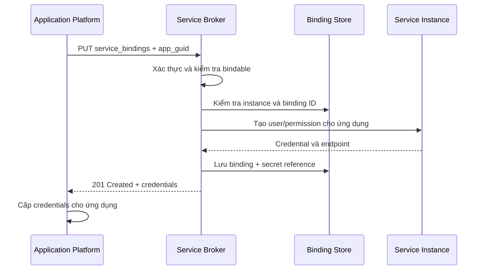

# Service binding dành cho ứng dụng và service binding dành cho route

Sau khi một service instance được provision, platform có thể kết nối instance đó với ứng dụng hoặc với một route. Hai kiểu liên kết này đều dùng Service Binding API của Open Service Broker API (OSB API), nhưng mục tiêu và dữ liệu trao đổi khác nhau. Application binding cung cấp thông tin kết nối hoặc credential để một ứng dụng truy cập tài nguyên. Route binding đăng ký một dịch vụ trung gian vào luồng request đi qua route, thường dùng cho xác thực, kiểm soát truy cập, lọc hoặc biến đổi lưu lượng.

Với Spring Cloud Service Broker, broker cần nhận biết đối tượng được bind, tạo đúng tài nguyên phụ thuộc, trả response phù hợp và lưu vòng đời của từng binding. `bind_resource.app_guid` thường nhận diện ứng dụng; `bind_resource.route` nhận diện route. Đối với route service, response có thể cung cấp `route_service_url` để platform cấu hình router chuyển request qua dịch vụ trung gian.

## 1. Service binding là gì?

Service instance đại diện cho tài nguyên đã provision, ví dụ một database PostgreSQL. Service binding là liên kết giữa service instance đó với một consumer cụ thể. Consumer có thể là ứng dụng cần credential để kết nối database hoặc một route cần đi qua route service.

Một service instance có thể có nhiều binding. Ví dụ database `db-prod-17` có thể được bind cho ứng dụng `orders-api`, `billing-worker` và một ứng dụng báo cáo. Mỗi binding có ID riêng, có thể có credential hoặc principal riêng và được xóa độc lập qua thao tác Unbind.

Phân biệt các khái niệm:

| Thành phần | Vai trò |
|---|---|
| Service instance | Tài nguyên chính đã được provision, ví dụ database hoặc message broker |
| Application binding | Cấp thông tin kết nối/quyền truy cập cho một ứng dụng |
| Route binding | Kết nối một route với dịch vụ xử lý lưu lượng trung gian |
| Binding ID | Định danh một liên kết cụ thể do platform cung cấp |
| `bind_resource` | Mô tả tài nguyên consumer mà platform muốn liên kết |
| Binding response | Thông tin broker trả về để platform hoàn tất liên kết |

Binding có vòng đời riêng. Xóa một application binding thường thu hồi user hoặc credential của ứng dụng đó, nhưng không xóa database chính. Xóa route binding gỡ liên kết route khỏi route service, nhưng không mặc nhiên xóa ứng dụng đích hoặc service instance.

## 2. Endpoint và cấu trúc request binding

OSB API sử dụng endpoint:

```text
PUT    /v2/service_instances/{instance_id}/service_bindings/{binding_id}
DELETE /v2/service_instances/{instance_id}/service_bindings/{binding_id}
```

Request tạo binding dùng `PUT` và có body JSON. Ví dụ application binding:

```http
PUT /v2/service_instances/db-prod-17/service_bindings/orders-api-binding HTTP/1.1
Host: broker.example.com
Content-Type: application/json
X-Broker-API-Version: 2.17
Authorization: Basic <broker-credentials>

{
  "service_id": "postgresql-service-v1",
  "plan_id": "postgresql-standard-v1",
  "bind_resource": {
    "app_guid": "app-orders-42"
  },
  "parameters": {
    "database": "orders"
  }
}
```

Các field quan trọng:

- `service_id`: service definition đã được chọn khi provision instance.
- `plan_id`: plan tương ứng với service instance.
- `bind_resource`: thông tin consumer mà platform muốn bind. Với application binding, field `app_guid` thường định danh ứng dụng.
- `parameters`: tùy chọn riêng của binding, ví dụ tên database/schema hoặc quyền cần cấp. Broker phải validate theo chính sách của service.
- `context`: thông tin platform-specific context nếu platform gửi. Đây là ngữ cảnh bổ sung, không thay thế xác thực và phân quyền.

`bind_resource` là object được OSB API dùng để mô tả tài nguyên cần liên kết. Với route binding, platform có thể cung cấp thuộc tính `route` chứa route URL. Platform có thể hỗ trợ các loại binding khác nhau; broker cần kiểm tra capability và dữ liệu thực tế thay vì suy đoán loại consumer từ tên binding ID.

## 3. Application binding

### 3.1. Mục tiêu và luồng hoạt động

Application binding cấp thông tin để một ứng dụng truy cập service instance. Với database, broker có thể tạo database user riêng, gán quyền trên schema, tạo credential và trả thông tin kết nối. Với message broker, broker có thể tạo virtual host, topic permission hoặc user riêng cho ứng dụng.

Luồng thường gặp:



Platform có thể đưa thông tin binding vào môi trường chạy của ứng dụng, ví dụ biến môi trường hoặc secret/configuration object. Ứng dụng dùng các thông tin này để kết nối service instance.

### 3.2. Binding response cho ứng dụng

Response OSB có thể chứa `credentials` cùng các field bổ sung tùy loại dịch vụ. Ví dụ:

```http
HTTP/1.1 201 Created
Content-Type: application/json

{
  "credentials": {
    "hostname": "postgres.internal.example",
    "port": 5432,
    "database": "orders",
    "username": "orders_app_42",
    "password": "<generated-secret>",
    "sslmode": "verify-full"
  }
}
```

Các key trong `credentials` do broker và service định nghĩa. OSB API không yêu cầu mọi broker phải dùng `hostname`, `port`, `username` hoặc `password`. Có thể trả về một URI hoặc cấu trúc khác phù hợp với client library. Credential phải có phạm vi quyền tối thiểu cần thiết cho ứng dụng.

Không nên dùng chung một database superuser cho mọi ứng dụng. Mỗi binding nên được cấp một principal hoặc credential riêng nếu hệ thống hỗ trợ. Khi một ứng dụng bị thu hồi, broker có thể xóa đúng principal của binding đó mà không ảnh hưởng các consumer khác.

### 3.3. Lưu trữ credential và tính nhất quán

Broker cần lưu đủ thông tin để xử lý retry, unbind và audit. Nếu provider chỉ trả secret một lần, broker không thể chỉ lưu hash nếu platform có thể gửi lại cùng binding request và cần nhận lại credential. Có thể lưu secret đã mã hóa bằng khóa quản lý an toàn hoặc lưu tham chiếu đến secret manager; không lưu password dạng rõ trong bảng thông thường.

Một bản ghi binding có thể chứa:

| Trường | Mục đích |
|---|---|
| `platform_instance_id` | Phạm vi platform sở hữu binding |
| `service_instance_id` | Service instance được bind |
| `binding_id` | ID binding do platform gửi |
| `service_id`, `plan_id` | Service và plan liên quan |
| `app_guid` | Ứng dụng consumer nếu là application binding |
| `route` | Route consumer nếu là route binding |
| `provider_principal_id` | User/role/resource ID được tạo ở service phía sau |
| `credential_ref` | Tham chiếu secret manager hoặc kho credential |
| `state` | `CREATING`, `READY`, `UNBINDING`, `DELETED`... |
| `created_at`, `updated_at` | Thời gian tạo và cập nhật |

Các trạng thái trên là quy ước nội bộ. OSB API không yêu cầu broker trả về các trạng thái này trong binding response.

## 4. Route binding và route service

### 4.1. Route binding giải quyết vấn đề gì?

Route binding dùng khi service không chỉ cung cấp credential cho một ứng dụng mà còn cần tham gia vào luồng request gửi đến một route. Mô hình thường gặp là route service trong Cloud Foundry: router chuyển request đến service trung gian trước khi request đi đến ứng dụng đích.

Route service có thể thực hiện:

- Xác thực hoặc kiểm tra token trước khi request đến ứng dụng.
- Áp dụng rate limiting hoặc quota theo client.
- Ghi log, đo lường và audit request.
- Lọc, bổ sung hoặc biến đổi header.
- Kiểm tra nội dung request theo chính sách.
- Chuyển request qua một thành phần bảo vệ hoặc tích hợp bên ngoài.

Khác với application binding, consumer của route binding là một route URL. Broker thường không tạo database user cho route. Thay vào đó, broker tạo hoặc cấp một endpoint route service và trả endpoint đó cho platform.

### 4.2. Request route binding

Ví dụ request:

```http
PUT /v2/service_instances/edge-security-01/service_bindings/orders-route-binding HTTP/1.1
Host: broker.example.com
Content-Type: application/json
X-Broker-API-Version: 2.17
Authorization: Basic <broker-credentials>

{
  "service_id": "http-route-protection-v1",
  "plan_id": "route-standard-v1",
  "bind_resource": {
    "route": "https://orders.apps.example.com"
  },
  "parameters": {
    "policy": "jwt-validation"
  }
}
```

Trong ví dụ này:

- `bind_resource.route` xác định route mà platform muốn liên kết với service.
- `service_id` và `plan_id` xác định route service đã provision.
- `parameters` có thể chọn chính sách xử lý route, ví dụ profile xác thực hoặc rate limit.

Broker cần xác thực quyền của platform đối với route và service instance. Không được xem việc client gửi một URL trong `bind_resource.route` là bằng chứng client sở hữu route đó. Quyền sở hữu hoặc khả năng bind route phải được platform xác nhận hoặc được broker kiểm tra qua cơ chế tin cậy đã thỏa thuận.

### 4.3. Response có `route_service_url`

Khi tạo route binding, broker có thể trả `route_service_url` trong response:

```http
HTTP/1.1 201 Created
Content-Type: application/json

{
  "route_service_url": "https://route-proxy.example.net/instances/edge-security-01"
}
```

`route_service_url` là URL endpoint của route service mà platform/router dùng để chuyển request. Nó khác với `bind_resource.route`:

- `bind_resource.route` là route đích của ứng dụng mà platform muốn bảo vệ hoặc xử lý.
- `route_service_url` là địa chỉ dịch vụ trung gian do broker trả về.

Ví dụ luồng traffic:


Platform/router sẽ cấu hình đường đi dựa trên response và cơ chế route-service mà nền tảng hỗ trợ. Broker không tự giả định mọi platform có router tương thích route service. Với Kubernetes, route binding thường cần tích hợp cụ thể với Ingress Controller, Gateway API, service mesh hoặc gateway riêng; OSB application binding phổ biến hơn và có thể được ánh xạ sang Kubernetes Secret hoặc cơ chế credential tương đương.

### 4.4. Bảo mật route service URL

Route service URL có thể chứa thông tin xác thực hoặc token trong một số thiết kế. Nếu có, cần xem URL là dữ liệu nhạy cảm: không ghi đầy đủ vào log, không để lộ qua metric và chỉ cấp cho platform có quyền. Ưu tiên xác thực bằng TLS và credential riêng, giới hạn endpoint chỉ nhận traffic từ router tin cậy, đồng thời kiểm tra chữ ký hoặc cơ chế xác thực mà platform hỗ trợ.

## 5. So sánh application binding và route binding

| Tiêu chí | Application binding | Route binding |
|---|---|---|
| Consumer | Một ứng dụng hoặc workload | Một route URL |
| Trường thường dùng trong `bind_resource` | `app_guid` | `route` |
| Mục tiêu | Cấp credential/endpoint để ứng dụng truy cập service | Đưa service trung gian vào luồng request của route |
| Response thường dùng | `credentials` | `route_service_url` |
| Ví dụ | DB user riêng cho `orders-api` | JWT validation trước khi request đến `orders.apps.example.com` |
| Nơi sử dụng thông tin | Environment hoặc secret/configuration của ứng dụng | Router, gateway hoặc route integration của platform |
| Unbind | Thu hồi principal/credential của ứng dụng | Gỡ liên kết route và thu hồi cấu hình route service |
| Phụ thuộc platform | Cơ chế inject credential vào workload | Router/gateway phải hỗ trợ route service |

Một service có thể chỉ hỗ trợ application binding, chỉ hỗ trợ route binding hoặc hỗ trợ cả hai nếu broker và platform có khả năng tương ứng. Field `bindable` ở service definition và plan cho biết service/plan có hỗ trợ binding hay không; nó không tự mô tả mọi kiểu consumer mà platform có thể dùng. Broker cần công bố capability phù hợp và validate `bind_resource` trong từng request.

## 6. Vòng đời binding và thao tác Unbind

Tạo binding thường bắt đầu bằng `PUT`. Khi platform không còn cần liên kết, nó gọi `DELETE`:

```http
DELETE /v2/service_instances/db-prod-17/service_bindings/orders-api-binding?service_id=postgresql-service-v1&plan_id=postgresql-standard-v1 HTTP/1.1
X-Broker-API-Version: 2.17
```

Broker tra cứu binding theo phạm vi platform, service instance và binding ID. Với application binding, broker thu hồi principal hoặc credential riêng của binding. Với route binding, broker gỡ cấu hình liên kết route và thu hồi endpoint/token nếu được tạo riêng cho binding.

Unbind phải idempotent. Nếu binding đã bị xóa, request lặp cần được xử lý theo hợp đồng OSB API và chính sách của broker mà không xóa nhầm tài nguyên khác. Broker không được xóa service instance chính khi chỉ unbind một consumer.

Nếu provider cần thời gian để thu hồi credential hoặc gỡ route, broker có thể xử lý bất đồng bộ khi platform gửi `accepts_incomplete=true`. Khi đó broker lưu operation, trả `202 Accepted` và platform polling `last_operation`. Nếu provider xóa binding nhanh, broker có thể trả response đồng bộ. Không trả `202` trước khi binding deletion intent và operation được lưu bền vững.

## 7. Idempotency và xử lý request binding lặp

Platform có thể gửi lại `PUT` nếu mất response. Nếu broker đã tạo database user nhưng chưa trả response, request lặp có thể đến trong khi binding đã tồn tại. Broker nên dùng khóa duy nhất theo `(platform_instance_id, service_instance_id, binding_id)` và kiểm tra nội dung request.

Các tình huống cần phân biệt:

- **Cùng binding ID, cùng consumer và cùng parameters:** trả lại kết quả binding đã lưu theo quy tắc OSB API, không tạo principal hoặc credential mới ngoài ý muốn.
- **Cùng binding ID nhưng consumer hoặc parameters khác:** từ chối xung đột hoặc xử lý theo chính sách rõ ràng; không âm thầm ghi đè binding cũ.
- **Binding ID khác:** có thể tạo principal/credential riêng cho consumer mới.
- **Worker bị dừng sau khi provider tạo principal:** khi retry, tra cứu principal theo binding key hoặc provider resource ID trước khi tạo lại.

Request identity hỗ trợ log correlation, không thay thế khóa idempotency. Nên lưu request identity nếu có để truy vết, nhưng binding identity và trạng thái nghiệp vụ mới quyết định việc tạo lại resource.

## 8. Triển khai trong Spring Cloud Open Service Broker

Spring Cloud Open Service Broker cung cấp abstraction cho việc tạo và xóa service instance binding. Ứng dụng thường triển khai `ServiceInstanceBindingService` để xử lý yêu cầu bind và unbind. Request model cung cấp thông tin service instance, binding ID, service/plan và `bind_resource`; response model cho phép trả credentials hoặc các URL/field binding tương ứng.

Ví dụ application binding minh họa:

```java
@Service
public class DatabaseBindingService implements ServiceInstanceBindingService {

    private final DatabaseCredentialManager credentialManager;

    public DatabaseBindingService(DatabaseCredentialManager credentialManager) {
        this.credentialManager = credentialManager;
    }

    @Override
    public CreateServiceInstanceBindingResponse createServiceInstanceBinding(
            CreateServiceInstanceBindingRequest request) {

        String appGuid = request.getBindResource() == null
                ? null
                : request.getBindResource().getAppGuid();

        if (appGuid == null || appGuid.isBlank()) {
            throw new InvalidBindingRequestException(
                    "Application binding yêu cầu bind_resource.app_guid");
        }

        Map<String, Object> credentials = credentialManager
                .createOrLoadCredentials(request.getServiceInstanceId(),
                        request.getBindingId(), appGuid);

        return CreateServiceInstanceBindingResponse.builder()
                .credentials(credentials)
                .build();
    }

    @Override
    public DeleteServiceInstanceBindingResponse deleteServiceInstanceBinding(
            DeleteServiceInstanceBindingRequest request) {

        credentialManager.revokeIfPresent(
                request.getServiceInstanceId(), request.getBindingId());

        return DeleteServiceInstanceBindingResponse.builder().build();
    }
}
```

Đây là ví dụ minh họa theo API service interface và builder của thư viện; chữ ký method, package và cách lấy bind resource cần được đối chiếu với phiên bản Spring Cloud Open Service Broker đang dùng. Phần quan trọng là binding service nhận request, xác thực consumer, tạo hoặc tìm lại credential theo binding ID và trả response theo model OSB.

### 8.1. Xử lý route binding

Với route binding, service kiểm tra `bind_resource.route`, xác minh route thuộc platform/tenant được phép và đăng ký route với route-service provider. Sau đó trả URL endpoint trung gian qua field `routeServiceUrl` nếu model response và platform hỗ trợ:

```java
String route = request.getBindResource().getRoute();
RouteBindingResult result = routeServiceProvider.bind(
        request.getServiceInstanceId(), request.getBindingId(), route);

return CreateServiceInstanceBindingResponse.builder()
        .routeServiceUrl(result.routeServiceUrl())
        .build();
```

Đây là đoạn minh họa, không thay thế kiểm tra quyền route, xác thực endpoint và xử lý lỗi provider. Không nên nhận một URL tùy ý rồi tự gửi request đến URL đó để kiểm tra vì có thể tạo rủi ro SSRF. Dùng thông tin xác nhận từ platform hoặc allowlist/registry tin cậy.

### 8.2. Lưu binding và secret

Tách binding metadata khỏi secret. Bảng binding lưu ID, consumer type, app GUID hoặc route, provider principal ID, trạng thái và secret reference. Secret manager lưu credential được mã hóa và có quyền truy cập hạn chế. Khi trả response, chỉ đưa các credential cần thiết cho platform; không log response body.

Nếu broker dùng Spring MVC hoặc WebFlux, cần chọn extension point đồng bộ hoặc reactive phù hợp với phiên bản framework. Nếu việc tạo credential/route mất nhiều thời gian và framework/platform hỗ trợ async binding, hãy lưu operation bền vững, truyền binding context sang worker và ánh xạ trạng thái qua `last_operation`.

## 9. Khả năng tương thích giữa Cloud Foundry và Kubernetes

Application binding thường dễ ánh xạ sang nhiều platform: Cloud Foundry có thể đưa credentials vào thông tin môi trường ứng dụng; Kubernetes có thể nhận credentials qua Secret, External Secrets hoặc cơ chế tích hợp tương đương. Broker vẫn cần tuân theo cách platform quản lý binding ID và vòng đời secret.

Route binding phụ thuộc sâu hơn vào network data plane:

- Cloud Foundry có router và route-service integration theo cơ chế của platform.
- Kubernetes thường cần Ingress Controller, Gateway API, service mesh hoặc gateway có khả năng gọi dịch vụ trung gian.
- Không phải mọi Kubernetes distribution hoặc ingress controller đều triển khai cùng một giao thức route service.

Vì vậy, không nên giả định một response `route_service_url` sẽ tự động tạo route binding trên mọi Kubernetes cluster. Broker có thể giới hạn route binding theo platform capability đã đăng ký và chỉ công bố khả năng khi tích hợp đích thực sự hỗ trợ.

## 10. Bảo mật cho application và route binding

Binding là điểm phát sinh credential và quyền truy cập, vì vậy cần áp dụng nguyên tắc least privilege:

- Mỗi application binding nên có principal hoặc credential riêng nếu provider hỗ trợ.
- Chỉ cấp quyền trên database/schema/topic cần thiết; tránh trả credential quản trị toàn hệ thống.
- Kiểm tra service instance thuộc đúng platform trước khi tạo hoặc xóa binding.
- Kiểm tra `app_guid` hoặc route thuộc consumer/tenant được phép; không tin ID hoặc URL chỉ vì xuất hiện trong request body.
- Bảo vệ credentials và route service URL bằng TLS, secret manager và quyền truy cập tối thiểu.
- Không ghi password, token, URI có secret hoặc toàn bộ binding response vào log.
- Khi unbind, thu hồi đúng principal hoặc route registration của binding đó; không ảnh hưởng binding khác.
- Giữ audit về binding ID, consumer type, người khởi tạo nếu có originating identity và kết quả tạo/xóa.

Đối với route binding, cần giới hạn nguồn traffic được phép gọi route service URL. Nếu endpoint có thể truy cập công khai, nó phải xác thực router hoặc áp dụng cơ chế bảo vệ phù hợp. Kiểm tra route domain và tenant ownership trước khi đăng ký cũng giúp ngăn một platform bind nhầm route của tenant khác.

## 11. Kiểm thử application binding và route binding

Các kiểm thử tích hợp nên bao gồm:

1. Application binding có `app_guid` hợp lệ trả `201` cùng credentials cần thiết.
2. Application binding thiếu `app_guid` bị từ chối theo chính sách broker.
3. Credential được tạo có quyền tối thiểu và chỉ gắn với binding tương ứng.
4. Retry cùng binding ID không tạo thêm user hoặc credential ngoài ý muốn.
5. Cùng binding ID nhưng app GUID khác bị phát hiện xung đột.
6. Route binding có `bind_resource.route` hợp lệ trả `route_service_url` đúng provider/instance.
7. Route không thuộc tenant hoặc platform được phép bị từ chối.
8. Platform không hỗ trợ route service không được cấu hình route binding ngoài khả năng thực tế.
9. Unbind application binding thu hồi đúng credential và không ảnh hưởng binding khác.
10. Unbind route binding gỡ route registration và không xóa service instance chính.
11. Retry unbind sau khi provider đã xóa principal/route registration vẫn hoàn tất an toàn.
12. Provider timeout sau khi tạo credential; lần xử lý lại tra cứu binding trước khi tạo mới.
13. Binding async lưu operation trước `202` và `last_operation` phản ánh đúng trạng thái.
14. Secret không xuất hiện trong log, exception hoặc response lỗi.

## 12. Lỗi thường gặp và cách khắc phục

| Lỗi | Hậu quả | Cách khắc phục |
|---|---|---|
| Nhầm `app_guid` với `route` | Tạo binding sai loại consumer | Xác định consumer từ `bind_resource` và capability platform |
| Coi `bind_resource.route` là URL route service | Router trỏ sai đích | Dùng route request làm route đích, `route_service_url` làm endpoint trung gian |
| Trả `credentials` cho route binding khi không cần | Rò rỉ dữ liệu và sai ngữ nghĩa | Trả đúng response field của loại binding |
| Dùng chung một credential cho mọi app | Khó thu hồi riêng và tăng phạm vi rủi ro | Tạo principal/credential riêng cho từng binding |
| Chỉ lưu hash credential | Không thể trả lại credential khi retry nếu không tái tạo được | Lưu mã hóa hoặc tham chiếu secret manager theo chính sách |
| Coi URL route do client gửi là đáng tin | Có thể bind route ngoài quyền hoặc tạo SSRF | Xác minh route ownership, allowlist và không fetch URL tùy ý |
| Unbind xóa cả service instance | Các consumer khác mất tài nguyên | Chỉ thu hồi tài nguyên thuộc binding ID |
| Giả định mọi platform hỗ trợ route service | Binding không hoạt động trên một số cluster | Kiểm tra capability và tích hợp router/gateway cụ thể |

## 13. Kết luận

Application binding và route binding cùng liên kết một service instance với consumer nhưng phục vụ hai luồng sử dụng khác nhau. Application binding thường dùng `bind_resource.app_guid` để cấp credentials hoặc endpoint cho ứng dụng. Route binding dùng `bind_resource.route` để xác định route đích và có thể trả `route_service_url` cho platform/router chuyển traffic qua dịch vụ trung gian. Khi triển khai bằng Spring Cloud Service Broker, hãy kiểm tra `bindable`, xác thực consumer, lưu binding theo ID có phạm vi platform, bảo vệ secret, xử lý retry idempotent và triển khai Unbind độc lập. Route binding cần xác nhận platform/router thực sự hỗ trợ route-service integration; application binding có thể được ánh xạ sang cơ chế credentials của Cloud Foundry hoặc Kubernetes.
