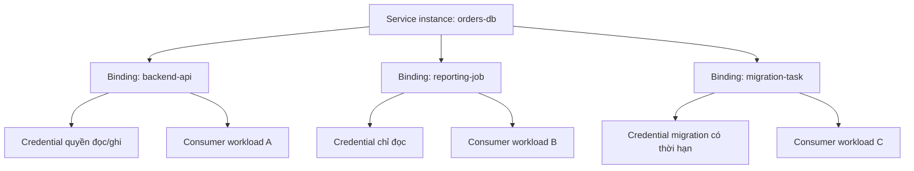
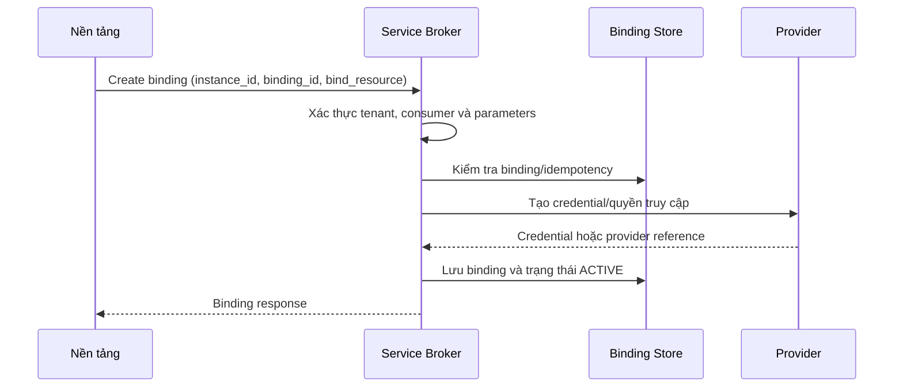

# `bind_resource`, `app_guid`, `route` và dữ liệu phụ thuộc nền tảng

Khi một ứng dụng hoặc workload cần sử dụng service instance, nền tảng gửi yêu cầu tạo service binding đến broker. Request này có thể chứa `bind_resource` để mô tả tài nguyên tiêu thụ đang được liên kết, chẳng hạn ứng dụng Cloud Foundry có `app_guid` hoặc một route cần được gắn với route service. Request cũng có thể chứa `context` để cung cấp thông tin môi trường nền tảng và `parameters` để mô tả tùy chọn riêng của binding.

Các trường này có mục đích khác nhau. `bind_resource` mô tả đối tượng nhận binding; `app_guid` nhận diện ứng dụng trong những nền tảng có khái niệm GUID ứng dụng; `route` mô tả route liên quan đến binding; `context` cung cấp ngữ cảnh triển khai như organization, space, namespace hoặc thông tin nền tảng. Broker cần đọc đúng dữ liệu mà nền tảng hỗ trợ, xác thực quyền sở hữu tài nguyên và chuyển dữ liệu sang mô hình nghiệp vụ nội bộ. Không nên giả định mọi nền tảng đều gửi cùng một cấu trúc hoặc có các trường giống Cloud Foundry.

Với `SPRING_CLOUD_SERVICE_BROKER`, mục tiêu là tạo binding đúng với workload cần sử dụng dịch vụ, cấp credential hoặc thông tin kết nối có quyền tối thiểu, lưu mapping để có thể thu hồi và xử lý request lặp an toàn.

## 1. Binding liên kết service instance với một consumer

Service instance đại diện cho tài nguyên dịch vụ mà broker quản lý, ví dụ một database PostgreSQL, một Redis deployment hoặc một bucket object storage. Service binding đại diện cho quyền hoặc thông tin kết nối được cấp cho một consumer cụ thể.

Một instance có thể có nhiều binding. Ví dụ database `orders-db` có thể cấp một tài khoản cho backend API, một tài khoản chỉ đọc cho báo cáo và một tài khoản migration cho pipeline triển khai. Mỗi binding có định danh riêng và có vòng đời độc lập với instance.



Broker phải quản lý cả instance và binding. Khi unbind một consumer, broker thu hồi credential/quyền của binding đó mà không xóa database dùng chung. Khi deprovision instance, broker cần xử lý các binding còn tồn tại theo quy tắc của OSB API và chính sách dịch vụ.

## 2. Request tạo binding theo OSB API

Nền tảng gọi endpoint tạo binding với `instance_id` và `binding_id` trên đường dẫn. Request body chứa định danh service, plan và các thông tin bổ sung phù hợp với thao tác.

Ví dụ request minh họa cho một ứng dụng Cloud Foundry:

```http
PUT /v2/service_instances/instance-42/service_bindings/binding-9a?service_id=postgres-service&plan_id=standard HTTP/1.1
Host: broker.example.com
Content-Type: application/json
X-Broker-API-Version: 2.17
```

```json
{
  "service_id": "postgres-service",
  "plan_id": "standard",
  "context": {
    "platform": "cloud-foundry",
    "organization_guid": "org-42",
    "space_guid": "space-17"
  },
  "bind_resource": {
    "app_guid": "app-81f2",
    "route": "orders.example.com"
  },
  "parameters": {
    "database": "orders",
    "role": "read-write"
  }
}
```

Ví dụ này thể hiện ứng dụng `app-81f2` yêu cầu binding đến database `orders`, đồng thời cung cấp route liên quan nếu luồng tích hợp cần thông tin route. Đây là dữ liệu mô tả resource/context; broker vẫn phải xác minh ứng dụng thuộc đúng organization/space và được phép sử dụng service instance.

`bind_resource` là object tùy chọn trong hợp đồng OSB API. Không phải mọi binding đều gắn với một ứng dụng hoặc route. Ví dụ một job quản trị, một pipeline hoặc consumer không có route có thể không gửi `app_guid` hay `route`. Broker cần xử lý trường hợp object vắng mặt và trường hợp chỉ có một số thuộc tính.

## 3. Phân biệt `bind_resource` và `context`

Hai trường này thường chứa dữ liệu liên quan đến nền tảng nhưng không thể thay thế cho nhau.

| Thành phần | Mục đích | Ví dụ |
|---|---|---|
| `bind_resource` | Mô tả resource nhận binding hoặc thông tin resource gắn với binding | `app_guid`, `route` |
| `context` | Cung cấp ngữ cảnh nền tảng/tenant nơi request phát sinh | platform, organization, space, namespace hoặc metadata môi trường |
| `parameters` | Tùy chọn nghiệp vụ do người dùng hoặc nền tảng gửi cho binding | database name, role, scope hoặc feature flag |
| `binding_id` | Định danh binding trong broker | `binding-9a` trên URL |
| `service_instance_id` | Định danh instance được bind | `instance-42` trên URL |

`context` thường có cấu trúc phụ thuộc nền tảng và có thể được nền tảng truyền qua nhiều thao tác OSB. `bind_resource` mô tả đối tượng nhận binding cụ thể hơn. `parameters` là dữ liệu đầu vào nghiệp vụ mà broker phải validate theo schema của plan và chính sách dịch vụ.

Không nên sao chép toàn bộ context vào binding record mà không lọc. Chỉ lưu những thuộc tính cần để xác định tenant, kiểm tra quyền, audit hoặc phục vụ lifecycle. Context có thể chứa dữ liệu không ổn định, metadata nhạy cảm hoặc trường riêng của từng nền tảng.

## 4. `app_guid` trong `bind_resource`

`app_guid` là định danh ứng dụng trong những nền tảng dùng GUID để quản lý application. Với Cloud Foundry, trường này có thể giúp broker hiểu ứng dụng nào sẽ tiêu thụ credential hoặc service binding.

Broker có thể dùng app GUID để:

- Liên kết binding record với ứng dụng tiêu thụ.
- Kiểm tra ứng dụng và service instance có thuộc cùng organization/space hoặc phạm vi cho phép không.
- Ghi audit về consumer nhận credential.
- Áp dụng chính sách riêng, ví dụ giới hạn số binding hoặc cấp role theo loại workload.
- Hỗ trợ truy vết khi unbind hoặc khi điều tra sự cố quyền truy cập.

`app_guid` không phải credential và cũng không chứng minh người gửi có quyền với ứng dụng. Broker không được xem một chuỗi GUID hợp lệ về hình thức là bằng chứng xác thực. Cần dựa vào authentication của nền tảng, context đáng tin cậy và/hoặc gọi API nền tảng để xác minh resource nếu chính sách yêu cầu.

### Tương thích với trường `app_guid` cũ

Một số phiên bản hoặc tích hợp cũ có thể truyền `app_guid` ở vị trí cấp cao của binding request. OSB API đã chuyển thông tin resource sang `bind_resource`; khi hỗ trợ các nền tảng cũ, adapter có thể chuẩn hóa giá trị cũ sang mô hình nội bộ. Cần xác định rõ phiên bản API và hành vi của nền tảng mục tiêu, tránh đọc hai vị trí rồi âm thầm chọn một nếu chúng mâu thuẫn.

Nếu cả giá trị tương thích cũ và `bind_resource.app_guid` cùng xuất hiện, broker nên áp dụng quy tắc rõ ràng: kiểm tra chúng có giống nhau không; nếu khác nhau, từ chối request hoặc xử lý theo chính sách tương thích đã công bố. Không dùng giá trị do client tự gửi để ghi đè danh tính đã xác minh từ nền tảng.

## 5. `route` và các trường hợp route service

`route` trong `bind_resource` có ý nghĩa khi binding gắn với một route, chẳng hạn tích hợp route service trên nền tảng có hỗ trợ. Nó cho broker biết route nào liên quan đến consumer hoặc cần được cấu hình để luồng request đi qua dịch vụ trung gian.

Ví dụ một route service có thể thực hiện kiểm tra bảo mật, ghi log, lọc request hoặc áp dụng chính sách trước khi request đến ứng dụng. Khi nền tảng yêu cầu binding route, broker cần xác định route được gửi có thuộc phạm vi tenant và có được service hỗ trợ hay không.

Không nên nhầm `bind_resource.route` với `route_service_url` trong response binding. `route` là thông tin đầu vào về route liên quan đến resource; `route_service_url` là thông tin phản hồi mà broker có thể cung cấp cho nền tảng trong trường hợp service đóng vai trò route service. Hai trường nằm ở hai chiều khác nhau của giao thức.

Ví dụ response cho một route service có thể bao gồm:

```json
{
  "route_service_url": "https://route-proxy.example.net"
}
```

Đây chỉ là ví dụ giá trị. URL phải trỏ đến endpoint thực tế, có TLS và xác thực theo thiết kế dịch vụ. Broker không nên trả một URL suy ra trực tiếp từ chuỗi route không đáng tin cậy.

Không phải mọi service binding đều có route. Với database credential binding hoặc object storage binding thông thường, `route` có thể không xuất hiện và broker không cần tạo route service behavior.

## 6. Dữ liệu phụ thuộc nền tảng: Cloud Foundry và Kubernetes

OSB API cố gắng cung cấp hợp đồng chung nhưng một số dữ liệu context và bind resource phụ thuộc vào nền tảng. Broker nên xây dựng lớp chuyển đổi từ payload nền tảng sang mô hình miền trung lập.

### Cloud Foundry

Trong Cloud Foundry, context có thể chứa platform identifier cùng organization và space GUID. `bind_resource.app_guid` có thể nhận diện ứng dụng được bind; `bind_resource.route` có thể xuất hiện trong các luồng liên quan đến route service.

Broker có thể dùng các dữ liệu này để xác định phạm vi sở hữu và consumer. Tuy nhiên, organization/space/app GUID chỉ là định danh. Để xác thực quyền, cần tin cậy nguồn request và kiểm tra mapping với nền tảng theo chính sách triển khai.

### Kubernetes

Kubernetes không có một khái niệm `app_guid` hoặc route chuẩn tương đương cho mọi workload. Một tích hợp Kubernetes có thể truyền namespace, cluster, workload name, service account hoặc định danh workload trong context riêng của nền tảng/adapter. Những trường này không phải tất cả đều là trường chuẩn của `bind_resource` trong OSB API.

Ví dụ context riêng của một tích hợp Kubernetes:

```json
{
  "platform": "kubernetes",
  "cluster_id": "cluster-prod-01",
  "namespace": "orders",
  "workload": {
    "kind": "Deployment",
    "name": "orders-api",
    "service_account": "orders-runtime"
  }
}
```

Broker có thể ánh xạ context này thành consumer identity nội bộ như `cluster-prod-01/orders/Deployment/orders-api`. Việc xác minh cần dựa trên danh tính gọi broker, quyền truy cập Kubernetes API hoặc cơ chế trust đã thiết lập. Không nên coi namespace hoặc service account do request gửi lên là bằng chứng quyền sở hữu nếu chúng chưa được xác thực.

### Thiết kế lớp trung lập nền tảng

Một mô hình nội bộ có thể chứa các trường tùy chọn:

```java
public record BindingConsumer(
        String platform,
        String tenantId,
        String applicationId,
        String route,
        String namespace,
        String workloadName,
        String workloadKind) {
}
```

Adapter Cloud Foundry có thể ánh xạ `bind_resource.app_guid` vào `applicationId` và `bind_resource.route` vào `route`. Adapter Kubernetes có thể ánh xạ namespace/workload từ context đã xác thực. Domain binding sử dụng `BindingConsumer` mà không phụ thuộc trực tiếp vào tên trường của từng nền tảng.

Không nên tạo một trường giả như `app_guid` cho Kubernetes chỉ để ép hai nền tảng có cùng cấu trúc. Hãy giữ các thuộc tính riêng khi chúng có ý nghĩa khác nhau và dùng một định danh consumer nội bộ khi cần khóa hoặc audit thống nhất.

## 7. Luồng xử lý bind trong broker

Một luồng tạo binding có thể được chia thành các bước:

1. Nhận `service_instance_id` và `binding_id` từ đường dẫn, cùng service ID, plan ID, context, bind resource và parameters.
2. Xác thực caller/nền tảng và xác định tenant từ nguồn đáng tin cậy.
3. Tìm service instance; xác minh instance đang sẵn sàng và thuộc tenant được phép sử dụng.
4. Kiểm tra service/plan có hỗ trợ binding; xác thực `bind_resource` theo loại consumer và khả năng dịch vụ.
5. Validate parameters, áp dụng default và kiểm tra quyền của consumer.
6. Tạo credential hoặc quyền truy cập trên provider với scope tối thiểu.
7. Lưu binding record gắn với instance, consumer, provider credential reference và trạng thái.
8. Trả binding response theo OSB API để nền tảng cung cấp credential hoặc endpoint cho consumer.

Sơ đồ luồng:



Nếu việc tạo credential có thể kéo dài, cần kiểm tra quy định đồng bộ của binding endpoint trong OSB API và phiên bản được hỗ trợ. Không tự áp dụng cơ chế async của provision/update cho bind nếu giao thức không cho phép thao tác đó.

## 8. Mô hình request trong Spring Cloud Open Service Broker

Spring Cloud Open Service Broker ánh xạ request HTTP thành model như `CreateServiceInstanceBindingRequest`. Tùy phiên bản thư viện, model có thể cung cấp accessor cho service instance ID, binding ID, service definition ID, plan ID, context, bind resource và parameters.

Một adapter nên chuyển request này thành command nghiệp vụ:

```java
public record CreateBindingCommand(
        String instanceId,
        String bindingId,
        String serviceId,
        String planId,
        BindingConsumer consumer,
        Map<String, Object> parameters) {
}
```

Việc chuyển đổi cần xử lý trường tùy chọn và dữ liệu cũ một cách tường minh. Ví dụ, nếu `bind_resource` không có, consumer có thể là workload không gắn với application cụ thể. Không tự tạo `applicationId` giả hoặc dùng `bindingId` thay cho danh tính consumer.

Ví dụ adapter minh họa cho kiểu API reactive:

```java
@Service
public class BrokerBindingService implements ServiceInstanceBindingService {

    private final CreateBindingUseCase createBinding;

    public BrokerBindingService(CreateBindingUseCase createBinding) {
        this.createBinding = createBinding;
    }

    @Override
    public Mono<CreateServiceInstanceBindingResponse>
            createServiceInstanceBinding(CreateServiceInstanceBindingRequest request) {
        CreateBindingCommand command = mapper.toCommand(request);
        return createBinding.execute(command)
                .map(result -> CreateServiceInstanceBindingResponse.builder()
                        .credentials(result.credentials())
                        .build());
    }

    // Các phương thức còn lại được triển khai theo đúng interface của thư viện.
}
```

Đây là ví dụ về cấu trúc adapter; package, accessor và chữ ký có thể khác theo phiên bản Spring Cloud Open Service Broker. Cần biên dịch theo dependency thực tế và triển khai đầy đủ các phương thức của interface. Logic xác thực consumer, tạo credential và lưu binding nên nằm trong use case riêng.

## 9. Tạo binding response và thông tin trả về cho consumer

Sau khi tạo binding thành công, broker trả response chứa thông tin để nền tảng cung cấp cho consumer. Trường thường gặp là `credentials`, ngoài ra response có thể có các trường chuyên biệt như `syslog_drain_url`, `route_service_url`, `volume_mounts` hoặc `endpoints` khi service và nền tảng hỗ trợ tương ứng.

Ví dụ database binding:

```json
{
  "credentials": {
    "hostname": "postgres.internal.example",
    "port": 5432,
    "database": "orders",
    "username": "orders_app_81f2",
    "password": "<generated-secret>",
    "sslmode": "verify-full"
  }
}
```

Broker phải tạo credential có quyền tối thiểu và gắn với đúng binding. Không dùng chung một tài khoản quản trị cho mọi consumer nếu có thể cấp tài khoản riêng. Secret phải được sinh bằng nguồn ngẫu nhiên an toàn, truyền qua kênh bảo vệ và không xuất hiện trong log.

Nếu nền tảng hỗ trợ service binding lifecycle và lưu credential, broker cần hiểu rằng response có thể được nền tảng lưu lại. Nếu broker cần cung cấp lại credential trong những tình huống retry, phải có thiết kế lưu trữ hoặc tái tạo an toàn. Không nên lưu mật khẩu dạng rõ trong binding record nếu không có lý do và biện pháp bảo vệ thích hợp.

## 10. Xác thực và phân quyền dữ liệu phụ thuộc nền tảng

Các trường như `app_guid`, `route`, namespace hoặc workload name không tự chứng minh caller có quyền tạo binding. Broker cần kiểm tra:

- Caller đã được xác thực theo cơ chế của nền tảng.
- Service instance thuộc tenant/organization được xác định từ nguồn tin cậy.
- Consumer resource thuộc tenant hoặc scope được phép sử dụng instance.
- Route, nếu có, thuộc phạm vi quản lý và được phép gắn với route service.
- Plan hỗ trợ loại binding và các tham số được yêu cầu.
- Credential được tạo có quyền tối thiểu phù hợp với role/scope.

Không chỉ kiểm tra cú pháp GUID hoặc tên namespace. Một `app_guid` đúng định dạng nhưng thuộc organization khác vẫn phải bị từ chối. Tương tự, không dùng `context.organization_guid` do client tự gửi làm danh tính có thẩm quyền nếu chưa được xác minh.

Khi gọi API nền tảng để xác minh app hoặc route, cần timeout, giới hạn retry và xử lý lỗi rõ ràng. Nếu nền tảng tạm thời không truy cập được, broker không nên cấp credential với giả định quyền đã được xác nhận.

## 11. Idempotency và vòng đời binding

Nền tảng có thể gửi lại yêu cầu tạo binding khi mất response. Broker cần xử lý request lặp theo `binding_id` và nội dung đã chuẩn hóa.

- Nếu binding ID đã tồn tại và thuộc cùng instance/consumer với cùng ý nghĩa request, trả lại kết quả tương ứng theo chính sách retry.
- Nếu cùng binding ID nhưng gắn với instance hoặc consumer khác, từ chối xung đột.
- Nếu provider đã tạo credential nhưng broker chưa lưu binding do crash, cần đối soát theo provider reference hoặc idempotency key để không tạo credential thứ hai.
- Nếu response chứa secret không thể đọc lại, cần quyết định cách retry: lưu secret mã hóa có kiểm soát, tái tạo credential an toàn hoặc trả lỗi có hướng xử lý phù hợp.

Binding record nên lưu `binding_id`, `instance_id`, tenant, consumer identity, provider credential/resource reference, trạng thái và thời điểm tạo/thu hồi. Khi unbind, broker dùng mapping này để thu hồi đúng credential hoặc quyền, không dựa vào `app_guid`/route hiện tại do nền tảng gửi lại.

Unbind phải có tính idempotent theo chính sách. Nếu credential đã bị thu hồi ở provider, lần gọi lại không nên tạo ra lỗi không thể phục hồi hoặc vô tình xóa tài nguyên của binding khác.

## 12. Xử lý khi không có `bind_resource`

Không phải consumer nào cũng là application hoặc route. Ví dụ một tác vụ vận hành, một CI job, một integration service hoặc một hệ thống ngoài nền tảng có thể yêu cầu binding mà không có app GUID.

Broker cần xác định theo từng service:

- Binding có bắt buộc gắn với một application/workload không?
- Nếu không có `bind_resource`, có thể xác định consumer từ context hoặc danh tính đã xác thực không?
- Có cho phép binding không gắn consumer cụ thể, ví dụ credential quản trị dành cho một quy trình kiểm soát riêng không?
- Có cần giới hạn số binding hoặc yêu cầu metadata bổ sung không?
- Nếu service là route service hoặc volume service, trường resource nào là bắt buộc theo hợp đồng nền tảng?

Không nên mặc định `bind_resource` luôn có mặt. Nếu service cần app GUID để tạo credential riêng cho từng ứng dụng, hãy kiểm tra điều kiện đó ở use case và trả lỗi rõ ràng khi thiếu. Nếu service không cần app GUID, cho phép binding không có trường này.

## 13. Khác biệt giữa binding ứng dụng, route và volume

OSB API có thể được dùng cho nhiều kiểu service khác nhau. Broker cần hiểu đúng loại consumer và response mà nền tảng hỗ trợ.

| Kiểu binding | Dữ liệu đầu vào có thể liên quan | Thông tin response có thể dùng |
|---|---|---|
| Application binding | `bind_resource.app_guid`, context organization/space | `credentials` |
| Route service binding | `bind_resource.route`, context nền tảng | `route_service_url` và thông tin liên quan theo API |
| Volume service binding | Context và metadata volume/workload theo tích hợp | `volume_mounts` nếu nền tảng và service hỗ trợ |
| Consumer ngoài ứng dụng | Context/danh tính tích hợp và parameters | `credentials` hoặc endpoint phù hợp |

Không phải mọi nền tảng đều hỗ trợ mọi kiểu binding. `volume_mounts` có cấu trúc và vòng đời riêng; `route_service_url` cũng không thể thay thế credentials thông thường. Hãy công bố capability và thiết kế response theo loại service thực tế.

## 14. Những lỗi thường gặp

**Coi `app_guid` là danh tính đã xác thực:** GUID chỉ nhận diện resource, không chứng minh caller có quyền. Cần xác minh tenant và ownership.

**Bắt buộc `bind_resource` cho mọi service:** các consumer không phải application hoặc route có thể không gửi object này. Chỉ yêu cầu trường khi nghiệp vụ thực sự cần.

**Nhầm `route` với `route_service_url`:** một trường là dữ liệu đầu vào mô tả route, trường kia là URL broker trả về cho route service. Không dùng thay thế cho nhau.

**Đồng nhất Cloud Foundry và Kubernetes:** Kubernetes không có app GUID/route chung cho mọi workload. Dùng adapter và mô hình consumer trung lập, giữ các trường nền tảng riêng biệt.

**Tin context do request gửi lên:** organization, space, namespace hoặc cluster ID phải được xác minh theo trust boundary của nền tảng.

**Cấp credential quản trị cho mọi binding:** mỗi consumer nên có quyền tối thiểu và credential riêng khi provider hỗ trợ.

**Không lưu mapping binding:** khi unbind, broker không biết credential hoặc quyền nào cần thu hồi. Lưu provider reference và consumer mapping ngay khi tạo.

**Không xử lý retry:** request lặp có thể tạo nhiều user hoặc credential. Dùng binding ID, fingerprint và provider idempotency.

## 15. Kiểm thử bind_resource và dữ liệu nền tảng

Nên kiểm thử các trường hợp sau:

| Trường hợp | Kết quả cần xác minh |
|---|---|
| Có `bind_resource.app_guid` hợp lệ | Consumer được ánh xạ đúng và ownership được xác minh |
| Có `bind_resource.route` | Route được xác thực và chỉ xử lý nếu service hỗ trợ |
| Không có `bind_resource` | Hành vi đúng theo chính sách của service |
| Chỉ có `app_guid` hoặc chỉ có `route` | Broker xử lý trường tùy chọn độc lập |
| `app_guid` không thuộc tenant | Từ chối và không tạo credential |
| Context Cloud Foundry hợp lệ | Organization/space mapping được xác minh |
| Context Kubernetes | Namespace/workload được ánh xạ theo adapter riêng |
| Dữ liệu cũ ở vị trí app_guid legacy | Chuẩn hóa tương thích hoặc từ chối xung đột rõ ràng |
| Request lặp cùng binding ID | Không tạo credential hoặc quyền trùng |
| Unbind sau binding thành công | Thu hồi đúng credential và cập nhật trạng thái |
| Response | Chỉ trả trường credentials/route/volume phù hợp với service |

Ngoài unit test cho mapper, nên có integration test gửi request qua endpoint OSB API để kiểm tra framework deserialize `bind_resource`, context và parameters đúng như dự kiến. Test cần xác minh cả trường hợp field vắng mặt, object rỗng, field không biết và dữ liệu không hợp lệ.

## 16. Trình tự triển khai cho service broker

Khi triển khai binding có dữ liệu phụ thuộc nền tảng, có thể làm theo trình tự:

1. Xác định loại consumer mà service hỗ trợ: application, route, volume hay consumer ngoài nền tảng.
2. Xác định trường nào cần trong `bind_resource` và trường nào thuộc `context`.
3. Định nghĩa schema parameters riêng cho binding và kiểm tra capability `bindable`.
4. Viết adapter chuyển dữ liệu Cloud Foundry/Kubernetes thành consumer identity nội bộ.
5. Xác thực tenant, application, route hoặc workload qua trust boundary thích hợp.
6. Xây dựng use case tạo credential/quyền truy cập với nguyên tắc least privilege.
7. Lưu binding mapping, provider reference và trạng thái theo `binding_id`.
8. Trả binding response phù hợp, bảo vệ secret và không công bố trường không được hỗ trợ.
9. Triển khai unbind để thu hồi đúng quyền và xử lý request lặp.
10. Kiểm thử trường thiếu, trường xung đột, tenant sai, retry, restart và tích hợp nền tảng.

Khi phân biệt rõ `bind_resource`, `app_guid`, `route`, `context` và `parameters`, broker có thể hỗ trợ nhiều loại consumer mà không gắn chặt logic nghiệp vụ với một nền tảng cụ thể. Việc xác minh resource, lưu mapping binding và cấp credential theo quyền tối thiểu giúp vòng đời bind/unbind an toàn và có thể vận hành lâu dài.
