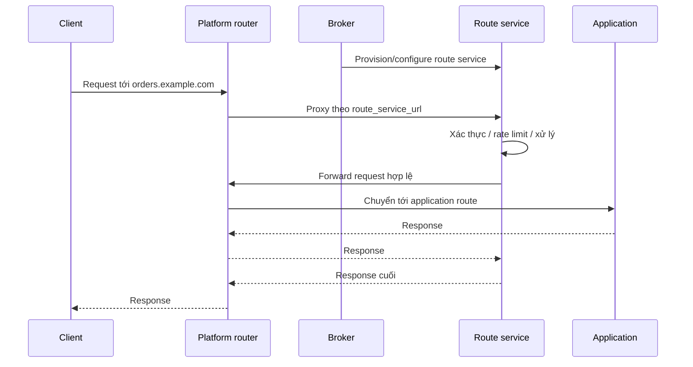

# CreateServiceInstanceRouteBindingResponse và route_service_url

Một số dịch vụ không cấp username/password cho ứng dụng mà đứng giữa luồng HTTP từ client tới ứng dụng để thực hiện xử lý như xác thực, giới hạn tốc độ, lọc request, cache hoặc ghi nhận lưu lượng. Trong Cloud Foundry, loại dịch vụ này được gọi là **route service**. Platform gắn một route của ứng dụng với service instance; router chuyển request qua route service trước khi tới ứng dụng.

Khi broker hỗ trợ kiểu binding này, request binding mang địa chỉ ứng dụng trong `bind_resource.route`. Nếu broker quản lý đường đi của traffic theo mô hình route service được broker điều phối, response cần cung cấp `route_service_url` để platform biết proxy request tới đâu. Spring Cloud Open Service Broker biểu diễn response đó bằng `CreateServiceInstanceRouteBindingResponse`.

Trong module `SPRING_CLOUD_SERVICE_BROKER`, bài học này tập trung vào ý nghĩa và cách dùng response model cùng `route_service_url`, sự khác nhau giữa địa chỉ route của ứng dụng và địa chỉ route service, các điều kiện khai báo trong catalog, cũng như cách tạo response an toàn bằng Spring.

## Mục tiêu học tập

Sau bài này, bạn có thể:

- Giải thích route service và khác biệt giữa route binding với application/credentials binding.
- Xác định vai trò của `bind_resource.route` trong request và `route_service_url` trong response.
- Khai báo `requires: ["route_forwarding"]` và khả năng bind trong catalog.
- Biết khi nào broker phải trả và khi nào không được trả `route_service_url`.
- Sử dụng `CreateServiceInstanceRouteBindingResponse` và builder trong Spring Cloud Open Service Broker.
- Xử lý response đồng bộ, bất đồng bộ và request binding lặp theo hợp đồng OSB API.
- Kiểm tra URL, bảo vệ luồng proxy và kiểm thử route binding.

## 1. Route service giải quyết bài toán gì?

Một ứng dụng web thường nhận request trực tiếp từ người dùng hoặc từ hệ thống khác. Có những yêu cầu cần xử lý request trước khi ứng dụng nhận được, ví dụ:

- Xác thực hoặc kiểm tra quyền truy cập ở một lớp trung gian.
- Giới hạn số request theo IP, user hoặc API key.
- Chặn request đáng ngờ, áp dụng chính sách bảo mật hoặc lọc nội dung.
- Cache response để giảm tải ứng dụng.
- Ghi nhận metric, log hoặc thông tin truy vết cho traffic.

Route service là một service offering có thể trung gian hóa request tới ứng dụng. Thay vì nhúng toàn bộ chức năng đó vào từng ứng dụng, platform chuyển request qua route service đã được bind với route của ứng dụng.

Ví dụ, một ứng dụng bán hàng có route `https://orders.example.com`. Nhóm vận hành tạo service instance `rate-limiter`, rồi bind route của ứng dụng vào instance đó. Router chuyển traffic tới route service; route service kiểm tra giới hạn request và sau đó chuyển tiếp request hợp lệ tới ứng dụng orders.


Route service thường xử lý lưu lượng HTTP/HTTPS ở tầng mạng ứng dụng. Nó khác với credentials binding: application binding thường trả credentials hoặc endpoint để ứng dụng tự kết nối tới dịch vụ; route binding cung cấp cấu hình để platform định tuyến traffic qua một thành phần trung gian.

## 2. Phân biệt `bind_resource.route` và `route_service_url`

Hai trường này cùng là URL nhưng biểu diễn hai đích khác nhau:

| Trường | Nằm ở đâu? | Ý nghĩa |
|---|---|---|
| `bind_resource.route` | Request binding gửi từ platform tới broker | Route/địa chỉ của ứng dụng mà người dùng muốn áp dụng route service. |
| `route_service_url` | Response binding do broker trả về | Địa chỉ route service mà platform/router cần proxy request tới. |

Ví dụ:

```json
{
  "bind_resource": {
    "route": "https://orders.example.com"
  }
}
```

Đây là route của ứng dụng. Broker nhận biết ứng dụng nào sẽ được trung gian hóa và có thể dùng thông tin này để cấu hình route service hoặc tạo cấu hình riêng cho binding.

Response có thể chứa:

```json
{
  "route_service_url": "https://rate-limiter.example.net"
}
```

Đây là endpoint của route service. Platform sử dụng URL này làm đích proxy cho traffic tới route đã gửi trong request. Không trả lại `https://orders.example.com` trong `route_service_url`, vì làm như vậy router sẽ proxy request quay về chính ứng dụng thay vì đi qua middleware.

`route_service_url` cũng không phải URL của service broker API. Platform không gọi endpoint provision/bind của broker cho từng request ứng dụng; router chuyển traffic tới route service đã được provision.

## 3. Khai báo khả năng route service trong catalog

Để platform biết service hỗ trợ route forwarding, broker phải khai báo capability trong catalog.

Ví dụ một service definition:

```json
{
  "id": "rate-limiter-service",
  "name": "rate-limiter",
  "description": "Route service giới hạn tốc độ request",
  "bindable": true,
  "requires": ["route_forwarding"],
  "plans": [
    {
      "id": "standard-plan",
      "name": "standard",
      "description": "Giới hạn request cho ứng dụng"
    }
  ]
}
```

Hai thuộc tính có ý nghĩa riêng:

- `bindable: true` cho biết service instance của service/plan có thể được binding. Platform không nên gửi yêu cầu bind cho một service/plan không bindable.
- `requires: ["route_forwarding"]` khai báo permission route forwarding mà service cần. Với Cloud Foundry, nếu thiếu capability này trong catalog thì platform không cho phép người dùng bind service instance vào route.

Nếu chỉ một số plan hỗ trợ binding, broker cần khai báo khả năng bind phù hợp ở cấp plan theo OSB API. Catalog phải phản ánh đúng khả năng của handler và hạ tầng: không công bố route forwarding nếu broker không thể cấu hình hoặc vận hành đường đi traffic tương ứng.

`route_forwarding` là capability của catalog, không phải một parameter trong request bind và cũng không phải giá trị URL. Platform dùng nó để xác định service có thể tham gia vào route binding.

## 4. Request route binding theo OSB API

Platform tạo binding bằng endpoint:

```http
PUT /v2/service_instances/{instance_id}/service_bindings/{binding_id}
```

`instance_id` xác định service instance đã provision. `binding_id` là định danh duy nhất của binding trong phạm vi platform và được dùng tiếp trong thao tác unbind hoặc truy xuất binding.

Request minh họa:

```http
PUT /v2/service_instances/instance-123/service_bindings/route-binding-456?accepts_incomplete=true HTTP/1.1
X-Broker-API-Version: 2.17
Content-Type: application/json
Authorization: Basic <credentials>

{
  "service_id": "rate-limiter-service",
  "plan_id": "standard-plan",
  "context": {
    "platform": "cloudfoundry",
    "organization_guid": "org-42",
    "space_guid": "space-prod"
  },
  "bind_resource": {
    "route": "https://orders.example.com"
  },
  "parameters": {
    "requests_per_minute": 600
  }
}
```

Các trường cần chú ý:

- `service_id` và `plan_id` phải khớp với catalog và instance đã tồn tại.
- `bind_resource.route` chứa route của ứng dụng cần được trung gian hóa. Với route service binding, platform phải gửi địa chỉ routable này.
- `parameters` có thể chứa cấu hình riêng của binding, ví dụ hạn mức request. Broker phải validate theo schema và chính sách của plan.
- `context` mô tả platform và môi trường liên quan. Không xem GUID trong context là bằng chứng xác thực hoặc quyền sở hữu.
- `accepts_incomplete=true` cho biết platform chấp nhận xử lý binding bất đồng bộ nếu broker cần chạy lâu.

Trong OSB API, `bind_resource` nói chung có thể vắng mặt nếu platform chưa có thông tin liên quan. Tuy nhiên, đối với route service binding, platform phải gửi `bind_resource.route` để broker biết route cần được cấu hình. `app_guid` là dữ liệu dành cho application/credentials binding và đã được chuyển sang `bind_resource.app_guid`; không dùng nó thay cho `route`.

## 5. `CreateServiceInstanceRouteBindingResponse` là gì?

Trong Spring Cloud Open Service Broker, `CreateServiceInstanceRouteBindingResponse` là model response cho yêu cầu tạo binding gắn với một route. Lớp này kế thừa `CreateServiceInstanceBindingResponse`, vì vậy nó dùng chung các thông tin binding và xử lý bất đồng bộ, đồng thời bổ sung URL route service.

Các thông tin quan trọng của response model:

| Thuộc tính/builder | Vai trò |
|---|---|
| `routeServiceUrl` | URL mà platform sẽ proxy request tới; được serialize thành field JSON `route_service_url`. |
| `bindingExisted` | Cho biết binding có sẵn với cùng parameters hay vừa được tạo mới; ảnh hưởng HTTP status đồng bộ. |
| `metadata` | Metadata quản lý binding, ví dụ thời điểm hết hạn hoặc thời điểm nên gia hạn nếu broker hỗ trợ. |
| `async` | Cho biết thao tác binding đang được xử lý bất đồng bộ. |
| `operation` | Mã nhận diện operation để platform gửi lại khi polling trạng thái binding. |

Lớp này là subtype của `CreateServiceInstanceBindingResponse`. Trong Spring Cloud Open Service Broker, interface `ServiceInstanceBindingService` nhận `CreateServiceInstanceBindingRequest` và trả về `Mono<CreateServiceInstanceBindingResponse>`. Vì vậy, handler có thể trả một `CreateServiceInstanceRouteBindingResponse` qua kiểu response cha.

Đây là model route binding. Nếu nghiệp vụ tạo application binding để trả credentials cho ứng dụng, hãy sử dụng subtype dành cho application binding như `CreateServiceInstanceAppBindingResponse` và cung cấp dữ liệu phù hợp.

## 6. Tạo response đồng bộ bằng builder

Giả sử broker đã cấu hình route service ở endpoint `https://rate-limiter.example.net` và tạo thành công binding mới. Có thể xây dựng response như sau:

```java
import org.springframework.cloud.servicebroker.model.binding.CreateServiceInstanceBindingResponse;
import org.springframework.cloud.servicebroker.model.binding.CreateServiceInstanceRouteBindingResponse;

CreateServiceInstanceBindingResponse response =
        CreateServiceInstanceRouteBindingResponse.builder()
                .routeServiceUrl("https://rate-limiter.example.net")
                .bindingExisted(false)
                .build();
```

`routeServiceUrl(...)` đặt giá trị cho `route_service_url` trong JSON response. `bindingExisted(false)` cho biết broker vừa tạo binding; Spring Cloud Open Service Broker dùng thông tin này để trả `201 Created` trong trường hợp đồng bộ.

Nếu binding đã tồn tại với cùng ID và cùng parameters, broker không nên tạo tài nguyên hoặc cấu hình route lần thứ hai. Khi đó có thể trả response mô tả binding hiện có:

```java
CreateServiceInstanceBindingResponse response =
        CreateServiceInstanceRouteBindingResponse.builder()
                .routeServiceUrl("https://rate-limiter.example.net")
                .bindingExisted(true)
                .build();
```

`bindingExisted(true)` cho biết binding đã tồn tại và không tạo tài nguyên mới; framework dùng thông tin này để trả `200 OK` trong response đồng bộ. Nếu cùng `binding_id` được gửi lại với route hoặc parameters khác, broker phải báo xung đột thay vì ghi đè binding đang tồn tại.

Response đồng bộ mẫu trên dây:

```http
HTTP/1.1 201 Created
Content-Type: application/json

{
  "route_service_url": "https://rate-limiter.example.net"
}
```

`metadata` có thể được thêm khi cần quản lý vòng đời binding. Không đưa thông tin bí mật hoặc dữ liệu không cần thiết vào metadata.

## 7. Khi nào trả `route_service_url` và khi nào không?

Đây là quyết định phụ thuộc kiến trúc mạng mà route service sử dụng.

### 7.1. Broker điều phối proxy theo mô hình fully brokered

Trong mô hình fully brokered, platform router nhận request và chuyển traffic tới route service dựa trên URL broker trả về. Nếu dịch vụ được triển khai theo cách này, broker phải trả `route_service_url` trong response tạo binding để platform biết nơi proxy request.



### 7.2. Network proxy được cấu hình out-of-band

Một số kiến trúc sử dụng proxy hoặc thiết bị mạng đã nằm sẵn trên đường đi traffic. Broker cập nhật cấu hình của thành phần đó thông qua API quản trị hoặc một kênh riêng. Platform router không cần thay đổi route target dựa trên response binding.

Trong trường hợp network configuration để proxy request được quản lý out-of-band, broker không được trả `route_service_url`. Nếu trả URL, platform có thể tạo thêm một bước proxy không thuộc kiến trúc dự kiến, gây vòng lặp hoặc định tuyến sai.

| Kiến trúc | Cách platform đưa traffic qua route service | Xử lý `route_service_url` |
|---|---|---|
| Fully brokered | Router proxy trực tiếp tới route service được khai báo trong response. | Broker phải trả URL. |
| Static/out-of-band | Hạ tầng mạng đã cấu hình để xử lý route; broker cập nhật cấu hình qua kênh quản trị. | Broker không được trả URL. |

Cloud Foundry mô tả route service URL là optional ở góc nhìn chung vì cả hai mô hình đều có thể tồn tại. Tính bắt buộc phụ thuộc cách triển khai cụ thể: dùng URL để router proxy thì phải trả; cấu hình proxy ngoài luồng thì không trả.

## 8. Yêu cầu URL và lưu ý riêng của Cloud Foundry

`route_service_url` phải trỏ tới endpoint route service có thể tiếp nhận traffic từ platform router. Đối với Cloud Foundry, Cloud Controller yêu cầu URL này sử dụng scheme `https`; nếu không, binding bị từ chối.

Broker nên kiểm tra trước khi trả URL:

- URL là absolute URI và có scheme được platform hỗ trợ.
- Hostname và port trỏ tới endpoint route service thực tế, không phải host của ứng dụng đích.
- Endpoint có thể được router truy cập từ network của platform.
- TLS certificate hợp lệ theo trust configuration của môi trường.
- URL không được tạo bằng cách nối chuỗi trực tiếp từ `bind_resource.route` hoặc một giá trị người dùng không tin cậy.
- Nếu URL chứa token hoặc thành phần nhạy cảm, cần giới hạn quyền đọc, tránh ghi log và có kế hoạch thay thế/thu hồi.

Không trả `localhost`, địa chỉ loopback hoặc địa chỉ chỉ có thể truy cập từ container broker nếu platform router không thể truy cập chúng. Với môi trường nhiều tenant, không cho phép người dùng điều khiển tùy ý host của `route_service_url`; điều đó có thể khiến router gửi traffic tới một endpoint không được kiểm soát.

### 8.1. Các header khi route service chuyển tiếp request

Trong Cloud Foundry, Gorouter bổ sung một số header cho request gửi tới route service:

- `X-CF-Forwarded-Url`: URL ban đầu mà client yêu cầu.
- `X-CF-Proxy-Signature`: chữ ký/token để Gorouter xác minh request được route service chuyển tiếp.
- `X-CF-Proxy-Metadata`: metadata hỗ trợ việc xác minh chữ ký.

Route service phải giữ các header này khi chuyển tiếp request về đúng URL gốc để Gorouter nhận biết request đã đi qua route service. Nếu chuyển tiếp tới một địa chỉ khác, route service phải loại bỏ các header chữ ký này theo hướng dẫn Cloud Foundry. `X-CF-Proxy-Signature` là thông tin nhạy cảm; không chia sẻ hoặc ghi log giá trị này.

Các header trên thuộc trách nhiệm vận hành của route service, không phải field mà broker đặt trong `CreateServiceInstanceRouteBindingResponse`. Broker cần cung cấp endpoint đúng và bảo đảm route service được cấu hình theo giao thức của platform.

## 9. Xử lý binding lặp và xung đột

`binding_id` là định danh do platform cung cấp. Broker cần lưu quan hệ giữa instance, binding ID, route, parameters và URL route service đã cấp.

| Tình huống | Hành vi phù hợp |
|---|---|
| Binding ID chưa tồn tại | Tạo cấu hình route service và trả `201 Created` cùng `route_service_url`. |
| Binding ID đã tồn tại với cùng route/parameters | Không tạo tài nguyên mới; trả binding hiện có với `200 OK` nếu xử lý đồng bộ. |
| Binding ID tồn tại nhưng route/parameters khác | Trả `409 Conflict`; không ghi đè binding cũ. |
| Cùng binding đang được tạo bất đồng bộ | Trả `202 Accepted` nhất quán với operation đang chạy, không tạo operation thứ hai. |
| Binding đã bị unbind | Áp dụng chính sách vòng đời và idempotency của broker; không trả một URL đã bị thu hồi như thể binding còn hoạt động. |

Khi tạo binding, có thể lưu:

- `instance_id` và `binding_id`.
- Route ứng dụng từ `bind_resource.route`.
- Parameters đã validate.
- Route service endpoint đã cấp.
- Trạng thái binding và provider resource ID.
- Thời điểm tạo, cập nhật và thông tin cần thiết để unbind.

Không nhất thiết phải lưu nguyên request body. Chỉ lưu dữ liệu cần để tái tạo response, xử lý idempotency, thu hồi cấu hình và kiểm toán; loại bỏ hoặc mã hóa dữ liệu nhạy cảm.

## 10. Binding bất đồng bộ

Nếu broker cần thời gian để tạo route configuration hoặc đăng ký endpoint ở hạ tầng mạng, thao tác có thể chạy bất đồng bộ khi request có `accepts_incomplete=true`.

Response `202 Accepted` chỉ xác nhận operation đã được tiếp nhận. Body chứa `operation` nếu broker cung cấp mã theo dõi; không trả thông tin binding như `route_service_url` trước khi binding hoàn tất.

Ví dụ builder cho operation bất đồng bộ:

```java
CreateServiceInstanceBindingResponse response =
        CreateServiceInstanceRouteBindingResponse.builder()
                .async(true)
                .operation("route-binding-2026-00042")
                .build();
```

Sau `202`, platform polling endpoint `last_operation` dành cho service binding. Khi operation thành công, platform có thể lấy thông tin binding qua endpoint fetch nếu broker công bố `bindings_retrievable: true` trong catalog. Broker cần giữ binding record và response data đủ lâu để platform đọc được sau khi operation kết thúc.

Nếu broker chỉ hỗ trợ async nhưng request không có `accepts_incomplete=true`, broker phải từ chối bằng `422 Unprocessable Entity` với mã lỗi `AsyncRequired`. Không tạo một binding nền mà platform không thể theo dõi.

## 11. Tích hợp trong Spring Cloud Open Service Broker

Ứng dụng Spring thường triển khai `ServiceInstanceBindingService`. Phương thức `createServiceInstanceBinding` nhận `CreateServiceInstanceBindingRequest` và trả `Mono<CreateServiceInstanceBindingResponse>`. Khi request là route binding, broker trả subtype `CreateServiceInstanceRouteBindingResponse`.

Ví dụ skeleton:

```java
import org.springframework.cloud.servicebroker.model.binding.CreateServiceInstanceBindingRequest;
import org.springframework.cloud.servicebroker.model.binding.CreateServiceInstanceBindingResponse;
import org.springframework.cloud.servicebroker.model.binding.CreateServiceInstanceRouteBindingResponse;
import org.springframework.cloud.servicebroker.service.ServiceInstanceBindingService;
import org.springframework.stereotype.Service;
import reactor.core.publisher.Mono;

@Service
public class RouteBindingService implements ServiceInstanceBindingService {

    private final RouteBindingManager routeBindingManager;

    public RouteBindingService(RouteBindingManager routeBindingManager) {
        this.routeBindingManager = routeBindingManager;
    }

    @Override
    public Mono<CreateServiceInstanceBindingResponse> createServiceInstanceBinding(
            CreateServiceInstanceBindingRequest request) {

        return routeBindingManager.createOrFind(request)
                .map(result -> (CreateServiceInstanceBindingResponse)
                        CreateServiceInstanceRouteBindingResponse.builder()
                                .routeServiceUrl(result.routeServiceUrl())
                                .bindingExisted(result.bindingExisted())
                                .build());
    }
}
```

`RouteBindingManager` là service nghiệp vụ do ứng dụng định nghĩa. Nó có trách nhiệm kiểm tra instance, service/plan, quyền sở hữu, route và parameters; tạo hoặc tìm binding hiện có; cấu hình backing route service; lưu kết quả; và trả về endpoint đã xác minh. Code minh họa dùng `Mono` để biểu diễn xử lý reactive, còn model response được tạo bởi builder của Spring Cloud Open Service Broker.

### 11.1. Các bước nghiệp vụ nên tách riêng

1. **Validate request:** kiểm tra `instance_id`, `binding_id`, service/plan, `bind_resource.route` và parameters.
2. **Authorize:** xác minh caller và tenant có quyền bind instance/route này.
3. **Check idempotency:** tìm binding ID hiện có; so sánh route và parameters đã chuẩn hóa.
4. **Provision route configuration:** đăng ký route ở proxy/router hoặc cấu hình hạ tầng theo kiến trúc.
5. **Persist binding:** lưu endpoint, trạng thái và dữ liệu cần cho unbind.
6. **Build response:** trả `CreateServiceInstanceRouteBindingResponse` với URL phù hợp khi đồng bộ.

Không để controller hoặc provider adapter tự suy luận URL từ dữ liệu không tin cậy. Hãy giữ logic xác thực, định tuyến và lưu trạng thái trong service nghiệp vụ có thể kiểm thử độc lập.

### 11.2. Unbind phải thu hồi cấu hình tương ứng

Khi platform gọi DELETE binding, broker phải gỡ route association hoặc cấu hình đã tạo, sau đó đánh dấu binding đã thu hồi. Nếu `route_service_url` là URL dùng chung cho nhiều binding, không dừng route service chỉ vì một binding bị xóa. Chỉ gỡ liên kết của route tương ứng và giải phóng tài nguyên riêng của binding.

Nếu unbind bất đồng bộ, lưu operation và cho platform polling trạng thái binding. Việc retry unbind không được làm hỏng các route hoặc binding khác.

## 12. Bảo mật và độ tin cậy

Route service nằm trên đường đi của request nên có thể quan sát hoặc thay đổi traffic. Một URL sai hoặc endpoint bị chiếm quyền có thể chuyển request của ứng dụng qua một thành phần không mong muốn.

Các nguyên tắc cần áp dụng:

- Chỉ trả endpoint route service do broker hoặc nhà cung cấp tin cậy kiểm soát.
- Dùng HTTPS trong Cloud Foundry và cấu hình TLS đúng cho các môi trường khác.
- Không lấy hostname của `route_service_url` trực tiếp từ `bind_resource.route`.
- Xác thực và phân quyền request bind; không tin context hoặc route chỉ vì platform gửi.
- Giới hạn quyền truy cập vào thông tin binding và route endpoint nếu URL có chứa token.
- Không ghi log `X-CF-Proxy-Signature`, credentials hoặc secret trong URL.
- Kiểm tra khả năng truy cập và health của route service trước khi xác nhận binding thành công.
- Có timeout, retry có giới hạn và reconciliation nếu việc cấu hình proxy bị timeout.
- Dùng operation ID/correlation ID để truy vết, nhưng không coi chúng là cơ chế xác thực.

Với Cloud Foundry, route service cần tuân thủ quy tắc chuyển tiếp các header xác minh của Gorouter. Nếu route service chuyển request tới URL gốc nhưng làm mất chữ ký, Gorouter có thể từ chối request. Nếu chuyển tiếp sang địa chỉ khác, các header chữ ký phải được loại bỏ theo tài liệu platform.

## 13. Kiểm thử route binding

Nên kiểm thử response model và cả hành vi định tuyến thực tế. Một số trường hợp quan trọng:

| Tình huống | Kết quả mong đợi |
|---|---|
| Catalog có `route_forwarding` và service bindable | Platform cho phép route binding. |
| Catalog thiếu `route_forwarding` | Platform không coi service là route service có thể bind route. |
| Request có `bind_resource.route` hợp lệ | Broker cấu hình binding và trả đúng route service endpoint nếu mô hình yêu cầu. |
| `route_service_url` không dùng HTTPS trong Cloud Foundry | Binding bị từ chối bởi Cloud Controller; test phải phát hiện trước khi triển khai. |
| Cùng binding ID và cùng route/parameters | Response idempotent, không tạo cấu hình trùng. |
| Cùng binding ID nhưng route khác | `409 Conflict`. |
| Binding cần async nhưng thiếu `accepts_incomplete=true` | `422` với `AsyncRequired`. |
| Async binding hoàn tất | `last_operation` trả terminal state; thông tin binding có thể được fetch theo catalog capability. |
| Unbind một route | Chỉ gỡ association của binding đó; route service dùng chung vẫn hoạt động nếu còn binding khác. |
| Route service endpoint không healthy | Không đánh dấu binding thành công; lưu lỗi và xử lý retry/reconciliation. |

Ngoài unit test cho builder và validator, nên có integration test xác nhận JSON response thực tế có field `route_service_url`, response status đúng với `bindingExisted`/`async`, và platform router có thể kết nối endpoint. Trong môi trường Cloud Foundry thử nghiệm, kiểm tra cả luồng request đi qua route service rồi tới ứng dụng đích.

## 14. Những nhầm lẫn thường gặp

- **Đặt route ứng dụng vào `route_service_url`:** khiến platform proxy sai đích; route ứng dụng thuộc `bind_resource.route`.
- **Quên `requires: ["route_forwarding"]`:** platform có thể không cho phép bind route dù handler đã được viết.
- **Trả URL trong mọi kiến trúc:** với proxy được cấu hình out-of-band, broker không được trả `route_service_url`.
- **Dùng HTTP trong Cloud Foundry:** Cloud Controller yêu cầu HTTPS cho route service URL.
- **Trả URL chưa sẵn sàng:** platform chuyển traffic tới endpoint chưa hoạt động và request người dùng thất bại.
- **Coi route binding giống credentials binding:** hai loại binding có request resource và response model khác nhau.
- **Trả thông tin binding trong response 202:** response async chỉ cung cấp operation để platform theo dõi; binding data chỉ được cung cấp khi thao tác hoàn tất.
- **Không xử lý binding lặp:** có thể tạo nhiều route association hoặc trả URL khác nhau cho cùng binding ID.
- **Không thu hồi association khi unbind:** traffic tiếp tục bị chuyển qua route service dù binding đã bị xóa.

## 15. Checklist triển khai

- [ ] Service được công bố với `bindable: true` ở đúng cấp service/plan.
- [ ] Catalog khai báo `requires: ["route_forwarding"]`.
- [ ] Handler nhận và validate `bind_resource.route`.
- [ ] `route_service_url` trỏ tới route service endpoint, không phải route ứng dụng.
- [ ] Broker chỉ trả URL khi kiến trúc mạng yêu cầu platform proxy qua URL đó.
- [ ] Không trả URL nếu proxy được cấu hình out-of-band.
- [ ] Cloud Foundry route service URL dùng HTTPS và router truy cập được.
- [ ] Builder sử dụng đúng `CreateServiceInstanceRouteBindingResponse`.
- [ ] `bindingExisted` và `async` phản ánh đúng kết quả để framework trả HTTP status phù hợp.
- [ ] Async response có operation ID ổn định và không công bố binding data trước khi hoàn tất.
- [ ] Binding ID, route và parameters được lưu để hỗ trợ idempotency/unbind.
- [ ] Unbind chỉ thu hồi association của binding tương ứng.
- [ ] Endpoint, header proxy và secret được bảo vệ; log không chứa token nhạy cảm.
- [ ] Có kiểm thử response JSON, status code, retry, unbind và luồng proxy thực tế.

## Kết luận

`CreateServiceInstanceRouteBindingResponse` là response model Spring Cloud dành cho binding gắn với route. `route_service_url` cho platform biết endpoint route service để proxy traffic của route được gửi trong `bind_resource.route`. Broker phải khai báo capability `route_forwarding`, xác định đúng kiến trúc mạng trước khi quyết định có trả URL hay không, và bảo đảm endpoint an toàn, có thể truy cập. Kết hợp builder Spring, xử lý idempotent, operation tracking và quy trình unbind đúng giúp route binding hoạt động nhất quán trong Cloud Foundry và các platform hỗ trợ route forwarding.

## Tài liệu tham khảo

- [Open Service Broker API specification — Binding và Route Services](https://github.com/openservicebrokerapi/servicebroker/blob/master/spec.md#binding)
- [Spring Cloud Open Service Broker — CreateServiceInstanceRouteBindingResponse](https://docs.spring.io/spring-cloud-open-service-broker/docs/current/apidocs/org/springframework/cloud/servicebroker/model/binding/CreateServiceInstanceRouteBindingResponse.html)
- [Spring Cloud Open Service Broker — CreateServiceInstanceRouteBindingResponseBuilder](https://docs.spring.io/spring-cloud-open-service-broker/docs/current/apidocs/org/springframework/cloud/servicebroker/model/binding/CreateServiceInstanceRouteBindingResponse.CreateServiceInstanceRouteBindingResponseBuilder.html)
- [Spring Cloud Open Service Broker — ServiceInstanceBindingService](https://docs.spring.io/spring-cloud-open-service-broker/docs/current/apidocs/org/springframework/cloud/servicebroker/service/ServiceInstanceBindingService.html)
- [Cloud Foundry — Offering route services](https://docs.cloudfoundry.org/services/route-services.html)
