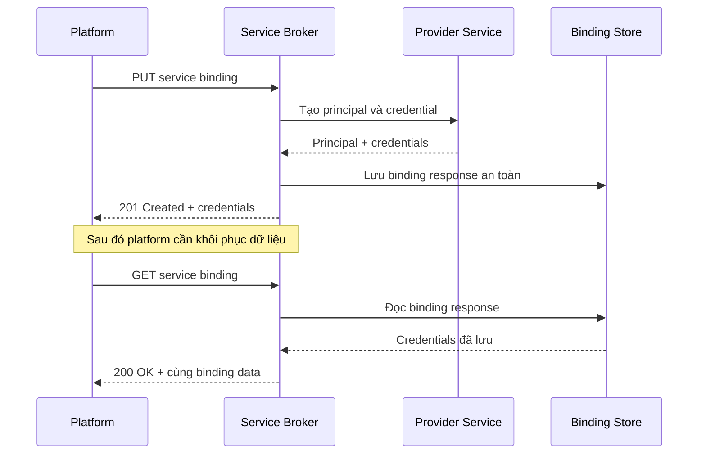
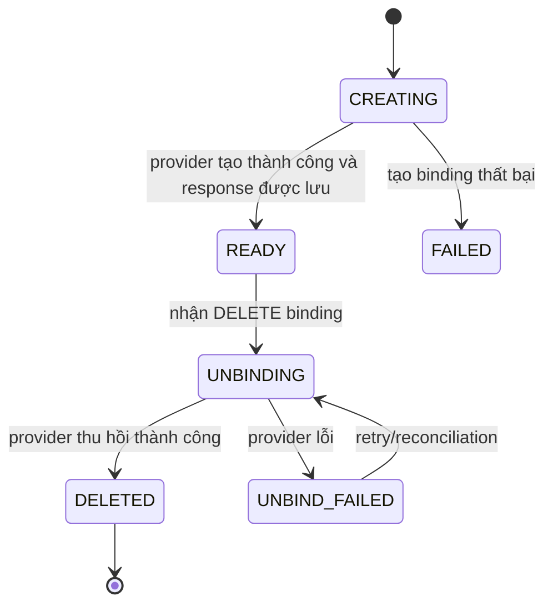

# `bindings_retrievable` và GET service binding

Khi platform tạo một service binding, broker thường trả về thông tin kết nối hoặc credential để ứng dụng sử dụng service instance. Có thể xảy ra tình huống platform cần lấy lại thông tin binding: response ban đầu bị mất, platform phục hồi dữ liệu sau sự cố hoặc cần khôi phục cấu hình consumer. Open Service Broker API (OSB API) cung cấp endpoint `GET` để truy xuất service binding đã tồn tại và field catalog `bindings_retrievable` để broker công bố khả năng này.

Với Spring Cloud Service Broker, hỗ trợ truy xuất binding đòi hỏi broker quản lý được dữ liệu response trong suốt vòng đời binding. Đặc biệt, nếu response chứa password hoặc token chỉ được provider cung cấp một lần, broker phải có cách lưu trữ và trả lại an toàn. Nếu không thể lấy lại dữ liệu binding một cách đáng tin cậy, broker không nên công bố `bindings_retrievable: true`.

## 1. Vì sao cần truy xuất service binding?

Một service instance có thể có nhiều binding. Ví dụ database `db-prod-17` được bind cho `orders-api` và `billing-worker`. Khi tạo binding, broker cấp principal riêng và trả credentials cho platform. Platform lưu thông tin đó rồi đưa vào môi trường chạy của ứng dụng.

Sau một thời gian, platform có thể cần truy xuất lại binding vì:

- Platform mất response của lần `PUT` do kết nối bị ngắt sau khi broker đã tạo binding.
- Platform khôi phục control plane hoặc dữ liệu binding từ bản sao lưu.
- Platform cần đồng bộ lại thông tin binding đã lưu với broker.
- Một quy trình vận hành cần đọc lại thông tin kết nối của binding hiện hữu.

Nếu broker chỉ hỗ trợ `PUT` và `DELETE`, platform không có endpoint OSB chuẩn để đọc lại response binding đã tạo. Khi broker hỗ trợ retrieve, platform có thể gọi `GET` với service instance ID và binding ID để nhận lại dữ liệu tương ứng.

Truy xuất binding là thao tác đọc. Nó không tạo binding mới, không cấp principal mới, không xoay password và không thay đổi cấu hình service instance. Mọi thay đổi credential phải đi qua quy trình riêng có kiểm soát để tránh làm mất đồng bộ giữa broker, platform và ứng dụng.

## 2. `bindings_retrievable` trong catalog

`bindings_retrievable` là field boolean ở cấp service definition trong catalog OSB API. Field này cho biết broker có hỗ trợ endpoint retrieve service binding hay không.

Ví dụ:

```json
{
  "services": [
    {
      "id": "postgresql-service-v1",
      "name": "postgresql",
      "description": "Dịch vụ PostgreSQL được quản lý",
      "bindable": true,
      "bindings_retrievable": true,
      "plans": [
        {
          "id": "postgresql-standard-v1",
          "name": "standard",
          "description": "Dành cho ứng dụng production"
        }
      ]
    }
  ]
}
```

Ý nghĩa của các field:

- `bindable` cho biết service có hỗ trợ tạo service binding hay không.
- `bindings_retrievable` cho biết broker có hỗ trợ lấy lại dữ liệu của binding đã tạo bằng endpoint GET hay không.

`bindings_retrievable` không có nghĩa mọi binding đều có thể được đọc công khai. Endpoint vẫn phải xác thực caller và kiểm tra binding thuộc đúng platform instance, service instance và binding ID. Đây là capability được công bố trong catalog, không phải cơ chế phân quyền.

Nếu broker công bố `bindings_retrievable: true`, broker phải triển khai endpoint retrieve tương ứng và trả dữ liệu binding hợp lệ. Nếu broker không hỗ trợ hoặc không thể cung cấp lại response một cách an toàn, hãy bỏ field hoặc đặt `false` theo phiên bản OSB API và cách platform xử lý giá trị mặc định. Không công bố `true` chỉ vì ứng dụng có thể đọc metadata binding nội bộ.

### 2.1. Phân biệt với `instances_retrievable`

Hai capability có tên gần giống nhưng truy xuất hai loại đối tượng khác nhau:

| Capability | Đối tượng | Endpoint |
|---|---|---|
| `bindings_retrievable` | Service binding | `GET /v2/service_instances/{instance_id}/service_bindings/{binding_id}` |
| `instances_retrievable` | Service instance | `GET /v2/service_instances/{instance_id}` |

Một broker có thể hỗ trợ một trong hai hoặc cả hai. Việc hỗ trợ GET service instance không tự động có nghĩa broker hỗ trợ GET service binding. Catalog phải công bố đúng capability đã triển khai.

## 3. Endpoint GET service binding

OSB API sử dụng đường dẫn:

```text
GET /v2/service_instances/{instance_id}/service_bindings/{binding_id}
```

Request thường kèm query parameters `service_id` và `plan_id` để xác định service và plan gắn với binding:

```http
GET /v2/service_instances/db-prod-17/service_bindings/orders-api-binding?service_id=postgresql-service-v1&plan_id=postgresql-standard-v1 HTTP/1.1
Host: broker.example.com
X-Broker-API-Version: 2.17
Authorization: Basic <broker-credentials>
```

Request không có body. Broker cần:

1. Xác thực platform/caller theo cơ chế bảo mật đã cấu hình.
2. Xác định platform instance và tenant scope của request.
3. Tìm binding theo khóa có phạm vi, ví dụ `(platform_instance_id, service_instance_id, binding_id)`.
4. Kiểm tra binding thuộc đúng service instance, `service_id` và `plan_id` được gửi.
5. Kiểm tra binding đang ở trạng thái có thể truy xuất, không phải đang tạo dở hoặc đã unbind.
6. Trả lại binding response đã lưu hoặc dữ liệu tương đương được khôi phục an toàn.

GET là thao tác đọc và nên hoàn tất đồng bộ. Nó không dùng `accepts_incomplete` để tạo một operation cấp phát mới. Nếu dữ liệu binding đang trong trạng thái tạo hoặc thu hồi dở, broker cần trả trạng thái/lỗi phù hợp với hợp đồng API và trạng thái thực tế, không trả response chưa hoàn chỉnh như thể binding đã sẵn sàng.

### 3.1. Response cho application binding

Với application binding, response thường chứa object `credentials` do broker định nghĩa:

```http
HTTP/1.1 200 OK
Content-Type: application/json

{
  "credentials": {
    "hostname": "postgres.internal.example",
    "port": 5432,
    "database": "orders",
    "username": "orders_app_42",
    "password": "<stored-secret>",
    "sslmode": "verify-full"
  }
}
```

Các key trong `credentials` phụ thuộc loại service. Với message broker, response có thể chứa endpoint, username, password, virtual host hoặc thông tin topic. OSB API không áp đặt một schema credentials chung cho mọi broker.

### 3.2. Response cho route binding

Với route binding, response có thể chứa `route_service_url`:

```http
HTTP/1.1 200 OK
Content-Type: application/json

{
  "route_service_url": "https://route-proxy.example.net/instances/edge-security-01"
}
```

`route_service_url` là địa chỉ route service broker đã cấp cho binding. GET cần trả đúng thông tin mà platform cần để khôi phục route-service integration. Broker không nên tạo endpoint mới mỗi lần GET vì router có thể tiếp tục sử dụng URL cũ.

Binding response còn có thể chứa các field theo loại service như `syslog_drain_url`, `volume_mounts`, `parameters` hoặc `metadata` khi phù hợp. Khi retrieve, cần giữ đúng cấu trúc response mà broker đã cung cấp lúc tạo binding.

## 4. Tính nhất quán giữa PUT và GET

GET service binding phải biểu diễn binding đã được tạo trước đó. Platform cần nhận lại dữ liệu gắn với đúng binding ID, không phải một binding mới có cùng tên.

Một quy tắc triển khai an toàn là lưu response binding sau khi provider tạo thành công và trước khi broker trả response thành công cho platform. Khi GET được gọi, broker đọc bản ghi đó và dựng response tương ứng.

Ví dụ vòng đời:



Nếu provider chỉ hiển thị password một lần, broker phải quyết định cách lưu trước khi công bố `bindings_retrievable`. Có thể mã hóa response ở tầng ứng dụng bằng khóa được quản lý an toàn hoặc lưu secret trong secret manager và chỉ lưu reference trong binding record. Hash password là không đủ nếu broker cần trả lại chính password cho platform.

### 4.1. Không tạo lại credential trong GET

Một lỗi thường gặp là GET gọi lại hàm `createCredentials()` rồi trả password mới. Điều này làm credential trong platform khác với credential mà broker/provider đang lưu, có thể khiến ứng dụng hiện tại mất kết nối.

GET cần trả dữ liệu đã gắn với binding hiện hữu. Nếu hệ thống cần xoay credential, hãy thiết kế quy trình rotation riêng, cập nhật provider và platform theo thứ tự có kiểm soát, rồi lưu trạng thái mới. Không dùng thao tác retrieve như một side effect để thay đổi quyền truy cập.

### 4.2. Xử lý khi response cũ không còn lấy được

Nếu broker không còn secret gốc và provider không thể trả lại secret, broker không nên tạo một giá trị ngẫu nhiên rồi giả làm response ban đầu. Các lựa chọn phụ thuộc thiết kế dịch vụ:

- Lưu credential được mã hóa ngay từ khi tạo binding.
- Lưu secret trong kho chuyên dụng và truy xuất bằng reference.
- Nếu provider hỗ trợ credential retrieval, lấy đúng credential gắn với binding.
- Nếu chỉ có thể rotation, thực hiện quy trình rotation riêng và bảo đảm platform được cập nhật trước khi trả dữ liệu mới.
- Nếu broker không thể đáp ứng hợp đồng retrieve, không công bố capability `bindings_retrievable` cho service đó.

## 5. Thiết kế dữ liệu cho binding retrieval

Binding store cần giữ metadata để xác định đúng đối tượng và response để khôi phục dữ liệu. Một mô hình gợi ý:

| Trường | Mục đích |
|---|---|
| `platform_instance_id` | Phạm vi platform |
| `service_instance_id` | Service instance chứa binding |
| `binding_id` | ID binding do platform gửi |
| `service_id` | Service definition |
| `plan_id` | Plan của instance tại thời điểm binding |
| `consumer_type` | `APPLICATION` hoặc `ROUTE` theo mô hình nội bộ |
| `app_guid` / `route` | Consumer tương ứng |
| `provider_binding_id` | ID principal hoặc resource ở provider |
| `response_payload_encrypted` | Response binding được mã hóa nếu cần lưu nguyên vẹn |
| `credential_ref` | Tham chiếu secret manager |
| `state` | `CREATING`, `READY`, `UNBINDING`, `DELETED`... |
| `created_at`, `updated_at` | Thời gian tạo và cập nhật |

Đây là mô hình nội bộ, không phải schema bắt buộc của OSB API. Với hệ thống nhiều platform, khóa duy nhất nên bao gồm platform instance, service instance và binding ID để tránh va chạm. Không dùng `binding_id` đơn lẻ làm khóa toàn cục nếu platform có thể tạo cùng ID trong hai phạm vi khác nhau.

### 5.1. Lưu response hay dựng lại từ dữ liệu chuẩn?

Có hai cách triển khai:

| Cách | Ưu điểm | Điểm cần kiểm soát |
|---|---|---|
| Lưu response đã mã hóa | Có thể trả lại đúng cấu trúc và giá trị đã tạo | Bảo vệ dữ liệu nhạy cảm, version hóa payload và quản lý khóa mã hóa |
| Lưu dữ liệu chuẩn và dựng response | Dễ truy vấn, có thể đổi schema nội bộ | Mapper phải tái tạo đúng dữ liệu binding, không tự sinh credential mới |

Có thể kết hợp hai cách: lưu metadata có cấu trúc, lưu secret trong secret manager và dùng mapper tạo response. Dù chọn cách nào, kết quả GET phải phản ánh binding thực tế, không lấy cấu hình plan hiện tại để suy ra credentials cho binding cũ.

### 5.2. Tính nhất quán khi tạo binding

Tạo binding thường có side effect ở provider và database broker. Có thể xảy ra trường hợp provider tạo user thành công nhưng broker dừng trước khi lưu binding record. Để phục hồi:

1. Tạo binding intent ở trạng thái `CREATING` với khóa idempotency ổn định.
2. Gọi provider để tạo principal/credential.
3. Lưu provider resource ID và response/secret reference.
4. Chuyển binding sang `READY` trong transaction.
5. Chỉ trả response tạo binding thành công sau khi dữ liệu cần thiết cho retrieve đã được lưu bền vững.

Nếu tiến trình dừng giữa các bước, retry phải tra cứu provider resource theo binding key hoặc idempotency key trước khi tạo mới. GET chỉ trả binding ở trạng thái `READY`; binding `CREATING` cần được hoàn tất hoặc xử lý theo trạng thái thực tế.

## 6. Bảo mật endpoint GET service binding

GET không làm thay đổi tài nguyên nhưng có thể trả password, token hoặc URL chứa thông tin nhạy cảm. Vì vậy, endpoint này cần được bảo vệ như một API đọc secret:

- Xác thực broker client/platform bằng cơ chế đã cấu hình, ví dụ HTTP Basic qua TLS hoặc mutual TLS.
- Kiểm tra caller có quyền với đúng `platform_instance_id` và service instance.
- Tra cứu binding theo đủ phạm vi platform, instance và binding ID.
- Kiểm tra `service_id` và `plan_id` khớp với binding đã lưu.
- Không coi binding ID là credential; ID khó đoán không thay thế authorization.
- Không ghi credentials hoặc toàn bộ response GET vào log, trace hay metric.
- Giới hạn quyền đọc secret manager cho service account của broker.
- Dùng mã hóa khi lưu response nhạy cảm và quản lý rotation của khóa mã hóa.
- Tránh cache response chứa secret ở gateway hoặc shared cache; nếu bắt buộc cache nội bộ, cần giới hạn phạm vi và thời gian sống.
- Không trả binding đã unbind hoặc thuộc instance khác.

Với route binding, `route_service_url` có thể chứa token hoặc thông tin định tuyến nhạy cảm. Cần áp dụng chính sách bảo vệ tương đương credentials. Khi GET được gọi nhiều lần, không ghi URL đầy đủ vào log.

## 7. Triển khai GET binding bằng Spring Cloud Open Service Broker

Spring Cloud Open Service Broker cung cấp abstraction để ứng dụng triển khai nghiệp vụ binding. Tùy phiên bản thư viện, retrieve service binding có thể được biểu diễn qua method xử lý `GetServiceInstanceBindingRequest` và trả `GetServiceInstanceBindingResponse` trong binding service. Cần đối chiếu API của dependency thực tế trước khi chọn chữ ký đồng bộ hoặc reactive.

Ví dụ domain service tách phần đọc binding:

```java
public record BindingKey(
        String platformInstanceId,
        String serviceInstanceId,
        String bindingId
) {}

@Service
public class BindingRetrievalService {

    private final BindingRepository repository;
    private final BindingSecretStore secretStore;
    private final BindingResponseMapper responseMapper;

    public BindingRetrievalService(
            BindingRepository repository,
            BindingSecretStore secretStore,
            BindingResponseMapper responseMapper) {
        this.repository = repository;
        this.secretStore = secretStore;
        this.responseMapper = responseMapper;
    }

    public BindingResponse retrieve(BindingKey key, String serviceId, String planId) {
        BindingRecord binding = repository.findReady(key)
                .orElseThrow(BindingNotFoundException::new);

        if (!binding.getServiceId().equals(serviceId)
                || !binding.getPlanId().equals(planId)) {
            throw new BindingNotFoundException();
        }

        Map<String, Object> credentials = secretStore
                .loadCredentials(binding.getCredentialRef());

        return responseMapper.toResponse(binding, credentials);
    }
}
```

Đây là domain code minh họa. `BindingKey` cần được tạo từ platform context đã xác thực, không lấy `platformInstanceId` từ dữ liệu client tùy ý. `findReady` chỉ trả binding đã tạo thành công. Khi không tồn tại binding trong đúng phạm vi, adapter ánh xạ exception sang lỗi OSB phù hợp.

### 7.1. Adapter cho Spring Cloud

Adapter framework có thể nhận request model, đọc binding và chuyển sang response model:

```java
@Service
public class BrokerBindingService implements ServiceInstanceBindingService {

    private final BindingRetrievalService retrievalService;

    public BrokerBindingService(BindingRetrievalService retrievalService) {
        this.retrievalService = retrievalService;
    }

    // Chữ ký minh họa; xác nhận kiểu request/response theo phiên bản thư viện.
    public GetServiceInstanceBindingResponse getServiceInstanceBinding(
            GetServiceInstanceBindingRequest request) {

        BindingResponse binding = retrievalService.retrieve(
                new BindingKey(
                        request.getPlatformInstanceId(),
                        request.getServiceInstanceId(),
                        request.getBindingId()),
                request.getServiceDefinitionId(),
                request.getPlanId());

        return GetServiceInstanceBindingResponse.builder()
                .credentials(binding.credentials())
                .routeServiceUrl(binding.routeServiceUrl())
                .build();
    }
}
```

Đoạn code mô tả trách nhiệm adapter và không khẳng định mọi phiên bản Spring Cloud Open Service Broker có cùng tên getter, builder hoặc chữ ký method. Với API reactive, domain retrieval có thể được bọc trong `Mono`; tránh gọi blocking secret store trên event-loop. Nếu framework không tự bật endpoint retrieve, cần kiểm tra auto-configuration và đăng ký handler tương ứng với capability catalog.

### 7.2. Công bố capability trong catalog

Catalog service chỉ nên đặt `bindings_retrievable(true)` khi endpoint GET đã được triển khai và có thể trả lại dữ liệu cho các binding hợp lệ:

```java
ServiceDefinition service = ServiceDefinition.builder()
        .id("postgresql-service-v1")
        .name("postgresql")
        .description("Dịch vụ PostgreSQL được quản lý")
        .bindable(true)
        .bindingsRetrievable(true)
        .plans(List.of(standardPlan))
        .build();
```

Tên builder được minh họa theo mô hình API; hãy xác minh phương thức thực tế trong phiên bản dependency. Nếu broker không thể lưu hoặc khôi phục credentials, không bật capability cho service đó. Với catalog có nhiều service, capability cần được đặt theo từng service definition dựa trên khả năng thực tế.

## 8. Phối hợp GET với Unbind và deprovision

GET phải phản ánh trạng thái vòng đời binding. Khi binding đang `UNBINDING`, broker không nên trả credentials như thể binding vẫn hoạt động bình thường nếu provider đã bắt đầu thu hồi principal. Khi binding đã `DELETED`, GET không được khôi phục hoặc tạo lại binding.

Luồng trạng thái nội bộ có thể như sau:



GET chỉ trả response cho trạng thái `READY`. Với `UNBINDING` hoặc `UNBIND_FAILED`, broker cần có chính sách rõ ràng về việc binding còn hiệu lực hay đã bị thu hồi một phần. Với `DELETED`, trả lỗi binding không tồn tại theo hợp đồng OSB API.

Khi service instance đang deprovision, broker cần điều phối binding lifecycle trước hoặc trong quy trình thu hồi instance. Không được trả credentials mới từ GET nếu service instance đã bị thu hồi hoặc đang ở trạng thái không còn cho phép truy cập. Deprovision service instance không được làm mất các binding record cần thiết cho việc cleanup và audit.

## 9. Kiểm thử `bindings_retrievable`

Các kiểm thử tích hợp cần xác nhận cả capability catalog và dữ liệu GET:

1. Catalog trả `bindings_retrievable: true` chỉ khi endpoint GET được bật.
2. GET với service instance và binding ID hợp lệ trả `200 OK` cùng binding response tương ứng.
3. Application binding trả đúng credentials đã lưu; không tạo user hoặc password mới.
4. Route binding trả đúng `route_service_url` đã cấp; không tạo endpoint mới.
5. GET với binding ID không tồn tại trả lỗi not found phù hợp.
6. GET với service ID hoặc plan ID không khớp không trả dữ liệu binding khác.
7. Caller từ platform instance khác không thể đọc binding.
8. Binding đang `CREATING` không bị trả như binding `READY`.
9. Binding đã `UNBINDING` hoặc `DELETED` tuân theo chính sách trạng thái và không làm lộ credential đã thu hồi.
10. Broker restart vẫn có thể retrieve binding vì response/secret reference được lưu bền vững.
11. Provider tạo credential nhưng broker crash trước khi commit; retry phục hồi cùng binding thay vì tạo principal trùng.
12. Secret được mã hóa hoặc lấy từ secret manager; không xuất hiện trong log và trace.
13. Khi secret không thể khôi phục, catalog không công bố capability retrieve cho service đó.
14. GET là thao tác đọc: gọi nhiều lần không làm thay đổi binding state hoặc rotate credentials.

## 10. Lỗi thường gặp và cách khắc phục

| Lỗi | Hậu quả | Cách khắc phục |
|---|---|---|
| Công bố `bindings_retrievable=true` nhưng chưa triển khai GET | Platform gọi endpoint và nhận lỗi | Chỉ công bố capability sau khi endpoint hoạt động |
| Nhầm với `instances_retrievable` | Platform hiểu sai loại dữ liệu có thể truy xuất | Công bố riêng capability cho binding và instance |
| GET tạo credential mới | Ứng dụng đang chạy có thể mất kết nối | Trả lại dữ liệu gắn với binding đã tạo |
| Chỉ lưu hash password | Không thể khôi phục credentials cho response | Lưu mã hóa hoặc secret manager reference |
| GET tra cứu chỉ bằng binding ID | Có nguy cơ lộ binding của platform khác | Dùng khóa phạm vi platform + instance + binding |
| Trả binding đang tạo dở | Platform nhận dữ liệu không hoàn chỉnh | Chỉ retrieve binding ở trạng thái sẵn sàng |
| GET trả response sau khi unbind | Credential đã thu hồi vẫn bị phát lại | Kiểm tra binding lifecycle trước khi trả |
| Cache response chứa secret ở gateway | Secret có thể tồn tại ngoài phạm vi kiểm soát | Tắt shared cache hoặc dùng cache riêng có bảo vệ nghiêm ngặt |
| Bật capability cho mọi service dù chỉ một service hỗ trợ | Catalog cam kết quá mức | Cấu hình capability theo từng service definition |

## 11. Kết luận

`bindings_retrievable` cho platform biết broker có thể trả lại dữ liệu của service binding đã tạo qua endpoint `GET /v2/service_instances/{instance_id}/service_bindings/{binding_id}` hay không. Khi công bố capability này, broker cần xác thực caller, tra cứu đúng binding trong phạm vi platform, trả lại response gắn với binding hiện hữu và bảo vệ credentials như dữ liệu bí mật. GET phải là thao tác đọc, không tạo principal mới hoặc tự xoay credential. Với Spring Cloud Service Broker, hãy lưu binding metadata và secret reference bền vững ngay trong quy trình tạo binding, triển khai handler retrieve phù hợp phiên bản thư viện và chỉ bật `bindings_retrievable` khi có thể phục hồi dữ liệu một cách nhất quán trong suốt vòng đời binding.
