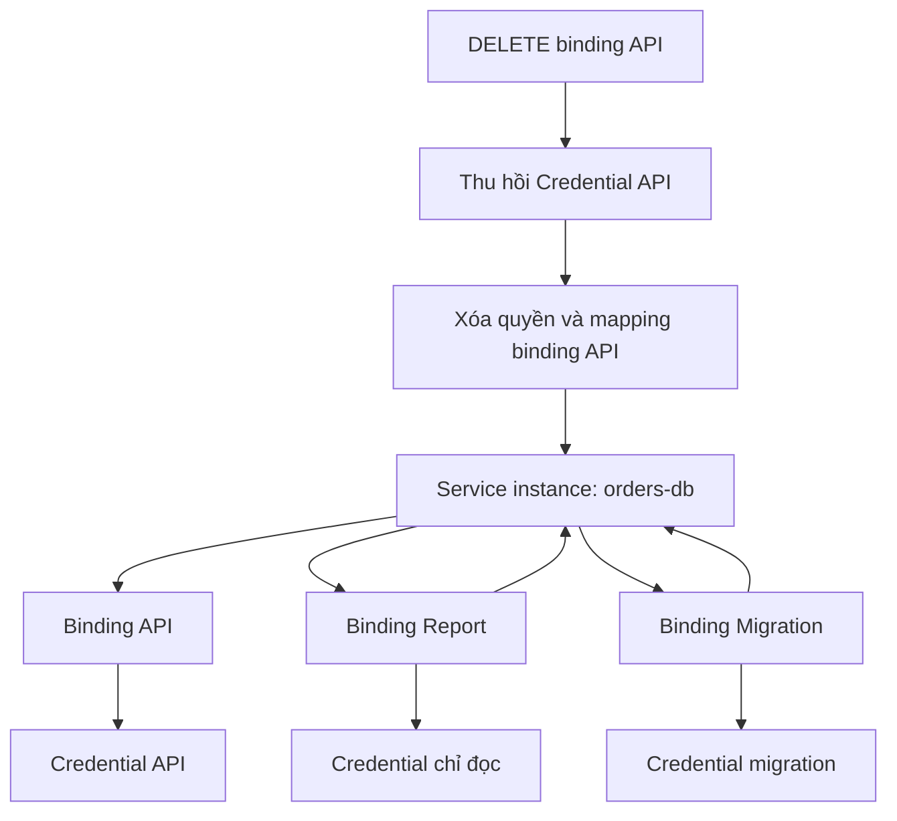
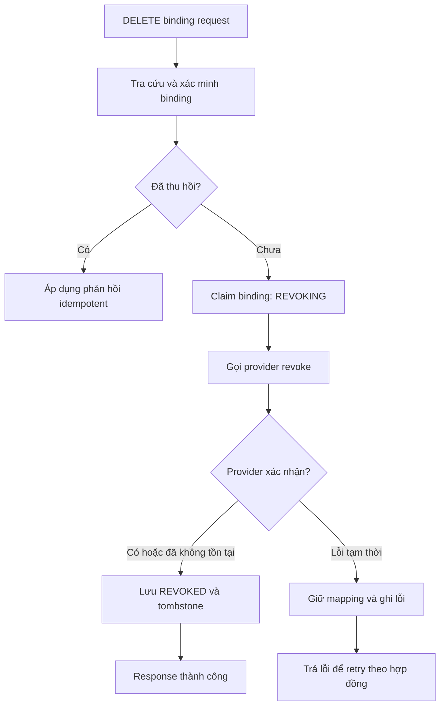
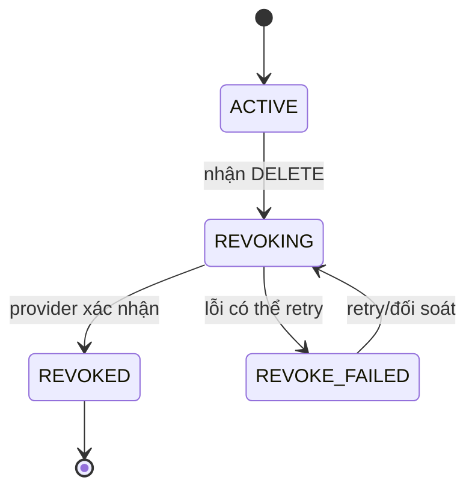

# DELETE service binding và cài đặt `deleteServiceInstanceBinding()`

Khi một ứng dụng hoặc workload không còn cần sử dụng service instance, nền tảng gọi thao tác unbind để yêu cầu broker thu hồi quyền truy cập đã cấp cho binding đó. Trong Open Service Broker API (OSB API), thao tác này dùng HTTP `DELETE` trên endpoint service binding. Trong Spring Cloud Open Service Broker, ứng dụng triển khai điểm mở rộng `deleteServiceInstanceBinding()` thông qua `ServiceInstanceBindingService`.

Unbind chỉ kết thúc một binding. Nếu database được chia sẻ cho nhiều consumer, broker phải thu hồi đúng credential hoặc quyền của consumer đang bị unbind, đồng thời giữ nguyên service instance và các binding khác. Broker cần tra cứu mapping đã lưu khi bind, thực hiện thu hồi ở provider, ghi nhận trạng thái và xử lý request lặp an toàn.

Với `SPRING_CLOUD_SERVICE_BROKER`, đây là bước quan trọng trong vòng đời bảo mật: credential không còn cần thiết phải mất hiệu lực ở hệ thống đích, không chỉ bị xóa khỏi database broker hoặc khỏi giao diện nền tảng.

## 1. Unbind khác với deprovision

Service instance đại diện cho tài nguyên dịch vụ mà broker quản lý, ví dụ một PostgreSQL database. Service binding đại diện cho quyền hoặc thông tin kết nối mà một consumer được cấp để sử dụng instance đó.

Giả sử database `orders-db` có ba binding:

- `binding-api`: tài khoản đọc/ghi cho backend API.
- `binding-report`: tài khoản chỉ đọc cho tác vụ báo cáo.
- `binding-migration`: tài khoản dùng cho quy trình migration.

Khi backend API ngừng sử dụng database, nền tảng xóa `binding-api`. Broker thu hồi tài khoản hoặc quyền tương ứng. Hai binding còn lại và database vẫn hoạt động.

| Thao tác | Đối tượng bị thu hồi | Đối tượng cần giữ lại |
|---|---|---|
| Unbind | Một binding, credential và quyền gắn với binding đó | Service instance và các binding khác |
| Deprovision | Service instance và tài nguyên dịch vụ theo chính sách | Các tài nguyên độc lập không thuộc instance đó |

Không dùng unbind để xóa database hoặc volume dùng chung. Ngược lại, không chỉ xóa một binding record rồi coi instance đã được thu hồi. Hai thao tác có endpoint, định danh và mục đích riêng trong OSB API.



## 2. Endpoint DELETE theo OSB API

Nền tảng gửi request đến endpoint binding với `service_instance_id` và `binding_id` trong đường dẫn. `service_id` và `plan_id` được truyền qua query string để broker xác định service và plan liên quan.

Ví dụ:

```http
DELETE /v2/service_instances/instance-42/service_bindings/binding-api?service_id=postgres-service&plan_id=standard HTTP/1.1
Host: broker.example.com
X-Broker-API-Version: 2.17
Authorization: Bearer <platform-token>
```

Request unbind thông thường không cần JSON body. Broker nhận diện binding từ các định danh giao thức và tra cứu dữ liệu đã lưu trong quá trình bind. Cần đối chiếu chính xác header phiên bản, query parameter và response với phiên bản OSB API mà broker công bố.

Phản hồi thành công thường là HTTP `200 OK` với body rỗng. Unbind là thao tác đồng bộ trong hợp đồng OSB API; không áp dụng cơ chế `accepts_incomplete` và `last_operation` giống provision, update hoặc deprovision. Nếu provider cần thời gian để thu hồi quyền, broker phải tổ chức việc gọi provider và xác nhận thu hồi trong giới hạn xử lý của endpoint, hoặc trả lỗi tạm thời để nền tảng có thể retry theo hợp đồng.

## 3. Dữ liệu trong `DeleteServiceInstanceBindingRequest`

Spring Cloud Open Service Broker ánh xạ request HTTP thành model `DeleteServiceInstanceBindingRequest`. Tên package và accessor cụ thể có thể khác theo phiên bản thư viện, nhưng handler thường cần những định danh sau:

| Dữ liệu | Nguồn | Mục đích |
|---|---|---|
| `serviceInstanceId` | Path | Xác định instance chứa binding |
| `bindingId` | Path | Xác định binding cần thu hồi |
| `serviceDefinitionId` | Query | Kiểm tra binding thuộc service nào |
| `planId` | Query | Kiểm tra plan tương ứng |

Request DELETE không nên được xem là nơi cung cấp lại toàn bộ `bind_resource`, `app_guid`, `route` hoặc credentials ban đầu. Những dữ liệu cần để thu hồi phải được lưu thành binding record từ lúc tạo binding. Khi nhận unbind, broker dùng `bindingId` và `serviceInstanceId` để tra cứu record rồi lấy provider credential reference, consumer identity hoặc role đã được cấp.

Điều này đặc biệt quan trọng khi ứng dụng đã bị xóa khỏi nền tảng. Broker vẫn phải biết credential nào cần thu hồi dù app GUID hoặc route hiện không còn được truy vấn được.

## 4. `DeleteServiceInstanceBindingResponse`

Khi thu hồi thành công, handler trả `DeleteServiceInstanceBindingResponse`. Response thành công thông thường không cần trả credential mới hoặc dữ liệu kết nối. Framework ánh xạ kết quả thành HTTP response theo OSB API.

Trong các phiên bản Spring Cloud Open Service Broker sử dụng API reactive, response có thể được tạo bằng builder:

```java
return Mono.just(DeleteServiceInstanceBindingResponse.builder().build());
```

Ví dụ này biểu diễn response thành công rỗng. Không trả lại password hoặc token trong response unbind. Nếu việc thu hồi không thể hoàn tất, handler phải phát sinh lỗi phù hợp để framework ánh xạ thành error response; không tạo response thành công chỉ vì binding record đã được đánh dấu xóa.

## 5. Đăng ký `ServiceInstanceBindingService`

Ứng dụng cung cấp bean triển khai `ServiceInstanceBindingService`. Bean này là adapter giữa framework và use case nghiệp vụ. `deleteServiceInstanceBinding()` nên chuyển request thành command, gọi use case thu hồi và ánh xạ kết quả thành response.

Ví dụ minh họa với kiểu API reactive:

```java
package com.example.broker.binding;

import org.springframework.stereotype.Service;
import org.springframework.cloud.servicebroker.model.binding.DeleteServiceInstanceBindingRequest;
import org.springframework.cloud.servicebroker.model.binding.DeleteServiceInstanceBindingResponse;
import org.springframework.cloud.servicebroker.service.ServiceInstanceBindingService;
import reactor.core.publisher.Mono;

@Service
public class BrokerServiceInstanceBindingService
        implements ServiceInstanceBindingService {

    private final DeleteBindingUseCase deleteBinding;

    public BrokerServiceInstanceBindingService(
            DeleteBindingUseCase deleteBinding) {
        this.deleteBinding = deleteBinding;
    }

    @Override
    public Mono<DeleteServiceInstanceBindingResponse>
            deleteServiceInstanceBinding(DeleteServiceInstanceBindingRequest request) {
        DeleteBindingCommand command = new DeleteBindingCommand(
                request.getServiceInstanceId(),
                request.getBindingId(),
                request.getServiceDefinitionId(),
                request.getPlanId());

        return deleteBinding.execute(command)
                .thenReturn(DeleteServiceInstanceBindingResponse.builder().build());
    }

    // Các phương thức bind khác được triển khai theo interface của phiên bản thư viện.
}
```

Đây là ví dụ cấu trúc, không phải cam kết chữ ký cố định cho mọi phiên bản. Cần kiểm tra đúng package, accessor, kiểu trả về và cách biểu diễn lỗi của dependency trong dự án. Một số phiên bản cũ có thể dùng chữ ký đồng bộ. Không tạo controller HTTP riêng nếu framework đã cung cấp endpoint OSB API.

Use case `DeleteBindingUseCase` nên phụ trách tra cứu binding, xác minh quan hệ với instance/service/plan, thu hồi provider credential và cập nhật trạng thái. Adapter không nên chứa logic riêng của PostgreSQL, Redis hoặc nhà cung cấp cloud.

## 6. Binding record phải đủ dữ liệu để thu hồi

Khi bind thành công, broker cần lưu mapping giữa định danh OSB và tài nguyên quyền truy cập ở provider. Một binding record có thể chứa:

| Trường | Ý nghĩa |
|---|---|
| `bindingId` | Định danh binding từ nền tảng |
| `instanceId` | Service instance được liên kết |
| `serviceId`, `planId` | Service và plan của binding |
| `tenantId` | Tenant sở hữu instance/binding |
| `consumerRef` | App/workload/route đã được chuẩn hóa khi bind |
| `providerPrincipalId` | User, role hoặc principal được tạo ở provider |
| `providerCredentialRef` | Tham chiếu đến secret hoặc credential trong secret store |
| `status` | Trạng thái binding hiện tại |
| `createdAt`, `revokedAt` | Thời điểm tạo và thu hồi |

Không nhất thiết lưu password dạng rõ. Có thể lưu provider principal ID và secret reference, trong khi secret được giữ trong secret manager. Với một số provider, broker có thể không cần đọc lại password để thu hồi vì chỉ cần principal ID để drop user hoặc revoke token.

Nếu binding record chỉ lưu `bindingId` mà không lưu provider reference, unbind có thể không biết phải thu hồi user nào. Nếu chỉ lưu `app_guid` mà không lưu principal ID, broker có thể gặp khó khăn khi ứng dụng đã bị xóa hoặc đã đổi tên. Hãy lưu định danh tài nguyên provider ngay khi tạo binding.

## 7. Các bước thực hiện unbind an toàn

Một quy trình thường có các bước:

1. Nhận `serviceInstanceId`, `bindingId`, service ID và plan ID.
2. Xác thực caller và tra cứu binding record trong phạm vi tenant được phép.
3. Kiểm tra binding thuộc đúng service instance, service và plan.
4. Nếu binding đã thu hồi, xử lý theo quy tắc idempotency và phản hồi OSB API.
5. Đánh dấu binding ở trạng thái `REVOKING` hoặc claim thao tác để ngăn hai request cùng thu hồi.
6. Gọi provider để thu hồi credential, role, token, policy hoặc quyền truy cập.
7. Xác nhận provider đã thu hồi hoặc tài nguyên quyền truy cập không còn tồn tại.
8. Đánh dấu binding `REVOKED`, lưu thời điểm và kết quả audit; giữ tombstone nếu cần chống request lặp.
9. Trả response thành công.

Không nên xóa binding record trước khi provider thu hồi quyền thành công. Nếu broker xóa mapping rồi provider timeout, credential có thể vẫn hoạt động nhưng broker không còn đủ thông tin để thu hồi ở lần retry sau.



## 8. Thu hồi credential và quyền ở provider

Hành động cụ thể phụ thuộc loại dịch vụ:

| Dịch vụ | Tài nguyên cần thu hồi | Ví dụ hành động |
|---|---|---|
| PostgreSQL | Database role/user, grants và credential | `REVOKE` quyền, chấm dứt session nếu cần, `DROP ROLE` sau khi xử lý dependency |
| MySQL | User và grants | `REVOKE` quyền, xóa user hoặc rotate secret |
| Redis | ACL user hoặc access key | Disable/delete ACL user và xác nhận key mất hiệu lực |
| Object storage | Access key, policy hoặc service account | Disable key, xóa policy gắn riêng với binding |
| API service | API key, OAuth client hoặc token grant | Revoke token/client hoặc thu hồi scope |
| Message broker | User, credential và ACL | Xóa principal hoặc thu hồi quyền trên topic/queue |

Thu hồi cần phản ánh hành vi thực tế của provider. Ví dụ, xóa một database user có thể thất bại nếu còn object ownership hoặc dependency. Khi đó broker cần thu hồi grants, chuyển ownership hoặc xóa đối tượng phụ theo chính sách trước khi drop role.

Một số hệ thống có session đã xác thực trước thời điểm thu hồi. Xóa credential không nhất thiết kết thúc các session đang mở. Nếu yêu cầu bảo mật cần chấm dứt session ngay, adapter phải gọi thêm thao tác terminate/revoke session mà provider hỗ trợ.

Không xóa credential dùng chung của instance nếu nó còn phục vụ binding khác. Thiết kế principal riêng theo binding giúp thu hồi đúng phạm vi và giảm nguy cơ làm gián đoạn consumer còn hoạt động.

## 9. Idempotency khi DELETE được gửi lại

Nền tảng có thể gửi lại DELETE nếu mất response, proxy timeout hoặc không biết lần gọi trước đã hoàn tất chưa. Unbind cần có hành vi lặp an toàn.

Ví dụ:

- Lần đầu broker thu hồi thành công provider principal nhưng mất kết nối trước khi trả response.
- Nền tảng gửi lại DELETE với cùng `bindingId`.
- Broker thấy binding đang `REVOKING` hoặc đã `REVOKED`, đối soát provider và không tạo thêm side effect.

Một số quy tắc cần thiết:

- Cùng binding ID và cùng instance: xử lý theo kết quả đã ghi nhận hoặc xác nhận provider đã không còn principal.
- Binding ID không tồn tại: trả mã response theo OSB API version và exception mapping của framework; không giả định mọi trường hợp đều là lỗi hạ tầng.
- Binding ID tồn tại nhưng thuộc instance/service khác: từ chối xung đột hoặc request không hợp lệ, không thu hồi theo dữ liệu không khớp.
- Provider trả “principal not found”: nếu điều đó chứng minh quyền đã không còn tồn tại, có thể coi bước thu hồi đã đạt mục tiêu và hoàn tất mapping.
- Provider timeout: không kết luận đã thu hồi; giữ record để đối soát và retry.

Có thể lưu `revocationRequestFingerprint`, `revokedAt` và provider result để xử lý retry. Unique constraint trên `bindingId` cùng `instanceId`, optimistic locking hoặc distributed lock giúp ngăn hai request đồng thời thực hiện cùng một thao tác.

## 10. Phản hồi lỗi và retry

Không phải lỗi nào cũng có cùng cách xử lý. Broker cần phân biệt lỗi định danh, lỗi trạng thái và lỗi provider.

| Tình huống | Hành vi cần có |
|---|---|
| Binding tồn tại và thu hồi thành công | Trả `200 OK` |
| Binding đã không còn tồn tại | Ánh xạ theo semantics OSB API và exception mapping của phiên bản đang dùng; trường hợp binding không tồn tại thường được biểu diễn bằng `410 Gone` |
| Service/plan không khớp binding | Từ chối request theo lỗi giao thức phù hợp |
| Instance ID không khớp binding record | Không thu hồi; trả lỗi không tìm thấy hoặc không hợp lệ theo mapping đã cấu hình |
| Provider từ chối do dependency nghiệp vụ | Giữ binding record, trả lỗi có thể chẩn đoán và xử lý theo chính sách |
| Provider timeout hoặc lỗi mạng tạm thời | Giữ mapping, trả lỗi server-side để nền tảng có thể retry |
| Provider xác nhận principal đã bị xóa trước đó | Đánh dấu hoàn tất nếu trạng thái thực tế đã đạt mục tiêu |

Mã HTTP cuối cùng phải tuân theo OSB API version và exception mapping của Spring Cloud Open Service Broker. Không chuyển mọi exception thành `500`, và không trả `200` nếu credential vẫn còn hoạt động mà broker chưa có xác nhận thu hồi.

Nếu provider có lỗi tạm thời, broker có thể retry nội bộ trong giới hạn ngắn phù hợp với request timeout. Khi không thể hoàn tất trong thời gian xử lý HTTP, giữ trạng thái và trả lỗi tạm thời để nền tảng thử lại. Vì unbind không dùng async operation theo OSB API, không trả `202` hoặc operation ID như cách giải quyết mặc định.

## 11. Đồng bộ trạng thái binding và xử lý crash

Thu hồi ở provider và cập nhật database broker là hai hệ thống khác nhau, nên không thể mặc định chúng nằm trong cùng một transaction ACID.

Ví dụ crash:

1. Broker đánh dấu `REVOKING`.
2. Provider đã xóa principal thành công.
3. Broker dừng trước khi cập nhật binding thành `REVOKED`.
4. Nền tảng retry DELETE.

Khi khởi động lại, broker cần đối soát provider bằng `providerPrincipalId` hoặc idempotency key. Nếu principal đã không còn, broker hoàn tất trạng thái `REVOKED` và trả kết quả tương ứng. Nếu principal vẫn còn, broker tiếp tục thu hồi.

Một state model nội bộ có thể là:



Đây là trạng thái nội bộ của broker, không phải trạng thái OSB operation bất đồng bộ. Nền tảng nhận kết quả qua response của DELETE. Broker có thể giữ tombstone `REVOKED` trong một khoảng thời gian để xử lý request lặp và audit, sau đó mới dọn dữ liệu không còn cần thiết.

## 12. Quan hệ giữa unbind và deprovision instance

Vòng đời thông thường là consumer ngừng sử dụng binding, nền tảng gọi unbind, sau đó khi không còn cần service instance thì gọi deprovision. Broker cần giữ đúng ranh giới này.

- Unbind một binding không được xóa instance.
- Deprovision cần xác định và xử lý các binding còn tồn tại theo quy tắc OSB API và chính sách dịch vụ.
- Không để unbind một binding làm mất credential của binding khác.
- Không để deprovision xóa instance trong khi một binding vẫn đang được tạo hoặc thu hồi mà không có cơ chế điều phối.
- Nếu instance đang `DEPROVISIONING`, request unbind đến muộn cần được xử lý theo state machine và mapping đã lưu.

Nên có khóa hoặc cơ chế tuần tự hóa theo instance khi các thao tác bind, unbind và deprovision có thể cạnh tranh. Ví dụ deprovision chuyển instance sang `DELETING`, ngăn binding mới; các binding hiện hữu được thu hồi trước hoặc trong quy trình xóa theo policy. Cần tránh race condition khiến worker xóa database trước khi unbind đã thu hồi xong quyền.

## 13. Bảo mật khi thu hồi binding

Unbind là thao tác nhạy cảm vì nó thay đổi quyền truy cập. Broker cần:

- Xác thực nền tảng gọi API và kiểm tra quyền trên service instance/binding.
- Ràng buộc `bindingId` với `instanceId`, tenant và service đã lưu.
- Chỉ thu hồi provider principal thuộc binding đó; không dùng dữ liệu consumer tùy ý từ request để chọn principal.
- Bảo vệ provider token và secret reference.
- Không ghi password, API key hoặc token vào log.
- Ghi audit event gồm actor, tenant, instance, binding, provider reference, thời điểm và kết quả.
- Hạn chế nội dung lỗi để không tiết lộ tên host, username nội bộ hoặc cấu trúc provider.

Operation ID hoặc binding ID không phải cơ chế xác thực. Người gọi cần được xác thực và được phép thao tác trong tenant tương ứng. Nếu một binding ID bị đoán hoặc lộ, broker vẫn phải kiểm tra ownership trước khi thu hồi.

## 14. Kiểm thử `deleteServiceInstanceBinding()`

Nên kiểm thử cả hành vi adapter, use case và tích hợp provider.

| Trường hợp | Kết quả mong đợi |
|---|---|
| Binding tồn tại, provider revoke thành công | Binding thành `REVOKED`, response thành công |
| Binding không tồn tại | Exception/HTTP status đúng OSB API version |
| Binding thuộc instance khác | Không gọi provider, trả lỗi phù hợp |
| Service ID hoặc plan ID không khớp | Từ chối request, không thu hồi nhầm |
| Provider báo principal đã bị xóa | Hoàn tất theo chính sách idempotent |
| Provider timeout | Giữ mapping và trạng thái có thể retry |
| Hai DELETE đồng thời | Chỉ một luồng thu hồi provider; luồng còn lại nhận kết quả nhất quán |
| Broker crash sau provider revoke | Retry/đối soát hoàn tất `REVOKED` mà không tạo side effect mới |
| Unbind một trong nhiều binding | Các binding khác và instance vẫn hoạt động |
| Deprovision chạy đồng thời | State/lock ngăn xóa instance trước khi xử lý binding theo policy |

Ví dụ unit test cho use case với provider giả lập:

```java
@ExtendWith(MockitoExtension.class)
class DeleteBindingUseCaseTest {

    @Mock BindingRepository bindings;
    @Mock ProviderCredentialRevoker revoker;

    @InjectMocks DeleteBindingUseCase useCase;

    @Test
    void revokesOnlyTheRequestedBinding() {
        BindingRecord record = BindingRecord.active(
                "binding-api", "instance-42", "principal-api");
        when(bindings.find("instance-42", "binding-api"))
                .thenReturn(Optional.of(record));

        useCase.execute(new DeleteBindingCommand(
                "instance-42", "binding-api", "postgres-service", "standard"));

        verify(revoker).revoke("principal-api");
        verify(bindings).markRevoked("binding-api");
    }
}
```

Đây là test minh họa; chữ ký repository và use case tùy thiết kế ứng dụng. Integration test cần xác minh provider thực sự thu hồi credential, quyền cũ không còn dùng được và binding khác không bị ảnh hưởng.

## 15. Những lỗi triển khai thường gặp

**Chỉ xóa binding record:** credential ở provider vẫn hoạt động. Hãy thu hồi quyền thực tế trước khi đánh dấu hoàn tất.

**Xóa cả service instance khi unbind:** làm gián đoạn các consumer khác. Chỉ thu hồi tài nguyên gắn với binding được yêu cầu.

**Dựa vào `app_guid` trong request DELETE:** unbind request không phải lúc nào cũng có lại dữ liệu consumer. Dùng mapping đã lưu từ thao tác bind.

**Xóa record trước khi provider thành công:** làm mất thông tin cần thiết để retry. Giữ record/tombstone cho đến khi xác nhận thu hồi.

**Coi timeout là đã thu hồi:** provider có thể đã hoặc chưa thực hiện lệnh. Cần reconciliation trước khi kết luận.

**Không xử lý request lặp:** nền tảng retry có thể khiến broker báo lỗi không cần thiết hoặc tạo side effect trùng. Dùng trạng thái và provider reference để xử lý idempotent.

**Trả `202` cho unbind:** không áp dụng cơ chế async provision/update cho endpoint unbind. Hãy theo hợp đồng đồng bộ của OSB API.

**Thu hồi credential dùng chung:** làm mất quyền của binding khác. Tạo principal riêng theo binding hoặc quản lý grants theo scope có thể thu hồi độc lập.

## 16. Trình tự triển khai cho service broker

Khi xây dựng `deleteServiceInstanceBinding()` cho broker, có thể thực hiện theo trình tự:

1. Xác định dữ liệu binding được lưu lúc bind và provider principal/reference tương ứng.
2. Xây dựng request mapper từ `DeleteServiceInstanceBindingRequest` sang command nghiệp vụ.
3. Xác thực instance, binding, service, plan và tenant trước khi gọi provider.
4. Thiết kế trạng thái `ACTIVE`, `REVOKING`, `REVOKED` và cơ chế khóa/optimistic locking.
5. Viết provider adapter thu hồi credential, role, token hoặc policy đúng phạm vi.
6. Xử lý provider timeout, principal đã mất, retry và reconciliation.
7. Chỉ đánh dấu `REVOKED` khi đã xác nhận quyền truy cập không còn hiệu lực.
8. Ánh xạ kết quả thành `DeleteServiceInstanceBindingResponse` hoặc lỗi OSB API tương ứng.
9. Phối hợp unbind với bind mới và deprovision để tránh race condition.
10. Kiểm thử idempotency, crash recovery, nhiều binding trên cùng instance và quyền truy cập sau thu hồi.

Khi `deleteServiceInstanceBinding()` thu hồi đúng provider principal, giữ mapping đủ lâu để xử lý retry và chỉ hoàn tất sau khi quyền truy cập đã mất hiệu lực, broker duy trì được ranh giới giữa vòng đời binding và vòng đời instance. Đây là điều kiện quan trọng để service broker bảo vệ credential và quản lý consumer an toàn trong suốt quá trình sử dụng dịch vụ.
