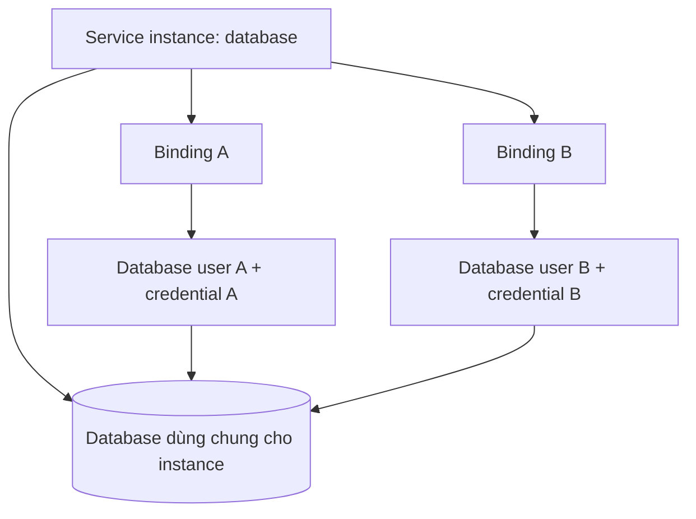
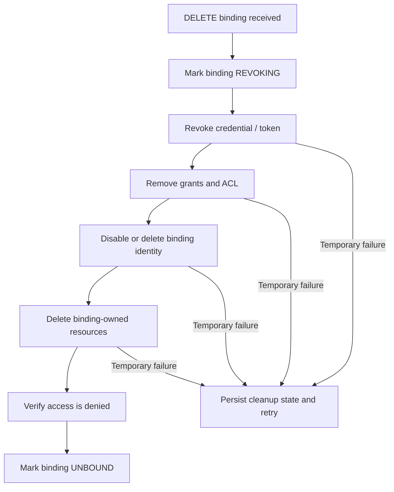

# Thu hồi quyền truy cập, tài khoản và tài nguyên thuộc riêng binding

## 1. Unbind thu hồi những gì?

Service binding đại diện cho quyền mà một ứng dụng hoặc consumer được cấp để sử dụng một service instance. Khi broker tạo binding, nó có thể tạo tài khoản database, password, API key, token, certificate, quyền IAM, ACL, route hoặc cấu hình kết nối riêng cho consumer đó. Khi nền tảng yêu cầu xóa binding, broker phải thu hồi các quyền và tài nguyên được tạo riêng cho binding.

Trong Open Service Broker API (OSB API), thao tác này được gọi là *unbind* và được thực hiện qua endpoint `DELETE /v2/service_instances/{instance_id}/service_bindings/{binding_id}`. Nó có vòng đời độc lập với service instance: unbind kết thúc quyền truy cập của một consumer; deprovision thu hồi chính service instance và tài nguyên mà instance sở hữu.

Với module `SPRING_CLOUD_SERVICE_BROKER`, Spring Cloud Open Service Broker cung cấp request model, response model và service interface để xử lý thao tác unbind. Ứng dụng broker phải xác định chính xác tài nguyên nào thuộc binding, thu hồi quyền tại hệ thống đích, cập nhật trạng thái và lưu dấu vết đủ để xử lý retry hoặc phục hồi lỗi.

Ví dụ, một PostgreSQL service instance có thể được hai ứng dụng binding. Mỗi binding nhận một database role và password riêng. Khi ứng dụng A unbind, broker thu hồi role và password của A; database và role của ứng dụng B vẫn hoạt động. Broker không được xóa cả database instance chỉ vì một binding bị xóa.

## 2. Phân biệt binding-owned resource và instance-owned resource

Trước khi triển khai unbind, cần xác định quyền sở hữu của từng tài nguyên. Một binding thường sở hữu credential và quyền truy cập của một consumer. Service instance sở hữu tài nguyên dịch vụ dùng chung hoặc nền tảng dữ liệu chính.

| Loại tài nguyên | Ví dụ | Khi unbind |
|---|---|---|
| Credential riêng binding | Username/password, API key, OAuth client secret, certificate | Thu hồi hoặc vô hiệu hóa. |
| Identity riêng binding | Database user, service account, application identity | Disable hoặc xóa sau khi đã thu hồi quyền. |
| Grant/ACL riêng binding | Database role grant, bucket policy, queue ACL, IAM policy attachment | Gỡ đúng grant thuộc binding. |
| Cấu hình kết nối riêng binding | Route, endpoint registration, subscription, webhook | Xóa nếu chỉ phục vụ binding đó. |
| Tài nguyên phụ riêng binding | Consumer queue, subscription, client registration, key pair | Xóa theo chính sách của service. |
| Tài nguyên instance | Database, cluster, storage volume chính, shared namespace | Giữ nguyên; xử lý khi deprovision instance. |
| Tài nguyên dùng chung | Shared pool, provider account, common network | Không xóa khi một binding unbind. |

Quy tắc quan trọng: chỉ xóa tài nguyên mà binding thực sự sở hữu. Nếu hai binding dùng chung một identity hoặc một resource, broker cần quản lý reference count hoặc quan hệ owner trước khi xóa. Thiết kế tốt thường tạo credential riêng cho từng binding để việc thu hồi có phạm vi nhỏ và dễ kiểm soát.



Khi unbind A, broker xóa hoặc vô hiệu hóa `UserA` và credential A, đồng thời giữ `UserB` và database. Khi deprovision instance, broker mới xử lý database cùng các tài nguyên instance-owned theo chính sách vòng đời.

## 3. Hợp đồng DELETE Service Binding của OSB API

Endpoint unbind có dạng:

```http
DELETE /v2/service_instances/{instance_id}/service_bindings/{binding_id}?service_id={service_id}&plan_id={plan_id} HTTP/1.1
Host: broker.example.com
Authorization: Basic <broker-credentials>
X-Broker-API-Version: 2.17
Accept: application/json
```

Các thành phần quan trọng:

| Thành phần | Ý nghĩa |
|---|---|
| `instance_id` | ID service instance mà binding trực thuộc. |
| `binding_id` | ID duy nhất của binding do nền tảng cung cấp. |
| `service_id` | ID service definition trong catalog. |
| `plan_id` | ID plan mà instance sử dụng. |
| `accepts_incomplete` | Query parameter tùy chọn cho biết nền tảng có chấp nhận unbind bất đồng bộ hay không. |
| `X-Broker-API-Version` | Phiên bản OSB API được nền tảng sử dụng. |

`service_id` và `plan_id` được truyền qua query string. Broker phải đối chiếu chúng với instance và binding đã lưu. Không dùng giá trị client gửi để tự chọn một tài khoản hoặc provider resource bất kỳ.

Ví dụ request chấp nhận xử lý bất đồng bộ:

```http
DELETE /v2/service_instances/inst-1001/service_bindings/bind-app-a?service_id=managed-database&plan_id=standard&accepts_incomplete=true HTTP/1.1
Host: broker.example.com
Authorization: Basic <broker-credentials>
X-Broker-API-Version: 2.17
```

Broker phải xác thực nền tảng trước khi thu hồi quyền. Không ghi header `Authorization`, password, token hoặc credential binding vào log.

## 4. Response và ý nghĩa của HTTP status

Khi unbind hoàn tất đồng bộ, broker trả `200 OK`. Nếu binding không tồn tại, broker trả `410 Gone` theo hợp đồng OSB API. Nếu thao tác cần chạy nền và request đã chấp nhận bất đồng bộ, broker trả `202 Accepted` kèm operation ID tùy chọn.

| HTTP status | Ý nghĩa |
|---|---|
| `200 OK` | Binding đã được thu hồi thành công đồng bộ. |
| `202 Accepted` | Broker đã tiếp nhận thao tác unbind bất đồng bộ. |
| `401 Unauthorized` | Broker client thiếu hoặc sai thông tin xác thực. |
| `410 Gone` | Binding không còn tồn tại; hoặc được dùng bởi last-operation polling khi unbind bất đồng bộ đã hoàn tất thành công. |
| `422 Unprocessable Entity` | Không thể thực hiện theo trạng thái hiện tại, ví dụ cần async nhưng client không chấp nhận hoặc có xung đột operation. |
| `500 Internal Server Error` | Lỗi không mong đợi trong broker. |
| `502` / `503` / `504` | Provider hoặc dependency gặp lỗi gateway, tạm thời không khả dụng hoặc timeout. |

Response đồng bộ thường không cần body:

```http
HTTP/1.1 200 OK
Content-Length: 0
```

Response bất đồng bộ có thể chứa `operation`:

```http
HTTP/1.1 202 Accepted
Content-Type: application/json

{
  "operation": "unbind-bind-app-a-001"
}
```

`202 Accepted` chỉ xác nhận broker đã nhận công việc. Không được xem credential đã bị thu hồi hoàn toàn chỉ vì broker đã trả response này. Nền tảng sẽ polling last operation của binding để biết khi nào unbind hoàn tất.

Nếu thao tác bắt buộc bất đồng bộ nhưng request không có `accepts_incomplete=true`, broker không được tự ý trả `202`. Hãy trả `422 Unprocessable Entity` với lỗi `AsyncRequired` theo hợp đồng OSB API.

## 5. Thứ tự thu hồi quyền truy cập

Một quy trình unbind an toàn thường gồm nhiều bước. Thứ tự cụ thể phụ thuộc provider, nhưng nên ưu tiên ngăn truy cập mới trước rồi mới dọn identity và tài nguyên phụ.

1. **Đánh dấu binding đang thu hồi:** chuyển binding sang `REVOKING` hoặc trạng thái tương đương, ngăn request cấp quyền mới hoặc thay đổi binding đồng thời.
2. **Vô hiệu hóa credential:** revoke API key, token, certificate hoặc password theo khả năng provider. Nếu có thể, vô hiệu hóa credential trước để cắt quyền truy cập ngay.
3. **Gỡ grant và ACL:** thu hồi quyền database, bucket, queue, topic, IAM hoặc policy gắn với binding.
4. **Disable hoặc xóa identity:** khóa hoặc xóa database user, service account, OAuth client hoặc identity riêng binding.
5. **Xóa cấu hình phụ:** xóa webhook, route, subscription, client registration hoặc tài nguyên chỉ phục vụ binding đó.
6. **Xác minh kết quả:** kiểm tra credential cũ không còn sử dụng được và các quyền đã bị gỡ.
7. **Cập nhật trạng thái:** đánh dấu binding `UNBOUND`, lưu thời điểm, operation và audit record.



Vô hiệu hóa credential trước giúp giảm thời gian quyền truy cập còn hiệu lực nếu bước xóa identity hoặc tài nguyên phụ thất bại. Tuy nhiên, cần kiểm tra đặc tính provider: một số hệ thống yêu cầu thu hồi grant trước khi xóa user, hoặc xóa client identity sẽ tự động thu hồi các token liên quan. Broker nên mã hóa thứ tự này trong adapter và kiểm thử với provider thật hoặc môi trường thử nghiệm.

## 6. Ví dụ thu hồi theo từng loại dịch vụ

### 6.1. Database

Khi tạo binding, broker thường tạo database user riêng và gán quyền trên database của instance. Khi unbind:

- Thu hồi password hoặc credential tương ứng.
- Thu hồi session hoặc token còn hiệu lực nếu database hỗ trợ.
- Gỡ role grant và quyền truy cập database/schema.
- Terminate session của user nếu chính sách yêu cầu cắt truy cập ngay.
- Drop user riêng của binding sau khi xác minh không còn dependency.

Không drop database của instance khi chỉ một binding bị unbind. Ví dụ, nếu `inst-1001` chứa database `orders` và có hai user `app_a` và `app_b`, unbind A chỉ thu hồi `app_a`; dữ liệu `orders` và user `app_b` vẫn được giữ.

### 6.2. Object storage

Một binding có thể nhận access key hoặc policy cho một bucket/prefix. Khi unbind, broker revoke key, xóa policy và gỡ quyền truy cập. Nếu bucket được chia sẻ giữa nhiều binding, không xóa bucket hoặc object dữ liệu của instance. Nếu binding sở hữu một bucket riêng, việc xóa bucket chỉ được thực hiện khi chính sách service quy định rõ và broker xác minh bucket thuộc binding đó.

### 6.3. Message broker

Một binding có thể tạo username, virtual host, queue, topic hoặc ACL riêng. Unbind cần vô hiệu hóa credential, ngắt consumer connection nếu provider hỗ trợ, xóa ACL và xóa queue/topic chỉ thuộc binding. Không xóa exchange, cluster hoặc queue dùng chung của instance khác.

### 6.4. OAuth, API key và certificate

Với dịch vụ cấp API key hoặc OAuth client, broker revoke token/key, disable client, thu hồi certificate và xóa secret reference. Nếu token đã phát hành có thời hạn dài, cần dùng cơ chế introspection/revocation hoặc rotation phù hợp để bảo đảm credential cũ không tiếp tục được chấp nhận.

## 7. Mô hình dữ liệu binding và cleanup operation

Broker nên lưu quan hệ giữa binding, credential và tài nguyên phụ. Điều này giúp xác định đúng phạm vi xóa và tiếp tục cleanup sau khi process restart.

Một mô hình khái niệm:

```text
service_binding
  binding_id
  instance_id
  service_id
  plan_id
  consumer_id
  state                 -- ACTIVE, REVOKING, UNBOUND, CLEANUP_REQUIRED
  created_at
  revoked_at

binding_credential
  id
  binding_id
  credential_reference -- reference tới secret manager
  credential_type
  state                 -- ACTIVE, REVOKED
  revoked_at

binding_resource
  id
  binding_id
  provider_resource_id
  resource_type
  ownership_scope       -- BINDING hoặc SHARED/INSTANCE
  state

binding_operation
  operation_id
  binding_id
  operation_type        -- CREATE hoặc DELETE
  state                 -- PENDING, RUNNING, SUCCEEDED, FAILED
  current_step
  retry_count
  last_error_code
  created_at
  completed_at
```

Đây là schema minh họa, không phải schema OSB API bắt buộc. `ownership_scope` giúp ngăn adapter xóa tài nguyên instance-owned trong luồng unbind. Trong database thực tế, cần foreign key, unique constraint và index phù hợp. `binding_id` cần được kiểm tra cùng `instance_id` và platform context để tránh thao tác nhầm binding ở tenant khác.

Không lưu password, private key hoặc token dạng rõ trong bảng binding. Hãy lưu secret trong secret manager, mã hóa bằng khóa được quản lý phù hợp và chỉ lưu reference cùng metadata tối thiểu. Khi unbind, cập nhật trạng thái reference đã revoke và xóa secret theo chính sách retention.

## 8. Triển khai deleteServiceInstanceBinding() trong Spring Cloud

Spring Cloud Open Service Broker chuyển request HTTP thành `DeleteServiceInstanceBindingRequest` và gọi `deleteServiceInstanceBinding()` trong implementation của `ServiceInstanceBindingService`.

Một implementation đồng bộ minh họa:

```java
import org.springframework.cloud.servicebroker.model.binding.DeleteServiceInstanceBindingRequest;
import org.springframework.cloud.servicebroker.model.binding.DeleteServiceInstanceBindingResponse;
import org.springframework.cloud.servicebroker.service.ServiceInstanceBindingService;
import org.springframework.stereotype.Service;
import reactor.core.publisher.Mono;

@Service
public class BrokerBindingService implements ServiceInstanceBindingService {

    private final BindingCleanupService cleanupService;

    public BrokerBindingService(BindingCleanupService cleanupService) {
        this.cleanupService = cleanupService;
    }

    @Override
    public Mono<DeleteServiceInstanceBindingResponse> deleteServiceInstanceBinding(
            DeleteServiceInstanceBindingRequest request) {

        BindingCleanupCommand command = new BindingCleanupCommand(
                request.getServiceInstanceId(),
                request.getBindingId(),
                request.getServiceDefinitionId(),
                request.getPlanId());

        return cleanupService.revokeSynchronously(command)
                .thenReturn(DeleteServiceInstanceBindingResponse.builder().build());
    }
}
```

`BindingCleanupService` và `BindingCleanupCommand` là thành phần nghiệp vụ do ứng dụng định nghĩa. Ví dụ chỉ thể hiện cách chuyển request OSB sang domain service; xử lý lỗi binding không tồn tại hoặc ID không khớp phải được ánh xạ sang exception OSB phù hợp với phiên bản thư viện.

Nếu cleanup cần thời gian, phương thức có thể ghi operation và trả response bất đồng bộ:

```java
return cleanupService.startOrResume(command)
        .map(operationId -> DeleteServiceInstanceBindingResponse.builder()
                .async(true)
                .operation(operationId)
                .build());
```

Trước khi trả response này, broker phải lưu operation bền vững và bảo đảm worker có thể tiếp tục xử lý. Không trả `async(true)` nếu chỉ tạo một task trong memory của request vì task có thể mất khi process restart.

Không nên đặt logic gọi database provider, thu hồi OAuth client, xóa ACL và xử lý retry trực tiếp trong service interface. Hãy tách `BindingCleanupService` và adapter theo provider để dễ kiểm thử, thay thế và phục hồi.

## 9. Xử lý bất đồng bộ và last operation

OSB API hỗ trợ asynchronous binding từ phiên bản v2.14. Khi unbind cần xử lý nền, broker trả `202 Accepted` cùng operation ID tùy chọn. Nền tảng tiếp tục gọi:

```http
GET /v2/service_instances/{instance_id}/service_bindings/{binding_id}/last_operation?service_id={service_id}&plan_id={plan_id}&operation={operation}
```

Trong Spring Cloud, phương thức `getLastOperation()` của `ServiceInstanceBindingService` trả `GetLastServiceBindingOperationResponse`. Khi thao tác delete hoàn tất thành công, response cần đánh dấu `deleteOperation(true)` cùng `OperationState.SUCCEEDED`; framework ánh xạ trường hợp unbind thành công bất đồng bộ thành HTTP `410 Gone` theo hợp đồng OSB API.

| Trạng thái nội bộ | Last operation | Kết quả |
|---|---|---|
| `PENDING` hoặc `REVOKING` | `IN_PROGRESS` | Nền tảng tiếp tục polling. |
| `UNBOUND` | `SUCCEEDED`, `deleteOperation(true)` | HTTP `410 Gone`, nền tảng ghi nhận binding đã bị xóa. |
| `CLEANUP_FAILED` | `FAILED`, `deleteOperation(true)` | Nền tảng dừng polling; broker tiếp tục quản lý cleanup theo chính sách vận hành. |

Giữ operation record và tombstone binding đủ lâu để request polling đến trễ vẫn nhận được trạng thái cuối. Không xóa bản ghi ngay khi đã revoke credential, vì nền tảng có thể chưa nhận được response polling cuối cùng.

## 10. Idempotency và xử lý retry

Nền tảng có thể gửi lại DELETE khi timeout hoặc mất kết nối. Provider cũng có thể đã revoke credential nhưng broker chưa nhận được response. Vì vậy, unbind phải idempotent.

- Nếu binding đang `REVOKING`, request lặp nên tham chiếu operation hiện tại hoặc tiếp tục cùng quy trình cleanup.
- Nếu binding đã `UNBOUND`, request lặp được xử lý theo ngữ nghĩa `410 Gone`; không tạo credential hoặc tài nguyên mới.
- Nếu provider báo credential hoặc user không tồn tại, có thể coi bước đó đã hoàn tất sau khi xác minh tài nguyên thuộc binding và trạng thái không tồn tại là kết quả mong muốn.
- Nếu cùng `binding_id` nhưng `instance_id` hoặc service/plan không khớp, từ chối request; không xóa tài nguyên dựa trên ID không được xác minh.
- Ghi từng bước cleanup và kết quả trước khi chuyển sang bước tiếp theo.
- Dùng idempotency key nếu provider hỗ trợ; nếu không, tra cứu trạng thái credential/resource trước khi retry.
- Chỉ retry lỗi tạm thời với backoff và giới hạn số lần; lỗi quyền hoặc cấu hình cần được xử lý như lỗi cuối cùng hoặc đưa vào hàng đợi can thiệp.

Không nên xem mọi response `404` từ provider là thành công ngay lập tức. Phải xác định đúng resource ID, tenant và ownership. Nếu ID bị sai, coi `not found` là thành công có thể che giấu việc broker đang cố xóa nhầm tài nguyên.

## 11. Xử lý lỗi một phần và cleanup recovery

Unbind có thể hoàn tất một số bước rồi thất bại ở bước khác. Ví dụ, API key đã bị revoke nhưng provider không xóa được user do lỗi kết nối. Khi đó, binding không còn quyền truy cập mới nhưng vẫn còn identity hoặc tài nguyên phụ cần dọn.

Broker nên lưu `current_step`, trạng thái từng resource và lỗi gần nhất. Khi retry, tiếp tục từ bước chưa hoàn tất; không tạo lại credential hoặc lặp thao tác đã hoàn tất một cách không an toàn.

Một quy trình recovery có thể:

1. Tìm binding `REVOKING` hoặc `CLEANUP_REQUIRED` quá thời hạn.
2. Đọc trạng thái credential và tài nguyên phụ từ provider.
3. Đánh dấu những bước đã hoàn tất dựa trên bằng chứng từ provider.
4. Retry bước còn thiếu bằng idempotency key hoặc thao tác kiểm tra trước.
5. Xác minh không còn quyền truy cập và chuyển binding sang `UNBOUND`.
6. Phát cảnh báo nếu provider không thể thu hồi sau số lần retry cho phép.

Nếu credential đã bị revoke nhưng user chưa bị xóa, broker có thể giữ binding ở `CLEANUP_REQUIRED`. Không trả trạng thái thành công cuối cùng cho nền tảng nếu hợp đồng service cam kết xóa cả identity và resource mà chúng vẫn còn tồn tại. Nếu chính sách cho phép revoke quyền trước và cleanup vật lý sau, cần định nghĩa rõ tiêu chí hoàn tất và theo dõi cleanup nền như một operation riêng.

## 12. Concurrency với create binding và deprovision instance

Broker cần bảo vệ binding khỏi các thao tác đồng thời:

- **Create và delete cùng binding:** dùng lock theo `instance_id`/`binding_id` hoặc optimistic version để tránh cấp credential khi unbind đang chạy.
- **Hai request delete:** chỉ tạo một operation đang chạy; request lặp tham chiếu operation đó.
- **Delete binding và deprovision instance:** deprovision chỉ bắt đầu khi binding đã được unbind hoặc broker có quy trình orchestration rõ ràng để thu hồi toàn bộ binding trước.
- **Hai binding cùng dùng một instance:** unbind một binding không được ảnh hưởng credential, ACL hoặc resource của binding còn lại.
- **Shared resource:** nếu tài nguyên phụ được chia sẻ giữa binding, chỉ xóa khi không còn owner/reference hợp lệ.

Việc kiểm tra binding còn hoạt động phải được thực hiện ở backend, không chỉ dựa vào thứ tự request mà nền tảng thường gửi. Request có thể đến trễ hoặc bị retry sau khi một thao tác khác đã thay đổi trạng thái.

## 13. Bảo mật, audit và bảo vệ secret

Unbind là thao tác thu hồi quyền, vì vậy broker cần bảo đảm thao tác chỉ tác động đúng consumer:

- Xác thực broker client và kiểm tra `instance_id`, `binding_id`, `service_id`, `plan_id`.
- Xác minh binding thuộc instance và platform context tương ứng.
- Dùng provider credential có quyền tối thiểu, giới hạn phạm vi revoke/delete.
- Revoke token, key hoặc certificate sớm theo khả năng provider.
- Không đưa secret vào operation description, exception message hoặc log.
- Mã hóa secret khi lưu và giới hạn quyền đọc secret manager.
- Ghi audit event gồm actor/request identity, binding ID, operation ID, resource type, bước cleanup, thời điểm và kết quả.
- Giữ audit record theo retention policy, kể cả khi binding record đã được dọn khỏi bảng hoạt động.

Nếu broker chạy sau proxy, chỉ tin identity header do proxy tin cậy thiết lập. Không dùng một `app_guid` hoặc context client gửi làm bằng chứng duy nhất về quyền sở hữu binding.

## 14. Kiểm thử unbind

Kiểm thử phải xác minh cả HTTP contract, hành vi provider và phạm vi tài nguyên bị xóa.

| Trường hợp | Kết quả cần xác minh |
|---|---|
| Binding tồn tại, cleanup đồng bộ | Trả `200 OK`; credential và resource riêng binding đã được thu hồi. |
| Binding không tồn tại | Trả `410 Gone`; không tác động tài nguyên khác. |
| Cleanup bất đồng bộ được chấp nhận | Trả `202 Accepted` và operation ID; last operation theo dõi đến trạng thái cuối. |
| Cần async nhưng client không chấp nhận | Trả `422 AsyncRequired`; không giả vờ đã thu hồi. |
| Credential revoke thất bại tạm thời | Lưu trạng thái và retry có kiểm soát. |
| Credential đã bị revoke từ lần gọi trước | Retry không gây lỗi hoặc tác dụng phụ sai. |
| User đã bị xóa | Xác minh ownership rồi coi bước xóa đã hoàn tất. |
| Có hai binding trên một instance | Xóa binding A không ảnh hưởng binding B hoặc tài nguyên instance. |
| Binding resource dùng chung | Chỉ xóa khi không còn binding/reference khác sử dụng. |
| Deprovision chạy đồng thời | Không xóa instance khi binding còn hoạt động hoặc đang cleanup. |
| Broker restart | Worker tiếp tục cleanup từ operation đã lưu. |
| Secret và audit | Secret không xuất hiện trong log; audit ghi đủ kết quả revoke. |

Integration test nên dùng provider giả lập để kiểm tra thứ tự revoke, lỗi giữa các bước, timeout và retry. Một test quan trọng là tạo hai binding trên cùng instance, unbind binding thứ nhất rồi xác minh credential thứ hai và database instance vẫn hoạt động.

## 15. Checklist trước khi đưa unbind vào production

1. Xác định rõ resource ownership: binding-owned, instance-owned hay shared.
2. Xác minh `instance_id`, `binding_id`, `service_id` và `plan_id` trước khi xóa.
3. Revoke credential và grant theo thứ tự an toàn, ưu tiên cắt quyền truy cập mới.
4. Xóa identity, ACL, route và resource chỉ thuộc binding.
5. Giữ nguyên service instance và tài nguyên dùng chung khi một binding unbind.
6. Lưu operation và từng bước cleanup bền vững nếu thao tác bất đồng bộ.
7. Xử lý request lặp và provider timeout theo hướng idempotent.
8. Ngăn create/delete/deprovision xung đột bằng locking hoặc version check.
9. Giữ tombstone và operation đủ lâu cho last-operation polling và audit.
10. Có reconciliation cho binding cleanup dở dang.
11. Bảo vệ secret, provider credential và audit log.
12. Kiểm thử hai binding cùng instance để chứng minh unbind không ảnh hưởng consumer còn lại.

## 16. Nguyên tắc cần ghi nhớ

- Unbind thu hồi quyền và tài nguyên thuộc riêng binding; deprovision thu hồi service instance.
- `DELETE /v2/service_instances/{instance_id}/service_bindings/{binding_id}` là endpoint chuẩn cho unbind.
- Credential, token, certificate, identity và ACL riêng binding phải được revoke hoặc xóa.
- Không xóa database, cluster hoặc tài nguyên instance-owned khi chỉ một binding bị thu hồi.
- `200 OK` xác nhận unbind đồng bộ đã hoàn tất; `202 Accepted` xác nhận broker đã nhận thao tác nền.
- Nếu cần async nhưng client không chấp nhận, trả `422 AsyncRequired`.
- Retry phải idempotent và chỉ xóa tài nguyên đã xác minh thuộc binding.
- Giữ operation/tombstone để last operation trả đúng kết quả sau khi binding đã được thu hồi.
- Có audit và reconciliation để xử lý cleanup một phần, timeout và lỗi provider.

Khi xác định đúng ranh giới sở hữu và thực hiện thu hồi theo từng bước có thể phục hồi, broker có thể chấm dứt quyền của một consumer mà không làm gián đoạn các binding khác hoặc phá hủy service instance đang được sử dụng.
