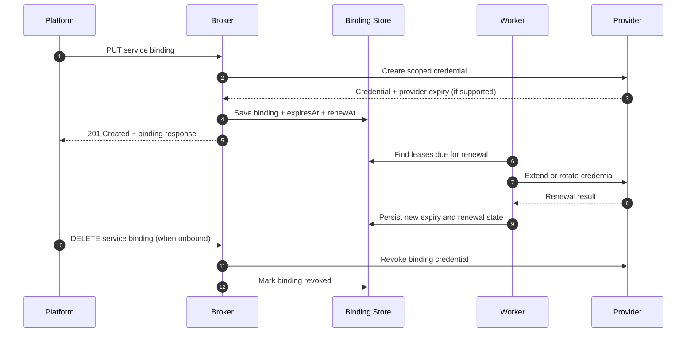
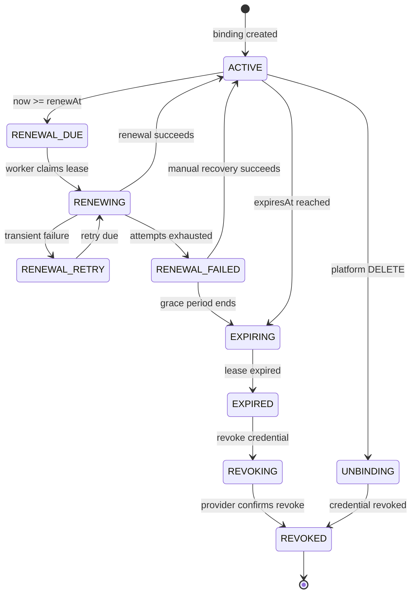

# Thời hạn binding, expiresAt và renewBefore theo khả năng thực tế

Một service binding có thể được cấp quyền truy cập trong một khoảng thời gian nhất định. Ví dụ, broker tạo một database user cho ứng dụng và muốn credential chỉ có hiệu lực trong 24 giờ, hoặc cấp một token cho workload với thời hạn 30 phút. Khi quản lý binding theo dạng lease, broker cần biết thời điểm hết hạn, thời điểm bắt đầu gia hạn và cách thu hồi credential nếu không thể gia hạn.

Trong module `SPRING_CLOUD_SERVICE_BROKER`, các khái niệm `expiresAt` và `renewBefore` giúp mô hình hóa thời hạn binding và thời điểm cần xử lý trước khi lease kết thúc. Tuy nhiên, cần phân biệt rõ mô hình nội bộ của broker với hợp đồng Open Service Broker API (OSB API): OSB API chuẩn không định nghĩa field chung tên `expiresAt`, `renewBefore` hoặc endpoint renew service binding. Broker chỉ có thể triển khai gia hạn tự động bằng cơ chế riêng, khả năng của provider hoặc extension đã được platform và broker thống nhất. Không được quảng bá một khả năng gia hạn mà provider hoặc platform không thực sự hỗ trợ.

## 1. Binding lease là gì?

Binding lease là khoảng thời gian mà một binding được phép sử dụng credential hoặc quyền truy cập đã cấp. Lease có thể được áp dụng cho token, database user, access key, certificate hoặc một quyền truy cập do provider quản lý.

Một binding có thời hạn thường có các mốc:

- `createdAt`: thời điểm broker tạo binding.
- `expiresAt`: thời điểm lease hết hiệu lực theo chính sách.
- `renewBefore`: khoảng thời gian trước `expiresAt` mà broker bắt đầu xử lý gia hạn.
- `renewAt`: thời điểm dự kiến bắt đầu gia hạn, thường được tính bằng `expiresAt - renewBefore`.
- `lastRenewedAt`: lần gia hạn thành công gần nhất.
- `renewalStatus`: trạng thái của lần gia hạn hiện tại hoặc gần nhất.

Ví dụ, credential được cấp lúc 10:00 và có TTL 24 giờ. Nếu `renewBefore` là 30 phút, broker lên lịch gia hạn khoảng 09:30 ngày hôm sau. Thời điểm này là ngưỡng bắt đầu xử lý, không phải cam kết rằng gia hạn sẽ luôn hoàn tất đúng tại thời điểm đó.

Lease thuộc về binding, không phải service instance. Một instance PostgreSQL có thể tồn tại nhiều tháng trong khi binding của ứng dụng A hết hạn sau một ngày và binding của ứng dụng B vẫn còn hiệu lực. Hết hạn binding không đồng nghĩa phải xóa database hoặc deprovision instance.

## 2. expiresAt và renewBefore

`expiresAt` nên được lưu dưới dạng thời điểm tuyệt đối có timezone, tốt nhất là UTC/`Instant`. Không lưu thời điểm hết hạn dưới dạng chuỗi ngày giờ không có timezone hoặc chỉ dựa trên đồng hồ của một JVM.

`renewBefore` nên được định nghĩa rõ là một khoảng thời gian (`Duration`) trước khi hết hạn. Từ đó broker tính:

\[
renewAt = expiresAt - renewBefore
\]

Ví dụ:

```yaml
broker:
  binding-lease:
    default-ttl: 24h
    renew-before: 30m
    renewal-retry-delay: 2m
    renewal-max-attempts: 5
    expiry-grace-period: 5m
```

Đây là cấu hình do ứng dụng tự định nghĩa, không phải các property chuẩn của Spring Boot hay OSB API. Ý nghĩa các giá trị phải được kiểm tra theo từng provider và plan. Một số credential không thể gia hạn; một số provider cho phép gia hạn TTL; một số chỉ hỗ trợ tạo credential mới rồi thu hồi credential cũ.

Ví dụ mô hình Java:

```java
import java.time.Duration;
import java.time.Instant;

public record BindingLease(
        Instant createdAt,
        Instant expiresAt,
        Duration renewBefore,
        Instant lastRenewedAt
) {
    public Instant renewAt() {
        return expiresAt.minus(renewBefore);
    }

    public boolean renewalDue(Instant now) {
        return !now.isBefore(renewAt()) && now.isBefore(expiresAt);
    }

    public boolean expired(Instant now) {
        return !now.isBefore(expiresAt);
    }
}
```

Ở môi trường production, cần validate `renewBefore` dương, nhỏ hơn TTL và đủ lớn để provider hoàn tất gia hạn. Nếu `renewBefore` bằng hoặc lớn hơn TTL, lease có thể bị đánh dấu cần gia hạn ngay khi tạo. Cũng cần kiểm tra overflow và giới hạn TTL tối đa theo chính sách dịch vụ.

## 3. OSB API chuẩn hỗ trợ đến đâu?

OSB API định nghĩa các thao tác tạo và xóa binding, điển hình là:

- `PUT /v2/service_instances/{instance_id}/service_bindings/{binding_id}` để tạo binding.
- `DELETE /v2/service_instances/{instance_id}/service_bindings/{binding_id}` để unbind.

Response tạo binding có thể chứa `credentials` và các trường chuyên biệt như `syslog_drain_url`, `route_service_url` hoặc `volume_mounts` tùy loại dịch vụ. Object `credentials` có thể chứa các trường do broker định nghĩa, nhưng platform không tự động hiểu mọi thuộc tính tùy chỉnh.

OSB API chuẩn không cung cấp endpoint chung kiểu `POST /service_bindings/{id}/renew`, cũng không định nghĩa `expiresAt` hay `renewBefore` như field chuẩn trong service binding response. Vì vậy:

1. `expiresAt`, `renewBefore`, `renewAt` và trạng thái lease có thể là dữ liệu nội bộ trong broker.
2. Nếu platform cần biết thời điểm hết hạn, broker và platform phải thống nhất một extension hoặc quy ước custom, ví dụ một thuộc tính trong `credentials` mà consumer có thể đọc.
3. Nếu không có tích hợp custom, platform không thể được giả định sẽ tự động gia hạn hoặc cập nhật credential chỉ vì broker lưu `expiresAt`.
4. Gia hạn do broker tự thực hiện với provider không đồng nghĩa ứng dụng đã nhận được credential mới.

Không đặt một custom field vào response rồi coi đó là tính năng portable trên mọi platform. Hãy xác nhận cách Cloud Foundry, Kubernetes controller hoặc adapter cụ thể xử lý trường mở rộng trước khi phụ thuộc vào nó.

## 4. Kiểm tra khả năng thực tế của provider

Trước khi bật lease, broker phải biết provider hỗ trợ những thao tác nào. Có thể phân loại:

| Khả năng provider | Cách broker quản lý lease |
|---|---|
| Credential có TTL và provider tự hết hạn | Lưu `expiresAt`, theo dõi thời điểm hết hạn và xử lý credential mới nếu cần. |
| Có API gia hạn cùng credential | Gọi API extend trước `renewAt`, xác nhận TTL mới rồi cập nhật trạng thái. |
| Chỉ tạo được credential mới | Tạo credential thay thế, cập nhật đường phân phối tới consumer, sau đó mới revoke credential cũ. |
| Chỉ revoke, không có TTL/renew | Broker có thể chủ động revoke theo lịch nếu có scheduler đáng tin cậy; không được tuyên bố provider tự hết hạn. |
| Không thể xác định hoặc thu hồi credential | Không nên bật lease tự động cho loại binding đó nếu không có lớp kiểm soát thay thế. |

Một số hệ thống chỉ cho phép đổi password của database user, nhưng không hỗ trợ hai password đồng thời. Nếu đổi password ngay, ứng dụng đang dùng password cũ có thể mất kết nối trước khi nhận được thông tin mới. Với trường hợp này, cần thiết kế credential rotation có giai đoạn chồng lấp, tạo user mới, proxy credential hoặc một quy trình phối hợp với platform/application.

Nếu provider không có khả năng gia hạn, broker vẫn có thể quản lý `expiresAt` nội bộ và chủ động revoke khi đến hạn. Nhưng điều đó là chính sách hết hạn của broker, không phải provider lease native. Cần có worker bền vững, cơ chế phục hồi và cảnh báo nếu scheduler không chạy.

## 5. Vòng đời lease của một binding

Một luồng cơ bản bắt đầu khi platform gọi PUT binding:

1. Broker xác thực request, kiểm tra service instance, plan, consumer và quyền bind.
2. Broker xác định policy TTL theo service/plan và chính sách tenant.
3. Provider tạo credential có TTL hoặc broker tạo credential theo cơ chế quản lý riêng.
4. Broker lưu binding record, secret reference và lease (`createdAt`, `expiresAt`, `renewBefore`, `renewAt`).
5. Broker trả response binding theo OSB API; chỉ đưa thông tin thời hạn vào extension/credentials nếu platform đã thống nhất cách sử dụng.
6. Scheduler/worker tìm các lease đến hạn gia hạn.
7. Broker gia hạn hoặc xoay credential, xác minh kết quả và cập nhật lease.
8. Nếu không thể gia hạn, broker áp dụng retry, grace period hoặc thu hồi theo chính sách.

Sơ đồ tổng quát:



## 6. State machine cho binding lease

Nên tách trạng thái binding khỏi trạng thái lần gia hạn. Ví dụ state machine nội bộ:



Đây là state machine minh họa; một hệ thống có thể dùng ít trạng thái hơn. Cần xác định rõ:

- `ACTIVE`: credential đang có hiệu lực.
- `RENEWAL_DUE`: đã tới ngưỡng cần gia hạn.
- `RENEWING`: một worker đang thực hiện gia hạn.
- `RENEWAL_RETRY`: lần gia hạn thất bại tạm thời và có lịch retry.
- `RENEWAL_FAILED`: không thể gia hạn tự động theo giới hạn đã đặt.
- `EXPIRING`/`EXPIRED`: đã tới hạn hết hiệu lực theo policy.
- `REVOKING`/`REVOKED`: broker đang thu hồi hoặc đã thu hồi credential.
- `UNBINDING`: platform yêu cầu unbind, cần hủy lịch renewal và revoke credential.

Một binding `EXPIRED` vẫn có thể còn bản ghi để audit/idempotency. Không xóa toàn bộ record ngay khi lease hết hạn vì broker cần biết credential nào phải revoke và request retry nào đang tham chiếu binding đó.

## 7. Gia hạn cùng credential và xoay credential

Hai thao tác thường được gọi chung là renewal nhưng có hệ quả khác nhau.

### Gia hạn TTL của credential hiện tại

Nếu provider hỗ trợ API kéo dài thời hạn của cùng credential, broker gọi API đó trước `renewAt`, kiểm tra provider xác nhận TTL mới rồi cập nhật `expiresAt`. Consumer tiếp tục dùng cùng giá trị credential nên không cần phân phối lại secret, nếu provider thật sự giữ nguyên credential.

### Xoay sang credential mới

Nếu provider chỉ hỗ trợ tạo credential mới, broker phải quản lý chuyển đổi:

1. Tạo credential mới với quyền tương đương hoặc quyền đã được cập nhật.
2. Lưu secret mới an toàn và xác minh credential mới có thể sử dụng.
3. Phân phối credential mới qua kênh mà platform/consumer thực sự hỗ trợ.
4. Chờ xác nhận hoặc khoảng thời gian chuyển tiếp phù hợp.
5. Revoke credential cũ sau khi consumer đã chuyển đổi.
6. Cập nhật `expiresAt`, `lastRenewedAt` và trạng thái binding.

Nếu platform chỉ cung cấp credential một lần qua response PUT và không có cơ chế refresh secret, broker không thể âm thầm thay credential trong ứng dụng đang chạy. Các lựa chọn là dùng proxy/credential gateway với secret phía sau có thể xoay, dùng cơ chế secret synchronization riêng đã thống nhất với platform, hoặc yêu cầu consumer thực hiện bind lại theo quy trình được hỗ trợ. Không revoke credential cũ trước khi có phương thức bảo đảm consumer nhận và dùng được credential mới.

## 8. Scheduler và worker bền vững trong Spring

Có thể dùng Spring Scheduling để kích hoạt việc tìm lease đến hạn, nhưng không nên dùng một `@Scheduled` job chỉ dựa vào memory của một replica. Broker thường chạy nhiều instance; nhiều worker có thể cùng nhìn thấy một lease và gia hạn trùng.

Một thiết kế đáng tin cậy:

- Lưu `expires_at`, `renew_at`, `lease_state`, `next_attempt_at` và `attempt_count` trong database.
- Scheduler định kỳ tìm các record đến hạn.
- Worker claim từng record bằng row lock, lease lock hoặc compare-and-set có version.
- Lưu operation/renewal attempt trước khi gọi provider.
- Gọi provider với idempotency key ổn định nếu API hỗ trợ.
- Lưu kết quả provider và thời hạn mới trong transaction sau khi xác nhận.
- Nếu worker dừng giữa chừng, lease lock hết hạn để worker khác tiếp tục.
- Dùng transactional outbox nếu cần phát job tới queue mà không mất công việc sau khi database commit.

Ví dụ cấu hình:

```yaml
broker:
  binding-lease:
    scan-interval: 30s
    default-ttl: 24h
    renew-before: 30m
    renewal-retry-delay: 2m
    renewal-max-attempts: 5
    expiry-grace-period: 5m
```

Ví dụ component kích hoạt scan:

```java
@Component
public class BindingLeaseScheduler {
    private final BindingLeaseWorker worker;

    public BindingLeaseScheduler(BindingLeaseWorker worker) {
        this.worker = worker;
    }

    @Scheduled(fixedDelayString = "${broker.binding-lease.scan-interval:30s}")
    public void scanDueLeases() {
        worker.claimAndProcessDueLeases();
    }
}
```

`claimAndProcessDueLeases()` cần dùng cơ chế claim nguyên tử trong kho dữ liệu. Không để tất cả replica chỉ chạy `findDueLeases()` rồi gọi provider trực tiếp, vì cùng một binding có thể bị gia hạn đồng thời. Với ứng dụng reactive, cần chọn scheduler và client phù hợp; không chặn event loop bằng JDBC hoặc SDK blocking.

## 9. Xử lý thời gian và clock skew

Thời hạn credential phụ thuộc đồng hồ. Nếu các replica lệch giờ, một worker có thể gia hạn quá sớm hoặc quá muộn. Nên:

- Lưu `Instant` UTC trong database.
- Đồng bộ thời gian máy chủ bằng NTP hoặc dịch vụ thời gian của nền tảng.
- Dùng `Clock` được inject vào domain service để kiểm thử thời gian.
- Dùng thời gian do provider trả về làm nguồn tham chiếu khi provider cung cấp expiry timestamp đáng tin cậy.
- Tính buffer an toàn cho network latency, queue delay và clock skew.
- Không dùng `LocalDateTime` không timezone để quyết định revoke credential.
- Kiểm tra thời hạn provider sau khi renew; không tự cộng TTL vào thời điểm hiện tại nếu provider trả về một expiry khác.

Ví dụ:

```java
Instant now = clock.instant();
Instant renewAt = lease.expiresAt().minus(lease.renewBefore());

if (!now.isBefore(renewAt)) {
    renewalService.schedule(lease.bindingId());
}
```

Đoạn mã này chỉ kiểm tra điều kiện thời gian. Việc claim lease, ngăn xử lý trùng và cập nhật trạng thái phải được thực hiện trong repository/worker có tính nguyên tử.

## 10. Retry, grace period và gia hạn thất bại

Gia hạn có thể thất bại do provider rate limit, timeout, lỗi mạng, credential quản trị hết hạn hoặc service instance đang bị thu hồi. Broker cần phân loại lỗi:

| Loại lỗi | Hướng xử lý |
|---|---|
| Timeout/lỗi mạng tạm thời | Retry với exponential backoff và jitter. |
| Rate limit | Tôn trọng `Retry-After` nếu provider trả về, giảm tốc độ gọi. |
| Provider từ chối do credential quản trị | Dừng retry mù quáng, phát cảnh báo vận hành. |
| Binding đã unbind | Hủy renewal; không tạo lại credential. |
| Instance đang deprovision | Dừng renewal và phối hợp với luồng cleanup. |
| Credential không thể gia hạn | Chuyển sang rotation hoặc báo không hỗ trợ renewal. |
| Hết số lần retry | Đánh dấu `RENEWAL_FAILED`, áp dụng grace policy và cảnh báo. |

Grace period là khoảng thời gian sau `expiresAt` mà broker cho phép xử lý phục hồi trước khi revoke hoặc đánh dấu binding không còn hợp lệ. Grace period chỉ có ý nghĩa nếu provider vẫn giữ credential hoạt động hoặc có cơ chế kiểm soát tương đương. Nếu provider tự động vô hiệu hóa token chính xác tại expiry, broker không thể kéo dài hiệu lực bằng grace period nội bộ.

Chính sách khi gia hạn thất bại phải được công bố rõ: giữ credential cũ đến expiry, thử rotation, thông báo platform qua extension đã thống nhất, hoặc revoke khi hết hạn. Không kéo dài `expiresAt` trong database chỉ để che lỗi provider; thời hạn lưu trong broker phải phản ánh thời hạn thật mà provider bảo đảm.

## 11. Phối hợp với unbind và deprovision

Renewal có thể chạy đúng lúc platform gửi DELETE binding hoặc deprovision instance. Broker cần đồng bộ các luồng:

- Khi bắt đầu unbind, chuyển binding sang `UNBINDING` và ngăn worker claim renewal mới.
- Nếu worker đã claim lease, dùng version/state check trước khi ghi kết quả; không cho renewal chuyển một binding đã unbind trở lại `ACTIVE`.
- Revoke credential của binding và xác nhận kết quả theo hợp đồng unbind.
- Hủy job renewal đang chờ hoặc đánh dấu chúng không còn hợp lệ.
- Khi instance chuyển `DEPROVISIONING`, dừng gia hạn tất cả binding thuộc instance và thực hiện thứ tự cleanup phù hợp.
- Không để renewal tạo credential mới sau khi instance đã bắt đầu deprovision.

Có thể dùng optimistic locking trên binding record. Ví dụ worker đọc `version=5`, nhưng unbind đã cập nhật record lên `version=6`; worker chỉ được commit nếu version vẫn là 5 và trạng thái vẫn cho phép renewal. Nếu không, worker bỏ kết quả hoặc thực hiện compensation/revoke credential vừa tạo.

## 12. Idempotency và phục hồi sau restart

Một lần gia hạn có thể bị gửi lại do worker restart hoặc timeout. Để tránh cấp nhiều credential:

1. Dùng binding ID kết hợp renewal generation/sequence làm khóa operation.
2. Lưu một renewal attempt duy nhất cho mỗi generation.
3. Gửi idempotency key ổn định tới provider nếu API hỗ trợ.
4. Nếu provider đã tạo credential nhưng broker mất response, tra cứu theo external operation ID hoặc idempotency key trước khi tạo lại.
5. Lưu secret mới vào secret manager trước khi đánh dấu renewal thành công.
6. Chỉ chuyển `expiresAt` sau khi provider xác nhận TTL mới hoặc credential mới đã sẵn sàng.
7. Khi unbind, vô hiệu hóa generation hiện tại để các worker cũ không thể ghi trạng thái trở lại.

Không lưu secret thô trong renewal attempt. Record chỉ nên giữ operation ID, provider resource ID, secret reference, trạng thái và mã lỗi đã làm sạch.

## 13. Ví dụ model và service xử lý lease

Một domain model có thể tách dữ liệu binding khỏi lease:

```java
public record BindingLeasePolicy(
        Duration ttl,
        Duration renewBefore,
        Duration retryDelay,
        Duration gracePeriod,
        int maxAttempts
) {
    public BindingLeasePolicy {
        if (ttl == null || ttl.isNegative() || ttl.isZero()) {
            throw new IllegalArgumentException("ttl must be positive");
        }
        if (renewBefore == null || renewBefore.isNegative()
                || renewBefore.isZero() || renewBefore.compareTo(ttl) >= 0) {
            throw new IllegalArgumentException("renewBefore must be positive and less than ttl");
        }
        if (maxAttempts < 1) {
            throw new IllegalArgumentException("maxAttempts must be at least one");
        }
    }
}
```

Service tạo lease khi provider trả kết quả:

```java
public BindingLease createLease(Instant providerExpiresAt,
                                BindingLeasePolicy policy,
                                Clock clock) {
    Instant now = clock.instant();
    Instant expiry = providerExpiresAt != null
            ? providerExpiresAt
            : now.plus(policy.ttl());

    if (!expiry.isAfter(now)) {
        throw new IllegalStateException("Provider credential is already expired");
    }

    return new BindingLease(now, expiry, policy.renewBefore(), null);
}
```

Nếu provider trả expiry, dùng giá trị đã xác nhận đó thay vì giả định TTL luôn đúng tuyệt đối. Nếu provider không trả expiry nhưng tài liệu API bảo đảm TTL bắt đầu tại thời điểm tạo, broker có thể tính từ thời điểm provider xác nhận tạo credential. Cần ghi rõ nguồn của expiry để vận hành hiểu độ tin cậy.

## 14. Quan sát và cảnh báo

Lease cần có metric và log đủ để phát hiện credential sắp hết hạn hoặc worker không theo kịp lịch:

- Số binding đang hoạt động theo service/plan và trạng thái lease.
- Số lease đến hạn trong khoảng thời gian tiếp theo.
- Số renewal thành công/thất bại và tỷ lệ retry.
- Độ trễ từ `renewAt` tới lúc worker bắt đầu xử lý.
- Số binding đã hết hạn nhưng chưa revoke.
- Tuổi của operation đang `RENEWING` hoặc bị kẹt.
- Số credential rotation đang chờ consumer/platform xác nhận.

Log nên dùng binding ID, instance ID, renewal generation và error code đã chuẩn hóa. Không log password, token, secret reference có quyền truy cập trực tiếp hoặc provider response chứa credential. Metric label không nên dùng binding ID vì cardinality cao và có thể làm lộ định danh tenant.

Nên cảnh báo khi:

- Có lease sắp hết hạn nhưng chưa được claim.
- Renewal thất bại vượt ngưỡng.
- Worker backlog khiến `renewAt` bị trễ đáng kể.
- Credential đã hết hạn nhưng provider chưa xác nhận revoke.
- Một replica liên tục mất lease lock hoặc có renewal conflict.

## 15. Kiểm thử thời hạn và renewal

Không nên kiểm thử thời gian bằng cách chờ thật nhiều giờ. Inject `Clock` và dùng clock giả để kiểm soát các mốc.

Các ca kiểm thử cần có:

1. Binding được tạo với TTL và `expiresAt` đúng theo provider/policy.
2. `renewAt` bằng `expiresAt - renewBefore` và không bị tính sai timezone.
3. Trước `renewAt`, worker không gia hạn sớm ngoài chính sách.
4. Đến `renewAt`, chỉ một worker claim được lease.
5. Provider extend thành công thì `expiresAt` được cập nhật theo kết quả xác nhận.
6. Provider tạo credential mới thì secret mới được lưu trước khi đánh dấu thành công.
7. Rotation không revoke credential cũ trước khi consumer có đường chuyển đổi.
8. Retry dùng cùng idempotency key và không tạo nhiều credential.
9. Hết retry chuyển sang `RENEWAL_FAILED` và phát cảnh báo.
10. Grace period không kéo dài thời hạn mà provider không hỗ trợ.
11. Unbind đồng thời ngăn worker gia hạn và thu hồi credential đúng một lần.
12. Deprovision instance dừng renewal của tất cả binding liên quan.
13. Worker restart có thể phục hồi renewal attempt đang dang dở.
14. Log, trace và response không chứa secret.

Ví dụ kiểm thử tính thời gian:

```java
Instant createdAt = Instant.parse("2026-01-10T10:00:00Z");
Clock clock = Clock.fixed(createdAt, ZoneOffset.UTC);
Duration ttl = Duration.ofHours(24);
Duration renewBefore = Duration.ofMinutes(30);

BindingLease lease = new BindingLease(
        createdAt,
        createdAt.plus(ttl),
        renewBefore,
        null
);

assertEquals(
        Instant.parse("2026-01-11T09:30:00Z"),
        lease.renewAt()
);
assertTrue(lease.renewalDue(clock.instant().plus(Duration.ofHours(23).plusMinutes(30))));
```

Đoạn test minh họa cần import assertion và `ZoneOffset` trong test class. Với worker integration, dùng provider giả lập để kiểm tra retry, timeout, response bị mất sau side effect và worker restart.

## 16. Checklist trước khi bật binding lease

- Provider có TTL, extend, rotate hoặc revoke phù hợp với chính sách đã chọn.
- `expiresAt` lấy từ nguồn đáng tin cậy và lưu theo UTC/Instant.
- `renewBefore` là khoảng thời gian hợp lệ, nhỏ hơn TTL và đủ cho thời gian xử lý.
- OSB API và platform không bị hiểu nhầm là có field/endpoint renewal chuẩn.
- Nếu platform cần biết expiry hoặc nhận credential mới, extension/tích hợp custom đã được thống nhất và kiểm thử.
- Scheduler/worker chạy bền vững trên nhiều replica, có claim/lock và phục hồi sau restart.
- Renewal có idempotency key, retry có giới hạn và xử lý timeout không rõ kết quả.
- Rotation giữ credential cũ cho tới khi consumer có thể dùng credential mới.
- Unbind/deprovision hủy renewal và ngăn worker cũ hồi sinh binding.
- Grace period phản ánh khả năng thật của provider.
- Có metric, cảnh báo, audit và kiểm thử clock/expiry/renewal.
- Không ghi secret vào database trạng thái thông thường, log, trace hoặc metric.

Thời hạn binding chỉ đáng tin khi broker biết provider thực sự hỗ trợ TTL, gia hạn và thu hồi ở mức nào. Hãy lưu `expiresAt` như thời điểm hết hạn đã được xác nhận, dùng `renewBefore` để bắt đầu công việc đủ sớm, điều phối worker bền vững và bảo đảm consumer có thể nhận credential mới trước khi thu hồi credential cũ. Khi platform không có cơ chế renewal chuẩn của OSB API, hãy dùng extension đã thống nhất hoặc giữ lease như chính sách nội bộ của broker; không giả định mọi platform sẽ tự hiểu các trường tùy chỉnh.
