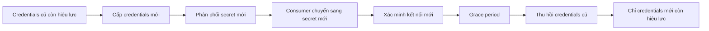
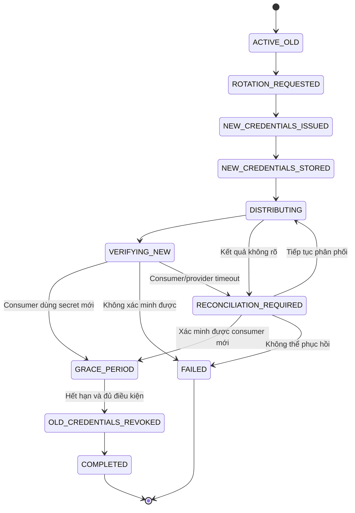

# Phân phối credentials mới và kết thúc thời gian chuyển tiếp an toàn

Credentials của một service binding cho phép ứng dụng truy cập database, cache, message broker hoặc một tài nguyên được quản lý. Theo thời gian, credentials có thể cần được thay mới vì đến hạn xoay vòng, nhân sự thay đổi, nghi ngờ bị lộ, chính sách bảo mật thay đổi hoặc nhà cung cấp yêu cầu thu hồi khóa cũ. Nếu thu hồi credentials đang dùng trước khi ứng dụng nhận và xác minh credentials mới, ứng dụng có thể mất kết nối và gián đoạn dịch vụ.

Một quy trình xoay vòng an toàn cần tạo ra khoảng thời gian chuyển tiếp có kiểm soát: credentials mới được cấp và phân phối, consumer chuyển sang sử dụng, broker xác minh kết nối mới, rồi credentials cũ mới bị thu hồi. Thời gian chuyển tiếp phải đủ cho việc triển khai và làm mới connection pool, nhưng cũng cần có giới hạn để credentials cũ không tiếp tục tồn tại vô thời hạn.

Trong module `SPRING_CLOUD_SERVICE_BROKER`, credentials thường được tạo khi thực hiện service binding và trả về trong response của OSB API. Broker quản lý vòng đời binding và tích hợp với backing service; platform phân phối thông tin binding cho ứng dụng theo cơ chế riêng. Bài học này trình bày cách phối hợp các thành phần đó để xoay vòng credentials mà không làm mất khả năng truy cập của consumer.

## Mục tiêu học tập

Sau bài này, bạn có thể:

- Giải thích vì sao cần xoay vòng credentials và vì sao phải có thời gian chuyển tiếp.
- Phân biệt credentials của ứng dụng, credentials quản trị của broker và thông tin xác thực platform.
- Thiết kế quy trình cấp credentials mới song song với credentials cũ.
- Phân phối và xác minh credentials mới trước khi thu hồi credentials cũ.
- Chọn thời gian grace period dựa trên rollout, connection pool, token TTL và đặc điểm consumer.
- Xử lý lỗi, retry, rollback và reconciliation trong quá trình rotation.
- Tổ chức logic rotation trong Spring Cloud Service Broker và tích hợp secret manager.
- Hiểu ranh giới của OSB API khi cần cập nhật thông tin binding đã tồn tại.

## 1. Credentials của binding và lý do phải xoay vòng

Khi platform gọi bind cho một service instance, broker có thể tạo một principal hoặc credential riêng ở backing service rồi trả thông tin truy cập cho platform. Ví dụ, một binding PostgreSQL có thể chứa URI, username, password và chế độ TLS:

```json
{
  "credentials": {
    "uri": "postgresql://db.example.internal:5432/orders",
    "username": "orders_app_v1",
    "password": "<secret>",
    "sslmode": "require"
  }
}
```

`<secret>` chỉ là placeholder minh họa. Credentials thực tế phải được tạo ngẫu nhiên hoặc lấy từ cơ chế cấp phát an toàn của provider. Không ghi password thật vào tài liệu, source code, log hoặc ví dụ dùng chung.

Credentials có thể cần xoay vòng vì nhiều lý do:

- **Đến hạn:** chính sách yêu cầu thay password, token hoặc certificate theo chu kỳ.
- **Nghi ngờ bị lộ:** secret xuất hiện trong log, ticket, shell history hoặc hệ thống không đáng tin cậy.
- **Thay đổi quyền:** ứng dụng cần giảm quyền, đổi role hoặc giới hạn phạm vi truy cập.
- **Thay đổi nhân sự hoặc hệ thống:** tài khoản cũ cần được thu hồi khi consumer hoặc chủ sở hữu thay đổi.
- **Yêu cầu provider:** nhà cung cấp buộc thay khóa, certificate hoặc thông tin xác thực.
- **Khôi phục sau sự cố:** credentials cũ có thể đã bị vô hiệu hóa hoặc không còn đáp ứng chính sách.

### 1.1. Phân biệt ba loại thông tin xác thực

Trong broker có thể tồn tại nhiều credentials với quyền và vòng đời khác nhau:

| Loại | Chủ thể sử dụng | Ví dụ | Cách quản lý |
|---|---|---|---|
| Binding credentials | Ứng dụng hoặc consumer | Database user/password, token truy cập queue | Xoay vòng theo binding; cấp quyền tối thiểu và thu hồi theo consumer. |
| Provider credentials | Broker dùng để gọi hệ thống cung cấp dịch vụ | API token quản trị database hoặc cloud | Lưu trong secret manager; không trả cho ứng dụng. |
| Platform-to-broker credentials | Platform dùng để xác thực khi gọi broker | HTTP Basic credentials hoặc cơ chế xác thực broker đã cấu hình | Quản lý độc lập với credentials của từng binding. |

Không dùng provider admin credential làm binding credential. Nếu ứng dụng nhận được thông tin xác thực quản trị mà broker dùng để tạo database, ứng dụng có thể tác động tới nhiều tenant hoặc tài nguyên ngoài phạm vi của nó.

## 2. Vì sao cần thời gian chuyển tiếp?

Giả sử ứng dụng `orders-api` đang sử dụng database user `orders_app_v1`. Broker tạo user mới `orders_app_v2` và thu hồi user cũ ngay lập tức. Nếu ứng dụng vẫn đang giữ password cũ trong environment, secret store, connection pool hoặc process chưa restart, các kết nối mới có thể bị từ chối.

Một quy trình an toàn giữ cả hai credentials hợp lệ trong thời gian chuyển tiếp:



Trong khoảng giao nhau, ứng dụng cũ vẫn có thể hoàn tất rollout, trong khi instance mới đã sử dụng credentials mới. Sau khi có đủ bằng chứng consumer đã chuyển đổi, broker thu hồi credentials cũ và kết thúc rotation.

### 2.1. Nguyên tắc hai bộ credentials cùng tồn tại

Nếu provider hỗ trợ nhiều principal hoặc nhiều secret đồng thời, hãy tạo một bộ credentials mới độc lập. Không ghi đè password của user cũ ngay khi bắt đầu rotation. Cách làm song song giúp broker có thể:

- Giữ ứng dụng đang chạy tiếp tục kết nối bằng credentials cũ.
- Phân phối credentials mới cho phiên bản ứng dụng tiếp theo.
- Kiểm tra quyền và khả năng kết nối của credentials mới trước khi chuyển traffic.
- Quay lại cấu hình cũ nếu rollout thất bại trong lúc credentials cũ vẫn còn hiệu lực.

Không phải provider nào cũng hỗ trợ hai credentials đồng thời. Nếu chỉ có một secret có thể thay thế tại chỗ, broker cần phối hợp maintenance window hoặc cơ chế rotate riêng của provider, và phải thông báo rõ nguy cơ gián đoạn. Không thể hứa zero-downtime khi backing service không hỗ trợ overlap.

### 2.2. Grace period không phải thời gian vô hạn

Grace period là khoảng thời gian credentials cũ vẫn được phép sử dụng sau khi credentials mới được cấp hoặc phân phối. Khoảng này cần có thời điểm bắt đầu, thời điểm hết hạn, chủ sở hữu và điều kiện kết thúc rõ ràng.

Nếu để credentials cũ hoạt động vô thời hạn, lợi ích bảo mật của rotation giảm đáng kể. Nếu kết thúc quá sớm, consumer chưa cập nhật xong có thể mất kết nối. Vì vậy, grace period cần dựa trên đặc điểm triển khai và được giới hạn bằng deadline.

## 3. Ranh giới của OSB API khi xoay vòng credentials

OSB API định nghĩa các thao tác chuẩn như catalog, provision, update service instance, deprovision, bind và unbind. Trong đó, `PUT /v2/service_instances/{instance_id}/service_bindings/{binding_id}` tạo binding và broker trả credentials trong response binding khi thao tác hoàn tất.

OSB API không định nghĩa một endpoint chuẩn riêng kiểu “rotate credentials” hoặc “update credentials của binding hiện có”. Vì vậy, broker không nên tự giả định rằng platform sẽ tự động nhận secret mới chỉ vì broker đã đổi password ở provider hoặc thay dữ liệu trong database nội bộ.

Một số cách triển khai thường gặp:

1. **Tạo binding mới:** tạo credentials mới dưới một `binding_id` khác, phân phối cho consumer, xác minh rồi unbind binding cũ. Cách này phù hợp khi provider hỗ trợ nhiều principal và platform cho phép nhiều binding cùng instance.
2. **Dùng cơ chế rotation của provider:** provider tạo secret version mới hoặc cho phép nhiều key cùng hoạt động. Broker điều phối việc cập nhật consumer qua cơ chế riêng của platform hoặc secret manager.
3. **Xoay vòng tại chỗ:** provider thay credentials của một principal hiện có. Cách này chỉ an toàn khi consumer có thể được cập nhật đồng bộ hoặc có một cơ chế overlap do provider hỗ trợ.

OSB API có capability `bindings_retrievable` để platform truy xuất lại thông tin binding qua endpoint fetch khi cần. Capability này hỗ trợ khôi phục dữ liệu binding theo hợp đồng; không nên coi nó là một cơ chế push notification hoặc cam kết rằng mọi platform sẽ tự động cập nhật environment của ứng dụng ngay khi credentials thay đổi.

Platform có thể cần restart/re-stage ứng dụng, cập nhật secret reference hoặc dùng một cơ chế refresh riêng. Broker phải xác định rõ cách platform nhận thông tin mới trước khi thu hồi credentials cũ.

## 4. Mô hình trạng thái rotation

Rotation là một quy trình nhiều bước, vì vậy nên lưu trạng thái riêng thay vì chỉ thay một password field trong binding record.

Một state model nội bộ tham khảo:

| Trạng thái | Ý nghĩa |
|---|---|
| `ACTIVE_OLD` | Binding hiện tại đang dùng credentials cũ. |
| `ROTATION_REQUESTED` | Có yêu cầu xoay vòng và đã qua kiểm tra ban đầu. |
| `NEW_CREDENTIALS_ISSUED` | Provider đã tạo credentials mới. |
| `NEW_CREDENTIALS_STORED` | Secret mới đã được lưu an toàn và có version/reference. |
| `DISTRIBUTING` | Platform hoặc secret distribution mechanism đang cập nhật consumer. |
| `VERIFYING_NEW` | Broker/consumer đang xác minh kết nối và quyền bằng credentials mới. |
| `GRACE_PERIOD` | Credentials cũ và mới cùng còn hiệu lực trong thời hạn đã định. |
| `OLD_CREDENTIALS_REVOKED` | Credentials cũ đã bị thu hồi ở provider. |
| `COMPLETED` | Rotation hoàn tất và chỉ credentials mới còn hiệu lực. |
| `FAILED` | Rotation kết thúc thất bại; trạng thái thực tế và hành động tiếp theo đã được ghi nhận. |
| `RECONCILIATION_REQUIRED` | Broker chưa xác định chắc provider hoặc consumer đã chuyển đổi tới đâu. |

Các trạng thái trên là trạng thái nội bộ, không phải giá trị chuẩn của OSB API. Có thể biểu diễn luồng chuyển trạng thái như sau:



Không chuyển sang `COMPLETED` chỉ vì provider đã tạo secret mới. Rotation chỉ hoàn tất khi consumer đã chuyển sang secret mới, credentials cũ đã được thu hồi và broker đã ghi nhận trạng thái cuối.

## 5. Quy trình xoay vòng an toàn từng bước

### Bước 1: Xác định binding và consumer bị ảnh hưởng

Broker cần biết binding nào đang dùng credentials sắp hết hạn hoặc cần thay thế. Tối thiểu cần xác định:

- `instance_id` và `binding_id`.
- Service, plan và provider resource liên quan.
- Consumer/application hoặc secret reference đang sử dụng binding.
- Version hiện tại của credentials.
- Quyền của credentials cũ và các tài nguyên mà nó có thể truy cập.
- Những consumer khác có thể dùng chung principal hay không.

Ưu tiên credentials riêng cho từng binding. Nếu nhiều ứng dụng cùng chia sẻ một database user, broker khó xác định consumer nào đã chuyển đổi và việc thu hồi secret có thể làm gián đoạn nhiều ứng dụng cùng lúc.

### Bước 2: Kiểm tra điều kiện rotation

Trước khi tạo secret mới, kiểm tra:

- Provider có hỗ trợ nhiều credentials hoặc overlap hay không.
- Binding hiện tại còn active và consumer còn hoạt động không.
- Có operation update, unbind hoặc rotation khác đang chạy trên cùng binding không.
- Consumer có cơ chế nhận secret mới và reload/restart hay không.
- Secret manager còn khả dụng và có quyền ghi version mới không.
- Có đủ quota hoặc giới hạn số principal của provider không.
- Grace period và deadline có phù hợp với lịch triển khai không.

Nếu không có cách phân phối hoặc xác minh credentials mới, không nên thu hồi credentials cũ theo lịch tự động. Hãy chuyển sang quy trình vận hành có kiểm soát hoặc lên lịch thay đổi có downtime.

### Bước 3: Cấp credentials mới

Provider adapter tạo principal hoặc secret mới với quyền tối thiểu cần thiết. Ví dụ, thay vì đổi password của `orders_app_v1`, broker tạo `orders_app_v2` và cấp quyền trên đúng database/schema mà ứng dụng cần.

Nếu provider hỗ trợ secret versioning, có thể giữ nguyên principal nhưng tạo password/key version mới theo cơ chế provider. Tuy nhiên, phải xác minh rằng version cũ vẫn hoạt động trong thời gian chuyển tiếp. Không tự giả định việc tạo version mới sẽ tự động duy trì hiệu lực version cũ.

### Bước 4: Lưu secret mới an toàn

Broker lưu secret vào secret manager hoặc kho lưu trữ được mã hóa. Binding record chỉ nên giữ reference/version cần thiết, ví dụ:

```json
{
  "binding_id": "orders-binding-02",
  "credential_version": 2,
  "secret_reference": "secret://broker/bindings/orders-binding-02/v2",
  "rotation_state": "NEW_CREDENTIALS_STORED"
}
```

Đây là metadata nội bộ minh họa, không phải response OSB API. Không lưu password thô trong operation table, log, event payload hoặc database không được bảo vệ. Nếu worker cần đọc secret, nó nên lấy từ secret manager bằng quyền tối thiểu và chỉ trong thời gian cần thiết.

### Bước 5: Phân phối credentials mới

Phân phối là bước đưa secret mới đến consumer thông qua cơ chế mà platform hỗ trợ. Có thể là:

- Tạo binding mới và để platform cung cấp credentials mới cho ứng dụng.
- Cập nhật secret reference trong secret manager mà ứng dụng hoặc deployment system sử dụng.
- Gửi sự kiện/version mới đến controller hoặc agent chịu trách nhiệm cập nhật workload.
- Thực hiện rollout/restart theo quy trình triển khai của platform.

Không gửi password qua email, chat, log hoặc một event bus không bảo vệ. Event nên chứa secret reference/version, không chứa secret thô.

### Bước 6: Xác minh consumer đã dùng credentials mới

Kiểm tra từ phía consumer hoặc một health probe có quyền tương đương:

- Kết nối tới đúng endpoint bằng credentials mới thành công.
- Quyền đọc/ghi hoặc quyền truy cập queue đúng với yêu cầu.
- TLS và certificate validation hoạt động.
- Connection pool đã tạo kết nối mới và không còn phụ thuộc vào secret cũ.
- Các replica hoặc instance của ứng dụng đã hoàn tất rollout.
- Error rate, authentication failure và latency không tăng bất thường.

Chỉ kiểm tra rằng secret đã được ghi vào secret manager là chưa đủ. Consumer có thể vẫn giữ biến môi trường cũ hoặc connection pool cũ. Broker cần một tín hiệu xác minh có ý nghĩa trước khi bắt đầu thu hồi.

### Bước 7: Bắt đầu và giám sát grace period

Sau khi xác minh consumer mới, broker ghi `grace_period_started_at` và `grace_period_ends_at`. Trong thời gian này:

- Credentials mới được sử dụng cho kết nối mới.
- Credentials cũ vẫn hoạt động để consumer còn sót lại có thể hoàn tất chuyển đổi.
- Broker theo dõi lỗi xác thực bằng secret cũ nếu provider có thể cung cấp audit.
- Không gia hạn grace period vô hạn mà không có lý do và người chịu trách nhiệm.

Nếu có nhiều consumer, chỉ bắt đầu tính grace period sau khi consumer cuối cùng đã nhận secret mới hoặc sau một mốc rollout được xác nhận. Cần có deadline tổng thể để một consumer mất liên lạc không giữ credentials cũ hoạt động mãi.

### Bước 8: Thu hồi credentials cũ

Khi hết grace period và tất cả điều kiện kết thúc đạt yêu cầu, broker gọi provider để thu hồi principal/key cũ. Sau đó xác minh:

- Credentials cũ không thể tạo kết nối mới.
- Credentials mới vẫn hoạt động.
- Các binding/consumer khác không bị ảnh hưởng.
- Provider không còn principal hoặc secret version cũ ở trạng thái active.
- Secret cũ được xóa hoặc giữ theo chính sách retention/forensics.

Chỉ sau khi xác minh thu hồi thành công mới đánh dấu rotation `COMPLETED`.

## 6. Xác định grace period hợp lý

Không có một thời lượng grace period đúng cho mọi hệ thống. Thời gian cần dựa trên thời gian lâu nhất mà consumer có thể cần để nhận và bắt đầu sử dụng secret mới.

| Yếu tố | Vì sao ảnh hưởng? |
|---|---|
| Thời gian rollout | Các replica có thể được cập nhật theo từng đợt và không cùng khởi động lại. |
| Connection pool | Kết nối hiện tại có thể tiếp tục tồn tại sau khi cấu hình secret đã đổi. |
| Token TTL | Token đã phát hành có thể còn hiệu lực đến khi hết TTL dù secret ký token đã đổi. |
| Job chạy dài | Worker hoặc batch job có thể giữ kết nối cũ trong thời gian dài. |
| Consumer offline | Một workload tạm ngừng có thể chưa nhận secret mới. |
| Cache secret | Secret có thể được cache trong process, sidecar hoặc agent. |
| Lịch triển khai | Một số môi trường chỉ cho phép rollout trong maintenance window. |

Ví dụ, ứng dụng có 8 replica, rollout tối đa 15 phút, connection pool có thể giữ kết nối 20 phút và job nền chạy tối đa 30 phút. Grace period phải tính đến các khoảng thời gian này cùng thời gian dự phòng, thay vì chỉ dựa trên thời điểm secret được cập nhật trong kho.

### 6.1. Đặt cả thời hạn tối thiểu và tối đa

Một chính sách có thể định nghĩa:

- **Thời gian tối thiểu:** không thu hồi credentials cũ trước khi consumer mới được xác minh và các kết nối cũ có cơ hội kết thúc.
- **Thời gian tối đa:** sau deadline, nếu consumer chưa chuyển đổi, phát cảnh báo và yêu cầu quyết định vận hành; không âm thầm gia hạn vô hạn.
- **Điều kiện kết thúc sớm:** nếu credentials cũ bị nghi ngờ xâm phạm, có thể cần thu hồi sớm theo quy trình incident response, chấp nhận ảnh hưởng dịch vụ đã được đánh giá.

### 6.2. Không chỉ dựa vào đồng hồ

Thời gian trôi qua không chứng minh consumer đã chuyển đổi. Nếu có thể, kết hợp deadline với tín hiệu xác minh: version secret đang dùng, kết quả health check, audit log của provider hoặc trạng thái rollout của platform. Nếu không thể thu thập tín hiệu consumer, ghi rõ mức độ không chắc chắn và dùng chính sách thời gian có người chịu trách nhiệm phê duyệt.

## 7. Xử lý lỗi và rollback trong thời gian chuyển tiếp

Rotation có thể thất bại ở bất kỳ bước nào. Hành vi khôi phục phụ thuộc credentials mới đã được cấp, phân phối hoặc sử dụng hay chưa.

| Điểm lỗi | Hành động an toàn |
|---|---|
| Provider không tạo được credentials mới | Giữ credentials cũ; kết thúc attempt hoặc retry theo phân loại lỗi. |
| Secret manager không lưu được secret mới | Không phân phối; xác minh provider secret có cần xóa/bù trừ hay không. |
| Platform không phân phối được secret mới | Giữ secret cũ; retry phân phối hoặc chuyển sang quy trình triển khai thủ công. |
| Consumer không kết nối được bằng secret mới | Giữ secret cũ; kiểm tra quyền, endpoint, TLS và format secret. |
| Chỉ một số replica đã chuyển đổi | Tiếp tục rollout hoặc rollback các replica đã chuyển đổi; chưa thu hồi secret cũ. |
| Provider timeout khi thu hồi secret cũ | Tra cứu trạng thái thực tế trước khi retry; không giả định secret đã bị thu hồi. |
| Secret cũ bị lộ trong lúc grace period | Kích hoạt incident response; đánh giá rút ngắn overlap và phương án giảm gián đoạn. |

### 7.1. Rollback trước khi thu hồi credentials cũ

Nếu consumer mới không hoạt động và credentials cũ vẫn còn hiệu lực, broker có thể yêu cầu platform quay lại secret reference/version cũ. Sau khi xác minh consumer cũ hoạt động, broker có thể thu hồi credentials mới nếu không còn sử dụng và đánh dấu rotation thất bại.

Không xóa secret mới trước khi xác định không còn consumer nào đang dùng nó. Nếu một phần workload đã chuyển đổi, cần phối hợp rollout ngược hoặc hoàn tất sửa lỗi thay vì thu hồi ngay.

### 7.2. Không thể rollback sau khi credentials cũ đã bị thu hồi

Sau khi provider đã vô hiệu hóa credentials cũ, không nên giả định có thể khôi phục chúng. Nếu credentials mới gặp lỗi, cần sửa hoặc cấp một bộ credentials khác, phân phối lại và xác minh. Đây là một rotation mới hoặc recovery operation mới, không phải chỉ đổi trạng thái rotation cũ về ban đầu.

### 7.3. Kết quả không xác định cần reconciliation

Nếu broker timeout khi gọi provider để tạo hoặc thu hồi secret, kết quả có thể chưa rõ. Broker cần truy vấn provider bằng principal ID, key ID hoặc operation ID đã lưu. Nếu secret mới đã được tạo nhưng broker chưa lưu reference, cần tìm và gắn lại resource đó hoặc thu hồi có kiểm soát. Nếu lệnh revoke đã thành công nhưng response bị mất, không được tiếp tục coi credentials cũ còn hoạt động.

## 8. Idempotency và đồng bộ nhiều lần rotation

Một binding có thể nhận nhiều yêu cầu rotation do lịch định kỳ, sự cố hoặc retry. Broker phải tránh chạy hai quy trình đồng thời làm consumer nhận các secret version không nhất quán.

### 8.1. Khóa theo binding và version

Mỗi rotation cần có `rotation_id`, `binding_id`, `old_credential_version` và `new_credential_version`. Version mới tăng đơn điệu hoặc dùng ID duy nhất do secret manager cấp.

Broker nên đảm bảo chỉ một rotation đang hoạt động trên một binding, bằng transaction, unique constraint hoặc optimistic locking. Nếu request lặp cùng `rotation_id`, trả trạng thái của rotation hiện tại thay vì cấp secret mới lần nữa.

### 8.2. Idempotency ở provider adapter

Nếu provider hỗ trợ idempotency key, truyền một key ổn định gắn với bước tạo hoặc revoke. Nếu không, adapter phải tra cứu principal/key trước khi tạo lại. Ví dụ, khi worker restart sau khi provider đã tạo user `orders_app_v2`, worker phải tìm user đó thay vì tạo một user thứ ba.

### 8.3. Không trộn version credentials

Secret reference mới phải gắn với version rõ ràng. Không ghi đè một secret path chung mà không giữ lịch sử hoặc không có cơ chế atomic switch. Nếu consumer đọc hai field username/password từ hai version khác nhau, nó có thể tạo cặp credentials không hợp lệ. Nên phân phối một secret object/version nguyên tử chứa toàn bộ thông tin cần thiết.

## 9. Tích hợp với Spring Cloud Service Broker

Spring Cloud Open Service Broker cung cấp model cho binding request/response và các service interface để triển khai bind/unbind. Việc xoay vòng credentials thường là nghiệp vụ bổ sung của broker hoặc provider adapter, vì OSB API không có thao tác rotate binding chuẩn.

Một kiến trúc có thể gồm:

| Thành phần | Trách nhiệm |
|---|---|
| `BindingRepository` | Lưu binding ID, consumer, secret reference/version và trạng thái. |
| `CredentialRotationService` | Điều phối quy trình rotation và kiểm soát state transition. |
| `ProviderCredentialAdapter` | Tạo, kiểm tra và thu hồi credentials ở backing service. |
| `SecretManagerClient` | Lưu và đọc secret version an toàn. |
| `DistributionAdapter` | Cập nhật secret reference hoặc yêu cầu platform/controller rollout. |
| `CredentialHealthChecker` | Xác minh kết nối và quyền bằng credentials mới. |
| `RotationWorker` | Thực hiện các bước nền, retry và reconciliation. |

Ví dụ một model nội bộ:

```java
public record CredentialRotation(
        String rotationId,
        String bindingId,
        int oldVersion,
        int newVersion,
        RotationState state,
        Instant gracePeriodEndsAt
) {}
```

Model này chỉ là cấu trúc nội bộ minh họa. Không phải request/response class chuẩn của Spring Cloud Open Service Broker.

### 9.1. Điều phối quy trình

Một service nghiệp vụ có thể triển khai logic theo chuỗi:

```java
public Mono<RotationResult> rotate(BindingRecord binding) {
    return providerAdapter.issueNextCredential(binding)
            .flatMap(issued -> secretManager.storeVersion(binding.id(), issued)
                    .flatMap(secretRef -> distributionAdapter.publish(binding, secretRef))
                    .then(healthChecker.verify(binding, issued))
                    .then(rotationRepository.markGracePeriod(binding.id())));
}
```

Đây là pseudocode minh họa các bước, không phải API cụ thể của Spring Cloud Open Service Broker. Triển khai thực tế cần lưu trạng thái sau mỗi bước, không giữ secret thô trong closure/log và xử lý lỗi từng giai đoạn. Không gộp toàn bộ chuỗi thành một transaction database duy nhất vì provider, secret manager và platform là các hệ thống độc lập.

### 9.2. Worker, operation và tính bền vững

Rotation có thể kéo dài qua nhiều lần rollout và grace period, vì vậy không nên giữ một HTTP request mở trong suốt quá trình. Dùng job/worker hoặc scheduler bền vững để tiếp tục các bước theo thời gian. Lưu `next_action_at`, trạng thái, attempt, provider request ID và deadline.

OSB API có async operation tracking cho các thao tác mà hợp đồng quy định. Nếu rotation được khởi tạo qua một cơ chế riêng của broker, không tự tạo endpoint OSB không chuẩn rồi giả định mọi platform hiểu được. Hãy dùng API quản trị/automation riêng hoặc cơ chế của platform đã được thống nhất. Nếu rotation gắn với một bind mới, tuân theo hợp đồng binding và khả năng async thực tế của phiên bản OSB API được triển khai.

### 9.3. Phân phối không đồng nghĩa consumer đã reload

Broker có thể ghi secret version mới thành công nhưng process ứng dụng vẫn đang dùng cấu hình cũ. Ví dụ:

- Environment variable thường chỉ được đọc khi process khởi động; cập nhật biến môi trường không tự thay giá trị trong process đang chạy.
- Secret volume có thể được cập nhật bởi nền tảng, nhưng ứng dụng phải đọc lại file hoặc được restart theo cơ chế triển khai.
- Connection pool có thể giữ kết nối đã xác thực bằng credentials cũ cho đến khi pool tạo connection mới hoặc hết tuổi thọ.

Vì vậy, `DistributionAdapter` cần báo rõ trạng thái đã gửi, đã rollout hay đã xác minh. Chỉ dùng tín hiệu “secret đã cập nhật” để bắt đầu grace period nếu chính sách đã xác định rằng tín hiệu đó đủ tin cậy.

## 10. Ví dụ thực tế: xoay vòng user PostgreSQL

Ứng dụng `orders-api` hiện dùng user `orders_app_v1` với quyền trên database `orders`. Broker cần xoay vòng password do đến hạn.

1. Broker đọc binding hiện tại và xác nhận không có rotation khác đang chạy.
2. Provider adapter tạo user `orders_app_v2` với quyền tối thiểu tương đương.
3. Secret manager lưu một version mới gồm URI, username và password của user mới.
4. Platform/deployment controller cập nhật secret reference cho các replica của `orders-api`.
5. Các replica được rollout; health checker thử kết nối và chạy truy vấn kiểm tra quyền bằng user mới.
6. Broker ghi nhận toàn bộ consumer đã chuyển sang version mới và bắt đầu grace period.
7. Trong thời gian chuyển tiếp, audit của PostgreSQL được theo dõi để phát hiện kết nối còn dùng user cũ.
8. Khi grace period kết thúc và điều kiện đạt, broker revoke hoặc drop user `orders_app_v1`.
9. Broker xác minh user cũ không còn đăng nhập được, user mới vẫn hoạt động, rồi đánh dấu rotation hoàn tất.

Nếu một replica chưa rollout, broker giữ user cũ trong grace period và phát cảnh báo. Nếu rollout thất bại, có thể đưa deployment về secret version cũ trong khi user cũ vẫn còn hiệu lực. Nếu user cũ bị nghi ngờ đã bị lộ, người vận hành có thể quyết định thu hồi sớm và chấp nhận downtime được kiểm soát.

## 11. Bảo mật và audit trong suốt rotation

Rotation là thao tác nhạy cảm vì nó tạo và thu hồi quyền truy cập. Cần bảo đảm:

- Chỉ principal/worker được phân quyền mới có thể khởi tạo hoặc phê duyệt rotation.
- Secret được tạo bằng entropy phù hợp và không tái sử dụng giữa các binding.
- Secret mới được lưu trong secret manager hoặc kho mã hóa có kiểm soát truy cập.
- Event, queue message và operation record chỉ chứa secret reference/version, không chứa password/token.
- Không log request body, response provider hoặc `credentials` đầy đủ.
- Có audit cho người khởi tạo, binding bị tác động, version cũ/mới, thời điểm phân phối và thu hồi.
- Việc revoke được xác minh ở provider; không chỉ đánh dấu `REVOKED` trong database broker.
- Secret cũ được xóa theo retention policy sau khi hoàn tất và không còn cần cho điều tra sự cố.
- Credentials có quyền tối thiểu và không dùng chung giữa các consumer nếu có thể tránh.

Nếu phát hiện secret bị lộ, quy trình incident response có thể ưu tiên thu hồi ngay thay vì duy trì overlap. Cần ghi nhận quyết định, đánh giá consumer bị ảnh hưởng và cung cấp phương án khôi phục; không tự động kéo dài grace period chỉ để tránh lỗi ứng dụng.

## 12. Quan sát và cảnh báo

Các metric hữu ích:

- Số binding sắp hết hạn credentials.
- Số rotation theo trạng thái `DISTRIBUTING`, `VERIFYING_NEW` hoặc `GRACE_PERIOD`.
- Tuổi của rotation và số lần vượt deadline.
- Tỷ lệ xác minh kết nối mới thành công.
- Số lỗi authentication theo credential version.
- Số credentials cũ còn hoạt động sau grace period.
- Số lần retry, provider timeout và reconciliation cần can thiệp.

Log nên có `binding_id`, `rotation_id`, provider resource ID đã được phép ghi, version và correlation ID. Không đưa secret hoặc token vào metric label vì metric thường được lưu lâu và có thể được nhiều nhóm truy cập.

Cảnh báo cần phát khi rotation gần hết grace period nhưng consumer chưa xác minh, khi credentials cũ vẫn được sử dụng sau deadline, hoặc khi provider revoke không thành công. Một rotation ở trạng thái trung gian quá lâu phải có người chịu trách nhiệm và hành động tiếp theo rõ ràng.

## 13. Kiểm thử quy trình rotation

| Tình huống | Kết quả mong đợi |
|---|---|
| Provider tạo credentials mới thành công | Secret mới được lưu thành version riêng; secret cũ còn hiệu lực. |
| Secret manager lỗi | Không phân phối secret chưa lưu an toàn; giữ credentials cũ. |
| Distribution thành công nhưng consumer chưa reload | Không đánh dấu đã xác minh; chưa revoke secret cũ. |
| Một replica rollout thất bại | Giữ overlap, retry hoặc rollback theo chính sách. |
| Consumer kết nối bằng secret mới | Xác minh quyền và health trước khi bắt đầu grace period. |
| Grace period hết hạn | Chỉ revoke credentials cũ khi mọi điều kiện đã đạt. |
| Provider timeout khi revoke | Tra cứu trạng thái trước khi retry; không giả định revoke thành công. |
| Worker restart giữa hai bước | Tiếp tục từ trạng thái bền vững, không tạo thêm credential ngoài ý muốn. |
| Hai rotation đồng thời cho cùng binding | Chỉ một rotation được claim; rotation còn lại nhận trạng thái/conflict phù hợp. |
| Credentials cũ bị thu hồi | Kết nối bằng secret cũ thất bại, secret mới vẫn hoạt động. |
| Provider không hỗ trợ overlap | Chuyển sang maintenance window hoặc quy trình có downtime được công bố. |

Nên kiểm thử cả kết quả của provider giả lập, secret manager, trạng thái binding và hành vi consumer. Một test chỉ xác nhận hàm `storeVersion()` trả về thành công chưa đủ chứng minh ứng dụng đã chuyển sang credentials mới.

## 14. Checklist kết thúc thời gian chuyển tiếp

Trước khi thu hồi credentials cũ, hãy xác nhận:

- [ ] Credentials mới đã được cấp và lưu trong secret manager.
- [ ] Secret version mới đã được phân phối tới đúng consumer.
- [ ] Tất cả replica/job cần thiết đã reload hoặc rollout xong.
- [ ] Kết nối bằng credentials mới thành công.
- [ ] Quyền của credentials mới đáp ứng đúng nhu cầu ứng dụng.
- [ ] Connection pool và các phiên làm việc cũ đã có thời gian chuyển đổi phù hợp.
- [ ] Grace period đã đạt điều kiện kết thúc và chưa vượt chính sách deadline.
- [ ] Không còn consumer hợp lệ nào cần credentials cũ, hoặc đã có quyết định incident response rõ ràng.
- [ ] Provider xác nhận có thể revoke credentials cũ.
- [ ] Sau revoke, credentials cũ không thể tạo kết nối mới.
- [ ] Credentials mới vẫn hoạt động sau khi credentials cũ bị thu hồi.
- [ ] Binding record, secret reference, audit và trạng thái rotation đã được cập nhật.
- [ ] Secret cũ được xử lý theo retention policy và không còn trong log/event.

## Kết luận

Xoay vòng credentials an toàn cần tạo khoảng giao nhau có kiểm soát giữa secret cũ và secret mới. Broker cấp và lưu credentials mới, phân phối qua cơ chế platform, xác minh consumer đã chuyển đổi, duy trì grace period có giới hạn rồi mới thu hồi credentials cũ. OSB API chuẩn hóa bind/unbind và khả năng truy xuất binding, nhưng không định nghĩa một endpoint rotate credentials chung; vì vậy broker phải phối hợp provider adapter, secret manager và cơ chế rollout của platform. Khi có state bền vững, idempotency, reconciliation và bằng chứng xác minh trước khi revoke, service broker có thể giảm rủi ro gián đoạn mà vẫn kết thúc thời gian chuyển tiếp đúng hạn.
