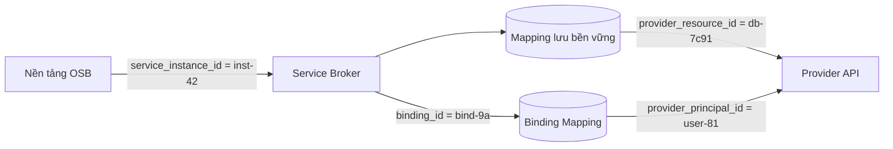
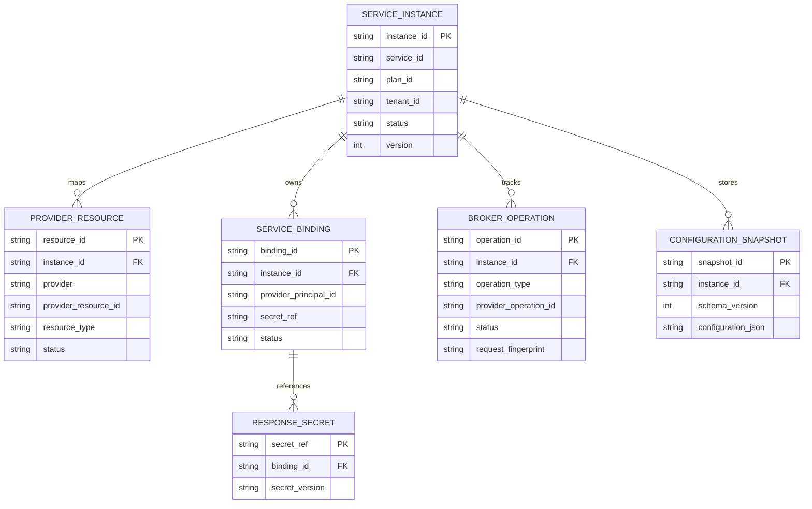

# Lưu tham số, định danh nhà cung cấp và kết quả phản hồi cần tái sử dụng

Một service broker không thể chỉ nhận request, gọi API của nhà cung cấp rồi quên kết quả. Broker cần lưu đủ dữ liệu để quản lý service instance và binding qua nhiều lần gọi, khôi phục sau khi tiến trình dừng, xử lý request được gửi lại và trả lời nhất quán khi nền tảng truy vấn trạng thái. Những dữ liệu quan trọng gồm tham số đã chuẩn hóa, định danh tài nguyên ở provider, định danh operation, trạng thái vòng đời và một số kết quả phản hồi cần tái sử dụng.

Trong `SPRING_CLOUD_SERVICE_BROKER`, cần phân biệt dữ liệu đầu vào mà nền tảng gửi, cấu hình hiệu lực mà broker áp dụng, định danh nội bộ của broker, định danh tài nguyên bên ngoài và dữ liệu response trả về theo Open Service Broker API (OSB API). Nếu trộn các loại dữ liệu này vào một JSON không có quy tắc, broker sẽ khó xử lý retry, khó thu hồi đúng tài nguyên và có nguy cơ làm lộ credential.

## 1. Vì sao broker phải lưu dữ liệu qua các request?

OSB API là giao thức trao đổi giữa nền tảng và broker; nó không giữ toàn bộ trạng thái nghiệp vụ thay cho broker. Sau khi request provision kết thúc, nền tảng có thể gửi `last_operation`, update, bind hoặc deprovision vào một thời điểm khác. Request mới có thể đến một replica khác hoặc sau khi pod broker đã restart.

Ví dụ, broker nhận yêu cầu tạo PostgreSQL instance. Provider trả về resource ID `db-7c91` và endpoint `pg-01.provider.internal`. Nếu broker chỉ trả response cho nền tảng mà không lưu provider ID, lần deprovision sau sẽ không biết phải xóa database nào. Nếu broker không lưu cấu hình đã áp dụng, lần update có thể không biết dung lượng cũ, vùng triển khai hoặc tính năng backup hiện tại. Nếu không lưu operation ID và trạng thái, broker không thể trả lời chính xác khi nền tảng polling.

Những lý do chính cần lưu trạng thái:

- **Quản lý vòng đời:** liên kết `instance_id` và `binding_id` của OSB với tài nguyên thật tại provider.
- **Retry an toàn:** nhận diện request lặp và tránh tạo nhiều tài nguyên hoặc credential.
- **Phục hồi:** tiếp tục operation sau khi process, pod hoặc node bị dừng.
- **Trả lời nhất quán:** tái sử dụng dữ liệu phản hồi phù hợp cho request lặp và truy vấn sau đó.
- **Đối soát:** phát hiện tài nguyên còn ở provider nhưng broker không còn bản ghi, hoặc bản ghi báo tồn tại nhưng tài nguyên đã bị xóa.
- **Audit và hỗ trợ:** giải thích ai đã yêu cầu thao tác, cấu hình nào được áp dụng và provider đã trả kết quả gì.

## 2. Phân biệt các nhóm dữ liệu

Không nên gọi tất cả dữ liệu được lưu là “request” hoặc “response”. Mỗi nhóm có vòng đời và yêu cầu bảo vệ khác nhau.

| Nhóm dữ liệu | Ví dụ | Mục đích |
|---|---|---|
| Định danh OSB | `service_instance_id`, `binding_id`, `service_id`, `plan_id` | Liên kết thao tác với tài nguyên mà nền tảng quản lý |
| Context nền tảng | platform, organization, space, namespace | Xác định phạm vi và tenant theo nguồn tin cậy |
| Parameters đầu vào | storage, region, backup, role | Lưu dấu vết request và kiểm tra tính hợp lệ |
| Cấu hình hiệu lực | storage đã áp dụng, region thực tế, backup state | Là trạng thái mong muốn/đã xác nhận để update và vận hành |
| Provider identifiers | resource ID, principal ID, operation ID | Gọi đúng tài nguyên hoặc tác vụ ở hệ thống bên ngoài |
| Operation state | operation ID, trạng thái, attempt, lỗi | Theo dõi provision/update/deprovision bất đồng bộ |
| Response data | dashboard URL, endpoint, binding credentials | Trả response nhất quán hoặc hỗ trợ retry theo hợp đồng |
| Secret references | vault key, secret version, credential reference | Truy xuất bí mật mà không phải lưu plaintext trong bảng nghiệp vụ |

Một giá trị có thể xuất hiện ở nhiều nhóm nhưng không có nghĩa các nhóm có thể thay thế nhau. Ví dụ `plan_id` là định danh plan theo OSB; `provider_sku` có thể là mã cấu hình ở nhà cung cấp. Hai mã này cần mapping rõ ràng thay vì dùng chung một cột `plan`.

## 3. Định danh OSB và định danh provider

Nền tảng chọn `service_instance_id` và `binding_id` để nhận diện đối tượng trong broker. Provider có hệ thống định danh riêng, ví dụ database UUID, cloud resource ARN, Kubernetes object UID, database username hoặc provider operation ID.

Broker nên duy trì mapping giữa hai miền định danh:



Không nên dùng provider resource ID làm OSB instance ID. Provider ID có thể chứa thông tin nội bộ, thay đổi khi migrate hoặc không duy nhất giữa các account/region. OSB ID nên ổn định trong phạm vi broker và không phụ thuộc vòng đời của một implementation provider cụ thể.

Một mapping instance thường cần lưu:

- OSB `instance_id`.
- `service_id` và `plan_id` mà instance đang sử dụng.
- Tenant hoặc owner đã được xác thực.
- Provider/account/region nơi tài nguyên được tạo.
- Provider resource type và provider resource ID.
- Trạng thái broker và trạng thái gần nhất quan sát được ở provider.
- Thời điểm tạo, cập nhật và xóa.

Nếu một service instance được cấu thành từ nhiều tài nguyên provider, ví dụ database, subnet, firewall rule và backup policy, không nên ép tất cả vào một `provider_resource_id`. Dùng bảng con hoặc collection mapping để lưu từng resource cùng vai trò, quan hệ phụ thuộc và trạng thái.

## 4. Lưu parameters đầu vào và cấu hình đã chuẩn hóa

Parameters trong request là dữ liệu do nền tảng chuyển tiếp từ người dùng hoặc workflow. Broker phải validate schema, kiểm tra chính sách và chuẩn hóa trước khi dùng. Nên phân biệt:

- **Raw request parameters:** dữ liệu nhận được, chỉ lưu khi thật sự cần audit hoặc xử lý tương thích; phải lọc secret và dữ liệu không cần thiết.
- **Normalized configuration:** dữ liệu sau khi áp dụng default, chuẩn hóa đơn vị, kiểm tra giới hạn và giải quyết giá trị bị bỏ qua.
- **Effective configuration:** cấu hình provider đã xác nhận đang áp dụng, có thể khác desired configuration trong lúc update bất đồng bộ.

Ví dụ request có `storage_gb=200`, `backup_enabled` bị bỏ qua. Broker có thể áp dụng default của plan là `false`, sau đó lưu cấu hình chuẩn hóa:

```json
{
  "configuration_version": 2,
  "storage_gb": 200,
  "backup_enabled": false,
  "region": "ap-southeast-1"
}
```

Không nên chỉ lưu request JSON gốc rồi mỗi lần đọc lại áp dụng default hiện tại. Khi default thay đổi ở phiên bản broker mới, request cũ có thể bị diễn giải khác. Lưu cấu hình đã chuẩn hóa cùng version contract giúp giữ nguyên ý nghĩa ban đầu.

Với update, nên lưu riêng `desired_configuration` và `effective_configuration` nếu thao tác có thể kéo dài. Ví dụ desired storage đã là 200 GB nhưng provider vẫn đang resize từ 100 GB. Chỉ cập nhật effective configuration khi provider xác nhận đã đạt cấu hình đích.

## 5. Lưu định danh tài nguyên và operation ở provider

Provider thường trả về nhiều định danh khác nhau:

| Provider value | Cách sử dụng |
|---|---|
| Resource ID | Đọc, cập nhật hoặc xóa tài nguyên |
| Principal/user ID | Thu hồi credential hoặc quyền binding |
| Operation/job ID | Poll tiến độ tác vụ do provider xử lý bất đồng bộ |
| Account/project/subscription ID | Xác định phạm vi tài khoản provider |
| Region/zone/cluster ID | Định tuyến request đến đúng vùng hoặc cụm |
| Resource version/ETag | Phát hiện thay đổi đồng thời và cập nhật có điều kiện |

Không gộp provider operation ID với operation ID của broker. Broker operation ID được nền tảng dùng để truy vấn `last_operation`; provider operation ID chỉ có ý nghĩa khi broker gọi API provider. Một broker operation có thể liên kết với nhiều provider operation nếu phải tạo nhiều tài nguyên.

Nên lưu provider ID ngay sau khi provider tạo tài nguyên và response đã được xác nhận. Nếu broker crash giữa lúc provider tạo resource và lúc ghi ID, broker cần cơ chế tìm lại tài nguyên. Có thể truyền idempotency key hoặc tag do broker tạo vào metadata của provider, ví dụ `broker-instance-id=inst-42`, rồi tìm kiếm theo tag khi phục hồi. Cách này phụ thuộc khả năng của provider và cần kiểm soát tính duy nhất.

## 6. Kết quả response nào cần tái sử dụng?

Một số response chứa dữ liệu ổn định cần được lưu để trả lại đúng kết quả khi request được gửi lại hoặc khi nền tảng cần thông tin đã được cấp.

### Provision response

Provision response có thể chứa `dashboard_url` và thông tin operation nếu xử lý bất đồng bộ. `dashboard_url` là dữ liệu mà nền tảng có thể cần lưu để hiển thị cho người dùng. Nếu broker trả cùng kết quả provision cho request lặp, cần dùng dữ liệu đã ghi nhận thay vì tạo URL khác hoặc tạo tài nguyên mới.

### Binding response

Binding response thường chứa `credentials` và có thể có các trường đặc thù như `syslog_drain_url`, `route_service_url`, `volume_mounts` hoặc `endpoints` tùy loại service. Credentials là dữ liệu nhạy cảm; nếu cần tái sử dụng để đáp ứng retry theo hợp đồng, phải lưu trong secret store hoặc mã hóa mạnh, giới hạn người đọc và quản lý phiên bản secret.

### Operation result

Với operation bất đồng bộ, broker cần lưu trạng thái cuối, mô tả đã lọc và dữ liệu cần thiết để trả lời `last_operation`. Không cần lưu nguyên HTTP response bytes hoặc header của request; hãy lưu model nghiệp vụ đủ để tái tạo response theo phiên bản API.

### Response snapshot và response source of truth

Response snapshot là bản dữ liệu đã trả cho một thao tác cụ thể. Nó có thể hữu ích cho retry, audit hoặc khôi phục. Tuy nhiên, không phải mọi field đều cần cache lâu dài. Cần phân biệt field bất biến, field có thể thay đổi và field nhạy cảm.

| Loại response field | Ví dụ | Chiến lược lưu |
|---|---|---|
| Định danh ổn định | broker instance ID, provider resource reference | Lưu trong bảng mapping |
| Thông tin hiển thị | dashboard URL | Lưu nếu cần trả lại hoặc truy vấn sau |
| Endpoint hiện tại | host, port | Lưu trạng thái đã xác nhận và cập nhật khi endpoint thay đổi |
| Credential | username/password/token | Secret store hoặc ciphertext có kiểm soát, không lưu log |
| Operation result | state, description, provider job reference | Lưu trong operation record |
| Header HTTP tạm thời | trace header, date, connection | Không lưu làm response nghiệp vụ |

Không tái sử dụng response cũ nếu trạng thái tài nguyên đã thay đổi theo cách làm dữ liệu đó sai. Ví dụ endpoint database đã chuyển vùng thì response cần được cập nhật theo quy trình change operation; response snapshot cũ chỉ giữ cho audit hoặc lịch sử.

## 7. Thiết kế các bảng dữ liệu cơ bản

Một mô hình quan hệ minh họa có thể chia thành các bảng sau:



Đây là mô hình tham khảo, không phải schema bắt buộc. Có thể dùng JSON/JSONB cho cấu hình linh hoạt và các bảng quan hệ cho định danh, trạng thái, unique constraint và khóa ngoại. Những trường thường được truy vấn hoặc dùng để bảo đảm toàn vẹn như `instance_id`, `binding_id`, `tenant_id`, `status` nên có cột rõ ràng thay vì chỉ nằm trong JSON.

### Ràng buộc dữ liệu quan trọng

- `instance_id` phải duy nhất trong phạm vi broker.
- `binding_id` phải duy nhất theo phạm vi giao thức và được liên kết với đúng `instance_id`.
- Provider resource mapping phải có uniqueness phù hợp với provider/account/region/resource ID.
- Một instance không được có nhiều operation xung đột đang hoạt động nếu policy không cho phép.
- Provider principal của binding cần có mapping duy nhất để unbind đúng quyền.
- Cấu hình và response snapshot cần lưu version hoặc timestamp để xác định cách diễn giải.

Ràng buộc ở database là lớp bảo vệ quan trọng khi nhiều replica cùng xử lý request. Kiểm tra trong Java trước khi insert không đủ để ngăn race condition.

## 8. Ví dụ model Java cho dữ liệu instance

Có thể biểu diễn dữ liệu đã chuẩn hóa bằng các record ở tầng domain:

```java
public record ProviderResourceReference(
        String providerName,
        String accountId,
        String region,
        String resourceType,
        String resourceId,
        String providerVersion) {
}

public record StoredServiceInstance(
        String instanceId,
        String serviceId,
        String planId,
        String tenantId,
        int configurationVersion,
        DatabaseConfiguration effectiveConfiguration,
        ProviderResourceReference providerResource,
        String status,
        long version) {
}
```

Record trên chỉ minh họa trường hợp một provider resource. Nếu instance gồm nhiều tài nguyên, thay `providerResource` bằng collection hoặc một repository riêng. Trong persistence layer, có thể dùng JPA entity hoặc Spring Data JDBC/R2DBC tùy kiến trúc; domain model không cần phụ thuộc trực tiếp vào annotation persistence.

Không nên lưu nguyên object request của Spring Cloud Open Service Broker làm entity domain. Hãy chuyển thành command và kiểu dữ liệu nội bộ để thay đổi phiên bản thư viện hoặc model giao thức không làm thay đổi toàn bộ schema lưu trữ.

## 9. Lưu response và secret an toàn

Response có thể chứa thông tin nhạy cảm, đặc biệt là binding credentials. Cần quyết định cách lưu theo khả năng tái sử dụng thực tế:

1. **Ưu tiên secret manager:** lưu username/secret trong vault hoặc secret service, database broker chỉ giữ `secret_ref` và version.
2. **Nếu lưu trong database:** mã hóa ở tầng ứng dụng bằng envelope encryption, dùng key quản lý bên ngoài database và phân quyền giải mã theo service account.
3. **Tách dữ liệu nhạy cảm:** endpoint và metadata không nhạy cảm có thể lưu ở bảng instance; password/token lưu riêng.
4. **Giới hạn thời gian và quyền đọc:** chỉ thành phần cần tạo lại response mới được đọc secret; audit mọi thao tác truy xuất.
5. **Không ghi secret vào log hoặc trace:** che `password`, `token`, `private_key`, `client_secret` và các trường tương tự.
6. **Quản lý rotation:** khi credential được xoay vòng, cập nhật secret version và response snapshot theo một quy trình nhất quán.

Hash không thể thay thế mã hóa khi broker cần trả lại chính credential đã tạo. Hash phù hợp để so sánh hoặc xác minh một số giá trị, nhưng không thể khôi phục password để tạo response retry. Nếu không muốn lưu secret có thể đọc lại, thiết kế provider phải hỗ trợ tái tạo credential an toàn hoặc response retry theo đúng contract phải được xử lý theo một cách khác đã xác định trước.

## 10. Idempotency và tái sử dụng response

Khi nền tảng gửi lại request provision hoặc bind, broker cần nhận biết đó là cùng một yêu cầu hay một yêu cầu mới. Có thể tạo request fingerprint từ định danh OSB, loại thao tác và cấu hình đã chuẩn hóa.

Ví dụ:

```text
fingerprint = SHA-256(
    operation_type
    + service_instance_id
    + service_id
    + plan_id
    + canonical_parameters
)
```

Đây là cách minh họa; dữ liệu đầu vào phải được canonicalize trước khi hash để không bị ảnh hưởng bởi thứ tự key JSON hoặc cách biểu diễn tương đương. Không đưa secret dạng rõ vào log khi tạo fingerprint; có thể dùng HMAC với key quản lý riêng nếu fingerprint có thể bị dùng để suy đoán dữ liệu đầu vào có entropy thấp.

Quy trình xử lý request lặp:

1. Xác thực và parse request.
2. Chuẩn hóa parameters theo đúng schema/configuration version.
3. Tính fingerprint.
4. Tra cứu operation hoặc binding đã tồn tại theo idempotency scope.
5. Nếu cùng fingerprint và thao tác đã có kết quả, tái sử dụng kết quả/response đã lưu theo hợp đồng OSB API.
6. Nếu cùng ID nhưng fingerprint khác, phát hiện xung đột thay vì ghi đè hoặc tạo thêm tài nguyên.
7. Nếu operation đang chạy, trả trạng thái/operation tương ứng thay vì khởi chạy worker thứ hai.

Tái sử dụng response không có nghĩa gửi lại mù quáng một JSON cũ. Broker phải kiểm tra response còn phù hợp với trạng thái hiện tại, tenant và binding ID của request. Không trả credential của binding khác chỉ vì fingerprint hoặc provider principal bị dùng nhầm.

## 11. Transaction, outbox và khoảng trống giữa database với provider

Broker thường phải cập nhật database của mình và gọi provider qua mạng. Hai thao tác này không nằm trong cùng một transaction ACID. Có thể xảy ra tình huống provider đã tạo tài nguyên nhưng broker chưa lưu provider ID, hoặc broker đã lưu operation nhưng message cho worker chưa được gửi.

Một cách tổ chức thường dùng:

- Trong transaction database, lưu instance ở trạng thái `PROVISIONING`, cấu hình đích, operation ID và outbox event.
- Commit transaction.
- Publisher đọc outbox và gửi job đến queue.
- Worker gọi provider với idempotency key hoặc broker resource tag.
- Khi provider trả resource ID, worker lưu mapping và provider operation ID.
- Khi provider xác nhận sẵn sàng, worker cập nhật instance thành `AVAILABLE`, lưu response snapshot cần thiết và đánh dấu operation thành công.

Transactional outbox bảo đảm operation và ý định phát job được lưu cùng transaction. Publisher có thể gửi trùng khi crash, nên worker vẫn phải idempotent. Nếu provider tạo resource thành công nhưng worker crash trước khi ghi mapping, worker có thể truy vấn theo idempotency key/tag để tìm lại tài nguyên thay vì tạo mới.

## 12. Lưu trạng thái mong muốn và trạng thái quan sát được

Với tác vụ kéo dài, một cột `status` duy nhất đôi khi không đủ. Broker có thể cần phân biệt:

- **Desired state:** cấu hình hoặc trạng thái mà request yêu cầu.
- **Observed state:** trạng thái provider hiện đang báo.
- **Broker operation state:** tiến độ của workflow điều phối.

Ví dụ update tăng storage từ 100 GB lên 200 GB:

| Thời điểm | Desired storage | Observed storage | Operation |
|---|---:|---:|---|
| Trước update | 100 GB | 100 GB | Không có |
| Đã chấp nhận | 200 GB | 100 GB | `IN_PROGRESS` |
| Provider đang resize | 200 GB | 150 GB hoặc `RESIZING` | `IN_PROGRESS` |
| Hoàn tất | 200 GB | 200 GB | `SUCCEEDED` |

Không trả `succeeded` chỉ vì desired state đã được lưu. Broker phải đối chiếu trạng thái provider hoặc nhận xác nhận cuối cùng. Nếu provider không cung cấp observed value chính xác, lưu trạng thái và bằng chứng hoàn tất mà adapter có thể xác minh.

## 13. Versioning và migration dữ liệu

Parameters, configuration và response model có thể thay đổi theo thời gian. Broker nên lưu version để biết dữ liệu được tạo theo contract nào.

Ví dụ:

```json
{
  "schema_version": 3,
  "plan_id": "postgres-standard",
  "configuration": {
    "storage_gb": 200,
    "backup_enabled": true,
    "region": "ap-southeast-1"
  }
}
```

Khi nâng phiên bản broker, không nên giả định tất cả instance đã lưu đều có schema mới. Có thể dùng migration theo batch hoặc lazy migration khi đọc. Migration cần:

- Giữ dữ liệu gốc hoặc audit khi chuyển đổi quan trọng.
- Có mapping rõ giữa field cũ và field mới.
- Không thay đổi đơn vị hoặc default một cách âm thầm.
- Có thể retry an toàn nếu tiến trình migration dừng giữa chừng.
- Không xóa provider ID hoặc secret reference còn cần cho deprovision/unbind.
- Kiểm tra dữ liệu sau migration trước khi đánh dấu phiên bản mới.

Đối với response snapshot, lưu `response_schema_version` hoặc loại response để code mới có thể deserialize và chuyển đổi đúng. Không cần version hóa mọi cột đơn giản, nhưng các JSON linh hoạt được lưu lâu dài cần có version hoặc migration contract.

## 14. Retention, xóa dữ liệu và tombstone

Khi instance hoặc binding được deprovision/unbind, broker vẫn có thể cần giữ một phần dữ liệu trong một khoảng thời gian để xử lý request lặp, audit và đối soát. Không xóa mọi bản ghi ngay khi provider trả thành công.

Có thể phân loại:

- **Active data:** instance, binding và provider mapping đang hoạt động.
- **Operation history:** lịch sử provision/update/deprovision và kết quả.
- **Tombstone:** định danh đã xóa cùng thời điểm và kết quả, dùng để nhận diện retry hoặc ngăn tạo lại ngoài ý muốn.
- **Secret material:** credential đã thu hồi; xóa hoặc vô hiệu hóa theo chính sách, giữ audit reference nếu cần.
- **Audit data:** actor, thời điểm, hành động và kết quả, theo chính sách lưu giữ.

Retention phải phù hợp yêu cầu bảo mật, hợp đồng và pháp lý của hệ thống. Tombstone không nên giữ secret. Sau thời gian lưu giữ, có thể xóa payload nhạy cảm trước, sau đó xóa mapping và lịch sử theo quy trình có kiểm soát.

## 15. Ví dụ luồng lưu dữ liệu khi provision

Giả sử nền tảng yêu cầu tạo instance `inst-42` theo plan `postgres-standard`.

1. Broker xác thực request, kiểm tra tenant và plan.
2. Broker chuẩn hóa parameters thành configuration version 2.
3. Broker tạo operation ID `op-901`, tính request fingerprint và ghi instance `PROVISIONING`.
4. Trong cùng transaction, broker ghi outbox event để phát job.
5. Worker nhận job và gọi provider với idempotency key liên kết đến `op-901`.
6. Provider trả resource ID `db-7c91` và provider operation ID `task-882`.
7. Broker lưu mapping `inst-42` → `db-7c91`, lưu `task-882` và theo dõi trạng thái provider.
8. Khi database sẵn sàng, broker lưu endpoint đã xác nhận, response snapshot cần thiết và chuyển instance thành `AVAILABLE`.
9. Broker đánh dấu operation `SUCCEEDED`; `last_operation` đọc kết quả từ operation store.

Một bản ghi instance minh họa:

```json
{
  "instance_id": "inst-42",
  "service_id": "postgres-service",
  "plan_id": "postgres-standard",
  "tenant_id": "tenant-7",
  "status": "AVAILABLE",
  "configuration_version": 2,
  "configuration": {
    "storage_gb": 200,
    "backup_enabled": true,
    "region": "ap-southeast-1"
  },
  "provider": {
    "name": "example-cloud",
    "account_id": "account-3",
    "resource_type": "managed-database",
    "resource_id": "db-7c91"
  },
  "response": {
    "dashboard_url": "https://console.example.net/databases/db-7c91"
  }
}
```

JSON này chỉ minh họa dữ liệu đã chuẩn hóa; hệ thống thực tế nên tách các trường quan hệ và secret khỏi document nếu cần query, constraint hoặc bảo vệ riêng. Không lưu password trong response JSON này.

## 16. Ví dụ use case Spring lưu mapping và kết quả

Một application service có thể điều phối việc ghi nhận operation và lưu provider result qua repository:

```java
@Service
public class ProvisionInstanceUseCase {

    private final InstanceRepository instances;
    private final OperationRepository operations;
    private final OutboxRepository outbox;

    public ProvisionInstanceUseCase(
            InstanceRepository instances,
            OperationRepository operations,
            OutboxRepository outbox) {
        this.instances = instances;
        this.operations = operations;
        this.outbox = outbox;
    }

    @Transactional
    public AcceptedProvision accept(ProvisionCommand command) {
        var existing = operations.findByFingerprint(command.fingerprint());
        if (existing.isPresent()) {
            return AcceptedProvision.from(existing.get());
        }

        var instance = instances.save(
                ServiceInstance.provisioning(command));
        var operation = operations.save(
                BrokerOperation.accepted(command.operationId(), instance.getId(),
                        command.fingerprint(), command.configuration()));
        outbox.save(OutboxEvent.forOperation(operation.getId()));

        return AcceptedProvision.from(operation);
    }
}
```

Ví dụ chỉ mô tả transaction tiếp nhận. Worker và provider adapter sẽ lưu provider ID và kết quả sau đó trong transaction riêng. Repository cần unique constraint cho fingerprint/idempotency scope; kiểm tra `findByFingerprint` đơn thuần không ngăn được hai request đồng thời nếu thiếu constraint hoặc locking.

Không giữ transaction database mở trong suốt lời gọi provider kéo dài. Ghi nhận desired state và job trong transaction ngắn, thực hiện I/O bên ngoài transaction, rồi lưu observed state và response sau khi có kết quả.

## 17. Kiểm soát dữ liệu khi lưu và tái sử dụng

Một số nguyên tắc giúp dữ liệu broker không bị sai lệch hoặc lộ lọt:

- **Chỉ lưu điều cần thiết:** không lưu toàn bộ request headers, bearer token hoặc context không phục vụ lifecycle.
- **Chuẩn hóa trước khi lưu:** dùng đơn vị, timezone, enum và default nhất quán.
- **Tách secret:** secret reference và ciphertext không đặt chung với metadata công khai.
- **Giới hạn tenant:** mọi truy vấn instance, binding, operation và response phải lọc theo ownership đã xác thực.
- **Ràng buộc định danh:** dùng foreign key/unique constraint cho mapping OSB-provider.
- **Lưu lịch sử thay đổi:** ghi actor, operation, phiên bản cấu hình và thời điểm.
- **Không tái sử dụng response sai ngữ cảnh:** response phải gắn với đúng instance, binding, tenant và operation.
- **Đối soát định kỳ:** so sánh mapping nội bộ với provider để phát hiện resource mồ côi hoặc credential còn tồn tại sau unbind.
- **Xóa an toàn:** thu hồi secret và xóa dữ liệu theo retention policy, giữ tombstone tối thiểu cần thiết.

## 18. Kiểm thử khả năng lưu và tái sử dụng dữ liệu

Kiểm thử cần bao phủ cả dữ liệu bình thường và các tình huống crash/retry:

| Tình huống | Kết quả cần xác minh |
|---|---|
| Provision thành công | OSB instance ID được map đến đúng provider resource ID |
| Provider trả nhiều resource | Mọi resource con được lưu với đúng role và quan hệ |
| Worker crash sau khi provider tạo resource | Có thể tìm lại resource bằng idempotency key/tag, không tạo trùng |
| Request lặp cùng fingerprint | Tái sử dụng operation/result phù hợp, không gọi provider lần nữa ngoài chính sách |
| Cùng ID nhưng parameters khác | Phát hiện conflict, không ghi đè cấu hình |
| Update đang chạy | Desired và effective configuration được phân biệt |
| Binding retry | Trả lại credential/response đúng binding theo chính sách lưu secret |
| Unbind | Provider principal được thu hồi, secret reference bị vô hiệu hóa |
| Restart broker | Replica khác đọc được operation và mapping từ kho bền vững |
| Migration schema | Instance cũ vẫn update/deprovision được |
| Tenant khác truy vấn ID | Không đọc được provider ID, configuration hoặc response |
| Retention cleanup | Secret được xóa theo policy, tombstone còn đủ để xử lý retry |

Ngoài unit test cho mapper và use case, nên có integration test với database thật hoặc Testcontainers, provider giả lập và queue giả lập. Test cần kiểm tra unique constraint, transaction rollback, outbox redelivery, worker restart và secret access policy.

## 19. Những lỗi thiết kế thường gặp

**Chỉ lưu OSB ID mà không lưu provider ID:** broker không biết phải update hoặc xóa tài nguyên nào. Lưu mapping provider có account, region và resource type.

**Dùng provider ID làm instance ID:** làm lộ chi tiết provider và gắn chặt định danh công khai với implementation bên ngoài. Duy trì ID broker riêng.

**Chỉ lưu raw parameters:** default hoặc schema mới có thể làm request cũ được diễn giải khác. Lưu cấu hình chuẩn hóa và version.

**Cập nhật effective state trước khi provider hoàn tất:** broker báo cấu hình mới trong khi tài nguyên vẫn ở trạng thái cũ. Tách desired và observed state.

**Lưu password dạng rõ trong response JSON:** tăng rủi ro lộ secret qua database backup, query hoặc log. Dùng secret manager hoặc mã hóa ở tầng ứng dụng.

**Không lưu provider operation ID:** broker không thể tiếp tục polling tác vụ bên ngoài sau restart. Lưu provider job reference cùng broker operation.

**Tạo lại response mỗi lần retry:** có thể sinh credential mới hoặc URL khác không khớp với resource đã tạo. Tái sử dụng snapshot đúng ngữ cảnh sau khi xác minh trạng thái.

**Tin rằng transaction database bao trùm provider:** lời gọi mạng không rollback cùng database. Dùng saga/outbox, idempotency và reconciliation.

**Xóa dữ liệu ngay khi deprovision:** làm mất dấu vết cần để xử lý retry và audit. Dùng tombstone/retention có thời hạn.

## 20. Trình tự triển khai cho service broker

Khi thiết kế lưu trữ cho broker, có thể thực hiện theo trình tự:

1. Liệt kê định danh OSB, context, parameters, cấu hình hiệu lực, provider IDs, operation state và response fields cần lưu.
2. Phân loại dữ liệu công khai, dữ liệu tenant, dữ liệu nhạy cảm và secret.
3. Thiết kế bảng instance, binding, provider resource, operation, configuration snapshot và secret reference.
4. Đặt unique constraint, foreign key, optimistic version và index phục vụ truy vấn vòng đời.
5. Chuẩn hóa parameters theo schema version và lưu desired/effective configuration phù hợp.
6. Lưu provider resource ID và provider operation ID ngay khi có thể; chuẩn bị idempotency key/tag để phục hồi khoảng trống khi crash.
7. Lưu response snapshot cần thiết theo loại thao tác, mã hóa hoặc tham chiếu secret khi có credential.
8. Dùng transaction/outbox để ghi operation và chuyển job bền vững.
9. Xây dựng retry, reconciliation, migration và retention/tombstone.
10. Kiểm thử request lặp, restart, provider timeout, tenant isolation, secret access và khả năng deprovision dữ liệu cũ.

Khi broker lưu được parameters đã chuẩn hóa, mapping provider và response cần tái sử dụng theo một mô hình rõ ràng, nó có thể tiếp tục quản lý tài nguyên sau nhiều request và nhiều lần restart. Đây là nền tảng để các thao tác provision, update, bind, unbind và deprovision có tính nhất quán, có thể phục hồi và an toàn trong môi trường nhiều replica.
