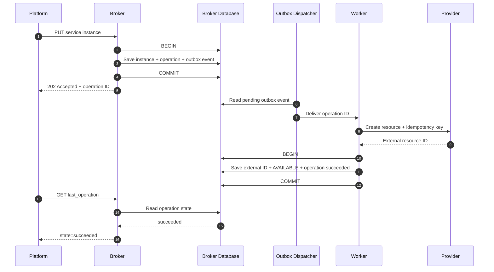

# Ranh giới giao dịch giữa cơ sở dữ liệu broker và API hạ tầng

Một service broker thường phải cập nhật cơ sở dữ liệu nội bộ và gọi API của nhà cung cấp hạ tầng trong cùng một nghiệp vụ. Ví dụ, khi platform yêu cầu provision PostgreSQL, broker cần ghi nhận service instance và operation, gọi provider để tạo database, sau đó lưu external resource ID cùng trạng thái mới. Hai hệ thống này không cùng tham gia một giao dịch cơ sở dữ liệu, vì vậy không thể mặc định rằng một annotation `@Transactional` sẽ khiến cả thao tác SQL lẫn HTTP request tới provider cùng commit hoặc cùng rollback.

Với `SPRING_CLOUD_SERVICE_BROKER`, ranh giới này quyết định broker có thể phục hồi sau timeout, process restart, retry và lỗi một phần hay không. Thiết kế đúng cần tách giao dịch local trong database khỏi side effect bên ngoài, lưu ý định công việc một cách bền vững, gọi provider bằng idempotency key khi có thể và đối soát trạng thái khi không biết chắc provider đã thực hiện thao tác hay chưa.

## 1. Vì sao không có một transaction chung?

Giả sử broker xử lý một request provision theo cách đơn giản:

```java
@Transactional
public void provision(String instanceId, ProvisionRequest request) {
    instanceRepository.save(new ServiceInstance(instanceId, "PROVISIONING"));
    ProviderResource resource = providerClient.create(request);
    instanceRepository.save(new ServiceInstance(
            instanceId, "AVAILABLE", resource.id()));
}
```

`@Transactional` thường quản lý transaction của resource manager được cấu hình cho Spring, ví dụ database JDBC. HTTP client gọi provider là một hệ thống độc lập. Khi provider tạo database thành công nhưng câu lệnh SQL cuối cùng thất bại, transaction database có thể rollback trong khi database bên ngoài vẫn tồn tại. Ngược lại, nếu transaction database đã commit nhưng provider request thất bại, broker có thể có bản ghi instance mà chưa có tài nguyên.

Không thể giải quyết vấn đề này bằng cách giữ transaction SQL mở trong suốt thời gian gọi HTTP. Cách đó vẫn không tạo ra atomic commit giữa hai hệ thống, đồng thời giữ connection và lock lâu, làm tăng contention, timeout và nguy cơ cạn connection pool.

### Hai hệ thống, hai kết quả commit

| Hệ thống | Phạm vi kiểm soát | Điều broker có thể bảo đảm |
|---|---|---|
| Database broker | Transaction SQL do broker quản lý | Các thay đổi trong cùng transaction local commit hoặc rollback cùng nhau. |
| Provider API | Hệ thống bên ngoài, có network và trạng thái riêng | Broker chỉ biết kết quả provider trả về hoặc trạng thái có thể truy vấn/đối soát. |

Nếu provider không tham gia cùng distributed transaction coordinator và không hỗ trợ giao thức commit chung, broker không có cơ chế rollback tự động side effect của provider khi SQL rollback. Trong phần lớn tích hợp HTTP, cần thiết kế theo hướng eventual consistency, durable operation và compensation/reconciliation.

## 2. Những cửa sổ lỗi giữa database và provider

Một thao tác có thể gặp lỗi ở nhiều thời điểm khác nhau. Cần phân biệt request chưa tới provider, provider chưa thực hiện side effect, provider đã thực hiện nhưng response bị mất và provider đã trả thành công nhưng broker chưa lưu kết quả.

| Thời điểm xảy ra lỗi | Trạng thái có thể còn lại | Cách phục hồi |
|---|---|---|
| Trước khi transaction local commit | Chưa có operation bền vững | Platform retry; broker nhận request mới theo cùng định danh. |
| Sau khi ghi operation nhưng trước khi gửi job | Operation còn trong DB, chưa có side effect | Outbox dispatcher tiếp tục phát job. |
| Request chưa tới provider hoặc bị từ chối | Operation đang chờ hoặc lỗi | Retry theo phân loại lỗi và chính sách. |
| Provider đã tạo resource nhưng response timeout | Resource có thể tồn tại, broker chưa biết external ID | Tra cứu bằng idempotency key, correlation ID hoặc ownership tag; không tạo lại mù quáng. |
| Provider trả thành công nhưng broker chưa commit kết quả | Resource tồn tại, DB vẫn ở trạng thái trước | Worker retry/reconcile và ghi nhận resource hiện có. |
| DB đã ghi kết quả nhưng message chưa được ack | Operation đã hoàn tất, message có thể được phát lại | Consumer deduplicate bằng operation ID và state/version. |

Điểm khó nhất là timeout không chứng minh provider chưa thực hiện thao tác. Một HTTP timeout chỉ cho biết broker không nhận được response đúng hạn. Nếu broker lập tức gọi `create` lần nữa, có thể tạo hai database hoặc hai credential.

## 3. Tách transaction local khỏi side effect bên ngoài

Một luồng bền vững thường chia thành ba giai đoạn:

1. **Ghi nhận ý định:** trong một transaction database ngắn, tạo hoặc cập nhật service instance, tạo operation và ghi outbox event.
2. **Thực hiện side effect:** sau khi transaction commit, worker lấy event, gọi provider và dùng idempotency key/correlation ID ổn định.
3. **Ghi nhận kết quả:** trong một transaction local khác, lưu external resource ID, trạng thái operation, bước tiếp theo và mô tả lỗi đã chuẩn hóa.

Với thao tác dài, broker có thể trả `202 Accepted` sau khi transaction đầu tiên commit và operation đã được lưu bền vững. Platform polling `last_operation` sẽ đọc trạng thái từ database. Không trả `202` chỉ vì một job mới được đặt trong memory của process.



## 4. Transactional Outbox

Transactional Outbox giải quyết vấn đề ghi database và phát một message cho worker. Thay vì commit bản ghi instance rồi gọi queue riêng rẽ, broker ghi operation và outbox event trong cùng transaction local.

Ví dụ các bảng tối thiểu:

| Bảng | Trường tiêu biểu | Vai trò |
|---|---|---|
| `service_instance` | `instance_id`, `service_id`, `plan_id`, `state`, `version` | Trạng thái vòng đời instance. |
| `operation` | `operation_id`, `instance_id`, `type`, `state`, `attempt_count` | Theo dõi công việc OSB API. |
| `outbox_event` | `event_id`, `aggregate_id`, `event_type`, `payload`, `created_at`, `published_at` | Ghi lại công việc cần phát đi. |

Ví dụ transaction tạo operation:

```java
@Service
public class ProvisionCommandService {
    private final ServiceInstanceRepository instances;
    private final OperationRepository operations;
    private final OutboxRepository outbox;

    @Transactional
    public String startProvision(ProvisionCommand command) {
        ServiceInstance instance = ServiceInstance.provisioning(command);
        instances.insert(instance);

        Operation operation = Operation.provisioning(
                command.operationId(), command.instanceId());
        operations.insert(operation);

        outbox.insert(OutboxEvent.provisionRequested(
                command.operationId(), command.instanceId()));

        return operation.id();
    }
}
```

Ở đây ba bản ghi được commit hoặc rollback cùng nhau. Nếu process dừng ngay sau commit, outbox event vẫn còn trong database và dispatcher có thể phát lại sau khi khởi động. Nếu transaction rollback, không có operation được xác nhận và cũng không có event mồ côi.

### Dispatcher và giao nhận ít nhất một lần

Dispatcher đọc các event chưa publish, gửi tới message broker hoặc chuyển cho worker, sau đó đánh dấu đã publish. Có thể xảy ra trường hợp message đã được gửi nhưng process dừng trước khi cập nhật `published_at`; khi chạy lại, dispatcher gửi event lần nữa. Vì vậy, Outbox thường cung cấp semantics **at-least-once**, không tự bảo đảm exactly-once side effect.

Consumer/worker phải deduplicate theo `event_id` hoặc `operation_id`. Việc đánh dấu event đã xử lý và cập nhật trạng thái operation cần có transaction/unique constraint phù hợp. Dù message được phát hai lần, chỉ một lần xử lý nghiệp vụ hợp lệ được phép tạo side effect mới.

## 5. Idempotency khi gọi provider

Idempotency giúp một thao tác được gửi lại nhiều lần nhưng chỉ tạo ra một kết quả nghiệp vụ. Broker nên tạo một idempotency key ổn định cho operation và gửi nó tới provider nếu API hỗ trợ.

Ví dụ:

```http
POST /v1/databases HTTP/1.1
Host: provider.example.internal
Idempotency-Key: provision-instance-123-op-456
Content-Type: application/json

{
  "name": "broker-instance-123",
  "engine": "postgresql",
  "size": "small",
  "labels": {
    "managed-by": "spring-cloud-service-broker",
    "broker-instance-id": "instance-123"
  }
}
```

Nếu provider nhận lại cùng idempotency key, nó nên trả về kết quả của lần thực hiện trước hoặc cùng resource thay vì tạo mới. Cần kiểm tra semantics thực tế: thời gian lưu key, phạm vi unique, cách xử lý request body khác nhau và khả năng tra cứu kết quả.

Nếu provider không hỗ trợ idempotency key:

- Dùng tên tài nguyên xác định hoặc external correlation ID nếu provider cho phép.
- Gắn ownership tag/label chứa broker instance ID để có thể tìm lại resource.
- Trước khi retry create, truy vấn provider theo khóa hoặc tag đã lưu.
- Lưu external resource ID ngay khi có thể và dùng nó cho update/delete tiếp theo.
- Dùng unique constraint/lock nội bộ để ngăn hai worker cùng xử lý một instance.
- Nếu không thể xác định provider đã thực hiện hay chưa, chuyển operation sang trạng thái `UNKNOWN`/`RECONCILIATION_REQUIRED` và đối soát thay vì tạo thêm tài nguyên.

Không tạo idempotency key mới cho mỗi lần retry. Key phải đại diện cho cùng một nghiệp vụ logic, ví dụ một operation provision cụ thể. Một lần update hoặc một lần deprovision mới có operation ID riêng.

## 6. Saga và compensation

Một workflow có nhiều side effect không thể được rollback bằng một transaction SQL duy nhất. Saga chia workflow thành các bước có trạng thái và, khi có thể, các hành động bù (compensation).

Ví dụ provision một service PostgreSQL:

| Bước | Side effect | Compensation có thể có |
|---|---|---|
| 1 | Tạo network endpoint | Xóa endpoint nếu chưa có consumer. |
| 2 | Tạo database | Xóa database nếu không còn dữ liệu cần giữ. |
| 3 | Tạo monitoring configuration | Gỡ cấu hình monitoring. |
| 4 | Ghi trạng thái AVAILABLE | Chuyển sang trạng thái lỗi/cleanup nếu bước trước chưa hoàn tất. |

Không phải mọi side effect đều có compensation an toàn. Ví dụ, xóa database có thể không thể khôi phục nếu backup không tồn tại. Deprovision cũng thường là thao tác phá hủy, vì vậy nếu đã xóa một tài nguyên thì không thể coi rollback SQL là phục hồi tài nguyên. Broker cần thiết kế theo hướng forward recovery: tiếp tục các bước cleanup còn lại, hoặc yêu cầu can thiệp khi không thể tự phục hồi.

Một saga record có thể lưu `saga_id`, `operation_id`, `current_step`, `completed_steps`, `compensation_state` và `last_error_code`. Không lưu raw provider response hoặc secret vào saga record.

## 7. Desired state và observed state

Để đối soát, broker nên phân biệt:

- **Desired state:** trạng thái mà broker đang cố đạt, ví dụ `AVAILABLE` sau provision hoặc `DEPROVISIONED` sau delete.
- **Observed state:** trạng thái mà broker xác nhận từ provider hoặc kết quả operation đã được kiểm chứng.

Ví dụ, sau khi platform yêu cầu provision, desired state là `AVAILABLE` nhưng observed state có thể là `CREATING`. Khi provider trả external ID, broker lưu lại và truy vấn provider để xác nhận `READY`. Nếu worker bị dừng giữa chừng, một reconcile job so sánh desired/observed state để tiếp tục xử lý.

Không nên ghi `AVAILABLE` chỉ vì đã gửi lệnh create. Cũng không nên ghi `DEPROVISIONED` chỉ vì HTTP DELETE đã được gửi. Trạng thái cuối cần dựa trên xác nhận của provider hoặc bằng chứng đủ tin cậy theo hợp đồng provider.

Một mô hình dữ liệu có thể gồm:

```text
service_instance
  instance_id
  service_id
  plan_id
  desired_state
  observed_state
  external_resource_id
  version
  updated_at

operation
  operation_id
  instance_id
  operation_type
  state
  current_step
  attempt_count
  next_retry_at
  last_error_code
  started_at
  finished_at

outbox_event
  event_id
  operation_id
  event_type
  payload
  published_at
```

Các trường này là mô hình gợi ý; schema thật cần phản ánh loại provider, yêu cầu audit, retention và tải hệ thống.

## 8. Transaction boundary trong từng thao tác OSB API

### Provision

Trong transaction đầu tiên, broker xác minh request, tạo instance ở trạng thái `PROVISIONING`, tạo operation và outbox event. Sau commit, worker gọi provider. Khi provider thành công, worker mở transaction mới để lưu external resource ID, chuyển observed state và operation sang `succeeded`.

Nếu provider thất bại trước khi tạo resource, worker lưu lỗi đã chuẩn hóa và quyết định retry. Nếu provider tạo resource nhưng broker mất response, worker tìm lại resource theo idempotency key hoặc ownership tag.

### Update

Broker lưu plan/cấu hình đích và operation update trong transaction local. Worker áp dụng thay đổi tới provider rồi ghi observed state mới. Nếu update nhiều bước, lưu tiến trình từng bước và compensation hoặc forward recovery. Không cập nhật plan hiện tại thành công trước khi provider đạt cấu hình đích theo chính sách.

### Bind

Broker tạo binding record ở trạng thái `CREATING` và outbox event. Worker tạo credential/quyền truy cập riêng cho binding. Sau khi xác nhận credential đã được tạo và lưu an toàn, broker chuyển binding sang `ACTIVE`. Nếu provider tạo user nhưng DB commit thất bại, worker phải tra cứu theo binding ID/idempotency key hoặc revoke credential vừa tạo trong một bước bù có kiểm soát.

### Unbind và deprovision

Broker ghi nhận ý định thu hồi và operation trước khi gọi provider. Worker revoke credential hoặc xóa tài nguyên bằng external ID đã lưu. DELETE thường cần idempotent: nếu provider xác nhận resource đã không tồn tại, có thể coi bước xóa đã đạt mục tiêu sau khi xác minh đúng resource. Bản ghi tombstone giúp nhận diện request lặp và audit.

## 9. Transaction trong Spring: phạm vi và cách sử dụng

`@Transactional` nên bao quanh các thay đổi local cần nguyên tử, chẳng hạn lưu instance, operation và outbox event. Giao tiếp HTTP với provider nên diễn ra sau khi transaction đó commit.

Ví dụ command service:

```java
@Service
public class InstanceCommandService {
    private final InstanceRepository instances;
    private final OperationRepository operations;
    private final OutboxRepository outbox;

    @Transactional
    public Operation startProvision(ProvisionCommand command) {
        ServiceInstance instance = instances.insertProvisioning(command);
        Operation operation = operations.insertProvisionOperation(command);
        outbox.insert(OutboxEvent.provisionRequested(operation.id(), instance.id()));
        return operation;
    }
}
```

Worker gọi provider ngoài transaction local:

```java
@Component
public class ProvisionWorker {
    private final ProviderClient provider;
    private final ProvisionResultRecorder recorder;

    public void process(ProvisionJob job) {
        ProviderResult result = provider.create(
                job.request(), job.idempotencyKey());
        recorder.recordSuccess(job.operationId(), result);
    }
}
```

Result recorder dùng một transaction mới hoặc transaction local ngắn để lưu kết quả:

```java
@Service
public class ProvisionResultRecorder {
    private final InstanceRepository instances;
    private final OperationRepository operations;

    @Transactional
    public void recordSuccess(String operationId, ProviderResult result) {
        Operation operation = operations.lockById(operationId);
        instances.markAvailable(
                operation.instanceId(), result.externalResourceId());
        operations.markSucceeded(operationId);
    }
}
```

Đây là cấu trúc minh họa. Cần kiểm tra trạng thái operation/version trước khi ghi để worker cũ không ghi đè kết quả của operation mới hoặc ghi `AVAILABLE` sau khi instance đã chuyển `DEPROVISIONING`.

### Tránh self-invocation và hiểu đúng propagation

Spring proxy thường áp dụng `@Transactional` khi method được gọi qua proxy. Gọi một method transactional khác bằng `this.someMethod()` trong cùng bean có thể bỏ qua proxy và không mở transaction như mong đợi. Nên tách command service, result recorder và repository thành bean có ranh giới rõ ràng hoặc dùng transaction template khi cần kiểm soát tường minh.

`REQUIRES_NEW` có thể hữu ích cho một số transaction ghi nhận lỗi/kết quả độc lập, nhưng không tự làm cho provider call atomic. Không dùng propagation để che giấu side effect bên ngoài. Transaction nên ngắn, có timeout và chỉ giữ lock khi cần cập nhật dữ liệu local.

### Reactive và R2DBC

Trong WebFlux/reactive stack, Spring có reactive transaction management cho R2DBC. `@Transactional` trên reactive method gắn transaction với Reactor context khi dùng đúng transaction manager. Không trộn JDBC blocking transaction với reactive chain rồi giả định transaction context tự truyền qua mọi thread.

Không dùng `.block()` trong event loop chỉ để giữ transaction mở khi gọi provider. Hãy giữ transaction reactive ngắn quanh thao tác DB, kết thúc trước khi gọi API hạ tầng. Nếu provider client blocking, cô lập trên scheduler phù hợp hoặc dùng client non-blocking.

## 10. Concurrency và optimistic locking

Hai worker có thể cùng nhận event cho một instance. Platform cũng có thể gửi update và deprovision gần như đồng thời. Broker cần cơ chế ngăn các chuyển trạng thái không hợp lệ:

- Unique constraint trên `instance_id`, `operation_id`, `event_id` và binding ID theo mô hình dữ liệu.
- Version column để optimistic locking.
- Claim/lease cho worker để chỉ một worker xử lý operation tại một thời điểm.
- Kiểm tra trạng thái hiện tại trước mỗi side effect và trước khi commit kết quả.
- Dùng state transition có điều kiện, ví dụ chỉ chuyển `PROVISIONING` sang `AVAILABLE` nếu version và operation ID vẫn khớp.
- Không giữ row lock trong khi chờ HTTP provider; claim operation rồi nhả transaction trước khi gọi mạng.

Ví dụ update có điều kiện:

```sql
UPDATE service_instance
SET observed_state = 'AVAILABLE',
    external_resource_id = :resource_id,
    version = version + 1
WHERE instance_id = :instance_id
  AND desired_state = 'AVAILABLE'
  AND version = :expected_version;
```

Nếu số dòng cập nhật là 0, trạng thái đã thay đổi hoặc worker đã lỗi thời. Không được bỏ qua kết quả này; worker phải đọc lại operation/instance và quyết định bỏ qua, reconcile hoặc thực hiện compensation.

## 11. Lỗi một phần và reconciliation

Reconciliation là quy trình so sánh trạng thái broker lưu với trạng thái thật của provider, rồi đưa chúng về nhất quán theo policy. Nó cần thiết vì có những cửa sổ lỗi không thể giải quyết chỉ bằng retry cùng request.

Ví dụ:

- Database được tạo nhưng external ID chưa được ghi vào broker.
- Broker ghi `DEPROVISIONING` nhưng worker không bao giờ nhận được message.
- Provider đã xóa resource nhưng response timeout.
- Credential đã được tạo nhưng binding record chưa chuyển `ACTIVE`.
- Provider thay đổi trạng thái ngoài broker hoặc operator can thiệp thủ công.

Một reconcile job có thể tìm resource theo ownership tag, external correlation ID hoặc idempotency key, sau đó cập nhật `observed_state` và external ID. Nếu resource tồn tại nhưng desired state là `DEPROVISIONED`, reconcile tiếp tục cleanup. Nếu desired state là `AVAILABLE` nhưng provider không có resource, broker có thể retry create hoặc đánh dấu lỗi cần can thiệp tùy khả năng phục hồi.

Không tự động xóa mọi resource không tìm thấy trong DB. Provider có thể chứa tài nguyên dùng chung hoặc được quản lý bởi hệ thống khác. Chỉ thao tác trên tài nguyên có ownership xác minh được và nằm trong phạm vi broker.

## 12. Timeout, retry và phân loại lỗi provider

Không phải lỗi nào cũng nên retry:

| Lỗi | Hướng xử lý |
|---|---|
| Connect timeout trước khi gửi request | Có thể retry với cùng idempotency key. |
| Read timeout sau khi provider có thể đã thực hiện side effect | Tra cứu trạng thái trước khi retry. |
| HTTP 429/rate limit | Tôn trọng `Retry-After`, backoff và jitter. |
| HTTP 5xx tạm thời | Retry có giới hạn nếu operation idempotent hoặc có cách tra cứu. |
| HTTP 4xx do request không hợp lệ | Không retry mù quáng; đánh dấu lỗi nghiệp vụ. |
| Authentication/authorization failure | Dừng retry nhanh, cảnh báo cấu hình credential provider. |
| Resource conflict | Đọc lại resource theo external ID/tag và reconcile. |

Mỗi operation nên có timeout tổng, timeout cho từng bước, số lần thử tối đa và `next_retry_at`. Retry phải bền vững qua restart; không chỉ dùng vòng lặp trong một request HTTP. Log chỉ chứa error code đã chuẩn hóa, operation ID và correlation ID, không chứa secret hoặc raw request/response.

## 13. Deprovision và compensation không đồng nghĩa rollback

Trong deprovision, provider có thể xóa database thành công nhưng broker chưa ghi được trạng thái cuối. Retry DELETE cần nhận diện tài nguyên đã biến mất và tiếp tục ghi nhận `DEPROVISIONED`. Nếu provider trả not found, chỉ coi đó là thành công khi external ID và ownership đã được xác minh.

Nếu cleanup gồm nhiều bước và một bước thất bại, broker không nên cố “rollback” bằng cách tạo lại mọi tài nguyên đã xóa. Việc tạo lại có thể mất dữ liệu hoặc tạo một resource khác. Với các thao tác phá hủy, forward recovery thường phù hợp hơn: tiếp tục xóa các thành phần còn lại, giữ trạng thái `DEPROVISION_FAILED` nếu cần và đưa vào hàng đợi vận hành.

Tombstone tối thiểu có thể giữ instance ID, service/plan ID, external ID đã xử lý, operation ID, trạng thái cuối và thời điểm hoàn tất. Không giữ credential hoặc parameters nhạy cảm chỉ để phục vụ retry.

## 14. Kiểm thử transaction boundary

Kiểm thử cần mô phỏng lỗi ở từng cửa sổ giữa DB và provider, không chỉ kiểm tra happy path.

| Kịch bản | Điều cần xác minh |
|---|---|
| DB transaction rollback trước khi commit | Không có outbox event được publish và không gọi provider. |
| Process dừng sau commit trước dispatch | Outbox event còn lại và được phát sau restart. |
| Dispatcher gửi trùng event | Worker deduplicate và không tạo resource trùng. |
| Provider tạo resource nhưng response timeout | Reconcile/lookup tìm được resource, không tạo bản thứ hai. |
| Provider thành công, DB ghi kết quả thất bại | Retry ghi nhận cùng external resource ID. |
| Worker restart giữa các bước saga | Tiếp tục từ step đã lưu hoặc chạy compensation có kiểm soát. |
| Update cạnh tranh với deprovision | Version/state check ngăn worker cũ ghi đè trạng thái mới. |
| Provider trả 429/5xx | Retry theo backoff và giới hạn. |
| Provider trả 4xx vĩnh viễn | Không retry vô hạn; operation chuyển lỗi. |
| Deprovision retry sau khi resource đã xóa | Không xóa nhầm resource khác; trạng thái cuối được ghi đúng. |

Nên dùng provider fake có thể điều khiển thời điểm side effect và timeout để tái tạo trường hợp “provider đã tạo resource nhưng response bị mất”. Với outbox, kiểm tra message có thể được phát nhiều lần nhưng chỉ tạo một kết quả nghiệp vụ. Với database, kiểm tra unique constraint, optimistic lock và rollback thực sự hoạt động.

## 15. Checklist thiết kế

- Transaction SQL chỉ bao quanh thay đổi local cần nguyên tử.
- Không giữ transaction/DB connection trong lúc chờ provider HTTP.
- Operation và outbox event được ghi trong cùng transaction trước khi trả `202`.
- Outbox dispatcher và worker có thể chạy lại sau restart.
- Message được xem là at-least-once; worker deduplicate theo operation/event ID.
- Provider call dùng idempotency key hoặc cơ chế tra cứu ownership/external ID.
- Timeout sau side effect dẫn tới lookup/reconciliation, không retry create mù quáng.
- Desired state và observed state được phân biệt.
- Kết quả provider được ghi bằng transaction local ngắn và kiểm tra version/state.
- Saga lưu từng bước; compensation chỉ dùng khi thực sự an toàn.
- Deprovision ưu tiên forward recovery và giữ tombstone cần thiết.
- Retry có phân loại lỗi, backoff, jitter, giới hạn và cảnh báo.
- Log/error không chứa secret hoặc raw provider response.
- Có test cho từng cửa sổ lỗi và xử lý request đồng thời.

Ranh giới transaction rõ ràng giúp service broker không nhầm một lần gọi HTTP thành một phần của transaction database. Hãy commit ý định và operation trước, thực hiện side effect qua worker có idempotency, rồi ghi nhận kết quả bằng transaction local khác. Khi provider timeout hoặc process dừng giữa chừng, outbox, saga và reconciliation giúp broker tiếp tục từ trạng thái đã lưu, tránh tạo tài nguyên trùng và không báo thành công khi hạ tầng chưa đạt trạng thái mong muốn.
