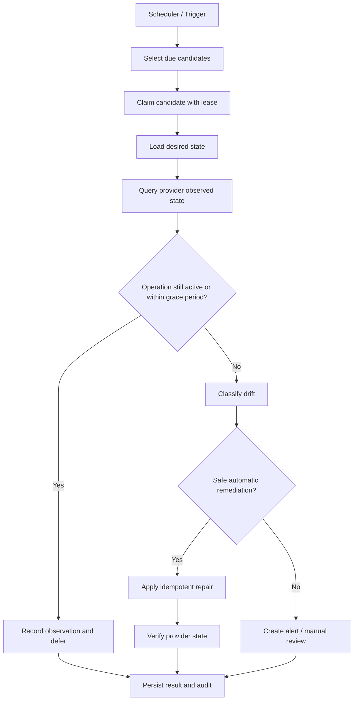

# Đối soát trạng thái định kỳ và phát hiện tài nguyên lệch trạng thái

Spring Cloud Service Broker lưu trạng thái service instance, binding và operation trong database của broker, trong khi tài nguyên thực tế được tạo và quản lý ở hệ thống phía sau như Cloud Foundry, Kubernetes hoặc một dịch vụ cloud. Theo thời gian, hai phía có thể không còn khớp nhau. Ví dụ broker ghi instance đã provision nhưng Pod hoặc database đã bị xóa thủ công; broker ghi deprovision thành công nhưng volume vẫn tồn tại; hoặc worker đã tạo tài nguyên nhưng dừng trước khi cập nhật database.

Đối soát trạng thái định kỳ (periodic reconciliation) là quy trình so sánh trạng thái broker mong muốn với trạng thái quan sát được từ provider, phát hiện sai lệch và xử lý theo chính sách an toàn. Quy trình này giúp tìm tài nguyên mồ côi, operation bị kẹt, instance mất tài nguyên và binding không còn hợp lệ. Đây là cơ chế bổ sung cho xử lý request và retry; nó không thay thế các thao tác OSB API hoặc cơ chế idempotency.

## 1. Vì sao trạng thái broker và provider có thể lệch nhau?

Một thao tác OSB thường cập nhật nhiều hệ thống: broker database, queue, worker và control plane của provider. Không có một transaction phân tán duy nhất bao trùm tất cả các thành phần. Vì vậy, sự cố có thể xảy ra giữa bất kỳ hai bước nào.

Các tình huống thường gặp:

- Broker đã lưu service instance và gửi lệnh provision, nhưng worker bị dừng trước khi gọi provider.
- Provider tạo database hoặc Kubernetes workload thành công, nhưng broker timeout trước khi lưu external resource ID.
- Người vận hành xóa Pod, database hoặc volume trực tiếp trên provider mà không thông báo broker.
- Provider tự phục hồi hoặc thay thế tài nguyên, khiến external resource ID hoặc thuộc tính quan sát thay đổi.
- Deprovision đã được đánh dấu thành công trong broker nhưng một tài nguyên phụ thuộc như snapshot, IP hoặc volume vẫn còn.
- Operation ở trạng thái `RUNNING` hoặc `RETRY_WAIT` quá lâu vì worker mất lease, queue thất lạc message hoặc provider liên tục lỗi.
- Binding record vẫn ở `READY` nhưng principal hoặc credential ở provider đã bị thu hồi.
- Tài nguyên được tạo ngoài broker nhưng mang nhãn hoặc metadata khiến nó giống tài nguyên do broker quản lý.

Một vài sai khác là tạm thời và hợp lệ. Ví dụ Kubernetes cần thời gian để scheduler đặt Pod, volume được attach hoặc controller cập nhật status. Nếu reconciliation chạy quá sớm và coi trạng thái trung gian là lỗi, broker có thể tạo tài nguyên trùng hoặc xóa nhầm tài nguyên đang được provider xử lý. Do đó, đối soát phải hiểu vòng đời và độ trễ nhất quán của từng provider.

## 2. Desired state và observed state

Đối soát cần phân biệt hai loại trạng thái:

- **Desired state** là trạng thái broker mong muốn theo các bản ghi nghiệp vụ đã được chấp nhận. Ví dụ service instance đang `READY`, plan là `standard`, có hai binding đang hoạt động.
- **Observed state** là trạng thái broker đọc được từ provider tại thời điểm kiểm tra. Ví dụ database còn tồn tại, Pod đã Ready, principal có thể đăng nhập hoặc volume đang attached.

Hai trạng thái không nhất thiết giống nhau ở mọi thời điểm. Khi một operation đang chạy, observed state có thể chỉ phản ánh một phần tiến trình. Reconciliation phải đối chiếu cả trạng thái operation và thời gian kể từ lần thay đổi gần nhất.

Ví dụ mô hình:

| Thành phần | Desired state trong broker | Observed state ở provider |
|---|---|---|
| Service instance | `READY`, external ID `db-781` | Database `db-781` đang hoạt động |
| Service instance | `DEPROVISIONED` | Database `db-781` vẫn tồn tại |
| Service instance | `READY`, external ID `db-781` | Database không tìm thấy |
| Binding | `READY`, principal `app_42` | Principal `app_42` đã bị xóa |
| Operation | `SUCCEEDED` | Provider operation vẫn `RUNNING` hoặc resource chưa đạt mục tiêu |
| Operation | `RUNNING` | Resource đã đạt trạng thái cuối nhưng broker chưa commit kết quả |

Broker database là nguồn chuẩn cho ý định nghiệp vụ và quyền sở hữu service instance; provider là nguồn chuẩn cho sự tồn tại và trạng thái vật lý của tài nguyên. Không nên coi một phía luôn đúng trong mọi tình huống. Khi hai phía bất đồng, broker phải xác định nguyên nhân và quy tắc xử lý thay vì tự động ghi đè một phía.

## 3. Những dạng drift cần phát hiện

Drift (sai lệch trạng thái) có thể được chia thành nhiều loại để chọn hành động phù hợp:

| Loại drift | Ví dụ | Mức độ và hướng xử lý |
|---|---|---|
| Missing resource | Broker ghi `READY`, provider không tìm thấy database | Cần xác minh account/region và operation gần nhất; sau đó đánh dấu cần phục hồi hoặc lỗi |
| Orphan resource | Broker ghi `DEPROVISIONED` hoặc không có instance, provider vẫn có database | Kiểm tra ownership và deletion intent; cleanup nếu chắc chắn resource thuộc broker |
| Configuration drift | Plan yêu cầu 4 replica nhưng provider chỉ có 2 | So sánh thuộc tính được quản lý; sửa hoặc cảnh báo theo policy |
| Binding drift | Binding `READY` nhưng user/route registration không còn | Recreate, đánh dấu binding lỗi hoặc yêu cầu rotation theo chính sách |
| Operation drift | Operation broker `SUCCEEDED` nhưng provider chưa hoàn tất | Điều tra và reconciliation; không tin trạng thái thành công đơn lẻ |
| Identity drift | External resource ID không còn khớp label/owner metadata | Tạm dừng tự động sửa, xác minh ownership và mapping |
| Stale operation | Operation ở `RUNNING` lâu hơn deadline | Kiểm tra worker lease, provider operation và side effect trước khi retry |

Nên phân biệt drift thật với trạng thái đang hội tụ. Một Pod đang `Pending` vài giây sau khi provision chưa chắc là drift. Một Pod vẫn `Pending` quá thời hạn, trong khi operation đã hết retry budget, mới là dấu hiệu cần điều tra.

## 4. Nguồn dữ liệu và định danh tài nguyên

Để đối soát chính xác, broker phải lưu thông tin đủ để tìm đúng resource ở provider. Không nên chỉ lưu tên hiển thị hoặc service instance ID của platform rồi suy ra resource theo quy ước tên.

Một service instance record nên có các trường như:

| Trường | Mục đích |
|---|---|
| `platform_instance_id` | Phạm vi platform tạo instance |
| `service_instance_id` | ID instance do platform gửi |
| `service_id`, `plan_id`, `plan_revision` | Định nghĩa dịch vụ và cấu hình đã áp dụng |
| `provider_type` | Loại provider, ví dụ Kubernetes hoặc database service |
| `provider_account_ref` | Tham chiếu account, cluster, project hoặc tenant |
| `provider_resource_id` | ID tài nguyên thực tế ở provider |
| `provider_resource_name` | Tên resource nếu cần để tra cứu |
| `desired_state` | Trạng thái nghiệp vụ broker mong muốn |
| `last_observed_state` | Trạng thái provider gần nhất đã quan sát |
| `last_reconciled_at` | Thời điểm đối soát thành công gần nhất |
| `version` | Phiên bản bản ghi để phát hiện cập nhật đồng thời |

Tài nguyên do broker tạo nên có metadata hoặc tag ownership ở provider nếu nền tảng hỗ trợ. Ví dụ Kubernetes label có thể chứa broker ID, platform instance ID đã chuẩn hóa, service instance ID hoặc một mã ownership không nhạy cảm. Tránh đặt secret hoặc thông tin cá nhân vào label vì label có thể được hiển thị rộng rãi.

Khi tra cứu resource, ưu tiên external resource ID đã lưu. Nếu ID bị mất do crash, có thể dùng ownership metadata hoặc idempotency key để tìm lại. Không nên chỉ tìm theo tên do người dùng đặt, vì tên có thể trùng hoặc đã được tái sử dụng.

## 5. Kiến trúc reconciliation định kỳ

Một hệ thống có thể tách reconciliation thành các thành phần:

1. **Scheduler:** kích hoạt chu kỳ đối soát theo lịch hoặc theo sự kiện.
2. **Candidate selector:** chọn các instance, binding hoặc operation đến hạn kiểm tra.
3. **Reconciliation coordinator:** claim từng candidate, xác định provider adapter và chính sách kiểm tra.
4. **Provider adapter:** đọc trạng thái thực tế từ Cloud Foundry, Kubernetes hoặc API của nhà cung cấp.
5. **Drift classifier:** so sánh desired/observed state và phân loại sai lệch.
6. **Remediation handler:** tự sửa các sai lệch được phép hoặc tạo cảnh báo/ticket cho trường hợp cần người vận hành.
7. **Audit and metrics:** lưu kết quả, số lần thử, thời gian và loại drift.



Scheduler không nên tự thực hiện mọi lời gọi provider trong một vòng lặp dài. Nó nên tạo candidate hoặc message để worker xử lý theo batch, giới hạn concurrency và có thể retry độc lập. Nhờ vậy, một provider chậm không làm treo toàn bộ chu kỳ reconciliation.

## 6. Chọn tài nguyên cần đối soát

Không nhất thiết kiểm tra toàn bộ tài nguyên ở mỗi chu kỳ. Có thể chọn candidate dựa trên:

- Instance hoặc binding đã quá thời gian kể từ lần reconcile gần nhất.
- Operation `RUNNING`, `RETRY_WAIT` hoặc `ACCEPTED` vượt một ngưỡng thời gian.
- Tài nguyên vừa trải qua lỗi provider hoặc retry.
- Instance có thay đổi plan, parameters hoặc binding gần đây.
- Tài nguyên quan trọng cần kiểm tra thường xuyên hơn theo SLA.
- Provider phát sự kiện cho biết resource đã thay đổi hoặc bị xóa.

Một chiến lược thường dùng là kết hợp kiểm tra theo lịch và event-driven reconciliation. Sự kiện giúp phát hiện drift nhanh hơn; kiểm tra định kỳ giúp phát hiện sự kiện bị mất hoặc trạng thái thay đổi ngoài hệ thống.

Candidate selector nên dùng phân trang theo khóa ổn định, ví dụ `next_reconcile_at` và primary key. Không tải toàn bộ bảng instance vào bộ nhớ. Khi một candidate được chọn, worker cần claim bằng lease hoặc optimistic locking để tránh hai worker cùng đối soát và sửa một resource.

Ví dụ truy vấn chọn candidate:

```sql
SELECT platform_instance_id,
       service_instance_id,
       provider_resource_id,
       desired_state,
       version
FROM service_instance
WHERE next_reconcile_at <= CURRENT_TIMESTAMP
  AND state IN ('READY', 'DEPROVISIONING', 'RECONCILIATION_REQUIRED')
ORDER BY next_reconcile_at, platform_instance_id, service_instance_id
FETCH FIRST 100 ROWS ONLY;
```

Đây là SQL minh họa; cú pháp phân trang và cách khóa phụ thuộc database. Trên hệ thống lớn, có thể dùng `FOR UPDATE SKIP LOCKED`, lease column hoặc queue để phân phối candidate cho nhiều worker.

## 7. Phân biệt operation đang chạy với drift thật

Một trong những quy tắc quan trọng nhất là không sửa resource trong khi operation hợp lệ đang điều khiển nó. Ví dụ worker đang scale Kubernetes Deployment từ 2 lên 4 replica; trong vài giây observed replica count vẫn là 2. Nếu reconciliation tự động scale lần nữa hoặc ghi đè target, có thể tạo xung đột.

Trước khi phân loại drift, kiểm tra:

1. Có operation mutation đang hoạt động trên instance không?
2. Operation có còn lease hợp lệ hoặc đang chờ retry không?
3. Provider có trả operation ID riêng và operation đó còn chạy không?
4. Thời gian từ lần thay đổi gần nhất đã vượt grace period chưa?
5. Provider có trạng thái trung gian hoặc eventual consistency được tài liệu hóa không?

Nếu operation còn hoạt động, reconciliation thường chỉ ghi nhận observed state và lên lịch kiểm tra lại. Nếu operation đã terminal nhưng observed state vẫn khác desired state, có thể tạo drift finding. Nếu operation mất lease hoặc trạng thái không rõ, cần chuyển instance sang `RECONCILIATION_REQUIRED` trước khi cho phép mutation mới.

Grace period nên phụ thuộc loại resource. Một database nhỏ có thể sẵn sàng trong thời gian ngắn; một cluster hoặc volume lớn có thể cần nhiều phút. Không dùng một khoảng thời gian chung cho tất cả provider và plan.

## 8. Phân loại và xử lý drift an toàn

Không phải drift nào cũng nên tự động sửa. Cần có policy cho từng loại tài nguyên và từng loại sai lệch.

| Drift | Có thể tự sửa? | Hành động gợi ý |
|---|---|---|
| Provider resource tồn tại, broker state `READY`, thuộc tính quan sát nhất quán | Không cần | Cập nhật `last_observed_state` và thời gian reconcile |
| Provider resource tạm thời chưa phản ánh cấu hình mới trong operation đang chạy | Chưa | Defer đến lần kiểm tra sau |
| Resource bị mất trong khi broker state `READY` | Thường không tự provision lại ngay | Xác minh có xóa thủ công hay provider outage; cảnh báo hoặc chạy recovery đã được phê duyệt |
| Resource mồ côi có ownership marker rõ và deletion intent đã hoàn tất | Có thể | Cleanup theo chính sách retention và xác minh không có owner hợp lệ |
| Binding principal bị thiếu nhưng service instance còn hoạt động | Tùy policy | Tạo lại đúng principal theo binding key hoặc đánh dấu binding cần rotation |
| Plan/configuration khác desired state | Tùy loại thay đổi | Áp dụng sửa chữa idempotent nếu policy cho phép; nếu không thì cảnh báo |
| External resource ID không khớp ownership | Không | Cách ly finding và yêu cầu kiểm tra thủ công |
| Operation broker terminal nhưng provider operation còn chạy | Không tự đánh dấu hoàn tất | Đồng bộ trạng thái operation hoặc mở điều tra |

Các hành động tự động nên có giới hạn rõ:

- **Observe only:** chỉ ghi nhận và phát cảnh báo.
- **Safe repair:** sửa sai lệch có thể khôi phục mà không gây mất dữ liệu, ví dụ thêm lại label quản lý đã mất nếu đã xác minh ownership.
- **Retry operation:** tiếp tục operation đã được chấp nhận và có idempotency.
- **Compensate:** dọn side effect dở dang theo kế hoạch đã định nghĩa.
- **Manual remediation:** yêu cầu người vận hành quyết định khi sửa có thể gây mất dữ liệu hoặc thay đổi ngoài hợp đồng.

Không tự động tạo lại database bị mất chỉ vì desired state ghi `READY`; thao tác này có thể tạo một database rỗng và làm người dùng tưởng dữ liệu cũ đã được phục hồi. Với dữ liệu quan trọng, cần backup/restore hoặc quy trình recovery rõ ràng.

## 9. Triển khai với Spring Scheduling và worker

Trong Spring, `@Scheduled` có thể dùng để kích hoạt quá trình chọn candidate. Scheduler nên nhẹ: chỉ tạo batch hoặc phát sự kiện. Phần gọi provider và sửa chữa chạy trong worker riêng để giới hạn concurrency và tránh giữ thread scheduler quá lâu.

Ví dụ scheduler:

```java
@Component
public class ReconciliationScheduler {

    private final ReconciliationDispatcher dispatcher;

    public ReconciliationScheduler(ReconciliationDispatcher dispatcher) {
        this.dispatcher = dispatcher;
    }

    @Scheduled(fixedDelayString = "${broker.reconciliation.scan-delay:60000}")
    public void dispatchDueCandidates() {
        dispatcher.dispatchNextBatch();
    }
}
```

`fixedDelay` tính thời gian từ lúc lần chạy trước kết thúc đến lần kế tiếp bắt đầu trên cùng scheduler. Trong ứng dụng nhiều replica, `@Scheduled` sẽ chạy ở mỗi replica nếu không có cơ chế phân phối/leader election. Vì vậy, candidate claim và lease phải được bảo vệ ở database hoặc hệ thống queue; không dựa vào giả định chỉ có một scheduler.

### 9.1. Provider adapter

Nên định nghĩa interface chung để reconciliation không phụ thuộc trực tiếp vào Kubernetes client hoặc API của một nhà cung cấp:

```java
public interface ProviderResourceInspector {

    ObservedResource inspect(ProviderResourceReference reference);

    RepairResult repair(RepairCommand command);
}
```

`ProviderResourceReference` chứa provider type, account/cluster reference và external resource ID. Mỗi adapter chuyển response của provider thành một mô hình observed state thống nhất. Không nên nhét token hoặc secret vào reference; adapter lấy credential từ secret manager theo account reference.

### 9.2. So sánh desired và observed state

Một service phân loại drift có thể nhận hai snapshot:

```java
public record ReconciliationSnapshot(
        String serviceInstanceId,
        DesiredResource desired,
        ObservedResource observed,
        boolean mutationInProgress,
        Instant lastMutationAt
) {}

public interface DriftClassifier {
    DriftFinding classify(ReconciliationSnapshot snapshot);
}
```

Classifier không nên trực tiếp gọi provider hoặc thay đổi database. Nó chỉ quyết định loại drift và mức độ an toàn. Remediation handler nhận finding và thực hiện hành động theo policy.

### 9.3. Xử lý một candidate

Pseudocode minh họa:

```java
@Service
public class ReconciliationWorker {

    private final ReconciliationRepository repository;
    private final ProviderResourceInspector inspector;
    private final DriftClassifier classifier;
    private final RemediationPolicy remediationPolicy;

    public void reconcile(ReconciliationCandidate candidate) {
        ClaimedCandidate claimed = repository.claim(candidate.id());
        if (claimed == null) {
            return;
        }

        try {
            if (claimed.hasActiveMutation()) {
                repository.defer(claimed.id(), "mutation-in-progress");
                return;
            }

            ObservedResource observed = inspector.inspect(
                    claimed.providerReference());
            DriftFinding finding = classifier.classify(
                    claimed.toSnapshot(observed));

            if (remediationPolicy.isAutomaticRepairAllowed(finding)) {
                remediationPolicy.repair(finding);
                repository.verifyAndComplete(claimed.id());
            } else {
                repository.recordFindingAndDefer(claimed.id(), finding);
            }
        } finally {
            repository.releaseLeaseIfOwned(claimed.id(), claimed.leaseToken());
        }
    }
}
```

Đây là ví dụ kiến trúc, cần bổ sung xử lý exception, transaction, timeout và retry theo provider. Khi `repair` có side effect, nó phải idempotent và có operation record riêng. Không giữ transaction database mở trong lúc gọi API provider kéo dài.

## 10. Đối soát Kubernetes và Cloud Foundry

### 10.1. Kubernetes

Với Kubernetes, observed state có thể được lấy từ API server:

- Deployment: desired replicas, available replicas, generation và observed generation.
- Pod: phase, readiness condition, restart count và owner reference.
- PersistentVolumeClaim: phase, capacity, storage class và volume binding.
- Service/Ingress/Gateway: selector, endpoint, listener hoặc route status.
- Secret: sự tồn tại và metadata; không đọc hoặc log giá trị secret khi không cần thiết.

Ví dụ: broker mong muốn một Deployment có 3 replicas. API server trả `spec.replicas=3` nhưng `status.availableReplicas=2`. Đây có thể là trạng thái hội tụ nếu rollout mới bắt đầu. Chỉ phân loại drift sau grace period và khi operation không còn active. Nếu Deployment bị xóa hoàn toàn nhưng instance broker vẫn `READY`, cần kiểm tra owner metadata, namespace và cluster trước khi quyết định recovery.

Khi cleanup resource mồ côi, dùng label ownership và external ID đã lưu. Không xóa mọi resource trong namespace chỉ vì tên gần giống service instance. Kubernetes controller có thể tự tái tạo Pod; nên quan sát resource cấp cao như Deployment hoặc StatefulSet thay vì coi từng Pod là tài nguyên độc lập nếu broker không trực tiếp sở hữu Pod.

### 10.2. Cloud Foundry

Với Cloud Foundry, observed state có thể bao gồm service instance, service binding, route service registration và trạng thái operation do platform/provider expose. Broker cần đối chiếu GUID của service instance/binding với dữ liệu đã lưu, cùng organization/space context khi phù hợp.

Nếu broker tích hợp với một service provider phía sau Cloud Foundry, cần phân biệt trạng thái service instance trong Cloud Foundry với tài nguyên backend mà broker quản lý. Một service instance có thể tồn tại trong platform nhưng database phía sau đã bị xóa; ngược lại, backend có thể còn resource sau khi platform đã xóa service instance. Reconciliation nên kiểm tra cả hai lớp nếu broker có quyền và API để làm việc đó.

Các API, quyền và field quan sát cụ thể phụ thuộc phiên bản Cloud Foundry và service provider. Adapter cần chuẩn hóa chúng thành observed state chung thay vì để logic nghiệp vụ phụ thuộc trực tiếp vào response riêng của từng nền tảng.

## 11. Đối soát binding và operation

Reconciliation không chỉ kiểm tra service instance. Binding và operation cũng có thể lệch trạng thái.

### 11.1. Binding drift

Ví dụ broker lưu binding `READY` với provider principal `orders_app_42`, nhưng principal đã bị xóa hoặc credential đã hết hạn. Broker có thể:

- Đánh dấu binding `RECONCILIATION_REQUIRED`.
- Kiểm tra binding còn được platform sử dụng hay không.
- Tạo lại principal nếu policy cho phép và có thể giữ nguyên contract credentials.
- Nếu phải đổi credential, thực hiện rotation có phối hợp với platform; không âm thầm đổi password trong GET binding.
- Ghi finding để vận hành xử lý nếu không thể khôi phục an toàn.

Với route binding, kiểm tra route registration hoặc endpoint trung gian còn tồn tại. Không tạo route service URL mới nếu platform vẫn đang dùng URL cũ, trừ khi có quy trình cập nhật rõ ràng.

### 11.2. Operation drift

Operation broker ở `RUNNING` quá lâu cần được kiểm tra với worker lease, queue và provider operation. Một operation có thể đã hoàn tất ở provider nhưng broker chưa ghi `SUCCEEDED`. Khi đó reconciliation có thể xác nhận kết quả và commit trạng thái nếu operation/version vẫn hợp lệ.

Ngược lại, operation broker đã `SUCCEEDED` nhưng provider chưa đạt trạng thái cuối là dấu hiệu nghiêm trọng. Không nên chỉ sửa database broker để khớp với provider đang lỗi. Cần xác định thao tác đã được xác nhận sai ở đâu, sau đó tiếp tục operation, compensation hoặc chuyển sang trạng thái cần can thiệp.

## 12. Concurrency, lease và an toàn khi sửa chữa

Reconciliation có thể chạy cùng lúc với provision, update hoặc deprovision. Mỗi candidate cần được claim nguyên tử bằng lease hoặc optimistic locking. Trước khi sửa, worker kiểm tra lại instance version và operation active.

Các nguyên tắc:

- Không chạy remediation mutation khi instance đang có operation mutation khác.
- Lease có thời hạn và được gia hạn khi worker còn làm việc.
- Mỗi lần claim có fencing token hoặc generation để worker cũ không commit sau khi lease hết hạn.
- Remediation phải có idempotency key hoặc điều kiện trạng thái trước khi tạo/xóa tài nguyên.
- Trước thao tác phá hủy, xác minh ownership bằng nhiều thuộc tính như provider account, external ID và ownership marker.
- Sau remediation, đọc lại provider state để xác nhận kết quả; không coi việc API trả 2xx là bằng chứng duy nhất nếu provider xử lý bất đồng bộ.
- Nếu kết quả provider không xác định, giữ trạng thái reconciliation pending thay vì giải phóng khóa và cho mutation mới chạy ngay.

Một finding có thể được tạo ở chu kỳ này và xử lý ở chu kỳ sau. Lưu finding riêng với resource state giúp broker tránh lặp lại cảnh báo mỗi phút mà không có thông tin mới. Có thể dùng fingerprint từ resource ID, drift type và desired version để nhóm finding trùng.

## 13. Lịch chạy, tải hệ thống và khả năng mở rộng

Tần suất reconciliation là một quyết định vận hành. Chạy quá thường xuyên gây tải lên API provider và database; chạy quá thưa khiến drift tồn tại lâu. Có thể dùng nhiều lịch:

- Operation mới hoặc vừa lỗi: kiểm tra lại sau một khoảng ngắn có backoff.
- Instance đang hoạt động bình thường: kiểm tra theo chu kỳ dài hơn.
- Tài nguyên quan trọng hoặc có SLA cao: chu kỳ ngắn hơn theo policy.
- Resource đã deprovision: kiểm tra orphan theo retention window trước khi cleanup cuối cùng.

Để mở rộng:

- Chia batch theo provider account, cluster, region hoặc partition key.
- Giới hạn concurrency riêng cho từng provider để tránh rate limit.
- Dùng pagination và incremental scan thay vì list toàn bộ resource mỗi lần.
- Dùng jitter cho lịch chạy để tránh mọi instance được kiểm tra cùng một thời điểm.
- Cache metadata ít thay đổi nhưng không cache trạng thái resource quá lâu.
- Có circuit breaker và backoff khi provider outage; không tạo backlog retry vô hạn không kiểm soát.
- Theo dõi queue depth, candidate age và thời gian reconcile.

Nếu provider có API list resource theo tag, có thể chạy hai chiều: từ broker record tìm resource bị thiếu và từ provider inventory tìm resource mồ côi. Khi chạy chiều provider-to-broker, phải xác minh ownership marker trước khi tạo finding hoặc cleanup; không nhập resource lạ vào database broker chỉ dựa trên tên.

## 14. Audit, cảnh báo và metric

Mỗi lần đối soát nên tạo một kết quả có thể truy vết:

| Trường audit | Ý nghĩa |
|---|---|
| `reconciliation_id` | Định danh lần kiểm tra |
| `resource_type` và `resource_id` | Loại và ID tài nguyên |
| `platform_instance_id` | Phạm vi platform |
| `desired_version` | Version trạng thái mong muốn được so sánh |
| `observed_at` | Thời điểm đọc provider |
| `drift_type` | Loại sai lệch |
| `action` | `OBSERVE`, `RETRY`, `REPAIR`, `ALERT` hoặc `MANUAL` |
| `result` | Kết quả xử lý |
| `provider_request_id` | Request ID provider nếu có |
| `started_at`, `finished_at` | Thời gian thực thi |

Metric hữu ích:

- Số candidate đến hạn và số candidate đã đối soát.
- Số drift theo loại và mức độ.
- Số remediation thành công/thất bại.
- Tuổi finding chưa xử lý.
- Số operation bị kẹt hoặc vượt deadline.
- Provider API latency, error rate, throttling và circuit breaker state.
- Thời gian từ lúc drift xuất hiện đến khi được phát hiện và xử lý.

Không đưa service instance ID, binding ID hoặc operation ID có cardinality cao thành label metric. Dùng log/trace cho định danh chi tiết và metric tổng hợp theo provider, resource type, drift type và kết quả. Không ghi secret, credentials hoặc payload nhạy cảm trong audit.

## 15. Kiểm thử reconciliation

Kiểm thử cần bao gồm trạng thái bình thường, drift thật, trạng thái trung gian và lỗi giữa các bước:

1. Desired và observed state khớp nhau; reconciliation chỉ cập nhật `last_reconciled_at`.
2. Provider chưa hội tụ nhưng operation còn active; worker defer và không sửa tài nguyên.
3. Provider resource bị mất trong khi broker ghi `READY`; tạo finding và không tự provision lại database khi chưa có policy recovery.
4. Broker ghi `DEPROVISIONED` nhưng provider resource còn tồn tại; chỉ cleanup khi ownership và retention policy được xác minh.
5. Binding record `READY` nhưng provider principal không tồn tại; phát hiện binding drift và xử lý theo policy.
6. Operation broker `RUNNING` nhưng provider operation đã thành công; reconciliation commit kết quả nếu version/fencing token còn hợp lệ.
7. Operation broker `SUCCEEDED` nhưng provider chưa đạt trạng thái mong muốn; phát cảnh báo và đưa vào reconciliation.
8. Hai worker cùng chọn một candidate; chỉ một worker claim được lease.
9. Worker cũ hết lease không thể commit kết quả sau khi worker mới tiếp quản.
10. Provider trả `429` hoặc `503`; worker tôn trọng retry/backoff và không làm cạn tài nguyên.
11. Pagination bị gián đoạn; chu kỳ tiếp theo tiếp tục từ checkpoint an toàn, không bỏ sót candidate.
12. Provider API trả timeout với kết quả chưa xác định; worker kiểm tra lại trạng thái trước khi retry side effect.
13. Ownership metadata không khớp; không tự động xóa resource.
14. Remediation thành công nhưng verification chưa thấy trạng thái mới; finding vẫn pending cho đến khi quan sát xác nhận.
15. Scheduler chạy trên nhiều replica không tạo duplicate mutation hoặc vượt giới hạn provider rate.

## 16. Lỗi thường gặp và cách khắc phục

| Lỗi | Hậu quả | Cách khắc phục |
|---|---|---|
| Coi broker database là bằng chứng duy nhất resource còn tồn tại | Bỏ sót tài nguyên bị xóa ngoài hệ thống | Đọc observed state từ provider |
| Coi provider state là nguồn duy nhất cho nghiệp vụ | Mất ý định, plan và quyền sở hữu của broker | So sánh desired state với observed state |
| Sửa ngay khi thấy hai trạng thái khác nhau | Tạo/xóa trùng trong lúc operation đang chạy | Kiểm tra active operation và grace period |
| Tự tạo lại resource bị mất | Có thể tạo resource rỗng và làm mất dữ liệu cũ | Yêu cầu recovery/restore policy rõ ràng |
| Xóa orphan chỉ dựa vào tên resource | Xóa nhầm tài nguyên của tenant khác | Xác minh external ID, account và ownership marker |
| Chạy scheduler trên nhiều replica mà không claim candidate | Nhiều worker cùng sửa một resource | Lease, unique claim và fencing token |
| Quét toàn bộ provider inventory mỗi phút | Tăng tải, rate limit và chi phí | Batch, pagination, incremental scan và lịch theo mức độ |
| Đánh dấu operation thành công chỉ từ HTTP 2xx | Provider operation có thể vẫn đang chạy | Poll hoặc kiểm tra trạng thái cuối của provider |
| Không lưu finding và audit | Drift lặp lại nhưng không biết lịch sử xử lý | Lưu finding, action và kết quả từng chu kỳ |
| Đưa ID chi tiết vào metric label | Cardinality tăng cao | Dùng log/trace cho ID cụ thể |

## 17. Kết luận

Đối soát trạng thái định kỳ giúp Spring Cloud Service Broker phát hiện sự khác nhau giữa ý định được lưu trong broker và tài nguyên thực tế ở provider. Hãy lưu external resource ID và ownership metadata, chọn candidate theo lịch hoặc sự kiện, kiểm tra operation đang chạy trước khi phân loại drift, rồi áp dụng policy observe, retry, repair hoặc manual remediation. Mọi sửa chữa phải idempotent, có lease/fencing, xác minh ownership và đọc lại provider state sau khi thực hiện. Khi kết hợp với audit, metric và reconciliation hai chiều, broker có thể phát hiện tài nguyên mồ côi, instance mất resource, binding lệch trạng thái và operation bị kẹt mà không tạo thêm rủi ro do sửa chữa quá sớm.
