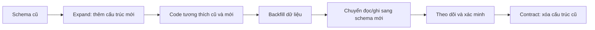

# Sao lưu, phục hồi và thay đổi schema kho dữ liệu

Kho dữ liệu là nơi service broker lưu những thông tin cần thiết để quản lý vòng đời tài nguyên: service instance, binding, tham số đã chuẩn hóa, định danh tài nguyên ở nhà cung cấp, operation đang chạy, kết quả đã trả cho nền tảng và mapping đến secret. Nếu kho dữ liệu bị mất hoặc không thể đọc sau sự cố, broker có thể không biết tài nguyên nào thuộc về instance nào, credential nào cần thu hồi hoặc operation nào phải tiếp tục.

Vì vậy, backup và restore là một phần của thiết kế vận hành broker. Thay đổi schema cũng phải được triển khai có kiểm soát để phiên bản ứng dụng mới vẫn đọc được dữ liệu cũ, worker đang chạy không bị lỗi và thao tác deprovision vẫn tìm được provider resource đã tạo trước đó. Với `SPRING_CLOUD_SERVICE_BROKER`, cần bảo vệ tính nhất quán giữa dữ liệu broker, secret store, queue/outbox và tài nguyên thật ở provider.

## 1. Vì sao broker cần chiến lược backup và restore?

Broker thường giữ trạng thái mà nền tảng không lưu đầy đủ thay cho broker. Ví dụ, nền tảng biết `service_instance_id=inst-42`, nhưng chỉ broker biết instance đó ánh xạ đến database `db-7c91` ở account nào, region nào và plan nào. Broker cũng có thể lưu operation ID, provider job ID, binding principal và secret reference. Nếu mất các mapping này, tài nguyên vẫn tồn tại ở provider nhưng broker không còn đủ thông tin để quản lý.

Những hậu quả thường gặp khi mất dữ liệu:

- **Không thể update hoặc deprovision đúng tài nguyên:** broker mất provider resource ID, account hoặc region.
- **Credential còn hiệu lực nhưng mất mapping:** broker không biết principal nào phải thu hồi khi unbind.
- **Operation bị treo:** operation record và outbox không còn đồng bộ, worker không biết công việc cần tiếp tục.
- **Trạng thái sai lệch:** broker báo instance không tồn tại dù provider vẫn còn tài nguyên, hoặc báo `AVAILABLE` dù tài nguyên đã mất.
- **Mất lịch sử và khả năng audit:** không thể giải thích ai yêu cầu thay đổi, cấu hình nào được áp dụng hoặc lần retry trước kết thúc ra sao.
- **Không thể phục hồi secret:** database giữ secret reference nhưng secret store đã mất phiên bản tương ứng, hoặc ngược lại.

Backup không chỉ nhằm khôi phục dữ liệu ứng dụng sau lỗi ổ đĩa. Nó phải giúp broker khôi phục khả năng điều khiển tài nguyên bên ngoài một cách an toàn và có thể đối soát.

## 2. Xác định phạm vi dữ liệu cần bảo vệ

Trước khi chọn công cụ backup, cần lập danh mục những nguồn dữ liệu cấu thành trạng thái broker.

| Thành phần | Dữ liệu quan trọng | Mục đích khi phục hồi |
|---|---|---|
| Database broker | Instance, binding, operation, provider mapping, configuration snapshot | Tiếp tục quản lý vòng đời service |
| Outbox/inbox | Event chờ phát, message đã nhận, deduplication key | Không bỏ sót hoặc xử lý trùng công việc |
| Secret manager | Credential, token, key reference, secret version | Khôi phục khả năng bind/unbind và gọi provider |
| Cấu hình triển khai | Provider account mapping, endpoint, feature flags, encryption key reference | Khởi động ứng dụng đúng môi trường |
| Queue/event system | Message chưa xử lý, retention và consumer offset nếu cần | Tiếp tục xử lý tác vụ nền |
| Artifact/schema migration | Phiên bản ứng dụng, migration scripts, schema version | Chạy đúng code với dữ liệu được khôi phục |
| Audit và log cần lưu | Sự kiện quản trị, thay đổi plan/configuration | Điều tra và đáp ứng yêu cầu lưu trữ |

Không phải mọi thành phần đều cần backup theo cùng một cách. Queue có thể được cấu hình để giữ message bền vững; outbox trong database có thể là nguồn sự thật để phát lại event; log có thể được lưu ở hệ thống riêng. Cần xác định rõ thành phần nào là source of truth và thành phần nào có thể tái tạo.

### Phân biệt dữ liệu broker với tài nguyên provider

Backup database broker không tự backup database mà broker đã cấp cho khách hàng. Hai phạm vi có chủ sở hữu, retention và mục tiêu phục hồi khác nhau:

- **Broker control data:** mapping, cấu hình, operation và binding record do broker quản lý.
- **Customer service data:** dữ liệu thật trong PostgreSQL, Redis, object storage hoặc tài nguyên mà broker đã cấp.

Broker có thể gọi provider để bật backup cho tài nguyên khách hàng, nhưng đó là nghiệp vụ dịch vụ riêng. Backup kho dữ liệu broker không thay thế backup tài nguyên khách hàng; ngược lại, khôi phục database khách hàng cũng không khôi phục mapping quản lý của broker.

## 3. Đặt mục tiêu RPO và RTO

Hai chỉ số giúp chuyển yêu cầu phục hồi thành chính sách kỹ thuật:

- **RPO (Recovery Point Objective):** lượng dữ liệu tối đa có thể chấp nhận mất, thường được biểu diễn bằng thời gian. RPO 15 phút nghĩa là khi có sự cố, dữ liệu mới nhất được khôi phục có thể lùi tối đa khoảng 15 phút.
- **RTO (Recovery Time Objective):** thời gian mục tiêu để khôi phục dịch vụ về trạng thái có thể vận hành. RTO 2 giờ nghĩa là quy trình khôi phục cần đưa broker trở lại hoạt động trong vòng 2 giờ.

Ví dụ minh họa:

| Dữ liệu | RPO mục tiêu | RTO mục tiêu | Lý do |
|---|---:|---:|---|
| Instance/binding/provider mapping | 5–15 phút | 1–2 giờ | Mất mapping có thể khiến broker mất quyền quản lý tài nguyên |
| Operation và outbox | 1–5 phút hoặc phục hồi theo log | 1 giờ | Cần tiếp tục operation và tránh bỏ sót job |
| Secret và key material | Theo chính sách gần như không mất phiên bản đang hoạt động | 1–2 giờ | Mất secret có thể khiến binding hoặc provider access không phục hồi được |
| Audit history | Theo yêu cầu lưu trữ | Theo yêu cầu nghiệp vụ | Phục vụ điều tra và đối soát |

Các con số trên chỉ là ví dụ. Đội vận hành cần xác định mục tiêu dựa trên số lượng instance, tốc độ phát sinh operation, mức độ ảnh hưởng đến khách hàng, khả năng của database và chi phí hạ tầng. RPO/RTO phải được kiểm chứng bằng diễn tập restore; một lịch backup dày không tự chứng minh đã đạt được mục tiêu.

## 4. Các phương pháp backup kho dữ liệu

### Logical backup

Logical backup xuất dữ liệu ở mức schema/table/record, ví dụ `pg_dump` với PostgreSQL. Nó hữu ích khi cần chuyển dữ liệu giữa phiên bản database, chọn một phần schema hoặc kiểm tra dữ liệu. Restore có thể chậm với database lớn và cần bảo đảm thứ tự khôi phục constraint, index, sequence và extension.

### Physical backup

Physical backup sao lưu data files hoặc snapshot volume theo cách database hỗ trợ. Với PostgreSQL, công cụ như pgBackRest hoặc WAL-G có thể phối hợp base backup và WAL archive để phục hồi nhất quán. Phương pháp này thường phù hợp database lớn và cần PITR, nhưng phải tuân theo tương thích phiên bản database, cấu trúc storage và quy trình recovery của công cụ.

### Snapshot từ dịch vụ database được quản lý

Nếu broker dùng managed database, nhà cung cấp có thể cung cấp snapshot tự động, backup retention và point-in-time recovery. Cần kiểm tra snapshot có bao gồm database, role, extension, encryption key và cấu hình cần thiết hay không. Một snapshot của data volume không nhất thiết chứa mọi cấu hình ngoài database.

### Replication không thay thế backup

Replication giúp duy trì bản sao gần thời gian thực và giảm thời gian chuyển đổi khi node hỏng. Nhưng lỗi logic, thao tác xóa nhầm hoặc dữ liệu bị mã hóa bởi ransomware có thể được sao chép sang replica. Vì vậy, vẫn cần backup độc lập, retention và khả năng restore về một thời điểm trước sự cố.

| Phương pháp | Điểm mạnh | Giới hạn cần lưu ý |
|---|---|---|
| Logical dump | Linh hoạt, dễ di chuyển/chọn bảng | Restore có thể lâu; cần xử lý schema/sequence/extension |
| Physical/base backup | Phục hồi database lớn hiệu quả | Phụ thuộc phiên bản và quy trình recovery |
| WAL/PITR | Phục hồi đến thời điểm cụ thể | Cần base backup hợp lệ và lưu WAL liên tục |
| Managed snapshot | Dễ tích hợp với dịch vụ cloud | Phụ thuộc khả năng và retention của provider |
| Replica | Giảm downtime khi node lỗi | Không bảo vệ khỏi mọi lỗi logic hoặc xóa nhầm |

## 5. Backup nhất quán với operation đang chạy

Broker có thể đang xử lý provision hoặc update trong lúc backup diễn ra. Nếu snapshot database lấy operation record ở một thời điểm nhưng outbox/queue ở thời điểm khác, dữ liệu phục hồi có thể không nhất quán.

Ví dụ:

1. Transaction tạo instance `PROVISIONING` và outbox event được commit.
2. Publisher gửi message đến queue.
3. Worker gọi provider, provider tạo resource.
4. Backup chụp database trước khi provider resource ID được lưu.
5. Khi restore, broker thấy operation cần xử lý nhưng không biết provider đã tạo tài nguyên.

Tình huống này không nhất thiết làm mất dữ liệu nếu worker có idempotency key hoặc provider resource tag để đối soát. Tuy nhiên, thiết kế cần chủ động xử lý khoảng trống giữa database và provider.

Các nguyên tắc:

- Backup database bằng cơ chế đảm bảo transaction consistency của database.
- Giữ operation ID, request fingerprint, outbox event và provider references trong cùng phạm vi backup nhất quán.
- Dùng transaction/outbox để trạng thái operation và ý định phát job được ghi nguyên tử trong database.
- Worker phải idempotent và có thể truy vấn provider trước khi tạo lại tài nguyên sau phục hồi.
- Không coi queue là nguồn dữ liệu duy nhất nếu message có thể được tái tạo từ outbox.
- Ghi rõ thời điểm snapshot, WAL position/LSN hoặc checkpoint theo công cụ database để hỗ trợ kiểm tra.

Không nên dừng toàn bộ broker mỗi lần backup nếu database hỗ trợ backup online nhất quán. Nếu cần snapshot nhiều hệ thống không có transaction chung, phải định nghĩa điểm đồng bộ, checkpoint hoặc quy trình tạm ngừng nhận operation trong khoảng ngắn.

## 6. Point-in-time recovery (PITR)

PITR cho phép khôi phục database đến một thời điểm trước khi xảy ra lỗi, ví dụ ngay trước khi một migration xóa nhầm cột hoặc một thao tác quản trị xóa nhầm bản ghi mapping.

Với PostgreSQL, PITR thường dựa trên một base backup và chuỗi WAL liên tục. Quy trình tổng quát:

1. Chọn base backup gần nhất nhưng hợp lệ.
2. Xác nhận WAL archive bao phủ khoảng thời gian cần phục hồi.
3. Khôi phục base backup vào một môi trường tách biệt.
4. Cấu hình recovery target time hoặc target LSN.
5. Phát lại WAL đến đúng điểm dừng.
6. Khởi động database ở trạng thái phục hồi và kiểm tra dữ liệu.
7. Đối soát các operation phát sinh sau điểm khôi phục trước khi cho broker nhận request.

Ví dụ cấu hình minh họa cho PostgreSQL hiện đại có thể dùng `recovery_target_time` trong `postgresql.conf`/`postgresql.auto.conf` cùng `restore_command` phù hợp. Cú pháp và vị trí file thay đổi theo phiên bản; hãy dùng tài liệu đúng phiên bản PostgreSQL và công cụ backup đã chọn.

PITR không thể tự phục hồi những secret đã bị xóa ở secret manager, message đã mất ở queue hoặc tài nguyên provider đã bị xóa sau thời điểm khôi phục. Các hệ thống liên quan cần có retention và điểm phục hồi tương thích.

## 7. Bảo vệ backup và secret

Backup thường chứa tenant ID, provider resource ID, endpoint, cấu hình và lịch sử operation. Nếu chứa secret hoặc credential, mức độ nhạy cảm còn cao hơn dữ liệu vận hành thông thường.

Các yêu cầu cơ bản:

- Mã hóa backup khi truyền và khi lưu; quản lý encryption key tách khỏi kho backup.
- Phân quyền backup/restore theo vai trò riêng; không để mọi tài khoản vận hành đều đọc được bản backup.
- Dùng immutable backup hoặc object lock khi phù hợp để giảm nguy cơ xóa/sửa bản sao do tài khoản bị chiếm quyền.
- Lưu bản sao ở failure domain hoặc account riêng, cân nhắc bản sao vùng khác nếu yêu cầu DR cần.
- Kiểm tra checksum/integrity và cảnh báo khi job backup thất bại.
- Không đưa secret vào tên file, log hoặc manifest backup.
- Ghi audit cho việc tạo, tải xuống, giải mã và restore backup.
- Kiểm tra quyền truy cập và khả năng xoay vòng key; backup mã hóa bằng key đã mất có thể không phục hồi được.

### Phục hồi secret store

Nếu database broker lưu `secret_ref` nhưng secret manager được vận hành riêng, backup hai hệ thống phải phối hợp. Cần lưu secret version/reference để sau restore broker có thể truy xuất đúng credential. Nếu secret store không thể phục hồi đúng phiên bản, có thể phải rotate credential ở provider và cập nhật binding record theo một quy trình kiểm soát.

Không nên backup secret bằng cách xuất plaintext vào cùng thư mục với dump database. Dùng chức năng backup được hỗ trợ của secret manager hoặc export mã hóa với key riêng, quyền truy cập giới hạn và quy trình restore đã diễn tập.

## 8. Quy trình restore an toàn

Restore không chỉ là chạy lệnh nạp dump. Broker phải được đưa về trạng thái có thể quản lý tài nguyên mà không tạo trùng hoặc thu hồi nhầm.

Một quy trình tổng quát:

1. **Tuyên bố sự cố và chọn điểm phục hồi:** xác định phạm vi lỗi, RPO cần đạt và thời điểm dữ liệu đáng tin cậy cuối cùng.
2. **Cô lập ghi:** ngăn các replica hoặc worker cũ tiếp tục ghi vào database/queue đang được phục hồi.
3. **Khôi phục hạ tầng dữ liệu:** tạo database/cluster đích, restore backup và phát lại WAL nếu dùng PITR.
4. **Khôi phục secret/configuration:** đảm bảo key, secret reference, provider account mapping và endpoint phù hợp.
5. **Kiểm tra schema:** xác minh migration version và tính tương thích với artifact broker sẽ chạy.
6. **Khởi động ở chế độ hạn chế:** chưa mở traffic provision/update/deprovision; chạy kiểm tra read-only và health check.
7. **Đối soát:** so sánh instance, binding, operation và provider resources; xác định công việc cần tiếp tục hoặc sửa chữa.
8. **Khôi phục queue/outbox:** phát lại event còn thiếu theo idempotency key; tránh xử lý cùng operation từ worker cũ và mới đồng thời.
9. **Mở traffic có kiểm soát:** bật worker và endpoint theo thứ tự; theo dõi lỗi và độ trễ.
10. **Ghi nhận hậu kiểm:** lưu thời điểm restore, backup ID, WAL target, dữ liệu mất trong RPO và các thao tác reconciliation.

Không cho worker chạy trước khi database, secret và provider credentials đã sẵn sàng. Nếu worker nhận job nhưng không thể đọc mapping, nó có thể tạo tài nguyên trùng hoặc đánh dấu sai trạng thái.

## 9. Đối soát provider sau restore

Database được khôi phục đến một thời điểm trong quá khứ, trong khi provider có thể tiếp tục thay đổi sau thời điểm đó. Ví dụ, một database được tạo sau điểm PITR vẫn còn tồn tại ở provider nhưng không có record trong broker. Ngược lại, broker có record `AVAILABLE` nhưng resource đã bị xóa sau thời điểm backup.

Do đó, sau restore cần reconciliation:

- Liệt kê instance và provider resource mapping trong database broker.
- Truy vấn provider theo resource ID, account, region hoặc tag do broker quản lý.
- Tìm tài nguyên provider có tag `broker-instance-id` nhưng không có mapping tương ứng.
- So sánh binding principal với binding record để phát hiện credential mồ côi.
- Kiểm tra operation đang `IN_PROGRESS` và provider operation ID tương ứng.
- Không tự động xóa tài nguyên không nhận diện được; đưa vào trạng thái cần kiểm tra hoặc quy trình orphan cleanup có phê duyệt.
- Ghi nhận kết quả đối soát và thực hiện repair theo từng loại sai lệch.

Khi database broker bị restore lùi thời gian, không thể giả định mọi thao tác sau thời điểm đó chưa xảy ra ở provider. Idempotency key, resource tag và provider operation reference giúp xác định thực tế. Nếu provider không hỗ trợ tìm kiếm theo tag hoặc truy vấn trạng thái, cần lưu thêm nhật ký/audit ngoài database chính để hỗ trợ phục hồi.

## 10. Thiết kế thay đổi schema an toàn

Schema kho dữ liệu thay đổi khi sản phẩm bổ sung trường, đổi quan hệ, tạo bảng operation mới hoặc điều chỉnh cách lưu cấu hình. Một migration nguy hiểm có thể khiến phiên bản broker cũ không khởi động được, worker đang chạy không ghi được dữ liệu hoặc rollback ứng dụng không còn tương thích với database.

Một thay đổi schema nên được đánh giá theo các hướng:

- Phiên bản ứng dụng mới đọc được dữ liệu cũ không?
- Phiên bản ứng dụng cũ còn chạy được trong rolling deployment không?
- Worker và API replica có thể cùng tồn tại trong thời gian deploy không?
- Rollback code có hoạt động sau khi migration đã chạy không?
- Backup/PITR có thể phục hồi về schema mà artifact khôi phục hiểu được không?
- Migration có khóa bảng lớn hoặc gây downtime vượt RTO không?

### Expand–migrate–contract

Với thay đổi không tương thích, nên chia thành nhiều giai đoạn:

1. **Expand:** thêm cột/bảng mới theo cách không phá code cũ; chưa xóa cấu trúc cũ.
2. **Deploy compatible code:** code mới đọc được cả cấu trúc cũ và mới; có thể ghi kép nếu cần.
3. **Migrate data:** chuyển dữ liệu theo batch, có checkpoint và khả năng retry.
4. **Switch reads/writes:** chuyển ứng dụng sang cấu trúc mới, theo dõi dữ liệu và lỗi.
5. **Contract:** sau khi toàn bộ code cũ không còn chạy và dữ liệu đã xác minh, mới xóa cột/bảng cũ trong một release sau.



Không gộp expand và contract vào một migration duy nhất nếu cần rolling deployment hoặc khả năng rollback. Một release trung gian giúp code cũ và mới cùng hoạt động trong khoảng chuyển tiếp.

## 11. Quản lý migration bằng Flyway hoặc Liquibase

Spring Boot có thể tích hợp Flyway hoặc Liquibase để quản lý phiên bản schema. Chọn một công cụ làm nguồn quản lý migration chính cho một database; tránh để hai công cụ cùng thay đổi schema mà không có quy ước rõ.

Ví dụ Flyway migration:

```sql
-- V12__add_provider_resource_version.sql
ALTER TABLE provider_resource
    ADD COLUMN provider_version VARCHAR(128);
```

Đây là migration expand tương đối an toàn vì thêm cột nullable. Code mới có thể đọc `null` với dữ liệu cũ và ghi giá trị cho resource mới. Chỉ sau khi dữ liệu được backfill và code đã chuyển hoàn toàn, mới cân nhắc thêm constraint bắt buộc hoặc loại bỏ trường cũ.

Ví dụ cấu hình Spring Boot:

```yaml
spring:
  flyway:
    enabled: true
    locations: classpath:db/migration
    validate-on-migrate: true
```

Không nên chạy migration phá hủy dữ liệu tùy tiện trong `ApplicationRunner` hoặc constructor của service. Dùng công cụ migration có version, checksum, lịch sử thực thi và quyền database riêng. Với production, cần đánh giá migration trước deploy, đặc biệt các thao tác rewrite bảng, tạo index lớn hoặc đổi kiểu cột.

## 12. Backfill dữ liệu với batch và checkpoint

Khi thêm trường mới như `provider_account_id`, dữ liệu cũ có thể cần lấy từ cấu hình hiện có hoặc provider mapping. Backfill nên chạy theo batch thay vì cập nhật toàn bộ bảng lớn trong một transaction kéo dài.

Một quy trình batch:

1. Chọn tập bản ghi theo khóa tăng dần hoặc phân vùng.
2. Đọc số lượng giới hạn, ví dụ 500–2.000 bản ghi mỗi batch tùy tải.
3. Tính giá trị mới từ dữ liệu đã xác minh.
4. Cập nhật có điều kiện để không ghi đè thay đổi mới hơn.
5. Commit batch và lưu checkpoint.
6. Ghi số bản ghi thành công, bỏ qua và lỗi.
7. Retry batch lỗi theo checkpoint mà không cập nhật trùng.
8. Đối chiếu số lượng và tính đầy đủ trước khi chuyển ứng dụng sang đọc field mới.

Không tự điền giá trị giả chỉ để vượt qua `NOT NULL`. Nếu không thể suy ra provider account hoặc region từ dữ liệu cũ, hãy giữ trạng thái `UNKNOWN`/`NEEDS_RECONCILIATION` và xử lý riêng thay vì gán một account mặc định có thể dẫn đến xóa nhầm tài nguyên.

## 13. Tương thích ứng dụng khi rolling deployment

Trong Kubernetes hoặc Cloud Foundry, có thể tồn tại nhiều replica ở phiên bản khác nhau trong thời gian deploy. Schema phải hỗ trợ cả phiên bản cũ và mới cho đến khi rollout hoàn tất.

Ví dụ thêm cột `provider_resource_ref` thay cho `provider_resource_id`:

- Release A: thêm cột mới, code cũ tiếp tục dùng cột cũ.
- Release B: code ghi cả hai cột, đọc cột mới nếu có và fallback cột cũ.
- Backfill: copy dữ liệu cũ sang cột mới và xác minh.
- Release C: code chỉ đọc/ghi cột mới; vẫn có thể giữ cột cũ một thời gian.
- Release D: xóa cột cũ sau khi rollback window kết thúc.

Khi chạy nhiều worker, cần bảo đảm worker cũ không ghi đè dữ liệu mới theo format cũ. Có thể dùng optimistic locking/version field, feature flag hoặc deploy worker tương thích trước khi bật producer gửi message format mới.

Message trong queue cũng là một dạng schema. Nếu đổi payload job, consumer cũ có thể không parse được message mới. Nên version hóa event, giữ backward-compatible fields và triển khai consumer hiểu format mới trước khi producer phát message mới.

## 14. Rollback ứng dụng và rollback schema

Rollback code không đồng nghĩa rollback database. Sau khi migration đã thêm dữ liệu hoặc code mới ghi vào cột mới, chạy migration ngược có thể làm mất dữ liệu hoặc khiến code cũ không đọc được.

Nên ưu tiên migration tiến có tính tương thích:

- Migration expand không xóa dữ liệu cũ.
- Code mới có thể chạy với schema trước và sau migration trong khoảng chuyển tiếp nếu có thể.
- Khi rollback code, schema vẫn giữ cấu trúc mở rộng để phiên bản cũ hoạt động.
- Chỉ contract schema khi chắc chắn không cần rollback về phiên bản dùng cấu trúc cũ.
- Với thay đổi dữ liệu không thể đảo ngược, chuẩn bị backup/PITR và quy trình forward-fix thay vì giả định có thể chạy `down` an toàn.

Nếu cần khôi phục database từ backup, phải chạy đúng artifact ứng dụng tương thích với schema được restore, sau đó mới tiếp tục migration. Không khởi động phiên bản mới nhất trên schema cũ nếu nó yêu cầu cột hoặc constraint chưa tồn tại.

## 15. Kiểm tra backup và restore tự động

Một job backup thành công chỉ cho biết công cụ đã tạo bản sao; nó chưa chứng minh bản sao có thể restore. Cần kiểm tra định kỳ:

- Backup hoàn tất và có checksum/integrity hợp lệ.
- WAL/archive hoặc log cần cho PITR không bị đứt quãng.
- Backup có thể giải mã bằng key còn khả dụng.
- Restore vào môi trường cô lập thành công.
- Schema version sau restore được xác định chính xác.
- Số lượng và quan hệ instance/binding/operation/provider mapping hợp lý.
- Secret reference có thể truy xuất hoặc có kế hoạch rotate.
- Ứng dụng tương thích có thể khởi động và thực hiện truy vấn read-only.
- Reconciliation có thể đối chiếu provider mà không tạo hoặc xóa tài nguyên ngoài ý muốn.

Nên chạy restore drill theo lịch, ví dụ hàng tháng hoặc hàng quý tùy mức độ quan trọng và RPO/RTO. Diễn tập cần ghi thời gian thực tế, điểm dữ liệu phục hồi, lỗi phát hiện và thời gian khôi phục. Sau mỗi lần thay đổi schema lớn hoặc đổi công cụ backup, cần kiểm tra lại quy trình.

## 16. Ví dụ runbook phục hồi broker

Một runbook ngắn có thể được tổ chức như sau:

| Giai đoạn | Hành động | Điều kiện hoàn tất |
|---|---|---|
| 1. Contain | Tạm dừng nhận thao tác thay đổi và dừng worker cũ | Không còn ghi ngoài kiểm soát |
| 2. Assess | Chọn backup/PITR target, xác định RPO dự kiến | Điểm phục hồi được phê duyệt |
| 3. Restore | Khôi phục database, WAL, secret/config và queue/outbox | Các nguồn dữ liệu thiết yếu sẵn sàng |
| 4. Validate | Kiểm tra schema, constraint, counts, references và decrypt | Dữ liệu có thể đọc và liên kết hợp lệ |
| 5. Reconcile | Đối chiếu provider resources, bindings và operations | Sai lệch được phân loại, có kế hoạch sửa |
| 6. Resume | Khởi động worker, mở endpoint theo từng bước | Broker xử lý request mới an toàn |
| 7. Observe | Theo dõi lỗi, backlog, operation stuck và orphan resources | Hệ thống ổn định trong thời gian giám sát |
| 8. Record | Lưu backup ID, target time, RPO/RTO thực tế và quyết định | Có biên bản phục hồi và hành động tiếp theo |

Trong thời gian phục hồi, có thể bật chế độ maintenance hoặc read-only cho endpoint catalog/diagnostic nếu kiến trúc hỗ trợ. Không nhận provision/update/deprovision khi mapping chưa được xác minh vì thao tác mới có thể làm sai lệch trạng thái cần phục hồi.

## 17. Tổ chức cấu hình backup và migration trong Spring

Spring Boot quản lý kết nối datasource và có thể tích hợp Flyway/Liquibase, nhưng backup database thường do database engine, managed database service hoặc hệ thống vận hành đảm nhiệm. Không nên viết một bean Java tự copy data files của database đang chạy.

Một cấu hình datasource cơ bản:

```yaml
spring:
  datasource:
    url: ${BROKER_DB_URL}
    username: ${BROKER_DB_USERNAME}
    password: ${BROKER_DB_PASSWORD}
  flyway:
    enabled: true
    locations: classpath:db/migration
```

Thông tin kết nối lấy từ secret manager hoặc biến môi trường được nền tảng bảo vệ. Backup job nên được quản lý ngoài vòng đời request của broker, có quyền tối thiểu và credential riêng. Nếu dùng managed database, cấu hình retention/PITR trong control plane của provider và đưa trạng thái backup vào monitoring.

Ứng dụng có thể cung cấp readiness check cho database và secret dependencies. Tuy nhiên, readiness không nên tự động chạy restore hoặc migration phá hủy dữ liệu. Startup migration phải được kiểm soát để tránh nhiều replica cùng thực hiện thay đổi schema không tương thích.

## 18. Phối hợp backup với outbox, queue và worker

Broker có thể dùng transactional outbox trong database và message queue riêng. Khi restore database về thời điểm T, queue có thể chứa message được phát sau T. Nếu worker xử lý message đó trong khi database chưa có operation record tương ứng, nó có thể không tìm thấy job hoặc thực hiện sai.

Một số cách quản lý:

- Xem outbox trong database là nguồn phát job có thể tái tạo; publisher chỉ phát những record chưa được đánh dấu.
- Dùng event ID và operation ID để deduplicate message ở consumer.
- Sau restore, tạm dừng consumer, kiểm tra queue offset/retention và đối chiếu message với operation record.
- Với message không có operation record do restore lùi thời gian, đưa vào dead-letter hoặc reconciliation thay vì xử lý mù.
- Với operation record có outbox chưa phát, publisher phát lại theo idempotency key.
- Không xóa outbox row trước khi xác nhận chính sách retention và khả năng phục hồi đã đáp ứng.

Nếu queue hỗ trợ snapshot/restore, cần đồng bộ với database checkpoint. Nếu không, thiết kế consumer phải chịu được duplicate, stale và orphan message.

## 19. Những lỗi thường gặp khi backup, restore và migration

**Chỉ backup database mà quên secret store:** record có secret reference nhưng không thể truy xuất credential. Hãy phối hợp backup và key/version của secret.

**Coi replica là backup:** lỗi xóa nhầm hoặc corruption được replicate. Duy trì backup độc lập và PITR.

**Không kiểm tra restore:** file backup tồn tại nhưng không giải mã hoặc thiếu WAL. Thực hiện restore drill định kỳ.

**Khôi phục DB nhưng chạy worker ngay:** worker xử lý message không khớp dữ liệu được restore. Tạm dừng consumer, validate và reconciliation trước.

**Xóa cột cũ ngay khi deploy code mới:** replica cũ hoặc rollback không thể hoạt động. Dùng expand–migrate–contract.

**Backfill một transaction khổng lồ:** khóa bảng lâu, tăng WAL và gây downtime. Chạy batch có checkpoint và quan sát tải.

**Đặt default giả cho provider ID thiếu:** có thể khiến broker thao tác nhầm account hoặc resource. Giữ trạng thái cần đối soát.

**Không kiểm tra tương thích message:** worker phiên bản cũ không đọc được event mới. Version hóa payload và triển khai consumer trước producer.

**Restore dữ liệu cũ nhưng quên provider đã tiến lên:** broker tin trạng thái trong backup mà không kiểm tra tài nguyên thật. Chạy reconciliation trước khi mở thao tác thay đổi.

## 20. Kiểm thử chiến lược backup, restore và schema

Nên duy trì các bài kiểm thử sau:

| Kiểm thử | Kết quả cần xác minh |
|---|---|
| Backup định kỳ | Có artifact, checksum, timestamp và retention đúng |
| Restore đầy đủ | Database được khôi phục và ứng dụng tương thích khởi động được |
| PITR | Khôi phục đúng target time/LSN và dữ liệu sau target không xuất hiện |
| Secret recovery | Secret reference và key version có thể truy xuất hoặc rotate có kiểm soát |
| Operation recovery | Operation/outbox được tiếp tục hoặc reconciliation đúng, không tạo tài nguyên trùng |
| Provider reconciliation | Mapping khớp resource thật; orphan được phân loại an toàn |
| Expand migration | Code cũ và mới cùng hoạt động trong giai đoạn rollout |
| Backfill retry | Chạy lại batch không làm sai hoặc nhân đôi dữ liệu |
| Contract migration | Chỉ xóa cấu trúc cũ sau khi không còn consumer sử dụng |
| Rollback ứng dụng | Code cũ vẫn chạy với schema đã expand |
| Queue recovery | Duplicate/stale/orphan message được xử lý theo policy |
| RPO/RTO drill | Thời gian và điểm dữ liệu phục hồi đạt mục tiêu đã đặt |

Các kiểm thử restore nên chạy trong môi trường cô lập, không trỏ provider adapter đến production nếu không có kiểm soát. Khi diễn tập reconciliation, ưu tiên chế độ report-only trước khi cho phép repair hoặc cleanup tự động.

## 21. Checklist vận hành

Trước khi đưa broker vào production, đội vận hành cần xác nhận:

- [ ] Đã lập danh mục database, outbox, queue, secret, configuration và audit data.
- [ ] RPO/RTO được thống nhất và có số liệu từ restore drill.
- [ ] Backup được mã hóa, kiểm tra integrity và lưu ngoài failure domain chính.
- [ ] WAL/PITR hoặc snapshot policy đáp ứng mục tiêu phục hồi.
- [ ] Secret và encryption key có backup/rotation/recovery plan riêng.
- [ ] Có runbook restore và phân quyền người thực hiện.
- [ ] Worker/consumer có thể tạm dừng và khởi động lại có kiểm soát.
- [ ] Có reconciliation sau restore để đối chiếu provider resources và bindings.
- [ ] Migration được version hóa, review và triển khai theo expand–migrate–contract khi cần.
- [ ] Backfill có batch, checkpoint, retry và metric.
- [ ] Queue event có version và idempotency/deduplication.
- [ ] Có cảnh báo backup lỗi, WAL gap, restore failure, schema drift và operation bị kẹt.

## 22. Trình tự triển khai cho service broker

Khi xây dựng chiến lược dữ liệu cho `SPRING_CLOUD_SERVICE_BROKER`, có thể đi theo trình tự:

1. Xác định dữ liệu nào là source of truth và hệ thống nào sở hữu từng loại dữ liệu.
2. Đặt RPO/RTO cho instance/binding mapping, operation, secret và audit.
3. Chọn logical/physical backup, snapshot và PITR phù hợp với database engine.
4. Thiết lập mã hóa, retention, immutable copy và quyền restore.
5. Xây dựng runbook restore có bước cô lập worker, phục hồi secret, kiểm tra schema và reconciliation provider.
6. Quản lý schema bằng Flyway hoặc Liquibase và review migration trước release.
7. Dùng expand–migrate–contract cho thay đổi có thể ảnh hưởng code cũ hoặc worker đang chạy.
8. Chạy backfill theo batch có checkpoint và xác minh dữ liệu.
9. Kiểm thử restore, PITR, queue recovery, provider reconciliation và rollback ứng dụng.
10. Ghi lại kết quả diễn tập, cập nhật RPO/RTO và cải thiện runbook sau mỗi sự cố hoặc thay đổi lớn.

Một broker chỉ có thể tiếp tục quản lý tài nguyên sau sự cố khi dữ liệu mapping, operation, cấu hình và secret được phục hồi đồng bộ đủ để đối chiếu với provider. Backup có thể khôi phục kho dữ liệu về một thời điểm; reconciliation xác nhận thực tế bên ngoài; migration có kiểm soát giúp ứng dụng tiếp tục đọc và ghi dữ liệu qua các phiên bản. Ba phần này cần được thiết kế cùng nhau để service broker vận hành bền vững.
