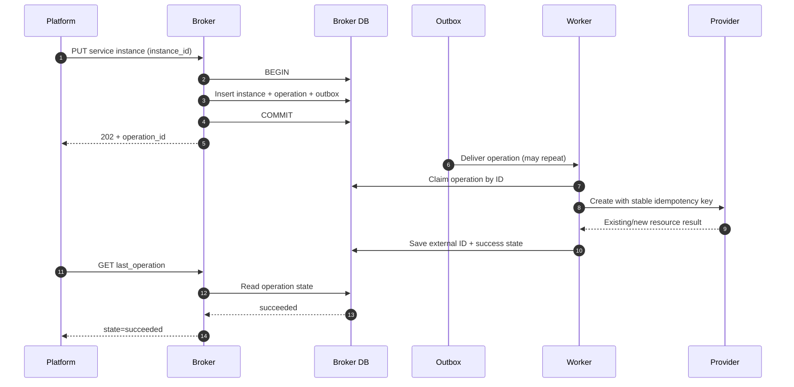

# Tính lặp an toàn (idempotency) khi nền tảng gửi lại yêu cầu

Platform gọi service broker qua HTTP để provision, update, bind, unbind và deprovision tài nguyên. Trong mạng phân tán, platform có thể timeout hoặc mất kết nối sau khi broker đã nhận request. Platform không biết thao tác đã được thực hiện hay chưa nên có thể gửi lại cùng request. Nếu broker thực hiện side effect mới mỗi lần nhận request, một instance có thể tạo ra nhiều database, một binding có thể phát hành nhiều credential hoặc một thao tác xóa có thể tác động nhầm tài nguyên.

**Idempotency** là khả năng xử lý một yêu cầu lặp lại mà không làm thay đổi kết quả nghiệp vụ ngoài dự kiến. Với `SPRING_CLOUD_SERVICE_BROKER`, broker phải kết hợp định danh do OSB API cung cấp, trạng thái lưu bền vững, ràng buộc duy nhất trong database, idempotency key khi gọi provider và cơ chế đối soát sau timeout. Mục tiêu là để một thao tác logic chỉ tạo ra một kết quả nghiệp vụ, kể cả khi request hoặc message được giao nhiều lần.

## 1. Vì sao platform gửi lại request?

Giả sử platform gửi yêu cầu provision PostgreSQL. Broker nhận request, provider tạo database thành công, nhưng response HTTP bị mất trên đường về. Platform chỉ nhìn thấy timeout nên không thể biết database đã được tạo. Platform gửi lại PUT với cùng `instance_id`.

Nếu broker không có idempotency, lần thứ hai có thể tạo thêm database thứ hai. Database đầu tiên trở thành tài nguyên mồ côi và có thể tiếp tục phát sinh chi phí.

Các nguyên nhân retry thường gặp:

- Client timeout trong khi broker hoặc provider vẫn đang xử lý.
- Kết nối bị đóng sau khi server đã thực hiện side effect nhưng trước khi response tới client.
- Load balancer, gateway hoặc platform retry request theo chính sách mạng.
- Worker nhận lại message sau khi consumer restart hoặc không kịp ack.
- Operator chạy lại một thao tác vì không thấy kết quả lần trước.
- Platform khôi phục trạng thái sau sự cố và gửi lại request để đồng bộ với broker.

Một timeout không chứng minh thao tác thất bại. Broker cần phân biệt **request chưa được xử lý**, **đang xử lý**, **đã thành công**, **đã thất bại chắc chắn** và **chưa xác định được kết quả bên ngoài**.

## 2. Idempotency trong các thao tác OSB API

OSB API dùng định danh ổn định trong path để platform tham chiếu vòng đời tài nguyên. Những định danh này là nền tảng để broker nhận diện request lặp:

| Thao tác | Endpoint | Định danh nghiệp vụ quan trọng |
|---|---|---|
| Provision | `PUT /v2/service_instances/{instance_id}` | `instance_id` |
| Update | `PATCH /v2/service_instances/{instance_id}` | `instance_id` kết hợp operation và nội dung thay đổi |
| Bind | `PUT /v2/service_instances/{instance_id}/service_bindings/{binding_id}` | `binding_id` và `instance_id` |
| Unbind | `DELETE /v2/service_instances/{instance_id}/service_bindings/{binding_id}` | `binding_id` |
| Deprovision | `DELETE /v2/service_instances/{instance_id}` | `instance_id` |

Ví dụ request provision:

```http
PUT /v2/service_instances/instance-123?accepts_incomplete=true HTTP/1.1
X-Broker-API-Version: 2.14
Content-Type: application/json

{
  "service_id": "postgres-service-id",
  "plan_id": "postgres-small-plan",
  "organization_guid": "org-123",
  "space_guid": "space-456",
  "parameters": {
    "storage_gb": 20,
    "region": "ap-southeast-1"
  }
}
```

Nếu platform gửi lại cùng request với `instance_id=instance-123`, broker cần tra cứu bản ghi hiện có và xác định request có cùng ý nghĩa với lần đầu hay không. Không tạo một instance mới chỉ vì HTTP request mới có request ID hoặc connection ID khác.

Các thao tác PUT/DELETE trong OSB API có semantics phù hợp cho việc retry theo định danh tài nguyên, nhưng broker vẫn phải triển khai persistence và xử lý cạnh tranh đúng cách. Không nên hiểu HTTP method idempotent là provider API phía sau cũng tự động idempotent.

## 3. Phân biệt các loại định danh

Một hệ thống broker có thể sử dụng nhiều loại ID. Chúng phục vụ các mục đích khác nhau:

| Định danh | Ai tạo | Mục đích |
|---|---|---|
| `instance_id` | Platform | Nhận diện service instance trong toàn bộ vòng đời OSB. |
| `binding_id` | Platform | Nhận diện một binding cụ thể. |
| `operation_id` | Broker | Theo dõi một lần thực hiện provision/update/deprovision hoặc tác vụ async. |
| `request_id` / correlation ID | Gateway hoặc broker | Truy vết một lần trao đổi HTTP; có thể khác nhau giữa các lần retry. |
| Provider idempotency key | Broker | Yêu cầu provider nhận diện cùng một side effect logic. |
| External resource ID | Provider | Nhận diện database, queue, credential hoặc tài nguyên thực tế. |

Không dùng correlation ID làm khóa idempotency nếu mỗi lần retry tạo correlation ID mới. `instance_id` và `binding_id` thường ổn định qua retry, trong khi request ID chỉ đại diện cho một lần truyền request.

Broker nên lưu quan hệ giữa các định danh. Ví dụ, một operation provision có `operation_id` riêng, gắn với `instance_id`, và dùng một provider idempotency key ổn định. Khi provider trả external resource ID, broker lưu ID đó vào instance record để các thao tác update và deprovision sử dụng.

## 4. Phân biệt retry cùng request với request xung đột

Không phải mọi request dùng cùng `instance_id` đều là bản lặp hợp lệ. Broker cần so sánh những thuộc tính có ý nghĩa nghiệp vụ.

| Request nhận được | Cách xử lý |
|---|---|
| Cùng instance ID, service/plan và parameters tương đương, operation đã thành công | Trả kết quả đã ghi nhận theo response contract; không tạo tài nguyên mới. |
| Cùng instance ID, operation vẫn đang chạy | Trả trạng thái/operation hiện có theo semantics OSB API; không khởi chạy worker thứ hai. |
| Cùng instance ID nhưng service hoặc plan khác | Xử lý như xung đột hoặc request không hợp lệ; không ghi đè instance cũ. |
| Cùng instance ID nhưng parameters khác | So sánh theo quy tắc nghiệp vụ; yêu cầu khác nội dung không được âm thầm xem là retry. |
| Instance đã deprovision | Áp dụng semantics của OSB API và tombstone; không tạo lại resource do request lặp. |

Broker cần định nghĩa rõ phần nào của request được xem là có ý nghĩa đối với thao tác. Ví dụ, thứ tự key trong JSON object không làm thay đổi ý nghĩa; nhưng `plan_id`, vùng, dung lượng hoặc loại consumer có thể làm thay đổi tài nguyên.

## 5. Request fingerprint

Broker có thể tạo fingerprint từ các trường nghiệp vụ đã chuẩn hóa để so sánh request lặp. Fingerprint không nên được tính trực tiếp từ JSON thô vì cùng một request có thể được serialize khác thứ tự key hoặc khác định dạng không làm thay đổi semantics.

Quy trình thường gồm:

1. Validate request theo schema của service và plan.
2. Chuẩn hóa các trường có ý nghĩa, ví dụ service ID, plan ID, tenant context và parameters không nhạy cảm.
3. Chuẩn hóa kiểu số, giá trị mặc định, chuỗi, URL và cấu trúc lồng nhau theo quy tắc đã công bố.
4. Serialize canonical representation một cách ổn định.
5. Tính fingerprint bằng hash hoặc HMAC theo chính sách bảo mật.
6. Lưu fingerprint cùng instance/operation để so sánh retry.

Ví dụ Java minh họa cho fingerprint chỉ chứa dữ liệu không nhạy cảm:

```java
public record ProvisionFingerprintInput(
        String serviceId,
        String planId,
        String organizationId,
        String spaceId,
        int storageGb,
        String region
) {}
```

Sau khi canonicalize object trên, ứng dụng có thể tính SHA-256 trên chuỗi canonical. Nếu request có password, token hoặc private key, không đưa giá trị thô vào fingerprint lưu lâu dài. Với trường hợp phải phân biệt request có secret khác nhau, dùng HMAC với khóa riêng được quản lý trong secret manager; không dùng hash thuần của password/token có entropy thấp vì có thể bị dò từ điển.

Fingerprint chỉ là một phần của cơ chế idempotency. Nó không thay thế unique constraint, operation state, provider idempotency hoặc kiểm tra quyền truy cập.

## 6. Lưu idempotency state trong database

Broker cần lưu trạng thái request/operation bền vững. Một mô hình đơn giản:

| Bảng | Trường quan trọng | Vai trò |
|---|---|---|
| `service_instance` | `instance_id`, `service_id`, `plan_id`, `state`, `fingerprint`, `external_resource_id` | Nhận diện instance và cấu hình đã chấp nhận. |
| `service_binding` | `binding_id`, `instance_id`, `consumer_id`, `state`, `fingerprint`, `secret_reference` | Nhận diện binding và credential reference. |
| `operation` | `operation_id`, `resource_id`, `type`, `state`, `provider_key`, `attempt_count` | Theo dõi một thao tác logic. |
| `idempotency_record` | `scope`, `key`, `fingerprint`, `operation_id`, `response_status`, `response_ref` | Nhận diện và phục hồi request đã xử lý. |

Các khóa unique nên phản ánh phạm vi nghiệp vụ. Ví dụ:

```sql
CREATE UNIQUE INDEX uq_service_instance_id
    ON service_instance(instance_id);

CREATE UNIQUE INDEX uq_service_binding_id
    ON service_binding(binding_id);

CREATE UNIQUE INDEX uq_idempotency_scope_key
    ON idempotency_record(scope, idempotency_key);
```

Không chỉ kiểm tra `SELECT` trước khi `INSERT`. Hai request đồng thời có thể cùng đọc thấy chưa tồn tại rồi cùng insert. Unique constraint là lớp bảo vệ cuối cùng; ứng dụng cần bắt duplicate-key và đọc lại record đã được request cạnh tranh tạo ra.

Với một operation đang chạy, record idempotency có thể tham chiếu operation ID thay vì lưu toàn bộ response. Với thao tác đã hoàn tất, lưu đủ thông tin để tạo lại response theo contract, nhưng không lưu credential dạng rõ chỉ để replay HTTP response.

## 7. Ghi nhận operation và side effect trong một quy trình bền vững

Đối với thao tác async, broker cần commit ý định trước khi trả `202 Accepted`. Transaction local nên ghi instance/binding state, operation và outbox event cùng nhau.



Transactional Outbox thường giao message ít nhất một lần (at-least-once). Worker có thể nhận cùng event nhiều lần; do đó worker phải claim operation, kiểm tra state/version và dùng idempotency key khi gọi provider. Không giả định queue tự bảo đảm side effect exactly-once.

## 8. Idempotency ở phía provider

Idempotency nội bộ không đủ nếu provider có thể tạo side effect trùng. Broker nên truyền một key ổn định tới provider:

```http
POST /v1/databases HTTP/1.1
Host: provider.example.internal
Idempotency-Key: broker-provision-instance-123-op-456
Content-Type: application/json

{
  "engine": "postgresql",
  "size": "small",
  "labels": {
    "managed-by": "service-broker",
    "broker-instance-id": "instance-123"
  }
}
```

Provider có thể trả cùng resource result khi nhận lại key đã dùng. Tuy nhiên, broker phải đọc tài liệu provider để hiểu:

- Key được lưu trong bao lâu và phạm vi unique là account, project hay endpoint.
- Cùng key nhưng request body khác nhau sẽ bị từ chối hay trả kết quả cũ.
- Provider có hỗ trợ lookup theo key hoặc external correlation ID không.
- Key có áp dụng cho cả create, update và delete hay từng endpoint có semantics riêng.
- Response đầu tiên bị timeout thì cách lấy lại kết quả là gì.

Không tự giả định header `Idempotency-Key` có hiệu lực nếu provider không hỗ trợ. Nếu provider không có tính năng này, dùng external name/label có tính duy nhất, ownership tag, operation metadata hoặc API truy vấn để tìm lại resource trước khi retry.

## 9. Xử lý timeout khi không biết provider đã thực hiện hay chưa

Đây là tình huống cần đối soát, không phải lúc nào cũng retry ngay.

Ví dụ provider tạo database thành công nhưng response bị mất. Broker vẫn lưu operation ở `IN_PROGRESS` hoặc `UNKNOWN`. Worker tiếp theo cần:

1. Tra cứu provider theo idempotency key, external request ID hoặc ownership tag.
2. Nếu resource đã tồn tại và đúng owner/plan, lưu external resource ID rồi tiếp tục workflow.
3. Nếu provider xác nhận chưa tạo resource, retry create với cùng idempotency key.
4. Nếu không thể xác định kết quả, giữ trạng thái `RECONCILIATION_REQUIRED` và chờ đối soát hoặc can thiệp.

Không tạo resource thứ hai chỉ vì lần gọi trước timeout. Cũng không đánh dấu thành công nếu chưa có bằng chứng resource tồn tại và thuộc đúng instance.

Với DELETE, nếu provider trả not found, broker chỉ coi bước xóa đã đạt mục tiêu sau khi xác minh external ID và ownership. Với UPDATE, cần đọc lại cấu hình thực tế hoặc operation status để biết provider đã áp dụng thay đổi chưa.

## 10. Idempotency cho từng thao tác OSB

### Provision

`instance_id` là khóa chính để nhận diện service instance. Khi request lặp đến:

- Nếu instance đã `AVAILABLE` và fingerprint tương đương, trả kết quả phù hợp với OSB API mà không tạo resource mới.
- Nếu instance đang `PROVISIONING`, trả thông tin operation hiện có khi semantics của request cho phép.
- Nếu cùng ID nhưng service/plan hoặc cấu hình xung đột, trả lỗi xung đột theo contract.
- Nếu lần trước ở trạng thái không xác định, đối soát provider trước khi tạo mới.

### Update

Update có thể được gửi lại sau timeout. Broker cần lưu operation ID, cấu hình đích/fingerprint và version. Nếu provider đã áp dụng cấu hình đích, retry không được tăng dung lượng hoặc tạo replica thêm lần nữa. Nếu request mới có cấu hình khác trong khi update trước chưa kết thúc, cần serialize hoặc từ chối theo chính sách concurrency.

### Bind

`binding_id` là khóa nhận diện. Cùng binding ID và cùng consumer phải trả lại binding đã tạo hoặc tiếp tục operation đang chạy. Cùng binding ID nhưng consumer/instance khác là xung đột. Nếu provider đã tạo user nhưng DB chưa lưu kết quả, tra cứu user theo binding ID hoặc idempotency key trước khi tạo user mới.

### Unbind

Unbind lặp cần thu hồi đúng credential của binding đó. Nếu credential đã bị revoke, retry có thể được xem là đã đạt trạng thái đích sau khi xác minh. Không xóa database hoặc credential của binding khác.

### Deprovision

Deprovision lặp cần tiếp tục cleanup cùng instance. Nếu provider đã xóa resource, broker xác minh theo external ID và ghi nhận trạng thái cuối; không tạo lại tài nguyên hoặc xóa nhầm resource khác.

## 11. Xử lý request đồng thời

Hai request có thể đến gần như cùng lúc trên hai replica broker. Một pattern `findById()` rồi `save()` không đủ để ngăn duplicate nếu không có constraint/lock.

Các cơ chế thường dùng:

- Unique constraint trên instance ID, binding ID và idempotency scope/key.
- Transaction local để claim operation hoặc tạo idempotency record.
- Optimistic locking với cột `version`.
- Pessimistic lock ngắn khi chuyển trạng thái trong database, không giữ lock trong lúc gọi provider.
- Lease/claim cho worker để một operation chỉ có một worker đang sở hữu tại một thời điểm.
- Provider idempotency key để bảo vệ side effect ngay cả khi worker chạy trùng.

Ví dụ cập nhật state có điều kiện:

```sql
UPDATE operation
SET state = 'RUNNING',
    version = version + 1,
    claimed_by = :worker_id,
    lease_until = :lease_until
WHERE operation_id = :operation_id
  AND state IN ('PENDING', 'RETRY')
  AND (lease_until IS NULL OR lease_until < CURRENT_TIMESTAMP);
```

Worker chỉ tiếp tục nếu update claim đúng một dòng. Khi lease hết hạn, worker khác có thể tiếp quản; side effect vẫn phải idempotent vì worker cũ có thể chưa dừng hẳn khi lease hết hạn.

## 12. Lưu response và credential an toàn

Một số thao tác trả credential trong response binding. Nếu broker tạo credential nhưng response bị mất, platform có thể retry. Broker cần có chiến lược trả lại kết quả mà không lưu password dạng rõ trong bảng idempotency.

Các lựa chọn:

- Lưu secret đã mã hóa bằng envelope encryption và chỉ giải mã khi cần trả lại response cho request hợp lệ.
- Lưu secret trong secret manager và lưu reference có scope theo binding ID.
- Dùng provider có API lấy lại credential an toàn hoặc tạo credential mới theo một quy trình rotation đã định nghĩa.
- Nếu không thể lấy lại secret và không được phép lưu, thiết kế lại flow để có cách phục hồi được hỗ trợ; không trả response giả hoặc tạo credential trùng mỗi lần retry.

Response cache chỉ nên chứa status, operation ID và reference tới response đã bảo vệ. Không lưu Authorization header, raw request body, password, token hoặc private key trong idempotency record.

Nếu dùng fingerprint, không ghi fingerprint có thể dò từ điển của secret vào log. Với secret entropy thấp, hash thuần không đủ bảo vệ; dùng HMAC với khóa riêng hoặc bỏ secret khỏi fingerprint và áp dụng quy tắc xung đột phù hợp.

## 13. Ví dụ service layer trong Spring

Ví dụ sau minh họa ý tưởng claim một instance bằng unique constraint và transaction local. Các repository method và exception là thành phần do ứng dụng định nghĩa:

```java
@Service
public class ProvisionRequestService {
    private final ServiceInstanceRepository instances;
    private final OperationRepository operations;
    private final OutboxRepository outbox;

    @Transactional
    public ProvisionAcceptance accept(ProvisionCommand command) {
        var existing = instances.findById(command.instanceId());

        if (existing.isPresent()) {
            ServiceInstance instance = existing.get();
            if (!instance.matches(command.fingerprint())) {
                throw new ProvisionConflictException();
            }
            return ProvisionAcceptance.existing(
                    instance.id(), instance.operationId(), instance.state());
        }

        ServiceInstance instance = instances.insertProvisioning(command);
        Operation operation = operations.insertProvisionOperation(command);
        outbox.insert(OutboxEvent.provisionRequested(operation.id()));

        return ProvisionAcceptance.accepted(instance.id(), operation.id());
    }
}
```

Trong thực tế, hai request đồng thời có thể cùng đọc thấy instance chưa tồn tại. Unique constraint trên `instance_id` vẫn là bắt buộc. Khi insert gặp duplicate-key, transaction hiện tại có thể cần rollback; tầng điều phối bắt lỗi ở ranh giới transaction rồi đọc lại record đã được request kia tạo và so sánh fingerprint. Không bắt duplicate-key rồi tiếp tục dùng một transaction đã bị đánh dấu rollback-only.

Provider call diễn ra ở worker sau commit:

```java
public void processProvision(ProvisionJob job) {
    ProviderResult result = providerClient.create(
            job.providerRequest(),
            job.providerIdempotencyKey()
    );
    provisionResultRecorder.record(job.operationId(), result);
}
```

Result recorder mở transaction local ngắn, kiểm tra operation/version và lưu external resource ID. Nếu provider call timeout, worker tra cứu theo provider key hoặc ownership tag trước khi thử lại.

## 14. Retention của idempotency record

Idempotency record không nhất thiết phải lưu mãi, nhưng xóa quá sớm có thể khiến retry muộn tạo side effect trùng. Thời hạn lưu cần tính tới:

- Thời gian platform có thể retry request.
- Thời gian operation async có thể chạy hoặc được reconcile.
- Vòng đời instance/binding và khả năng request lặp sau khi platform restart.
- Thời gian provider giữ idempotency key.
- Chính sách audit, billing và retention của tổ chức.

Với service instance và binding, bản ghi tài nguyên hoặc tombstone thường cần sống lâu hơn một cache HTTP thông thường. Không xóa idempotency state của một instance đã deprovision nếu platform hoặc worker vẫn có thể gửi lại request tham chiếu instance đó. Có thể xóa chi tiết operation cũ theo retention, nhưng cần giữ tombstone/unique identity đủ để ngăn ID cũ bị tái sử dụng ngoài ý muốn.

## 15. Observability và vận hành

Để điều tra retry, log và metric nên ghi nhận:

- Operation ID, instance ID hoặc binding ID.
- Operation type và trạng thái hiện tại.
- Provider idempotency key ở dạng đã che hoặc mã tham chiếu an toàn.
- Số lần nhận request, số lần worker retry và thời gian xử lý.
- Kết quả lookup/reconciliation và mã lỗi provider đã chuẩn hóa.
- Version/state transition và worker claim metadata cần thiết.

Không log raw request body, credential, secret, Authorization header hoặc provider response chứa thông tin nhạy cảm. Không dùng instance ID hoặc binding ID làm metric label nếu số lượng cao; cardinality có thể tăng mạnh. Dùng counter theo operation type/state/error category và log có correlation ID để tra cứu chi tiết.

Các cảnh báo hữu ích:

- Một operation bị `UNKNOWN` hoặc `RECONCILIATION_REQUIRED` quá lâu.
- Tỷ lệ duplicate request tăng bất thường.
- Provider idempotency conflict hoặc lookup không tìm được resource.
- Outbox backlog hoặc worker lease hết hạn thường xuyên.
- Một instance có nhiều external resource cùng ownership tag.
- Deprovision đã hoàn tất ở provider nhưng broker chưa cập nhật state.

## 16. Kiểm thử idempotency

Kiểm thử cần chứng minh request lặp không tạo side effect trùng, kể cả khi có concurrency và timeout:

1. Gửi hai lần provision giống nhau với cùng instance ID; chỉ có một resource được tạo.
2. Gửi cùng instance ID nhưng plan hoặc fingerprint khác; broker trả conflict và không gọi provider lần hai.
3. Gửi hai request đồng thời tới hai replica; unique constraint chỉ cho một operation hợp lệ.
4. Provider tạo resource nhưng response timeout; retry tìm được resource cũ theo idempotency key/ownership tag.
5. Outbox phát cùng event hai lần; worker chỉ tạo một side effect logic.
6. Worker restart sau provider success nhưng trước DB commit; reconcile ghi nhận external resource đã tồn tại.
7. Bind lặp với cùng binding ID không tạo nhiều credential.
8. Binding ID gắn với consumer khác bị từ chối.
9. Unbind/deprovision lặp không xóa nhầm resource khác và ghi nhận trạng thái cuối đúng.
10. Update lặp không áp dụng tăng dung lượng hoặc tạo replica nhiều lần.
11. Response replay không làm lộ secret hoặc trả credential cũ đã bị revoke.
12. Idempotency record hết retention không khiến instance ID cũ bị tái sử dụng ngoài chính sách.

Một provider fake nên cho phép mô phỏng các thời điểm: timeout trước side effect, timeout sau side effect, success rồi mất response, duplicate idempotency key và resource lookup không khả dụng. Chỉ kiểm tra controller trả cùng status code là chưa đủ; cần xác minh số lần provider thực hiện side effect và trạng thái cuối trong database.

## 17. Checklist triển khai

- Dùng `instance_id` và `binding_id` làm định danh vòng đời ổn định.
- Phân biệt operation ID, correlation ID và provider idempotency key.
- Chuẩn hóa request và so sánh fingerprint theo trường nghiệp vụ có ý nghĩa.
- Không đưa secret thô vào fingerprint/log/idempotency record.
- Dùng unique constraint và xử lý duplicate-key an toàn khi request đồng thời.
- Ghi operation và outbox event trong cùng transaction local.
- Chấp nhận message at-least-once và deduplicate ở worker.
- Gửi provider idempotency key ổn định nếu provider hỗ trợ.
- Sau timeout không rõ kết quả, lookup/reconcile trước khi tạo side effect mới.
- Lưu external resource ID và state transition bền vững.
- Xử lý conflict khi cùng ID nhưng nội dung request khác.
- Bảo vệ response replay, đặc biệt với credential binding.
- Giữ tombstone/idempotency record đủ lâu cho retry và vòng đời tài nguyên.
- Có test cho concurrency, timeout sau side effect, worker restart và duplicate event.

Idempotency không đến từ một header duy nhất hoặc một câu lệnh `if (exists)`. Nó là thuộc tính của toàn bộ quy trình: nhận diện đúng thao tác logic, lưu trạng thái trước side effect, ngăn request đồng thời, gọi provider bằng khóa ổn định, đối soát khi timeout và trả kết quả nhất quán cho platform. Khi các lớp này phối hợp, service broker có thể chịu được retry tự nhiên của mạng và worker mà không tạo tài nguyên trùng, phát hành credential dư thừa hoặc làm sai lệch vòng đời OSB API.
