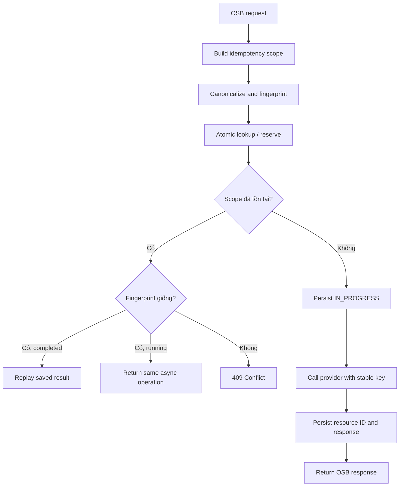
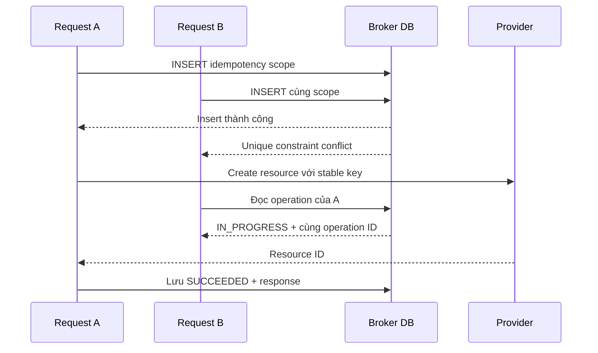
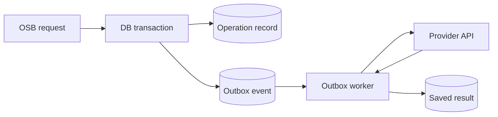
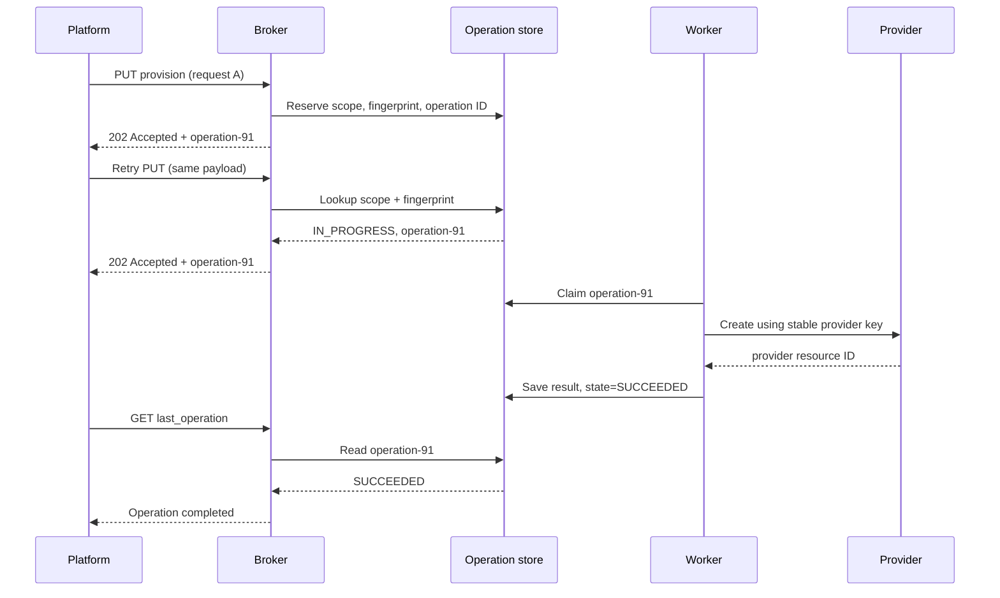

# Sử dụng dấu vết yêu cầu và kết quả đã lưu để tránh tạo tài nguyên trùng

Trong Open Service Broker API (OSB API), platform có thể gửi lại một request khi mất kết nối, timeout hoặc không nhận được response từ service broker. Request đầu tiên có thể đã tạo database, volume, user hoặc binding thành công ở provider, dù platform không biết kết quả. Nếu broker thực hiện side effect lần nữa mà không nhận diện được lần gọi trước, hệ thống có thể tạo tài nguyên trùng, cấp credentials khác hoặc tính phí hai lần.

**Idempotency** là khả năng xử lý một yêu cầu lặp lại mà không tạo thêm side effect ngoài ý muốn. Để đạt được điều này, broker cần kết hợp định danh tài nguyên OSB, dấu vết request, fingerprint của nội dung yêu cầu, operation record và kết quả đã lưu. Khi platform retry, broker xác định request đó là lần gửi lại của operation cũ hay là một yêu cầu mới có nội dung khác.

Trong hệ thống phân tán, không thể giả định request chỉ đến một lần hoặc provider chỉ thực hiện một lần. Mục tiêu thực tế là tạo hành vi **effectively-once** bằng cách nhận diện retry, lưu trạng thái bền vững, kiểm soát đồng thời và dùng idempotency mechanism của provider khi có thể.

## 1. Vì sao broker cần idempotency?

Hãy xét luồng provision PostgreSQL:

1. Platform gửi `PUT /v2/service_instances/pg-orders-01`.
2. Broker gọi provider để tạo database.
3. Provider tạo database thành công và trả resource ID `db-93a1`.
4. Broker bị mất kết nối trước khi platform nhận được response.
5. Platform không biết database đã được tạo nên gửi lại cùng request.

Nếu broker gọi provider tạo database lần nữa mà không kiểm tra trạng thái cũ, có thể xuất hiện hai database cho cùng một service instance. Một database bị bỏ mồ côi, trong khi platform chỉ biết một instance ID.

Các thao tác khác cũng có rủi ro tương tự:

- **Provision:** tạo database, bucket, cluster hoặc tài khoản trùng lặp.
- **Update:** tăng dung lượng hoặc thay đổi cấu hình nhiều lần ngoài ý muốn.
- **Bind:** tạo nhiều database user, token, log drain endpoint hoặc volume attachment cho cùng binding ID.
- **Unbind/deprovision:** lệnh xóa bị gửi lặp, gây lỗi hoặc xóa nhầm tài nguyên đã được tạo lại.
- **Asynchronous operation:** platform polling hoặc retry request trong khi worker cũ vẫn đang chạy.

Idempotency không chỉ là kiểm tra xem ID đã tồn tại hay chưa. Broker còn phải xác định nội dung request có tương đương với lần trước không, operation cũ đã hoàn tất chưa và provider đã thực hiện side effect đến đâu.

## 2. Những định danh cần phân biệt

Không nên dùng một ID duy nhất cho mọi mục đích. OSB broker thường cần phân biệt ít nhất bốn loại định danh:

| Định danh | Nguồn | Mục đích |
|---|---|---|
| `service_instance_id` | Platform gửi trong path | Định danh service instance xuyên suốt vòng đời |
| `binding_id` | Platform gửi trong path | Định danh binding thuộc một service instance |
| Request identity / trace ID | Header hoặc hạ tầng gateway | Truy vết một lần gửi HTTP cụ thể qua các thành phần |
| Idempotency scope/key | Broker xây dựng từ tài nguyên và operation, hoặc key riêng nếu giao thức tích hợp có quy định | Nhận diện các lần retry thuộc cùng một thao tác logic |

`service_instance_id` và `binding_id` là các ID nghiệp vụ do platform cấp. Chúng thường là phần quan trọng nhất để broker xác định tài nguyên cần tạo hoặc cập nhật. Request identity chỉ giúp truy vết một lần HTTP request; platform có thể tạo request identity mới cho lần retry. Vì vậy, không dùng trace ID làm khóa idempotency duy nhất.

OSB API không định nghĩa một HTTP header chung bắt buộc tên `Idempotency-Key` cho mọi operation. Broker không nên giả định platform luôn gửi header đó. Cơ chế deduplication cơ bản cần dựa trên ID tài nguyên và ngữ nghĩa operation của OSB. Nếu một platform hoặc gateway có hợp đồng riêng cung cấp idempotency key, broker có thể hỗ trợ bổ sung nhưng phải giữ phạm vi khóa rõ ràng.

Một idempotency scope tham khảo:

```text
platform_instance_id
+ operation_type
+ service_instance_id
+ binding_id (nếu là binding operation)
```

Ví dụ:

```text
cf-east | PROVISION | pg-orders-01
cf-east | BIND      | pg-orders-01 | bind-orders-api
cf-east | DEPROVISION | pg-orders-01
```

Nếu broker chỉ phục vụ một platform, `platform_instance_id` có thể là giá trị cấu hình cố định. Nếu broker phục vụ nhiều platform hoặc tenant, phải đưa scope đó vào unique key để tránh xung đột ID giữa các môi trường.

## 3. Request fingerprint: nhận diện nội dung yêu cầu

ID tài nguyên cho biết request đang nhắm tới đối tượng nào. **Request fingerprint** cho biết nội dung nghiệp vụ của request đó có tương đương với lần đã xử lý hay không.

Fingerprint thường được tạo bằng cách chuẩn hóa các field có ý nghĩa rồi băm bằng SHA-256 hoặc HMAC-SHA-256. Với provision, các field có thể bao gồm:

- Operation type (`PROVISION`).
- Platform scope và service instance ID.
- Service definition ID và plan ID.
- Parameters sau khi chuẩn hóa.
- Context hoặc các thuộc tính consumer có ảnh hưởng đến việc tạo tài nguyên.
- Phiên bản schema hoặc policy nếu cần phân biệt semantics giữa các lần triển khai.

Với binding, fingerprint cần bao gồm service instance ID, binding ID, consumer identity, loại binding và parameters của binding. Không đưa các field chỉ phục vụ tracing như request timestamp hoặc trace ID vào fingerprint, vì chúng thay đổi giữa các lần retry dù nội dung nghiệp vụ giống nhau.

### 3.1. Chuẩn hóa JSON trước khi băm

Hai JSON object có thể giống nhau về ý nghĩa nhưng khác thứ tự key:

```json
{
  "storage_gb": 100,
  "region": "ap-southeast-1"
}
```

```json
{
  "region": "ap-southeast-1",
  "storage_gb": 100
}
```

Nếu băm trực tiếp chuỗi JSON thô, hai body có thể tạo ra hai hash khác nhau. Vì vậy, broker nên canonicalize JSON trước khi tính fingerprint:

1. Parse body thành cấu trúc JSON.
2. Sắp xếp object key theo quy tắc ổn định.
3. Chuẩn hóa cách biểu diễn số, boolean, string và null theo một quy tắc thống nhất.
4. Giữ nguyên thứ tự array nếu thứ tự phần tử có ý nghĩa.
5. Không tự ý bỏ field hoặc đổi default nếu điều đó làm thay đổi semantics của request.
6. Serialize lại thành canonical representation rồi tính hash.

Không nên chỉ hash `parameters` nếu service ID, plan ID hoặc consumer identity cũng ảnh hưởng đến side effect. Ngược lại, không nên đưa toàn bộ header hoặc dữ liệu không liên quan vào fingerprint vì chúng có thể thay đổi giữa retry.

### 3.2. Bảo vệ dữ liệu nhạy cảm trong fingerprint

Parameters có thể chứa password, token hoặc dữ liệu nhạy cảm. Không lưu raw request body vào bảng idempotency chỉ để so sánh retry. Một số lựa chọn:

- Lưu fingerprint SHA-256 của canonical payload nếu payload không chứa giá trị bí mật có entropy thấp và chính sách cho phép.
- Dùng HMAC-SHA-256 với secret key quản lý an toàn để giảm khả năng dò ngược các giá trị nhạy cảm.
- Lưu encrypted canonical payload chỉ khi thực sự cần replay đầy đủ response hoặc điều tra request.
- Redact secrets trong log và audit; chỉ lưu mã tham chiếu hoặc fingerprint.

Fingerprint không thay thế mã hóa. Hash một password yếu vẫn có thể bị dò bằng dictionary attack; HMAC với key được bảo vệ phù hợp hơn khi fingerprint bao gồm dữ liệu bí mật.

### 3.3. Ví dụ tạo fingerprint

Đoạn code dưới đây minh họa ý tưởng; `CanonicalJsonWriter` là thành phần do ứng dụng cung cấp để tạo JSON representation ổn định:

```java
import java.nio.charset.StandardCharsets;
import java.security.MessageDigest;
import java.security.NoSuchAlgorithmException;
import java.util.HexFormat;
import java.util.Map;

public final class RequestFingerprint {

    private final CanonicalJsonWriter canonicalJsonWriter;

    public RequestFingerprint(CanonicalJsonWriter canonicalJsonWriter) {
        this.canonicalJsonWriter = canonicalJsonWriter;
    }

    public String sha256(Map<String, Object> semanticRequest) {
        try {
            String canonical = canonicalJsonWriter.write(semanticRequest);
            byte[] digest = MessageDigest.getInstance("SHA-256")
                    .digest(canonical.getBytes(StandardCharsets.UTF_8));
            return HexFormat.of().formatHex(digest);
        }
        catch (NoSuchAlgorithmException exception) {
            throw new IllegalStateException("SHA-256 is unavailable", exception);
        }
    }
}
```

Trong production, nên dùng thư viện canonical JSON đã được kiểm thử hoặc một implementation chuẩn hóa có test rõ ràng. Không dùng `Map.toString()` hoặc serialization không ổn định làm canonical representation.

## 4. Quy trình xử lý request lần đầu và request retry

Một coordinator idempotency có thể thực hiện quy trình sau:

1. Tạo idempotency scope từ platform, operation và resource IDs.
2. Canonicalize các field nghiệp vụ và tính fingerprint.
3. Atomically reserve scope bằng unique constraint hoặc transaction.
4. Nếu scope chưa tồn tại, lưu operation ở trạng thái `RECEIVED`/`IN_PROGRESS` trước khi gọi provider.
5. Gọi use case/provider với idempotency key ổn định hoặc correlation tag nếu provider hỗ trợ.
6. Lưu provider resource ID, operation ID, response cần replay và trạng thái cuối cùng.
7. Khi request retry đến, đọc record và so sánh fingerprint để quyết định replay, tiếp tục polling hoặc trả lỗi conflict.



Khi cùng scope và fingerprint xuất hiện lần nữa:

- **Operation đã hoàn tất:** trả kết quả đã lưu theo ngữ nghĩa endpoint, không gọi provider tạo thêm tài nguyên.
- **Operation đang chạy:** trả lại cùng operation ID nếu operation async, hoặc lỗi concurrency phù hợp nếu giao thức yêu cầu chờ.
- **Operation thất bại chắc chắn trước side effect:** trả lỗi đã lưu hoặc cho phép retry theo policy đã định.
- **Kết quả provider không chắc chắn:** inspect provider theo correlation ID trước khi quyết định gọi lại side effect.
- **Fingerprint khác:** từ chối request vì cùng resource/operation identity nhưng nội dung khác nhau.

## 5. Lưu operation và kết quả đã xử lý

Broker cần một kho lưu bền vững để nhận diện request sau khi process restart. Không dùng `Map` trong bộ nhớ hoặc cache cục bộ làm nguồn idempotency duy nhất nếu broker chạy nhiều replica.

Một bảng operation tham khảo:

| Cột | Ý nghĩa |
|---|---|
| `id` | Khóa nội bộ của operation |
| `platform_instance_id` | Scope platform/tenant |
| `operation_type` | `PROVISION`, `UPDATE`, `DEPROVISION`, `BIND`, `UNBIND` |
| `service_instance_id` | ID service instance OSB |
| `binding_id` | ID binding nếu operation liên quan binding |
| `request_fingerprint` | Hash của payload đã canonicalize |
| `state` | `RECEIVED`, `IN_PROGRESS`, `SUCCEEDED`, `FAILED`, `UNKNOWN` |
| `provider_resource_id` | ID tài nguyên phía provider nếu đã biết |
| `provider_operation_id` | Job ID phía provider nếu có |
| `osb_operation_id` | Operation ID trả về platform cho polling |
| `response_status` | HTTP status đã trả hoặc cần replay |
| `response_body` | Response đã chuẩn hóa và đã loại bỏ secret nếu cần |
| `created_at`, `updated_at` | Thời điểm tạo và cập nhật |
| `expires_at` | Thời điểm có thể dọn record theo retention policy |

Unique constraint nên được thiết kế theo phạm vi tài nguyên và operation. Ví dụ:

```sql
CREATE UNIQUE INDEX uq_broker_operation_scope
ON broker_operation (
    platform_instance_id,
    operation_type,
    service_instance_id,
    COALESCE(binding_id, '')
)
WHERE state IN ('RECEIVED', 'IN_PROGRESS');
```

Đây là ví dụ PostgreSQL cho việc chỉ cho phép một operation cùng scope đang hoạt động; `COALESCE` giúp các operation cấp instance (không có `binding_id`) vẫn va chạm đúng trên unique index vì PostgreSQL mặc định xem nhiều giá trị `NULL` là khác nhau. Index này không thay thế deduplication ledger cho kết quả đã hoàn tất. Broker cần giữ một record idempotency/tombstone có thể tra cứu theo scope và fingerprint đủ lâu để retry sau khi operation kết thúc vẫn nhận được kết quả cũ. Operation history có thể nằm ở bảng riêng với sequence/version để lưu nhiều update hợp lệ trên cùng instance.

### 5.1. Lưu response để replay

Đối với request đồng bộ, lưu HTTP status và response body đã được tạo để lần retry có thể nhận lại kết quả tương đương. Đối với request bất đồng bộ, lưu operation ID và trạng thái; retry trong khi operation chạy phải nhận cùng operation ID thay vì tạo job mới.

Không lưu hoặc replay response chứa secret theo cách làm lộ credentials không còn hợp lệ. Với binding, có thể lưu secret reference rồi dựng lại response qua secret store; hoặc lưu encrypted response với quyền truy cập và retention phù hợp. Nếu credentials chỉ được trả một lần và không thể khôi phục, broker phải thiết kế quy trình retry phù hợp để không vô tình tạo credential mới cho cùng binding.

## 6. Idempotency theo từng OSB operation

Các endpoint OSB có semantics khác nhau. Broker phải dùng đúng ID và quy tắc của từng operation.

| Operation | Định danh chính | Hành vi khi request lặp |
|---|---|---|
| Provision | `service_instance_id` | Cùng ID và nội dung tương đương phải nhận diện instance đã tồn tại; không provision tài nguyên thứ hai |
| Update | `service_instance_id` + operation/version | Tuần tự hóa update; không áp dụng cùng thay đổi hai lần ngoài ý muốn |
| Deprovision | `service_instance_id` | Nếu instance đã không còn tồn tại, trả kết quả xóa phù hợp của OSB (`410 Gone`) |
| Bind | `service_instance_id` + `binding_id` | Cùng binding không tạo user/token/attachment thứ hai |
| Unbind | `service_instance_id` + `binding_id` | Nếu binding đã không còn, trả `410 Gone` theo semantics delete binding |

### 6.1. Provision

Provision dùng `PUT /v2/service_instances/{instance_id}`. ID do platform cấp ổn định trong vòng đời instance. Broker nên lưu instance record và operation trước khi tạo provider resource. Khi request cùng ID đến lại:

- Nếu instance đã được tạo với cùng service, plan và parameters, trả kết quả tương đương với lần tạo trước theo contract OSB.
- Nếu instance ID đã tồn tại nhưng request có service/plan/parameters xung đột, trả `409 Conflict`.
- Nếu operation cũ đang chạy, không tạo operation provision thứ hai; trả lại trạng thái/operation đang chạy phù hợp với async contract.
- Nếu provider có thể đã tạo tài nguyên nhưng broker chưa lưu resource ID, tìm bằng idempotency key hoặc correlation tag trước khi gọi create lại.

### 6.2. Update

Update dùng `PATCH /v2/service_instances/{instance_id}`. Vì một instance có thể nhận nhiều update hợp lệ theo thời gian, không thể chỉ dùng instance ID làm idempotency key vĩnh viễn cho mọi update. Với update, scope cần gắn thêm operation sequence, expected resource version hoặc idempotency token riêng nếu platform integration cung cấp; fingerprint và `previous_values` giúp nhận diện retry của lần update gần nhất. Sau khi operation cũ kết thúc, một update mới phải được phép tạo operation mới.

Broker cần lưu operation ID, fingerprint, version trước/sau và trạng thái của từng update. Chỉ cho phép một operation update thay đổi cùng instance tại một thời điểm, hoặc dùng optimistic concurrency để từ chối update xung đột. Khi retry cùng update, so sánh fingerprint và operation version để trả kết quả cũ; một update mới với parameters khác phải được xử lý như operation mới sau khi trạng thái trước đó đã kết thúc.

### 6.3. Deprovision

Deprovision dùng `DELETE /v2/service_instances/{instance_id}`. DELETE có tính idempotent theo mục tiêu cuối cùng: instance không còn tồn tại. Nếu provider đã xóa resource nhưng response bị mất, lần DELETE tiếp theo phải nhận diện trạng thái đã xóa và trả `410 Gone`, không cố tạo hoặc xóa một tài nguyên khác có cùng tên.

Nếu delete đang chạy bất đồng bộ, giữ operation ID và trả `202 Accepted` cho request lặp tương ứng. Chỉ đánh dấu hoàn tất khi provider xác nhận tài nguyên không còn hoặc policy xác minh trạng thái đích đã đạt.

### 6.4. Bind

Bind dùng `PUT /v2/service_instances/{instance_id}/service_bindings/{binding_id}`. Binding ID phân biệt từng consumer relationship. Broker nên lưu fingerprint gồm instance ID, binding ID, consumer identity và binding parameters.

Nếu cùng binding ID được gửi với nội dung tương đương, trả lại binding hiện có theo semantics OSB và không tạo credentials, user hoặc volume mới. Nếu cùng binding ID nhưng consumer hoặc parameters khác, từ chối xung đột. Nếu bind operation chạy async, giữ nguyên operation ID và chỉ trả binding details sau khi operation hoàn tất theo cơ chế fetch được công bố.

### 6.5. Unbind

Unbind dùng `DELETE` trên binding path. Nếu binding đã bị xóa trước đó, trả `410 Gone`. Nếu provider đã revoke user/token nhưng broker chưa cập nhật repository, lần retry cần inspect hoặc gọi revoke idempotent để hoàn tất trạng thái mà không tạo thêm side effect.

## 7. Xử lý đồng thời: hai request giống nhau đến cùng lúc

Một lỗi phổ biến là thực hiện theo kiểu:

```text
if (operation does not exist) {
    insert operation;
    call provider;
}
```

Hai request có thể cùng đọc thấy chưa có record trước khi một request insert. Cả hai đều gọi provider, tạo ra hai tài nguyên. Kiểm tra tồn tại bằng code không đủ; việc reserve idempotency scope phải nguyên tử.

Các cách thường dùng:

- Unique constraint trên idempotency scope và xử lý duplicate-key bằng cách đọc lại record thắng cuộc.
- Transaction ngắn để reserve operation và lưu fingerprint trước khi gọi provider.
- Optimistic locking hoặc lease để bảo vệ thay đổi state.
- Distributed lock có thời hạn khi cần serialize operation theo resource ID.
- Provider idempotency key để bảo vệ side effect ở phía ngoài database broker.

Ví dụ race:



Request B không gọi provider. Nó chờ hoặc trả response phù hợp dựa trên operation A.

## 8. Giao dịch database và provider: Outbox, saga và trạng thái UNKNOWN

Không thể mở một transaction SQL duy nhất bao trùm database broker và API provider. Nếu broker commit DB rồi provider thất bại, hoặc provider thành công rồi broker rollback, hai bên có thể lệch nhau.

Một cách triển khai là dùng transactional outbox:

1. Trong một transaction DB, tạo operation `IN_PROGRESS` và ghi một outbox event.
2. Commit transaction.
3. Worker đọc outbox và gọi provider bằng idempotency key ổn định.
4. Worker lưu provider resource ID và kết quả operation.
5. Đánh dấu outbox event đã xử lý.



Outbox bảo đảm việc ghi nhận ý định và enqueue công việc được commit cùng nhau. Worker vẫn có thể gửi event nhiều lần nếu crash sau khi provider xử lý nhưng trước khi đánh dấu outbox complete. Vì vậy, provider call vẫn cần idempotency key hoặc cơ chế tra cứu resource theo correlation ID.

Nếu provider không hỗ trợ idempotency key, broker nên gắn metadata/correlation ID vào tài nguyên khi tạo nếu API cho phép, rồi inspect trước khi retry. Nếu không thể xác định provider đã thực hiện hay chưa, lưu operation ở trạng thái `UNKNOWN`, không tự động gọi create lại ngay.

Saga có thể được dùng khi operation gồm nhiều bước, ví dụ tạo database, tạo network rule rồi tạo secret. Nếu bước sau thất bại, broker thực hiện compensation theo thứ tự ngược. Compensation cũng phải idempotent và có operation record riêng để tiếp tục sau restart.

## 9. Tích hợp idempotency với Spring Cloud Open Service Broker

Spring Cloud Open Service Broker cung cấp request model và service interface cho OSB, nhưng repository idempotency, fingerprint, operation store và provider adapter là trách nhiệm của ứng dụng.

| Service interface | Phương thức thường cần bảo vệ idempotency |
|---|---|
| `ServiceInstanceService` | `createServiceInstance()`, `updateServiceInstance()`, `deleteServiceInstance()` |
| `ServiceInstanceBindingService` | `createServiceInstanceBinding()`, `deleteServiceInstanceBinding()` |
| Last operation methods | Đọc operation đã lưu; không khởi chạy side effect mới |

Không nên viết logic deduplication riêng rẽ trong mỗi controller. Tạo một coordinator/use case dùng chung để reserve operation, kiểm tra fingerprint và lưu kết quả.

### 9.1. Model idempotency do ứng dụng định nghĩa

```java
public record IdempotencyScope(
        String platformInstanceId,
        String operationType,
        String serviceInstanceId,
        String bindingId) {
}

public record OperationSnapshot(
        String operationId,
        String fingerprint,
        OperationStatus status,
        String providerResourceId,
        String responseJson) {
}

public enum OperationStatus {
    RECEIVED,
    IN_PROGRESS,
    SUCCEEDED,
    FAILED,
    UNKNOWN
}
```

Các record và enum trên là model minh họa do ứng dụng xây dựng, không phải class mặc định của Spring Cloud Open Service Broker.

### 9.2. Coordinator xử lý retry

```java
public Mono<IdempotencyDecision> reserveOrReplay(
        IdempotencyScope scope,
        String fingerprint) {

    return operationRepository.insertIfAbsent(scope, fingerprint)
            .map(operation -> IdempotencyDecision.newOperation(operation))
            .onErrorResume(DuplicateScopeException.class,
                    error -> operationRepository.findByScope(scope)
                            .flatMap(existing -> {
                                if (!existing.fingerprint().equals(fingerprint)) {
                                    return Mono.error(
                                            new IdempotencyConflictException(scope));
                                }

                                return switch (existing.status()) {
                                    case SUCCEEDED -> Mono.just(
                                            IdempotencyDecision.replay(existing));
                                    case IN_PROGRESS, RECEIVED -> Mono.just(
                                            IdempotencyDecision.inProgress(existing));
                                    case FAILED -> Mono.just(
                                            IdempotencyDecision.failed(existing));
                                    case UNKNOWN -> Mono.just(
                                            IdempotencyDecision.inspectProvider(existing));
                                };
                            }));
}
```

`operationRepository`, `IdempotencyDecision`, `DuplicateScopeException` và `IdempotencyConflictException` là abstraction của ứng dụng. Pseudocode minh họa các nhánh quyết định; code thực tế cần bảo đảm insert-if-absent có unique constraint ở database và duplicate conflict chỉ được xử lý sau khi transaction insert đã kết thúc.

### 9.3. Sử dụng trong createServiceInstance()

```java
@Override
public Mono<CreateServiceInstanceResponse> createServiceInstance(
        CreateServiceInstanceRequest request) {

    IdempotencyScope scope = new IdempotencyScope(
            request.getPlatformInstanceId(),
            "PROVISION",
            request.getServiceInstanceId(),
            null);

    String fingerprint = fingerprintService.forProvision(request);

    return idempotencyCoordinator.reserveOrReplay(scope, fingerprint)
            .flatMap(decision -> switch (decision.type()) {
                case NEW -> provisionUseCase.execute(request, decision.operation());
                case REPLAY -> responseStore.readCreateResponse(decision.operation());
                case IN_PROGRESS -> Mono.just(
                        CreateServiceInstanceResponse.builder()
                                .async(true)
                                .operation(decision.operation().operationId())
                                .build());
                case FAILED -> responseStore.readFailure(decision.operation());
                case INSPECT_PROVIDER -> provisionUseCase.reconcileUnknown(
                        request, decision.operation());
            });
}
```

`fingerprintService`, `idempotencyCoordinator`, `provisionUseCase` và `responseStore` là thành phần tùy biến. Response replay phải phù hợp với trạng thái đã lưu và contract OSB. Nếu operation ban đầu là đồng bộ nhưng kết quả response bị mất, broker có thể trả kết quả thành công đã lưu; nếu operation đang chạy async, phải trả operation ID đã cấp trước đó.

### 9.4. Không gọi block() trong reactive pipeline

Các method của Spring Cloud Open Service Broker trả về `Mono`. Không dùng `.block()` để chờ database hoặc provider trong event loop. Repository reactive và provider client nên trả `Mono`/`Flux`; nếu buộc phải gọi thư viện blocking, cô lập nó trên scheduler phù hợp và giới hạn concurrency.

## 10. Lưu trữ kết quả và thời hạn giữ idempotency record

Nếu xóa operation record quá sớm, retry đến muộn có thể bị hiểu là request mới và tạo tài nguyên trùng. Nếu giữ vĩnh viễn mọi response và payload, database sẽ phình to và có thể lưu dữ liệu nhạy cảm không cần thiết.

Retention policy nên dựa trên:

- Thời gian platform có thể retry request.
- Thời gian provider operation có thể chạy hoặc trả kết quả muộn.
- Thời gian platform có thể polling last operation.
- Thời gian lưu audit và yêu cầu điều tra.
- Quy tắc không tái sử dụng instance ID/binding ID trong vòng đời tài nguyên.

Một số nguyên tắc:

1. Giữ operation đang `RECEIVED`, `IN_PROGRESS` hoặc `UNKNOWN` cho đến khi được xử lý hoặc chuyển manual review.
2. Giữ operation terminal đủ lâu để retry có thể nhận kết quả cũ.
3. Có thể xóa response body nhạy cảm sớm hơn nhưng giữ tombstone gồm scope, fingerprint, state và kết quả rút gọn.
4. Không tái sử dụng idempotency scope cũ cho một tài nguyên mới chỉ vì record đã hết hạn.
5. Lưu operation history tách khỏi bảng resource hiện tại để không ngăn các update hợp lệ tiếp theo.

Với delete, tombstone đặc biệt quan trọng. Nếu broker xóa hoàn toàn instance record ngay sau deprovision, request DELETE retry sau đó cần vẫn nhận biết tài nguyên đã được xóa và trả `410 Gone` đúng semantics.

## 11. Xử lý lỗi và phân loại kết quả provider

Một request có thể thất bại ở nhiều giai đoạn. Broker cần phân biệt lỗi chắc chắn không tạo side effect với lỗi có kết quả không xác định.

| Kết quả | Ví dụ | Xử lý idempotency |
|---|---|---|
| Validation failure trước provider call | Thiếu plan ID, parameters sai schema | Lưu/ghi nhận lỗi nếu cần; không gọi provider |
| Provider từ chối rõ ràng | Plan không được hỗ trợ, quota bị từ chối | Lưu lỗi terminal và trả lỗi OSB phù hợp |
| Provider timeout | Request có thể đã được thực hiện | Đánh dấu `UNKNOWN`, inspect theo idempotency key/correlation ID |
| Broker crash sau provider success | Resource đã tồn tại nhưng broker chưa lưu kết quả | Reconcile provider rồi cập nhật operation cũ |
| Provider 429 hoặc 5xx | Lỗi tạm thời hoặc chưa rõ side effect | Retry có backoff; dùng cùng provider idempotency key |
| Duplicate request cùng fingerprint | Platform retry | Replay response hoặc operation ID cũ |
| Duplicate scope khác fingerprint | Cùng resource ID nhưng nội dung khác | Trả conflict, không gọi provider |

Không nên xem mọi lỗi 5xx là bằng chứng provider chưa tạo tài nguyên. Một HTTP 500 có thể được gửi sau khi provider đã commit side effect nhưng trước khi response hoàn chỉnh. Nếu kết quả không chắc chắn, phải inspect trước khi retry create.

## 12. Idempotency và asynchronous operation

Khi request có `accepts_incomplete=true`, broker có thể trả `202 Accepted` cùng operation ID. Operation ID phải được lưu trước khi trả response để platform polling có thể tìm thấy ngay cả khi broker restart.



Retry cùng payload không tạo operation mới. Polling last operation chỉ đọc operation record; không được gọi provision hoặc update provider thêm lần nữa.

Nếu platform gửi cùng resource ID nhưng payload khác trong lúc operation cũ còn chạy, broker phải từ chối conflict hoặc concurrency theo đúng contract. Không thay fingerprint của operation đang chạy để “hợp thức hóa” request mới.

## 13. Bảo mật và quan sát

Idempotency store chứa thông tin có thể nhạy cảm: service IDs, tenant IDs, parameters, provider resource IDs và response. Cần:

- Giới hạn quyền đọc/ghi bảng operation và response store.
- Mã hóa dữ liệu nhạy cảm at rest và in transit.
- Không log raw request, password, token hoặc response credentials.
- Dùng HMAC cho fingerprint khi payload có secret hoặc giá trị dễ dò.
- Giữ trace ID riêng với idempotency scope để quan sát nhiều lần retry của cùng operation.
- Ghi metric cho duplicate hit, fingerprint conflict, operation UNKNOWN, provider replay và retry exhaustion.
- Gắn correlation ID vào provider resource tag/metadata nếu provider hỗ trợ.
- Audit việc replay hoặc manual retry mà không lưu secret.

Metric hữu ích:

| Metric | Ý nghĩa |
|---|---|
| `broker_idempotency_requests_total` | Tổng số request được phân loại là mới hoặc retry |
| `broker_idempotency_replay_total` | Số lần trả lại kết quả đã lưu |
| `broker_idempotency_conflict_total` | Cùng scope nhưng fingerprint khác |
| `broker_idempotency_in_progress_total` | Số retry gặp operation đang chạy |
| `broker_operation_unknown_total` | Số operation có kết quả provider chưa xác định |
| `broker_provider_duplicate_prevented_total` | Số lần phát hiện tài nguyên đã tồn tại trước khi gọi create |

## 14. Kiểm thử idempotency

Kiểm thử cần xác minh side effect và trạng thái đã lưu, không chỉ xác minh HTTP response.

| Tình huống | Kết quả mong đợi |
|---|---|
| Provision lần đầu | Một operation và một provider resource |
| Provision retry cùng ID và cùng fingerprint | Không gọi create lần hai; trả kết quả cũ hoặc operation ID cũ |
| Provision cùng ID nhưng plan khác | `409 Conflict`, không tạo resource thứ hai |
| Hai request giống nhau đến đồng thời | Unique constraint chỉ cho một request reserve; request còn lại replay/in-progress |
| Provider create thành công nhưng response bị mất | Retry inspect theo correlation ID; không tạo duplicate |
| Broker restart sau provider success | Worker/retry đọc operation cũ và khôi phục provider resource ID |
| Retry khi async operation đang chạy | Cùng operation ID, không enqueue job mới |
| Update retry cùng fingerprint | Không áp dụng thay đổi hai lần |
| Update mới sau operation cũ đã hoàn tất | Tạo operation mới theo version/sequence |
| Bind retry cùng binding ID và parameters | Không tạo user/token/volume thứ hai |
| Bind cùng ID nhưng consumer khác | Conflict, không thay đổi binding cũ |
| Delete retry sau khi resource đã xóa | Trả `410 Gone` theo OSB semantics |
| Provider trả timeout/5xx | `UNKNOWN` hoặc retry có kiểm soát; inspect trước create lại |
| Fingerprint có secret | Không lộ secret trong database log hoặc application log |
| Hai replica cùng xử lý | Shared database/lock ngăn side effect trùng |

Một bài test concurrency nên chạy nhiều request cùng lúc với cùng scope và xác nhận provider mock chỉ nhận một lệnh create. Một bài test crash recovery nên mô phỏng provider đã tạo tài nguyên, broker chưa ghi kết quả, sau đó restart/retry và xác nhận broker nhận lại đúng provider resource ID.

## 15. Lỗi thiết kế thường gặp

| Lỗi | Hậu quả | Cách khắc phục |
|---|---|---|
| Dùng trace ID làm idempotency key | Retry có trace ID mới sẽ tạo operation mới | Dùng resource ID + operation scope và fingerprint |
| Chỉ kiểm tra instance ID trong memory | Nhiều replica có thể cùng tạo resource | Unique constraint/atomic reservation trong shared store |
| Băm JSON thô | Khác thứ tự key tạo fingerprint khác | Canonicalize trước khi băm |
| Chỉ hash parameters | Bỏ sót plan, service hoặc consumer ảnh hưởng side effect | Hash toàn bộ semantic request fields |
| Lưu raw credentials để so sánh | Lộ secret và tăng phạm vi dữ liệu nhạy cảm | Hash/HMAC và secret reference |
| Cùng scope nhưng payload khác vẫn replay | Platform nhận kết quả của request không tương ứng | Trả conflict, không gọi provider |
| Retry create ngay sau timeout | Provider có thể đã tạo resource | Đánh dấu UNKNOWN và inspect bằng correlation ID |
| Không lưu operation trước provider call | Broker crash khiến request retry không tìm được tiến trình cũ | Reserve operation bền vững trước side effect |
| Xóa operation record quá sớm | Retry muộn tạo resource trùng | Retention và tombstone phù hợp |
| Coi mọi update dùng instance ID là cùng một operation | Không cho phép update hợp lệ tiếp theo | Dùng operation sequence/version và fingerprint |
| Polling last operation tạo lại provider job | Side effect chạy lặp | Polling chỉ đọc operation store |
| Không idempotent hóa unbind/deprovision | Retry gây lỗi hoặc cleanup không hoàn tất | DELETE đạt trạng thái đích và lưu tombstone |

## 16. Checklist triển khai

- [ ] Phân biệt resource ID, request trace ID và idempotency scope.
- [ ] Dùng `service_instance_id` và `binding_id` làm định danh OSB ổn định.
- [ ] Fingerprint bao gồm đầy đủ semantic fields của từng operation.
- [ ] Canonicalize JSON trước khi hash.
- [ ] Không lưu raw secret trong fingerprint, log hoặc response store.
- [ ] Reserve scope atomically bằng unique constraint hoặc cơ chế tương đương.
- [ ] Lưu operation và fingerprint trước khi gọi provider.
- [ ] Cùng scope và fingerprint trả kết quả cũ hoặc operation ID cũ.
- [ ] Cùng scope nhưng fingerprint khác bị từ chối.
- [ ] Provider call dùng idempotency key/correlation tag nếu hỗ trợ.
- [ ] Provider timeout/5xx được xử lý như kết quả chưa chắc chắn khi phù hợp.
- [ ] Có outbox/worker recovery hoặc cơ chế tiếp tục operation sau restart.
- [ ] Update được tuần tự hóa theo resource/version.
- [ ] Delete retry nhận diện tombstone và trả đúng semantics OSB.
- [ ] Operation record được giữ đủ lâu để hỗ trợ retry và polling.
- [ ] Kiểm thử concurrent requests, provider timeout, crash recovery và multi-replica.

## 17. Tài liệu tham khảo

- [Open Service Broker API v2.17 Specification](https://github.com/openservicebrokerapi/servicebroker/blob/v2.17/spec.md)
- [Spring Cloud Open Service Broker 4.4.1 — Reference Guide](https://docs.spring.io/spring-cloud-open-service-broker/docs/4.4.1/reference/)
- [Spring Cloud Open Service Broker — ServiceInstanceService API](https://docs.spring.io/spring-cloud-open-service-broker/docs/4.4.1/apidocs/org/springframework/cloud/servicebroker/service/ServiceInstanceService.html)
- [Spring Cloud Open Service Broker — ServiceInstanceBindingService API](https://docs.spring.io/spring-cloud-open-service-broker/docs/4.4.1/apidocs/org/springframework/cloud/servicebroker/service/ServiceInstanceBindingService.html)
- [PostgreSQL — INSERT ... ON CONFLICT](https://www.postgresql.org/docs/current/sql-insert.html)
- [RFC 9110 — HTTP Semantics: Idempotent Methods](https://www.rfc-editor.org/rfc/rfc9110#section-9.2.2)

Các bảng operation, fingerprint coordinator, canonical JSON writer, provider idempotency key và outbox trong bài là thiết kế tham khảo do ứng dụng xây dựng; chúng không phải một header hoặc API bắt buộc được OSB định nghĩa. Broker phải giữ đúng semantics của từng endpoint OSB và kiểm thử với platform thực tế.
