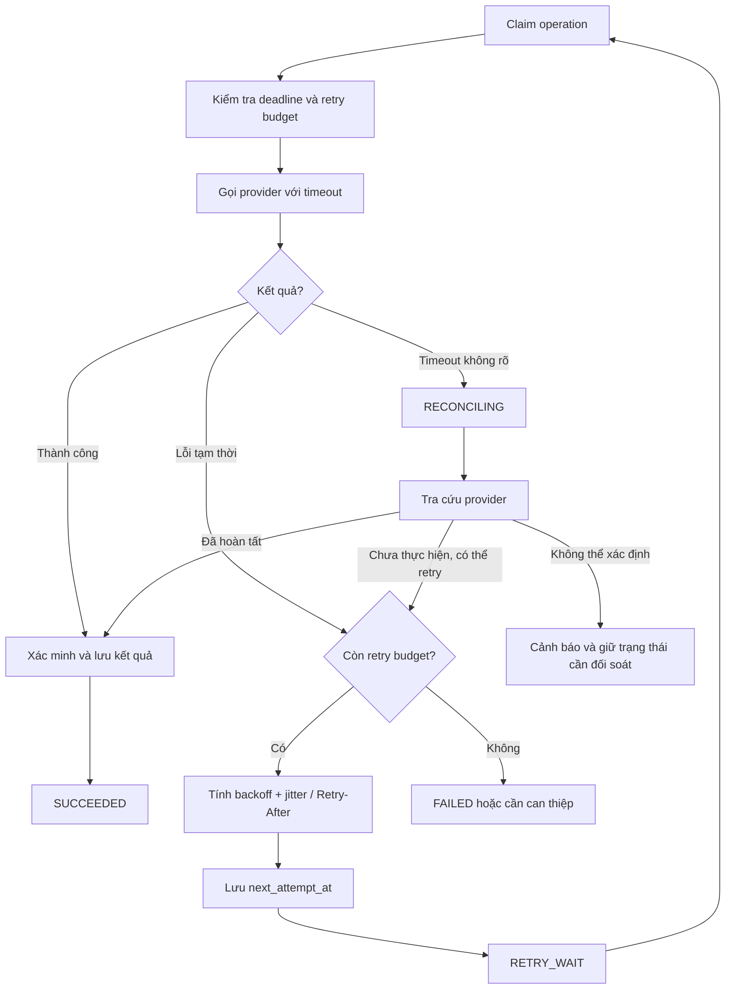

# Thử lại có giới hạn, khoảng chờ tăng dần và giới hạn tốc độ

Service broker thường phải gọi nhiều hệ thống bên ngoài để provision, update, bind hoặc deprovision tài nguyên. Những hệ thống này có thể tạm thời quá tải, trả lỗi giới hạn tốc độ, mất kết nối hoặc phản hồi chậm. Thử lại (retry) giúp vượt qua một số lỗi tạm thời, nhưng nếu retry vô hạn hoặc nhiều client cùng retry liên tục, broker có thể làm provider quá tải hơn và khiến sự cố lan rộng.

Một chính sách retry an toàn cần giới hạn số lần thử, tổng thời gian, tốc độ gọi và số operation đồng thời. Khoảng chờ tăng dần (exponential backoff) cùng jitter giúp giảm việc nhiều worker gọi lại cùng lúc. Rate limiting kiểm soát lượng request đi vào broker và lượng lời gọi đi ra provider. Idempotency bảo đảm việc gửi lại cùng một ý định không tạo thêm tài nguyên hoặc lặp side effect ngoài mong muốn.

Trong module `SPRING_CLOUD_SERVICE_BROKER`, các cơ chế này cần phối hợp với hợp đồng Open Service Broker API (OSB API), operation store và xử lý reactive bằng Spring. Bài học tập trung vào cách chọn lỗi có thể retry, thiết kế backoff có giới hạn, tôn trọng `Retry-After`, áp dụng rate limit công bằng và triển khai retry an toàn khi kết quả của provider chưa rõ.

## Mục tiêu học tập

Sau bài này, bạn có thể:

- Phân biệt retry của platform, retry nội bộ broker và polling operation.
- Phân loại lỗi tạm thời, lỗi vĩnh viễn và lỗi có kết quả chưa xác định.
- Thiết kế số lần retry, timeout, tổng deadline và retry budget.
- Tính exponential backoff có giới hạn và thêm jitter.
- Xử lý `Retry-After` và HTTP `429 Too Many Requests`/`503 Service Unavailable`.
- Áp dụng rate limiting và giới hạn concurrency theo tenant, provider và loại thao tác.
- Kết hợp retry với idempotency key, operation state và reconciliation.
- Dùng Reactor `Retry` trong Spring mà không retry mù quáng các side effect.

## 1. Retry trong service broker diễn ra ở những tầng nào?

Một luồng OSB có thể có nhiều nơi phát sinh retry. Cần xác định rõ tầng nào chịu trách nhiệm để tránh cùng một request bị retry nhiều lần ở nhiều lớp.

| Tầng | Ai retry? | Ví dụ | Điều cần kiểm soát |
|---|---|---|---|
| Platform → broker | Cloud Foundry hoặc platform gửi lại request khi mất response/lỗi tạm thời | Gửi lại `PUT` provision cho cùng `instance_id` | Broker phải xử lý idempotent và nhận diện operation hiện có. |
| Broker → provider | Provider adapter gọi lại API của database/cloud | Provider trả `429` hoặc `503` | Phân loại lỗi, backoff, retry budget và idempotency ở provider. |
| Worker/queue | Worker nhận lại message sau restart hoặc visibility timeout | Message provision được giao lại | Atomic claim, lease và bước xử lý idempotent. |
| Platform polling | Platform gọi `last_operation` để đọc trạng thái | Poll operation đang `in progress` | Đây là truy vấn trạng thái, không phải chạy lại provision/update. |
| Người dùng/automation | Người dùng khởi tạo một yêu cầu mới sau khi thấy lỗi | Thử lại tạo binding sau khi sửa cấu hình | Phân biệt ý định mới với retry của operation cũ. |

Một request có thể đi qua nhiều tầng. Ví dụ, platform gửi provision, broker trả `202 Accepted`, worker gọi provider và nhận `503`, sau đó worker retry. Trong lúc đó platform polling `last_operation`. Polling không được kích hoạt thêm lệnh tạo database; worker mới là thành phần thực hiện retry provider.

### 1.1. Không retry cùng một công việc ở mọi lớp

Nếu WebClient retry ba lần, worker retry ba lần và platform cũng gửi lại request ba lần, một lỗi có thể tạo ra số lần gọi lớn hơn dự kiến. Cần xác định một tầng sở hữu retry cho mỗi loại thao tác, công bố deadline cho tầng gọi bên ngoài và truyền idempotency identity xuyên suốt.

Ví dụ, worker sở hữu retry provider trong operation async. Platform chỉ polling trạng thái và chỉ gửi lại request provision nếu mất response ban đầu; khi gửi lại, broker tra cứu `instance_id` và trả lời nhất quán với operation đã lưu.

## 2. Phân loại lỗi trước khi quyết định retry

Không phải lỗi nào cũng có thể khắc phục bằng cách gửi lại request. Retry chỉ hữu ích khi nguyên nhân có khả năng tạm thời và thao tác có thể thực hiện lại an toàn.

| Nhóm lỗi | Ví dụ | Hành động |
|---|---|---|
| Lỗi request/vĩnh viễn | JSON sai, parameters vượt giới hạn, service/plan không hợp lệ | Không retry tự động; trả lỗi để client sửa request. |
| Lỗi xác thực/phân quyền | Credential sai, token hết quyền, tenant không được phép | Không retry liên tục; sửa credential hoặc quyền. |
| Xung đột trạng thái | Instance đang update, binding ID gắn với cấu hình khác | Đọc lại trạng thái hoặc trả conflict; không retry ngay theo vòng lặp. |
| Lỗi tạm thời có thể nhận diện | HTTP `429`, `502`, `503`, `504`, connection refused trước khi gửi request | Retry có giới hạn, backoff và tuân thủ rate limit. |
| Timeout/kết quả không rõ | Provider có thể đã thực hiện lệnh nhưng response bị mất | Reconcile hoặc tra cứu resource/operation trước khi retry. |
| Lỗi lập trình/cấu hình | Null mapping, sai endpoint, thiếu cấu hình cố định | Dừng retry, ghi nhận lỗi và sửa nguyên nhân. |

### 2.1. HTTP status chỉ là tín hiệu, không phải toàn bộ quyết định

Một bảng định hướng khi gọi provider:

| Status/lỗi | Thường có thể retry? | Điều kiện |
|---|---|---|
| `408 Request Timeout` | Có thể | Chỉ khi thao tác idempotent hoặc đã xác minh kết quả lần trước. |
| `429 Too Many Requests` | Có thể | Tôn trọng `Retry-After`, giới hạn tốc độ và retry budget. |
| `500 Internal Server Error` | Có thể trong một số trường hợp | Cần hiểu provider có thể đã thực hiện side effect hay chưa. |
| `502 Bad Gateway` | Có thể | Backoff; xác minh kết quả nếu request có side effect. |
| `503 Service Unavailable` | Có thể | Tôn trọng `Retry-After` nếu có. |
| `504 Gateway Timeout` | Có thể nhưng kết quả thường chưa rõ | Tra cứu trạng thái trước khi gửi lại lệnh tạo/cập nhật. |
| `400 Bad Request` | Không | Request cần được sửa. |
| `401 Unauthorized` / `403 Forbidden` | Không theo retry tự động thông thường | Xử lý credential/quyền; retry dồn dập không khắc phục được. |
| `404 Not Found` | Phụ thuộc thao tác | Có thể là lỗi cấu hình hoặc trạng thái mong đợi; phải xét hợp đồng provider. |
| `409 Conflict` | Không retry ngay | Đọc trạng thái mới, giải quyết xung đột rồi mới quyết định. |

Không áp dụng bảng này một cách máy móc cho mọi provider. Một số API có thể dùng `409` cho một trạng thái tạm thời, hoặc trả `500` sau khi side effect đã hoàn tất. Adapter cần ánh xạ lỗi theo tài liệu provider và loại thao tác.

### 2.2. Phân biệt lỗi chắc chắn và kết quả chưa xác định

Giả sử broker gửi lệnh tạo database và chờ provider phản hồi. Kết nối bị ngắt sau khi request đã được gửi. Có ít nhất hai khả năng:

1. Provider chưa nhận hoặc chưa thực hiện lệnh.
2. Provider đã tạo database nhưng response bị mất.

Nếu broker gửi lại một lệnh tạo mới mà provider không hỗ trợ idempotency, có thể tạo tài nguyên trùng. Vì vậy, timeout sau khi gửi request phải được xem là `outcome unknown` cho đến khi broker tra cứu theo resource name, provider request ID hoặc idempotency key.

Với kết quả chưa xác định, chuyển operation sang trạng thái nội bộ như `RECONCILING`; không đánh dấu `FAILED` ngay và không retry mù quáng.

## 3. Giới hạn số lần thử và tổng thời gian

Retry phải có điểm dừng. Nếu không giới hạn, worker có thể giữ tài nguyên, queue và connection vô thời hạn, trong khi platform chờ một operation không bao giờ kết thúc.

Một chính sách thường cần các giới hạn sau:

- **Số lần thử tối đa:** bao gồm số retry sau lần gọi ban đầu hay chỉ số lần retry; phải định nghĩa rõ.
- **Timeout mỗi lần gọi:** thời gian tối đa chờ một lần provider request.
- **Tổng deadline:** thời gian tối đa cho toàn bộ operation hoặc nhóm retry.
- **Backoff tối đa:** khoảng chờ không vượt quá một ngưỡng.
- **Retry budget:** giới hạn tổng lượng retry trong một khoảng thời gian hoặc trên một nhóm operation.
- **Concurrency limit:** giới hạn số lần gọi provider đồng thời.

Ví dụ chính sách minh họa cho một lời gọi provider:

| Tham số | Giá trị ví dụ |
|---|---:|
| Timeout mỗi lần gọi | 4 giây |
| Số retry tối đa | 3 |
| Backoff ban đầu | 250 ms |
| Backoff tối đa | 4 giây |
| Jitter | 50% |
| Tổng deadline của operation | 30 giây |

Đây chỉ là giá trị khởi đầu để minh họa, không phải mặc định phù hợp cho mọi service. Provision database có thể cần deadline dài hơn một lần đọc catalog; một thao tác đồng bộ cũng không nên giữ HTTP request mở trong thời gian dài chỉ để chờ retry.

### 3.1. Phân biệt attempt và retry

Nếu cấu hình tối đa 3 retry, tổng số lần gọi có thể là 4: một lần ban đầu và ba lần thử lại. Tài liệu, metric và code cần dùng cùng một cách đếm. Ví dụ, field `attempt=1` có thể chỉ lần đầu; `retry_count=0` biểu thị chưa retry. Tránh dùng một biến tên `maxAttempts` nhưng lại hiểu nó là tổng số lần gọi ở nơi khác.

### 3.2. Tổng deadline phải bao gồm cả thời gian chờ

Giả sử ba retry có backoff 1, 2 và 4 giây, cộng thời gian chờ provider mỗi lần. Tổng operation có thể vượt deadline dù từng request đều có timeout riêng. Broker phải tính cả thời gian gọi, thời gian backoff và thời gian reconcile.

Khi hết deadline, không nhất thiết có thể kết luận provider thất bại. Nếu request cuối đã gửi và timeout, operation có thể cần reconciliation để xác định trạng thái cuối trước khi trả `failed`.

## 4. Exponential backoff và jitter

Exponential backoff tăng thời gian chờ sau mỗi lần thất bại. Một công thức cơ bản:

`d_n = min(d_max, d_0 * 2^n)`

Trong đó:

- `d_0` là khoảng chờ ban đầu.
- `n` là số lần retry đã xảy ra, bắt đầu từ 0.
- `d_max` là giới hạn khoảng chờ tối đa.
- `d_n` là khoảng chờ trước lần retry kế tiếp.

Ví dụ với `d_0 = 500 ms`, `d_max = 8 s`:

| Lần retry | Backoff chưa có jitter |
|---:|---:|
| 1 | 500 ms |
| 2 | 1 giây |
| 3 | 2 giây |
| 4 | 4 giây |
| 5 | 8 giây |
| 6 trở đi | 8 giây |

Backoff giảm áp lực lên provider vì request không được gửi lại liên tục. Tuy nhiên, nếu nhiều worker cùng thất bại ở một thời điểm, tất cả có thể cùng thức dậy sau 1 giây, rồi 2 giây, rồi 4 giây. Hiện tượng này gọi là synchronized retry hoặc thundering herd.

### 4.1. Thêm jitter

Jitter thêm độ ngẫu nhiên vào khoảng chờ để các worker không retry cùng một thời điểm. Một cách dùng full jitter:

`d_n_jitter = random(0, min(d_max, d_0 * 2^n))`

Trong đó `random(0, x)` là một giá trị ngẫu nhiên phân bố đều từ 0 đến `x`. Một cách khác là dùng jitter quanh giá trị backoff cơ sở. Điều quan trọng là khoảng chờ cuối vẫn phải tuân thủ giới hạn và deadline.

Ví dụ, nếu backoff cơ sở là 4 giây với full jitter, worker có thể chờ ngẫu nhiên từ 0 đến 4 giây. Một worker khác có thể chờ 1,3 giây, worker khác 3,7 giây; các lần gọi được phân tán theo thời gian.

### 4.2. Chọn backoff phù hợp

- Với lỗi rate limit, ưu tiên `Retry-After` của provider nếu có, sau đó áp dụng giới hạn chính sách nội bộ.
- Với lỗi quá tải, dùng backoff và jitter đủ lớn để giảm áp lực.
- Với lỗi mạng ngắn hạn, backoff nhỏ có thể phù hợp nhưng vẫn cần giới hạn.
- Với thao tác dài chạy nền, lưu `next_attempt_at` và để scheduler/worker xử lý; không giữ thread ngủ trong thời gian backoff.
- Với lỗi không retry được, không áp dụng backoff vì không có lần thử tiếp theo.

## 5. `Retry-After` và HTTP 429/503

Provider có thể trả `429 Too Many Requests` hoặc `503 Service Unavailable` cùng header `Retry-After` để hướng dẫn client chờ trước khi gửi request tiếp theo.

Ví dụ:

```http
HTTP/1.1 429 Too Many Requests
Retry-After: 10
Content-Type: application/json

{
  "error": "rate_limit_exceeded",
  "message": "Too many requests"
}
```

Giá trị `10` biểu thị số giây cần chờ. `Retry-After` cũng có thể mang một HTTP-date. Client cần parse cả hai dạng theo HTTP semantics và xử lý giá trị không hợp lệ bằng chính sách backoff nội bộ.

### 5.1. Kết hợp Retry-After với backoff nội bộ

Nếu provider yêu cầu chờ 10 giây nhưng backoff nội bộ đang là 2 giây, broker không nên gọi lại sau 2 giây. Thời điểm retry phải tôn trọng hướng dẫn provider, đồng thời vẫn nằm trong tổng deadline và retry budget. Nếu `Retry-After` vượt quá deadline hiện tại, broker có thể hoãn operation hoặc kết thúc attempt theo chính sách; không được bỏ qua header rồi tiếp tục gây tải.

Một quy tắc thực tế là chọn khoảng chờ không nhỏ hơn `Retry-After`, rồi thêm jitter phù hợp nếu chính sách cho phép mà không làm retry sớm hơn thời điểm provider yêu cầu. Với HTTP-date, tính khoảng chênh lệch so với thời gian hiện tại và xử lý sai lệch đồng hồ một cách thận trọng.

### 5.2. Hai chiều Retry-After khác nhau

Trong broker có hai luồng riêng:

1. **Provider → broker:** provider trả `Retry-After` trong response `429`/`503`; broker dùng nó để lên lịch lần gọi provider tiếp theo.
2. **Broker → platform:** broker trả `Retry-After` khi platform polling `last_operation` hoặc khi broker giới hạn tốc độ request; platform dùng nó để biết nên chờ bao lâu.

Không sao chép nguyên header từ provider sang platform nếu ý nghĩa và thời điểm không còn phù hợp. Broker cần tạo response theo hợp đồng OSB API và chính sách polling của chính mình.

## 6. Retry budget: ngăn retry khuếch đại sự cố

Giới hạn retry trên từng operation vẫn có thể tạo ra tải rất lớn khi hàng nghìn operation cùng thất bại. Retry budget giới hạn tổng lượng retry của một hệ thống trong một khoảng thời gian.

Ví dụ, broker có thể cho phép tối đa một số retry bổ sung trên mỗi 100 request gốc trong một cửa sổ thời gian. Khi ngân sách cạn, request mới không được retry tự động cho đến khi budget hồi phục. Tùy mức độ quan trọng, broker có thể chuyển operation sang `RETRY_WAIT`, `RECONCILING` hoặc `FAILED` sau khi xác định không còn cách xử lý an toàn.

Retry budget có thể được chia theo:

- Provider hoặc tài khoản cloud, để một dependency quá tải không ảnh hưởng toàn hệ thống.
- Loại thao tác, vì provision có thể có chi phí khác catalog read.
- Tenant hoặc service plan, để một tenant không tiêu thụ hết ngân sách của tenant khác.
- Toàn broker, để bảo vệ tài nguyên tổng thể.

Không xem retry budget là giới hạn số request đầu vào. Request gốc và request retry cần được thống kê riêng để nhìn thấy mức độ khuếch đại do lỗi.

## 7. Rate limiting: giới hạn tốc độ request

Rate limiting quyết định một client hoặc nhóm client được phép gửi bao nhiêu request trong một khoảng thời gian. Mục đích là bảo vệ broker, provider và các tenant khác khỏi lưu lượng quá cao.

Broker thường cần giới hạn ở hai hướng:

- **Inbound rate limit:** kiểm soát request từ platform tới broker, ví dụ catalog, provision, binding và polling.
- **Outbound rate limit:** kiểm soát lời gọi từ broker tới provider, ví dụ API quản trị database hoặc cloud account.

Hai hướng có thể dùng giới hạn khác nhau. Platform có thể gửi nhiều request polling nhưng provider chỉ cho phép một số ít thao tác tạo tài nguyên mỗi giây.

### 7.1. Các thuật toán phổ biến

| Thuật toán | Cách hoạt động | Ưu điểm | Lưu ý |
|---|---|---|---|
| Fixed window | Đếm request trong từng cửa sổ cố định, ví dụ mỗi phút. | Đơn giản, dễ triển khai. | Có thể tạo burst ở ranh giới hai cửa sổ. |
| Sliding window | Tính số request trong cửa sổ trượt theo thời gian. | Giới hạn mượt hơn fixed window. | Cần lưu/ước lượng dữ liệu theo thời gian. |
| Token bucket | Token được nạp đều; mỗi request tiêu thụ token. | Cho phép burst có giới hạn và kiểm soát tốc độ trung bình. | Cần đồng bộ bucket nếu nhiều replica. |
| Leaky bucket | Request được xử lý theo tốc độ đều qua hàng đợi. | Làm phẳng burst và ổn định tải. | Hàng đợi cần giới hạn; độ trễ có thể tăng. |

Token bucket thường phù hợp để minh họa rate limit cho broker. Giả sử bucket có dung lượng 20 token và được nạp 5 token mỗi giây. Một burst tối đa 20 request có thể được chấp nhận nếu bucket đầy; về lâu dài tốc độ trung bình vẫn bị giới hạn quanh 5 request/giây.

### 7.2. Phạm vi áp dụng rate limit

Không nên chỉ giới hạn theo IP nếu nhiều tenant hoặc nhiều platform client dùng chung proxy. Có thể kết hợp các khóa:

- Danh tính platform/client đã xác thực.
- Tenant hoặc organization.
- Service ID và plan ID.
- Provider account hoặc endpoint.
- Loại thao tác: read, provision, update, bind, deprovision, polling.

Ví dụ, catalog `GET` có thể có quota lớn hơn provision vì catalog không tạo tài nguyên. Polling có thể được giới hạn riêng để một operation không tạo quá nhiều request đọc trạng thái. Deprovision cần được ưu tiên đủ để người dùng có thể giải phóng tài nguyên khi hệ thống đang chịu tải.

### 7.3. Phản hồi khi vượt rate limit

Khi broker từ chối request do rate limit, response thường dùng `429 Too Many Requests` và có thể kèm `Retry-After` để client biết thời điểm thử lại. Response nên có error code ổn định và mô tả an toàn.

```http
HTTP/1.1 429 Too Many Requests
Retry-After: 3
Content-Type: application/json

{
  "error": "RateLimitExceeded",
  "description": "Đã vượt giới hạn request; hãy thử lại sau"
}
```

Ví dụ này minh họa response rate limit của broker. Khi áp dụng vào OSB API, cần bảo đảm status và error body phù hợp với endpoint cùng phiên bản giao thức. Không trả `202 Accepted` nếu broker chưa thực sự tiếp nhận operation.

### 7.4. Rate limit phân tán

Nếu broker chạy nhiều replica, rate limiter lưu bucket trong bộ nhớ từng JVM sẽ tạo ra giới hạn tổng cao hơn dự kiến. Ví dụ, 4 replica mỗi replica cho 10 request/giây có thể cho phép gần 40 request/giây.

Để có quota toàn cục, dùng kho trạng thái dùng chung hoặc một gateway/rate-limit service có khả năng điều phối phân tán. Cập nhật token phải nguyên tử để hai replica không cùng tiêu thụ một token. Nếu rate limiter phụ thuộc Redis hoặc database, cần xác định hành vi khi chính kho này không khả dụng: fail-open có thể bảo vệ tính sẵn sàng nhưng tăng rủi ro quá tải; fail-closed bảo vệ quota nhưng có thể từ chối request hợp lệ. Quyết định phải theo mức độ quan trọng và được quan sát.

## 8. Giới hạn concurrency và bảo vệ provider

Rate limit giới hạn tốc độ request trong thời gian; concurrency limit giới hạn số thao tác đang chạy cùng lúc. Hai cơ chế bổ sung cho nhau.

Ví dụ, provider cho phép 10 request/giây nhưng mỗi thao tác provision mất 30 giây. Nếu broker không giới hạn concurrency, số request đang chạy có thể tăng nhanh và chiếm hết connection, thread hoặc quota provider.

Broker có thể dùng:

- Semaphore/bulkhead theo provider hoặc loại thao tác.
- Giới hạn concurrency trong reactive pipeline.
- Hàng đợi bền vững với số worker cố định.
- Giới hạn số operation đang active theo tenant.
- Circuit breaker để tạm ngừng gọi dependency khi tỷ lệ lỗi vượt ngưỡng.

Circuit breaker không giống retry hoặc rate limit. Retry gửi lại một request sau lỗi; rate limit kiểm soát lượng request; concurrency limit kiểm soát số việc đang chạy; circuit breaker tạm ngăn lời gọi tới dependency đang có dấu hiệu lỗi để hệ thống phục hồi.

Không giữ một semaphore permit trong thời gian backoff nếu worker không thực hiện I/O. Có thể giải phóng slot khi operation chuyển sang `RETRY_WAIT`, sau đó claim lại slot khi tới `next_attempt_at`.

## 9. Kết hợp retry với idempotency

Retry chỉ an toàn khi cùng một ý định không tạo ra side effect trùng lặp. Đây là lý do retry và idempotency phải được thiết kế cùng nhau.

### 9.1. Dùng định danh ổn định

Với OSB API, `instance_id` và `binding_id` là định danh do platform cung cấp cho tài nguyên. Broker có thể kết hợp chúng với loại thao tác và fingerprint request để nhận diện yêu cầu tương đương.

Với provider API, nếu hỗ trợ idempotency key, broker nên tạo key ổn định cho operation và dùng lại key đó qua mọi lần retry. Không sinh key mới ở mỗi attempt, vì khi đó provider có thể coi mỗi lần thử là một yêu cầu tạo tài nguyên độc lập.

### 9.2. Lưu trạng thái trước side effect

Trước khi gọi provider, broker nên lưu operation và idempotency identity trong kho bền vững. Khi worker restart hoặc queue redelivery, worker tra cứu operation để biết đã thực hiện tới bước nào.

Một bản ghi nội bộ có thể chứa:

```json
{
  "operation_id": "provision-901",
  "instance_id": "instance-123",
  "idempotency_key": "broker:provision:instance-123",
  "attempt": 2,
  "max_retries": 3,
  "state": "RETRY_WAIT",
  "next_attempt_at": "2026-11-27T10:15:00Z"
}
```

Đây là ví dụ dữ liệu nội bộ, không phải response OSB API. Không lưu secret thô vào idempotency record hoặc log.

### 9.3. Timeout phải reconcile trước khi retry side effect

Nếu provider timeout sau khi nhận lệnh tạo resource, broker tra cứu theo idempotency key, provider operation ID hoặc resource name ổn định. Chỉ khi xác nhận provider chưa thực hiện hoặc thao tác trước đã kết thúc mới gửi lại lệnh. Nếu resource đã tồn tại và khớp yêu cầu, broker tiếp tục cập nhật trạng thái thay vì tạo lại.

### 9.4. Không retry lỗi nghiệp vụ

Ví dụ, plan không cho phép tăng dung lượng từ 100 GB lên 2 TB. Retry cùng request không làm plan có thêm capacity. Broker trả lỗi phù hợp, lưu mã lỗi và dừng retry. Người dùng phải thay đổi request hoặc chọn plan khác.

## 10. Thiết kế worker retry cho operation bất đồng bộ

Với provision/update/deprovision kéo dài, broker nên lưu thời điểm retry kế tiếp thay vì dùng `Thread.sleep` hoặc giữ request HTTP mở.

Một quy trình worker tham khảo:

1. Claim operation `QUEUED` bằng cập nhật nguyên tử.
2. Đọc attempt, deadline, idempotency key và `next_attempt_at`.
3. Nếu chưa tới thời điểm retry, trả operation về hàng đợi có lịch hoặc nhường worker.
4. Gọi provider trong timeout mỗi attempt.
5. Nếu thành công, xác minh kết quả, lưu provider resource ID và chuyển operation sang terminal state.
6. Nếu lỗi tạm thời, kiểm tra retry budget, tính backoff/jitter và lưu `RETRY_WAIT` cùng `next_attempt_at`.
7. Nếu timeout hoặc kết quả không rõ, chuyển `RECONCILING` và tra cứu provider trước khi quyết định.
8. Nếu lỗi vĩnh viễn hoặc hết retry budget, kết thúc operation theo chính sách và cập nhật trạng thái instance chính xác.



Nếu platform đã nhận `202 Accepted`, broker cập nhật `last_operation` thành `in progress` trong khi worker đang retry hoặc reconcile. Khi operation đã kết thúc, broker trả `succeeded` hoặc `failed`. Không để platform polling kích hoạt lại worker.

## 11. Tích hợp retry bằng Reactor trong Spring

Reactor cung cấp `Retry` và `retryWhen` để cấu hình retry cho một publisher. Cần đặt retry quanh đúng lời gọi có thể retry, giới hạn số lần và lọc loại exception.

Ví dụ minh họa:

```java
import java.time.Duration;

import reactor.core.publisher.Mono;
import reactor.util.retry.Retry;

public Mono<ProviderResult> provision(ProvisionCommand command) {
    Retry retryPolicy = Retry.backoff(3, Duration.ofMillis(250))
            .maxBackoff(Duration.ofSeconds(4))
            .jitter(0.5)
            .filter(this::isRetryableProviderFailure)
            .onRetryExhaustedThrow((spec, signal) -> signal.failure());

    return Mono.defer(() -> providerClient.create(command)
                    .timeout(Duration.ofSeconds(4)))
            .retryWhen(retryPolicy);
}
```

Ví dụ dùng tối đa ba lần retry sau lần gọi đầu, backoff từ 250 ms tới 4 giây và jitter 50%. `isRetryableProviderFailure` phải chỉ cho phép lỗi đã được phân loại an toàn; không đưa mọi exception vào retry. `Mono.defer` tạo lời gọi mới cho mỗi subscription/retry.

Đoạn code chỉ minh họa một lời gọi provider có thể retry. Trong hệ thống thực tế, `providerClient.create(command)` phải truyền cùng idempotency key ổn định ở mọi attempt. Nếu lỗi timeout khiến kết quả không rõ, predicate không nên retry trực tiếp; hãy chuyển sang bước reconciliation. Cũng cần có deadline tổng cho operation bên ngoài timeout từng attempt.

### 11.1. Ví dụ bộ lọc lỗi

Một predicate có thể kiểm tra loại exception đã được adapter chuẩn hóa:

```java
private boolean isRetryableProviderFailure(Throwable error) {
    if (error instanceof ProviderRateLimitedException) {
        return true;
    }
    if (error instanceof ProviderUnavailableException) {
        return true;
    }
    if (error instanceof ProviderOutcomeUnknownException) {
        return false; // Chuyển sang reconciliation, không gửi lại mù quáng.
    }
    return false;
}
```

Adapter nên chuyển response HTTP và lỗi mạng thành exception có ngữ nghĩa rõ ràng. Ví dụ `ProviderRateLimitedException` có thể chứa thời điểm retry từ `Retry-After`; scheduler cần sử dụng thời điểm đó thay vì chỉ áp dụng backoff mặc định.

### 11.2. Không block trong thời gian backoff

Không dùng `Thread.sleep()` hoặc `block()` trong reactive request path để chờ retry. Reactor điều phối delay mà không cần giữ thread xử lý request ngủ. Với operation kéo dài qua nhiều giây/phút, cách tốt hơn là lưu `next_attempt_at` trong operation store và để worker scheduler thực hiện lần thử kế tiếp.

### 11.3. Retry không thay thế rate limiter

`Retry.backoff` điều chỉnh thời gian thử lại của một publisher; nó không giới hạn tổng số request từ tất cả publisher hoặc tất cả replica. Cần kết hợp với rate limiter, concurrency limiter và retry budget ở cấp hệ thống.

## 12. Phân biệt retry operation và polling OSB

OSB API hỗ trợ xử lý bất đồng bộ khi platform gửi `accepts_incomplete=true` và broker trả `202 Accepted`. Platform sử dụng endpoint `last_operation` để đọc trạng thái operation.

| Hoạt động | Mục đích | Có thực hiện side effect không? |
|---|---|---|
| Retry provider call | Thực hiện lại một bước gọi provider sau lỗi tạm thời | Có thể có; cần idempotency. |
| Worker retry operation | Tiếp tục operation đang lưu | Có thể có; phải kiểm tra state và bước đã hoàn thành. |
| Platform polling `last_operation` | Đọc trạng thái operation | Không; chỉ đọc trạng thái. |
| Platform retry request ban đầu | Khôi phục khi mất response từ broker | Broker tra cứu `instance_id`/`binding_id` và operation hiện có trước. |

Broker có thể trả `Retry-After` trong response polling để hướng dẫn platform chờ lâu hơn giữa các lần hỏi. Giá trị này không phải số lần worker sẽ retry provider. Hai chính sách cần được theo dõi riêng.

Nếu thao tác bắt buộc phải chạy bất đồng bộ nhưng platform không gửi `accepts_incomplete=true`, broker phải tuân thủ hợp đồng OSB API, thường từ chối bằng `422 Unprocessable Entity` với lỗi `AsyncRequired`. Không giữ kết nối đồng bộ mở trong thời gian dài để thử đi thử lại.

## 13. Ví dụ tổng hợp: provider trả 429 khi provision

Platform yêu cầu provision một PostgreSQL instance và chấp nhận async. Broker xác thực request, kiểm tra plan/parameters, ghi instance và operation rồi trả `202 Accepted` cùng operation ID.

Worker gọi provider. Provider trả `429 Too Many Requests` với `Retry-After: 8`.

Broker thực hiện:

1. Phân loại lỗi là rate limit tạm thời.
2. Kiểm tra operation còn deadline và retry budget.
3. Tính thời điểm retry không sớm hơn 8 giây, có jitter nếu chính sách cho phép.
4. Lưu attempt, `next_attempt_at` và mã lỗi; chuyển operation sang `RETRY_WAIT`.
5. Giải phóng concurrency slot trong lúc chờ.
6. Trả `in progress` khi platform gọi `last_operation`.
7. Đến thời điểm retry, worker claim operation và gọi provider với cùng idempotency key.
8. Nếu provider tạo resource thành công, broker lưu resource ID và chuyển operation sang `SUCCEEDED`.
9. Nếu tiếp tục bị rate limit đến khi hết budget, broker dừng retry tự động, phát cảnh báo và kết thúc operation theo chính sách sau khi xác định trạng thái provider.

Nếu request provider đầu tiên timeout thay vì trả 429, broker phải tra cứu provider trước khi retry vì database có thể đã được tạo. Không dùng cùng một quy tắc cho mọi lỗi chỉ vì chúng đều làm lời gọi hiện tại thất bại.

## 14. Quan sát và vận hành retry/rate limit

Các metric cần theo dõi:

- Số request gốc và số retry, tách theo provider, endpoint và loại operation.
- Tỷ lệ lỗi tạm thời, lỗi vĩnh viễn và kết quả chưa xác định.
- Số lần retry trung bình và p95 trên mỗi operation.
- Tổng thời gian operation và thời gian nằm trong `RETRY_WAIT`.
- Số lần nhận `429`, `503` và thời gian `Retry-After` được áp dụng.
- Token bucket còn lại, số request bị rate limit và mức sử dụng quota.
- Số operation đang chạy, số worker active và độ dài queue.
- Retry budget còn lại và số operation phải chuyển sang xử lý thủ công.
- Số operation `RECONCILING` quá lâu.

Log nên có `operation_id`, `instance_id`, provider request ID, attempt, delay, mã lỗi đã chuẩn hóa và thời điểm retry tiếp theo. Không log password, token hoặc toàn bộ parameters có chứa secret. Dùng correlation ID để nối request platform, operation worker và provider call.

Cảnh báo nên kích hoạt khi tỷ lệ retry tăng bất thường, retry budget cạn, provider liên tục trả 429/503, queue tăng nhanh hoặc operation nằm trong `RETRY_WAIT`/`RECONCILING` quá deadline. Khi provider đang quá tải, có thể giảm concurrency, mở circuit breaker hoặc tạm dừng các loại thao tác ít ưu tiên.

## 15. Những lỗi thiết kế thường gặp

- **Retry vô hạn:** worker không bao giờ kết thúc và giữ tài nguyên lâu dài.
- **Không có jitter:** nhiều worker cùng retry theo nhịp và tạo thundering herd.
- **Retry mọi exception:** lỗi request, credential hoặc code bug bị lặp vô ích.
- **Bỏ qua `Retry-After`:** broker tiếp tục gọi provider trước thời điểm provider yêu cầu.
- **Mỗi attempt tạo idempotency key mới:** provider coi mỗi lần thử là một thao tác mới và có thể tạo tài nguyên trùng.
- **Retry timeout mù quáng:** provider có thể đã hoàn tất side effect trước khi response bị mất.
- **Chỉ rate limit trong bộ nhớ từng replica:** tổng quota tăng theo số replica và vượt giới hạn provider.
- **Không giới hạn concurrency:** request rate có vẻ hợp lệ nhưng số operation đang chạy vẫn quá lớn.
- **Giữ worker/thread trong lúc backoff:** giảm throughput và chiếm tài nguyên không cần thiết.
- **Nhầm polling với retry:** mỗi lần platform hỏi `last_operation` lại kích hoạt provider call.
- **Không tách request gốc và retry trong metric:** khó phát hiện retry storm và mức khuếch đại tải.
- **Không có deadline hoặc retry budget:** một dependency lỗi làm queue tích tụ vô hạn.

## 16. Checklist xây dựng chính sách retry

- [ ] Xác định tầng chịu trách nhiệm retry cho từng lời gọi.
- [ ] Phân loại lỗi tạm thời, vĩnh viễn và outcome unknown.
- [ ] Xác định rõ tổng số attempt và số retry.
- [ ] Đặt timeout mỗi lần gọi và deadline toàn operation.
- [ ] Dùng exponential backoff có giới hạn và jitter.
- [ ] Tôn trọng `Retry-After` của provider.
- [ ] Có retry budget ở cấp operation và hệ thống.
- [ ] Dùng idempotency key ổn định xuyên suốt các attempt.
- [ ] Reconcile provider state trước khi retry side effect có kết quả chưa rõ.
- [ ] Áp dụng rate limit theo client/tenant/provider và loại thao tác.
- [ ] Dùng concurrency limit, bulkhead hoặc circuit breaker khi cần.
- [ ] Lưu `attempt`, `next_attempt_at` và operation state bền vững.
- [ ] Không dùng `Thread.sleep()`/`block()` trong reactive request path.
- [ ] Tách polling `last_operation` khỏi worker retry.
- [ ] Có metric, log và cảnh báo cho retry storm, budget cạn và operation treo.
- [ ] Kiểm thử queue redelivery, provider 429/503, timeout và request lặp.

## 17. Bài tập tự luyện

### Bài tập 1: Tính backoff

Một provider adapter dùng backoff ban đầu 300 ms, hệ số nhân 2 và giới hạn 5 giây. Hãy tính khoảng chờ cơ sở cho năm lần retry đầu tiên. Sau đó mô tả jitter giúp giảm thundering herd như thế nào.

### Bài tập 2: Phân loại timeout

Broker gửi lệnh tạo database, provider đã nhận request nhưng response bị timeout. Hãy giải thích vì sao không nên gửi lại lệnh tạo ngay, và dữ liệu nào cần dùng để reconciliation.

### Bài tập 3: Xử lý Retry-After

Provider trả `429` cùng `Retry-After: 12`, trong khi backoff nội bộ của operation đang là 2 giây. Broker nên chọn thời điểm retry như thế nào? Nếu tổng deadline chỉ còn 5 giây thì cần xử lý ra sao?

### Bài tập 4: Thiết kế rate limit

Broker có 3 tenant dùng chung một provider account. Hãy đề xuất cách phân bổ token bucket sao cho một tenant không chiếm hết quota và vẫn giữ được giới hạn tổng của provider.

### Bài tập 5: Reactor retry

Viết một pipeline `Mono` dùng `Retry.backoff` tối đa ba lần, có jitter, timeout mỗi attempt và predicate chỉ cho phép retry lỗi rate limit hoặc provider unavailable. Giải thích cách xử lý riêng cho lỗi outcome unknown.

## Kết luận

Retry có ích khi lỗi tạm thời và thao tác có thể lặp an toàn, nhưng phải có giới hạn số lần, timeout, tổng deadline và retry budget. Exponential backoff cùng jitter phân tán thời điểm thử lại; `Retry-After` giúp broker tôn trọng khả năng của provider; rate limiting và concurrency limit bảo vệ broker lẫn backing service. Khi kết hợp các cơ chế này với idempotency key, operation state bền vững và reconciliation, Spring Cloud Service Broker có thể phục hồi sau lỗi mà không tạo retry storm hoặc nhân đôi tài nguyên.
