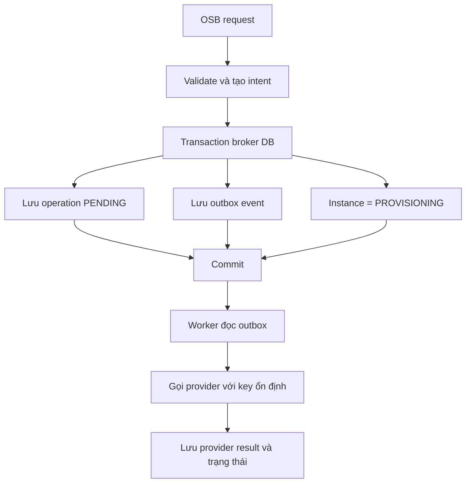
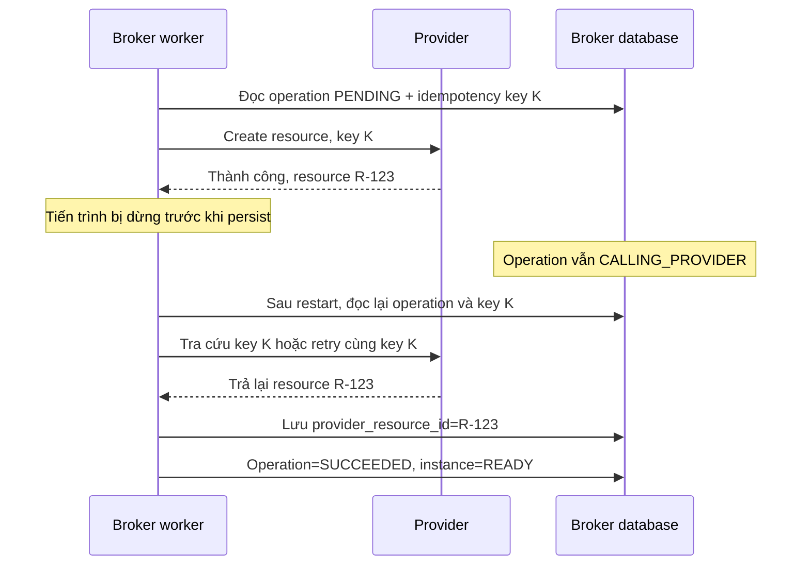
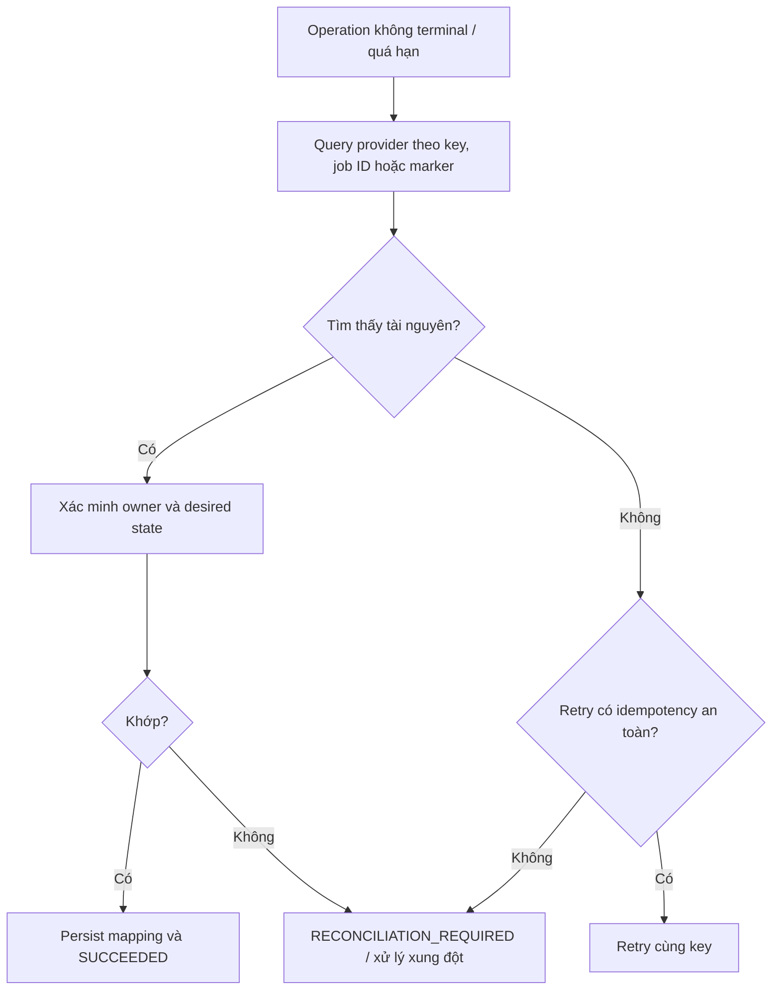

# Cơ chế phục hồi sau sự cố giữa lúc gọi nhà cung cấp và lưu trạng thái

## Bài toán hai hệ thống không cùng một transaction

Một service broker thường phải phối hợp hai nơi lưu trạng thái độc lập:

- Kho dữ liệu của broker lưu service instance, binding, operation và ánh xạ đến tài nguyên nhà cung cấp.
- Hệ thống nhà cung cấp (provider) thực sự tạo, cập nhật hoặc xóa database, cluster, queue, volume hay credential.

Khi broker provision một PostgreSQL instance, nó có thể gọi API của provider để tạo database rồi ghi `provider_resource_id` và trạng thái `READY` vào database nội bộ. Hai hành động này không nằm trong cùng một transaction ACID. Provider có thể đã tạo database thành công nhưng broker bị dừng trước khi lưu kết quả. Khi khởi động lại, broker chỉ thấy operation còn dang dở và không biết chắc provider đã thực hiện đến đâu.

Nếu broker gọi lệnh tạo lại một cách mù quáng, có thể xuất hiện database thứ hai, credential trùng hoặc tài nguyên phát sinh chi phí ngoài dự kiến. Nếu broker kết luận thất bại và bỏ qua tài nguyên đã tạo, tài nguyên đó trở thành orphan. Vì vậy, phục hồi phải dựa trên **idempotency, dấu vết operation bền vững và reconciliation với provider**.

Trong module `SPRING_CLOUD_SERVICE_BROKER`, các thao tác provision, update, deprovision và binding đều cần xử lý tình huống này. Spring Cloud Open Service Broker cung cấp lớp tích hợp Open Service Broker API (OSB API); ứng dụng vẫn phải thiết kế cơ chế phối hợp giữa trạng thái nội bộ và side effect ở provider.

## Vì sao không thể dựa vào một lần gọi HTTP?

Giả sử broker gửi yêu cầu tạo tài nguyên và chờ provider trả response. Có thể xảy ra các tình huống:

1. Broker chưa gửi request thì tiến trình bị dừng.
2. Provider nhận request nhưng chưa thực hiện xong.
3. Provider đã tạo tài nguyên, nhưng response bị mất trên mạng.
4. Broker nhận response thành công, nhưng bị dừng trước khi commit database.
5. Broker đã commit database, nhưng mất kết nối trước khi xác nhận job hoặc response cho nền tảng.

Ở các tình huống 3 và 4, broker không thể suy ra kết quả provider chỉ từ việc request timeout hoặc transaction nội bộ chưa hoàn tất. **Timeout không chứng minh provider chưa thực hiện thao tác.** Đây là điểm quan trọng nhất khi thiết kế retry.

Không có một transaction thông thường nào tự động bao trùm database của broker và API của provider. Nếu hai hệ thống không hỗ trợ một giao thức giao dịch phân tán chung, broker không thể bảo đảm một lệnh tạo tài nguyên chỉ được thực thi đúng một lần bằng cách dùng transaction nội bộ. Mục tiêu thực tế là tạo ra kết quả *effectively once*: request có thể được gửi lại, nhưng cùng một ý định nghiệp vụ không tạo ra nhiều tài nguyên ngoài ý muốn.

## Bốn nguyên tắc phục hồi

| Nguyên tắc | Cách áp dụng | Lợi ích |
|---|---|---|
| Ghi nhận ý định trước khi gọi provider | Lưu operation và công việc cần thực hiện trong transaction nội bộ. | Broker biết request đã được tiếp nhận kể cả khi worker bị dừng. |
| Dùng khóa idempotency ổn định | Mọi lần retry cùng một ý định dùng lại cùng provider idempotency key. | Provider có thể trả lại kết quả cũ thay vì tạo tài nguyên mới. |
| Tra cứu trước khi thực hiện lại | Tìm tài nguyên theo khóa, tên xác định hoặc operation marker. | Phát hiện side effect đã xảy ra nhưng broker chưa lưu kết quả. |
| Reconciliation trước trạng thái không chắc chắn | So sánh operation record với trạng thái thật ở provider. | Khôi phục mapping và tránh tạo/xóa nhầm tài nguyên. |

Các nguyên tắc này cần phối hợp. Chỉ có operation log mà không có cách nhận diện tài nguyên ở provider thì vẫn khó phục hồi sau khi response bị mất. Chỉ có idempotency key mà không lưu key ổn định thì retry sau restart có thể vô tình tạo một key mới.

## Ghi operation và outbox trước khi gọi provider

Khi nhận request OSB API, broker nên ghi nhận ý định nghiệp vụ trong database trước khi thực hiện side effect. Với thao tác bất đồng bộ, có thể dùng transactional outbox để lưu operation và event cần xử lý trong cùng transaction.

Ví dụ transaction tiếp nhận provision:

1. Xác thực `instance_id`, `service_id`, `plan_id` và parameters.
2. Tính fingerprint của ý định provision và xác định operation key ổn định.
3. Tạo operation record ở trạng thái `PENDING`.
4. Tạo bản ghi outbox chứa lệnh provision cần worker xử lý.
5. Chuyển instance sang trạng thái nội bộ `PROVISIONING`.
6. Commit một transaction database.
7. Sau commit, worker đọc outbox và gọi provider.



Transactional outbox bảo đảm việc ghi operation và yêu cầu phát job vào outbox cùng commit hoặc cùng rollback. Nó tránh tình huống broker đã ghi operation nhưng không có job được gửi đi, hoặc đã gửi job nhưng không có bản ghi operation tương ứng.

Outbox không tự giải quyết transaction giữa broker và provider. Worker vẫn có thể gọi provider thành công rồi bị dừng trước khi đánh dấu event hoàn tất. Vì vậy worker phải có khả năng nhận lại event và thực hiện lại an toàn bằng idempotency key hoặc reconciliation.

## Khóa idempotency phải ổn định qua retry và restart

Một khóa idempotency đại diện cho một ý định nghiệp vụ cụ thể. Broker cần lưu khóa đó trước khi gọi provider và dùng lại nó ở mọi lần retry của cùng operation.

Có thể xây dựng khóa từ các thành phần:

```text
provider_idempotency_key = HMAC(
    broker_secret,
    provider_name | operation_type | resource_id | operation_id
)
```

Đây là công thức minh họa. `operation_id` phải được tạo và lưu một lần khi broker tiếp nhận ý định, không được tạo lại mỗi lần worker retry. Nếu provider giới hạn độ dài hoặc định dạng khóa, broker cần chuyển digest sang dạng phù hợp.

Phạm vi khóa cần phân biệt các thao tác hợp lệ khác nhau. Ví dụ:

- Retry cùng một provision cho cùng `instance_id` phải dùng lại khóa của operation provision đó.
- Một lần update mới trên instance đã tồn tại phải có operation ID mới, kể cả khi nó cùng loại với lần update trước.
- Deprovision có khóa riêng, không dùng lại khóa provision.
- Mỗi binding có operation riêng dựa trên cặp `(instance_id, binding_id)` và loại thao tác.

Không nên chỉ tạo khóa từ `instance_id` và `operation_type`, vì một instance có thể có nhiều lần update hợp lệ. Ngược lại, không nên sinh UUID ngẫu nhiên mới trong mỗi lần retry, vì provider sẽ coi mỗi lần là một yêu cầu khác nhau.

Nếu provider hỗ trợ `Idempotency-Key`, broker gửi khóa ổn định đó trong header hoặc field mà provider quy định. Provider thường giữ kết quả của request đầu tiên và trả lại kết quả tương ứng khi nhận lại cùng key. Thời hạn lưu key của provider cũng quan trọng: nếu broker retry sau khi provider đã quên key, broker cần tra cứu tài nguyên trước khi phát lệnh tạo lại.

## Dùng định danh tài nguyên xác định khi provider không hỗ trợ idempotency key

Không phải provider nào cũng có API idempotency. Trong trường hợp đó, broker có thể tạo tên tài nguyên xác định từ ID của broker và lưu marker để tra cứu.

Ví dụ:

```text
instance_id:       inst-orders-001
provider_name:     pg-prod-a
provider_resource: broker-inst-orders-001
operation_marker:  broker-op-provision-8f31
```

Broker có thể dùng tên `broker-inst-orders-001` khi yêu cầu tạo database và gắn tag/label `broker-operation-id=...` nếu provider hỗ trợ. Khi retry sau sự cố, broker tra cứu theo tên hoặc marker trước:

- Nếu tài nguyên chưa tồn tại, tiếp tục tạo.
- Nếu tài nguyên đã tồn tại và marker khớp, nhận diện đây là kết quả của operation trước và tiếp tục lưu mapping.
- Nếu tài nguyên tồn tại nhưng marker hoặc cấu hình không khớp, dừng tự động và xử lý xung đột/reconciliation.

Tên xác định không phải bằng chứng tuyệt đối rằng tài nguyên thuộc operation. Cần xác minh provider account, project, tenant, owner tag và các thuộc tính quan trọng trước khi nhận tài nguyên đó làm của broker. Không được chiếm một tài nguyên trùng tên do người dùng hoặc hệ thống khác tạo.

Nếu provider không hỗ trợ idempotency key, không có API tra cứu và cũng không cho gắn marker, broker không thể tự động phân biệt chắc chắn “provider chưa làm” với “provider đã làm nhưng response mất”. Với thao tác tạo có tác dụng phụ lớn, cần đưa operation vào `RECONCILIATION_REQUIRED` hoặc hàng chờ xử lý thủ công thay vì retry mù quáng.

## Kịch bản quan trọng: provider đã thành công nhưng broker chưa lưu kết quả

Đây là cửa sổ lỗi thường gặp nhất. Trình tự có thể diễn ra như sau:



Quy trình phục hồi:

1. Worker mới nhận lại operation chưa terminal.
2. Đọc lại provider idempotency key và provider request metadata đã lưu.
3. Tra cứu provider theo key, operation marker hoặc resource name xác định nếu API hỗ trợ.
4. Nếu tìm thấy kết quả khớp, xác minh cấu hình và quyền sở hữu.
5. Lưu `provider_resource_id`, kết quả và trạng thái instance trong transaction nội bộ.
6. Đánh dấu operation `SUCCEEDED` và kết thúc job.

Nếu provider hỗ trợ idempotency key nhưng không có API tra cứu riêng, worker có thể retry cùng request và cùng key theo hợp đồng provider. Nếu provider trả lại response đã lưu, broker tiếp tục persist kết quả. Không được tạo key mới cho lần retry này.

## Ma trận phục hồi theo điểm crash

| Điểm xảy ra sự cố | Dấu vết broker | Cách phục hồi an toàn |
|---|---|---|
| Trước transaction tiếp nhận | Chưa có operation/outbox. | Nền tảng retry request; broker tiếp nhận như lần đầu. |
| Sau commit operation/outbox, trước khi worker gọi provider | Operation `PENDING`, outbox chưa hoàn tất. | Worker đọc lại outbox và bắt đầu xử lý. |
| Trong lúc gọi provider, chưa biết kết quả | Operation `CALLING_PROVIDER`. | Tra cứu theo key/marker; nếu chưa xác định được thì reconciliation. |
| Provider đã tạo tài nguyên, response bị mất | Broker chưa có provider ID. | Retry cùng provider key hoặc tìm theo marker/tên xác định. |
| Broker nhận response, crash trước khi persist | Operation vẫn chưa terminal. | Dùng lại key hoặc lookup để lấy lại kết quả và lưu mapping. |
| Broker đã commit kết quả, crash trước khi ack job | Operation đã terminal nhưng message có thể được gửi lại. | Worker đọc operation terminal và kết thúc message mà không gọi provider. |
| Provider thực hiện một phần workflow | Operation có checkpoint hoặc đang ở bước cụ thể. | Reconcile từng bước; tiếp tục hoặc bù trừ theo workflow. |

Điều quan trọng là mọi điểm crash đều phải có một dấu vết bền vững đủ để worker biết mình đang phục hồi operation nào và provider call nào. Nếu broker không lưu request identity, key hoặc checkpoint, sau restart rất khó phân biệt retry với một yêu cầu mới.

## Thiết kế operation record và checkpoint

Một operation record có thể lưu:

```text
broker_operation
----------------
operation_id
resource_type
resource_id
operation_type
request_fingerprint
provider_name
provider_idempotency_key
provider_resource_id
provider_request_reference
state
step_name
attempt_count
lease_until
last_error_code
started_at
updated_at
completed_at
```

Các trường là mô hình nội bộ gợi ý. `provider_request_reference` có thể là ID request/job do provider trả về; không nhất thiết phải lưu toàn bộ payload. `step_name` và `attempt_count` giúp worker tiếp tục workflow nhiều bước. `lease_until` giúp thu hồi job bị worker giữ khi tiến trình chết.

Một số trạng thái nội bộ có thể gồm:

| Trạng thái | Ý nghĩa |
|---|---|
| `PENDING` | Operation đã được lưu, chưa gọi provider. |
| `CALLING_PROVIDER` | Worker đang gọi provider hoặc chưa xác định được kết quả cuộc gọi trước. |
| `PROVIDER_CONFIRMED` | Đã xác nhận side effect ở provider, đang lưu kết quả vào broker. |
| `RECONCILIATION_REQUIRED` | Không thể kết luận kết quả bằng retry thông thường. |
| `SUCCEEDED` | Kết quả đã được lưu bền vững và instance state đã được cập nhật. |
| `FAILED` | Operation thất bại và kết quả lỗi đã được ghi nhận. |

Đây là state nội bộ, không phải các giá trị `state` của OSB API `last_operation`. Khi trả `last_operation`, broker ánh xạ trạng thái chưa terminal sang `in progress`, thành công sang `succeeded`, thất bại sang `failed` theo đúng hợp đồng.

## Transactional outbox và worker có thể chạy lại

Worker nên coi message từ outbox/queue là có thể được giao nhiều lần. Không dựa vào giả định queue chỉ giao đúng một lần. Một worker an toàn cần:

1. Nhận `operation_id` từ message.
2. Lấy lease hoặc khóa xử lý operation để tránh nhiều worker cùng thực hiện.
3. Đọc operation; nếu đã `SUCCEEDED` hoặc `FAILED`, ack message và kết thúc.
4. Nếu chưa terminal, dùng provider key đã lưu để tra cứu hoặc thực hiện tiếp.
5. Persist kết quả và trạng thái trong transaction.
6. Chỉ ack message sau khi kết quả đã được lưu bền vững.

Ví dụ pseudo-SQL để claim operation:

```sql
UPDATE broker_operation
SET lease_until = :new_lease,
    attempt_count = attempt_count + 1,
    updated_at = CURRENT_TIMESTAMP
WHERE operation_id = :operation_id
  AND state NOT IN ('SUCCEEDED', 'FAILED')
  AND (lease_until IS NULL OR lease_until < CURRENT_TIMESTAMP);
```

Worker chỉ được tiếp tục nếu claim thành công. Trong hệ thống nhiều replica, cần fencing token hoặc revision tăng dần để worker cũ không thể ghi đè kết quả của worker mới sau khi lease hết hạn. Lease đơn thuần mà không có fencing có thể vẫn cho phép worker bị treo tiếp tục gửi lệnh sau khi một worker khác đã nhận operation.

## Request fingerprint và phát hiện retry khác ý định

Idempotency không có nghĩa mọi request cùng `instance_id` đều giống nhau. Một instance có thể có một lần provision, nhiều lần update và một lần deprovision. Broker cần xác định hai request có cùng ý định hay đang yêu cầu hai thay đổi khác nhau.

Có thể tạo request fingerprint từ dữ liệu đã chuẩn hóa:

```text
fingerprint = HMAC(
    broker_secret,
    operation_type | resource_id | service_id | plan_id | canonical_parameters
)
```

Khi nhận request trùng khóa:

- Nếu fingerprint giống nhau và operation đang chạy, trả lại kết quả tiếp nhận/operation tương ứng.
- Nếu fingerprint giống nhau và operation đã hoàn tất, trả kết quả nhất quán theo hợp đồng OSB API.
- Nếu cùng resource nhưng fingerprint khác, xác định đó là operation mới hợp lệ hay xung đột với operation đang chạy; không gộp hai ý định khác nhau thành một.

Canonicalization phải ổn định: sắp xếp key object, chuẩn hóa kiểu dữ liệu và xử lý giá trị mặc định nhất quán. Không lưu password/token dạng rõ chỉ để so sánh fingerprint. Với tham số nhạy cảm, dùng HMAC có secret hoặc fingerprint theo các thuộc tính không nhạy cảm nhưng đủ phân biệt request.

## Áp dụng cho provision, update, binding và deprovision

Mỗi loại thao tác có side effect và chiến lược phục hồi khác nhau:

| Thao tác | Side effect | Cách phục hồi |
|---|---|---|
| Provision | Tạo tài nguyên mới. | Idempotency key ổn định, tên/marker xác định, lookup trước khi tạo lại. |
| Update | Thay đổi cấu hình hoặc plan hiện tại. | Lưu desired state và revision; đọc trạng thái provider trước khi áp dụng lại. |
| Bind | Tạo credential, role, grant hoặc policy. | Khóa theo `(instance_id, binding_id)`; tra cứu credential/resource theo binding marker. |
| Unbind | Thu hồi credential hoặc quyền của một binding. | Kiểm tra quyền đã bị thu hồi chưa; lặp thao tác thu hồi an toàn. |
| Deprovision | Xóa tài nguyên instance. | Xác minh resource còn tồn tại; xóa theo resource ID đã lưu và xử lý trạng thái đã xóa như kết quả idempotent nếu provider cho phép. |

Với update nhiều bước, có thể dùng saga hoặc workflow checkpoint. Ví dụ thay đổi cấu hình gồm tăng volume, cập nhật database config và restart. Nếu bước restart thất bại sau khi volume đã tăng, broker phải lưu bước đã hoàn tất, đánh giá trạng thái thực tế và tiếp tục hoặc thực hiện compensation có kiểm soát. Không phải mọi thay đổi đều có thể rollback an toàn; compensation là một thao tác nghiệp vụ mới, không phải phép đảo ngược transaction tự động.

Với deprovision, provider có thể trả “not found” khi retry xóa tài nguyên đã xóa ở lần trước. Nếu broker xác minh đúng tài nguyên thuộc operation, trạng thái không còn tồn tại có thể được xem là mục tiêu đã đạt. Không được coi mọi lỗi 404 là thành công nếu URL hoặc resource ID có thể sai phạm vi.

## Ví dụ coordinator phục hồi bằng idempotency key

Pseudocode dưới đây minh họa luồng provision. Tên lớp và chữ ký là thiết kế domain nội bộ, không phải API cố định của Spring Cloud Open Service Broker:

```java
public Mono<Void> processProvision(String operationId) {
    return operationRepository.findById(operationId)
            .switchIfEmpty(Mono.error(new OperationNotFoundException()))
            .flatMap(operation -> {
                if (operation.isTerminal()) {
                    return Mono.empty();
                }

                return provider.findByIdempotencyKey(
                                operation.providerIdempotencyKey())
                        .flatMap(existing -> verifyOwnershipAndConfiguration(
                                existing, operation))
                        .switchIfEmpty(Mono.defer(() ->
                                provider.createResource(
                                        operation.desiredConfiguration(),
                                        operation.providerIdempotencyKey())))
                        .flatMap(resource -> transactionOperator.transactional(
                                instanceRepository.attachProviderResource(
                                        operation.resourceId(), resource.id())
                                .then(operationRepository.markSucceeded(
                                        operationId, resource.id()))))
                        .then();
            });
}
```

Đoạn mã chỉ mô tả ý tưởng. Trong triển khai thực tế, `findByIdempotencyKey` và `createResource` phụ thuộc khả năng provider; `switchIfEmpty` phải được dùng sao cho chỉ tạo mới khi việc tra cứu đã hoàn tất và xác nhận không có tài nguyên. Cần thêm lease/fencing, xử lý lỗi, timeout, kiểm tra fingerprint và transaction phù hợp. Không giữ transaction database mở trong khi gọi provider.

Nếu provider không có API tra cứu theo idempotency key, thay bước lookup bằng tìm theo resource name hoặc marker đã lưu. Nếu không có cả hai khả năng, chuyển sang reconciliation thay vì giả định có thể retry an toàn.

## Reconciliation khi kết quả vẫn chưa rõ

Reconciliation là quy trình so sánh trạng thái broker với trạng thái thực tế của provider để giải quyết sai lệch. Nó đặc biệt cần thiết khi:

- Provider timeout và không có response xác định.
- Provider đã hoàn tất nhưng broker chưa persist.
- Worker chết sau side effect.
- Provider thực hiện một phần workflow.
- Operation đã vượt deadline nhưng tài nguyên vẫn xuất hiện muộn.

Một quy trình reconciliation có thể gồm:

1. Lấy danh sách operation quá hạn hoặc ở `RECONCILIATION_REQUIRED`.
2. Tra cứu provider bằng idempotency key, provider job ID, resource name hoặc ownership marker.
3. Xác minh tài nguyên thuộc đúng broker, tenant và operation.
4. So sánh cấu hình thực tế với desired state đã lưu.
5. Nếu tài nguyên đúng và thao tác đã hoàn tất, cập nhật mapping và operation thành công.
6. Nếu tài nguyên chưa tồn tại, retry bằng cùng key khi provider bảo đảm idempotency.
7. Nếu chỉ hoàn thành một phần, tiếp tục từ checkpoint hoặc chạy compensation đã được xác định.
8. Nếu không thể xác minh quyền sở hữu hoặc kết quả, giữ trạng thái cần can thiệp thay vì tự ý xóa/tạo tài nguyên.



Reconciliation nên chạy định kỳ và cũng có thể được kích hoạt ngay sau khi phát hiện timeout. Cần giới hạn số lần query, backoff và tải lên provider để tránh một sự cố tạo ra bão request tra cứu.

## Bảo vệ dữ liệu và dấu vết phục hồi

Operation record và outbox giúp phục hồi nhưng có thể chứa thông tin nhạy cảm. Cần áp dụng các nguyên tắc:

- Không lưu password, token hoặc private key dạng rõ trong outbox hay log.
- Chỉ lưu provider credential reference hoặc secret ID; secret thực tế nằm trong secret store.
- Hạn chế quyền đọc operation payload và outbox theo service account.
- Mã hóa dữ liệu nhạy cảm khi lưu và truyền.
- Không dùng idempotency key như credential; key chỉ là định danh kỹ thuật và vẫn cần bảo vệ theo chính sách hệ thống.
- Giữ audit record đủ để truy vết ai/điều gì khởi tạo operation, nhưng áp dụng retention và masking.
- Dùng HMAC hoặc hash có kiểm soát khi tạo fingerprint từ dữ liệu có secret.

Không ghi request body đầy đủ vào log chỉ để điều tra retry. Nên log `operation_id`, `resource_id`, provider request reference, attempt count, state transition và mã lỗi đã chuẩn hóa.

## Kiểm thử các cửa sổ crash

Một bài kiểm thử idempotency có ý nghĩa phải mô phỏng sự cố ở các thời điểm giữa provider call và persist, không chỉ gửi cùng một request hai lần khi hệ thống hoạt động bình thường.

| Điểm chèn lỗi | Kỳ vọng sau restart/retry |
|---|---|
| Sau khi ghi outbox, trước khi worker nhận job | Job được xử lý sau khi worker hoạt động lại. |
| Sau khi provider nhận request, trước khi trả response | Broker lookup/retry cùng key và không tạo tài nguyên trùng. |
| Sau khi provider tạo tài nguyên, trước khi broker persist ID | Broker tìm lại đúng tài nguyên và lưu mapping. |
| Sau khi persist kết quả, trước khi ack queue | Worker đọc operation terminal và không gọi provider lần nữa. |
| Hai worker cùng nhận một operation | Lease/fencing hoặc unique constraint ngăn side effect trùng. |
| Provider trả timeout nhưng tài nguyên vẫn được tạo | Operation chuyển qua reconciliation, không retry bằng key mới. |
| Provider chỉ hoàn tất một phần workflow update | Broker tiếp tục từ checkpoint hoặc compensation theo policy. |

Các assertion quan trọng:

1. Chỉ có một provider resource cho một ý định provision.
2. Mọi retry của cùng operation sử dụng cùng provider idempotency key.
3. `provider_resource_id` cuối cùng khớp với tài nguyên đã được xác minh.
4. Operation không được đánh dấu `SUCCEEDED` trước khi kết quả và mapping được persist.
5. Worker restart không làm mất operation hoặc tạo job không thể phục hồi.
6. Operation không xác định được kết quả được giữ ở trạng thái reconciliation, không tự chuyển thành thành công.
7. Request mới có fingerprint khác không bị gộp nhầm vào operation cũ.

## Checklist triển khai

1. Operation được lưu trước provider call.
2. Outbox và operation được commit trong cùng transaction khi cần enqueue job.
3. Provider idempotency key được tạo một lần và lưu bền vững.
4. Retry không tạo key mới cho cùng operation.
5. Broker có lookup theo provider key, resource name hoặc marker khi khả thi.
6. Worker có lease/fencing để xử lý nhiều replica an toàn.
7. Operation terminal được kiểm tra trước khi gọi provider.
8. Provider timeout được xem là kết quả chưa xác định, không mặc định là thất bại.
9. Mapping provider resource và operation state được persist trong transaction nội bộ.
10. Có reconciliation cho operation quá hạn hoặc kết quả không rõ.
11. Update nhiều bước có checkpoint và compensation policy.
12. Fingerprint phân biệt retry cùng ý định với request mới hợp lệ.
13. Secret không bị ghi vào outbox, fingerprint log hoặc log ứng dụng dạng rõ.
14. Có kiểm thử crash injection tại các điểm giữa provider call và persist.

## Kết luận

Sự cố giữa lúc provider thực hiện side effect và lúc broker lưu trạng thái là ranh giới quan trọng của idempotency. Broker cần ghi operation trước, dùng provider key ổn định, thiết kế worker có thể chạy lại, tra cứu tài nguyên sau timeout và reconciliation khi kết quả chưa rõ. Với Spring Cloud Open Service Broker, các cơ chế này nên nằm trong domain coordinator, repository, outbox và provider adapter để mọi thao tác provision, update, binding và deprovision có thể phục hồi sau restart mà không tạo tài nguyên trùng hoặc làm sai trạng thái nền tảng.
