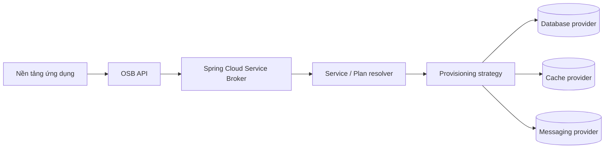
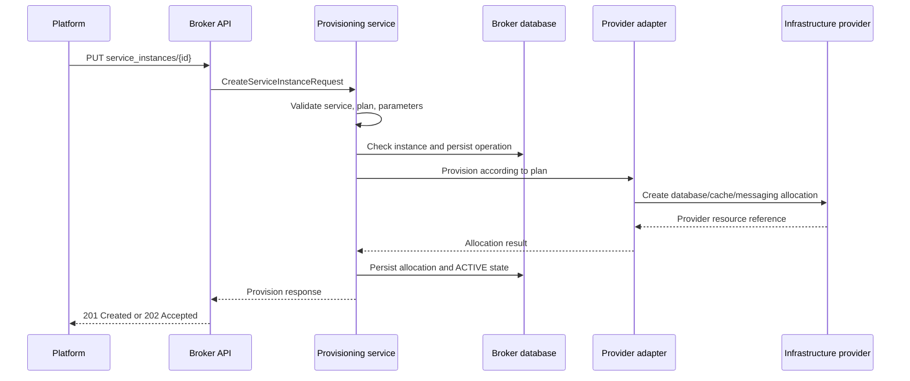
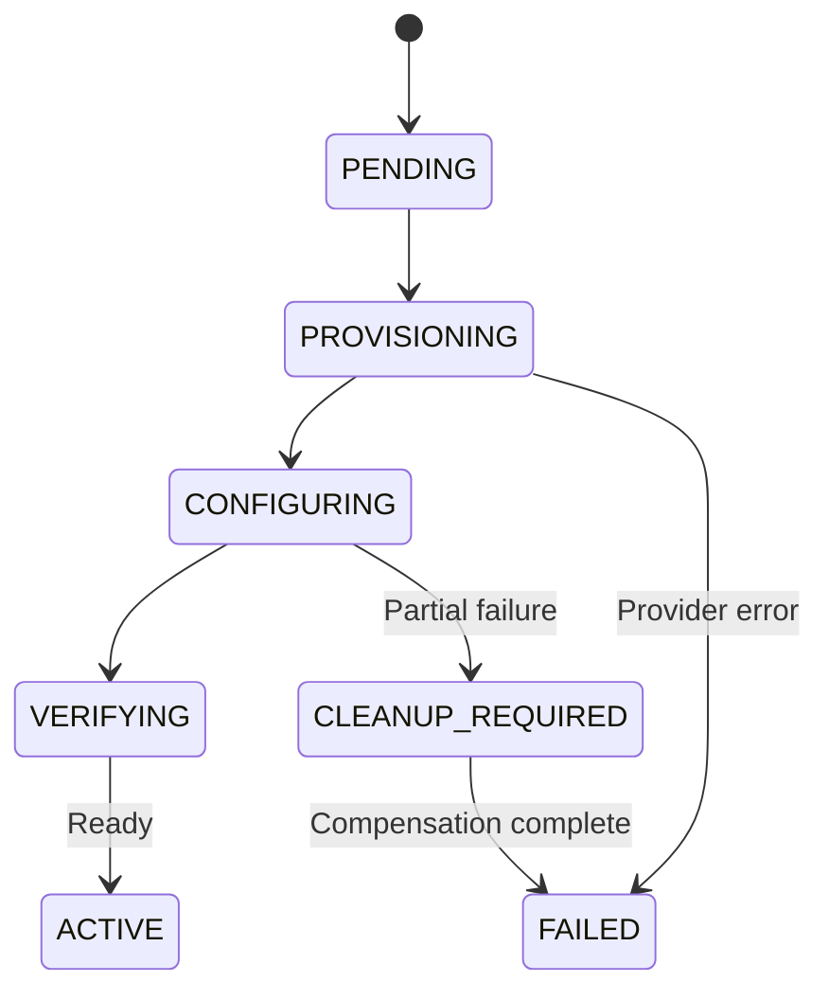
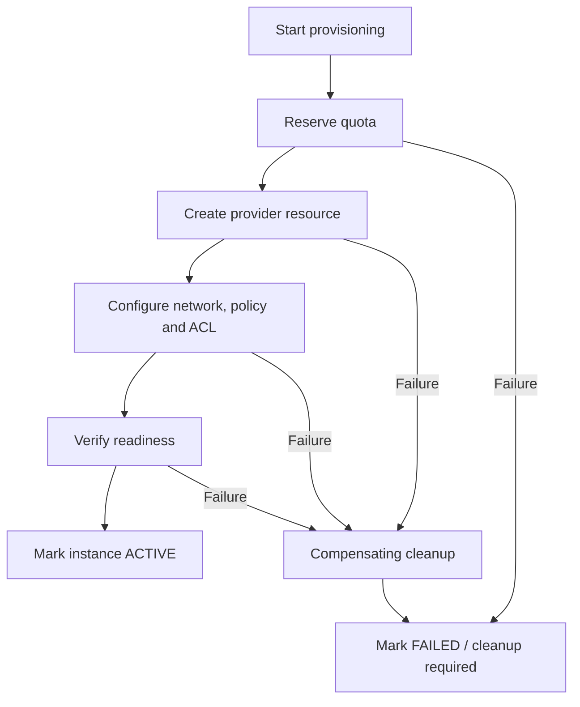

# Cấp phát cơ sở dữ liệu, bộ nhớ đệm hoặc dịch vụ nhắn tin qua broker

## 1. Vai trò của broker khi cấp phát dịch vụ hạ tầng

Service broker cung cấp một giao diện thống nhất để nền tảng yêu cầu tạo, cập nhật, binding và thu hồi dịch vụ. Người dùng chọn service và plan trong catalog; nền tảng gửi yêu cầu theo Open Service Broker API (OSB API); broker chuyển yêu cầu đó thành các thao tác cụ thể trên hệ thống hạ tầng.

Với module `SPRING_CLOUD_SERVICE_BROKER`, một broker có thể cung cấp nhiều loại dịch vụ như cơ sở dữ liệu quan hệ, bộ nhớ đệm và hệ thống nhắn tin. Mỗi loại dịch vụ có vòng đời và cách cấp phát khác nhau:

- Database có thể cần tạo database/schema, user, role, quyền, backup policy và endpoint kết nối.
- Cache có thể cần tạo logical database, key namespace, ACL user, quota và endpoint Redis hoặc cache provider.
- Messaging có thể cần tạo virtual host, exchange, queue, topic, subscription, credential, ACL và quota.

OSB API chuẩn hóa hợp đồng giữa nền tảng và broker. Nó không quy định broker phải tạo database, Redis instance hay Kafka topic bằng công nghệ nào. Broker chịu trách nhiệm ánh xạ service/plan sang provider phù hợp, xác thực tham số, quản lý trạng thái và bảo đảm tài nguyên được tạo đúng phạm vi.



Broker thường đóng vai trò control plane: tiếp nhận yêu cầu, điều phối provider, lưu mapping giữa service instance và tài nguyên thật, cấp credential qua binding và thu hồi tài nguyên khi deprovision. Ứng dụng sử dụng dịch vụ thông qua endpoint và credential do broker cấp; ứng dụng không cần biết chi tiết API quản trị của từng provider.

## 2. Ánh xạ service, plan và loại tài nguyên

Một service definition mô tả một sản phẩm dịch vụ. Các plan của service định nghĩa cấp tài nguyên hoặc tính năng. Broker sử dụng `service_id` và `plan_id` để chọn cấu hình nội bộ tương ứng.

Ví dụ catalog có thể cung cấp:

| Service | Plan | Tài nguyên hoặc đặc tính |
|---|---|---|
| `postgresql` | `starter` | Database logic trong shared PostgreSQL cluster, dung lượng và connection giới hạn. |
| `postgresql` | `isolated` | Managed PostgreSQL instance riêng, backup và cấu hình HA. |
| `redis-cache` | `basic` | Allocation logic trên shared Redis cluster, ACL và quota riêng. |
| `redis-cache` | `dedicated` | Redis deployment hoặc managed cache instance riêng. |
| `rabbitmq` | `standard` | Virtual host, user và queue/exchange trên shared RabbitMQ cluster. |
| `kafka` | `event-stream` | Topic, ACL, partition và quota trên Kafka cluster được quản lý. |

Các tên service và plan trên là ví dụ. Broker cần giữ ID ổn định vì các instance hiện hữu sẽ tiếp tục tham chiếu đến ID đó trong update, retrieve và deprovision.

OSB API không bắt buộc có một trường chuẩn tên `provider`, `resourceMode` hoặc `databaseEngine` trong plan. Những lựa chọn này thường nằm trong cấu hình nội bộ của broker. Có thể dùng metadata catalog để hiển thị đặc tính dịch vụ, nhưng không nên coi metadata tùy chỉnh là nguồn quyết định quyền cấp phát.

Ví dụ cấu hình nội bộ:

```yaml
servicePlans:
  postgresql:
    starter:
      resourceMode: SHARED
      provider: postgres-primary
      maxStorageMb: 10240
      maxConnections: 20
    isolated:
      resourceMode: DEDICATED
      provider: managed-postgres
      backupPolicy: daily
      highAvailability: true

  redis-cache:
    basic:
      resourceMode: SHARED
      provider: redis-general
      maxMemoryMb: 512
      maxConnections: 100

  rabbitmq:
    standard:
      resourceMode: SHARED
      provider: rabbitmq-primary
      maxQueues: 30
```

Đây là cấu hình ứng dụng broker, không phải cấu trúc JSON catalog bắt buộc. Không cho request từ nền tảng tự chọn provider hoặc nâng cấp resource mode ngoài plan. Broker phải tra cấu hình tin cậy theo `service_id` và `plan_id` đã được xác thực.

## 3. Request provisioning từ nền tảng

Nền tảng yêu cầu tạo service instance bằng:

```http
PUT /v2/service_instances/{instance_id}?accepts_incomplete=true HTTP/1.1
Host: broker.example.com
Authorization: Basic <broker-credentials>
X-Broker-API-Version: 2.17
Content-Type: application/json
Accept: application/json

{
  "service_id": "postgresql",
  "plan_id": "starter",
  "organization_guid": "org-01",
  "space_guid": "space-01",
  "parameters": {
    "database_name": "orders",
    "backup_enabled": true
  },
  "context": {
    "platform": "cloud-foundry",
    "organization_name": "commerce",
    "space_name": "production"
  }
}
```

Các dữ liệu chính:

- `instance_id` trong path là định danh do nền tảng cấp và được dùng xuyên suốt vòng đời instance.
- `service_id` và `plan_id` xác định sản phẩm và cấp dịch vụ.
- `organization_guid`, `space_guid` và `context` cung cấp ngữ cảnh consumer hoặc nền tảng nếu có.
- `parameters` chứa cấu hình bổ sung được broker cho phép, ví dụ tên database hoặc retention.
- `accepts_incomplete=true` cho biết nền tảng chấp nhận xử lý bất đồng bộ.

Broker phải kiểm tra mọi tham số ở server. JSON Schema trong catalog giúp nền tảng tạo biểu mẫu và kiểm tra dữ liệu sớm, nhưng không thay thế validation phía broker. Không nhận trực tiếp các trường tùy ý như `providerUrl`, `adminPassword`, `clusterAdmin` hoặc `resourceMode` nếu chúng cho phép caller vượt qua ranh giới plan hay quyền quản trị.

## 4. Quy trình provisioning tổng quát

Một quy trình provisioning có thể được chia thành các bước độc lập:

1. Xác thực broker client, phiên bản OSB API và request identity.
2. Tìm service definition và plan từ catalog registry.
3. Validate parameters, context, consumer và quota.
4. Kiểm tra `instance_id` để xử lý idempotency.
5. Tạo bản ghi instance và operation trong database broker.
6. Chọn provisioning strategy dựa trên service, plan và cấu hình nội bộ.
7. Gọi provider adapter để tạo allocation hoặc tài nguyên dedicated.
8. Lưu provider resource ID, allocation, trạng thái và thông tin vận hành.
9. Tạo hoặc tham chiếu credential an toàn để binding sau này.
10. Chuyển instance sang `ACTIVE` khi tài nguyên đã sẵn sàng và trả response OSB.



Sơ đồ mô tả đường đi tổng quát. Nếu provider cần nhiều bước hoặc thời gian dài, broker trả `202 Accepted` sau khi lưu operation bền vững và để worker hoàn tất công việc. Không trả `201 Created` khi dịch vụ chưa đạt điều kiện sẵn sàng mà broker đã cam kết.

## 5. Cấp phát cơ sở dữ liệu

Database provisioning tạo một database service instance có endpoint, cấu hình và chính sách truy cập riêng. Broker có thể dùng shared database cluster hoặc tạo managed database instance dedicated tùy plan.

### 5.1. Shared database

Trong mô hình shared, nhiều service instance dùng chung cluster hoặc database server nhưng mỗi instance cần phân vùng và quyền riêng. Ví dụ với PostgreSQL, broker có thể:

- Tạo database riêng cho mỗi instance hoặc schema riêng nếu mô hình sản phẩm cho phép.
- Tạo role/user riêng cho từng binding, không dùng chung superuser.
- Gán quyền tối thiểu trên database/schema tương ứng.
- Đặt giới hạn connection, storage hoặc workload theo plan.
- Áp dụng backup, encryption và audit theo chính sách chung của cluster.

```sql
CREATE DATABASE orders_inst_1001;
CREATE ROLE bind_inst_1001 LOGIN PASSWORD '<generated-secret>';
GRANT CONNECT ON DATABASE orders_inst_1001 TO bind_inst_1001;
```

Đây là ví dụ rút gọn. Trong production, broker cần kết nối bằng provider credential được bảo vệ, sinh secret an toàn, cấu hình quyền trên schema/object đúng phạm vi và xử lý việc cấp credential qua binding. Không đặt password thật trong source code hoặc log.

Shared cluster tiết kiệm chi phí và tăng mật độ sử dụng, nhưng cần quota và cô lập. Database riêng không tự động bảo đảm cách ly nếu user có quyền trên database khác hoặc nếu broker dùng credential quản trị chung cho ứng dụng.

### 5.2. Dedicated database

Với plan dedicated, broker có thể gọi cloud provider API để tạo managed database instance hoặc server riêng. Các bước thường gồm:

1. Kiểm tra quota vùng, loại instance và giới hạn tài khoản provider.
2. Tạo database resource với tag liên kết về `instance_id`.
3. Cấu hình network, subnet, firewall, TLS và encryption.
4. Cấu hình backup, retention, monitoring và HA nếu plan yêu cầu.
5. Chờ provider chuyển trạng thái sang `AVAILABLE` hoặc trạng thái sẵn sàng tương ứng.
6. Lưu resource ID, endpoint và thông tin kết nối không nhạy cảm.

Dedicated database có mức cô lập và khả năng điều chỉnh cao hơn, nhưng provisioning thường lâu hơn và tốn chi phí. Broker cần xử lý bất đồng bộ nếu thời gian tạo vượt quá giới hạn request HTTP.

### 5.3. Thông tin trả về qua binding

Provisioning tạo service instance và tài nguyên nền. Thông tin truy cập cho ứng dụng thường được cấp ở bước service binding. Binding có thể trả hostname, port, database name, username, password, CA certificate hoặc URI kết nối.

Không nên trả password hoặc API key trong response provisioning nếu hợp đồng service không yêu cầu. Credential nên được tạo theo binding để mỗi consumer có thể được thu hồi độc lập.

## 6. Cấp phát bộ nhớ đệm

Cache provisioning có thể tạo Redis, Valkey hoặc một dịch vụ cache tương đương. Broker cần phân biệt tài nguyên compute/cache server với namespace logic mà từng service instance sử dụng.

### 6.1. Shared cache

Với shared Redis cluster, mỗi instance có thể được cấp:

- ACL user riêng và password/token riêng.
- Key namespace hoặc prefix được quy định rõ.
- Giới hạn command, connection, memory hoặc throughput nếu provider hỗ trợ.
- TLS endpoint và chính sách network.
- Metadata để truy vết allocation về instance.

Redis logical database index hoặc key prefix không tự động tạo ranh giới bảo mật mạnh. Nếu dùng chung cluster cho nhiều tenant, broker cần ACL và quyền truy cập giới hạn ở mức provider hỗ trợ. Không để client của một instance có quyền đọc/ghi key của instance khác chỉ vì chúng cùng kết nối tới một Redis endpoint.

### 6.2. Dedicated cache

Plan cao cấp có thể cấp managed Redis instance hoặc cluster riêng. Broker tạo resource, cấu hình subnet/security group, TLS, backup nếu dịch vụ hỗ trợ, memory size, replica và failover. Khi provider sẵn sàng, broker lưu endpoint và resource ID; credential consumer vẫn được cấp ở binding.

### 6.3. Quota và eviction policy

Cache là tài nguyên có giới hạn và thường có eviction policy. Broker cần công bố hoặc mô tả giới hạn plan, ví dụ memory, connection, throughput và chính sách eviction. Không nên để một tenant chiếm hết memory của shared cluster.

Nếu plan cho phép tùy chỉnh eviction policy, broker phải validate giá trị trong allowlist và bảo đảm provider có thể áp dụng. Không nhận mọi giá trị cấu hình tự do từ request.

## 7. Cấp phát dịch vụ nhắn tin

Messaging provisioning phụ thuộc loại broker. RabbitMQ thường tổ chức tài nguyên quanh virtual host, exchange, queue, user và permission. Kafka thường tổ chức quanh topic, partition, ACL, quota và consumer group.

### 7.1. RabbitMQ

Với shared RabbitMQ cluster, một instance có thể nhận virtual host riêng, user riêng, permission giới hạn trong virtual host và quota theo chính sách. Broker có thể tạo exchange/queue mặc định hoặc để ứng dụng tạo theo quyền được cấp.

Ví dụ thao tác khái niệm:

```text
Create virtual host: /tenant-inst-1001
Create user: app_inst_1001
Set permissions:
  configure = ^app.*
  write     = ^app.*
  read      = ^app.*
```

Các biểu thức permission trên chỉ minh họa cách giới hạn tên resource; phải điều chỉnh theo naming convention và chính sách thực tế. Không cấp quyền quản trị toàn cluster cho consumer.

Với dedicated messaging plan, broker có thể tạo một RabbitMQ deployment hoặc managed cluster riêng, cấu hình node, storage, TLS, monitoring và backup. Đây là thao tác nặng và thường phù hợp với asynchronous provisioning.

### 7.2. Apache Kafka

Kafka provisioning thường tạo topic hoặc cấp quyền trên một cluster hiện hữu thay vì tạo cluster mới cho mọi service instance. Broker có thể:

- Tạo topic theo instance ID hoặc tenant namespace.
- Thiết lập partition và replication factor theo plan.
- Thiết lập retention và cleanup policy.
- Tạo principal hoặc credential riêng cho binding.
- Gán ACL cho topic và consumer group theo quyền tối thiểu.
- Thiết lập quota producer/consumer nếu cluster hỗ trợ.

Một binding Kafka có thể trả bootstrap servers, topic name, security protocol, username/password hoặc certificate reference. Không cấp quyền đọc/ghi mọi topic nếu ứng dụng chỉ cần một tập topic cụ thể.

### 7.3. Shared messaging và dedicated messaging

| Tiêu chí | Shared cluster | Dedicated cluster |
|---|---|---|
| Provisioning | Tạo vhost/topic/user/ACL hoặc namespace. | Tạo cluster hoặc deployment riêng. |
| Thời gian | Thường nhanh hơn. | Thường lâu hơn. |
| Cô lập | Dựa vào ACL, quota và namespace. | Có thể cô lập compute/network mạnh hơn. |
| Chi phí | Tối ưu khi nhiều tenant. | Cao hơn vì dành riêng tài nguyên. |
| Ảnh hưởng sự cố | Cluster chung có thể ảnh hưởng nhiều instance. | Có thể giới hạn phạm vi ảnh hưởng. |

Dù shared hay dedicated, broker vẫn phải quản lý credential riêng theo binding và thu hồi chúng khi unbind.

## 8. Kiến trúc provider adapter trong Spring

Không nên để service OSB gọi trực tiếp nhiều SDK cloud khác nhau. Hãy tách hợp đồng OSB khỏi chi tiết provider bằng application service và adapter.

Một cấu trúc có thể gồm:

```text
broker
  catalog
  serviceinstance
    ServiceInstanceService implementation
  application
    ProvisioningService
    PlanResolver
    ResourceProvisioningStrategy
  domain
    ServiceKind
    ResourceMode
    ProvisioningCommand
    ResourceAllocation
  infrastructure
    postgres
      PostgresProvisioningAdapter
    redis
      RedisProvisioningAdapter
    rabbitmq
      RabbitMqProvisioningAdapter
    kafka
      KafkaProvisioningAdapter
  persistence
    ServiceInstanceRepository
    OperationRepository
```

Ví dụ abstraction nội bộ:

```java
public interface ResourceProvisioningStrategy {
    ServiceKind serviceKind();

    ResourceMode resourceMode();

    Mono<ResourceAllocation> provision(ProvisioningCommand command);

    Mono<Void> deprovision(ResourceAllocation allocation);
}
```

Các kiểu `ServiceKind`, `ResourceMode`, `ProvisioningCommand` và `ResourceAllocation` là model do ứng dụng định nghĩa. Adapter cụ thể có thể dùng JDBC hoặc SDK provider, nhưng application service không cần biết chi tiết API của PostgreSQL, Redis, RabbitMQ hay Kafka.

Ví dụ chọn strategy:

```java
public Mono<ResourceAllocation> provision(ProvisioningCommand command) {
    ResourceProvisioningStrategy strategy = strategies.stream()
            .filter(candidate -> candidate.serviceKind() == command.serviceKind())
            .filter(candidate -> candidate.resourceMode() == command.resourceMode())
            .findFirst()
            .orElseThrow(() -> new IllegalArgumentException(
                    "No provisioning strategy for requested plan"));

    return strategy.provision(command);
}
```

Đây là mã minh họa cho tầng application, không phải API của Spring Cloud. Có thể đăng ký từng strategy thành Spring bean và inject danh sách qua constructor. Khi không có strategy phù hợp, broker phải từ chối request có kiểm soát thay vì tự chọn provider mặc định không an toàn.

## 9. Kết nối với ServiceInstanceService

Spring Cloud Open Service Broker cung cấp `ServiceInstanceService` để ứng dụng xử lý vòng đời service instance. Framework ánh xạ request HTTP OSB sang request model và gọi bean tương ứng.

Một phần implementation provisioning minh họa:

```java
import org.springframework.cloud.servicebroker.model.instance.CreateServiceInstanceRequest;
import org.springframework.cloud.servicebroker.model.instance.CreateServiceInstanceResponse;
import reactor.core.publisher.Mono;

@Override
public Mono<CreateServiceInstanceResponse> createServiceInstance(
        CreateServiceInstanceRequest request) {

    ProvisioningCommand command = ProvisioningCommand.from(request);

    return provisioningService.provision(command)
            .map(result -> CreateServiceInstanceResponse.builder()
                    .dashboardUrl(result.dashboardUrl())
                    .build());
}
```

Đây là phần thân phương thức trong bean triển khai `ServiceInstanceService`; các kiểu `ProvisioningService`, `ProvisioningCommand` và kết quả `result` do ứng dụng định nghĩa. Bean thực tế cần triển khai các phương thức vòng đời khác mà broker hỗ trợ. Implementation đầy đủ cần xử lý idempotency, lỗi nghiệp vụ và response bất đồng bộ.

Với thao tác cần chạy nền, broker lưu operation trước rồi trả response có `async(true)` và operation ID theo API của phiên bản thư viện. Không tạo task chỉ trong memory của request rồi trả `202`, vì task có thể mất khi process restart.

## 10. Xử lý bất đồng bộ và trạng thái operation

Tạo managed database, cache cluster hoặc messaging deployment có thể mất nhiều phút. OSB API hỗ trợ asynchronous provisioning thông qua query parameter `accepts_incomplete=true`.

- Nếu thao tác hoàn tất đồng bộ, broker trả `201 Created`.
- Nếu thao tác được tiếp nhận và chạy nền, broker trả `202 Accepted` cùng `operation` tùy chọn.
- Nếu thao tác bắt buộc bất đồng bộ nhưng client không chấp nhận, broker trả `422 Unprocessable Entity` với lỗi `AsyncRequired`.

Ví dụ response bất đồng bộ:

```http
HTTP/1.1 202 Accepted
Content-Type: application/json

{
  "operation": "provision-inst-1001"
}
```

Nền tảng polling:

```http
GET /v2/service_instances/inst-1001/last_operation?service_id=postgresql&plan_id=isolated&operation=provision-inst-1001 HTTP/1.1
```

Response last operation dùng `state` với các giá trị `in progress`, `succeeded` hoặc `failed`. Broker có thể có trạng thái nội bộ chi tiết hơn như `WAITING_FOR_PROVIDER`, `CREATING_DATABASE`, `CONFIGURING_ACL` hoặc `VERIFYING_ENDPOINT`, nhưng phải ánh xạ chúng về giá trị OSB API.



Operation phải được lưu bền vững để polling vẫn hoạt động khi worker restart hoặc request được xử lý bởi replica khác. Có thể dùng database operation store, message queue và transactional outbox để bảo đảm công việc không bị mất giữa lúc lưu trạng thái và publish event.

## 11. Idempotency và chống cấp phát trùng

Nền tảng có thể retry PUT khi response bị mất hoặc timeout. Provider cũng có thể đã tạo tài nguyên nhưng broker chưa nhận được response. Nếu không có idempotency, một instance có thể bị cấp hai database hoặc hai cache resource.

Các nguyên tắc:

- Dùng `instance_id` làm định danh nghiệp vụ chính cho provisioning.
- Đặt unique constraint cho instance ID trong phạm vi platform.
- Nếu request lặp có cùng service, plan và tham số có ý nghĩa, trả kết quả hoặc operation hiện tại.
- Nếu cùng instance ID nhưng service/plan hoặc tham số mâu thuẫn, trả `409 Conflict` theo hợp đồng phù hợp.
- Lưu operation và provider idempotency key trước khi gọi provider.
- Nếu provider không hỗ trợ idempotency key, gắn tag theo instance ID và tra cứu tài nguyên trước khi tạo lại.
- Không sinh tên tài nguyên ngẫu nhiên mới cho mỗi lần retry.
- Với shared resource, reservation capacity phải nguyên tử để tránh cấp vượt quota khi có request đồng thời.

Ví dụ tên tài nguyên có thể được tạo ổn định từ instance ID và một suffix an toàn:

```text
database: broker_inst_1001
redis-acl-user: bind_inst_1001_a
rabbit-vhost: /broker-inst-1001
kafka-topic-prefix: broker.inst.1001
```

Tên thực tế cần tuân thủ giới hạn ký tự, độ dài và quy tắc naming của provider. Không đưa trực tiếp chuỗi chưa validate từ client vào tên resource hoặc lệnh quản trị.

## 12. Transaction, saga và compensation

Provisioning một dịch vụ thường gồm nhiều hệ thống không tham gia cùng một database transaction. Ví dụ tạo database thành công nhưng cấu hình backup thất bại; tạo RabbitMQ vhost thành công nhưng tạo user thất bại. Broker không thể dùng một transaction SQL duy nhất để rollback tất cả provider.

Hãy mô hình hóa provisioning như một saga gồm các bước có trạng thái:



Ví dụ compensation:

| Bước đã thực hiện | Bước bù khi provisioning thất bại |
|---|---|
| Reserve quota | Release reservation. |
| Create database | Drop database nếu đã xác minh đúng instance và chưa có dữ liệu cần giữ. |
| Create database user | Revoke credential và drop user. |
| Create Redis ACL user | Disable/delete ACL user. |
| Create RabbitMQ vhost | Xóa vhost nếu không có resource khác sử dụng. |
| Create Kafka topic | Xóa topic chỉ khi chính sách và ownership cho phép; nếu không, chuyển sang cleanup workflow. |

Compensation cũng phải idempotent. Nếu không thể cleanup ngay, ghi `CLEANUP_REQUIRED`, lưu resource ID và đưa vào hàng đợi retry/reconciliation. Không xóa operation record chỉ vì provisioning thất bại.

## 13. Quản lý credential và service binding

Provisioning tạo tài nguyên service instance; binding cấp quyền sử dụng cho một consumer cụ thể. Hai vòng đời này nên tách biệt.

Ví dụ database instance có thể được nhiều ứng dụng binding. Mỗi binding nhận username/password riêng với quyền cần thiết. Khi một ứng dụng unbind, broker revoke credential của ứng dụng đó nhưng giữ database và credential của các ứng dụng khác.

Với cache, binding có thể cấp ACL user và key permissions. Với RabbitMQ, binding có thể cấp user/password cùng virtual host và permission. Với Kafka, binding có thể cấp principal, certificate hoặc SASL credential và ACL cho topic/consumer group.

Credential cần được:

- Sinh bằng bộ tạo số ngẫu nhiên mật mã an toàn.
- Lưu trong secret manager hoặc kho được mã hóa.
- Trả qua binding response theo hợp đồng.
- Không ghi vào log, metric label hoặc operation description.
- Thu hồi khi unbind và rotate theo chính sách.
- Giới hạn quyền theo instance, binding và plan.

Không trả provider admin credential cho ứng dụng. Broker dùng credential quản trị ở adapter; consumer chỉ nhận credential riêng có phạm vi truy cập tối thiểu.

## 14. Deprovisioning và cleanup theo loại provider

Khi nền tảng xóa service instance, broker cần thu hồi đúng tài nguyên đã tạo:

- Database: xóa database/schema, role, backup hoặc snapshot theo retention policy và giải phóng quota.
- Cache: xóa ACL user, namespace hoặc allocation; chỉ xóa dedicated cache resource khi thuộc instance.
- RabbitMQ: revoke user, xóa permission và vhost/queue thuộc instance.
- Kafka: revoke principal/ACL, xử lý topic theo chính sách dữ liệu và retention.

Không xóa shared cluster khi chỉ một instance bị deprovision. Với Kafka, xóa topic có thể làm mất dữ liệu và không thể khôi phục; cần xác định retention và chính sách xóa rõ ràng. Với database, cần phân biệt xóa instance với giữ snapshot theo yêu cầu backup.

Deprovision có thể bất đồng bộ. Broker lưu operation, trả `202 Accepted` nếu client chấp nhận, sau đó cung cấp trạng thái qua last operation. Nếu provider resource đã bị xóa ngoài luồng, adapter cần xác minh ownership và coi bước xóa đã hoàn tất khi provider xác nhận resource không còn tồn tại; vẫn tiếp tục dọn credential, ACL và tài nguyên phụ.

## 15. Bảo mật và cô lập tenant

Broker có quyền quản trị tài nguyên hạ tầng nên là thành phần có đặc quyền cao. Một lỗi trong mapping hoặc authorization có thể làm lộ dữ liệu giữa các tenant.

Các biện pháp quan trọng:

- Xác thực nền tảng bằng cơ chế broker authentication đã cấu hình và dùng HTTPS.
- Xác minh `instance_id`, service ID, plan ID và platform context ở server.
- Chỉ cho phép plan chọn provider/resource mode đã được cấu hình.
- Dùng provider credential có quyền tối thiểu, tách theo môi trường hoặc tài khoản khi phù hợp.
- Áp dụng ACL, RBAC, network policy và quota cho từng instance/binding.
- Mã hóa dữ liệu khi truyền và khi lưu; quản lý secret qua secret manager.
- Không log password, token, private key hoặc toàn bộ request parameters nếu có dữ liệu nhạy cảm.
- Gắn tag ownership để đối soát resource, nhưng không đặt secret hoặc dữ liệu cá nhân trong tag.
- Ghi audit cho create, update, bind, unbind và delete.

Không dùng `organization_name`, `space_name` hoặc tên tenant do client gửi làm căn cứ duy nhất để phân quyền. Ưu tiên ID ổn định từ context đã xác thực và kiểm tra theo trust boundary của nền tảng.

## 16. Quan sát và vận hành

Broker cần cung cấp metric và log để người vận hành biết provisioning đang chậm ở bước nào và provider nào đang gặp sự cố.

Các metric hữu ích:

- Số instance theo service, plan, provider và trạng thái.
- Tỷ lệ provisioning thành công/thất bại.
- Thời gian provisioning p50/p95/p99 theo plan và provider.
- Số operation `IN_PROGRESS` quá thời hạn.
- Số lần retry và compensation.
- Capacity/quota còn lại của shared pool.
- Số tài nguyên provider không có broker record hoặc allocation.
- Số cleanup pending và resource drift được phát hiện.

Log nên gắn `instance_id`, `operation_id`, service ID, plan ID và provider resource ID đã được kiểm soát. Dùng trace ID hoặc request identity để nối các bước giữa API, worker và provider adapter. Không dùng instance ID hoặc tenant ID làm metric label có cardinality không giới hạn nếu hệ thống giám sát không chịu được.

Reconciliation định kỳ có thể so sánh broker record với tài nguyên provider, phát hiện resource mồ côi, allocation mất mapping, credential chưa revoke hoặc quota bị kẹt. Job này cần giới hạn concurrency, tôn trọng API rate limit và có cơ chế tránh hai worker cùng xử lý một allocation.

## 17. Kiểm thử provisioning qua broker

Kiểm thử nên bao phủ từng loại provider và toàn bộ vòng đời:

| Nhóm kiểm thử | Nội dung |
|---|---|
| Catalog/plan mapping | Service ID và plan ID chọn đúng provider strategy. |
| Parameter validation | Tên database, memory, retention, topic và quota nằm trong giới hạn. |
| Database | Database/schema/user được tạo; quyền chỉ đúng phạm vi; endpoint sẵn sàng. |
| Cache | ACL user, key namespace, memory và connection quota đúng plan. |
| Messaging | Vhost/topic, ACL, partition, queue và retention được cấu hình đúng. |
| Shared isolation | Instance A không đọc/ghi tài nguyên của instance B. |
| Dedicated lifecycle | Provider resource được tạo và thu hồi đúng ID. |
| Idempotency | Retry cùng instance ID không tạo resource trùng. |
| Async | `202` có operation; last operation chuyển đúng state và kết thúc đúng lúc. |
| Partial failure | Compensation dọn được các bước đã tạo hoặc lưu cleanup pending. |
| Binding | Credential riêng được cấp và thu hồi độc lập. |
| Deprovision | Không xóa shared cluster hoặc dữ liệu ngoài phạm vi instance. |
| Security | Secret không xuất hiện trong response sai phạm vi hoặc log. |
| Reconciliation | Phát hiện resource mồ côi và operation bị kẹt. |

Nên có unit test cho plan resolver và strategy selector, adapter test với provider giả lập, integration test cho service interface OSB và contract test cho HTTP endpoint. Test với provider thật nên dùng môi trường sandbox, quota giới hạn và dữ liệu không nhạy cảm.

## 18. Checklist trước khi đưa broker vào production

1. Catalog mô tả đúng service, plan, bindable và các capability đã triển khai.
2. Service/plan ID ổn định và ánh xạ đến cấu hình nội bộ có kiểm soát.
3. Mọi parameters được validate ở server; không cho caller tự chọn quyền quản trị hoặc provider tùy ý.
4. Có provider adapter riêng cho database, cache và messaging.
5. Shared resource có ACL, quota, reservation nguyên tử và ownership rõ ràng.
6. Dedicated resource có tag, resource ID, network, encryption và backup policy.
7. Provisioning ghi instance/operation trước khi gọi provider.
8. Xử lý bất đồng bộ đúng `accepts_incomplete`, `202`, `operation` và last operation.
9. Idempotency và compensation xử lý retry, timeout và lỗi một phần.
10. Credential chỉ được cấp qua binding và được lưu trong secret manager.
11. Unbind và deprovision chỉ thu hồi tài nguyên đúng ownership.
12. Có metric, audit, alert và reconciliation cho tài nguyên drift.
13. Kiểm thử cả shared/dedicated, database/cache/messaging và các tình huống provider lỗi.

## 19. Nguyên tắc cần ghi nhớ

- OSB API chuẩn hóa giao tiếp nền tảng-broker; broker chịu trách nhiệm chuyển service/plan thành tài nguyên hạ tầng thật.
- Database, cache và messaging có mô hình allocation khác nhau, không nên dùng một lệnh provisioning chung thiếu chính sách riêng.
- Service plan là đầu vào để broker chọn shared/dedicated mode, provider và quota từ cấu hình tin cậy.
- Spring Cloud `ServiceInstanceService` tiếp nhận vòng đời instance; application service và provider adapter thực hiện nghiệp vụ hạ tầng.
- Tài nguyên phải được kiểm tra quyền, cô lập tenant và gắn mapping với `instance_id`.
- Tác vụ dài cần operation bền vững, `202 Accepted`, last operation và worker có thể phục hồi.
- Idempotency, saga, compensation và reconciliation giúp broker xử lý timeout, retry và lỗi một phần.
- Credential consumer thuộc vòng đời binding; provider admin credential không được trả cho ứng dụng.
- Deprovision phải xóa đúng allocation, giữ shared infrastructure và tuân thủ chính sách dữ liệu.

Khi tách rõ hợp đồng OSB, cấu hình plan, provisioning strategy và provider adapter, một Spring Cloud Service Broker có thể cung cấp database, cache và messaging qua cùng một giao diện trong khi vẫn giữ được quyền kiểm soát về tài nguyên, bảo mật và vòng đời.
