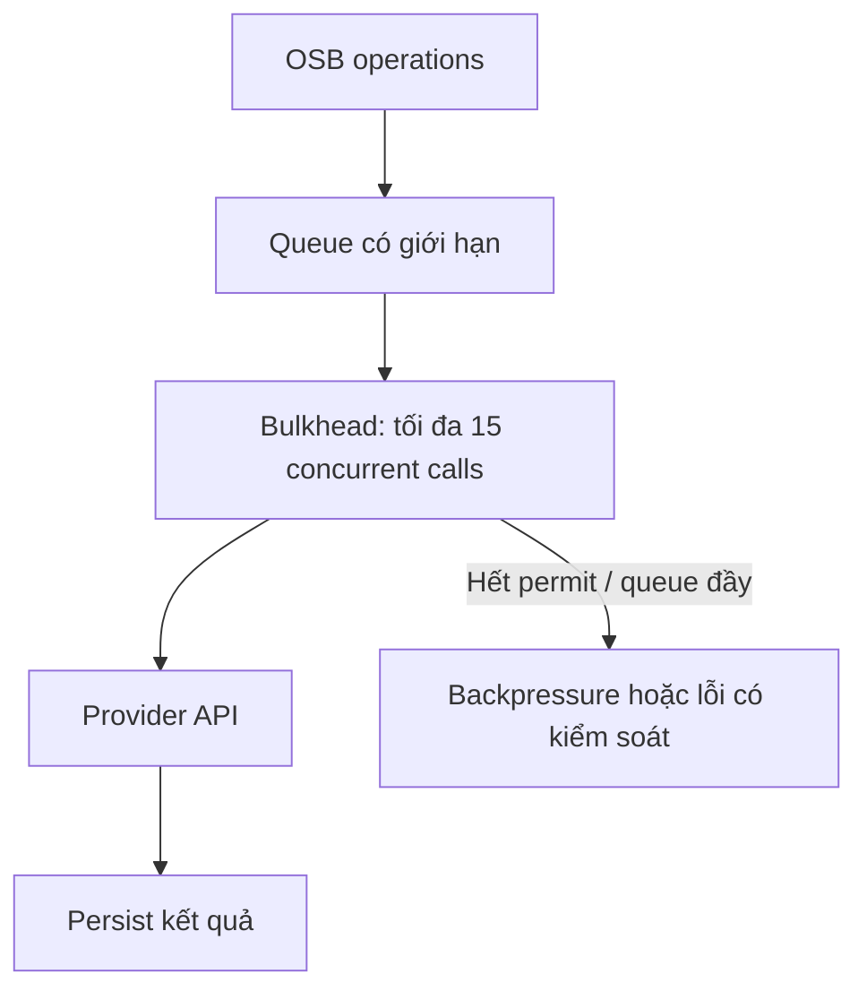
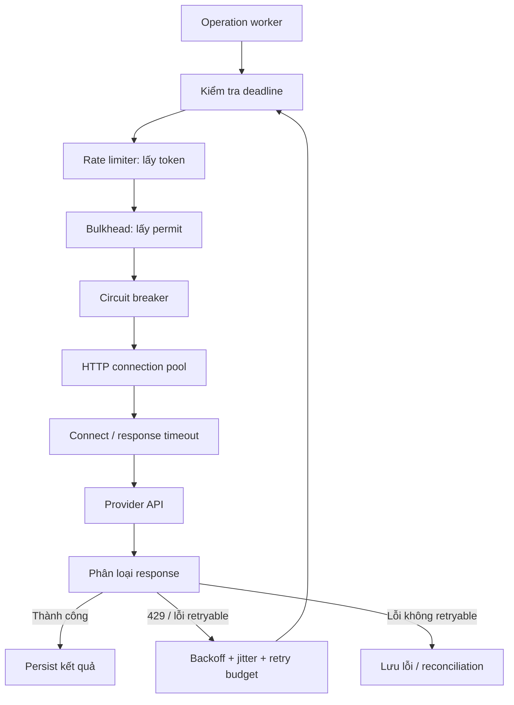

# Thiết lập thời gian chờ, giới hạn đồng thời và giới hạn tần suất gọi API

## Vì sao broker phải kiểm soát lời gọi đến hạ tầng?

Service broker là lớp điều phối giữa nền tảng và các hệ thống cung cấp dịch vụ. Khi nhận yêu cầu provision, update, bind, unbind hoặc deprovision, broker thường gọi một hay nhiều API phía sau để tạo database, cấp credential, cấu hình network, mở rộng cluster hoặc giải phóng tài nguyên.

Các API provider có giới hạn về thời gian xử lý, số kết nối, số request đồng thời và số request trong một khoảng thời gian. Nếu broker không kiểm soát các giới hạn này, một đợt triển khai nhiều ứng dụng có thể tạo ra hàng nghìn lời gọi đồng thời, làm cạn connection pool, vượt quota của provider hoặc khiến worker bị treo chờ quá lâu. Một provider chậm cũng có thể kéo theo hàng đợi operation tăng liên tục và ảnh hưởng đến các dịch vụ khác.

Trong module `SPRING_CLOUD_SERVICE_BROKER`, ứng dụng xây dựng theo Open Service Broker API (OSB API) bằng Spring Cloud Open Service Broker. Framework hỗ trợ lớp giao thức; phần tích hợp hạ tầng vẫn cần chính sách rõ ràng cho ba nhóm giới hạn:

- **Timeout:** một lời gọi được phép chờ bao lâu trước khi kết luận không nhận được kết quả trong thời hạn.
- **Concurrency limit / bulkhead:** có tối đa bao nhiêu lời gọi hoặc workflow được chạy cùng lúc.
- **Rate limit:** trong một đơn vị thời gian, broker được phép gửi bao nhiêu request đến provider.

Ba giới hạn này giải quyết các vấn đề khác nhau và cần phối hợp. Timeout không giới hạn số request đang chạy; concurrency limit không bảo đảm quota theo phút; rate limit không ngăn một request bị treo chiếm connection trong thời gian dài.

## Phân biệt timeout, concurrency và rate limit

| Cơ chế | Giới hạn điều gì? | Ví dụ | Khi vượt giới hạn |
|---|---|---|---|
| Timeout | Thời gian chờ một bước hoặc toàn bộ workflow. | API tạo database phải phản hồi trong 8 giây. | Hủy/chấm dứt việc chờ theo chính sách và xử lý kết quả chưa xác định. |
| Concurrency limit | Số công việc đang thực thi đồng thời. | Tối đa 20 request đến PostgreSQL control plane. | Chờ slot trong giới hạn hoặc từ chối/đưa vào queue. |
| Rate limit | Số request trong một khoảng thời gian. | Tối đa 120 request mỗi phút cho một provider account. | Chờ token, điều chỉnh lịch gọi hoặc xử lý `429 Too Many Requests`. |
| Connection pool limit | Số kết nối mạng được giữ hoặc sử dụng. | Tối đa 50 kết nối HTTP đến một provider. | Request chờ lấy connection hoặc thất bại khi hết thời gian chờ pool. |
| Circuit breaker | Có tiếp tục gọi dependency đang lỗi hay không. | Tạm ngừng gọi provider khi tỷ lệ lỗi vượt ngưỡng. | Mở circuit và trả lỗi nhanh hoặc đưa operation vào retry/reconciliation phù hợp. |

Connection pool limit và circuit breaker bổ sung cho ba cơ chế chính. Chúng không thay thế timeout, bulkhead hay rate limiter.

## Thiết kế timeout theo nhiều lớp

Một lời gọi HTTP đến provider có thể chờ ở nhiều giai đoạn. Không nên chỉ đặt một timeout chung rồi giả định mọi loại chờ đều được kiểm soát.

| Loại timeout | Phạm vi | Ý nghĩa |
|---|---|---|
| Connection timeout | Thiết lập kết nối TCP/TLS. | Giới hạn thời gian kết nối đến host provider. |
| Connection-pool acquire timeout | Chờ lấy một connection từ pool. | Ngăn request chờ vô hạn khi pool đã hết slot. |
| Response/read timeout | Chờ response hoặc dữ liệu từ provider. | Giới hạn thời gian provider phản hồi theo cấu hình client. |
| Per-attempt timeout | Một lần gọi provider, bao gồm các bước được quy định trong client. | Giới hạn mỗi lần thử riêng lẻ. |
| Workflow deadline | Toàn bộ operation gồm queue, retry và nhiều provider call. | Bảo đảm operation không vượt quá ngân sách thời gian đã định. |

Các timeout cần có quan hệ hợp lý. Ví dụ, nếu workflow có deadline 30 giây, không thể cho một lần gọi provider chờ 45 giây rồi mới bắt đầu retry. Ngược lại, đặt response timeout quá thấp có thể làm broker kết luận timeout trong khi provider thường hoàn tất ngay sau đó, dẫn đến nhiều retry không cần thiết.

### Xây dựng timeout budget

Timeout budget là tổng thời gian tối đa dành cho các bước trong một operation. Có thể phân bổ như sau:

```text
workflow deadline:          30 giây
  chờ queue:                  3 giây
  provider call lần 1:        8 giây
  backoff:                    2 giây
  provider call lần 2:        8 giây
  persist/reconcile:          5 giây
  phần dự phòng:              4 giây
```

Đây chỉ là ví dụ phân bổ. Thời gian thực tế cần dựa trên latency phân vị của provider, thời gian queue, số bước workflow và giới hạn của nền tảng. Với nhiều provider call nối tiếp, deadline còn lại phải được truyền xuống từng bước thay vì mỗi bước tự dùng lại timeout tối đa ban đầu.

Một công thức đơn giản:

\[
T_{remaining}=T_{deadline}-T_{now}
\]

Timeout của lần gọi tiếp theo không được vượt quá thời gian còn lại:

\[
T_{attempt}=\min(T_{configured},T_{remaining})
\]

Khi `T_remaining` không còn đủ cho một lần gọi hợp lệ và xử lý kết quả, workflow cần kết thúc theo chính sách timeout hoặc chuyển sang reconciliation. Không khởi động retry mới khi đã hết deadline.

### Timeout HTTP và timeout operation OSB API

Timeout của một HTTP request từ broker đến provider khác với thời lượng operation mà nền tảng theo dõi qua OSB API.

- **Provider request timeout:** giới hạn một lần gọi API từ broker đến provider.
- **Worker/workflow deadline:** giới hạn thời gian xử lý nội bộ của operation, gồm queue, các lần gọi và backoff.
- **Platform polling duration:** khoảng thời gian nền tảng tiếp tục gọi `last_operation` sau khi broker trả `202 Accepted`.

Nếu thao tác provision có thể kéo dài hơn thời gian một request HTTP phù hợp, broker có thể tiếp nhận theo mô hình bất đồng bộ khi nền tảng gửi `accepts_incomplete=true`. Broker trả `202 Accepted` sau khi lưu operation/job bền vững, còn worker tiếp tục xử lý và nền tảng polling `last_operation`. Việc chuyển sang async không có nghĩa provider call được phép chạy vô hạn; worker vẫn cần timeout, deadline và cơ chế phục hồi.

## Cấu hình timeout cho WebClient và Reactor Netty

Với ứng dụng Spring WebFlux hoặc thành phần tích hợp dùng `WebClient`, có thể cấu hình Reactor Netty `HttpClient` để đặt giới hạn kết nối, chờ connection pool và response. API cụ thể có thể thay đổi theo phiên bản Spring Boot/Reactor Netty; hãy dùng phiên bản được dependency management của dự án quản lý.

Ví dụ cấu hình:

```java
@Configuration
public class ProviderHttpClientConfiguration {

    @Bean
    WebClient providerWebClient() {
        ConnectionProvider pool = ConnectionProvider.builder("provider-pool")
                .maxConnections(40)
                .pendingAcquireMaxCount(80)
                .pendingAcquireTimeout(Duration.ofSeconds(2))
                .build();

        HttpClient httpClient = HttpClient.create(pool)
                .option(ChannelOption.CONNECT_TIMEOUT_MILLIS, 2_000)
                .responseTimeout(Duration.ofSeconds(8));

        return WebClient.builder()
                .clientConnector(new ReactorClientHttpConnector(httpClient))
                .build();
    }
}
```

Trong ví dụ:

- `maxConnections` giới hạn connection pool.
- `pendingAcquireMaxCount` giới hạn số request chờ lấy connection.
- `pendingAcquireTimeout` giới hạn thời gian chờ connection.
- `CONNECT_TIMEOUT_MILLIS` giới hạn thời gian thiết lập kết nối.
- `responseTimeout` giới hạn thời gian chờ response theo semantics của Reactor Netty.

Connection pool không phải concurrency limiter hoàn chỉnh. Một request có thể thực hiện nhiều lần gọi hoặc nhiều loại công việc không giữ connection; vì vậy vẫn cần bulkhead riêng ở tầng provider adapter hoặc operation coordinator. Cũng cần cân nhắc cấu hình TLS, proxy, DNS và connection eviction theo môi trường thực tế.

Có thể đặt timeout cho một publisher ở tầng ứng dụng:

```java
Mono<ProviderResource> createResource(CreateRequest request,
                                      Duration remaining) {
    return providerWebClient.post()
            .uri("/resources")
            .bodyValue(request)
            .retrieve()
            .bodyToMono(ProviderResource.class)
            .timeout(remaining);
}
```

`Mono.timeout` giới hạn thời gian chờ publisher ở tầng Reactor. Nó không chứng minh provider đã hủy side effect khi timeout xảy ra. Request có thể đã tới provider và được xử lý dù phía broker đã ngừng chờ. Với thao tác tạo/cập nhật/xóa, cần idempotency key và reconciliation trước khi phát lệnh lại.

## Giới hạn đồng thời bằng bulkhead

Bulkhead giới hạn số công việc đồng thời để một dependency chậm không chiếm toàn bộ tài nguyên của broker. Có thể dùng semaphore bulkhead, thread-pool bulkhead hoặc giới hạn concurrency trong reactive pipeline.

Ví dụ, provider A chỉ chịu được 15 request đồng thời. Broker đặt semaphore với 15 permit cho adapter của provider A. Khi tất cả permit đang được sử dụng, request mới phải chờ trong một hàng đợi có giới hạn hoặc bị từ chối sớm.



### Semaphore bulkhead

Semaphore bulkhead giới hạn số lời gọi đang chạy mà không cần tạo thread pool riêng. Ví dụ dùng Resilience4j:

```java
BulkheadConfig config = BulkheadConfig.custom()
        .maxConcurrentCalls(15)
        .maxWaitDuration(Duration.ofMillis(200))
        .build();

Bulkhead bulkhead = Bulkhead.of("provider-a", config);
```

Khi tích hợp với Reactor, dùng adapter/operator tương ứng của Resilience4j để áp dụng bulkhead vào publisher. Cú pháp cụ thể phụ thuộc phiên bản Resilience4j. Nếu không có permit trong thời gian chờ, broker nhận lỗi bulkhead và có thể đưa operation vào retry có giới hạn hoặc trả lỗi tạm thời theo ngữ cảnh.

### Giới hạn theo từng provider và từng tenant

Không nên dùng một semaphore toàn cục cho mọi provider nếu các provider có năng lực khác nhau. Nên phân bổ theo dependency:

| Phạm vi | Ví dụ giới hạn | Mục tiêu |
|---|---:|---|
| Provider PostgreSQL control plane | 15 concurrent calls | Bảo vệ API quản lý database. |
| Provider object storage | 30 concurrent calls | Tận dụng năng lực API storage riêng. |
| Provider Kubernetes API | 20 concurrent calls | Tránh tạo áp lực quá lớn lên API server. |
| Một tenant lớn | 5 concurrent operations | Ngăn một tenant chiếm hết capacity. |

Các con số chỉ là ví dụ. Broker cần xác định quota provider, năng lực worker, connection pool và yêu cầu fairness. Có thể kết hợp giới hạn toàn provider với giới hạn theo tenant để bảo vệ cả dependency lẫn các khách hàng dùng chung broker.

## Rate limiting và quota của provider

Rate limiter giới hạn số request được phép bắt đầu trong một khoảng thời gian. Ví dụ, provider cho phép 600 request mỗi 5 phút trên một account. Broker cần duy trì bộ đếm hoặc token bucket tương ứng để không vượt quota.

Một số thuật toán thường dùng:

| Thuật toán | Cách hoạt động | Đặc điểm |
|---|---|---|
| Fixed window | Đếm request trong từng cửa sổ thời gian cố định. | Đơn giản nhưng có thể tạo burst ở ranh giới hai cửa sổ. |
| Sliding window | Tính số request trong cửa sổ trượt. | Phản ánh quota mượt hơn nhưng tốn trạng thái hơn. |
| Token bucket | Token được nạp đều đến một mức tối đa; mỗi request tiêu thụ token. | Cho phép burst có giới hạn và kiểm soát tốc độ trung bình. |
| Leaky bucket | Request được phát ra với tốc độ tương đối ổn định. | Làm phẳng burst, phù hợp khi provider cần tải đều. |

Token bucket là lựa chọn phổ biến khi provider cho phép một tốc độ trung bình và một burst tối đa. Ví dụ:

```text
refill rate: 10 tokens/second
bucket capacity: 30 tokens
cost per API request: 1 token
```

Broker có thể gửi ngay tối đa 30 request nếu bucket đầy; sau đó tốc độ dài hạn bị giới hạn khoảng 10 request mỗi giây. Đây chỉ là ví dụ thuật toán, không phải quota thực của một provider cụ thể.

### Rate limit cần dùng chung khi broker chạy nhiều replica

Nếu mỗi replica giữ một bộ đếm trong bộ nhớ, tổng tốc độ có thể vượt quota provider. Ví dụ bốn replica, mỗi replica cho phép 10 request/giây, có thể cùng gửi khoảng 40 request/giây đến một account dù quota chỉ là 10.

Với quota dùng chung, cần một nguồn điều phối chung như Redis, database có atomic update hoặc một dịch vụ rate limit tập trung. Việc lấy và tiêu thụ token phải nguyên tử để hai replica không cùng dùng một token. Nếu provider quota được chia theo API key, account, project hoặc endpoint, key phân vùng limiter phải phản ánh đúng phạm vi quota đó.

Rate limit theo provider account có thể kết hợp với rate limit theo tenant:

- Limiter provider bảo đảm broker không vượt quota tổng.
- Limiter tenant bảo đảm một khách hàng không tiêu thụ hết quota chung.
- Limiter endpoint có thể tách API đắt như create cluster khỏi API đọc trạng thái nhẹ.

## Xử lý `429 Too Many Requests` và `Retry-After`

Provider có thể trả `429 Too Many Requests` khi broker vượt quota. Một số provider gửi header `Retry-After` hoặc header quota riêng để chỉ ra thời điểm có thể thử lại.

Broker nên:

1. Đọc `Retry-After` theo định dạng mà provider hỗ trợ (số giây hoặc HTTP-date nếu được quy định).
2. Đặt thời gian chờ retry không sớm hơn chỉ dẫn của provider.
3. Kết hợp với exponential backoff và jitter để tránh nhiều worker cùng retry tại một thời điểm.
4. Giới hạn số lần retry và tổng thời gian theo workflow deadline.
5. Nếu hết deadline hoặc retry budget, chuyển operation sang trạng thái lỗi/reconciliation phù hợp.
6. Ghi nhận quota scope, endpoint và mã request của provider để điều tra.

Ví dụ backoff lũy thừa có jitter:

\[
T_n=\min(T_{max},T_{base}\times 2^n)+J
\]

Trong đó `J` là jitter ngẫu nhiên trong một khoảng được chọn. Nếu provider gửi `Retry-After`, thời gian chờ cần tôn trọng giá trị đó; không lấy một backoff ngắn hơn để gọi sớm. Cũng không được retry vô hạn khi provider tiếp tục trả `429`.

Không phải mọi lỗi `4xx` đều có thể retry. `400`, `401`, `403` hoặc lỗi validation thường cần sửa request/quyền trước; retry liên tục chỉ làm tăng tải. `429` là tín hiệu throttling; `5xx` hoặc lỗi mạng có thể retry có điều kiện nếu thao tác an toàn và còn deadline.

## Kết hợp timeout, bulkhead, rate limiter và circuit breaker

Một request provider nên đi qua các lớp bảo vệ theo trình tự được thiết kế nhất quán:

1. Xác thực operation và kiểm tra deadline còn lại.
2. Xin token từ rate limiter để bảo đảm tốc độ gọi.
3. Lấy permit bulkhead để giới hạn số lời gọi đang chạy.
4. Lấy connection từ pool trong thời gian chờ cho phép.
5. Thực hiện HTTP request với connect/response timeout.
6. Phân loại response và chỉ retry khi an toàn, còn retry budget.
7. Persist kết quả và giải phóng permit/tài nguyên.

Circuit breaker có thể bao quanh lời gọi provider để ngăn tiếp tục gọi dependency đang lỗi liên tục. Khi circuit mở, broker không nên gửi request mới đến provider cho đến khi trạng thái cho phép thử lại. Circuit breaker không thay thế rate limiter: một provider khỏe mạnh vẫn có thể giới hạn quota thấp, còn một provider đang lỗi có thể cần circuit breaker dù request rate thấp.



Thứ tự triển khai cụ thể phụ thuộc thư viện và loại limiter. Cần bảo đảm permit không bị giữ trong lúc chờ rate token quá lâu; nếu lấy bulkhead trước rate token, request có thể chiếm slot đồng thời trong khi chưa được phép gọi. Có thể lấy rate token trước, sau đó lấy permit ngay trước HTTP call. Khi permit không sẵn có, không nên giữ token vô ích quá lâu; thiết kế có thể hoàn token hoặc đặt hai bước trong một admission controller có giới hạn.

## Backpressure và hàng đợi có giới hạn

Giới hạn đồng thời chỉ có tác dụng nếu lượng công việc chờ cũng được kiểm soát. Một queue không giới hạn có thể làm bộ nhớ tăng vô hạn khi provider chậm. Nên đặt:

- Số operation tối đa đang chờ theo provider.
- Thời gian tối đa một operation được nằm trong queue.
- Số worker tối đa xử lý mỗi loại provider.
- Chính sách từ chối hoặc trả lỗi tạm thời khi queue đầy.
- Cơ chế ưu tiên hoặc fairness giữa provision, update và deprovision.

Deprovision có thể cần ưu tiên để giải phóng tài nguyên và chi phí; tuy nhiên không nên làm đói các operation khác. Cần xác định chính sách dựa trên SLA và tác động nghiệp vụ. Khi broker trả `202 Accepted`, job phải được lưu bền vững trước khi xác nhận tiếp nhận; nếu queue đang quá tải và broker không thể bảo đảm xử lý, nên từ chối tiếp nhận phù hợp thay vì trả accepted rồi để operation nằm vô thời hạn.

## Tích hợp chính sách với Spring

Một cách tổ chức dễ quản lý là đặt cấu hình và adapter riêng cho từng provider:

```yaml
broker:
  providers:
    postgres-control-plane:
      connect-timeout: 2s
      response-timeout: 8s
      workflow-deadline: 30s
      max-concurrent-calls: 15
      max-pending-calls: 60
      rate-limit:
        permits: 10
        period: 1s
        burst-capacity: 30
    object-storage:
      connect-timeout: 2s
      response-timeout: 12s
      workflow-deadline: 45s
      max-concurrent-calls: 25
      max-pending-calls: 100
      rate-limit:
        permits: 20
        period: 1s
        burst-capacity: 40
```

Các giá trị là ví dụ cấu hình nội bộ, không phải thuộc tính chuẩn của Spring Cloud Open Service Broker. Nên bind chúng vào `@ConfigurationProperties`, validate khi khởi động và cho phép override theo môi trường. Không hard-code quota provider trong business handler.

Một service tích hợp có thể phối hợp các cơ chế:

```java
public Mono<ProviderResource> provision(
        ProvisionCommand command, Instant deadline) {

    return deadlinePolicy.remaining(deadline)
            .flatMap(remaining -> rateLimiter.acquire("postgres-control-plane"))
            .then(Mono.defer(() -> bulkhead.executeMono(() ->
                    circuitBreaker.executeMono(() ->
                            providerClient.create(command)
                                    .timeout(deadlinePolicy.remainingOrFail(deadline))))));
}
```

Đây là pseudocode minh họa cách kết hợp admission control và reactive call; chữ ký operator của Resilience4j, cách lấy permit và xử lý `Retry-After` phụ thuộc phiên bản thư viện. Mã production cần bảo đảm rate token, bulkhead permit và connection được giải phóng đúng khi cancel/timeout; đồng thời cần có retry policy ở một lớp duy nhất để tránh retry lồng nhau giữa WebClient, Resilience4j và provider SDK.

Spring Cloud Open Service Broker không tự áp đặt các quota này lên API provider. Hãy đặt chúng trong provider adapter hoặc operation coordinator dùng chung để mọi handler provision/update/bind/deprovision tuân thủ cùng chính sách.

## Retry phải gắn với idempotency

Timeout, `429` và một số lỗi `5xx` có thể khiến broker muốn retry. Tuy nhiên, broker không thể mặc định rằng provider chưa thực hiện side effect khi response bị mất.

Trước khi retry thao tác tạo hoặc thay đổi tài nguyên, cần:

- Dùng provider idempotency key ổn định cho cùng operation nếu provider hỗ trợ.
- Lưu operation ID và request fingerprint trước provider call.
- Tra cứu tài nguyên hoặc provider job sau timeout không xác định.
- Không tạo idempotency key mới cho lần retry của cùng operation.
- Dừng retry khi hết deadline, retry budget hoặc khi lỗi không thể khắc phục bằng chờ.

Ví dụ, provider tạo database thành công nhưng broker timeout trước khi nhận response. Nếu broker gửi lại create request bằng một key mới, provider có thể tạo database thứ hai. Nếu provider không hỗ trợ idempotency, broker cần tìm theo resource name/marker hoặc chuyển operation sang reconciliation trước khi quyết định tạo lại.

Đối với thao tác `GET` đọc trạng thái, retry thường ít rủi ro hơn thao tác `POST` tạo tài nguyên, nhưng vẫn cần rate limit và deadline. Với `DELETE`, cần xác minh semantics của provider để biết “resource not found” có thể được xem là mục tiêu đã đạt hay không.

## Theo dõi và điều chỉnh giới hạn

Không nên chọn timeout, concurrency và rate limit chỉ bằng cảm tính. Cần đo lường:

| Metric | Ý nghĩa | Dùng để điều chỉnh |
|---|---|---|
| Provider latency p50/p95/p99 | Thời gian phản hồi ở các phân vị. | Timeout và workflow budget. |
| In-flight requests | Số request provider đang chạy. | Bulkhead và connection pool. |
| Pending acquire time | Thời gian chờ connection hoặc permit. | Pool size, queue limit và concurrency. |
| Requests per second | Tốc độ gọi theo provider/account/endpoint. | Rate limiter và quota allocation. |
| HTTP 429 count | Số lần bị throttling. | Rate limit, burst và retry policy. |
| Timeout/error rate | Tỷ lệ request không hoàn tất hoặc lỗi. | Timeout, circuit breaker và chất lượng provider. |
| Queue depth/age | Số operation chờ và tuổi operation lâu nhất. | Worker capacity, backpressure và admission policy. |
| Operation duration | Tổng thời gian từ tiếp nhận đến terminal. | Workflow deadline và `maximum_polling_duration` phù hợp với plan/platform. |

Metric nên gắn nhãn provider, operation type, endpoint class và kết quả đã chuẩn hóa. Tránh dùng `instance_id`, `binding_id`, tenant ID hoặc URL có giá trị tùy biến làm metric label có cardinality cao; các ID này phù hợp hơn trong log có kiểm soát và trace.

Log có cấu trúc nên ghi `operation_id`, provider request ID, attempt number, thời gian chờ permit, response status và state transition. Không ghi access token, password hoặc request body chứa secret.

## Checklist cấu hình và vận hành

1. Có timeout riêng cho connect, pool acquire, response và toàn bộ workflow.
2. Mỗi provider adapter dùng timeout budget phù hợp với latency thực tế.
3. Timeout của một attempt không vượt deadline còn lại.
4. Connection pool có giới hạn số connection và số request chờ.
5. Bulkhead giới hạn concurrent calls theo provider hoặc dependency.
6. Queue có giới hạn độ sâu, thời gian chờ và chính sách khi đầy.
7. Rate limiter phản ánh đúng quota scope của provider account/API key/endpoint.
8. Rate limit dùng chung giữa các replica khi quota được chia sẻ.
9. `429` và `Retry-After` được xử lý theo chỉ dẫn provider, có backoff/jitter và retry budget.
10. Retry chỉ áp dụng cho lỗi phù hợp và side effect có idempotency/reconciliation.
11. Circuit breaker được dùng để ngăn gọi liên tục dependency đang lỗi.
12. Async OSB operation được lưu bền vững trước khi trả `202 Accepted`.
13. Worker timeout hoặc restart không làm mất operation và không tạo side effect trùng.
14. Có metric cho latency, concurrency, queue, rate, timeout, `429` và operation duration.
15. Secret không xuất hiện trong log, metric label hoặc trace attribute.

## Kết luận

Timeout giới hạn thời gian chờ; bulkhead giới hạn số lời gọi đang chạy; rate limiter giới hạn tốc độ gửi request. Kết hợp thêm connection pool, backpressure, circuit breaker và retry có kiểm soát giúp broker bảo vệ provider cũng như tài nguyên của chính mình. Với Spring Cloud Service Broker, các chính sách nên được cấu hình theo từng provider, dùng chung giữa các handler và gắn với deadline của operation OSB API. Đặc biệt, timeout không chứng minh provider chưa thực hiện side effect: mọi retry tạo hoặc thay đổi tài nguyên phải dựa trên idempotency key, tra cứu trạng thái và reconciliation khi kết quả chưa xác định.
