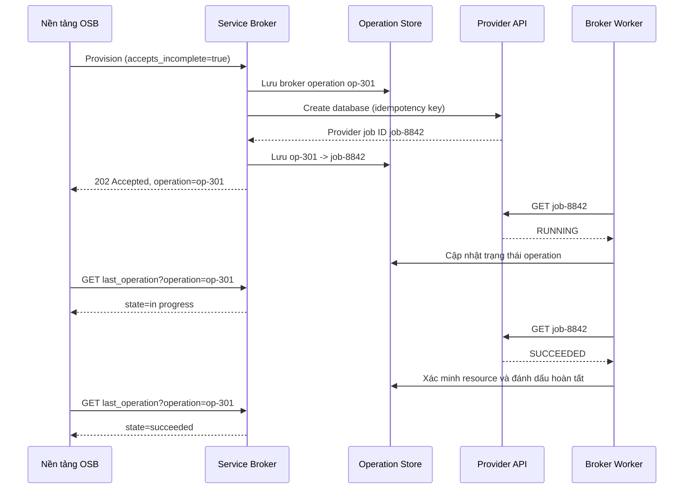
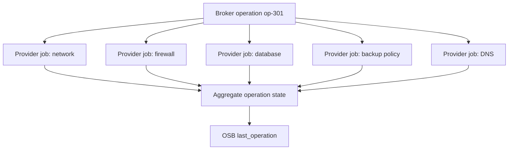

# Đối chiếu tác vụ OSB với mã công việc bất đồng bộ của nhà cung cấp

Khi nền tảng yêu cầu tạo, cập nhật hoặc thu hồi service instance, service broker có thể phải gọi API của nhà cung cấp hạ tầng. Nhiều provider không hoàn tất ngay trong HTTP request đầu tiên. Họ tiếp nhận yêu cầu, tạo một công việc nền và trả về mã job để client theo dõi. Trong khi đó, Open Service Broker API (OSB API) cũng có cơ chế bất đồng bộ riêng: broker trả response chấp nhận operation và cung cấp operation ID để nền tảng truy vấn `last_operation`.

Hai mã này phục vụ hai hợp đồng khác nhau. **Broker operation ID** là định danh mà broker công bố cho nền tảng theo OSB API. **Provider job ID** là định danh nội bộ mà nhà cung cấp trả cho broker để theo dõi công việc ở hạ tầng. Broker phải lưu mapping giữa chúng, theo dõi provider job, chuyển trạng thái sang mô hình OSB và chỉ báo thành công khi kết quả thực tế đã được xác nhận.

Với `SPRING_CLOUD_SERVICE_BROKER`, mapping này là một phần của trạng thái bền vững. Nó giúp broker tiếp tục theo dõi sau restart, xử lý callback hoặc polling, chống retry trùng, đối soát khi response provider bị mất và trả kết quả nhất quán cho nền tảng.

## 1. Hai lớp operation trong một luồng bất đồng bộ

Một luồng bất đồng bộ có hai bên theo dõi công việc:

- Nền tảng OSB theo dõi operation mà broker đã chấp nhận.
- Broker theo dõi job mà provider đã tạo hoặc tiếp nhận.

Ví dụ nền tảng gửi yêu cầu provision PostgreSQL. Broker xác thực request, ghi operation `op-301` và gọi provider. Provider trả job `job-8842`. Broker lưu mapping `op-301` → `job-8842`, worker theo dõi job provider và cập nhật operation. Nền tảng chỉ biết `op-301`; nó không cần gọi API provider hoặc hiểu định dạng job của provider.



Broker là lớp trung gian chuyển đổi trạng thái và bảo vệ ranh giới giữa nền tảng với provider. Không nên đưa provider job ID ra ngoài như thể đó là operation ID OSB.

## 2. Phân biệt các loại định danh

Một request có thể đi qua nhiều hệ thống và nhận nhiều mã khác nhau. Cần đặt tên và lưu riêng từng loại:

| Định danh | Ai tạo? | Ai sử dụng? | Phạm vi |
|---|---|---|---|
| `service_instance_id` | Nền tảng | Nền tảng và broker | Service instance theo OSB |
| `operation_id` | Broker | Nền tảng và broker | Một operation OSB trên instance |
| `provider_job_id` | Provider | Broker và provider | Một job bất đồng bộ ở provider |
| `provider_resource_id` | Provider | Broker và provider | Tài nguyên thật được tạo/quản lý |
| `provider_request_id` | Provider hoặc gateway | Hỗ trợ trace request | Một lần gọi HTTP/API; có thể không đại diện job bền vững |
| `correlation_id` | Broker hoặc hệ thống quan sát | Log, trace và các thành phần nội bộ | Liên kết dấu vết qua nhiều dịch vụ |
| `idempotency_key` | Broker | Broker và provider nếu hỗ trợ | Nhận diện cùng yêu cầu nghiệp vụ khi retry |

Không phải mọi provider đều trả cả `job_id`, `resource_id` và `request_id`. Có API trả resource ID ngay nhưng trạng thái resource vẫn là `CREATING`; API khác trả một URL operation; API khác nữa chỉ trả request token dùng để truy vấn trạng thái. Adapter cần hiểu semantics của từng provider và chuẩn hóa vào model nội bộ.

Provider job ID có thể chỉ duy nhất trong một account, region hoặc loại resource. Vì vậy, mapping nên lưu cả provider name, account/project, region, resource type và API version cần thiết để gọi đúng endpoint truy vấn.

## 3. Broker operation ID là hợp đồng với nền tảng

Khi nền tảng gửi thao tác có `accepts_incomplete=true` và broker chấp nhận xử lý nền, broker trả HTTP `202 Accepted`. Response có thể chứa trường `operation` để nền tảng gửi lại khi gọi endpoint `last_operation`.

Ví dụ:

```http
HTTP/1.1 202 Accepted
Content-Type: application/json
```

```json
{
  "operation": "op-301"
}
```

`op-301` thuộc namespace của broker. Broker phải giữ nó ổn định trong suốt vòng đời operation và có thể dùng nó để tìm trạng thái sau khi process restart. Nền tảng không cần biết `job-8842`, URL truy vấn provider hoặc account nội bộ.

Với OSB API, `last_operation` trả các trạng thái giao thức như `in progress`, `succeeded` hoặc `failed`. Broker có thể có nhiều trạng thái nội bộ hơn, nhưng phải ánh xạ chúng về các giá trị OSB được hỗ trợ. Không trả trực tiếp chuỗi `RUNNING`, `DONE` hay `ERROR` của provider nếu nó không thuộc vocabulary OSB.

## 4. Provider job ID là chi tiết tích hợp nội bộ

Provider job ID được dùng để gọi API theo dõi job hoặc hủy job nếu provider hỗ trợ. Mã này không thay thế broker operation ID vì:

- Nền tảng không có quyền hoặc credential để gọi provider.
- Provider có thể thay đổi API, format ID hoặc quy tắc truy vấn.
- Một broker operation có thể tạo nhiều provider job.
- Provider job có thể hết retention trong khi broker vẫn cần lưu kết quả OSB.
- Provider có thể trả request ID chỉ phục vụ tracing, không phải job ID có thể polling.

Broker nên giữ provider job ID trong adapter/persistence layer. Nếu cần hỗ trợ nhiều provider, domain model dùng `ProviderOperationReference` chung, còn adapter chịu trách nhiệm chuyển thành URL, header và trạng thái riêng của provider.

## 5. Mapping bền vững giữa hai operation

Mapping phải được lưu trước khi worker bắt đầu polling. Một record tối thiểu có thể gồm:

| Trường | Ý nghĩa |
|---|---|
| `broker_operation_id` | ID trả về nền tảng |
| `service_instance_id` | Instance mà operation đang thay đổi |
| `operation_type` | `PROVISION`, `UPDATE` hoặc `DEPROVISION` |
| `provider_name` | Adapter/provider cần dùng |
| `provider_account_id` | Account/project/subscription đích |
| `provider_region` | Region/zone/cluster nếu có |
| `provider_job_id` | Mã job do provider trả về |
| `provider_request_id` | Request trace ID nếu có |
| `provider_resource_id` | Resource ID nếu đã được cấp |
| `provider_state` | Trạng thái nguyên bản đã chuẩn hóa của provider |
| `broker_state` | Trạng thái nội bộ của broker |
| `osb_state` | Trạng thái trả cho `last_operation` |
| `idempotency_key` | Khóa retry cho lệnh gửi provider |
| `created_at`, `updated_at` | Thời điểm tạo/cập nhật |
| `next_poll_at`, `attempt_count` | Lịch và số lần truy vấn provider |
| `last_error_code`, `last_error_summary` | Lỗi đã lọc để chẩn đoán |

Không cần mọi cột cho mọi provider. Các trường không áp dụng có thể null, nhưng semantics phải rõ. Nếu một broker operation tạo nhiều provider job, nên có bảng `provider_operation` con với khóa ngoại đến `broker_operation`, thay vì ghi đè provider job ID trước đó.

### Ràng buộc dữ liệu

- `broker_operation_id` duy nhất trong phạm vi broker.
- Một provider job reference phải được xác định cùng provider/account/region nếu ID không globally unique.
- Operation đang hoạt động cần được khóa hoặc claim để không có nhiều worker polling và cập nhật cạnh tranh.
- Mapping provider resource phải liên kết với đúng instance và tenant.
- Trạng thái cuối nên có `completed_at` và không bị worker khác ghi đè thành trạng thái đang chạy.

## 6. Chuẩn hóa trạng thái provider sang OSB

Provider có thể dùng các trạng thái `PENDING`, `ACCEPTED`, `QUEUED`, `RUNNING`, `IN_PROGRESS`, `SUCCEEDED`, `DONE`, `FAILED`, `CANCELLED`, `DELETING` hoặc nhiều trạng thái riêng. Broker cần có bảng mapping theo từng adapter.

Ví dụ mapping:

| Provider state (minh họa) | Broker state | OSB `last_operation` |
|---|---|---|
| `PENDING`, `ACCEPTED`, `QUEUED` | `QUEUED` | `in progress` |
| `RUNNING`, `RESIZING`, `CREATING` | `IN_PROGRESS` | `in progress` |
| `SUCCEEDED`, `DONE`, `COMPLETED` | `VERIFYING` trước khi xác nhận resource | Chưa vội trả `succeeded` |
| Provider job hoàn tất và resource đã đạt desired state | `SUCCEEDED` | `succeeded` |
| `FAILED`, lỗi cuối không thể retry | `FAILED` | `failed` |
| `CANCELLED`, `ABORTED` | Theo policy: `FAILED` hoặc trạng thái hủy nội bộ | Thường ánh xạ `failed` nếu operation không đạt mục tiêu |
| Trạng thái không biết | `UNKNOWN`/`RECONCILING` | Thường giữ `in progress` trong thời gian đối soát, sau đó kết luận |

Không ánh xạ trạng thái provider một cách máy móc. `COMPLETED` có thể chỉ có nghĩa provider đã chạy xong workflow, trong khi tài nguyên vẫn cần health check hoặc chưa đạt cấu hình đích. Broker chỉ chuyển OSB state sang `succeeded` khi điều kiện hoàn tất của nghiệp vụ đã được xác minh.

Nếu provider trả trạng thái mới mà adapter chưa nhận diện, không nên tự coi là thành công. Giữ operation ở trạng thái cần đối soát, ghi metric/log và áp dụng timeout vận hành để không để nền tảng polling `in progress` vô hạn.

## 7. Một broker operation có thể gồm nhiều provider job

Provision một dịch vụ phức hợp có thể cần tạo network, firewall rule, database, backup policy và DNS record. Provider có thể trả một job cho mỗi bước hoặc một job tổng hợp. Broker operation là đơn vị nghiệp vụ tổng thể; provider jobs là các bước triển khai bên dưới.

Ví dụ:



Broker cần định nghĩa dependency và điều kiện hoàn tất. Ví dụ database chỉ được tạo sau khi network sẵn sàng; DNS chỉ được cập nhật sau khi database endpoint tồn tại. Nếu một bước thất bại, workflow có thể retry bước đó, chạy compensation cho các bước đã thành công hoặc giữ tài nguyên ở trạng thái cần can thiệp.

Không đánh dấu operation thành `succeeded` khi chỉ một provider job trong số nhiều job đã hoàn tất. Cần kiểm tra tất cả bước bắt buộc và trạng thái resource cuối.

## 8. Provider API trả job ID như thế nào?

Mỗi provider có giao thức riêng. Một số mẫu phổ biến:

| Kiểu provider response | Cách broker tiếp tục |
|---|---|
| HTTP `202` cùng JSON `jobId` | Lưu job ID, polling endpoint theo tài liệu provider |
| HTTP `202` cùng `Location` header | Lưu operation URL đã xác thực/chuẩn hóa và polling theo provider contract |
| HTTP `201` cùng resource ID, resource đang `CREATING` | Lưu resource ID rồi truy vấn trạng thái resource |
| HTTP `200` với kết quả cuối | Xác minh resource và hoàn tất nếu nghiệp vụ đã đạt |
| Response có `requestId` nhưng không có job endpoint | Dùng cho trace; cần cơ chế provider khác để xác định kết quả |
| Webhook/callback | Xác thực callback, deduplicate event và cập nhật operation |

Không giả định mọi HTTP `202` đều trả một trường tên `jobId`, hoặc mọi `Location` đều an toàn để gọi trực tiếp. Adapter phải kiểm tra response schema, host/path được phép, authentication và semantics của endpoint. Không gọi một URL tùy ý từ response provider nếu điều đó có thể tạo SSRF hoặc vượt trust boundary.

## 9. Polling provider job

Nếu provider hỗ trợ polling, worker truy vấn job theo `provider_job_id` hoặc operation URL. Nên dùng lịch polling có backoff thay vì hỏi liên tục.

Ví dụ chiến lược:

- Poll nhanh hơn ở những giây đầu nếu provider thường hoàn tất nhanh.
- Tăng dần khoảng cách giữa các lần poll khi job kéo dài.
- Thêm jitter để nhiều worker không đồng loạt gọi provider vào cùng thời điểm.
- Tôn trọng `Retry-After` hoặc rate limit nếu provider trả về.
- Dừng polling khi đã đạt trạng thái cuối hoặc operation bị chuyển sang reconciliation thủ công.
- Có deadline tối đa để phát hiện job bị kẹt hoặc provider không còn trả lời.

Ví dụ pseudocode:

```java
Duration nextDelay(int attempt, Duration retryAfter) {
    if (retryAfter != null) {
        return retryAfter;
    }

    long baseSeconds = Math.min(60, 2L * (1L << Math.min(attempt, 5)));
    long jitterSeconds = ThreadLocalRandom.current().nextLong(0, 4);
    return Duration.ofSeconds(baseSeconds + jitterSeconds);
}
```

Đây là thuật toán minh họa; cần giới hạn exponent, tổng thời gian và số lần poll theo policy thực tế. Không để worker ngủ trong khi giữ database transaction hoặc giữ lock dài hạn. Lưu `next_poll_at`, nhả lease và để scheduler/queue kích hoạt lần kiểm tra kế tiếp.

## 10. Callback từ provider

Một số provider gửi webhook khi job thay đổi trạng thái. Callback có thể giảm polling nhưng không thay thế hoàn toàn việc đối soát: webhook có thể đến trễ, lặp, sai thứ tự hoặc bị mất.

Khi nhận callback, broker cần:

1. Xác thực chữ ký, mTLS hoặc cơ chế xác thực webhook của provider.
2. Kiểm tra timestamp/nonce để giảm nguy cơ replay.
3. Tra cứu mapping provider job trong phạm vi account/tenant phù hợp.
4. Deduplicate event ID hoặc version để callback lặp không gây side effect.
5. Xử lý sự kiện theo thứ tự hợp lệ; không cho callback cũ ghi đè trạng thái mới.
6. Đọc lại trạng thái job/resource từ provider nếu payload không đủ tin cậy hoặc không chứa version đáng tin.
7. Cập nhật broker operation và ghi audit.

Callback chỉ là tín hiệu rằng có thể đã có thay đổi. Nếu provider webhook không có chữ ký hoặc cơ chế xác thực mạnh, không dùng payload callback làm bằng chứng duy nhất để đánh dấu `succeeded`.

## 11. Khoảng trống khi provider nhận job nhưng broker chưa lưu job ID

Đây là một failure window quan trọng:

1. Broker gửi `CreateDatabase` đến provider.
2. Provider tiếp nhận và tạo job `job-8842`.
3. Kết nối bị đứt trước khi broker nhận response hoặc process crash trước khi ghi job ID.
4. Broker operation vẫn tồn tại nhưng chưa có `provider_job_id`.

Nếu broker gửi lại lệnh tạo tài nguyên một cách mù quáng, provider có thể tạo database thứ hai. Để phục hồi, cần thiết kế ngay từ lúc gửi request:

- Tạo idempotency key ổn định từ broker operation ID hoặc request fingerprint.
- Truyền key cho provider nếu API hỗ trợ và dùng cùng key khi retry.
- Gắn broker operation ID hoặc instance ID vào metadata/tag của resource nếu provider hỗ trợ.
- Nếu timeout, truy vấn provider theo idempotency key/tag trước khi gửi lệnh tạo lại.
- Lưu request payload đã chuẩn hóa và provider account/region để đối soát.
- Nếu không thể xác định provider đã nhận lệnh hay chưa, chuyển operation sang `RECONCILING` thay vì tạo lại ngay.

Một provider request ID chỉ giúp truy vết nếu provider cho phép tìm kiếm theo ID đó. Không được giả định request ID tương đương idempotency key.

## 12. Retry, idempotency và lỗi không xác định

Broker cần phân biệt retry truy vấn trạng thái với retry lệnh tạo/cập nhật tài nguyên.

| Tình huống | Hành vi khuyến nghị |
|---|---|
| GET provider job timeout | Retry polling với backoff; GET thường không tạo side effect |
| Provider trả `429` | Tôn trọng rate limit/`Retry-After` và giảm tần suất |
| Provider trả `5xx` khi poll | Retry có giới hạn, giữ trạng thái chưa xác định |
| Lệnh create timeout trước khi nhận job ID | Tra cứu bằng idempotency key/tag trước khi gửi lại |
| Provider báo job failed do quota | Đánh dấu lỗi cuối hoặc chờ điều kiện thay đổi theo policy; không retry vô hạn |
| Provider báo job không tồn tại | Kiểm tra retention, account/region và resource state trước khi kết luận |
| Callback trùng | Deduplicate theo event ID/version |
| Hai worker cùng poll/update operation | Dùng lease, optimistic locking hoặc atomic claim |

Idempotency phải được áp dụng cả ở broker lẫn provider adapter. Một broker operation có thể được xử lý nhiều lần do message redelivery, nhưng kết quả nghiệp vụ chỉ nên được tạo một lần. Nếu provider không hỗ trợ idempotency, adapter cần read-before-retry và reconciliation.

## 13. Timeout và reconciliation

Provider job có thể tồn tại lâu hơn thời hạn mà broker dự kiến. Khi quá deadline, không nên tự động đánh dấu failed nếu provider vẫn đang chạy hoặc trạng thái không rõ. Cần phân biệt:

- **Job còn chạy:** tiếp tục theo dõi với khoảng poll và deadline được điều chỉnh.
- **Job đã thất bại:** ánh xạ lỗi và xác định có thể retry hay không.
- **Job không tìm thấy:** kiểm tra provider retention, account, region và resource tags.
- **Provider API không truy cập được:** giữ trạng thái chưa xác định, cảnh báo và retry có giới hạn.
- **Job hoàn tất nhưng resource không đạt desired state:** chạy bước verify/repair hoặc đánh dấu failed theo policy.
- **Resource tồn tại nhưng job ID mất:** tìm theo broker tag hoặc provider resource reference để nối lại mapping.

Reconciliation có thể truy vấn cả job lẫn resource. Job state trả lời provider workflow đã kết thúc chưa; resource state trả lời tài nguyên thật hiện ở trạng thái nào. Hai trạng thái có thể không đồng nhất trong thời gian eventual consistency.

Không tự động xóa tài nguyên khi chỉ thấy job `NOT_FOUND`. Job record có thể hết retention trong khi resource vẫn tồn tại. Trước cleanup cần kiểm tra resource ID, tag, account và ownership.

## 14. Ánh xạ lỗi provider thành lỗi OSB

Khi provider job thất bại, broker phải chuyển lỗi kỹ thuật thành mô tả phù hợp với nền tảng mà không tiết lộ dữ liệu nội bộ.

| Lỗi provider | Xử lý nội bộ | `last_operation` |
|---|---|---|
| Quota hết | Lưu mã lỗi provider đã chuẩn hóa và gợi ý điều kiện khắc phục | `failed`, description ngắn gọn |
| Region không khả dụng | Không retry vô hạn; có thể cho phép người dùng chọn region khác | `failed` |
| Permission denied | Kiểm tra provider account/role, cảnh báo vận hành | `failed` |
| Rate limit | Retry polling/command an toàn theo backoff | `in progress` khi còn retry |
| Provider outage | Giữ operation đang xử lý trong thời gian retry policy | `in progress`, sau deadline có quyết định rõ |
| Resource tạo một phần | Chạy compensation hoặc đưa vào trạng thái cần can thiệp | `in progress` trong recovery, sau đó `failed` nếu không đạt |

`description` không nên chứa provider stack trace, credential, URL quản trị hoặc account ID nhạy cảm. Log nội bộ có thể giữ mã lỗi và correlation ID đã được bảo vệ để người vận hành truy vết.

## 15. Ví dụ model Java cho mapping operation

Một model nội bộ có thể tách broker operation và provider operation:

```java
public record BrokerOperation(
        String operationId,
        String instanceId,
        OperationType type,
        BrokerOperationState state,
        String requestFingerprint) {
}

public record ProviderOperationReference(
        String provider,
        String accountId,
        String region,
        String jobId,
        String requestId,
        String resourceId) {
}

public enum OsbOperationState {
    IN_PROGRESS,
    SUCCEEDED,
    FAILED
}
```

Các record trên chỉ là mô hình minh họa. Persistence model thực tế cần thêm timestamp, lease, attempt count, error summary, API version và quan hệ một-nhiều nếu broker operation điều phối nhiều provider jobs.

### Provider adapter

```java
public interface ProviderJobClient {

    ProviderJobSnapshot getJob(
            ProviderOperationReference reference);

    ProviderResourceSnapshot getResource(
            ProviderOperationReference reference);
}

public record ProviderJobSnapshot(
        String jobId,
        String rawState,
        boolean terminal,
        String errorCode,
        String safeMessage) {
}
```

Adapter chịu trách nhiệm gọi đúng endpoint provider, xác thực, parse response và chuyển thành snapshot nội bộ. Application service không nên tự ghép URL provider từ chuỗi `jobId` hoặc phụ thuộc JSON response riêng của một hãng.

## 16. Worker cập nhật broker operation

Worker có thể lấy operation đến hạn polling, claim bằng lease ngắn, gọi provider ngoài transaction rồi lưu kết quả bằng optimistic locking.

Pseudocode minh họa:

```java
public void process(BrokerOperationRecord operation) {
    if (!operationRepository.claim(operation.id(), workerId, leaseDuration)) {
        return;
    }

    try {
        ProviderJobSnapshot job = providerJobClient.getJob(
                operation.providerReference());

        ProviderResourceSnapshot resource = null;
        if (job.terminal() && isProviderSuccess(job.rawState())) {
            resource = providerJobClient.getResource(
                    operation.providerReference());
        }

        OperationDecision decision = stateMapper.map(job, resource);
        operationRepository.applyDecision(
                operation.id(), operation.version(), decision);
    } catch (TransientProviderException ex) {
        operationRepository.scheduleRetry(
                operation.id(), nextPollAt(operation.attemptCount()),
                safeErrorCode(ex));
    } finally {
        operationRepository.releaseLease(operation.id(), workerId);
    }
}
```

Đây là pseudocode, cần điều chỉnh transaction và lease semantics theo persistence technology. Không giữ transaction database trong lúc gọi provider. Khi cập nhật, kiểm tra version/lease để callback hoặc worker khác không ghi đè trạng thái mới hơn. Nếu worker chết trước `finally`, lease phải tự hết hạn.

## 17. Tích hợp với `last_operation` của Spring Cloud Open Service Broker

Trong Spring Cloud Open Service Broker, handler của `getLastOperation()` hoặc API tương ứng theo phiên bản thư viện nên đọc broker operation store. Nó không nên gọi provider trực tiếp trong mỗi request polling của nền tảng.

Luồng phân chia trách nhiệm:

- Provider poller/callback cập nhật `provider_state` và `broker_state`.
- State mapper quyết định operation đã hoàn tất hay chưa.
- Operation store lưu `osb_state`, description an toàn và thời điểm cập nhật.
- `last_operation` adapter đọc record và ánh xạ thành response model của framework.

Ví dụ pseudo-code:

```java
public Mono<GetLastServiceOperationResponse> getLastOperation(
        GetLastServiceOperationRequest request) {

    return operationRepository.find(
                    request.getServiceInstanceId(),
                    request.getOperation())
            .switchIfEmpty(Mono.error(new OperationNotFoundException()))
            .map(operation -> GetLastServiceOperationResponse.builder()
                    .state(operation.osbState().wireValue())
                    .description(operation.safeDescription())
                    .build());
}
```

Tên model, accessor và kiểu trả về cần theo đúng phiên bản Spring Cloud Open Service Broker đang dùng. Ví dụ nhấn mạnh nguyên tắc endpoint polling chỉ đọc trạng thái đã lưu, không thực thi provider job hoặc tạo operation mới.

## 18. Bảo mật provider job reference

Provider job ID có thể không phải secret, nhưng endpoint truy vấn job thường yêu cầu credential provider và có thể tiết lộ thông tin tài nguyên. Broker cần:

- Lưu provider account/project, region và resource scope cùng job ID.
- Không đưa provider job ID, URL quản trị hoặc provider token vào response OSB nếu không cần thiết.
- Mã hóa hoặc giới hạn truy cập các provider references nhạy cảm theo policy.
- Xác thực callback bằng chữ ký/mTLS và kiểm tra replay.
- Chỉ worker có quyền phù hợp mới được poll hoặc cancel job.
- Không cho phép client gửi tùy ý `provider_job_id` để broker truy vấn provider; chỉ dùng reference đã được mapping và ownership xác minh.
- Che token và payload nhạy cảm trong log/trace.
- Kiểm tra host/path của operation URL provider trước khi gọi để tránh SSRF.

Broker operation ID cũng không phải credential. Khi nền tảng gọi `last_operation`, broker vẫn phải xác thực nền tảng và kiểm tra operation thuộc đúng instance/tenant.

## 19. Quan sát và cảnh báo

Để vận hành workflow nhiều tầng, log và metric cần nối được broker operation với provider job nhưng không lộ thông tin nhạy cảm.

Các trường log hữu ích:

- `brokerOperationId`, `serviceInstanceId`, `operationType`.
- `providerName`, `providerAccountAlias`, `providerJobId` đã được kiểm soát.
- `correlationId`, `attempt`, `providerState`, `brokerState`.
- Thời điểm nhận request, provider accept, poll và hoàn tất.
- Mã lỗi đã chuẩn hóa, không ghi raw secret hoặc response body không lọc.

Metric nên theo dõi:

- Số broker operation đang `in progress` theo provider và loại thao tác.
- Thời gian từ broker accept đến provider job complete và đến resource ready.
- Số job quá deadline hoặc không tìm thấy.
- Tỷ lệ provider polling lỗi, HTTP 429 và 5xx.
- Queue lag, lease hết hạn, số lần retry và reconciliation backlog.
- Số operation ở trạng thái `UNKNOWN`/`RECONCILING`.
- Tỷ lệ provider job thành công nhưng resource verification thất bại.

Cảnh báo khi operation kéo dài quá ngưỡng theo loại dịch vụ, khi provider job ID bị thiếu bất thường hoặc khi nhiều operation không thể đối chiếu. Một job dài không luôn là lỗi; ngưỡng cảnh báo nên dựa trên phân phối thời gian thực tế và SLA của provider.

## 20. Kiểm thử mapping và phục hồi

Kiểm thử cần bao phủ sự khác nhau giữa hai lớp operation:

| Trường hợp | Kết quả cần xác minh |
|---|---|
| Provider trả job ID | Mapping broker operation/provider job được lưu bền vững |
| Provider trả resource ID nhưng không có job | Adapter theo dõi resource state đúng cách |
| Provider trả request ID không phải job | Không dùng nhầm request ID làm polling key |
| Broker restart | Worker tiếp tục polling bằng mapping đã lưu |
| Timeout sau provider accept | Idempotency key/tag giúp tìm job/resource, không tạo trùng |
| Provider job `RUNNING` | OSB `last_operation` trả `in progress` |
| Provider job `COMPLETED` nhưng resource chưa ready | Broker chưa trả `succeeded` |
| Provider job `FAILED` | Operation OSB chuyển `failed` với description an toàn |
| Provider state không biết | Chuyển sang reconciliation, không coi là success |
| Callback lặp hoặc sai thứ tự | Deduplicate và không ghi đè trạng thái mới |
| Một operation nhiều provider jobs | Chỉ hoàn tất khi mọi bước bắt buộc đạt trạng thái cuối |
| Hai worker cùng xử lý | Lease/version ngăn cập nhật cạnh tranh |
| Job hết retention | Broker vẫn trả kết quả đã lưu hoặc đối soát resource theo policy |

Nên có contract test cho từng provider adapter bằng response fixture, integration test với provider sandbox nếu có và fault injection cho timeout/crash. Test `last_operation` độc lập để xác minh endpoint trả trạng thái từ broker store kể cả khi provider tạm thời không truy cập được.

## 21. Những lỗi thiết kế thường gặp

**Dùng provider job ID làm OSB operation ID:** làm lộ chi tiết provider và khiến hợp đồng nền tảng phụ thuộc provider. Tạo broker operation ID riêng.

**Chỉ lưu broker operation ID:** worker không thể tiếp tục polling provider sau restart. Lưu provider job reference và scope của nó.

**Coi request ID là job ID:** request trace ID có thể không truy vấn được trạng thái. Adapter cần hiểu semantics response.

**Đánh dấu `succeeded` khi provider job báo completed:** resource có thể chưa sẵn sàng hoặc chưa đạt desired state. Xác minh resource trước khi kết thúc operation.

**Retry lệnh create sau timeout ngay lập tức:** provider có thể đã nhận lệnh. Tra cứu theo idempotency key/tag trước khi gửi lại.

**Polling quá dày:** gây rate limit và tăng chi phí provider. Dùng backoff, jitter và `Retry-After`.

**Để callback ghi đè trạng thái mới:** event cũ đến trễ có thể làm operation quay từ success về running. Dùng event version, timestamp tin cậy hoặc đọc lại provider.

**Một operation chỉ có một provider job ID:** workflow nhiều tài nguyên sẽ ghi đè job trước. Dùng quan hệ một-nhiều và aggregate state.

**Xóa mapping ngay khi provider job hết retention:** broker mất dữ liệu để audit hoặc đối soát. Lưu kết quả cuối và provider resource mapping theo retention policy riêng.

## 22. Trình tự triển khai cho service broker

Khi tích hợp provider có tác vụ bất đồng bộ, có thể đi theo trình tự:

1. Xác định thao tác OSB nào có thể chạy async và điều kiện nền tảng chấp nhận `accepts_incomplete`.
2. Tạo broker operation ID độc lập với mọi provider identifier.
3. Thiết kế operation store và provider operation mapping có account/region/resource scope.
4. Xây dựng adapter phân biệt job ID, resource ID, request ID và operation URL.
5. Gửi idempotency key hoặc broker resource tag khi gọi provider.
6. Lưu provider job reference ngay khi nhận response; xử lý timeout/crash window bằng lookup và reconciliation.
7. Xây dựng poller hoặc callback handler có authentication, deduplication, backoff và lease.
8. Chuẩn hóa provider state sang broker state rồi OSB `last_operation` state.
9. Xác minh resource thực tế trước khi đánh dấu operation thành công.
10. Kiểm thử restart, duplicate, out-of-order callback, provider outage, job retention và workflow nhiều job.
11. Thiết lập metric/log/alert và retention cho operation cùng provider references.

Khi broker giữ riêng broker operation ID và provider job ID, lưu mapping bền vững và xác minh trạng thái tài nguyên trước khi kết thúc operation, nền tảng có thể theo dõi một hợp đồng OSB ổn định trong khi broker tự xử lý khác biệt của từng nhà cung cấp. Đây là nền tảng để tích hợp an toàn với các API bất đồng bộ của cloud, Kubernetes control plane và những hệ thống hạ tầng có workflow kéo dài.
