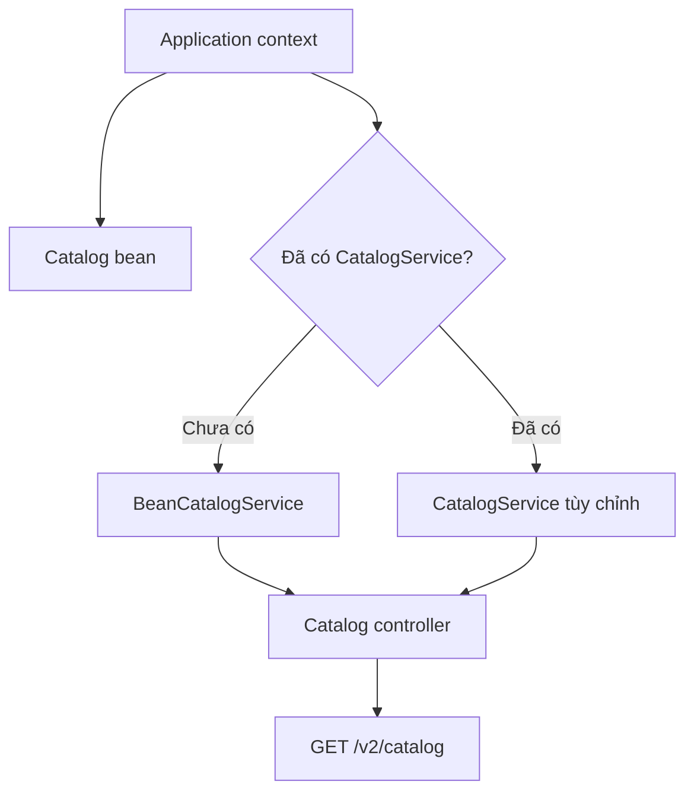
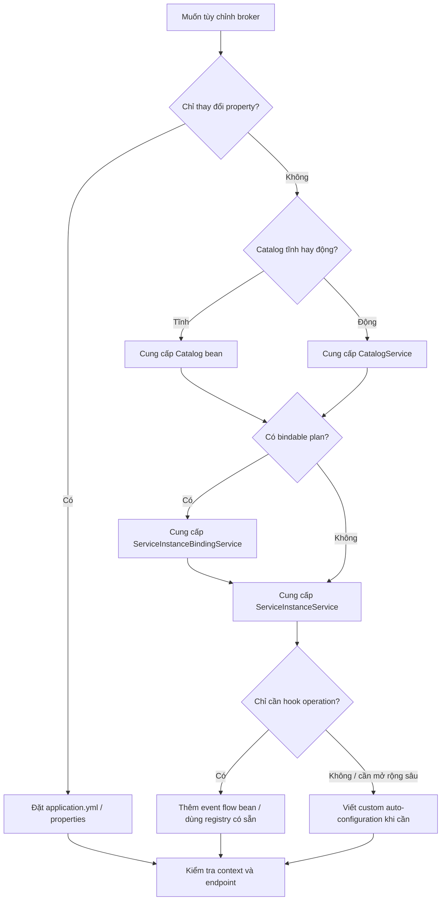

# Thay thế Spring bean mặc định và điều kiện tự cấu hình

Spring Cloud Open Service Broker cung cấp controller, model request/response và các bean cấu hình để ứng dụng nhanh chóng triển khai Open Service Broker API (OSB API). Framework cũng tạo một số bean mặc định khi ứng dụng chưa cung cấp implementation riêng. Khi service broker cần đọc catalog từ database, kết nối provider khác nhau theo môi trường hoặc quản lý binding theo nghiệp vụ riêng, ứng dụng có thể thay thế các bean mặc định bằng Spring bean của mình.

Việc thay thế dựa trên cơ chế auto-configuration của Spring Boot. Auto-configuration kiểm tra classpath, bean hiện có và property để quyết định cấu hình nào được kích hoạt. Một bean tùy chỉnh đúng kiểu thường khiến cấu hình mặc định tương ứng lùi lại nhờ `@ConditionalOnMissingBean`.

Điều quan trọng là hiểu framework đang cung cấp bean nào, bean nào ứng dụng bắt buộc phải tự triển khai và extension point nào có thể bổ sung mà không cần thay toàn bộ registry hoặc controller.

## 1. Auto-configuration của Spring Cloud Open Service Broker

Spring Cloud Open Service Broker được kích hoạt trong ứng dụng Spring Boot khi có starter và một web starter phù hợp. Thư viện hỗ trợ cả Spring MVC và Spring WebFlux; dependency `spring-cloud-starter-open-service-broker` không tự kéo theo `spring-boot-starter-web` hoặc `spring-boot-starter-webflux`.

Ví dụ dependency Gradle:

```groovy
dependencies {
    implementation "org.springframework.cloud:spring-cloud-starter-open-service-broker:4.4.1"
    implementation "org.springframework.boot:spring-boot-starter-webflux"
}
```

Nếu ứng dụng dùng Spring MVC, thay `spring-boot-starter-webflux` bằng `spring-boot-starter-web`. Không cần đồng thời thêm cả hai web stack trừ khi ứng dụng có yêu cầu tích hợp cụ thể và đã kiểm soát được cấu hình tương ứng.

Ứng dụng khởi động thông qua cấu hình Spring Boot thông thường:

```java
@SpringBootApplication
public class ServiceBrokerApplication {

    public static void main(String[] args) {
        SpringApplication.run(ServiceBrokerApplication.class, args);
    }
}
```

Auto-configuration của framework đăng ký các thành phần cần thiết cho API broker. Với web stack đã chọn, framework cấu hình controller cho catalog, service instance và service binding. Ứng dụng cung cấp các service bean để controller chuyển request OSB vào nghiệp vụ tương ứng.

## 2. Bean mặc định nào được cung cấp?

Trong Spring Cloud Open Service Broker 4.4.1, `ServiceBrokerAutoConfiguration` có hai bean triển khai nghiệp vụ đáng chú ý:

| Bean mặc định | Điều kiện tạo | Mục đích |
|---|---|---|
| `CatalogService` thông qua `BeanCatalogService` | Có bean `Catalog` và chưa có bean `CatalogService` | Phục vụ catalog tĩnh từ một `Catalog` bean |
| `NonBindableServiceInstanceBindingService` | Chưa có bean `ServiceInstanceBindingService` | Cung cấp implementation mặc định cho broker không hỗ trợ bindable service |

Các phương thức tương ứng được đánh dấu `@ConditionalOnMissingBean`. Điều này cho phép ứng dụng thay thế chúng bằng bean có cùng contract.

Ngoài ra, framework có auto-configuration riêng cho:

- Controller Spring MVC hoặc Spring WebFlux.
- Kiểm tra phiên bản OSB API.
- Các event flow registry cho create, update, delete và polling operation.
- Chuyển exception của broker thành HTTP response theo OSB.

Không phải mọi bean trong application context đều là điểm cần thay thế. Controller và model của framework thường nên được giữ lại; phần nghiệp vụ cần tùy chỉnh được triển khai qua các interface service và event flow.

## 3. Phân biệt bean framework cung cấp và bean ứng dụng phải triển khai

Không nên nhầm `ServiceInstanceService` với `CatalogService` hoặc service binding mặc định.

| Contract | Framework xử lý thế nào? | Khi nào ứng dụng cần tự cung cấp? |
|---|---|---|
| `CatalogService` | Có thể tạo `BeanCatalogService` nếu có `Catalog` bean | Khi catalog cần lấy động từ database, tenant hoặc nguồn bên ngoài; hoặc khi muốn kiểm soát ETag/HTTP response |
| `ServiceInstanceService` | Không có bean nghiệp vụ mặc định thay cho ứng dụng; thiếu bean sẽ gây lỗi khởi động | Broker phải cung cấp implementation cho vòng đời instance |
| `ServiceInstanceBindingService` | Có `NonBindableServiceInstanceBindingService` nếu ứng dụng chưa cung cấp | Khi catalog có service/plan hỗ trợ binding |
| Event flow registry | Auto-configuration tạo registry mặc định | Thường chỉ cần cung cấp các flow bean hoặc đăng ký flow vào registry hiện có |
| Web controller | Auto-configuration MVC/WebFlux tạo controller | Thường không cần tự viết controller OSB |

`ServiceInstanceService` là thành phần bắt buộc của một broker có service instance. Các thao tác create và delete phải được triển khai. Những phương thức như update, fetch instance hoặc get last operation chỉ cần implementation nghiệp vụ tương ứng khi catalog và hành vi broker công bố khả năng đó. Ví dụ, nếu plan cho phép update (`plan_updateable=true`), broker phải xử lý update; nếu broker trả async response, broker phải hỗ trợ polling last operation; nếu công bố `instances_retrievable=true`, phải hỗ trợ fetch instance.

Với binding, nếu bất kỳ plan nào cho phép bind (`bindable=true`), broker cần implementation `ServiceInstanceBindingService` phù hợp. Bean mặc định `NonBindableServiceInstanceBindingService` dành cho trường hợp broker không công bố bindable service.

## 4. Cách `@ConditionalOnMissingBean` cho phép thay thế bean

Spring Boot thường đặt `@ConditionalOnMissingBean` trên phương thức `@Bean` trong auto-configuration. Cấu hình mặc định chỉ được áp dụng khi application context chưa có bean thuộc kiểu được kiểm tra.

Ví dụ rút gọn:

```java
@Configuration(proxyBeanMethods = false)
class ExampleAutoConfiguration {

    @Bean
    @ConditionalOnMissingBean(CatalogService.class)
    CatalogService defaultCatalogService(Catalog catalog) {
        return new BeanCatalogService(catalog);
    }
}
```

Nếu ứng dụng đã cung cấp một bean `CatalogService`, phương thức `defaultCatalogService()` không tạo thêm bean mặc định. Nếu chưa có, Spring tạo bean mặc định từ `Catalog`.

Trong thư viện thực tế, `ServiceBrokerAutoConfiguration` có phương thức tương ứng:

```java
@Bean
@ConditionalOnMissingBean(CatalogService.class)
public CatalogService beanCatalogService(
        @Autowired(required = false) Catalog catalog) {
    return new BeanCatalogService(catalog);
}

@Bean
@ConditionalOnMissingBean(ServiceInstanceBindingService.class)
public ServiceInstanceBindingService nonBindableServiceInstanceBindingService() {
    return new NonBindableServiceInstanceBindingService();
}
```

Đoạn code trên mô tả điều kiện và kiểu bean của API 4.4.1. Ứng dụng thường không cần sao chép cấu hình này; chỉ cần đăng ký bean tùy chỉnh đúng interface.

### 4.1. Vì sao kiểu trả về của @Bean quan trọng?

Điều kiện `@ConditionalOnMissingBean` cần biết kiểu bean để quyết định có tạo bean mặc định hay không. Khi viết auto-configuration của riêng mình, nên khai báo kiểu trả về cụ thể và đúng contract mà các thành phần khác sẽ inject.

Ví dụ:

```java
@Bean
@ConditionalOnMissingBean(ProviderResourceClient.class)
ProviderResourceClient providerResourceClient() {
    return new DefaultProviderResourceClient();
}
```

Khai báo return type là `ProviderResourceClient` giúp điều kiện và các bean khác nhận diện đúng abstraction. Nếu chỉ trả về `Object`, Spring khó đánh giá điều kiện theo kiểu mong muốn ở giai đoạn xử lý bean definition.

### 4.2. Thứ tự xử lý cấu hình

`@ConditionalOnMissingBean` đánh giá những bean definition đã được xử lý tại thời điểm condition chạy. Spring Boot khuyến nghị dùng bean conditions trong auto-configuration vì auto-configuration được xử lý sau các bean definition do ứng dụng khai báo.

Không nên đặt các điều kiện phụ thuộc thứ tự bean một cách tùy tiện trong component configuration thông thường rồi kỳ vọng kết quả giống auto-configuration. Khi viết starter riêng, hãy dùng `@AutoConfiguration` và cơ chế đăng ký auto-configuration của Spring Boot.

## 5. Cung cấp Catalog bean để dùng implementation mặc định

Nếu catalog ổn định và có thể xây dựng bằng Java hoặc externalized configuration, ứng dụng chỉ cần cung cấp bean `Catalog`. Framework tự tạo `CatalogService` mặc định để phục vụ endpoint `/v2/catalog`.

Ví dụ:

```java
@Configuration(proxyBeanMethods = false)
public class BrokerCatalogConfiguration {

    @Bean
    Catalog catalog() {
        Plan standard = Plan.builder()
                .id("postgres-standard")
                .name("standard")
                .description("PostgreSQL for standard workloads")
                .free(false)
                .build();

        ServiceDefinition postgres = ServiceDefinition.builder()
                .id("postgresql")
                .name("PostgreSQL")
                .description("Managed PostgreSQL database")
                .bindable(true)
                .plans(standard)
                .build();

        return Catalog.builder()
                .serviceDefinitions(postgres)
                .build();
    }
}
```

Luồng khởi tạo:



Catalog bean phù hợp khi catalog được tạo một lần từ cấu hình. Nếu catalog thay đổi theo tenant, region, account hoặc dữ liệu bên ngoài, nên xem xét triển khai `CatalogService` tùy chỉnh.

Thay vì tạo `Catalog` bằng Java, có thể khai báo catalog qua externalized configuration:

```yaml
spring:
  cloud:
    openservicebroker:
      catalog:
        services:
          - id: postgresql
            name: PostgreSQL
            description: Managed PostgreSQL database
            bindable: true
            plans:
              - id: postgres-standard
                name: standard
                description: PostgreSQL for standard workloads
                free: false
```

`CatalogPropertiesMinimalConfiguration` chuyển catalog properties thành `Catalog` bean. Sau đó `ServiceBrokerAutoConfiguration` có thể tạo `BeanCatalogService` nếu ứng dụng chưa cung cấp `CatalogService` riêng.

## 6. Thay thế CatalogService mặc định

`CatalogService` là interface mà controller sử dụng để lấy catalog. Nếu ứng dụng cung cấp một bean của interface này, `BeanCatalogService` mặc định sẽ không được tạo do điều kiện `@ConditionalOnMissingBean(CatalogService.class)`.

Ví dụ đăng ký implementation đọc catalog từ repository:

```java
@Configuration(proxyBeanMethods = false)
public class DynamicCatalogConfiguration {

    @Bean
    CatalogService catalogService(CatalogRepository repository) {
        return new RepositoryCatalogService(repository);
    }
}
```

`RepositoryCatalogService` là class do ứng dụng triển khai, implement `CatalogService`. Implementation thường cần cung cấp:

- `getCatalog()` để trả catalog hiện tại.
- `getServiceDefinition(serviceId)` để tra service definition.
- `getResponseEntityCatalog(httpHeaders)` khi cần kiểm soát ETag, cache hoặc HTTP response của catalog.

Ví dụ skeleton:

```java
@Service
public class RepositoryCatalogService implements CatalogService {

    private final CatalogRepository repository;

    public RepositoryCatalogService(CatalogRepository repository) {
        this.repository = repository;
    }

    @Override
    public Mono<Catalog> getCatalog() {
        return repository.loadCatalog();
    }

    @Override
    public Mono<ServiceDefinition> getServiceDefinition(String serviceId) {
        return repository.findServiceDefinition(serviceId);
    }

    @Override
    public Mono<ResponseEntity<Catalog>> getResponseEntityCatalog(
            HttpHeaders headers) {
        return repository.loadCatalog()
                .map(catalog -> ResponseEntity.ok(catalog));
    }
}
```

`CatalogRepository` là abstraction ví dụ. Để hỗ trợ caching hiệu quả, implementation thực tế có thể tính ETag từ catalog version hoặc checksum và trả `304 Not Modified` khi `If-None-Match` phù hợp. Không nên bỏ qua semantics HTTP nếu catalog lớn hoặc platform thường xuyên refresh.

Không cần đồng thời khai báo `Catalog` bean nếu custom `CatalogService` đã tự chịu trách nhiệm cung cấp catalog. Có thể vẫn tồn tại `Catalog` bean vì mục đích khác, nhưng nó không phải nguồn dữ liệu của controller nếu `CatalogService` tùy chỉnh đã được chọn.

## 7. Thay thế ServiceInstanceBindingService mặc định

Khi catalog không có bindable plan, framework cung cấp `NonBindableServiceInstanceBindingService`. Bean này biểu thị rằng broker không hỗ trợ tạo hoặc xóa binding. Nếu ứng dụng công bố plan bindable, cần cung cấp implementation riêng.

Ví dụ:

```java
@Configuration(proxyBeanMethods = false)
public class BindingConfiguration {

    @Bean
    ServiceInstanceBindingService serviceInstanceBindingService(
            BindingUseCase bindingUseCase) {
        return new PostgreSqlBindingService(bindingUseCase);
    }
}
```

`PostgreSqlBindingService` là implementation do ứng dụng xây dựng. Nó cần xử lý các operation tương ứng với capability đã công bố, ví dụ tạo binding và xóa binding. Nếu broker hỗ trợ asynchronous binding, cần cung cấp `getLastOperation()` để platform polling; nếu catalog khai báo `bindings_retrievable=true`, cần hỗ trợ `getServiceInstanceBinding()`.

Khi có bean custom, `NonBindableServiceInstanceBindingService` mặc định tự động lùi lại. Không cần bật bean overriding theo tên để ghi đè implementation mặc định.

### 7.1. Không thay nhầm ServiceInstanceService

`ServiceInstanceService` là service interface cho provision, update, deprovision, fetch và polling operation. Framework yêu cầu ứng dụng cung cấp bean này; thiếu bean sẽ phát sinh `ServiceInstanceServiceBeanDoesNotExistException` trong quá trình khởi động.

Ví dụ:

```java
@Service
public class PostgreSqlInstanceService implements ServiceInstanceService {

    private final InstanceLifecycleUseCase lifecycle;

    public PostgreSqlInstanceService(InstanceLifecycleUseCase lifecycle) {
        this.lifecycle = lifecycle;
    }

    @Override
    public Mono<CreateServiceInstanceResponse> createServiceInstance(
            CreateServiceInstanceRequest request) {
        return lifecycle.provision(request);
    }

    @Override
    public Mono<DeleteServiceInstanceResponse> deleteServiceInstance(
            DeleteServiceInstanceRequest request) {
        return lifecycle.deprovision(request);
    }
}
```

Đây là skeleton rút gọn; `InstanceLifecycleUseCase` và response mapping là thành phần ứng dụng. Các phương thức còn lại phải được override khi catalog hoặc chế độ operation yêu cầu. Không thể chỉ khai báo một bean `ServiceInstanceBindingService` rồi kỳ vọng nó thay thế service quản lý instance.

## 8. Mở rộng bằng event flow thay vì thay toàn bộ service

Không phải mọi tùy chỉnh đều cần thay thế một service bean. Spring Cloud Open Service Broker có event flow registry cho các giai đoạn initialization, completion và error của operation.

Ví dụ, ứng dụng muốn ghi audit trước và sau provision nhưng vẫn giữ `ServiceInstanceService` hiện tại. Có thể khai báo flow bean:

```java
@Configuration(proxyBeanMethods = false)
public class ProvisionAuditConfiguration {

    @Bean
    CreateServiceInstanceInitializationFlow provisionAuditStart(AuditService audit) {
        return request -> audit.recordStarted(
                request.getServiceInstanceId(), request.getServiceDefinitionId());
    }

    @Bean
    CreateServiceInstanceCompletionFlow provisionAuditComplete(AuditService audit) {
        return (request, response) -> audit.recordCompleted(
                request.getServiceInstanceId(), response.isAsync());
    }

    @Bean
    CreateServiceInstanceErrorFlow provisionAuditError(AuditService audit) {
        return (request, error) -> audit.recordFailed(
                request.getServiceInstanceId(), error.getClass().getSimpleName());
    }
}
```

Các lambda minh họa interface functional; `AuditService` là service do ứng dụng cung cấp. Các flow bean được framework nhận diện và thêm vào registry tương ứng.

### 8.1. Đăng ký flow qua registry có sẵn

Ứng dụng cũng có thể inject registry mặc định và thêm flow trong quá trình khởi tạo. Các phương thức `addInitializationFlow()`, `addCompletionFlow()` và `addErrorFlow()` trả về `Mono<Void>`, vì vậy phải subscribe hoặc compose kết quả để việc đăng ký được thực thi. Ví dụ dùng `ApplicationRunner` để đăng ký một lần khi ứng dụng khởi động:

```java
@Configuration(proxyBeanMethods = false)
public class ProvisionFlowRegistrar {

    @Bean
    ApplicationRunner registerProvisionFlow(
            CreateServiceInstanceEventFlowRegistry registry,
            AuditService audit) {

        return args -> registry.addInitializationFlow(request ->
                audit.recordStarted(request.getServiceInstanceId(),
                        request.getServiceDefinitionId()))
                .block();
    }
}
```

`ApplicationRunner` chạy trong giai đoạn startup, nên ví dụ chờ `Mono` hoàn tất tại thời điểm đăng ký. Không gọi `.block()` trong luồng xử lý HTTP hoặc trong reactive request pipeline. Registry đã được auto-configuration cung cấp. Thêm flow vào registry là mở rộng hành vi; nó không thay service bean xử lý nghiệp vụ. Nếu chỉ cần đăng ký flow, khai báo flow interface dưới dạng `@Bean` như phần trước thường đơn giản hơn.

### 8.2. Cẩn trọng khi tự khai báo EventFlowRegistry

Nếu ứng dụng khai báo một bean mới của kiểu registry, bean đó có thể khiến auto-configuration registry mặc định lùi lại. Khi đó, ứng dụng chịu trách nhiệm tạo registry hoàn chỉnh với các initialization, completion và error flow mong muốn.

Vì vậy:

- Nếu chỉ cần thêm một bước audit hoặc metrics, ưu tiên khai báo flow bean hoặc inject registry hiện có.
- Chỉ tạo registry bean mới khi thực sự muốn kiểm soát toàn bộ danh sách flow.
- Khi tự thay registry, kiểm tra tất cả operation create/update/delete và async polling, cả cho instance lẫn binding.
- Không giả định các flow bean khác vẫn tự động được kết nối nếu registry mặc định đã bị thay thế.

## 9. Các điều kiện tự cấu hình thường gặp

Spring Boot cung cấp nhiều condition annotation để auto-configuration chỉ tạo bean khi môi trường đáp ứng điều kiện.

| Annotation | Điều kiện | Ví dụ sử dụng |
|---|---|---|
| `@ConditionalOnMissingBean` | Chưa có bean của type/name được chỉ định | Tạo implementation mặc định có thể thay thế |
| `@ConditionalOnBean` | Đã có bean được chỉ định | Tạo adapter chỉ khi có `CatalogRepository` |
| `@ConditionalOnClass` | Class có mặt trên classpath | Bật adapter Kubernetes khi SDK có trong ứng dụng |
| `@ConditionalOnProperty` | Property thỏa điều kiện | Bật provider adapter theo `broker.provider.type` |
| `@ConditionalOnResource` | Resource được chỉ định tồn tại | Nạp cấu hình bổ sung khi file schema có mặt |
| `@ConditionalOnWebApplication` | Ứng dụng là web application phù hợp | Cấu hình endpoint chỉ trong web context |

### 9.1. Ví dụ chọn provider adapter theo property

Một broker có thể hỗ trợ provider Kubernetes và provider database riêng. Không nên tạo cả hai implementation rồi để Spring tự chọn ngẫu nhiên. Dùng property condition để chỉ tạo adapter được cấu hình:

```java
@Configuration(proxyBeanMethods = false)
public class ProviderAdapterConfiguration {

    @Bean
    @ConditionalOnProperty(
            prefix = "broker.provider",
            name = "type",
            havingValue = "kubernetes")
    ProviderResourceClient kubernetesProvider(KubernetesClient client) {
        return new KubernetesProviderResourceClient(client);
    }

    @Bean
    @ConditionalOnProperty(
            prefix = "broker.provider",
            name = "type",
            havingValue = "postgres")
    ProviderResourceClient postgresProvider(DataSource dataSource) {
        return new PostgresProviderResourceClient(dataSource);
    }
}
```

`KubernetesClient`, `DataSource` và các adapter là dependency do ứng dụng cung cấp. Cấu hình tương ứng:

```yaml
broker:
  provider:
    type: kubernetes
```

Nếu property không khớp bất kỳ điều kiện nào, không bean provider nào được tạo. Khi service bắt buộc cần `ProviderResourceClient`, ứng dụng nên fail fast với lỗi rõ ràng thay vì âm thầm dùng một provider không đúng.

### 9.2. Kết hợp nhiều điều kiện

Một custom auto-configuration có thể kết hợp classpath, property và missing-bean condition:

```java
@AutoConfiguration
@ConditionalOnClass(KubernetesClient.class)
@ConditionalOnProperty(
        prefix = "broker.provider",
        name = "type",
        havingValue = "kubernetes")
public class KubernetesBrokerAutoConfiguration {

    @Bean
    @ConditionalOnMissingBean(ProviderResourceClient.class)
    ProviderResourceClient kubernetesProvider(KubernetesClient client) {
        return new KubernetesProviderResourceClient(client);
    }
}
```

Ví dụ này dành cho trường hợp đóng gói auto-configuration thành starter. Nếu ứng dụng tự khai báo class configuration, không nhất thiết phải dùng `@AutoConfiguration`; có thể dùng `@Configuration` cùng các condition phù hợp.

Khi phát hành starter riêng, đăng ký class auto-configuration trong file:

```text
META-INF/spring/org.springframework.boot.autoconfigure.AutoConfiguration.imports
```

Mỗi dòng chứa tên đầy đủ của một auto-configuration class. Không đặt class auto-configuration trong package bị component scan như cấu hình ứng dụng thông thường; Spring Boot nạp nó qua cơ chế import auto-configuration.

## 10. Tùy chỉnh API version và base path

Một số phần cấu hình có thể thay đổi bằng property mà không cần thay bean:

```yaml
spring:
  cloud:
    openservicebroker:
      base-path: /broker
      api-version: 2.17
```

`base-path` đổi prefix của các endpoint OSB, ví dụ `/broker/v2/catalog`. `api-version` cấu hình phiên bản OSB mà broker yêu cầu platform gửi trong `X-Broker-API-Version`.

Nếu ứng dụng cung cấp bean `BrokerApiVersion`, bean đó được ưu tiên hơn property `api-version`:

```java
@Configuration(proxyBeanMethods = false)
public class BrokerApiVersionConfiguration {

    @Bean
    BrokerApiVersion brokerApiVersion() {
        return new BrokerApiVersion("2.17");
    }
}
```

Mặc định, việc kiểm tra API version cho phép mọi phiên bản. Khi cấu hình một phiên bản cụ thể, framework trả `412 Precondition Failed` nếu header platform không khớp. Nếu cần tắt kiểm tra, có property riêng; chỉ nên thay đổi khi đã hiểu rõ khả năng tương thích của platform.

## 11. Bảo mật không tự được bật chỉ vì dùng starter

Spring Cloud Open Service Broker cung cấp API controller và xử lý protocol, nhưng không tự cấu hình authentication/authorization cho các endpoint. Ứng dụng cần tích hợp Spring Security hoặc cơ chế bảo vệ tương đương cho `/v2/**`.

Nếu ứng dụng khai báo `SecurityFilterChain` riêng, đây là bean cấu hình của ứng dụng và cần được thiết kế phù hợp với web stack đang dùng. Với Spring MVC dùng servlet security; với WebFlux dùng reactive security. Không copy một `SecurityFilterChain` servlet sang WebFlux.

Ngoài xác thực platform, cần bảo đảm các endpoint broker không bị vô tình công khai qua reverse proxy, API gateway hoặc ingress. Các endpoint dashboard và API quản trị nội bộ cũng cần rule riêng; không nên mở toàn bộ ứng dụng chỉ để cho phép `/v2/**`.

## 12. Kiểm thử kết quả auto-configuration

Khi thay thế bean mặc định, cần kiểm tra application context có đúng bean và controller vẫn hoạt động. Không chỉ kiểm tra class configuration đã được scan.

### 12.1. Kiểm thử bean back-off bằng ApplicationContextRunner

`ApplicationContextRunner` giúp tạo context nhỏ và kiểm tra điều kiện auto-configuration mà không cần khởi chạy toàn bộ web server.

Ví dụ khái niệm:

```java
class BrokerAutoConfigurationTests {

    private final ApplicationContextRunner contextRunner =
            new ApplicationContextRunner()
                    .withConfiguration(AutoConfigurations.of(
                            ServiceBrokerAutoConfiguration.class));

    @Test
    void customCatalogServiceMakesDefaultBackOff() {
        contextRunner
                .withBean(Catalog.class, this::sampleCatalog)
                .withBean(CatalogService.class, CustomCatalogService::new)
                .run(context -> {
                    assertThat(context).hasSingleBean(CatalogService.class);
                    assertThat(context.getBean(CatalogService.class))
                            .isInstanceOf(CustomCatalogService.class);
                });
    }
}
```

Đây là skeleton kiểm thử; `sampleCatalog()` và constructor của `CustomCatalogService` cần được triển khai trong test. Tùy phiên bản dependency, có thể cần thêm cấu hình tối thiểu để thỏa dependency của auto-configuration.

### 12.2. Ma trận kiểm thử nên có

| Trường hợp | Kết quả mong đợi |
|---|---|
| Có `Catalog`, không có `CatalogService` | Framework tạo `BeanCatalogService` |
| Có `Catalog` và custom `CatalogService` | Chỉ custom service được sử dụng |
| Không có `Catalog` và không có `CatalogService` | Catalog endpoint không có implementation hợp lệ; context/endpoint báo lỗi cấu hình |
| Không có `ServiceInstanceBindingService` | Framework tạo `NonBindableServiceInstanceBindingService` |
| Có custom `ServiceInstanceBindingService` | Bean non-bindable mặc định lùi lại |
| Không có `ServiceInstanceService` | Broker không khởi động được do thiếu bean bắt buộc |
| Có flow bean | Flow được thêm vào registry tương ứng |
| Có custom registry bean | Registry auto-config mặc định lùi lại; custom registry phải đủ flow cần thiết |
| Chỉ có WebFlux starter | WebFlux controller auto-configuration được kích hoạt |
| Chỉ có MVC starter | MVC controller auto-configuration được kích hoạt |
| Có `BrokerApiVersion` bean và property | Bean được ưu tiên |

Ngoài context test, nên có integration test gọi `/v2/catalog`, provision, binding và last operation để xác nhận controller đang inject đúng service implementation.

## 13. Lỗi cấu hình thường gặp

| Lỗi | Hệ quả | Cách xử lý |
|---|---|---|
| Tưởng starter tự kéo web stack | Auto-configuration endpoint không được kích hoạt | Thêm `spring-boot-starter-web` hoặc `spring-boot-starter-webflux` |
| Tạo `Catalog` bean nhưng mong có dynamic catalog | Framework dùng `BeanCatalogService` từ catalog tĩnh | Cung cấp `CatalogService` nếu cần đọc nguồn động |
| Tạo custom service sai interface | Auto-configuration vẫn tạo bean mặc định hoặc context thiếu bean | Kiểm tra đúng return type và interface |
| Dùng `@Primary` để thay bean mặc định | Bean mặc định vẫn có thể được tạo; có thể gây hai candidate | Dùng bean đúng type để `@ConditionalOnMissingBean` back off |
| Bật `bindable=true` nhưng không triển khai binding service | Request bind không được xử lý đúng | Cung cấp `ServiceInstanceBindingService` |
| Nghĩ `ServiceInstanceService` có bean mặc định | Ứng dụng lỗi khởi động | Đăng ký implementation của ứng dụng |
| Khai báo registry mới chỉ để thêm một flow | Làm mất registry và các flow auto-config khác | Dùng flow bean hoặc inject registry hiện có |
| Định nghĩa hai web stack mà không chủ đích | Có thể phát sinh cấu hình controller/filter khó kiểm soát | Chọn web stack phù hợp và kiểm tra condition |
| Tưởng starter tự bật security | Endpoint broker có thể không được bảo vệ như mong muốn | Cấu hình Spring Security riêng cho MVC/WebFlux |
| Custom catalog bỏ qua ETag/cache | Platform phải tải catalog đầy đủ thường xuyên | Xử lý `If-None-Match`, ETag và cache policy |

### 13.1. Vì sao không dùng bean name để ghi đè?

Spring Boot mặc định không khuyến khích bean definition overriding theo tên. Cách mở rộng của auto-configuration dựa trên type condition, không phải việc khai báo bean trùng tên với bean thư viện. Vì vậy, tạo bean custom đúng interface là cách thay thế rõ ràng và ổn định hơn.

`@Primary` chỉ giúp Spring chọn một candidate khi có nhiều bean cùng type trong injection point. Nó không phải cơ chế ngăn auto-configuration tạo bean mặc định. Nếu muốn framework back off, phải thỏa condition của nó, thường là cung cấp bean đúng type trước khi auto-configuration chạy.

## 14. Quy trình chọn extension point

Khi cần thay đổi hành vi broker, có thể chọn theo thứ tự:

1. Nếu chỉ cần đổi giá trị cấu hình như base path hoặc API version, ưu tiên property.
2. Nếu cần catalog tĩnh, cung cấp `Catalog` bean hoặc externalized catalog properties.
3. Nếu cần catalog động hoặc ETag tùy chỉnh, cung cấp `CatalogService`.
4. Nếu service hỗ trợ binding, cung cấp `ServiceInstanceBindingService`.
5. Luôn cung cấp `ServiceInstanceService` cho vòng đời instance.
6. Nếu chỉ cần audit, metrics hoặc hook trước/sau operation, thêm event flow bean hoặc dùng registry có sẵn.
7. Chỉ tạo registry hoặc auto-configuration riêng khi thực sự cần thay đổi cách framework đăng ký các extension point.
8. Kiểm thử condition và application context để xác nhận bean mặc định đã lùi lại đúng chỗ.



## 15. Checklist trước khi triển khai

- [ ] Ứng dụng có đúng một web stack phù hợp để kích hoạt broker endpoint auto-configuration.
- [ ] Hiểu rõ `CatalogService` mặc định chỉ được tạo khi có `Catalog` và chưa có custom service.
- [ ] Dùng `CatalogService` tùy chỉnh nếu catalog cần lấy động hoặc cần ETag riêng.
- [ ] Cung cấp `ServiceInstanceService` và các operation bắt buộc.
- [ ] Nếu có bindable plan, cung cấp `ServiceInstanceBindingService` riêng.
- [ ] Chỉ dựa vào `NonBindableServiceInstanceBindingService` khi catalog không hỗ trợ binding.
- [ ] Thêm event flow bằng flow bean hoặc registry có sẵn nếu chỉ cần hook.
- [ ] Nếu tự khai báo registry, kiểm tra đã tái tạo mọi flow cần thiết.
- [ ] Dùng đúng condition annotation và return type cho custom auto-configuration.
- [ ] Không dựa vào `@Primary` hoặc trùng bean name để thay thế auto-configuration.
- [ ] Kiểm thử bean back-off bằng ApplicationContextRunner hoặc context test.
- [ ] Kiểm thử endpoint `/v2/**` và cấu hình bảo mật của web stack.

## 16. Tài liệu tham khảo

- [Spring Cloud Open Service Broker 4.4.1 — Configuring the Service Broker](https://docs.spring.io/spring-cloud-open-service-broker/docs/4.4.1/reference/#configuring-the-service-broker)
- [Spring Cloud Open Service Broker 4.4.1 — ServiceBrokerAutoConfiguration API](https://docs.spring.io/spring-cloud-open-service-broker/docs/4.4.1/apidocs/org/springframework/cloud/servicebroker/autoconfigure/web/ServiceBrokerAutoConfiguration.html)
- [Spring Cloud Open Service Broker 4.4.1 — Event Flow Configuration](https://docs.spring.io/spring-cloud-open-service-broker/docs/4.4.1/reference/#example-event-flow-configuration)
- [Spring Boot — Creating Your Own Auto-configuration](https://docs.spring.io/spring-boot/reference/features/developing-auto-configuration.html)
- [Spring Boot — Condition Annotations](https://docs.spring.io/spring-boot/reference/features/developing-auto-configuration.html#features.developing-auto-configuration.condition-annotations)

Các bean mặc định và ví dụ API trong bài dựa trên Spring Cloud Open Service Broker 4.4.1. Condition annotation và cách đăng ký auto-configuration dựa trên Spring Boot; khi nâng cấp Spring Boot hoặc Spring Cloud Open Service Broker, cần đối chiếu lại phiên bản dependency và API docs tương ứng.
