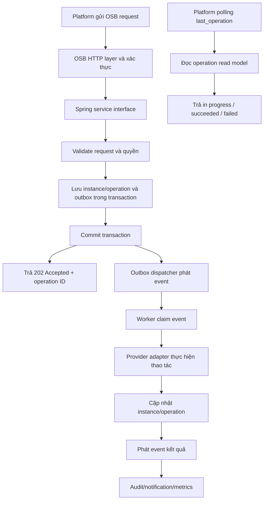
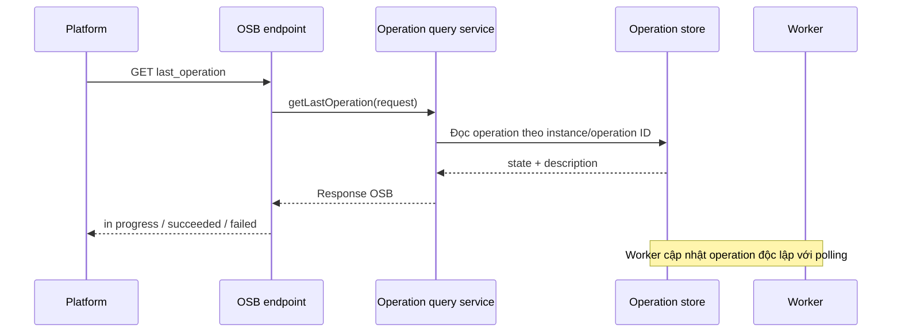
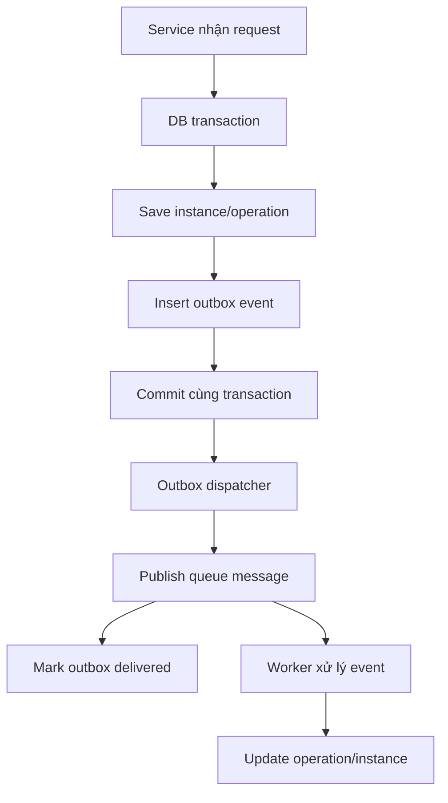

# Event flow cho cấp phát, cập nhật, thu hồi và last operation

Service broker thường phải phối hợp nhiều thành phần để quản lý một service instance: HTTP endpoint của Open Service Broker API (OSB API), service layer của Spring, database nội bộ, worker, provider adapter và hệ thống cấp phát tài nguyên bên ngoài. Nếu mỗi thành phần tự cập nhật trạng thái mà không có một luồng sự kiện rõ ràng, broker dễ rơi vào tình trạng database báo đã cấp phát nhưng provider chưa tạo tài nguyên, worker xử lý lặp, hoặc platform polling nhận kết quả không nhất quán.

Event flow mô tả cách một yêu cầu đi qua các thành phần và cách các thay đổi trạng thái được thông báo, lưu trữ, xử lý tiếp. Với Spring Cloud Open Service Broker, framework nhận request OSB và gọi các service interface tương ứng. Ứng dụng có thể mở rộng luồng này bằng domain event của chính mình, Spring application event, message broker hoặc transactional outbox.

Một điểm cần phân biệt ngay từ đầu: các domain event trong bài là event nội bộ do ứng dụng định nghĩa. Chúng không phải endpoint hoặc tên event bắt buộc của OSB API. Endpoint `last_operation` là một truy vấn để platform đọc trạng thái operation đã lưu; nó không khởi chạy lại provision, update hay deprovision và cũng không phải webhook nhận event từ broker.

## Mục tiêu học tập

Sau bài này, bạn có thể:

- Mô tả luồng request từ OSB endpoint qua service interface của Spring tới provider.
- Thiết kế domain event cho provision, update và deprovision.
- Phân biệt event yêu cầu xử lý, event kết quả và trạng thái operation.
- Chọn xử lý đồng bộ hoặc bất đồng bộ dựa trên thời gian thực thi.
- Dùng transaction và transactional outbox để không mất event sau khi lưu trạng thái.
- Thiết kế listener/worker có idempotency, kiểm soát thứ tự và retry.
- Xây dựng `last_operation` như một read model nhất quán cho platform polling.
- Theo dõi toàn bộ luồng bằng operation ID, correlation ID và metric.

## 1. Những thành phần tham gia vào event flow

Trong một ứng dụng Spring Cloud Service Broker, luồng xử lý thường có các thành phần sau:

| Thành phần | Trách nhiệm |
|---|---|
| OSB HTTP layer | Nhận request catalog, provision, update, deprovision hoặc last operation; kiểm tra giao thức và ánh xạ request thành model. |
| Spring service interface | Điểm mở rộng nghiệp vụ như `ServiceInstanceService` và `LastOperationService`. |
| Application/domain service | Kiểm tra chính sách, quyền tenant, plan, parameters và điều phối vòng đời instance. |
| Repository | Lưu instance, operation, revision và lịch sử trạng thái. |
| Domain event publisher | Tạo event nội bộ để thông báo một yêu cầu hoặc thay đổi nghiệp vụ. |
| Outbox/queue | Lưu và chuyển event bền vững tới worker hoặc hệ thống khác. |
| Worker/listener | Claim event, thực hiện bước nghiệp vụ và xử lý retry/reconciliation. |
| Provider adapter | Gọi API database, cloud, Kubernetes hoặc nhà cung cấp tài nguyên. |
| Operation query/read model | Trả trạng thái cho endpoint `last_operation`. |

Framework xử lý phần giao thức OSB và gọi các service interface mà ứng dụng triển khai. Domain event, outbox, worker và provider adapter thường là phần kiến trúc ứng dụng cần xây dựng theo nhu cầu. Không nên mặc định Spring Cloud Open Service Broker tự tạo một event bus bền vững hoặc tự retry mọi listener.

### 1.1. Phân biệt request, event và operation

- **Request** là yêu cầu HTTP mà platform gửi theo OSB API, ví dụ `PUT /v2/service_instances/{instance_id}`.
- **Event** là thông báo về một sự kiện nghiệp vụ, ví dụ `ServiceInstanceProvisionRequested` hoặc `ServiceInstanceProvisioned`.
- **Operation** là một lần thực hiện có trạng thái và định danh, đặc biệt quan trọng khi thao tác chạy bất đồng bộ.

Một request provision có thể tạo operation `op-123`, ghi event `ServiceInstanceProvisionRequested`, rồi worker xử lý provider. Khi hoàn tất, broker cập nhật operation thành `SUCCEEDED` và phát event `ServiceInstanceProvisioned`. Platform không cần biết tên event nội bộ; platform theo dõi operation qua response OSB và `last_operation`.

## 2. Luồng tổng quát từ OSB request tới provider

Một luồng bất đồng bộ điển hình có thể biểu diễn như sau:



Thứ tự quan trọng là trạng thái và event phải được ghi bền vững trước khi broker xác nhận đã tiếp nhận operation. Nếu broker trả `202 Accepted` nhưng process dừng trước khi lưu operation hoặc event, platform có thể polling một operation không tồn tại hoặc operation không bao giờ được worker xử lý.

Trong luồng đồng bộ, service có thể gọi provider và chờ kết quả trong cùng request nếu thao tác đủ nhanh. Khi đó broker trả response cuối thay vì `202`. Domain event vẫn có thể được phát sau khi commit để audit hoặc cập nhật hệ thống phụ trợ.

## 3. Provision: từ yêu cầu tạo instance tới event hoàn tất

Provision thường bắt đầu từ request:

```http
PUT /v2/service_instances/instance-123?accepts_incomplete=true HTTP/1.1
X-Broker-API-Version: 2.17
Content-Type: application/json

{
  "service_id": "postgres-service",
  "plan_id": "standard-plan",
  "parameters": {
    "database_name": "orders",
    "storage_gb": 100
  }
}
```

OSB layer ánh xạ request thành model provision rồi gọi service interface do ứng dụng cung cấp, thường là `ServiceInstanceService`. Service layer kiểm tra service/plan, parameters, tenant, quota và idempotency trước khi quyết định tạo tài nguyên.

### 3.1. Các bước trong provision flow

1. Xác thực platform và kiểm tra request theo OSB API version.
2. Xác minh `instance_id`, `service_id`, `plan_id`, parameters và quyền tenant.
3. Tra cứu instance để nhận diện request lặp hoặc xung đột.
4. Tạo instance record ở trạng thái nội bộ `PROVISIONING`.
5. Tạo operation record ở trạng thái `QUEUED` hoặc `IN_PROGRESS`.
6. Ghi event `ServiceInstanceProvisionRequested` vào outbox cùng transaction.
7. Commit dữ liệu; nếu request cho phép async, trả `202 Accepted` và operation ID.
8. Worker nhận event và gọi provider adapter.
9. Khi provider hoàn tất, lưu provider resource ID, cấu hình đã xác nhận và trạng thái instance `ACTIVE`.
10. Cập nhật operation `SUCCEEDED`, sau đó phát event kết quả `ServiceInstanceProvisioned`.

Nếu provider thất bại, worker phân loại lỗi. Lỗi tạm thời có thể chuyển operation sang `RETRY_WAIT`; kết quả timeout chưa rõ cần `RECONCILING`; lỗi vĩnh viễn có thể kết thúc `FAILED` sau khi xử lý tài nguyên tạo dở. Không phát event `ServiceInstanceProvisioned` trước khi provider state và bản ghi nội bộ đã được xác minh.

### 3.2. Ví dụ event nội bộ

Event yêu cầu provision có thể chứa dữ liệu như sau:

```json
{
  "event_id": "evt-9001",
  "event_type": "ServiceInstanceProvisionRequested",
  "schema_version": 1,
  "aggregate_type": "ServiceInstance",
  "aggregate_id": "instance-123",
  "operation_id": "op-provision-123",
  "correlation_id": "req-7c91",
  "occurred_at": "2026-11-27T10:30:00Z",
  "payload": {
    "service_id": "postgres-service",
    "plan_id": "standard-plan",
    "parameters_reference": "config://operations/op-provision-123"
  }
}
```

Đây là event schema nội bộ minh họa, không phải JSON body của OSB API. Event chỉ nên chứa dữ liệu cần để xử lý. Nếu parameters có password hoặc secret, chỉ gửi secret reference hoặc mã định danh được bảo vệ; không đưa secret thô vào queue, event log hay dead-letter record.

## 4. Update: điều phối thay đổi và giữ revision nhất quán

Update service instance thường đến từ `PATCH /v2/service_instances/{instance_id}`. Request có thể yêu cầu đổi plan hoặc parameters. Trước khi tạo event, broker cần xác minh instance đang ở trạng thái cho phép update, plan mới thuộc đúng service và parameters hợp lệ.

Một flow update tham khảo:

1. Đọc instance và revision hiện tại.
2. Validate quyền, plan, parameters, quota và khả năng update.
3. Kiểm tra không có operation xung đột đang chạy trên cùng instance.
4. Tạo operation update với revision nguồn và cấu hình đích.
5. Ghi `ServiceInstanceUpdateRequested` vào outbox.
6. Worker claim operation và gọi provider adapter.
7. Provider thực hiện thay đổi; worker xác minh kết quả và health.
8. Commit cấu hình mới/revision mới và operation terminal state.
9. Phát `ServiceInstanceUpdated` hoặc `ServiceInstanceUpdateFailed` theo kết quả.

### 4.1. Event update cần mang ý định, không chỉ mang dữ liệu tùy ý

Event nên tham chiếu tới cấu hình đích đã validate và revision mà update bắt đầu từ đó. Ví dụ:

```json
{
  "event_id": "evt-9002",
  "event_type": "ServiceInstanceUpdateRequested",
  "schema_version": 1,
  "aggregate_id": "instance-123",
  "operation_id": "op-update-124",
  "expected_revision": 4,
  "target_revision": 5,
  "payload": {
    "target_plan_id": "large-plan",
    "configuration_reference": "config://operations/op-update-124"
  }
}
```

Worker cần kiểm tra `expected_revision` hoặc version của instance trước khi commit. Nếu instance đã thay đổi bởi operation khác, worker không được ghi đè cấu hình mới bằng kết quả cũ. Dùng optimistic locking, sequence number hoặc cơ chế tuần tự hóa theo `instance_id`.

### 4.2. Update thất bại và event kết quả

Nếu provider chỉ thay đổi một phần, broker cần reconciliation hoặc compensation trước khi quyết định trạng thái instance. Event `ServiceInstanceUpdateFailed` nên phản ánh kết quả đã xác minh và mã lỗi an toàn. Không phát thông báo “instance vẫn active” nếu broker chưa xác nhận cấu hình hiện tại thực sự hoạt động.

## 5. Deprovision: event thu hồi tài nguyên và xử lý lặp

Deprovision thường đến từ:

```http
DELETE /v2/service_instances/instance-123?accepts_incomplete=true HTTP/1.1
X-Broker-API-Version: 2.17
```

Broker phải xác minh instance và quyền của caller, sau đó tạo operation deprovision. Event nội bộ có thể là `ServiceInstanceDeprovisionRequested`.

### 5.1. Luồng thu hồi

1. Tra cứu instance và xác định trạng thái hiện tại.
2. Kiểm tra quyền và các điều kiện deprovision theo chính sách broker.
3. Chặn hoặc tuần tự hóa các thao tác update/bind xung đột.
4. Ghi operation deprovision và event vào outbox.
5. Trả response đồng bộ hoặc `202 Accepted` nếu xử lý nền.
6. Worker gọi provider để xóa tài nguyên và các thành phần phụ thuộc.
7. Xác minh tài nguyên đã bị xóa hoặc đã ở trạng thái không tồn tại theo semantics provider.
8. Đánh dấu instance `DEPROVISIONED`/tombstone và operation `SUCCEEDED`.
9. Phát `ServiceInstanceDeprovisioned` để audit, cập nhật quota và xử lý phụ trợ.

### 5.2. Deprovision lặp phải idempotent

Queue có thể giao lại event hoặc platform có thể gửi lại request sau khi mất response. Worker cần nhận diện instance đã deprovision, không tạo side effect không cần thiết và trả kết quả nhất quán. Nếu provider trả `NotFound`, broker chỉ coi đó là thành công khi hợp đồng deprovision cho phép trạng thái tài nguyên đã không còn được xem là kết quả mong muốn.

Không xóa instance record ngay khi nhận request. Giữ tombstone và operation history đủ lâu để nhận diện retry, ngăn tạo nhầm lại cùng ID và phục vụ audit. Việc dọn dữ liệu cũ thực hiện theo retention policy riêng.

## 6. `last_operation`: truy vấn trạng thái, không phải event handler

Với thao tác bất đồng bộ, broker trả `202 Accepted` và có thể cung cấp `operation` trong response. Platform dùng endpoint `last_operation` để hỏi kết quả của operation:

```http
GET /v2/service_instances/instance-123/last_operation?service_id=postgres-service&plan_id=standard-plan&operation=op-update-124 HTTP/1.1
X-Broker-API-Version: 2.17
```

Response đang chạy:

```json
{
  "state": "in progress",
  "description": "Đang cập nhật cấu hình database"
}
```

Response thành công:

```json
{
  "state": "succeeded",
  "description": "Cập nhật đã hoàn tất"
}
```

Response thất bại:

```json
{
  "state": "failed",
  "description": "Provider không thể áp dụng cấu hình mới"
}
```

`last_operation` đọc operation store hoặc read model tương ứng và ánh xạ trạng thái nội bộ sang ba giá trị chuẩn `in progress`, `succeeded`, `failed`. Các trạng thái nội bộ như `QUEUED`, `RUNNING`, `RETRY_WAIT` và `RECONCILING` đều có thể được ánh xạ thành `in progress`.

### 6.1. Luồng polling



Polling không phát lại `ServiceInstanceProvisionRequested`, không gọi provider và không tạo operation mới. Nếu endpoint polling làm những việc đó, mỗi lần platform hỏi trạng thái có thể lặp side effect và phá vỡ idempotency.

### 6.2. `last_operation` không phải push event

OSB API dùng mô hình platform chủ động hỏi trạng thái (polling). Domain event nội bộ có thể được gửi tới audit system, notification service hoặc worker, nhưng không tự động trở thành webhook OSB cho platform. Nếu cần push notification, đó là tích hợp riêng được hai bên thống nhất, không thay thế hợp đồng `last_operation`.

### 6.3. Operation ID và lịch sử

Nếu broker trả operation ID, ID đó cần ổn định trong toàn bộ vòng đời operation và được tra cứu đúng với `instance_id`. Khi một instance có nhiều operation theo thời gian, không trả nhầm trạng thái operation mới nhất cho request đang hỏi operation cũ. Nếu API/platform không gửi operation ID trong một trường hợp cụ thể, broker cần bảo đảm cách xác định operation hiện hành phù hợp với hợp đồng và không để nhiều operation xung đột chạy đồng thời trên một instance.

## 7. Event nội bộ trong Spring: ApplicationEvent và listener

Spring cung cấp `ApplicationEventPublisher` để ứng dụng phát event trong phạm vi application context. Listener có thể đăng ký bằng `@EventListener`. Với xử lý cần chạy sau khi transaction commit, ứng dụng imperative có thể dùng `@TransactionalEventListener(phase = AFTER_COMMIT)`.

Ví dụ event nội bộ do ứng dụng định nghĩa:

```java
public record ServiceInstanceProvisionRequested(
        String eventId,
        String instanceId,
        String operationId,
        String correlationId
) {}
```

Phát event:

```java
publisher.publishEvent(new ServiceInstanceProvisionRequested(
        eventId,
        instanceId,
        operationId,
        correlationId
));
```

Listener imperative có thể đăng ký sau commit:

```java
@Component
public class ProvisionEventListener {

    @TransactionalEventListener(phase = TransactionPhase.AFTER_COMMIT)
    public void onProvisionRequested(ServiceInstanceProvisionRequested event) {
        // Chuyển giao công việc hoặc gọi coordinator theo thiết kế ứng dụng.
    }
}
```

Đây là event và listener do ứng dụng định nghĩa, không phải tên class event bắt buộc của Spring Cloud Open Service Broker. `@TransactionalEventListener` giúp tránh chạy listener khi transaction rollback, nhưng event in-process không phải message queue bền vững. Nếu process dừng sau commit nhưng trước khi listener thực hiện xong, ứng dụng có thể mất công việc cần xử lý.

### 7.1. Khi nào dùng Spring application event?

Phù hợp cho thông báo nội bộ trong cùng application, ví dụ:

- Cập nhật metric hoặc audit không quan trọng tới tính đúng đắn của tài nguyên.
- Làm mới cache sau khi trạng thái đã commit.
- Kích hoạt một bước phụ trợ nhẹ có thể chạy lại hoặc bỏ qua.
- Tách module nghiệp vụ trong cùng process mà không tạo phụ thuộc gọi trực tiếp.

Không nên dùng listener in-process làm cơ chế duy nhất cho provision/deprovision quan trọng nếu yêu cầu đảm bảo công việc tồn tại qua restart, deploy hoặc crash.

### 7.2. Async listener và lỗi

`@Async` có thể chuyển listener sang executor khác, nhưng cần cấu hình thread pool, queue capacity, exception handling và shutdown behavior. Việc thêm `@Async` không biến event thành durable. Khi executor đầy hoặc process dừng, event có thể không được xử lý như mong đợi.

Với tác vụ quan trọng, dùng outbox và queue bền vững; Spring event có thể đóng vai trò thông báo phụ trong cùng process.

## 8. Transactional outbox: giữ dữ liệu và event nhất quán

Một lỗi thường gặp là lưu instance/operation trong database rồi gửi message tới queue bằng hai thao tác độc lập:

1. Database commit thành công.
2. Broker crash trước khi publish event.

Khi đó operation tồn tại nhưng worker không bao giờ nhận được việc. Trường hợp ngược lại cũng nguy hiểm: message được publish nhưng transaction database rollback, worker nhận event cho một operation không tồn tại.

Transactional outbox giải quyết khoảng trống này bằng cách ghi bản ghi nghiệp vụ và bản ghi event vào cùng một transaction database. Một dispatcher đọc outbox chưa gửi và publish tới queue sau commit.

### 8.1. Luồng outbox



Nếu transaction rollback, cả operation và outbox event đều không tồn tại. Nếu dispatcher crash sau khi publish nhưng trước khi đánh dấu delivered, event có thể được publish lần nữa; consumer phải idempotent.

### 8.2. Bảng outbox tham khảo

| Cột | Ý nghĩa |
|---|---|
| `event_id` | ID duy nhất để consumer nhận diện event trùng. |
| `aggregate_type` | Loại aggregate, ví dụ `ServiceInstance`. |
| `aggregate_id` | ID instance dùng để phân vùng/thứ tự event. |
| `event_type` | Loại event nghiệp vụ. |
| `schema_version` | Phiên bản payload. |
| `payload` | Dữ liệu event đã được lọc secret. |
| `created_at` | Thời điểm ghi event. |
| `published_at` | Thời điểm dispatcher xác nhận publish. |
| `attempt_count` | Số lần dispatcher thử gửi. |
| `next_attempt_at` | Thời điểm thử gửi tiếp theo. |

Dispatcher nên claim bản ghi nguyên tử, giới hạn số event mỗi batch, retry publish có backoff và chuyển event lỗi kéo dài sang dead-letter hoặc trạng thái cần xử lý. Không xóa event ngay sau publish nếu hệ thống cần audit/replay; áp dụng retention phù hợp.

### 8.3. Ví dụ reactive transaction

Với repository reactive, có thể dùng `TransactionalOperator` để lưu instance, operation và outbox trong cùng reactive transaction:

```java
public Mono<ProvisionAccepted> acceptProvision(ProvisionCommand command) {
    return transactionalOperator.transactional(
            instanceRepository.save(command.toProvisioningInstance())
                    .then(operationRepository.save(command.toQueuedOperation()))
                    .then(outboxRepository.save(command.toProvisionRequestedEvent()))
                    .thenReturn(new ProvisionAccepted(command.operationId()))
    );
}
```

Đây là skeleton minh họa; các repository phải tham gia cùng transaction manager/connection phù hợp. Chỉ sau khi transaction commit thành công, response handler mới trả `202 Accepted`. Dispatcher riêng đọc outbox và gửi event tới queue.

## 9. Listener và worker: delivery ít nhất một lần, xử lý idempotent

Hầu hết message broker và outbox dispatcher thực tế cần chấp nhận khả năng event được giao nhiều lần. Không nên giả định mỗi event chỉ được nhận đúng một lần. Thiết kế phổ biến là at-least-once delivery kết hợp consumer idempotent.

Worker có thể xử lý theo trình tự:

1. Đọc message và xác thực schema/version.
2. Kiểm tra `event_id` đã được xử lý chưa.
3. Claim operation theo `operation_id` và `instance_id` bằng transaction/lease.
4. Kiểm tra trạng thái hiện tại và điều kiện transition.
5. Gọi provider với idempotency key ổn định.
6. Lưu kết quả và event kết quả/outbox trong transaction.
7. Đánh dấu message đã xử lý sau khi dữ liệu cần thiết được commit.

Ví dụ bảng inbox có unique constraint trên `consumer_name` và `event_id`. Khi message đến lần thứ hai, worker nhận ra event đã được xử lý và không thực hiện side effect lại.

### 9.1. Không tuyên bố exactly-once end-to-end

Transaction database không thể tự bảo đảm một side effect bên ngoài như tạo database trên cloud được thực hiện đúng một lần. Nếu provider đã tạo resource nhưng broker crash trước khi lưu kết quả, worker có thể phải gọi lại. Cần provider idempotency key, resource name ổn định hoặc reconciliation để đạt hiệu quả tương đương một lần trong phạm vi nghiệp vụ.

### 9.2. Ordering theo service instance

Provision, update và deprovision trên cùng instance thường có thứ tự phụ thuộc. Nếu `DeprovisionRequested` chạy trước một `UpdateRequested` cũ, worker update có thể tạo lại hoặc sửa tài nguyên đang bị xóa.

Có thể phân vùng queue theo `aggregate_id`, dùng sequence/revision, hoặc cho phép một operation active trên mỗi instance. Worker cần từ chối event có sequence cũ hơn trạng thái hiện tại. Deprovision thường cần chặn các operation mới và chờ operation xung đột kết thúc hoặc được hủy theo chính sách.

## 10. Quản lý trạng thái operation và phát event kết quả

Operation store là nguồn trạng thái để phục vụ `last_operation`. Event là phương tiện thông báo thay đổi cho worker hoặc hệ thống khác. Hai phần cần được cập nhật nhất quán.

Một state model nội bộ có thể gồm:

| State nội bộ | OSB `last_operation.state` |
|---|---|
| `QUEUED` | `in progress` |
| `RUNNING` | `in progress` |
| `RETRY_WAIT` | `in progress` |
| `RECONCILING` | `in progress` |
| `SUCCEEDED` | `succeeded` |
| `FAILED` | `failed` |

Khi worker hoàn tất, transaction nên cập nhật operation, instance và outbox event kết quả cùng nhau. Ví dụ provision thành công:

```json
{
  "event_id": "evt-9003",
  "event_type": "ServiceInstanceProvisioned",
  "schema_version": 1,
  "aggregate_id": "instance-123",
  "operation_id": "op-provision-123",
  "result": {
    "instance_state": "ACTIVE",
    "provider_resource_id": "db-8841"
  }
}
```

Event kết quả không cần chứa credentials. Nếu một consumer cần thông tin binding, consumer nên lấy qua cơ chế có phân quyền và secret reference phù hợp.

Không phát event thành công trước khi operation state được commit. Nếu event kết quả được dùng để kích hoạt workflow khác, event đó phải đại diện cho trạng thái đã lưu bền vững.

## 11. Thiết kế `last_operation` trong Spring

Spring Cloud Open Service Broker cung cấp extension point cho truy vấn last operation, thường thông qua `LastOperationService`. Handler nhận request model, tra cứu operation và trả response model tương ứng. Phần mapping nên tập trung trong một service để mọi loại thao tác có cách diễn giải nhất quán.

Ví dụ ở mức khái niệm:

```java
public Mono<GetLastServiceOperationResponse> getLastOperation(
        GetLastServiceOperationRequest request) {

    return operationRepository.findForInstanceAndOperation(
                    request.getServiceInstanceId(),
                    request.getOperation())
            .switchIfEmpty(Mono.error(new OperationNotFoundException()))
            .map(operation -> GetLastServiceOperationResponse.builder()
                    .state(toOsbState(operation.state()))
                    .description(safeDescription(operation))
                    .build());
}
```

Đây là ví dụ minh họa cách tổ chức; tên accessor/builder có thể khác theo phiên bản Spring Cloud Open Service Broker đang dùng. Hãy kiểm tra API của dependency trong dự án khi triển khai. Ý nghĩa kiến trúc vẫn giữ nguyên: endpoint đọc operation đã lưu và không gọi provider.

### 11.1. Mapping state và description

Description nên ngắn, ổn định và không tiết lộ nội bộ. Ví dụ:

- `QUEUED`: “Đã tiếp nhận yêu cầu và đang chờ xử lý”.
- `RUNNING`: “Đang tạo tài nguyên”.
- `RETRY_WAIT`: “Đang chờ nhà cung cấp sẵn sàng để tiếp tục”.
- `RECONCILING`: “Đang xác minh trạng thái tài nguyên”.
- `SUCCEEDED`: “Thao tác đã hoàn tất”.
- `FAILED`: “Không thể hoàn tất thao tác theo yêu cầu”.

Không trả stack trace, URL quản trị nội bộ, SQL, access token hoặc secret trong description. Mã lỗi chi tiết và exception đã làm sạch có thể lưu trong log/audit nội bộ theo chính sách truy cập.

### 11.2. Polling không được đọc trạng thái cache cũ vô thời hạn

Nếu `last_operation` đọc từ cache, cần có invalidation hoặc TTL phù hợp để platform nhận trạng thái mới sau khi worker commit. Với operation quan trọng, ưu tiên nguồn dữ liệu có tính nhất quán phù hợp. Không cache `in progress` quá lâu sau khi operation đã terminal.

Nếu broker trả `Retry-After`, giá trị nên dựa trên thời gian xử lý dự kiến và tải hệ thống. Polling quá thường xuyên không làm worker hoàn tất nhanh hơn.

## 12. Đồng bộ và bất đồng bộ trong cùng event architecture

Không phải mọi operation đều cần queue. Quyết định sync/async phụ thuộc thời gian xử lý, khả năng provider và hợp đồng OSB API.

| Trường hợp | Cách xử lý | Response |
|---|---|---|
| Kiểm tra/ghi nhận hoàn tất nhanh | Service gọi nghiệp vụ/provider và commit kết quả trong request | Response thành công cuối cùng. |
| Provider cần thời gian dài và platform cho phép async | Lưu operation + outbox, trả response sớm, worker tiếp tục | `202 Accepted` và operation ID nếu có. |
| Broker bắt buộc async nhưng platform không gửi `accepts_incomplete=true` | Không tạo công việc nền mà platform không thể theo dõi theo hợp đồng | `422 Unprocessable Entity` với lỗi `AsyncRequired`. |
| Event phụ trợ như audit/cache | Phát sau commit hoặc dispatch từ outbox | Không làm thay đổi response nghiệp vụ đã trả. |

Với thao tác sync, nếu provider call thất bại trước khi trả response, broker cần cập nhật trạng thái nội bộ và xử lý tài nguyên dở dang. Với thao tác async, operation state và outbox phải được lưu trước `202`. Trong cả hai trường hợp, event kết quả chỉ phát sau khi trạng thái đã được xác nhận.

## 13. Lỗi listener, retry và dead-letter

Listener/worker có thể thất bại vì provider timeout, lỗi schema, thiếu credential, database tạm thời không khả dụng hoặc code bug. Cần phân loại lỗi:

| Loại lỗi | Hành động |
|---|---|
| Tạm thời | Retry có giới hạn, exponential backoff, jitter và tôn trọng `Retry-After`. |
| Kết quả provider chưa rõ | Chuyển `RECONCILING`, tra cứu provider trước khi gửi lại side effect. |
| Lỗi nghiệp vụ/vĩnh viễn | Ghi operation `FAILED` sau khi xác định trạng thái tài nguyên và cleanup cần thiết. |
| Event schema không hỗ trợ | Đưa dead-letter, cảnh báo và triển khai consumer tương thích; không bỏ qua âm thầm. |
| Event trùng | Inbox/idempotency nhận diện và không lặp side effect. |

Dead-letter queue không phải nơi xóa lỗi. Cần lưu lý do, event ID, attempt, thời điểm, consumer version và hướng dẫn replay. Khi replay, worker vẫn phải kiểm tra trạng thái instance/operation vì trạng thái có thể đã thay đổi kể từ lần xử lý trước.

## 14. Observability: theo dấu một lifecycle qua nhiều thành phần

Một operation có thể đi qua HTTP request, database, outbox dispatcher, queue, worker và provider. Nếu mỗi thành phần tạo ID riêng mà không liên kết, rất khó tìm nguyên nhân sự cố.

Nên duy trì các trường:

- `instance_id`: định danh service instance.
- `operation_id`: định danh lần provision/update/deprovision.
- `event_id`: định danh từng event cụ thể.
- `correlation_id`: nối các log cùng một request/workflow.
- `causation_id`: chỉ event hoặc command đã tạo ra event hiện tại.
- `aggregate_version`: thứ tự thay đổi của instance.
- `provider_request_id`: ID do provider trả về nếu có.

Metric nên theo dõi số operation theo state, tuổi operation, độ trễ từ request tới worker, outbox backlog, queue lag, listener retry, dead-letter count, thời gian provider và tỷ lệ `last_operation` trả `in progress`. Cảnh báo khi operation treo, outbox chưa publish quá lâu hoặc event kết quả không được tạo.

Log và event payload không được chứa credentials, password, token hoặc secret. Dùng secret reference và dữ liệu đã làm sạch; giới hạn quyền đọc log/audit theo tenant và vai trò vận hành.

## 15. Những lỗi thiết kế thường gặp

- **Publish event trước khi lưu operation:** worker có thể nhận event nhưng không tìm thấy trạng thái cần xử lý.
- **Commit database rồi publish trực tiếp không có outbox:** crash ở giữa làm mất event.
- **Coi Spring application event là durable queue:** event in-process có thể mất khi process dừng.
- **Không idempotent listener:** queue redelivery tạo database, user hoặc binding trùng.
- **Không tuần tự hóa theo instance:** update và deprovision có thể chạy đồng thời và ghi đè nhau.
- **Phát event thành công quá sớm:** provider chưa hoàn tất hoặc database chưa commit nhưng consumer khác đã hành động.
- **Dùng `last_operation` để khởi chạy công việc:** polling gây lặp side effect.
- **Trả state nội bộ trực tiếp:** platform nhận `QUEUED` hoặc `RETRY_WAIT` thay vì ba state OSB chuẩn.
- **Không lưu operation ID và lịch sử:** broker trả nhầm trạng thái khi instance có nhiều operation.
- **Đưa secret vào event:** queue, dead-letter và audit trở thành nơi rò rỉ credentials.
- **Replay dead-letter không kiểm tra state:** event cũ có thể tác động lên instance đã update hoặc deprovision.
- **Không theo dõi correlation ID:** không thể nối request platform với provider call và event kết quả.

## 16. Checklist triển khai event flow

- [ ] OSB HTTP layer gọi đúng service interface của Spring Cloud Open Service Broker.
- [ ] Domain event được phân biệt với request OSB và operation record.
- [ ] Event name, schema version và aggregate ID được định nghĩa rõ.
- [ ] Provision/update/deprovision validate và authorize trước side effect.
- [ ] Instance, operation và outbox event được ghi trong cùng transaction.
- [ ] Chỉ trả `202 Accepted` sau khi operation/event đã được lưu bền vững.
- [ ] Worker claim event nguyên tử, có lease và idempotency.
- [ ] Provider call dùng idempotency key hoặc reconciliation khi kết quả chưa rõ.
- [ ] Update/deprovision được tuần tự hóa theo instance hoặc kiểm soát revision.
- [ ] Event kết quả chỉ phát sau khi trạng thái đã commit.
- [ ] `last_operation` chỉ đọc operation store và ánh xạ sang `in progress`, `succeeded`, `failed`.
- [ ] Polling không tạo event hoặc gọi provider.
- [ ] Retry có giới hạn; lỗi kéo dài có dead-letter và quy trình replay.
- [ ] Event payload, log và description không chứa secret.
- [ ] Có correlation ID, metric, tracing và cảnh báo cho operation/outbox bị treo.
- [ ] Kiểm thử crash giữa commit/publish, duplicate delivery, ordering và provider timeout.

## 17. Bài tập tự luyện

### Bài tập 1: Thiết kế provision event flow

Platform gửi provision với `accepts_incomplete=true`. Hãy xác định những bản ghi cần lưu trước khi trả `202`, event nào được tạo và worker cần cập nhật những state nào sau khi provider hoàn tất.

### Bài tập 2: Crash giữa database và queue

Broker commit instance và operation thành công nhưng process dừng trước khi publish message. Hãy giải thích transactional outbox giải quyết tình huống này ra sao và vì sao consumer vẫn phải idempotent.

### Bài tập 3: Update cạnh tranh với deprovision

Một event update cũ được giao sau event deprovision mới. Hãy đề xuất cách dùng aggregate version, queue partition hoặc operation lock để ngăn update tác động lên instance đã thu hồi.

### Bài tập 4: Last operation

Worker đang ở `RETRY_WAIT`, platform gọi `last_operation`. Hãy xác định response OSB cần trả và giải thích vì sao endpoint này không được publish lại event provision.

### Bài tập 5: Spring listener hay outbox?

Một event chỉ dùng để làm mới cache và một event dùng để tạo database. Hãy chọn cơ chế xử lý cho từng event, nêu lý do và cách xử lý khi listener thất bại.

## Kết luận

Event flow giúp service broker tách việc tiếp nhận request OSB khỏi các bước xử lý provider và hệ thống phụ trợ. Spring Cloud Open Service Broker cung cấp các service interface cho provision, update, deprovision và last operation; ứng dụng bổ sung domain event, listener, worker và outbox theo yêu cầu độ tin cậy. Khi instance, operation và outbox được lưu nhất quán, worker idempotent, event được sắp thứ tự theo instance và `last_operation` chỉ đọc trạng thái đã commit, broker có thể xử lý lifecycle bền vững dù provider chậm, message được giao lặp hoặc process restart.
