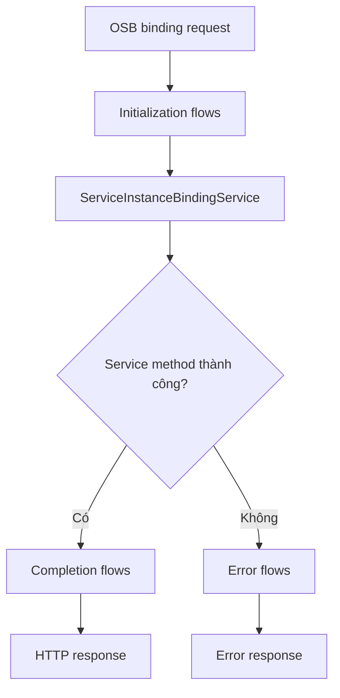
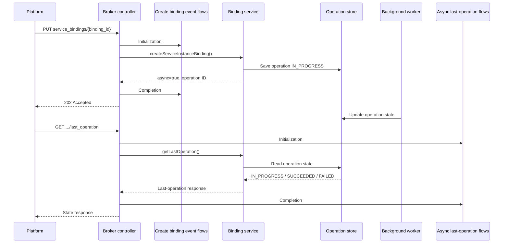

# Event flow cho tạo, hủy binding và truy vấn trạng thái thao tác

## 1. Event flow trong vòng đời service binding

Service binding liên kết một service instance với ứng dụng hoặc consumer. Khi tạo binding, service broker có thể cấp username/password, API key, token, certificate, endpoint hoặc quyền truy cập. Khi hủy binding, broker thu hồi credential và quyền tương ứng. Nếu thao tác được xử lý bất đồng bộ, nền tảng còn gọi endpoint truy vấn trạng thái cho đến khi operation hoàn tất.

Spring Cloud Open Service Broker cung cấp cơ chế *event flow* để mở rộng ba điểm trong quá trình xử lý request:

- **Initialization flow:** chạy ở giai đoạn khởi tạo request, trước khi xử lý nghiệp vụ chính.
- **Completion flow:** chạy sau khi service xử lý thành công và tạo response.
- **Error flow:** chạy khi quá trình xử lý request gặp lỗi.

Với module `SPRING_CLOUD_SERVICE_BROKER`, event flow hữu ích để gắn các tác vụ xuyên suốt như audit, tracing, metric, ghi nhận correlation ID, theo dõi thời gian xử lý và cập nhật hệ thống quan sát. Nó giúp mở rộng luồng xử lý của framework mà không phải đưa mọi logic phụ vào `ServiceInstanceBindingService`.

Event flow là hook chạy trong ứng dụng broker. Nó không phải message broker, không tự tạo background worker và không thay thế nghiệp vụ tạo credential, revoke credential hay truy vấn trạng thái operation.

## 2. Ba pha của một event flow

Mỗi loại request có thể có tối đa ba nhóm flow tương ứng với ba pha:



| Pha | Thời điểm | Ví dụ công việc phù hợp |
|---|---|---|
| Initialization | Trước khi gọi logic create/delete/get last operation. | Tạo trace span, ghi nhận request bắt đầu, gắn correlation ID, tăng metric bắt đầu. |
| Completion | Sau khi service method trả response thành công. | Ghi metric kết quả, audit response status, ghi thời gian xử lý, phát sự kiện quan sát. |
| Error | Khi service method hoặc pipeline xử lý phát sinh lỗi. | Ghi mã lỗi, đo tỷ lệ thất bại, tạo audit failure, phát cảnh báo theo ngưỡng. |

Các flow nhận request model của OSB và, ở pha completion, nhận cả response model. Error flow nhận `Throwable`. Mỗi method trả `Mono<Void>` để framework có thể kết hợp công việc reactive vào pipeline xử lý.

Không nên hiểu completion flow là “mọi tác vụ bất đồng bộ đã hoàn tất”. Với request create/delete binding bất đồng bộ, service method có thể trả response `async=true` ngay khi operation mới được tiếp nhận. Completion flow của request đó chỉ xác nhận request HTTP đã được xử lý và response đã được tạo; nó không xác nhận worker đã cấp hoặc thu hồi xong credential.

## 3. Ba event flow registry dành cho binding

Spring Cloud Open Service Broker 4.4.1 cung cấp ba registry riêng cho vòng đời binding:

| Registry | Request được theo dõi | Mục đích |
|---|---|---|
| `CreateServiceInstanceBindingEventFlowRegistry` | `CreateServiceInstanceBindingRequest` | Hook cho request tạo binding. |
| `DeleteServiceInstanceBindingEventFlowRegistry` | `DeleteServiceInstanceBindingRequest` | Hook cho request hủy binding. |
| `AsyncOperationServiceInstanceBindingEventFlowRegistry` | `GetLastServiceBindingOperationRequest` | Hook cho request polling trạng thái create/delete bất đồng bộ. |

Mỗi registry có ba loại flow tương ứng:

- `...InitializationFlow`
- `...CompletionFlow`
- `...ErrorFlow`

Tên interface cụ thể được ghép với loại request. Ví dụ, create binding có `CreateServiceInstanceBindingInitializationFlow`, `CreateServiceInstanceBindingCompletionFlow` và `CreateServiceInstanceBindingErrorFlow`. Delete binding và last-operation retrieval cũng có bộ interface riêng.

```mermaid
flowchart TB
    Create[PUT service_bindings/{binding_id}]
    Delete[DELETE service_bindings/{binding_id}]
    Poll[GET service_bindings/{binding_id}/last_operation]
    CreateRegistry[CreateServiceInstanceBindingEventFlowRegistry]
    DeleteRegistry[DeleteServiceInstanceBindingEventFlowRegistry]
    AsyncRegistry[AsyncOperationServiceInstanceBindingEventFlowRegistry]
    Create --> CreateRegistry
    Delete --> DeleteRegistry
    Poll --> AsyncRegistry
```

Không dùng registry của service instance để đăng ký hook cho binding. Ví dụ `CreateServiceInstanceEventFlowRegistry` theo dõi provisioning instance, còn `CreateServiceInstanceBindingEventFlowRegistry` theo dõi việc cấp quyền cho một consumer cụ thể.

## 4. Event flow cho tạo binding

Nền tảng gọi `createServiceInstanceBinding()` khi ứng dụng yêu cầu kết nối tới một service instance. Spring chuyển HTTP request thành `CreateServiceInstanceBindingRequest` và gọi implementation của `ServiceInstanceBindingService`.

Các interface của create flow:

| Interface | Method | Dữ liệu nhận được |
|---|---|---|
| `CreateServiceInstanceBindingInitializationFlow` | `initialize(request)` | `CreateServiceInstanceBindingRequest` |
| `CreateServiceInstanceBindingCompletionFlow` | `complete(request, response)` | Request và `CreateServiceInstanceBindingResponse` |
| `CreateServiceInstanceBindingErrorFlow` | `error(request, throwable)` | Request và lỗi phát sinh |

### 4.1. Công việc phù hợp ở từng pha

**Initialization** có thể ghi nhận thời điểm bắt đầu, service instance ID, binding ID, platform ID và trace context. Không ghi credential hoặc toàn bộ parameters nếu chúng có thể chứa dữ liệu nhạy cảm.

**Completion** có thể ghi nhận binding đã được tạo hoặc request đã được tiếp nhận bất đồng bộ. Nếu response có `async=true`, metric nên phân biệt “request accepted” với “binding ready”. Trạng thái hoàn tất cuối cùng được xác định qua last-operation polling.

**Error** có thể ghi mã lỗi đã được chuẩn hóa, loại exception và thời gian xử lý. Không chuyển một request thất bại thành thành công bằng cách bỏ qua lỗi trong event flow.

### 4.2. Ví dụ tạo flow bean

Các interface event flow của framework có method mặc định; vì vậy ví dụ dùng anonymous class để override method:

```java
import org.springframework.cloud.servicebroker.model.binding.CreateServiceInstanceBindingRequest;
import org.springframework.cloud.servicebroker.service.events.flows.CreateServiceInstanceBindingInitializationFlow;
import org.springframework.context.annotation.Bean;
import org.springframework.context.annotation.Configuration;
import reactor.core.publisher.Mono;

@Configuration
class CreateBindingEventConfiguration {

    @Bean
    CreateServiceInstanceBindingInitializationFlow createBindingAuditStart(
            BindingAuditService auditService) {
        return new CreateServiceInstanceBindingInitializationFlow() {
            @Override
            public Mono<Void> initialize(CreateServiceInstanceBindingRequest request) {
                return auditService.recordStarted(
                        request.getServiceInstanceId(),
                        request.getBindingId(),
                        request.getPlatformInstanceId());
            }
        };
    }
}
```

`BindingAuditService` là service nội bộ của ứng dụng. Bean flow trả về `Mono<Void>` của audit service để công việc được đưa vào reactive pipeline. Không gọi `.subscribe()` bên trong flow; framework chịu trách nhiệm subscribe pipeline của request.

## 5. Event flow cho hủy binding

Khi nền tảng gọi `deleteServiceInstanceBinding()`, broker phải thu hồi credential và quyền truy cập được cấp riêng cho binding. Spring chuyển request thành `DeleteServiceInstanceBindingRequest`.

Các interface của delete flow:

| Interface | Method | Dữ liệu nhận được |
|---|---|---|
| `DeleteServiceInstanceBindingInitializationFlow` | `initialize(request)` | `DeleteServiceInstanceBindingRequest` |
| `DeleteServiceInstanceBindingCompletionFlow` | `complete(request, response)` | Request và `DeleteServiceInstanceBindingResponse` |
| `DeleteServiceInstanceBindingErrorFlow` | `error(request, throwable)` | Request và lỗi phát sinh |

Ví dụ công việc:

- Initialization: ghi nhận yêu cầu revoke, tạo trace span và lưu dấu thời gian bắt đầu.
- Completion: ghi nhận broker đã hoàn tất xử lý request hoặc đã tiếp nhận operation bất đồng bộ.
- Error: ghi nhận provider lỗi, timeout hoặc không thể thu hồi credential.

Không đặt toàn bộ logic revoke trong completion flow. Nghiệp vụ thu hồi credential phải nằm trong `deleteServiceInstanceBinding()` hoặc application service mà method này gọi. Completion flow chỉ thực hiện tác vụ phụ sau khi service method trả response.

Ví dụ flow ghi nhận lỗi:

```java
import org.springframework.cloud.servicebroker.model.binding.DeleteServiceInstanceBindingRequest;
import org.springframework.cloud.servicebroker.service.events.flows.DeleteServiceInstanceBindingErrorFlow;
import org.springframework.context.annotation.Bean;
import org.springframework.context.annotation.Configuration;
import reactor.core.publisher.Mono;

@Configuration
class DeleteBindingEventConfiguration {

    @Bean
    DeleteServiceInstanceBindingErrorFlow deleteBindingFailureAudit(
            BindingAuditService auditService) {
        return new DeleteServiceInstanceBindingErrorFlow() {
            @Override
            public Mono<Void> error(
                    DeleteServiceInstanceBindingRequest request, Throwable error) {
                return auditService.recordFailure(
                        request.getServiceInstanceId(),
                        request.getBindingId(),
                        error.getClass().getSimpleName());
            }
        };
    }
}
```

Ví dụ chỉ ghi tên lớp exception đã chuẩn hóa. Không ghi trực tiếp `error.getMessage()` nếu message có thể chứa URL nội bộ, SQL, credential hoặc dữ liệu do provider trả về.

## 6. Event flow cho truy vấn trạng thái operation

Nếu create hoặc delete binding có thể trả response bất đồng bộ, broker cần triển khai `getLastOperation()` của `ServiceInstanceBindingService`. Nền tảng polling endpoint:

```http
GET /v2/service_instances/{instance_id}/service_bindings/{binding_id}/last_operation
```

Spring ánh xạ request thành `GetLastServiceBindingOperationRequest`. Registry tương ứng là `AsyncOperationServiceInstanceBindingEventFlowRegistry`.

| Interface | Method | Dữ liệu nhận được |
|---|---|---|
| `AsyncOperationServiceInstanceBindingInitializationFlow` | `initialize(request)` | `GetLastServiceBindingOperationRequest` |
| `AsyncOperationServiceInstanceBindingCompletionFlow` | `complete(request, response)` | Request và `GetLastServiceBindingOperationResponse` |
| `AsyncOperationServiceInstanceBindingErrorFlow` | `error(request, throwable)` | Request và lỗi phát sinh |

Ví dụ completion flow đo trạng thái polling:

```java
import org.springframework.cloud.servicebroker.model.binding.GetLastServiceBindingOperationRequest;
import org.springframework.cloud.servicebroker.model.binding.GetLastServiceBindingOperationResponse;
import org.springframework.cloud.servicebroker.service.events.flows.AsyncOperationServiceInstanceBindingCompletionFlow;
import org.springframework.context.annotation.Bean;
import org.springframework.context.annotation.Configuration;
import reactor.core.publisher.Mono;

@Configuration
class BindingOperationEventConfiguration {

    @Bean
    AsyncOperationServiceInstanceBindingCompletionFlow bindingOperationMetric(
            BindingMetrics metrics) {
        return new AsyncOperationServiceInstanceBindingCompletionFlow() {
            @Override
            public Mono<Void> complete(
                    GetLastServiceBindingOperationRequest request,
                    GetLastServiceBindingOperationResponse response) {
                return metrics.recordPoll(
                        request.getServiceInstanceId(),
                        request.getBindingId(),
                        response.getState());
            }
        };
    }
}
```

`BindingMetrics` là thành phần nội bộ minh họa. Nếu metric label có cardinality cao, chẳng hạn binding ID hoặc instance ID, hãy cân nhắc ghi các ID đó vào trace/log thay vì dùng làm label metric.

## 7. Phân biệt event flow của request và công việc bất đồng bộ

Có ba luồng riêng biệt cần phân biệt:

1. Request create/delete binding được xử lý bởi `ServiceInstanceBindingService` và các event flow tương ứng.
2. Công việc dài như tạo user, cấp token hoặc revoke ACL được thực hiện bởi application service/worker và được theo dõi bằng operation store.
3. Request GET last operation được xử lý bởi `getLastOperation()` và `AsyncOperationServiceInstanceBindingEventFlowRegistry`.



Event flow không phải nơi giữ trạng thái operation. Trạng thái phải được lưu bền vững trong database hoặc kho dùng chung để request polling đến replica khác vẫn đọc được. Event flow chỉ quan sát và mở rộng từng request trong pipeline.

Với unbind bất đồng bộ, response last operation thành công cần đánh dấu `deleteOperation(true)` cùng `OperationState.SUCCEEDED`; framework ánh xạ trường hợp đó thành HTTP `410 Gone`. Event flow completion của last-operation chỉ được gọi sau khi response đã được tạo; nó không tự quyết định trạng thái thành công.

## 8. Đăng ký flow bằng Spring bean

Spring Cloud Open Service Broker hỗ trợ hai cách đăng ký event flow phổ biến.

### 8.1. Khai báo bean cho từng flow

Đây là cách phù hợp khi muốn tách mỗi hook thành một component độc lập. Framework tự nhận diện các bean theo interface và thêm chúng vào registry tương ứng.

Ví dụ bean có thể được khai báo trong `@Configuration`:

```java
@Bean
CreateServiceInstanceBindingCompletionFlow createBindingCompletionAudit(
        BindingAuditService auditService) {
    return new CreateServiceInstanceBindingCompletionFlow() {
        @Override
        public Mono<Void> complete(
                CreateServiceInstanceBindingRequest request,
                CreateServiceInstanceBindingResponse response) {
            return auditService.recordAccepted(
                    request.getServiceInstanceId(), request.getBindingId());
        }
    };
}
```

Có thể khai báo nhiều flow cùng một interface nếu các trách nhiệm độc lập, ví dụ một flow ghi audit và một flow ghi metric. Hãy đặt tên bean có ý nghĩa để tránh nhầm lẫn khi quan sát Spring application context.

### 8.2. Autowire registry và đăng ký trực tiếp

Ứng dụng cũng có thể inject ba registry:

```java
CreateServiceInstanceBindingEventFlowRegistry createRegistry;
DeleteServiceInstanceBindingEventFlowRegistry deleteRegistry;
AsyncOperationServiceInstanceBindingEventFlowRegistry asyncRegistry;
```

Sau đó gọi `addInitializationFlow()`, `addCompletionFlow()` hoặc `addErrorFlow()` để đăng ký flow. Các phương thức `add...` trả về `Mono<Void>`, do đó phải bảo đảm thao tác đăng ký được thực thi trong lifecycle khởi tạo phù hợp. Không tạo các lệnh `.subscribe()` rời rạc trong request handler hoặc mỗi lần có binding mới.

### 8.3. Tránh vô tình thay thế auto-configuration

Framework tự cấu hình các registry và tập hợp các flow bean. Nếu ứng dụng khai báo một bean mới cùng kiểu registry, bean đó có thể thay thế registry auto-configured. Khi đó, những flow bean khác có thể không còn được đăng ký như dự kiến.

Chỉ tạo custom registry bean khi thực sự muốn kiểm soát toàn bộ registry và biết rõ cần giữ những flow nào. Với nhu cầu thêm audit, metrics hoặc trace, khai báo flow bean riêng thường đơn giản và ít rủi ro hơn.

## 9. Chọn công việc phù hợp cho từng hook

| Nhu cầu | Hook phù hợp | Lý do |
|---|---|---|
| Ghi audit request bắt đầu | Initialization | Có request context trước khi service xử lý. |
| Tạo trace span hoặc gắn correlation | Initialization | Bao phủ thời gian xử lý chính. |
| Ghi metric response thành công | Completion | Có response để phân loại kết quả. |
| Ghi nhận request async được tiếp nhận | Completion | Có thể đọc cờ async và operation ID từ response. |
| Ghi audit khi provider lỗi | Error | Có request và exception. |
| Đo số lần polling | Async initialization/completion | Phân biệt polling với create/delete request. |
| Theo dõi trạng thái operation trả về | Async completion | Có response last-operation. |
| Ghi lỗi khi đọc operation store | Async error | Có request polling và exception. |

Không nên dùng event flow để:

- Cấp credential thay cho `createServiceInstanceBinding()`.
- Revoke credential thay cho `deleteServiceInstanceBinding()`.
- Tạo hoặc cập nhật operation state thay cho worker/application service.
- Tự trả HTTP response hoặc sửa status code của controller.
- Thực hiện tác vụ không idempotent mà không có operation key.

Các tác vụ nghiệp vụ cần nằm trong service/application layer. Event flow chỉ bổ sung hành vi xuyên suốt request và không nên trở thành một nơi điều phối vòng đời thứ hai.

## 10. Xử lý lỗi trong event flow

Error flow hữu ích để ghi nhận lỗi nhưng bản thân nó cũng có thể gặp lỗi. Ví dụ, audit database tạm thời không khả dụng đúng lúc provider từ chối tạo credential.

Các nguyên tắc:

1. Không để lỗi ghi metric làm che mất exception nghiệp vụ ban đầu.
2. Không ném một exception mới thiếu ngữ cảnh nếu chỉ cần ghi nhận lỗi phụ.
3. Phân biệt lỗi của operation chính với lỗi của telemetry/audit.
4. Chuẩn hóa mã lỗi và loại exception; tránh ghi stack trace hoặc thông tin bí mật vào response.
5. Nếu audit bắt buộc phải bền vững vì yêu cầu tuân thủ, hãy thiết kế outbox hoặc durable audit path trong application service thay vì phụ thuộc duy nhất vào một hook best-effort.

Ví dụ ghi nhận lỗi an toàn:

```java
@Override
public Mono<Void> error(
        CreateServiceInstanceBindingRequest request, Throwable error) {
    return auditService.recordFailure(
            request.getServiceInstanceId(),
            request.getBindingId(),
            error.getClass().getSimpleName());
}
```

Nếu audit service không thể ghi, quyết định tiếp tục hay thất bại request phải được xác định rõ theo chính sách hệ thống. Không tự động chuyển mọi lỗi audit thành `Mono.empty()` nếu audit là yêu cầu bắt buộc; cũng không để một lỗi telemetry không quan trọng làm mất kết quả xử lý binding.

## 11. Reactive flow và thứ tự thực thi

Các interface event flow dùng Reactor `Mono<Void>`. Hãy trả về publisher đại diện cho công việc cần hoàn tất, thay vì gọi tác vụ blocking trực tiếp trên reactive thread.

Ví dụ:

```java
@Override
public Mono<Void> initialize(CreateServiceInstanceBindingRequest request) {
    return auditRepository.insertStartedEvent(
            request.getServiceInstanceId(), request.getBindingId());
}
```

Nếu một thư viện audit chỉ có API blocking, hãy đưa phần blocking vào scheduler phù hợp hoặc chuyển nó sang adapter chuyên dụng. Không gọi `block()` bên trong event flow vì có thể làm nghẽn WebFlux event loop.

Registry giữ danh sách các flow và cung cấp chúng dưới dạng `Flux`. Không nên dựa vào thứ tự chạy giữa nhiều flow độc lập nếu nghiệp vụ yêu cầu thứ tự nghiêm ngặt. Nếu bước B bắt buộc chỉ chạy sau bước A, hãy kết hợp chúng trong một flow hoặc một application service có chuỗi `then()` rõ ràng.

Mỗi flow nên ngắn, có timeout hợp lý và có khả năng chịu lỗi. Tránh gọi provider quản trị lâu dài trong completion flow nếu điều đó làm response của nền tảng bị trì hoãn không cần thiết.

## 12. Idempotency, concurrency và bảo mật

Nền tảng có thể retry create/delete binding khi timeout hoặc mất kết nối. Event flow cũng có thể được gọi nhiều lần cho các request retry hợp lệ. Vì vậy:

- Dùng `binding_id`, `instance_id` và `platformInstanceId` làm khóa tương quan phù hợp.
- Không giả định mỗi request chỉ xuất hiện một lần.
- Dùng idempotency key cho audit event hoặc outbox để tránh ghi sự kiện trùng không kiểm soát.
- Không tạo credential hoặc revoke credential trong flow telemetry.
- Không ghi password, API key, token, certificate private key hoặc toàn bộ credentials map.
- Kiểm soát quyền truy cập vào log, trace và audit store.
- Không dùng binding ID làm metric label nếu số lượng binding lớn và tăng liên tục.

Request object có thể chứa parameters hoặc context do nền tảng gửi. Chỉ ghi các trường cần thiết cho vận hành và đã được chuẩn hóa. Dữ liệu `originatingIdentity` hoặc tenant context có thể nhạy cảm; áp dụng chính sách masking và retention tương ứng.

## 13. Kiểm thử event flow

Kiểm thử nên bao phủ từng registry và từng pha, đồng thời xác minh hook không làm thay đổi nghiệp vụ binding.

| Trường hợp | Kết quả cần xác minh |
|---|---|
| Create binding thành công | Initialization và completion flow được gọi đúng request/response. |
| Create binding thất bại | Error flow nhận đúng request và exception. |
| Delete binding thành công | Delete initialization/completion flow được gọi. |
| Delete binding thất bại | Delete error flow ghi nhận lỗi phù hợp. |
| Create trả async | Completion flow ghi nhận request accepted; không đánh dấu credential đã sẵn sàng nếu chưa hoàn tất. |
| Delete trả async | Completion flow phân biệt accepted với revoke hoàn tất. |
| Poll last operation | Async initialization/completion flow nhận đúng request và response. |
| Poll last operation gặp lỗi | Async error flow được gọi. |
| Nhiều flow cùng loại | Mỗi flow được đăng ký và thực thi theo cấu hình; không phụ thuộc thứ tự không được cam kết. |
| Audit service lỗi | Hành vi của pipeline tuân thủ chính sách lỗi audit đã chọn. |
| Broker restart | Event flow bean được cấu hình lại; operation state vẫn được đọc từ persistence. |
| Secret protection | Không có credential trong log, metric hoặc description. |

Unit test có thể gọi flow method trực tiếp với request/response model được tạo bằng builder. Integration test nên gửi HTTP request qua controller auto-configured để xác minh registry thực sự được framework sử dụng.

Ví dụ kiểm thử initialization flow:

```java
StepVerifier.create(flow.initialize(request))
        .verifyComplete();

verify(auditService).recordStarted(
        request.getServiceInstanceId(), request.getBindingId(),
        request.getPlatformInstanceId());
```

Ví dụ trên giả định dùng Reactor Test và Mockito. Cần kiểm tra cả side effect và publisher completion; chỉ xác minh method được gọi chưa đủ để chứng minh reactive operation đã kết thúc.

## 14. Các lỗi thiết kế thường gặp

- **Dùng nhầm registry:** đăng ký create/delete binding hook vào registry của service instance. Hãy dùng đúng registry có `Binding` trong tên.
- **Nhầm completion với async completion:** completion của DELETE request có thể chỉ là broker đã trả `202`; trạng thái revoke cuối cùng được đọc ở last-operation flow.
- **Đưa nghiệp vụ chính vào event flow:** khiến luồng cấp/revoke credential bị phân tán và khó kiểm thử. Giữ nghiệp vụ trong `ServiceInstanceBindingService` và application service.
- **Tạo custom registry không cần thiết:** có thể thay thế auto-configuration và làm mất flow bean khác. Ưu tiên khai báo flow bean riêng.
- **Dùng `subscribe()` tùy tiện:** tạo tác vụ ngoài pipeline, khó kiểm soát lỗi và lifecycle. Trả `Mono<Void>` để framework điều phối.
- **Dựa vào thứ tự của nhiều flow:** các flow trong registry được hợp nhất thành `Flux`; nếu cần thứ tự, kết hợp logic trong một flow rõ ràng.
- **Ghi secret vào audit:** có thể làm lộ credential qua log hoặc hệ thống giám sát. Chỉ ghi ID và mã trạng thái đã chuẩn hóa.
- **Không kiểm thử error flow:** khiến lỗi provider không được ghi nhận hoặc lỗi audit làm sai hành vi request.

## 15. Checklist triển khai

1. Dùng đúng `CreateServiceInstanceBindingEventFlowRegistry` cho create.
2. Dùng đúng `DeleteServiceInstanceBindingEventFlowRegistry` cho delete.
3. Dùng `AsyncOperationServiceInstanceBindingEventFlowRegistry` cho last-operation polling.
4. Chọn initialization, completion và error hook theo đúng thời điểm cần mở rộng.
5. Giữ logic cấp/revoke credential trong `ServiceInstanceBindingService` hoặc application service.
6. Trả `Mono<Void>` và không `block()` hoặc `subscribe()` ngoài pipeline.
7. Đăng ký flow bean riêng khi chỉ cần mở rộng một số hook.
8. Chỉ tạo registry bean tùy chỉnh khi chủ động thay thế auto-configuration.
9. Tách trạng thái operation bền vững khỏi event flow.
10. Thiết kế audit, metric và trace có idempotency, masking và retention.
11. Kiểm thử success, error, async accepted, last operation và nhiều replica.
12. Theo dõi thời gian flow, lỗi flow, số lần polling và độ trễ operation.

## 16. Nguyên tắc cần ghi nhớ

- Event flow là hook reactive cho các pha initialization, completion và error của request binding.
- Create, delete và last-operation polling có ba registry riêng.
- `CreateServiceInstanceBindingEventFlowRegistry` theo dõi tạo binding.
- `DeleteServiceInstanceBindingEventFlowRegistry` theo dõi hủy binding.
- `AsyncOperationServiceInstanceBindingEventFlowRegistry` theo dõi truy vấn trạng thái operation bất đồng bộ.
- Mỗi flow nhận đúng request model; completion nhận thêm response, error nhận `Throwable`.
- Event flow không thay thế service method hoặc background worker thực hiện cấp/revoke credential.
- Bean flow được framework tự nhận diện; custom registry có thể thay thế auto-configuration.
- Dùng reactive pipeline, idempotency và masking để event flow an toàn trong môi trường nhiều replica.

## Nguồn tham khảo

- [Spring Cloud Open Service Broker 4.4.1 – Service Binding Event Flow Configuration](https://docs.spring.io/spring-cloud-open-service-broker/docs/4.4.1/reference/#service-binding-event-flow-configuration): cách autowire registry, đăng ký flow bean và cấu hình create/delete/last-operation.
- [CreateServiceInstanceBindingEventFlowRegistry – API](https://docs.spring.io/spring-cloud-open-service-broker/docs/4.4.1/apidocs/org/springframework/cloud/servicebroker/service/events/CreateServiceInstanceBindingEventFlowRegistry.html): registry cho create binding và ba nhóm flow.
- [DeleteServiceInstanceBindingEventFlowRegistry – API](https://docs.spring.io/spring-cloud-open-service-broker/docs/4.4.1/apidocs/org/springframework/cloud/servicebroker/service/events/DeleteServiceInstanceBindingEventFlowRegistry.html): registry cho delete binding.
- [AsyncOperationServiceInstanceBindingEventFlowRegistry – API](https://docs.spring.io/spring-cloud-open-service-broker/docs/4.4.1/apidocs/org/springframework/cloud/servicebroker/service/events/AsyncOperationServiceInstanceBindingEventFlowRegistry.html): registry cho polling last operation của binding.
- [EventFlowRegistry – API](https://docs.spring.io/spring-cloud-open-service-broker/docs/4.4.1/apidocs/org/springframework/cloud/servicebroker/service/events/EventFlowRegistry.html): các method `addInitializationFlow`, `addCompletionFlow` và `addErrorFlow`.
- [Open Service Broker API v2.17](https://github.com/cloudfoundry/servicebroker/blob/v2.17/spec.md): hợp đồng create binding, delete binding và polling last operation.
