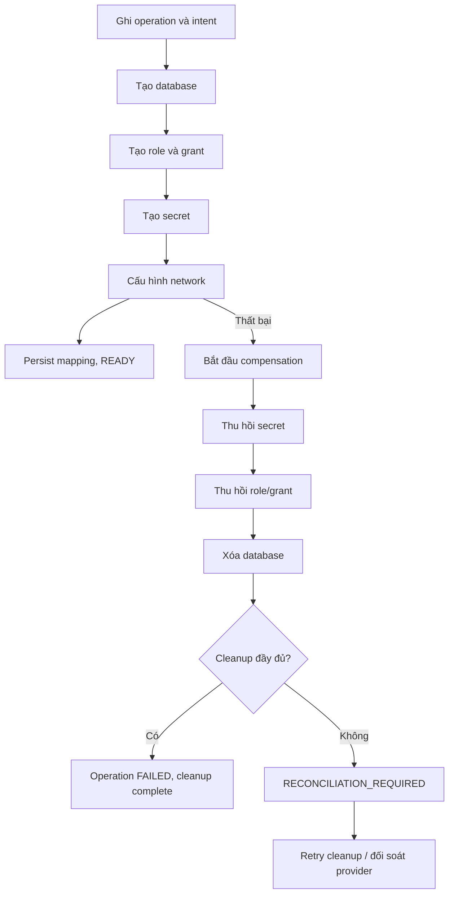

# Phản hồi lỗi khi thao tác đã tạo ra tác động một phần

## Vấn đề: request thất bại nhưng provider đã thay đổi tài nguyên

Một thao tác của service broker thường gồm nhiều bước trên các hệ thống khác nhau. Khi provision PostgreSQL, broker có thể tạo database, tạo role, cấp quyền, cấu hình network, ghi secret và lưu ánh xạ `instance_id` vào database nội bộ. Nếu bước cấu hình network thất bại sau khi database và role đã được tạo, request không còn ở trạng thái “chưa làm gì”. Một phần tài nguyên đã tồn tại và có thể phát sinh chi phí hoặc quyền truy cập.

Tình huống tương tự xảy ra khi:

- **Provision:** database đã tạo nhưng broker chưa lưu được `provider_resource_id`.
- **Update:** dung lượng đã tăng nhưng bước thay đổi cấu hình hoặc restart thất bại.
- **Bind:** role và credential đã tạo nhưng broker lỗi khi ghi binding record.
- **Unbind:** credential đã bị thu hồi nhưng policy mạng chưa được xóa.
- **Deprovision:** database đã xóa nhưng volume hoặc snapshot vẫn còn.

Trong các trường hợp này, broker phải trả lời hai câu hỏi riêng: request theo hợp đồng OSB API đã thành công hay thất bại, và tài nguyên thực tế sau lỗi đang ở trạng thái nào. Một HTTP error không tự động hoàn tác side effect đã xảy ra ở provider.

Module `SPRING_CLOUD_SERVICE_BROKER` xây dựng service broker theo Open Service Broker API bằng Spring Cloud Open Service Broker. Để xử lý lỗi một phần an toàn, ứng dụng cần kết hợp phân loại lỗi, compensation, operation log, idempotency, reconciliation và response đúng hợp đồng. Mục tiêu là giữ trạng thái nền tảng và provider có thể đối chiếu được, tránh báo thành công khi tài nguyên chưa sẵn sàng và tránh che giấu tài nguyên mồ côi.

## Nguyên tắc của OSB API đối với lỗi và side effect

OSB API quy định broker phải trả HTTP status phù hợp và response lỗi có thể chứa `error` cùng `description`. Hai quy tắc quan trọng chi phối cách xử lý lỗi một phần:

- Với status thuộc nhóm **4xx**, tài nguyên của broker **MUST** không thay đổi về mặt ngữ nghĩa do request đó gây ra, trừ khi đặc tả nêu rõ ngoại lệ.
- Với status thuộc nhóm **5xx**, tài nguyên của broker **SHOULD** không thay đổi về mặt ngữ nghĩa. Đặc tả dùng `SHOULD` vì có tình huống broker không thể bảo đảm đảo ngược mọi side effect của một thao tác đã thất bại.

Điều này dẫn đến một quy tắc thực tế: hãy hoàn tất validation và kiểm tra điều kiện trước khi tạo side effect. Nếu request không hợp lệ, trả lỗi 4xx khi trạng thái tài nguyên vẫn chưa bị thay đổi. Nếu lỗi phát sinh sau khi đã gọi provider, broker phải thử compensation hoặc phục hồi để đưa hệ thống về trạng thái ngữ nghĩa ban đầu. Nếu không thể bảo đảm điều đó, cần ghi nhận chính xác phần đã xảy ra, trả lỗi phía server phù hợp và chuẩn bị cho reconciliation/orphan mitigation.

Không nên trả `400`, `409` hoặc `422` sau khi đã tạo database, cấp credential hay thay đổi tài nguyên rồi bỏ mặc chúng. Các mã 4xx thể hiện request bị từ chối; nền tảng có thể không thực hiện orphan mitigation cho những lỗi này vì theo hợp đồng tài nguyên được kỳ vọng chưa bị thay đổi.

## Phân loại lỗi trước và sau side effect

Trước khi chọn HTTP status, hãy xác định thao tác đã đi đến bước nào:

| Nhóm lỗi | Ví dụ | Tình trạng tài nguyên | Hướng phản hồi |
|---|---|---|---|
| Lỗi đầu vào trước side effect | JSON sai, thiếu `service_id`, plan không hợp lệ, tham số vượt quota. | Chưa có thay đổi do request. | Trả 4xx và error code phù hợp. |
| Lỗi chính sách trước side effect | Plan không hỗ trợ update, thiếu quyền, instance đang bị operation khác khóa. | Trạng thái hiện tại được giữ nguyên. | Trả 4xx theo hợp đồng, ví dụ `ConcurrencyError` hoặc `AsyncRequired` khi đúng điều kiện. |
| Lỗi provider có thể compensation hoàn toàn | Tạo database thành công nhưng tạo user thất bại; broker xóa được database vừa tạo. | Có thể đưa về trạng thái ban đầu. | Ghi nhận compensation, sau đó trả lỗi phù hợp; không tuyên bố thành công. |
| Lỗi provider không thể compensation hoàn toàn | Volume đã mở rộng không thể thu nhỏ; cluster đã tạo nhưng API cleanup cũng lỗi. | Có side effect còn tồn tại hoặc trạng thái chưa xác định. | Ghi nhận trạng thái một phần, trả lỗi server nếu request đồng bộ và chạy reconciliation. |
| Thao tác dài đã được tiếp nhận | Broker đã lưu operation và job, provider đang xử lý. | Operation chưa terminal. | Nếu request có `accepts_incomplete=true`, trả `202 Accepted`, rồi báo kết quả qua `last_operation`. |
| Thao tác bất đồng bộ kết thúc thất bại | Provision tạo được một phần tài nguyên rồi worker thất bại. | Có thể còn tài nguyên một phần. | Trả `state: failed` qua `last_operation`, giữ dấu vết và xử lý orphan/cleanup. |

Phân loại phải dựa trên bằng chứng từ provider và operation log. Timeout không chứng minh provider chưa thực hiện thao tác. Nếu broker không biết provider đã tạo tài nguyên hay chưa, trạng thái đúng là “chưa xác định” và cần reconciliation, không phải tự động đánh dấu “chưa có side effect”.

## Response lỗi chuẩn: `error` và `description`

Response lỗi OSB API sử dụng JSON. `error` là mã ngắn theo camel case để nhận diện điều kiện lỗi; `description` là thông điệp hướng tới người dùng hoặc nền tảng để giải thích nguyên nhân.

Ví dụ lỗi tham số trước khi provision:

```http
HTTP/1.1 422 Unprocessable Entity
Content-Type: application/json
```

```json
{
  "error": "InvalidStorageSize",
  "description": "Plan standard chỉ hỗ trợ dung lượng từ 10 đến 100 GB."
}
```

Ví dụ lỗi nội bộ sau khi provider đã tạo một phần tài nguyên và broker không thể xác nhận compensation hoàn tất:

```http
HTTP/1.1 500 Internal Server Error
Content-Type: application/json
```

```json
{
  "error": "ProviderProvisioningFailed",
  "description": "Không thể hoàn tất provision. Broker đang đối soát các tài nguyên đã tạo và sẽ xử lý phần còn lại."
}
```

Mã `ProviderProvisioningFailed` là mã tùy chọn do broker định nghĩa, không phải mã chuẩn bắt buộc của OSB API. Khi đặc tả đã quy định mã cụ thể cho một tình huống, phải dùng đúng mã đó. Ví dụ:

| Error code | Khi dùng |
|---|---|
| `AsyncRequired` | Broker chỉ có thể thực hiện thao tác bất đồng bộ nhưng request không có `accepts_incomplete=true`. |
| `ConcurrencyError` | Broker không thể xử lý đồng thời các request thay đổi cùng resource. |
| `RequiresApp` | Broker yêu cầu `app_guid` nhưng request bind không có trường này. |
| `MaintenanceInfoConflict` | Phiên bản maintenance trong request không khớp catalog. |

Không dùng các mã chuẩn này để mô tả một lỗi khác chỉ vì tên có vẻ gần nghĩa. Nếu lỗi không thuộc tình huống đã định nghĩa, broker có thể dùng mã riêng theo quy ước camel case.

## Vì sao không nên trả 4xx sau khi đã thay đổi provider?

Nền tảng diễn giải 4xx là request bị từ chối. OSB API yêu cầu tài nguyên broker không bị thay đổi về mặt ngữ nghĩa khi trả 4xx. Bảng orphan mitigation cũng phân loại các lỗi 4xx thông thường là request rejected và không khởi động dọn orphan.

Ví dụ sai:

1. Broker tạo database `orders` thành công.
2. Broker tạo role thất bại do provider tạm thời lỗi.
3. Broker trả `422 InvalidParameters`.
4. Platform hiểu request đã bị từ chối và không dọn tài nguyên provision dở dang.
5. Database `orders` còn tồn tại nhưng platform không quản lý instance đó.

Nếu lỗi thực sự là tham số không hợp lệ, broker cần phát hiện điều đó ở bước validation trước khi tạo database. Nếu lỗi chỉ xuất hiện sau khi provider đã thực hiện side effect, broker phải compensation hoặc phân loại là lỗi xử lý phía server, đồng thời giữ dấu vết cho quá trình dọn dẹp.

`422` vẫn phù hợp với các điều kiện giao thức như `AsyncRequired` hoặc `ConcurrencyError` khi broker chưa thực hiện thay đổi do request bị từ chối. Không dùng 422 như một cách chung để báo “một phần workflow thất bại”.

## Compensation: hoàn tác bằng một thao tác nghiệp vụ bù

Trong một workflow nhiều bước, compensation là thao tác mới nhằm đảo ngược tác động của những bước đã hoàn tất. Nó không phải rollback ACID tự động vì các bước thường chạy qua nhiều hệ thống.

Ví dụ workflow provision PostgreSQL:

| Bước | Side effect | Compensation tương ứng |
|---|---|---|
| 1 | Tạo database `orders`. | Xóa database nếu chắc chắn thuộc operation này. |
| 2 | Tạo role `orders_app`. | Thu hồi role và các grant của role. |
| 3 | Tạo secret chứa credential. | Thu hồi secret hoặc đánh dấu không còn hiệu lực. |
| 4 | Cấu hình network policy. | Gỡ policy đã tạo. |
| 5 | Ghi mapping instance vào broker. | Chuyển instance sang trạng thái thất bại/cleanup; giữ audit record. |

Nếu bước 4 thất bại, broker có thể chạy compensation ngược thứ tự: gỡ secret, thu hồi role, xóa database. Nếu mọi bước bù đều thành công, tài nguyên do request tạo ra đã được dọn và broker có thể kết thúc operation ở trạng thái thất bại với trạng thái nội bộ rõ ràng.

Nếu xóa database hoặc thu hồi role cũng thất bại, không được ghi nhận compensation hoàn tất. Hãy giữ operation ở trạng thái `CLEANUP_REQUIRED` hoặc `RECONCILIATION_REQUIRED`, lưu ID tài nguyên còn lại và lên lịch retry có kiểm soát.



Compensation phải idempotent. Nếu worker chạy lại bước “xóa database”, việc database đã bị xóa ở lần trước không nên làm workflow thất bại theo cách không thể phục hồi. Tuy nhiên, broker phải xác minh database thuộc instance/operation của mình trước khi xóa; không xóa tài nguyên chỉ vì trùng tên.

## Lưu operation log và checkpoint cho từng side effect

Broker cần lưu tiến độ trước và sau mỗi lời gọi provider. Một operation record có thể gồm:

```text
operation_id
instance_id
binding_id
operation_type
request_fingerprint
state
current_step
completed_steps
provider_resource_ids
compensation_steps
last_provider_error
started_at
updated_at
completed_at
```

Đây là mô hình nội bộ gợi ý. `completed_steps` và `provider_resource_ids` cho phép worker biết side effect nào đã xảy ra; `compensation_steps` cho biết những bước bù nào đã hoàn tất. Không cần lưu nguyên payload có secret; chỉ lưu reference tới secret store.

Ví dụ operation log:

| Step | Trạng thái | Provider reference |
|---|---|---|
| `CREATE_DATABASE` | `SUCCEEDED` | `db-7781` |
| `CREATE_ROLE` | `SUCCEEDED` | `role-992` |
| `CREATE_SECRET` | `SUCCEEDED` | `secret-ref-51` |
| `CONFIGURE_NETWORK` | `FAILED` | `network-policy-creation-timeout` |
| `REVOKE_SECRET` | `SUCCEEDED` | `secret-ref-51` |
| `REVOKE_ROLE` | `PENDING` | `role-992` |
| `DELETE_DATABASE` | `PENDING` | `db-7781` |

Với dữ liệu này, worker có thể tiếp tục cleanup từ `REVOKE_ROLE` sau khi khởi động lại, thay vì tạo lại database hoặc chạy compensation đã hoàn tất. Việc ghi operation/checkpoint cần được commit bền vững trước khi xác nhận job đã xử lý xong.

## Phản hồi cho thao tác đồng bộ bị lỗi một phần

Với thao tác đồng bộ, broker chỉ trả response thành công sau khi hoàn tất công việc theo hợp đồng. Nếu workflow thất bại:

1. Dừng tạo side effect mới.
2. Ghi lại bước thất bại và provider response/reference.
3. Thực hiện compensation cho những bước có thể đảo ngược.
4. Xác minh trạng thái tài nguyên sau compensation.
5. Nếu đã đưa hệ thống về trạng thái ngữ nghĩa ban đầu, trả error response phù hợp.
6. Nếu còn side effect hoặc không xác định được trạng thái, trả lỗi phía server và giữ operation để reconciliation.

Với provision và bind, platform có thể thực hiện orphan mitigation sau một số response thất bại hoặc timeout. Vì vậy broker cần hỗ trợ các yêu cầu cleanup tương ứng một cách an toàn, kể cả khi tài nguyên đã được dọn nội bộ trước đó.

Không trả `201 Created` cho provision hoặc bind nếu tài nguyên chưa sẵn sàng hoặc credential chưa được tạo hoàn chỉnh. Không trả `200 OK` cho update/unbind/deprovision nếu thao tác vẫn còn bước bắt buộc chưa hoàn tất.

## Khi nào chuyển sang bất đồng bộ?

Nếu broker không thể bảo đảm thao tác hoàn tất trước khi trả response, OSB API khuyến nghị dùng mô hình bất đồng bộ. Request phải có `accepts_incomplete=true`; broker ghi operation/job bền vững rồi trả `202 Accepted`. Nền tảng tiếp tục polling `last_operation`.

Ví dụ provision:

```http
PUT /v2/service_instances/inst-orders-001?accepts_incomplete=true HTTP/1.1
Content-Type: application/json
```

```json
{
  "service_id": "svc-postgresql",
  "plan_id": "plan-standard",
  "parameters": {
    "storage_gb": 50
  }
}
```

Broker trả:

```http
HTTP/1.1 202 Accepted
Content-Type: application/json
```

```json
{
  "operation": "provision-op-778"
}
```

Nếu provider thực hiện một phần rồi worker thất bại, endpoint `last_operation` trả trạng thái cuối:

```http
HTTP/1.1 200 OK
Content-Type: application/json
```

```json
{
  "state": "failed",
  "description": "Provision thất bại ở bước cấu hình network; broker đang xử lý cleanup tài nguyên đã tạo."
}
```

Với provision, response `last_operation` không dùng `instance_usable` hoặc `update_repeatable`; hai trường này không áp dụng cho operation provision. Platform có thể cần thực hiện orphan mitigation khi nhận `state: failed` cho provision bất đồng bộ.

Với bind bất đồng bộ, response `202` chỉ chứa operation ID nếu có; không được trả credential binding trước khi bind hoàn tất. Khi `last_operation` báo `failed`, platform có thể cần orphan mitigation cho binding đã tạo một phần.

## `instance_usable` và `update_repeatable` khi update/deprovision thất bại

OSB API định nghĩa hai thuộc tính bổ sung cho lỗi update hoặc deprovision service instance. Chúng giúp nền tảng hiểu tác động còn lại sau thất bại.

### `instance_usable`

`instance_usable` cho biết service instance còn có thể sử dụng hay không sau khi update hoặc deprovision thất bại:

- `true`: instance vẫn có thể được sử dụng.
- `false`: instance không còn sử dụng được.

Ví dụ update thất bại nhưng cấu hình cũ vẫn hoạt động:

```json
{
  "state": "failed",
  "description": "Không thể áp dụng cấu hình mới; cấu hình trước đó vẫn đang hoạt động.",
  "instance_usable": true,
  "update_repeatable": true
}
```

Ví dụ update đã làm database không thể khởi động:

```json
{
  "state": "failed",
  "description": "Cấu hình mới đã được áp dụng một phần và database hiện không thể phục vụ kết nối.",
  "instance_usable": false,
  "update_repeatable": false
}
```

Nếu instance không còn sử dụng được, platform SHOULD NOT cho phép tạo binding mới cho instance cho đến khi instance được xóa hoặc sửa chữa bằng một update tiếp theo. Nếu broker không cung cấp `instance_usable`, platform SHOULD giả định instance vẫn sử dụng được theo mặc định của đặc tả. Vì vậy broker nên cung cấp giá trị khi đã xác định chắc chắn trạng thái thực tế, đặc biệt khi instance đã bị hỏng.

### `update_repeatable`

`update_repeatable` chỉ áp dụng cho update thất bại:

- `true`: cùng request update có thể được thử lại và có khả năng thành công.
- `false`: lặp lại đúng update đó sẽ thất bại lần nữa; platform SHOULD NOT retry cùng yêu cầu.

Ví dụ lỗi tạm thời do provider quá tải có thể cho phép retry sau khi provider phục hồi. Ngược lại, chuyển đổi plan không được hỗ trợ hoặc tham số đích vi phạm chính sách vĩnh viễn không nên được đánh dấu repeatable.

Không được nhầm `update_repeatable` với idempotency. Idempotency bảo đảm request lặp không tạo thêm side effect; `update_repeatable` hướng dẫn platform liệu có nên thử lại một update đã thất bại hay không.

Hai trường này cũng có trong Error response đồng bộ và Last Operation response bất đồng bộ, nhưng chỉ được xuất hiện cho loại thao tác mà đặc tả cho phép:

| Operation thất bại | `instance_usable` | `update_repeatable` |
|---|---|---|
| Provision | Không được gửi | Không được gửi |
| Update | Có thể gửi | Có thể gửi |
| Deprovision | Có thể gửi | Không được gửi |
| Bind | Không được gửi | Không được gửi |
| Unbind | Không được gửi | Không được gửi |

Nếu trạng thái instance chưa xác định vì provider timeout, broker không nên tự đoán `true` hoặc `false`. Cần chạy reconciliation và chỉ trả thông tin có căn cứ. Khi phải trả kết quả lỗi trước khi xác định được trạng thái, broker cần tuân theo default/semantics của OSB API và lưu lại operation để tiếp tục đối soát.

## Orphan mitigation và trách nhiệm của broker

OSB API xác định platform là nguồn sự thật về service instance và binding. Platform kỳ vọng broker chỉ quản lý những tài nguyên mà platform đã ghi nhận. Tài nguyên mồ côi có thể xuất hiện khi:

- Provision hoặc bind đồng bộ thất bại sau khi provider đã tạo một phần tài nguyên.
- Request timeout ở platform trong khi broker/provider vẫn tiếp tục xử lý.
- Provision hoặc bind bất đồng bộ kết thúc với `state: failed`.
- Platform gặp lỗi nội bộ sau khi broker đã tạo tài nguyên nhưng trước khi platform lưu được record.
- Deprovision bất đồng bộ thất bại và tài nguyên vẫn còn.

Trong các tình huống được đặc tả, platform SHOULD thử xóa tài nguyên mà nó không thể chắc chắn đã được tạo thành công và tiếp tục thử cho đến khi broker trả response thành công. Broker cũng MAY tự động dọn những tài nguyên mà nó xác định là orphan.

Một số điểm cần nhớ:

- Với failed provision, platform có thể gọi deprovision để dọn instance được tạo một phần.
- Với failed bind, platform có thể gọi unbind để dọn binding được tạo một phần.
- Với failed update, platform không thực hiện orphan mitigation theo bảng của OSB API; broker phải xử lý trạng thái instance và khả năng usable/repeatable chính xác.
- Với failed deprovision, platform có thể tiếp tục quá trình cleanup instance theo quy tắc orphan mitigation.
- Với `ConcurrencyError`, platform MUST NOT thực hiện orphan mitigation vì request bị từ chối do xung đột thao tác.

Broker phải làm cho deprovision/unbind idempotent và có thể xử lý cả tài nguyên đã được cleanup một phần. Nếu platform gọi dọn một instance mà broker đã xóa nội bộ trước đó, broker cần phản hồi theo semantics của endpoint, không tái tạo tài nguyên và không biến cleanup thành lỗi không thể phục hồi.

## Xử lý lỗi một phần theo từng loại thao tác

| Operation | Ví dụ side effect một phần | Phục hồi phù hợp | Thông tin lỗi cần lưu |
|---|---|---|---|
| Provision | Database đã tạo, role chưa tạo. | Tạo tiếp nếu có thể hoặc xóa database; nếu không rõ kết quả, tra cứu provider. | Resource ID, bước hoàn tất, cleanup state. |
| Update | Storage đã tăng, config chưa đổi. | Tiếp tục update hoặc compensation nếu provider hỗ trợ; xác minh instance còn usable. | Desired/previous state, provider revision, `instance_usable`, `update_repeatable`. |
| Bind | Role và secret đã tạo, binding record chưa commit. | Thu hồi role/secret hoặc hoàn tất persist mapping sau khi xác minh. | Binding ID, credential reference, provider role ID. |
| Unbind | Secret đã thu hồi, role còn tồn tại. | Tiếp tục xóa role/policy; không tạo lại credential. | Các bước cleanup đã xong và còn pending. |
| Deprovision | Database đã xóa, volume còn tồn tại. | Tiếp tục cleanup volume hoặc giữ instance ở trạng thái chưa hoàn tất. | Resource IDs còn lại, `instance_usable`, cleanup progress. |

### Ví dụ update có tác động một phần

Giả sử update một PostgreSQL instance gồm ba bước:

1. Tăng storage từ 20 GB lên 100 GB.
2. Cập nhật cấu hình database.
3. Restart để áp dụng cấu hình.

Provider hoàn tất bước 1 và 2 nhưng restart thất bại. Broker cần xác định database có tiếp tục phục vụ hay không:

- Nếu database vẫn chạy được với cấu hình hiện tại, operation có thể kết thúc `failed`, `instance_usable: true`. `update_repeatable` tùy thuộc lỗi restart có thể khắc phục bằng cách lặp cùng update hay không.
- Nếu database không thể khởi động và cùng update sẽ luôn thất bại do một điều kiện không thể khắc phục, có thể trả `instance_usable: false`, `update_repeatable: false`.
- Nếu provider timeout và chưa xác định được database đang ở trạng thái nào, giữ operation cần reconciliation; không tự đánh dấu instance usable.

Response ví dụ:

```json
{
  "state": "failed",
  "description": "Storage đã mở rộng nhưng database chưa khởi động lại thành công.",
  "instance_usable": false,
  "update_repeatable": true
}
```

Ví dụ này thể hiện update có thể thử lại sau khi xử lý nguyên nhân restart; nó không khẳng định mọi provider đều có thể rollback storage hoặc restart theo cùng cách.

## Ánh xạ lỗi trong Spring Cloud Open Service Broker

Spring Cloud Open Service Broker cung cấp exception và response model để ứng dụng truyền error code cùng thông tin về instance khi update/deprovision thất bại. API cụ thể thay đổi theo phiên bản thư viện, vì vậy cần đối chiếu Javadoc đúng dependency mà dự án sử dụng.

Trong các phiên bản có hỗ trợ, `ServiceBrokerException` có constructor nhận `errorCode`, `message`, `instanceUsable` và `updateRepeatable`. Ví dụ minh họa cho lỗi update đồng bộ:

```java
throw new ServiceBrokerException(
        "ProviderUpdateFailed",
        "Cấu hình mới chỉ được áp dụng một phần; instance cần được phục hồi.",
        false,
        true);
```

Các tham số boolean chỉ nên được truyền cho update/deprovision failure. Không dùng constructor này để thêm `instanceUsable` hoặc `updateRepeatable` vào lỗi provision, bind hoặc unbind.

Với update bất đồng bộ, response `GetLastServiceOperationResponse` có builder method như `operationState(...)`, `instanceUsable(...)` và `updateRepeatable(...)` trong các phiên bản hỗ trợ:

```java
GetLastServiceOperationResponse.builder()
        .operationState(OperationState.FAILED)
        .description("Database không thể khởi động sau khi cập nhật.")
        .instanceUsable(false)
        .updateRepeatable(true)
        .build();
```

Đây là ví dụ theo API model của Spring Cloud Open Service Broker; cần xác nhận import, chữ ký builder và phiên bản framework đang dùng. Với provision hoặc binding thất bại, chỉ trả `operationState(FAILED)` và mô tả phù hợp, không thêm hai thuộc tính dành riêng cho update/deprovision.

Không để exception từ SDK provider tự động đi thẳng ra response OSB. Nên có lớp mapper phân loại lỗi:

```text
ProviderException
      |
      v
ProviderErrorClassifier
      |
      +--> Validation / policy error before side effect
      |       -> OSB 4xx with standard/custom error code
      |
      +--> Transient error with completed compensation
      |       -> OSB server error or async operation failed
      |
      +--> Partial side effect / unknown provider outcome
              -> Persist partial state
              -> Reconciliation / cleanup job
              -> OSB 5xx or last_operation state=failed
```

Các lớp `ProviderErrorClassifier`, `CompensationCoordinator` và `ReconciliationService` là thành phần domain do ứng dụng xây dựng, không phải class bắt buộc của framework.

## Bảo mật khi mô tả lỗi một phần

`description` là thông tin có thể được platform hiển thị cho người dùng. Không đưa vào đó:

- Password, access token, private key hoặc nội dung secret.
- Raw provider response chứa account ID hoặc dữ liệu nội bộ nhạy cảm.
- Stack trace, SQL query, hostname nội bộ hoặc cấu hình network.
- Thông tin xác thực được dùng để gọi provider.

Thông điệp nên mô tả điều người dùng cần biết: thao tác thất bại, tài nguyên còn dùng được hay không nếu đã xác định, và có cần thử lại hay liên hệ vận hành. Chi tiết kỹ thuật cần được lưu trong log có kiểm soát, gắn với `instance_id`, `binding_id`, `operation_id`, provider request ID và step name.

Khi ghi operation log, chỉ lưu secret reference hoặc credential ID. Nếu cần đối chiếu payload, dùng fingerprint/HMAC thay vì ghi dữ liệu bí mật dạng rõ. Audit record cần cho biết side effect nào đã xảy ra, compensation nào đã chạy và ai/operation nào khởi tạo thao tác.

## Kiểm thử failure injection

Kiểm thử lỗi một phần phải chủ động làm hỏng từng bước của workflow để chứng minh broker không trả response gây hiểu nhầm và có thể phục hồi sau restart.

| Kịch bản | Kỳ vọng |
|---|---|
| Validation thất bại trước provider call | Trả 4xx; provider không có side effect. |
| Bước 2 của provision thất bại, compensation thành công | Tài nguyên do operation tạo được dọn; operation ghi nhận thất bại và cleanup hoàn tất. |
| Compensation thất bại | Operation giữ trạng thái cleanup/reconciliation; resource ID còn lại không bị mất. |
| Provider thành công nhưng response timeout | Broker tra cứu hoặc retry idempotent; không tạo resource trùng. |
| Update làm instance unusable | Response failed có `instance_usable: false` khi xác định được. |
| Update không thể retry cùng request | `update_repeatable: false`; platform được hướng dẫn không lặp lại cùng update. |
| Deprovision xóa một phần resource | Instance không bị đánh dấu deprovisioned; cleanup tiếp tục từ checkpoint. |
| Async provision thất bại | `last_operation.state=failed`; broker giữ dấu vết để platform/orphan cleanup có thể xử lý. |
| Async bind thất bại | Không trả credentials; binding partial được cleanup hoặc hỗ trợ orphan mitigation. |
| Request bị từ chối do concurrency | Trả `422` với `ConcurrencyError`; không có side effect và platform không chạy orphan mitigation. |
| Worker restart giữa provider call và persist | Operation được phục hồi bằng idempotency key, provider lookup hoặc reconciliation. |

Các assertion cần kiểm tra:

1. Mọi response 4xx không làm thay đổi tài nguyên về mặt ngữ nghĩa.
2. Mọi response thành công chỉ được trả khi thao tác hoàn tất theo hợp đồng.
3. Side effect đã xảy ra luôn có provider reference hoặc trạng thái cần reconciliation.
4. Compensation có thể chạy lại mà không tạo thêm side effect ngoài ý muốn.
5. Operation không bị đánh dấu terminal thành công trước khi mapping và trạng thái được persist.
6. `instance_usable` và `update_repeatable` chỉ xuất hiện trong update/deprovision failure.
7. Orphan cleanup có thể gọi lại nhiều lần mà không làm hỏng tài nguyên đã được dọn.
8. Log và response không tiết lộ secret.

## Checklist xử lý lỗi có side effect một phần

1. Validate đầy đủ request và policy trước provider call.
2. Phân biệt lỗi 4xx trước side effect với lỗi provider/server sau side effect.
3. Lưu operation ID, request fingerprint và resource mapping trước khi thực hiện workflow dài.
4. Ghi checkpoint cho từng bước provider đã hoàn tất.
5. Dùng compensation theo thứ tự ngược khi có thể đảo ngược an toàn.
6. Nếu compensation thất bại, giữ trạng thái cleanup/reconciliation thay vì xóa dấu vết.
7. Chỉ trả `202` khi có `accepts_incomplete=true` và operation/job đã được lưu bền vững.
8. Với async failure, trả `last_operation.state=failed` và giữ operation record đủ lâu.
9. Dùng `instance_usable` cho update/deprovision failure khi có căn cứ.
10. Dùng `update_repeatable` chỉ cho update failure và phản ánh đúng khả năng retry.
11. Không gửi hai trường trên trong lỗi provision, bind hoặc unbind.
12. Hỗ trợ deprovision/unbind idempotent để platform orphan mitigation có thể chạy lại.
13. Đối soát provider sau timeout hoặc kết quả không xác định.
14. Che secret trong error description, log và operation metadata.
15. Có failure-injection test tại mọi điểm giữa side effect và persist.

## Tài liệu tham khảo

- [Open Service Broker API Specification – Service Broker Errors](https://github.com/cloudfoundry/servicebroker/blob/master/spec.md#service-broker-errors): cấu trúc error response, semantics 4xx/5xx và các mã lỗi chuẩn.
- [Open Service Broker API Specification – Polling Last Operation for Service Instances](https://github.com/cloudfoundry/servicebroker/blob/master/spec.md#polling-last-operation-for-service-instances): trạng thái operation, `instance_usable`, `update_repeatable` và phản hồi khi thao tác bất đồng bộ thất bại.
- [Open Service Broker API Specification – Orphan Mitigation](https://github.com/cloudfoundry/servicebroker/blob/master/spec.md#orphan-mitigation): vai trò của platform và những trường hợp cần dọn service instance/binding mồ côi.
- [Spring Cloud Open Service Broker 5.0.0 – ServiceBrokerException](https://docs.spring.io/spring-cloud-open-service-broker/docs/current/apidocs/org/springframework/cloud/servicebroker/exception/ServiceBrokerException.html): constructor hỗ trợ error code, message, `instanceUsable` và `updateRepeatable`.
- [Spring Cloud Open Service Broker 4.4.1 – GetLastServiceOperationResponse Builder](https://docs.spring.io/spring-cloud-open-service-broker/docs/4.4.1/apidocs/org/springframework/cloud/servicebroker/model/instance/GetLastServiceOperationResponse.GetLastServiceOperationResponseBuilder.html): builder cho operation state, `instanceUsable` và `updateRepeatable`.
