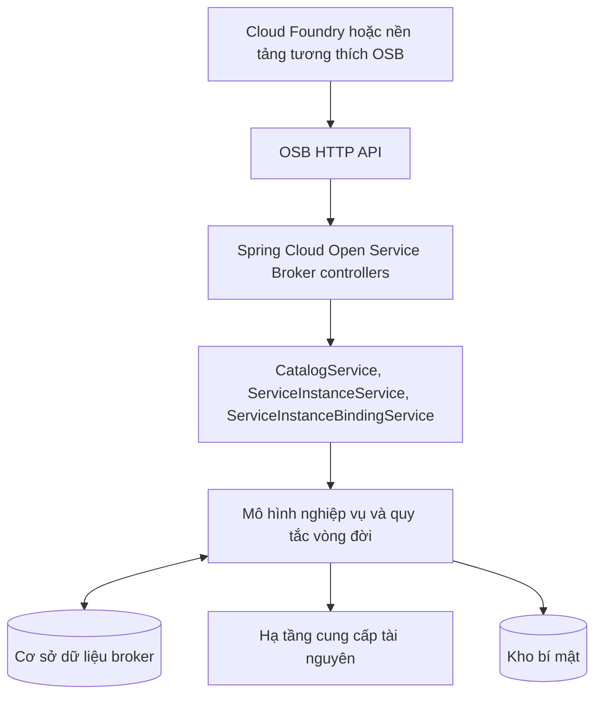
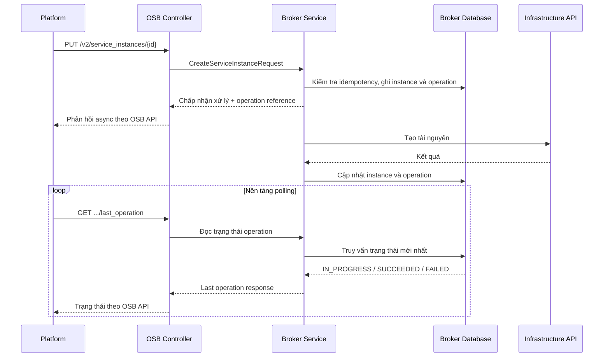

# Controller OSB, mô hình dữ liệu và cơ chế tự cấu hình của Spring Boot

## 1. Bức tranh kiến trúc

Một service broker đứng giữa nền tảng triển khai ứng dụng và hệ thống cung cấp tài nguyên. Nền tảng gửi yêu cầu theo một hợp đồng HTTP thống nhất; broker chuyển yêu cầu đó thành thao tác cụ thể trên cơ sở dữ liệu, cụm Kubernetes, hệ thống cấp tài khoản, dịch vụ quản lý bí mật hoặc một hạ tầng khác. Broker cũng chịu trách nhiệm công bố những dịch vụ và gói dịch vụ mà nền tảng có thể cung cấp cho người dùng.

Open Service Broker API (OSB API) định nghĩa hợp đồng trao đổi này. Spring Cloud Open Service Broker cung cấp các thành phần Spring để xây dựng broker theo hợp đồng OSB API mà không phải tự viết toàn bộ bộ định tuyến HTTP, chuyển đổi JSON và cấu trúc request/response. Ứng dụng vẫn phải triển khai nghiệp vụ: kiểm tra quyền sử dụng plan, lưu trạng thái, tạo tài nguyên thật, sinh thông tin kết nối và thu hồi tài nguyên khi cần.

Có thể hình dung các lớp chính như sau:



Nền tảng chỉ cần hiểu hợp đồng OSB API. Broker có thể thay đổi cách lưu dữ liệu hoặc cách tạo tài nguyên phía sau mà không buộc nền tảng phải biết chi tiết triển khai đó, miễn là hành vi API vẫn đúng hợp đồng.

## 2. OSB API và các nhóm endpoint

Các endpoint tiêu chuẩn nằm dưới tiền tố `/v2`. Những endpoint quan trọng nhất thuộc ba nhóm: catalog, service instance và service instance binding.

| Nhóm | Endpoint tiêu biểu | Ý nghĩa |
|---|---|---|
| Catalog | `GET /v2/catalog` | Công bố danh sách service và plan mà broker hỗ trợ. |
| Provisioning | `PUT /v2/service_instances/{instance_id}` | Tạo một service instance theo service và plan được chọn. |
| Update | `PATCH /v2/service_instances/{instance_id}` | Thay đổi plan hoặc cấu hình của instance khi broker hỗ trợ cập nhật. |
| Deprovisioning | `DELETE /v2/service_instances/{instance_id}` | Thu hồi instance và tài nguyên liên quan. |
| Last operation | `GET /v2/service_instances/{instance_id}/last_operation` | Trả trạng thái của thao tác bất đồng bộ để nền tảng tiếp tục theo dõi. |
| Binding | `PUT /v2/service_instances/{instance_id}/service_bindings/{binding_id}` | Tạo binding giữa instance và ứng dụng hoặc consumer. |
| Unbinding | `DELETE /v2/service_instances/{instance_id}/service_bindings/{binding_id}` | Xóa binding và thu hồi thông tin truy cập được cấp cho binding đó. |

`GET /v2/catalog` thường được gọi khi nền tảng đăng ký broker hoặc làm mới catalog. Phản hồi mô tả các service definition và plan, chứ không phải danh sách instance đang tồn tại. Những thao tác còn lại làm việc với tài nguyên đã được một consumer yêu cầu tạo hoặc sử dụng.

Trong yêu cầu provisioning, nền tảng gửi các thông tin nhận diện như `service_id`, `plan_id`, `organization_guid`, `space_guid`, cùng `parameters` và `context` nếu có. Đường dẫn chứa `instance_id`, là định danh mà nền tảng dùng xuyên suốt vòng đời instance. Broker cần lưu các định danh này để kiểm tra những lần gọi tiếp theo và liên hệ yêu cầu với đúng tài nguyên.

Với binding, đường dẫn chứa cả `instance_id` và `binding_id`. Phần thân yêu cầu có thể chứa `app_guid`, `bind_resource`, `parameters` và `context`. Binding đại diện cho quyền sử dụng một instance của một consumer cụ thể; nó thường có vòng đời độc lập với instance. Vì vậy, xóa binding không đồng nghĩa với xóa service instance.

Các request OSB API có thể mang header phiên bản API, thông tin định danh request hoặc thông tin originating identity. Broker nên giữ lại request ID trong log và trace để truy vết; chỉ tin các header danh tính khi chúng đến từ nền tảng hoặc proxy đã được xác thực. Giá trị `context` và `parameters` là dữ liệu đầu vào cần được kiểm tra theo nghiệp vụ, không nên được xem là cấu hình đáng tin cậy.

### 2.1. Ý nghĩa của các thao tác vòng đời

Provisioning tạo một instance theo cặp service và plan. Trước khi tạo tài nguyên, broker kiểm tra service/plan có tồn tại, plan có còn được cung cấp, tham số có hợp lệ và consumer có quyền yêu cầu hay không. Nếu cùng một `instance_id` được gửi lại do nền tảng retry, broker phải nhận diện đây là lần gọi lặp của cùng thao tác. Không được tạo thêm một tài nguyên mới chỉ vì request được gửi lại.

Update thay đổi cấu hình hoặc plan của instance hiện có. Broker phải xác định những trường được phép thay đổi, kiểm tra khả năng chuyển đổi giữa plan cũ và plan mới, đồng thời giữ được dữ liệu trước và sau cập nhật khi cần rollback. Không phải service hoặc plan nào cũng hỗ trợ update; catalog cần công bố đúng khả năng này.

Deprovisioning thu hồi tài nguyên do broker quản lý. Thao tác này cũng cần idempotent: nếu instance đã được thu hồi hoặc request bị gửi lại, broker phải trả kết quả nhất quán thay vì xóa nhầm tài nguyên khác. Trước khi xóa, broker cần kiểm tra quan hệ với các binding còn hoạt động theo chính sách của service.

Binding thường tạo credential hoặc thông tin kết nối có phạm vi quyền hẹp cho một consumer. Khi unbind, broker thu hồi credential hoặc quyền truy cập tương ứng. Nếu broker không thể thu hồi credential ngay lập tức, trạng thái binding phải phản ánh điều đó để hệ thống có thể retry hoặc đối soát.

## 3. Controller OSB chịu trách nhiệm gì?

Controller là lớp biên HTTP của broker. Nó nhận method, path, query parameter, header và JSON body; chuyển dữ liệu thành đối tượng request mà tầng service hiểu; gọi đúng nghiệp vụ; rồi chuyển kết quả hoặc lỗi thành phản hồi OSB API.

Ở mức kiến trúc, các controller thường được chia theo trách nhiệm:

- **Catalog controller** xử lý yêu cầu đọc catalog và trả danh sách service definition cùng plan.
- **Service instance controller** điều phối create, update, delete và truy vấn last operation cho instance.
- **Service instance binding controller** điều phối create và delete binding.

Tên lớp cụ thể có thể thay đổi theo phiên bản thư viện, nhưng ranh giới trách nhiệm vẫn như trên. Khi dùng Spring Cloud Open Service Broker, ứng dụng thường cung cấp các implementation của những service interface mà framework yêu cầu; framework kết nối chúng với các endpoint HTTP tương ứng.

Luồng xử lý điển hình của một request như sau:

1. Spring Web nhận request và định tuyến đến controller phù hợp.
2. Lớp bảo mật xác thực broker client và áp dụng chính sách truy cập.
3. Framework chuyển JSON, path variable, query parameter và header thành request object; dữ liệu được kiểm tra cấu trúc và ràng buộc cơ bản.
4. Controller gọi service interface tương ứng.
5. Tầng nghiệp vụ kiểm tra quy tắc, đọc hoặc ghi trạng thái, rồi gọi hệ thống cung cấp tài nguyên nếu cần.
6. Kết quả được chuyển thành response theo OSB API; lỗi nghiệp vụ được ánh xạ thành mã lỗi và HTTP status phù hợp.

Controller không nên tự chứa câu lệnh SQL, logic tạo database, gọi Kubernetes API hay quy tắc phân quyền theo plan. Nếu những phần này nằm trong controller, việc kiểm thử và thay đổi hạ tầng sẽ khó khăn, đồng thời làm cho hành vi endpoint không nhất quán. Hãy để controller làm nhiệm vụ giao tiếp và giữ nghiệp vụ trong service/domain layer.

### 3.1. Phân biệt lỗi giao thức và lỗi nghiệp vụ

Một request JSON sai cấu trúc, thiếu trường bắt buộc hoặc có kiểu dữ liệu không hợp lệ là lỗi ở ranh giới API. Một service ID không tồn tại, plan không thuộc service, instance đã tồn tại với cấu hình khác hoặc consumer không được phép sử dụng plan là lỗi nghiệp vụ. Hai loại lỗi này cần được phân biệt để nền tảng nhận được phản hồi có ý nghĩa và người vận hành có thể tìm đúng nguyên nhân.

Không nên trả stack trace, câu SQL, token hoặc thông tin nội bộ của hạ tầng trong response. Log nội bộ có thể chứa mã lỗi chi tiết và request ID, nhưng vẫn phải loại bỏ credential và dữ liệu bí mật.

## 4. Mô hình dữ liệu của broker

OSB API có các cấu trúc dữ liệu trao đổi với nền tảng. Ứng dụng broker thường cần thêm mô hình lưu trữ riêng để theo dõi trạng thái và liên kết với tài nguyên thực. Hai nhóm mô hình có liên quan nhưng không nhất thiết phải là cùng một class hoặc cùng một bảng.

### 4.1. Catalog, service definition và plan

Catalog là tập hợp các service definition mà broker công bố. Mỗi service definition mô tả một loại dịch vụ, thường gồm:

- `id`: định danh ổn định của service trong broker.
- `name` và `description`: tên và mô tả hiển thị trên nền tảng.
- `bindable`: cho biết instance của service có hỗ trợ binding hay không.
- `plans`: các plan có thể chọn cho service.
- `tags`, `metadata` và các cờ năng lực khác: cung cấp thông tin phân loại, hiển thị và khả năng mà broker hỗ trợ.

Plan mô tả một cấu hình hoặc cấp dịch vụ cụ thể, ví dụ dung lượng, số kết nối, mức hiệu năng hoặc chính sách lưu trữ. Plan thường có `id`, `name`, `description`, thông tin `free` và metadata. `service_id` và `plan_id` là định danh dùng trong các thao tác vòng đời; vì thế không nên đổi chúng tùy tiện sau khi đã có instance được tạo theo các định danh đó.

Catalog nên phản ánh đúng khả năng thực tế. Nếu service không thể bind thì không công bố nó như một service bindable. Nếu broker không hỗ trợ update hoặc retrieval thì các cờ năng lực tương ứng phải được đặt chính xác. Việc công bố một tính năng mà implementation không thực hiện được sẽ khiến nền tảng gửi những request broker không thể đáp ứng.

### 4.2. Service instance và request provisioning

Request tạo instance là dữ liệu đến từ nền tảng. Các trường thường gặp gồm:

| Trường | Vai trò |
|---|---|
| `serviceInstanceId` | Định danh instance trong phạm vi broker. |
| `serviceDefinitionId` | Service mà consumer đã chọn. |
| `planId` | Plan được chọn cho instance. |
| `organizationGuid`, `spaceGuid` | Ngữ cảnh tổ chức/không gian của nền tảng, nếu nền tảng gửi. |
| `parameters` | Tham số riêng của service hoặc plan. |
| `context` | Thông tin ngữ cảnh do nền tảng cung cấp. |

Khi lưu dữ liệu, broker thường cần một bản ghi instance có thêm các trường nội bộ như trạng thái, thời điểm tạo/cập nhật, mã thao tác đang chạy, định danh tài nguyên phía hạ tầng, phiên bản cấu hình và thông tin lỗi đã được làm sạch. Các trường nội bộ này phục vụ vận hành và đối soát; không nhất thiết được trả nguyên trạng trong response OSB API.

Một mô hình đơn giản có thể gồm:

```text
service_instance
  id                    -- instance_id từ nền tảng
  service_definition_id -- service_id
  plan_id
  organization_guid
  space_guid
  parameters            -- cấu hình đã chuẩn hóa, loại bỏ bí mật nếu cần
  context
  state                 -- PROVISIONING, ACTIVE, UPDATING, DEPROVISIONING...
  platform_resource_id  -- định danh tài nguyên ở hạ tầng đích
  created_at
  updated_at

broker_operation
  id
  instance_id
  operation_key
  operation_type        -- CREATE, UPDATE, DELETE
  state                 -- IN_PROGRESS, SUCCEEDED, FAILED
  description
  started_at
  completed_at

service_binding
  id                    -- binding_id từ nền tảng
  instance_id
  app_guid
  state
  credential_reference  -- tham chiếu đến kho bí mật
  created_at
  revoked_at
```

Đây là mô hình minh họa, không phải schema bắt buộc của OSB API. Khi triển khai thật, cần bổ sung khóa ngoại, unique constraint, chỉ mục và chính sách lưu trữ phù hợp. Đặc biệt, `instance_id` và `binding_id` phải được bảo vệ bằng ràng buộc duy nhất trong phạm vi mà broker quản lý.

### 4.3. Binding và credential

Binding liên kết một service instance với một consumer. Response tạo binding có thể trả `credentials` cùng các trường đặc thù như thông tin route service, syslog drain hoặc volume mount tùy loại service và khả năng broker hỗ trợ. Với dịch vụ cơ sở dữ liệu, credential có thể gồm hostname, port, database name, username và password. Với dịch vụ khác, đó có thể là URL, token hoặc thông tin cấu hình kết nối.

Credential nên được sinh riêng cho từng binding để có thể thu hồi một consumer mà không làm gián đoạn những consumer khác. Broker nên lưu bí mật trong secret manager hoặc kho mã hóa chuyên dụng, còn cơ sở dữ liệu nghiệp vụ chỉ lưu tham chiếu. Khi unbind, broker thu hồi credential ở hệ thống đích và cập nhật trạng thái binding. Không ghi password, token hay toàn bộ response có chứa credential vào log.

### 4.4. Tách request/response khỏi mô hình lưu trữ

Request/response là hợp đồng với nền tảng; entity hoặc aggregate là mô hình nội bộ của broker. Tách hai nhóm này giúp broker thay đổi schema lưu trữ mà không vô tình thay đổi giao thức. Nó cũng cho phép lưu trạng thái nội bộ, mã lỗi, thông tin retry và tham chiếu tài nguyên mà không làm lộ các trường này ra API.

Ví dụ, request provisioning có thể chứa password đầu vào trong `parameters`. Domain layer nên chuẩn hóa và kiểm tra giá trị đó, sau đó lưu bí mật theo chính sách an toàn. Khi lưu snapshot request để hỗ trợ idempotency hoặc audit, phải loại bỏ hoặc mã hóa trường nhạy cảm. Việc lưu nguyên JSON request vào log hoặc bảng lịch sử có thể tạo ra một bản sao credential khó kiểm soát.

## 5. Spring Boot auto-configuration kết nối các thành phần

Spring Boot auto-configuration giúp ứng dụng có sẵn cấu hình nền khi các dependency phù hợp xuất hiện trên classpath. Với Spring Cloud Open Service Broker, starter đưa các thư viện cần thiết vào ứng dụng và cơ chế cấu hình của Spring đăng ký các thành phần framework. Ứng dụng tập trung cung cấp bean nghiệp vụ tương ứng, thay vì tự tạo controller cho từng endpoint OSB.

Một ứng dụng thường khởi động từ `@SpringBootApplication`. Annotation này bật component scanning và cơ chế auto-configuration của Spring Boot. Khi starter của Service Broker được thêm vào dependency, các cấu hình tự động của thư viện có thể tạo các thành phần web và liên kết chúng với những service bean mà ứng dụng cung cấp.

Quá trình khởi tạo có thể mô tả theo các bước:

1. Spring Boot dựng `ApplicationContext` và đọc cấu hình ứng dụng.
2. Auto-configuration của các dependency được xem xét dựa trên classpath, cấu hình và điều kiện bean.
3. Những thành phần framework phù hợp được đăng ký, bao gồm hạ tầng xử lý request OSB API.
4. Component scanning tìm các lớp nghiệp vụ được đánh dấu `@Service`, `@Component` hoặc cấu hình bằng `@Bean`.
5. Dependency injection kết nối controller/framework với các service bean mà ứng dụng cung cấp.
6. Ứng dụng sẵn sàng nhận request sau khi các dependency và cấu hình bắt buộc được khởi tạo thành công.

### 5.1. Các service interface ở ranh giới nghiệp vụ

Các interface chính thể hiện những năng lực mà broker phải cung cấp:

- `CatalogService`: trả catalog gồm service definition và plan.
- `ServiceInstanceService`: xử lý vòng đời service instance, gồm create, update, delete và truy vấn last operation theo các khả năng của API.
- `ServiceInstanceBindingService`: xử lý tạo và xóa binding; các khả năng truy vấn binding có thể được triển khai khi broker công bố hỗ trợ.

Framework nhận các implementation này thông qua Spring dependency injection. Một cách tổ chức phổ biến là mỗi service interface có một implementation được đánh dấu `@Service`, trong khi lớp repository và adapter hạ tầng được tách riêng. Cách tổ chức đó làm rõ phần nào là hợp đồng OSB, phần nào là nghiệp vụ và phần nào giao tiếp với hệ thống bên ngoài.

Ví dụ rút gọn về catalog:

```java
@Service
public class BrokerCatalogService implements CatalogService {

    @Override
    public Mono<Catalog> getCatalog() {
        Plan basicPlan = Plan.builder()
                .id("basic")
                .name("Basic")
                .description("Gói cơ bản")
                .free(false)
                .build();

        ServiceDefinition database = ServiceDefinition.builder()
                .id("managed-database")
                .name("Managed Database")
                .description("Cơ sở dữ liệu được quản lý")
                .bindable(true)
                .plans(List.of(basicPlan))
                .build();

        return Mono.just(Catalog.builder()
                .serviceDefinitions(List.of(database))
                .build());
    }
}
```

Đoạn mã minh họa cách một bean catalog cung cấp dữ liệu cho framework. Các import được lược bỏ để tập trung vào cấu trúc. Kiểu trả về và builder cần được đối chiếu với phiên bản Spring Cloud Open Service Broker mà dự án sử dụng; không nên sao chép một chữ ký API từ phiên bản khác mà chưa kiểm tra dependency thực tế.

Với provisioning và binding, implementation thường phối hợp repository với adapter hạ tầng. Một luồng create instance có thể thực hiện: kiểm tra request, tìm bản ghi theo `instance_id`, xác định request có phải retry hợp lệ hay không, ghi nhận operation, gọi adapter tạo tài nguyên, cập nhật instance và trả response. Nếu thao tác dài, service trả kết quả chấp nhận xử lý bất đồng bộ và lưu operation để endpoint last operation có thể cung cấp trạng thái mới nhất.

### 5.2. Auto-configuration không thay thế cấu hình nghiệp vụ

Auto-configuration cung cấp hạ tầng tích hợp; nó không tự quyết định broker có service nào, plan nào, người dùng nào được phép provisioning hay tài nguyên được tạo ở đâu. Những quyết định đó thuộc ứng dụng.

Ứng dụng vẫn cần cấu hình các phần sau:

- Bean catalog và các service xử lý instance/binding mà broker hỗ trợ.
- Repository và datasource để lưu instance, binding, operation và thông tin đối soát.
- Adapter kết nối hạ tầng đích, ví dụ Kubernetes API, database provider hoặc hệ thống quản lý tài khoản.
- Cấu hình bảo mật cho endpoint broker, thông tin xác thực với nền tảng và quản lý secret.
- Cấu hình timeout, retry, logging, tracing và health check phù hợp với môi trường chạy.

Không nên tạo thêm controller trùng endpoint đã được framework cung cấp. Nếu cần mở rộng cách xử lý HTTP, hãy kiểm tra extension point được phiên bản thư viện hỗ trợ và chỉ thay thế bean khi có chủ đích rõ ràng. Hai controller cùng nhận một route có thể gây xung đột mapping hoặc khiến hành vi phụ thuộc thứ tự khởi tạo.

### 5.3. Bảo mật ở lớp web và lớp nghiệp vụ

Broker endpoint thường chỉ dành cho nền tảng đã đăng ký broker. Cần dùng HTTPS và xác thực broker client theo cơ chế mà nền tảng hỗ trợ, thường là HTTP Basic Authentication trong OSB API. Thông tin xác thực phải được lưu trong secret store hoặc hệ thống quản lý cấu hình an toàn; không đưa trực tiếp vào mã nguồn hay file cấu hình được commit.

Auto-configuration của framework không có nghĩa toàn bộ chính sách bảo mật của ứng dụng đã được thiết lập. Hãy cấu hình Spring Security hoặc lớp bảo vệ tương đương để giới hạn endpoint, xác thực request và áp dụng quy tắc truy cập. Nếu broker nằm sau API gateway hoặc reverse proxy, chỉ tin các header do proxy tin cậy ghi vào và phải ngăn client bên ngoài giả mạo những header đó.

Kiểm tra `parameters`, `context`, `service_id`, `plan_id`, `instance_id` và `binding_id` ở tầng nghiệp vụ. Áp dụng quyền tối thiểu cho credential được cấp trong binding; mã hóa dữ liệu nhạy cảm khi lưu; giới hạn quyền truy cập log và audit; đồng thời có quy trình xoay vòng và thu hồi credential.

## 6. Xử lý bất đồng bộ và quản lý trạng thái

Tạo database, cấp IP, dựng cluster hoặc cấu hình tài nguyên bên ngoài có thể mất nhiều thời gian hơn thời hạn chờ của một HTTP request. OSB API hỗ trợ mô hình bất đồng bộ: broker xác nhận đã tiếp nhận thao tác, cung cấp mã operation nếu cần, rồi nền tảng gọi endpoint last operation để theo dõi tiến độ.

Một luồng provisioning bất đồng bộ điển hình:



Trạng thái nội bộ nên đủ chi tiết để phục vụ vận hành, ví dụ `PROVISIONING`, `ACTIVE`, `UPDATING`, `DEPROVISIONING`, `FAILED` và `DELETE_FAILED`. Trạng thái trả về ở endpoint last operation cần được ánh xạ về các giá trị mà OSB API quy định, thường là `in progress`, `succeeded` hoặc `failed`. Không trả một trạng thái nội bộ tùy ý nếu giao thức chỉ chấp nhận tập giá trị chuẩn.

Mỗi operation cần có loại thao tác, instance liên quan, mã định danh ổn định, trạng thái, thời điểm bắt đầu/kết thúc và mô tả lỗi đã được làm sạch. Khi có nhiều thao tác trên cùng instance, broker phải tuần tự hóa hoặc khóa phù hợp để tránh create, update và delete chạy đồng thời trên một tài nguyên.

### 6.1. Idempotency và retry

Nền tảng có thể retry khi timeout hoặc mất kết nối, kể cả khi broker đã thực hiện xong tác vụ nhưng response chưa đến được client. Vì vậy, broker cần thiết kế idempotency ngay từ đầu.

- Dùng `instance_id` và `binding_id` làm khóa định danh theo hợp đồng; đặt unique constraint ở cơ sở dữ liệu.
- Nếu request lặp có cùng định danh và cùng nội dung có ý nghĩa, trả kết quả nhất quán với thao tác đã ghi nhận.
- Nếu cùng định danh nhưng service, plan hoặc tham số mâu thuẫn, trả lỗi xung đột phù hợp; không tạo tài nguyên thứ hai.
- Ghi operation trước khi gọi hệ thống bên ngoài để có dấu vết phục hồi khi tiến trình bị dừng giữa chừng.
- Khi gọi API hạ tầng, truyền idempotency key nếu nhà cung cấp hỗ trợ; nếu không, thực hiện tra cứu trước khi tạo hoặc xây dựng cơ chế đối soát.
- Retry chỉ những lỗi tạm thời; dùng backoff và giới hạn số lần thử để tránh tạo tải dây chuyền.

Không nên dựa vào bộ nhớ của một process để lưu trạng thái operation. Khi ứng dụng restart hoặc chạy nhiều replica, mọi replica phải đọc được cùng trạng thái từ kho lưu trữ dùng chung.

### 6.2. Giao dịch và đối soát tài nguyên

Một giao dịch cơ sở dữ liệu không thể tự động bao trùm thao tác tạo tài nguyên trên một hệ thống bên ngoài. Nếu database commit thành công nhưng lời gọi hạ tầng thất bại, hoặc hạ tầng tạo xong tài nguyên nhưng broker chết trước khi ghi kết quả, hai hệ thống có thể lệch trạng thái.

Có thể giảm rủi ro bằng cách lưu operation và trạng thái mong muốn trong database trước, sau đó chạy worker thực hiện tác vụ. Khi worker hoàn thành, nó cập nhật kết quả. Nếu dùng message broker, outbox pattern giúp việc ghi operation và phát sự kiện được nhất quán hơn. Một tiến trình reconciliation định kỳ có thể so sánh trạng thái broker với tài nguyên thật, phát hiện tài nguyên mồ côi hoặc thao tác bị kẹt và đưa chúng vào quy trình khắc phục.

## 7. Tích hợp với nền tảng triển khai

### 7.1. Cloud Foundry

Trong mô hình Cloud Foundry, quản trị viên đăng ký broker với nền tảng bằng địa chỉ endpoint và thông tin xác thực. Cloud Foundry gọi catalog để biết service/plan, sau đó quản trị viên có thể bật những plan được phép cung cấp. Khi ứng dụng yêu cầu một service, nền tảng gọi provisioning; khi ứng dụng cần thông tin kết nối, nền tảng gọi binding. Khi service không còn cần thiết, nền tảng gọi unbind và deprovision theo vòng đời tương ứng.

Broker cần lưu các GUID và context do Cloud Foundry gửi để gắn instance với tổ chức, space hoặc ứng dụng thích hợp. Không nên suy ra các định danh này từ tên hiển thị vì tên có thể thay đổi hoặc trùng nhau.

### 7.2. Kubernetes và các thành phần tương thích OSB

Broker có thể cung cấp dịch vụ cho môi trường Kubernetes thông qua một thành phần nền tảng hoặc lớp tích hợp hiểu OSB API. Thành phần đó đóng vai trò client của broker: đọc catalog, yêu cầu tạo instance, tạo binding và chuyển thông tin kết nối đến workload theo cơ chế mà nền tảng hỗ trợ.

Không nên giả định mọi bản cài Kubernetes đều có sẵn một controller OSB API. Cần xác định rõ thành phần tích hợp đang dùng, phiên bản của nó, cách lưu credential và cách biểu diễn binding trong cluster. Với tài nguyên Kubernetes, adapter của broker thường gọi Kubernetes API bằng service account có quyền tối thiểu; broker vẫn phải kiểm tra namespace, tenant và quyền của consumer trước khi tạo hoặc thu hồi tài nguyên.

## 8. Kiểm thử và vận hành

Kiểm thử broker nên đi từ hợp đồng HTTP đến nghiệp vụ và tích hợp hạ tầng:

1. **Catalog test:** kiểm tra service ID, plan ID, cờ bindable và metadata được công bố đúng.
2. **Controller/API test:** gửi request hợp lệ và không hợp lệ, xác minh status, response body, header và ánh xạ lỗi.
3. **Idempotency test:** gửi lặp create, update, delete và binding; xác minh không tạo trùng tài nguyên.
4. **Async test:** mô phỏng operation đang chạy, thành công, thất bại và bị retry; xác minh last operation phản ánh trạng thái mới nhất.
5. **Persistence test:** restart ứng dụng hoặc chạy nhiều replica để xác minh trạng thái không phụ thuộc bộ nhớ cục bộ.
6. **Adapter test:** thay API hạ tầng bằng mock hoặc môi trường thử nghiệm để kiểm tra timeout, lỗi tạm thời và kết quả không xác định.
7. **Security test:** xác minh request không xác thực bị từ chối, secret không xuất hiện trong log và credential binding có thể thu hồi.

Trong production, cần theo dõi số request theo endpoint, tỷ lệ lỗi, thời gian xử lý, số operation `IN_PROGRESS` quá lâu, số lần retry, lỗi từ hạ tầng và số binding chưa thu hồi. Log nên có request ID, instance ID hoặc binding ID đã được kiểm soát quyền truy cập, operation ID và mã lỗi; không log nội dung bí mật.

Health check của ứng dụng nên phân biệt trạng thái tiến trình với khả năng truy cập các dependency quan trọng. Một broker có thể vẫn nhận HTTP request nhưng không thể provisioning nếu database hoặc hệ thống hạ tầng đích đang lỗi. Thông tin readiness và metric cần giúp người vận hành nhận biết trường hợp đó sớm.

## 9. Các nguyên tắc thiết kế cần giữ

- Controller chỉ đảm nhiệm giao tiếp OSB API; nghiệp vụ nằm trong service/domain layer.
- Catalog là cam kết về năng lực broker, vì vậy chỉ công bố những thao tác mà implementation thực sự hỗ trợ.
- Request/response OSB được tách khỏi entity lưu trữ và trạng thái nội bộ.
- Instance, binding và operation có định danh ổn định, ràng buộc duy nhất và trạng thái được lưu bền vững.
- Create, update, delete và binding phải xử lý retry theo hướng idempotent.
- Tác vụ dài được quản lý bằng operation bất đồng bộ và endpoint last operation.
- Tài nguyên bên ngoài được quản lý qua adapter; có cơ chế retry, đối soát và phục hồi khi hai hệ thống lệch trạng thái.
- Auto-configuration của Spring Boot giúp lắp ghép hạ tầng framework; ứng dụng vẫn phải cấu hình bảo mật, persistence, adapter và các service nghiệp vụ.
- Credential được giới hạn theo binding, lưu trong kho bí mật và thu hồi đúng vòng đời.

Khi nắm rõ quan hệ giữa controller, service interface, mô hình dữ liệu và auto-configuration, người phát triển có thể lần theo một request từ nền tảng đến tài nguyên thật, xác định nơi cần đặt quy tắc nghiệp vụ và thiết kế broker có khả năng phục hồi khi request bị retry hoặc thao tác hạ tầng kéo dài.
