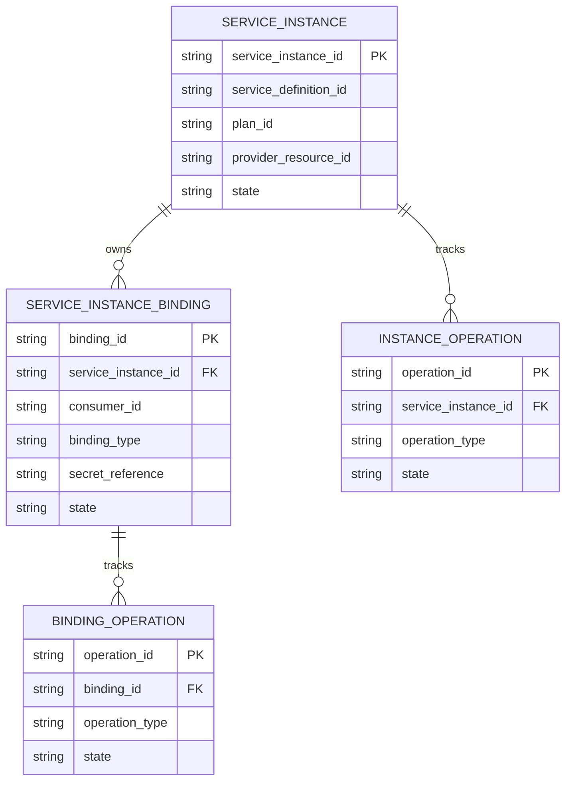
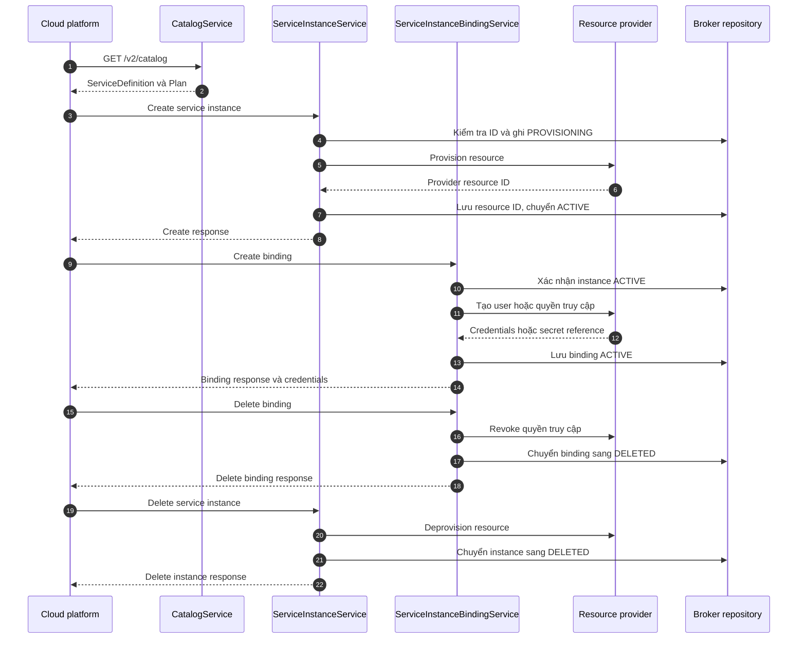

# Vai trò và quan hệ của CatalogService, ServiceInstanceService và ServiceInstanceBindingService

Trong một service broker tuân theo Open Service Broker API (OSB API), nền tảng cần biết broker cung cấp dịch vụ nào, cần yêu cầu broker tạo tài nguyên ra sao và ứng dụng sẽ nhận quyền truy cập tài nguyên đó bằng cách nào. Spring Cloud Open Service Broker tách ba nhóm trách nhiệm này thành ba interface: `CatalogService`, `ServiceInstanceService` và `ServiceInstanceBindingService`.

Ba interface không phải ba tầng HTTP độc lập. Chúng là các điểm mở rộng nghiệp vụ mà những controller và thành phần tự cấu hình của thư viện gọi khi nhận request OSB. Mỗi interface xử lý một loại tài nguyên và một phần khác nhau trong vòng đời dịch vụ:

| Interface | Câu hỏi mà interface trả lời | Đối tượng được quản lý |
|---|---|---|
| `CatalogService` | Broker có thể cung cấp dịch vụ và plan nào? | Catalog, service definition, plan |
| `ServiceInstanceService` | Làm thế nào để tạo, cập nhật, truy vấn hoặc xóa một dịch vụ đã được cấp phát? | Service instance và operation của instance |
| `ServiceInstanceBindingService` | Làm thế nào để một consumer được phép sử dụng instance? | Binding, credentials và quyền truy cập |

Ví dụ xuyên suốt bài viết là broker cung cấp PostgreSQL. Catalog công bố dịch vụ PostgreSQL và các plan; service instance service tạo một database theo plan được chọn; binding service tạo một tài khoản riêng cho ứng dụng và trả thông tin kết nối. Khi ứng dụng ngừng sử dụng, broker thu hồi binding trước, sau đó mới thu hồi database nếu nền tảng yêu cầu xóa instance.

## 1. Vị trí của ba interface trong kiến trúc broker

Ở mức HTTP, nền tảng gọi các endpoint chuẩn của OSB API. Spring Cloud Open Service Broker tiếp nhận request, chuyển dữ liệu thành các request model Java, gọi interface tương ứng và chuyển response model thành HTTP response.

```mermaid
flowchart LR
    P[Cloud platform\nCloud Foundry hoặc Kubernetes]
    CC[CatalogController]
    IC[ServiceInstanceController]
    BC[ServiceInstanceBindingController]
    CS[CatalogService]
    IS[ServiceInstanceService]
    BS[ServiceInstanceBindingService]
    CAT[Catalog và Plan]
    PROV[Provisioning use case\nResource adapter]
    BIND[Binding use case\nCredential và permission adapter]
    DB[(State repository)]

    P -->|GET /v2/catalog| CC
    CC --> CS --> CAT
    P -->|PUT, DELETE /v2/service_instances/{id}| IC
    IC --> IS --> PROV
    P -->|PUT, DELETE /v2/service_instances/{instanceId}/service_bindings/{bindingId}| BC
    BC --> BS --> BIND
    PROV <--> DB
    BIND <--> DB
```

Controller chịu trách nhiệm tiếp nhận giao thức và định tuyến request. Ba service interface chịu trách nhiệm xử lý nghiệp vụ. Các use case hoặc adapter phía dưới thực hiện thao tác với hệ quản trị database, hệ thống cấp phát tài nguyên, secret store hay API của nền tảng đích. Việc tách lớp này giúp cùng một nghiệp vụ có thể được gọi từ OSB API mà không buộc logic cấp phát phải phụ thuộc trực tiếp vào HTTP controller.

Các endpoint thường gặp gồm:

| Endpoint | Interface được gọi | Mục đích |
|---|---|---|
| `GET /v2/catalog` | `CatalogService` | Lấy danh sách service và plan |
| `PUT /v2/service_instances/{instanceId}` | `ServiceInstanceService` | Tạo hoặc cập nhật instance theo nội dung request |
| `GET /v2/service_instances/{instanceId}` | `ServiceInstanceService` | Truy vấn instance khi `instancesRetrievable` được bật |
| `DELETE /v2/service_instances/{instanceId}` | `ServiceInstanceService` | Thu hồi instance |
| `GET /v2/service_instances/{instanceId}/last_operation` | `ServiceInstanceService` | Truy vấn trạng thái operation bất đồng bộ của instance |
| `PUT /v2/service_instances/{instanceId}/service_bindings/{bindingId}` | `ServiceInstanceBindingService` | Tạo binding |
| `GET /v2/service_instances/{instanceId}/service_bindings/{bindingId}` | `ServiceInstanceBindingService` | Truy vấn binding khi `bindingsRetrievable` được bật |
| `DELETE /v2/service_instances/{instanceId}/service_bindings/{bindingId}` | `ServiceInstanceBindingService` | Xóa binding |

Endpoint truy vấn instance hoặc binding chỉ được sử dụng khi broker công bố capability tương ứng trong catalog và triển khai phần xử lý cần thiết.

## 2. CatalogService: công bố dịch vụ và plan

`CatalogService` là nguồn cung cấp metadata để nền tảng khám phá những dịch vụ broker có thể cung cấp. Interface này không tạo database, container, tài khoản hay bất kỳ tài nguyên thực tế nào. Nó mô tả các lựa chọn mà nền tảng có thể hiển thị cho người dùng và gửi lại trong các request cấp phát.

Trong API reactive của Spring Cloud Open Service Broker, hai phương thức cốt lõi là:

```java
Mono<Catalog> getCatalog();

Mono<ServiceDefinition> getServiceDefinition(String serviceId);
```

`getCatalog()` trả về toàn bộ catalog. `getServiceDefinition(serviceId)` tìm một service definition theo ID, thường được dùng khi thư viện cần xác định metadata của service được nhắc đến trong request. Nếu catalog cố định, ứng dụng cũng có thể cung cấp một bean `Catalog`; thư viện có implementation `BeanCatalogService` để phục vụ catalog đó. Khi metadata cần lấy từ cấu hình động hoặc nguồn dữ liệu ngoài, có thể triển khai `CatalogService` riêng.

### 2.1. Catalog, ServiceDefinition và Plan

Catalog là tập hợp các service definition. Một service definition mô tả một loại dịch vụ, ví dụ `postgresql`. Mỗi service definition có thể có nhiều plan, chẳng hạn `dev`, `standard` và `production`.

- **ServiceDefinition** định danh dịch vụ bằng ID ổn định, tên hiển thị, mô tả và các capability của dịch vụ.
- **Plan** định danh một cấu hình cung cấp cụ thể, ví dụ dung lượng, số kết nối tối đa, mức sao lưu hoặc lớp hiệu năng.
- **Schema và metadata** có thể mô tả các tham số mà nền tảng cho phép người dùng truyền khi tạo hoặc cập nhật instance.

Một số capability quan trọng được khai báo ở service definition:

| Capability | Ý nghĩa đối với broker |
|---|---|
| `bindable` | Cho phép nền tảng tạo binding để consumer sử dụng instance |
| `planUpdateable` | Cho phép nền tảng yêu cầu đổi plan của instance |
| `instancesRetrievable` | Cho phép nền tảng truy vấn thông tin instance |
| `bindingsRetrievable` | Cho phép nền tảng truy vấn thông tin binding |

Chỉ công bố capability khi broker thực sự hỗ trợ hành vi tương ứng. Ví dụ, nếu đặt `planUpdateable(true)`, implementation của `ServiceInstanceService` phải xử lý được yêu cầu cập nhật plan. Nếu đặt `bindingsRetrievable(true)`, broker cần duy trì đủ dữ liệu để trả lời truy vấn binding.

### 2.2. Ví dụ triển khai CatalogService

Ví dụ dưới đây công bố một service PostgreSQL với một plan tiêu chuẩn:

```java
@Service
public class ExampleCatalogService implements CatalogService {

    @Override
    public Mono<Catalog> getCatalog() {
        Plan standardPlan = Plan.builder()
                .id("postgresql-standard")
                .name("standard")
                .description("PostgreSQL instance for standard workloads")
                .free(false)
                .build();

        ServiceDefinition postgres = ServiceDefinition.builder()
                .id("postgresql")
                .name("PostgreSQL")
                .description("Managed PostgreSQL database")
                .bindable(true)
                .planUpdateable(true)
                .instancesRetrievable(true)
                .bindingsRetrievable(true)
                .plans(standardPlan)
                .build();

        return Mono.just(Catalog.builder()
                .serviceDefinitions(postgres)
                .build());
    }

    @Override
    public Mono<ServiceDefinition> getServiceDefinition(String serviceId) {
        if (!"postgresql".equals(serviceId)) {
            return Mono.empty();
        }

        return getCatalog()
                .map(catalog -> catalog.getServiceDefinitions().get(0));
    }
}
```

Đây là ví dụ minh họa cho catalog nhỏ, có một service và một plan. Trong hệ thống thật, không nên dựa vào vị trí phần tử đầu tiên nếu catalog có nhiều service. Có thể lưu metadata trong cấu hình hoặc repository, sau đó tra cứu theo ID. ID của service và plan cần ổn định vì nền tảng dùng các ID này để tham chiếu đến instance đã tồn tại. Đổi tên hiển thị thường ít ảnh hưởng hơn việc đổi ID.

Catalog cũng là một cam kết về hành vi. Nếu broker ngừng hỗ trợ một plan, cần có chính sách tương thích cho các instance đã được tạo từ plan đó; không nên xóa metadata một cách tùy tiện khiến những instance cũ không còn được nhận diện.

## 3. ServiceInstanceService: quản lý vòng đời tài nguyên

`ServiceInstanceService` xử lý các request liên quan đến việc cấp phát, cập nhật và thu hồi service instance. Service instance là một tài nguyên dịch vụ cụ thể mà nền tảng đã yêu cầu broker tạo, chẳng hạn một database PostgreSQL riêng cho một nhóm hoặc một ứng dụng.

Các phương thức chính của interface gồm:

```java
Mono<CreateServiceInstanceResponse> createServiceInstance(
        CreateServiceInstanceRequest request);

Mono<UpdateServiceInstanceResponse> updateServiceInstance(
        UpdateServiceInstanceRequest request);

Mono<DeleteServiceInstanceResponse> deleteServiceInstance(
        DeleteServiceInstanceRequest request);

Mono<GetServiceInstanceResponse> getServiceInstance(
        GetServiceInstanceRequest request);

Mono<GetLastServiceOperationResponse> getLastOperation(
        GetLastServiceOperationRequest request);
```

Trong API 4.4.1, tạo và xóa instance là các thao tác cốt lõi; một số phương thức như cập nhật, truy vấn instance và truy vấn operation có implementation mặc định. Broker cần ghi đè các phương thức tương ứng khi đã công bố capability hoặc hỗ trợ xử lý bất đồng bộ.

### 3.1. Tạo instance

Khi nền tảng yêu cầu tạo instance, request chứa các thông tin như `serviceInstanceId`, `serviceDefinitionId`, `planId`, `parameters`, `context` và việc nền tảng có chấp nhận xử lý bất đồng bộ hay không. `serviceInstanceId` do nền tảng cấp và được dùng làm khóa để broker liên kết instance với tài nguyên thật.

Một luồng tạo instance thường gồm các bước:

1. Kiểm tra service ID và plan ID có tồn tại trong catalog.
2. Kiểm tra tham số theo schema và quy tắc nghiệp vụ của plan.
3. Kiểm tra instance ID đã tồn tại hay đang có operation khác chạy hay chưa.
4. Ghi nhận yêu cầu và trạng thái ban đầu trong repository.
5. Gọi adapter để tạo tài nguyên ở hệ thống đích.
6. Lưu ID tài nguyên phía provider, cấu hình cần thiết và trạng thái cuối cùng.
7. Trả response phù hợp với kết quả đồng bộ hoặc bất đồng bộ.

Không nên chỉ dựa vào ID instance để gọi provider rồi bỏ qua trạng thái nội bộ. Broker cần lưu mối liên hệ giữa ID do nền tảng cấp và ID tài nguyên do provider trả về. Mối liên hệ đó cho phép cập nhật, truy vấn và xóa đúng tài nguyên về sau.

### 3.2. Cập nhật instance

`updateServiceInstance()` được sử dụng khi nền tảng yêu cầu thay đổi cấu hình hoặc plan của instance. Request có thể chứa plan mới, parameters mới và `previousValues` mô tả trạng thái trước khi cập nhật.

Broker cần so sánh trạng thái hiện tại với yêu cầu mới, xác định thay đổi nào được hỗ trợ và thực hiện cập nhật theo chính sách của provider. Không phải mọi thay đổi đều có thể áp dụng trực tiếp. Ví dụ, tăng dung lượng có thể được hỗ trợ tại chỗ, trong khi đổi một loại tài nguyên có thể cần tạo tài nguyên thay thế và chuyển dữ liệu.

Chỉ công bố `planUpdateable(true)` khi broker có thể xử lý các trường hợp cập nhật được cam kết. Khi cập nhật thất bại, broker cần báo rõ instance còn sử dụng được hay không và việc thử lại có an toàn hay không trong response trạng thái operation.

### 3.3. Xóa instance

`deleteServiceInstance()` thu hồi tài nguyên đã tạo trong bước provision. Broker tra cứu bản ghi instance, xác định tài nguyên provider tương ứng, gọi thao tác deprovision và cập nhật trạng thái. Cần giữ đủ dữ liệu để xử lý retry nếu provider tạm thời không phản hồi.

Một instance có thể có nhiều binding. Vì binding thường đại diện cho tài khoản hoặc quyền truy cập của consumer, broker nên thu hồi các binding còn tồn tại trước khi xóa tài nguyên gốc. Nếu còn binding, việc xóa instance có thể làm ứng dụng đang chạy mất kết nối hoặc để lại tài khoản không được quản lý.

### 3.4. Truy vấn instance và trạng thái operation

`getServiceInstance()` trả về thông tin instance khi service definition công bố `instancesRetrievable(true)`. Dữ liệu trả về được dựng từ trạng thái broker đã lưu, không nên phụ thuộc hoàn toàn vào việc gọi lại provider vì provider có thể đang gián đoạn.

`getLastOperation()` phục vụ các thao tác bất đồng bộ của instance. Khi broker trả response cho biết operation đang chạy, nền tảng có thể gọi endpoint last operation nhiều lần. Broker phải đọc trạng thái operation đã lưu và trả về `IN_PROGRESS`, `SUCCEEDED` hoặc `FAILED` phù hợp với tiến trình thực tế.

### 3.5. Khung triển khai nghiệp vụ

Implementation nên điều phối use case và adapter thay vì nhồi toàn bộ logic provider vào service class:

```java
@Service
public class ExampleServiceInstanceService implements ServiceInstanceService {

    private final InstanceProvisioningUseCase provisioning;
    public ExampleServiceInstanceService(
            InstanceProvisioningUseCase provisioning) {
        this.provisioning = provisioning;
    }

    @Override
    public Mono<CreateServiceInstanceResponse> createServiceInstance(
            CreateServiceInstanceRequest request) {
        // Kiểm tra plan, idempotency key và trạng thái hiện tại.
        // Use case thực hiện provision và trả response OSB tương ứng.
        return provisioning.create(request);
    }

    @Override
    public Mono<DeleteServiceInstanceResponse> deleteServiceInstance(
            DeleteServiceInstanceRequest request) {
        // Xác minh instance, xử lý binding còn tồn tại,
        // deprovision tài nguyên và cập nhật trạng thái.
        return provisioning.delete(request);
    }
}
```

Các kiểu `InstanceProvisioningUseCase` và repository trong ví dụ là thành phần nghiệp vụ do ứng dụng định nghĩa. Chúng không phải interface có sẵn của Spring Cloud Open Service Broker. Mục tiêu là giữ service interface tập trung vào việc chuyển đổi request OSB thành use case và chuyển kết quả use case thành response OSB.

## 4. ServiceInstanceBindingService: cấp quyền truy cập cho consumer

Một service instance biểu diễn tài nguyên đã được cấp phát. Tuy nhiên, ứng dụng sử dụng tài nguyên thường cần thông tin kết nối hoặc quyền truy cập riêng. Binding biểu diễn mối quan hệ giữa một consumer và một service instance.

Ví dụ, database PostgreSQL đã tồn tại nhưng ứng dụng `orders-api` vẫn cần một username và password để kết nối. `ServiceInstanceBindingService` tạo tài khoản hoặc quyền truy cập phù hợp, lưu trạng thái binding và trả credentials cho nền tảng.

Các phương thức chính gồm:

```java
Mono<CreateServiceInstanceBindingResponse> createServiceInstanceBinding(
        CreateServiceInstanceBindingRequest request);

Mono<DeleteServiceInstanceBindingResponse> deleteServiceInstanceBinding(
        DeleteServiceInstanceBindingRequest request);

Mono<GetServiceInstanceBindingResponse> getServiceInstanceBinding(
        GetServiceInstanceBindingRequest request);

Mono<GetLastServiceBindingOperationResponse> getLastOperation(
        GetLastServiceBindingOperationRequest request);
```

Các phương thức trong interface có implementation mặc định. Broker triển khai thao tác tạo và xóa binding khi công bố dịch vụ có thể bind. Nếu bật `bindingsRetrievable(true)`, broker cần triển khai truy vấn binding. Nếu thao tác binding có thể chạy bất đồng bộ, broker cần cung cấp trạng thái last operation dành riêng cho binding.

### 4.1. Tạo binding

Request tạo binding xác định ít nhất service instance và binding ID; tùy loại binding, request còn có thông tin consumer như application GUID hoặc tham số bổ sung. Một luồng tạo binding nên:

1. Xác nhận service instance tồn tại và đang ở trạng thái cho phép binding.
2. Kiểm tra binding ID và xác định request có phải retry của lần tạo trước hay không.
3. Tạo tài khoản, token, ACL hoặc quyền truy cập có phạm vi phù hợp cho consumer.
4. Lưu binding, liên kết binding với instance và lưu tham chiếu đến secret an toàn.
5. Trả credentials hoặc thông tin kết nối mà consumer cần.

OSB hỗ trợ app binding và route binding. App binding thường cung cấp credentials, log drain hoặc volume service cho ứng dụng. Route binding cung cấp thông tin route để nền tảng định tuyến request. Kiểu response phải phù hợp với loại binding mà broker hỗ trợ.

Ví dụ response cho app binding có thể chứa URI, username và password:

```java
CreateServiceInstanceAppBindingResponse.builder()
        .credentials("uri", databaseUri)
        .credentials("username", username)
        .credentials("password", password)
        .bindingExisted(false)
        .build();
```

Credentials là dữ liệu nhạy cảm. Không ghi password hoặc token vào log, không đưa chúng vào exception message và không lưu dạng plaintext trong bảng nghiệp vụ. Có thể lưu secret trong secret manager rồi chỉ lưu secret reference trong binding record. Response chỉ nên trả những thông tin consumer được phép nhận.

### 4.2. Xóa binding

`deleteServiceInstanceBinding()` thu hồi đúng quyền truy cập do binding đó tạo ra. Ví dụ, broker xóa user PostgreSQL dành riêng cho ứng dụng, thu hồi token hoặc xóa ACL. Thao tác này không xóa database gốc vì database thuộc vòng đời của service instance.

Nếu provider đã thu hồi quyền truy cập nhưng broker chưa cập nhật trạng thái do lỗi mạng, lần retry tiếp theo phải nhận biết được kết quả trước đó. Thiết kế thao tác revoke theo hướng idempotent giúp tránh lỗi khi xóa một binding đã được thu hồi.

### 4.3. Truy vấn binding và trạng thái operation

`getServiceInstanceBinding()` trả thông tin binding khi catalog công bố `bindingsRetrievable(true)`. Broker cần duy trì dữ liệu để nhận diện consumer, loại binding và thông tin kết nối có thể trả về. Nếu cần trả credentials đã tạo trước đó, broker phải có cơ chế lưu trữ hoặc tái tạo an toàn.

`getLastOperation()` của `ServiceInstanceBindingService` chỉ theo dõi operation tạo hoặc xóa binding. Đây là phương thức khác với `ServiceInstanceService.getLastOperation()`, dù cả hai có cùng tên. Chúng nhận request và trả response model khác nhau, đồng thời phản ánh hai loại tài nguyên khác nhau.

## 5. Quan hệ dữ liệu giữa instance và binding

Quan hệ phổ biến là một service instance có thể có không, một hoặc nhiều binding:



Mô hình trên là gợi ý cho repository của broker, không phải schema bắt buộc do thư viện tạo ra. Tối thiểu, broker cần lưu được ID do nền tảng cấp, ID tài nguyên phía provider, service/plan đã chọn và trạng thái operation. Binding cần tham chiếu đến instance để bảo đảm không tạo binding cho tài nguyên không tồn tại.

Ba interface có thể dùng chung repository hoặc use case, nhưng không nên nhập nhằng quyền sở hữu dữ liệu:

| Dữ liệu | Thành phần nghiệp vụ chịu trách nhiệm chính |
|---|---|
| Danh sách service, plan và capability | Catalog provider / `CatalogService` |
| ID instance, plan đang dùng, provider resource ID và trạng thái instance | Instance repository / `ServiceInstanceService` |
| Consumer, binding ID, loại binding, secret reference và trạng thái binding | Binding repository / `ServiceInstanceBindingService` |
| Trạng thái provision, update, deprovision | Instance operation repository |
| Trạng thái tạo và thu hồi binding | Binding operation repository |

`CatalogService` thường đọc metadata từ cấu hình hoặc catalog repository. Hai service còn lại làm việc với dữ liệu thay đổi theo thời gian và cần lưu bền vững. Nếu chỉ lưu instance và binding trong bộ nhớ của một tiến trình, trạng thái sẽ mất khi broker khởi động lại và không phù hợp với môi trường có nhiều replica.

## 6. Luồng phối hợp từ catalog đến thu hồi tài nguyên



Trình tự cho thấy binding phụ thuộc vào instance. Catalog không tham gia trực tiếp vào việc cấp phát hoặc tạo credentials sau khi nền tảng đã chọn service và plan. Ngược lại, service instance service cần dựa trên metadata catalog để xác thực service ID, plan ID và capability của request.

## 7. Xử lý trạng thái, bất đồng bộ và idempotency

Provisioning database, triển khai workload hoặc cấu hình tài nguyên trên Kubernetes có thể mất nhiều thời gian. Broker cần phân biệt operation đã hoàn thành với operation mới được tiếp nhận.

Một state machine đơn giản cho instance có thể là:

```text
NEW -> PROVISIONING -> ACTIVE
          |              |
          v              v
        FAILED         UPDATING -> ACTIVE
                          |
                          v
                        FAILED

ACTIVE -> DELETING -> DELETED
             |
             v
           FAILED
```

Binding có vòng đời riêng, ví dụ `CREATING -> ACTIVE -> DELETING -> DELETED`. Không nên dùng chung một cột trạng thái cho instance và binding vì hai operation có thể diễn ra ở các thời điểm khác nhau.

### 7.1. Phân biệt reactive return và asynchronous OSB operation

Các phương thức của Spring Cloud Open Service Broker trả về `Mono<T>`. `Mono` biểu diễn một kết quả reactive có thể phát ra sau này; bản thân việc trả về `Mono` không có nghĩa là nền tảng đã nhận một operation bất đồng bộ.

Với operation OSB bất đồng bộ, broker cần kiểm tra request có cho phép xử lý bất đồng bộ hay không, tiếp nhận operation, lưu trạng thái và trả response cho biết công việc còn đang chạy. Sau đó nền tảng gọi `getLastOperation()` ở interface tương ứng để truy vấn tiến trình. Khi công việc hoàn tất, broker trả trạng thái thành công hoặc thất bại.

Vì vậy, broker cần lưu operation trước khi dispatch công việc nền. Nếu chỉ gửi message vào queue rồi mất dấu operation, request polling của nền tảng sẽ không thể nhận được trạng thái đáng tin cậy.

### 7.2. Idempotency và xử lý request lặp

Nền tảng có thể gửi lại request khi timeout hoặc mất kết nối. Broker phải xử lý request lặp theo ID và nội dung:

- Cùng instance ID và cùng ý nghĩa request: nhận diện là lần retry, trả kết quả phù hợp với tài nguyên đã tồn tại hoặc operation đang chạy.
- Cùng instance ID nhưng service, plan hoặc tham số xung đột: từ chối bằng lỗi phù hợp thay vì tạo thêm tài nguyên.
- Cùng binding ID và cùng consumer/tham số: trả kết quả binding đã tồn tại theo quy tắc OSB.
- Cùng binding ID nhưng yêu cầu khác: báo xung đột; không ghi đè credentials hoặc quyền của consumer trước.

Có thể dùng unique constraint cho `service_instance_id` và cặp `(service_instance_id, binding_id)`, lưu request fingerprint, operation ID và trạng thái. Nếu broker phục vụ nhiều platform instance, đưa `platform_instance_id` vào phạm vi khóa duy nhất để tránh xung đột giữa các nền tảng. Việc kiểm tra rồi ghi dữ liệu phải có tính nguyên tử để hai request đồng thời không cùng tạo một tài nguyên.

### 7.3. Đồng bộ trạng thái với provider

Broker và provider là hai hệ thống riêng. Một lệnh provision có thể thành công ở provider nhưng response bị mất trước khi broker ghi nhận. Do đó, cần có operation record, retry có kiểm soát và cơ chế đối soát. Không đánh dấu instance `ACTIVE` trước khi có bằng chứng tài nguyên đã sẵn sàng. Khi xóa, chỉ chuyển sang `DELETED` sau khi provider xác nhận hoặc broker có quy tắc rõ ràng cho tài nguyên đã không còn tồn tại.

## 8. Tích hợp Cloud Foundry, Kubernetes và bảo mật

Ba interface mô tả nghiệp vụ ở mức OSB. Phần giao tiếp với nền tảng hoặc provider cụ thể nên nằm trong adapter.

- Với Cloud Foundry, request context có thể mang thông tin tổ chức, space và application. Broker dùng thông tin đó để xác định tenant, quyền sở hữu và consumer của binding.
- Với Kubernetes, context có thể chứa thông tin cluster, namespace hoặc workload. Adapter có thể tạo resource, Secret, ServiceAccount hay RBAC theo plan và chính sách của broker.
- Nếu broker hỗ trợ nhiều nền tảng, use case nên nhận mô hình context đã được chuẩn hóa và gọi adapter phù hợp. Tránh để logic nghiệp vụ phụ thuộc trực tiếp vào tên header hoặc cấu trúc HTTP của một nền tảng.

Context do nền tảng gửi vẫn phải được xác thực và kiểm tra phạm vi. Không xem các trường như namespace, application ID hoặc tenant ID là bằng chứng quyền truy cập chỉ vì chúng xuất hiện trong request. Broker cần xác thực nền tảng gọi API, kiểm tra quyền trên tài nguyên và giới hạn credentials theo consumer.

Một số nguyên tắc bảo mật quan trọng:

1. Bảo vệ endpoint broker bằng cơ chế xác thực mà nền tảng hỗ trợ; chỉ cho phép nền tảng tin cậy gọi các thao tác quản trị.
2. Cấp credentials riêng cho từng binding khi mô hình dịch vụ cho phép, giới hạn quyền theo nhu cầu của consumer.
3. Lưu secret trong secret manager hoặc kho mã hóa; repository nghiệp vụ chỉ lưu tham chiếu nếu có thể.
4. Không ghi credentials, token hoặc dữ liệu nhạy cảm trong log, tracing tag hay error message.
5. Thu hồi credentials và quyền truy cập khi binding bị xóa; thu hồi binding trước khi deprovision instance.
6. Kiểm tra tham số và context ở phía broker, kể cả khi nền tảng đã kiểm tra schema từ catalog.

## 9. Ví dụ tổng hợp: broker PostgreSQL

Giả sử một nền tảng yêu cầu tạo PostgreSQL theo plan `postgresql-standard` cho ứng dụng `orders-api`.

1. Nền tảng gọi `CatalogService` và nhận service `postgresql`, plan `postgresql-standard`, cùng capability `bindable=true`.
2. Nền tảng gửi request tạo instance với một `serviceInstanceId`. `ServiceInstanceService` kiểm tra plan, tham số và ID, sau đó gọi adapter tạo database.
3. Broker lưu provider resource ID, plan, trạng thái và metadata cần thiết của instance.
4. Nền tảng yêu cầu binding cho `orders-api`. `ServiceInstanceBindingService` xác nhận instance đang `ACTIVE`, tạo database user riêng và lưu secret reference.
5. Broker trả URI, username và password cho nền tảng để cung cấp cho ứng dụng.
6. Khi ứng dụng không còn cần database, nền tảng yêu cầu xóa binding. Broker thu hồi database user và cập nhật binding thành `DELETED`.
7. Khi nền tảng yêu cầu xóa instance, `ServiceInstanceService` deprovision database và cập nhật trạng thái instance.

Nếu bước tạo database chạy lâu, `ServiceInstanceService` trả response asynchronous và cung cấp trạng thái qua `ServiceInstanceService.getLastOperation()`. Nếu tạo user cho binding cũng chạy lâu, trạng thái đó được theo dõi riêng qua `ServiceInstanceBindingService.getLastOperation()`. Hai luồng operation không được dùng lẫn repository hoặc ID mà không có phân loại rõ ràng.

## 10. Lỗi thiết kế thường gặp

| Cách làm chưa phù hợp | Hệ quả | Cách xử lý |
|---|---|---|
| Tạo tài nguyên ngay trong `getCatalog()` | Mỗi lần nền tảng đọc catalog có thể phát sinh side effect | Catalog chỉ trả metadata; provision nằm trong `ServiceInstanceService` |
| Gộp credentials vào bản ghi instance | Không quản lý được quyền riêng cho từng consumer | Lưu binding độc lập và liên kết bằng instance ID |
| Xóa database khi một binding bị xóa | Các ứng dụng khác đang dùng instance bị gián đoạn | Binding service chỉ thu hồi quyền của binding đó |
| Cho phép plan update nhưng không triển khai update | Nền tảng gửi request mà broker không xử lý được | Chỉ công bố capability đã hỗ trợ |
| Trả asynchronous nhưng không lưu operation | Nền tảng polling không nhận được tiến trình chính xác | Lưu operation bền vững và triển khai last operation |
| Coi `Mono` là bằng chứng operation đã asynchronous | Giao thức và trạng thái với nền tảng không nhất quán | Phân biệt reactive pipeline với response OSB `async` |
| Không xử lý request lặp | Có thể tạo trùng tài nguyên hoặc credentials | Dùng ID, request fingerprint, unique constraint và trạng thái operation |
| Lưu password trực tiếp trong log hoặc bảng thường | Rò rỉ thông tin truy cập | Dùng secret manager, mã hóa và lọc log |

## 11. Checklist khi triển khai

- [ ] Catalog có service ID và plan ID ổn định, mô tả đúng năng lực thực tế.
- [ ] Các capability `bindable`, `planUpdateable`, `instancesRetrievable` và `bindingsRetrievable` phản ánh đúng implementation.
- [ ] `ServiceInstanceService` lưu được quan hệ giữa instance ID của nền tảng và resource ID của provider.
- [ ] Create, update và delete xử lý request lặp, lỗi provider và operation đang chạy.
- [ ] `getLastOperation()` của instance trả trạng thái từ operation store bền vững khi có asynchronous operation.
- [ ] `ServiceInstanceBindingService` quản lý binding riêng, cấp quyền theo consumer và thu hồi đúng quyền khi unbind.
- [ ] Truy vấn binding và last operation của binding được triển khai nếu catalog hoặc cách xử lý bất đồng bộ yêu cầu.
- [ ] Credentials không bị ghi vào log và được lưu trữ an toàn.
- [ ] Deprovision kiểm tra và xử lý các binding còn tồn tại.
- [ ] Adapter Cloud Foundry, Kubernetes hoặc provider khác được tách khỏi logic nghiệp vụ chung.

## 12. Tài liệu tham khảo

- [Spring Cloud Open Service Broker 4.4.1 — Reference Guide](https://docs.spring.io/spring-cloud-open-service-broker/docs/4.4.1/reference/)
- [CatalogService — API](https://docs.spring.io/spring-cloud-open-service-broker/docs/4.4.1/apidocs/org/springframework/cloud/servicebroker/service/CatalogService.html)
- [ServiceInstanceService — API](https://docs.spring.io/spring-cloud-open-service-broker/docs/4.4.1/apidocs/org/springframework/cloud/servicebroker/service/ServiceInstanceService.html)
- [ServiceInstanceBindingService — API](https://docs.spring.io/spring-cloud-open-service-broker/docs/4.4.1/apidocs/org/springframework/cloud/servicebroker/service/ServiceInstanceBindingService.html)
- [Open Service Broker API specification](https://github.com/openservicebrokerapi/servicebroker/blob/v2.16/spec.md)

Các chữ ký Java và ví dụ reactive trong bài tham chiếu API Spring Cloud Open Service Broker 4.4.1. Khi triển khai, cần dùng phiên bản thư viện tương thích với Spring Boot và Spring Cloud BOM của dự án.
