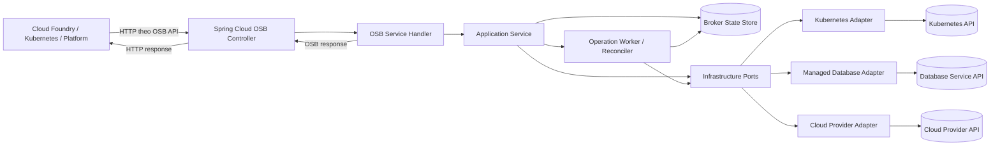
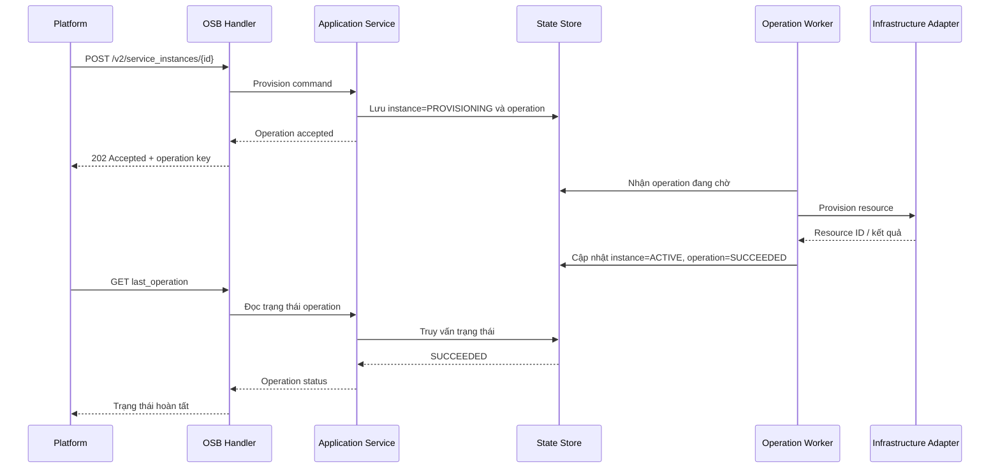

# Tách bộ điều hợp hạ tầng khỏi hợp đồng Open Service Broker

Một service broker đứng giữa nền tảng triển khai ứng dụng và hệ thống thực sự tạo ra dịch vụ. Nền tảng gửi yêu cầu theo **Open Service Broker API (OSB API)** để xem catalog, cấp phát service instance, tạo binding, cập nhật hoặc thu hồi tài nguyên. Broker tiếp nhận hợp đồng đó, điều phối nghiệp vụ và gọi hệ thống hạ tầng như Kubernetes, cơ sở dữ liệu, hệ thống lưu trữ hoặc một dịch vụ đám mây.

Hai phía có nhịp thay đổi khác nhau. Hợp đồng OSB cần ổn định để Cloud Foundry, Kubernetes hoặc một nền tảng tương thích có thể giao tiếp với broker. Hạ tầng phía sau lại có thể thay đổi theo nhà cung cấp, cách triển khai, quyền truy cập và công cụ vận hành. Nếu controller OSB gọi thẳng Kubernetes Java Client hoặc SDK của một nhà cung cấp đám mây, chi tiết của hạ tầng sẽ lan vào giao thức, trạng thái nghiệp vụ và cả cách kiểm thử.

Vì vậy, kiến trúc nên giữ hợp đồng OSB ở biên giao tiếp và đặt một cổng nghiệp vụ ở giữa. Các bộ điều hợp hạ tầng triển khai cổng đó, chịu trách nhiệm chuyển yêu cầu nghiệp vụ thành thao tác cụ thể trên từng hệ thống. Khi thay đổi backend, broker chỉ cần thay hoặc bổ sung adapter; nền tảng gọi broker vẫn sử dụng cùng hợp đồng.

## 1. Hai loại hợp đồng cần được tách riêng

### Hợp đồng Open Service Broker

OSB API quy định cách một nền tảng nói chuyện với service broker. Hợp đồng này bao gồm đường dẫn và phương thức HTTP, cấu trúc request/response, mã trạng thái, định danh service, plan, instance và binding, cùng quy tắc cho các thao tác đồng bộ hoặc bất đồng bộ.

Những nhóm thao tác thường gặp gồm:

| Nhóm thao tác | Ý nghĩa ở biên OSB | Kết quả broker cần biểu diễn |
|---|---|---|
| Catalog | Công bố service và plan có thể cung cấp | Danh sách service, plan, metadata và khả năng hỗ trợ |
| Provision | Tạo một service instance | Instance được tạo hoặc một operation đang chạy |
| Last operation | Truy vấn tiến độ của thao tác bất đồng bộ | Trạng thái đang xử lý, thành công hoặc thất bại |
| Update | Thay đổi cấu hình hoặc plan của instance | Trạng thái mới hoặc operation cập nhật |
| Deprovision | Thu hồi instance | Xác nhận thu hồi hoặc operation đang chạy |
| Bind | Cấp thông tin để một ứng dụng sử dụng instance | Binding ID và thông tin kết nối/credentials |
| Unbind | Thu hồi quyền sử dụng của một binding | Xác nhận binding đã bị thu hồi |

Đây là hợp đồng hướng ra nền tảng. Nó không nên chứa tên class của Kubernetes, cấu trúc request của AWS SDK, tên bảng dữ liệu nội bộ hay cách một nhà cung cấp lưu secret.

### Hợp đồng với hạ tầng

Hợp đồng hạ tầng là giao diện mà nghiệp vụ broker dùng để yêu cầu một năng lực, chẳng hạn cấp phát cơ sở dữ liệu, tạo tài khoản, cấp quyền truy cập, lưu secret hoặc xóa tài nguyên. Giao diện này diễn đạt theo ngôn ngữ nghiệp vụ của broker, không theo DTO của OSB và cũng không theo API riêng của nhà cung cấp.

Ví dụ, nghiệp vụ có thể yêu cầu `provisionDatabase` với dung lượng, phiên bản và vùng triển khai. Adapter Kubernetes chuyển yêu cầu đó thành manifest hoặc lệnh gọi API Kubernetes; adapter của một dịch vụ cơ sở dữ liệu được quản lý chuyển nó thành request của nhà cung cấp tương ứng. Cả hai adapter đều trả về kết quả theo mô hình mà broker hiểu, chẳng hạn mã tài nguyên, endpoint nội bộ, tham chiếu secret và trạng thái thao tác.

Ranh giới này tạo ra ba trách nhiệm rõ ràng:

1. **OSB adapter** hiểu giao thức và chuyển request/response OSB sang lệnh hoặc kết quả của ứng dụng.
2. **Application service** thực thi quy tắc nghiệp vụ, kiểm tra trạng thái, quản lý idempotency và điều phối các bước trong vòng đời dịch vụ.
3. **Infrastructure adapter** giao tiếp với hệ thống bên ngoài, chuyển mô hình nghiệp vụ sang API hoặc tài nguyên cụ thể và chuẩn hóa lỗi trả về.

## 2. Kiến trúc tổng thể



Luồng đi từ trái sang phải thể hiện ranh giới giao tiếp: nền tảng chỉ biết OSB API; application service chỉ biết các cổng nghiệp vụ; adapter mới biết cách gọi hệ thống cụ thể. Với thao tác dài, application service lưu trạng thái và tạo operation để worker xử lý. Worker dùng cùng các cổng hạ tầng, nhờ đó luồng đồng bộ và bất đồng bộ không phải triển khai hai bộ logic provision khác nhau.

Sơ đồ là mô hình trách nhiệm, không bắt buộc mỗi ô phải là một tiến trình hoặc microservice riêng. Ở một broker nhỏ, controller, application service và adapter có thể nằm trong cùng ứng dụng Spring Boot nhưng vẫn nên tách bằng package, interface và phụ thuộc một chiều.

## 3. Vai trò của các thành phần trong Spring Cloud Open Service Broker

Spring Cloud Open Service Broker cung cấp phần tích hợp giao thức và các điểm mở rộng để ứng dụng triển khai hành vi của broker. Các interface như `CatalogService`, `ServiceInstanceService` và `ServiceInstanceBindingService` là những điểm nối quan trọng giữa framework và logic của ứng dụng.

| Thành phần | Trách nhiệm nên đảm nhận | Tránh đảm nhận |
|---|---|---|
| OSB controller do framework cung cấp | Nhận request OSB, xử lý tuyến giao thức và trả response theo framework | Gọi trực tiếp SDK của hạ tầng |
| `CatalogService` | Công bố catalog và plan mà broker thực sự hỗ trợ | Tạo tài nguyên hoặc truy vấn backend theo từng request catalog nếu không cần thiết |
| `ServiceInstanceService` | Chuyển yêu cầu tạo, đọc, cập nhật, xóa instance và truy vấn operation vào application service | Chứa logic riêng của Kubernetes hoặc nhà cung cấp cloud |
| `ServiceInstanceBindingService` | Chuyển yêu cầu tạo, đọc, xóa binding vào application service | Tự tạo secret bằng SDK của một backend cụ thể |
| Application service | Kiểm tra quy tắc, điều phối vòng đời, ghi trạng thái và áp dụng idempotency | Phụ thuộc vào kiểu request của SDK hạ tầng |
| Infrastructure adapter | Gọi API hạ tầng, ánh xạ dữ liệu và chuẩn hóa lỗi | Tự tạo HTTP response theo OSB |
| State repository | Lưu instance, binding, operation và tham chiếu tài nguyên | Làm nhiệm vụ thay thế API của nhà cung cấp |

Tên interface của framework có thể thay đổi theo phiên bản thư viện; khi triển khai cần đối chiếu đúng phiên bản Spring Cloud Open Service Broker đang dùng. Nguyên tắc kiến trúc vẫn giữ nguyên: handler OSB là adapter ở phía giao thức, còn adapter hạ tầng ở phía tài nguyên.

## 4. Thiết kế cổng nghiệp vụ và adapter

Một cổng nghiệp vụ nên mô tả điều broker cần làm, không mô tả cách một backend thực hiện. Có thể tách cổng theo nhóm năng lực để mỗi adapter có phạm vi nhỏ và dễ kiểm thử.

Ví dụ dưới đây là mã minh họa theo Reactor, phù hợp với ứng dụng Spring Cloud Open Service Broker có luồng reactive. Các kiểu dữ liệu là mô hình nội bộ giả định, không phải kiểu request/response chuẩn của OSB.

```java
public interface InstanceProvisioner {
    Mono<ProvisioningReceipt> provision(ProvisioningCommand command);

    Mono<ProvisioningReceipt> update(UpdateCommand command);

    Mono<DeprovisioningReceipt> deprovision(DeprovisioningCommand command);
}

public interface BindingProvisioner {
    Mono<BindingReceipt> bind(BindingCommand command);

    Mono<Void> unbind(UnbindingCommand command);
}

public record ProvisioningCommand(
        String instanceId,
        String serviceId,
        String planId,
        String tenantId,
        Map<String, Object> parameters) {}

public record ProvisioningReceipt(
        String infrastructureResourceId,
        String operationId,
        OperationState state) {}
```

`InstanceProvisioner` là cổng mà application service phụ thuộc vào. Một adapter triển khai cổng này có thể dùng Kubernetes API, một dịch vụ cơ sở dữ liệu được quản lý hoặc một API nội bộ. Mô hình `ProvisioningReceipt` chỉ chứa dữ liệu cần thiết cho nghiệp vụ tiếp tục xử lý; nó không làm lộ `V1PersistentVolumeClaim`, `CreateDatabaseRequest` hay kiểu dữ liệu riêng của SDK.

Ví dụ cấu trúc triển khai:

```text
broker
├── osb
│   ├── catalog
│   ├── instance
│   └── binding
├── application
│   ├── provision
│   ├── update
│   ├── deprovision
│   └── operation
├── domain
│   ├── model
│   └── port
└── infrastructure
    ├── persistence
    ├── kubernetes
    ├── manageddatabase
    └── secrets
```

Package là cách tổ chức tham khảo. Điều cần giữ là dependency đi từ ngoài vào trong: OSB handler và infrastructure adapter phụ thuộc vào mô hình/cổng mà ứng dụng sở hữu; application service không import class từ Kubernetes client hoặc SDK của nhà cung cấp.

## 5. Ánh xạ request OSB qua mô hình nghiệp vụ

Request OSB là dữ liệu đến từ nền tảng. Trước khi chuyển đến adapter hạ tầng, broker cần xác thực và chuẩn hóa dữ liệu đó thành command nội bộ.

Ví dụ, một yêu cầu provision có thể chứa `service_id`, `plan_id`, `organization_guid`, `space_guid`, `parameters` và `context`. Handler OSB không nên chuyển nguyên request framework cho adapter Kubernetes. Thay vào đó, application service thực hiện các bước:

1. Kiểm tra service và plan có tồn tại trong catalog, đồng thời xác nhận plan có được phép cung cấp ở môi trường hiện tại.
2. Kiểm tra quyền của caller và ràng buộc tenant; không xem các trường định danh trong request là bằng chứng xác thực.
3. Chuẩn hóa context của nền tảng thành một value object nội bộ, giữ lại thông tin cần cho phân vùng tài nguyên hoặc kiểm toán.
4. Kiểm tra schema và allowlist của `parameters`, áp dụng giá trị mặc định và giới hạn tài nguyên.
5. Tạo command nội bộ rồi gọi cổng hạ tầng.

Adapter nhận command đã được kiểm tra và chuyển thành thao tác riêng của backend. Khi có kết quả, application service lưu trạng thái và tạo kết quả nghiệp vụ. Handler OSB ánh xạ kết quả đó thành response đúng hợp đồng.

Chiều ngược lại cũng cần được tách. Adapter có thể trả về mã tài nguyên, endpoint và tham chiếu đến secret. Application service quyết định dữ liệu nào được lưu và dữ liệu nào được phép công bố. Handler OSB chỉ đưa ra các trường mà hợp đồng cho phép, chẳng hạn thông tin binding cần cho ứng dụng kết nối. Không trả về object nội bộ, thông tin vận hành hoặc credentials không liên quan.

## 6. Giữ nhất quán trạng thái và xử lý bất đồng bộ

OSB có thể yêu cầu một thao tác được xử lý bất đồng bộ khi việc cấp phát hoặc thu hồi mất nhiều thời gian. Cần phân biệt hai khái niệm:

- `Mono` biểu diễn một kết quả bất đồng bộ trong mô hình lập trình reactive; nó không tự động có nghĩa thao tác OSB là asynchronous operation.
- Asynchronous operation của OSB là một quy trình nghiệp vụ có thể tiếp tục sau khi HTTP request ban đầu kết thúc. Broker trả response chấp nhận xử lý và nền tảng truy vấn tiến độ qua thao tác last operation theo hợp đồng.

Một luồng provision bất đồng bộ có thể diễn ra như sau:



Các trạng thái như `PROVISIONING`, `ACTIVE`, `UPDATING`, `DEPROVISIONING`, `DELETED` và `FAILED` giúp broker biểu diễn vòng đời instance. Binding có thể có vòng đời riêng như `BINDING`, `BOUND`, `UNBINDING` và `UNBOUND`. Cần quy định chuyển trạng thái hợp lệ, ví dụ không cho phép deprovision khi binding còn tồn tại nếu chính sách của broker yêu cầu unbind trước.

Để tránh mất operation giữa lúc ghi database và gửi công việc, có thể dùng transactional outbox: ghi thay đổi trạng thái và bản ghi outbox trong cùng transaction; worker đọc outbox rồi thực hiện thao tác hạ tầng. Worker phải có khả năng retry và cập nhật kết quả một cách an toàn. Nếu backend đã tạo tài nguyên nhưng worker chết trước khi ghi nhận kết quả, lần chạy tiếp theo cần tra cứu theo định danh ổn định hoặc khóa nghiệp vụ để nhận diện tài nguyên đã tồn tại.

Response HTTP cụ thể phải tuân theo phiên bản OSB mà broker công bố hỗ trợ và khả năng xử lý của thao tác. Với thao tác bất đồng bộ được chấp nhận, broker trả thông tin operation để nền tảng polling; nếu nền tảng không chấp nhận xử lý bất đồng bộ thì broker phải áp dụng quy tắc lỗi tương ứng của phiên bản API, thay vì âm thầm chuyển sang xử lý nền.

## 7. Idempotency và retry ở cả hai ranh giới

Nền tảng có thể gửi lại request khi timeout hoặc không nhận được response. Worker cũng có thể chạy lại một operation sau lỗi tạm thời. Vì vậy, mỗi thao tác có tác dụng thay đổi tài nguyên phải được thiết kế để lặp lại an toàn.

Một số nguyên tắc thực hiện:

- Dùng định danh ổn định của instance, binding và operation làm khóa tra cứu; đặt ràng buộc duy nhất trong database cho các tổ hợp cần chống tạo trùng.
- Lưu dấu vết request đã nhận và trạng thái xử lý trước khi gọi backend. Khi nhận lại cùng yêu cầu, trả kết quả đã biết hoặc tiếp tục operation đang chạy theo quy tắc OSB.
- Truyền idempotency key hoặc correlation ID xuống adapter nếu API hạ tầng hỗ trợ. Nếu không hỗ trợ, adapter cần tra cứu tài nguyên theo nhãn/metadata ổn định trước khi tạo mới.
- Phân biệt lỗi tạm thời có thể retry với lỗi nghiệp vụ không thể tự khắc phục. Áp dụng retry có giới hạn, backoff và jitter; không retry vô hạn với lỗi xác thực hoặc tham số sai.
- Xử lý trường hợp hai request đồng thời cùng tác động lên một instance bằng optimistic locking, unique constraint hoặc cơ chế khóa phù hợp.

Idempotency không chỉ là kiểm tra một ID trong bộ nhớ. Trạng thái phải được lưu bền vững để nhiều replica của broker và worker cùng nhìn thấy. Khi backend trả lỗi sau khi đã tạo tài nguyên một phần, adapter hoặc application service cần có bước reconcile để xác định tài nguyên thực tế trước khi quyết định retry, bù trừ hay đánh dấu thất bại.

## 8. Chuẩn hóa lỗi và bảo vệ ranh giới bảo mật

Adapter hạ tầng là nơi hiểu lỗi riêng của backend. Nó nên chuyển lỗi đó thành nhóm lỗi nội bộ có ý nghĩa, ví dụ `RESOURCE_ALREADY_EXISTS`, `QUOTA_EXCEEDED`, `DEPENDENCY_UNAVAILABLE`, `INVALID_CONFIGURATION` hoặc `ACCESS_DENIED`. Application service quyết định cách thay đổi trạng thái và có thể retry hay không; OSB handler ánh xạ lỗi nghiệp vụ sang response phù hợp với hợp đồng.

Không đưa nguyên văn lỗi SDK, stack trace, token hoặc thông tin cấu hình nhạy cảm vào response OSB. Log cần có correlation ID, instance ID và operation ID để truy vết, đồng thời che credentials và dữ liệu bí mật.

Ranh giới này cũng là nơi áp dụng least privilege:

- OSB endpoint phải xác thực caller theo cơ chế triển khai và kiểm tra quyền trên tenant/instance tương ứng.
- Adapter chỉ dùng credential đủ quyền cho đúng loại tài nguyên và namespace/project được phép.
- Tham số từ request phải được kiểm tra theo schema, giới hạn kích thước và allowlist; không cho phép request tùy ý tạo manifest, câu lệnh shell hoặc truy vấn quản trị.
- Secret nên được lưu trong secret manager hoặc kho bí mật chuyên dụng. Database broker chỉ giữ tham chiếu cần thiết; response binding chỉ công bố credentials mà ứng dụng được phép nhận.
- Giao tiếp với nền tảng, broker và API hạ tầng cần dùng TLS cùng quy trình xoay vòng credential.

Việc xác thực request ở biên OSB và việc cấp quyền cho adapter là hai quyết định khác nhau. Caller được phép yêu cầu tạo một service instance không đồng nghĩa caller được quyền truy cập trực tiếp vào credential quản trị của Kubernetes hoặc nhà cung cấp cloud.

## 9. Kiểm thử từng ranh giới

Tách adapter giúp kiểm thử theo đúng hợp đồng của từng lớp:

| Phạm vi | Cách kiểm thử | Điều cần xác minh |
|---|---|---|
| OSB handler | Contract test qua HTTP | Đường dẫn, payload, mã trạng thái, header và response đúng phiên bản OSB |
| Application service | Unit test với fake port và fake repository | Quy tắc plan, chuyển trạng thái, idempotency, quyền và xử lý lỗi |
| Infrastructure adapter | Integration test với môi trường giả lập hoặc sandbox | Ánh xạ API, timeout, retry, cleanup và chuẩn hóa lỗi |
| Worker/reconciler | Test chạy lặp và phục hồi sau lỗi | Operation không tạo tài nguyên trùng và có thể tiếp tục sau khi tiến trình khởi động lại |
| Toàn hệ thống | End-to-end test với nền tảng hoặc client OSB tương thích | Vòng đời provision, bind, unbind, update và deprovision hoàn chỉnh |

Application service nên được kiểm thử mà không cần khởi động Kubernetes hoặc kết nối cloud thật. Ngược lại, integration test của adapter phải kiểm tra hành vi thật ở ranh giới backend, nhất là khi API có khác biệt về eventual consistency, quota hoặc cách báo lỗi. Contract test bảo đảm việc thay adapter không vô tình làm thay đổi response OSB.

## 10. Những dấu hiệu cho thấy hai ranh giới đang bị trộn lẫn

- Controller hoặc lớp triển khai `ServiceInstanceService` trực tiếp tạo Kubernetes client, gọi SDK cloud hoặc ghép manifest.
- DTO OSB được truyền sâu đến repository hoặc adapter hạ tầng.
- Adapter hạ tầng tự quyết định mã HTTP, response OSB hoặc cấu trúc `last_operation`.
- Application service phải kiểm tra tên class hoặc exception cụ thể của từng nhà cung cấp.
- Thêm backend mới buộc phải sửa controller, schema response OSB hoặc logic vòng đời vốn không thay đổi.
- Unit test nghiệp vụ phải mock quá nhiều class SDK vì nghiệp vụ phụ thuộc trực tiếp vào chi tiết hạ tầng.

Khi gặp các dấu hiệu này, hãy xác định dữ liệu nào thuộc hợp đồng OSB, quy tắc nào thuộc application service và thao tác nào thực sự thuộc backend. Sau đó đưa một interface nhỏ vào ranh giới, chuyển phần chuyển đổi API cụ thể vào adapter và giữ việc ánh xạ OSB ở lớp giao thức.

## Kết luận

Hợp đồng Open Service Broker mô tả cách nền tảng yêu cầu một dịch vụ; cổng nghiệp vụ mô tả broker cần thực hiện điều gì; bộ điều hợp hạ tầng mô tả cách một hệ thống cụ thể thực hiện điều đó. Giữ ba trách nhiệm này tách biệt giúp broker duy trì API ổn định khi chuyển backend, kiểm thử từng phần độc lập và quản lý nhất quán các thao tác dài như provision, binding, update và deprovision. Đây là nền tảng để một service broker Spring Cloud có thể tích hợp nhiều hệ thống cung cấp tài nguyên mà không làm lộ chi tiết của chúng vào hợp đồng OSB.
