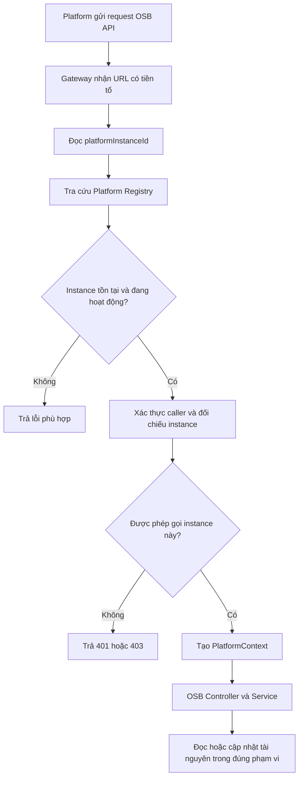

# Nhận diện nền tảng bằng `platformInstanceId` và tiền tố đường dẫn

Một Spring Cloud Service Broker có thể phục vụ nhiều môi trường nền tảng cùng lúc, chẳng hạn nhiều Cloud Foundry foundation hoặc nhiều cụm Kubernetes. Các môi trường này có thể gọi cùng một dịch vụ broker, nhưng mỗi môi trường có catalog, cấu hình kết nối, phạm vi tài nguyên và thông tin xác thực riêng. Broker cần biết request đến từ môi trường nào trước khi xử lý thao tác.

Một cách tổ chức rõ ràng là cấp cho mỗi môi trường một `platformInstanceId` ổn định và đưa mã này vào tiền tố đường dẫn của broker. Tiền tố giúp định tuyến request đến đúng cấu hình nền tảng; `platformInstanceId` trở thành khóa phạm vi để kiểm tra quyền sở hữu service instance, binding và operation. Đây là quy ước mở rộng ở tầng tích hợp của broker. Open Service Broker API (OSB API) vẫn giữ các endpoint và payload chuẩn của nó.

## 1. Vì sao broker cần nhận diện từng platform instance?

Giả sử một broker quản lý dịch vụ cơ sở dữ liệu cho ba môi trường:

- `cf-prod-01`: Cloud Foundry production.
- `cf-staging-01`: Cloud Foundry staging.
- `k8s-prod-01`: cụm Kubernetes production.

Cả ba môi trường có thể gọi các thao tác catalog, provision, update, deprovision và binding. Tuy nhiên, cùng một `service_id` hoặc `plan_id` có thể được bật ở môi trường này nhưng bị tắt ở môi trường khác. Hai nền tảng cũng có thể gửi cùng một `service_instance_id`; mã này chỉ có ý nghĩa trong phạm vi nền tảng đã tạo ra nó.

Nếu broker chỉ lưu `service_instance_id` làm khóa toàn cục, dữ liệu của hai môi trường có nguy cơ va chạm. Nếu broker dùng một cấu hình kết nối chung, request từ staging có thể vô tình tác động đến tài nguyên production. Vì vậy, mỗi request cần mang theo ngữ cảnh platform đã được xác định và xác thực.

Hai khái niệm cần được phân biệt:

- **Platform type** cho biết loại nền tảng, ví dụ `CLOUDFOUNDRY` hoặc `KUBERNETES`.
- **Platform instance** là một cài đặt cụ thể của nền tảng, ví dụ một Cloud Foundry foundation hoặc một cụm Kubernetes. `platformInstanceId` định danh instance đó trong hệ thống broker.

`platformInstanceId` nên là mã ổn định, duy nhất trong phạm vi broker, không phụ thuộc tên hiển thị, địa chỉ có thể thay đổi hoặc thông tin bí mật. Có thể dùng UUID hoặc mã slug đã được kiểm soát như `cf-prod-01`. Khi endpoint, tên cụm hoặc thông tin xác thực thay đổi, mã định danh vẫn được giữ nguyên để các bản ghi tài nguyên không mất liên kết.

## 2. Đặt `platformInstanceId` trong tiền tố đường dẫn

OSB API định nghĩa các đường dẫn chuẩn như `/v2/catalog`, `/v2/service_instances/{service_instance_id}` và `/v2/service_instances/{service_instance_id}/service_bindings/{binding_id}`. API không định nghĩa một trường chuẩn tên `platformInstanceId`. Vì vậy, broker có thể đưa mã instance vào phần base path của URL mà nền tảng dùng để gọi broker.

Ví dụ, cấu hình broker URL cho từng môi trường như sau:

| Platform instance | Base URL được cấu hình | Endpoint catalog thực tế |
|---|---|---|
| `cf-prod-01` | `https://broker.example.com/platforms/cf-prod-01` | `/platforms/cf-prod-01/v2/catalog` |
| `cf-staging-01` | `https://broker.example.com/platforms/cf-staging-01` | `/platforms/cf-staging-01/v2/catalog` |
| `k8s-prod-01` | `https://broker.example.com/platforms/k8s-prod-01` | `/platforms/k8s-prod-01/v2/catalog` |

Nền tảng tiếp tục gọi các endpoint OSB API bên dưới base URL đã cấu hình. Ví dụ:

```http
GET /platforms/cf-prod-01/v2/catalog HTTP/1.1
Host: broker.example.com
X-Broker-API-Version: 2.15
Authorization: Basic <credentials>
```

Các thao tác tài nguyên dùng cùng tiền tố:

```text
GET    /platforms/{platformInstanceId}/v2/catalog
PUT    /platforms/{platformInstanceId}/v2/service_instances/{serviceInstanceId}
PATCH  /platforms/{platformInstanceId}/v2/service_instances/{serviceInstanceId}
DELETE /platforms/{platformInstanceId}/v2/service_instances/{serviceInstanceId}
PUT    /platforms/{platformInstanceId}/v2/service_instances/{serviceInstanceId}/service_bindings/{bindingId}
DELETE /platforms/{platformInstanceId}/v2/service_instances/{serviceInstanceId}/service_bindings/{bindingId}
GET    /platforms/{platformInstanceId}/v2/service_instances/{serviceInstanceId}/last_operation
```

Danh sách trên minh họa cách thêm tiền tố vào base path; phương thức HTTP và phần endpoint OSB API vẫn tuân theo phiên bản đặc tả mà broker hỗ trợ. Khi cấu hình URL trên một nền tảng cụ thể, cần kiểm tra nền tảng đó có nối `/v2/...` vào base URL hay yêu cầu URL đầy đủ, tránh cấu hình lặp `/v2/v2`.

Tiền tố nên có cấu trúc nhất quán, chẳng hạn `/platforms/{platformInstanceId}`. Không nên dùng tên hiển thị làm định danh vì tên có thể đổi hoặc trùng nhau. Cũng không đưa password, token hay secret vào đường dẫn: URL thường xuất hiện trong access log, trace và lịch sử proxy.

## 3. Luồng nhận diện và định tuyến request

Broker nên giải quyết `platformInstanceId` ở đầu luồng xử lý, sau đó truyền ngữ cảnh đã xác định đến các lớp nghiệp vụ. Luồng tổng quát:



Các bước có ý nghĩa như sau:

1. **Nhận đường dẫn:** gateway hoặc ứng dụng nhận request có dạng `/platforms/{platformInstanceId}/v2/...`.
2. **Kiểm tra mã định danh:** kiểm tra định dạng và tra cứu mã trong Platform Registry. Không tự tạo instance mới chỉ vì nhận được một mã chưa biết.
3. **Xác thực:** xác minh caller bằng cơ chế đã cấu hình, ví dụ HTTP Basic, bearer token hoặc mutual TLS. Sau đó kiểm tra danh tính đã xác thực có quyền gọi đúng `platformInstanceId` trong URL.
4. **Tạo ngữ cảnh:** tạo một `PlatformContext` bất biến chứa các thông tin cần cho request như mã instance, loại nền tảng và tenant hoặc organization scope.
5. **Thực thi nghiệp vụ:** catalog, provision, update, deprovision, binding và truy vấn trạng thái đều nhận ngữ cảnh này để giới hạn dữ liệu và thao tác.

Việc tách bước nhận diện khỏi nghiệp vụ giúp mọi endpoint áp dụng cùng một quy tắc. Nếu mỗi controller tự phân tích URL hoặc tự tìm cấu hình nền tảng, các endpoint dễ xử lý khác nhau và có thể bỏ sót kiểm tra quyền.

## 4. Tổ chức triển khai trong Spring

### 4.1. Mô hình ngữ cảnh platform

Tạo một kiểu dữ liệu chỉ chứa thông tin định danh và phạm vi cần thiết cho request:

```java
public record PlatformContext(
        String platformInstanceId,
        PlatformType platformType,
        String tenantId
) {}
```

`PlatformType` có thể là enum nội bộ:

```java
public enum PlatformType {
    CLOUDFOUNDRY,
    KUBERNETES
}
```

Không nên đưa secret vào `PlatformContext`, vì đối tượng này có thể được truyền qua nhiều lớp hoặc xuất hiện trong log khi debug. Thành phần cần kết nối đến control plane nên lấy thông tin xác thực từ kho secret theo quyền phù hợp.

### 4.2. Tra cứu Platform Registry

Platform Registry lưu ánh xạ từ `platformInstanceId` đến cấu hình của instance. Một bản ghi có thể chứa loại nền tảng, tenant hoặc organization scope, trạng thái hoạt động, endpoint quản trị và tham chiếu đến secret. Secret thực tế nên được lưu trong secret manager hoặc kho bảo mật tương đương.

Ví dụ lớp tra cứu:

```java
@Service
public class PlatformRegistry {

    private final PlatformInstanceRepository repository;

    public PlatformRegistry(PlatformInstanceRepository repository) {
        this.repository = repository;
    }

    public PlatformContext requireActive(String rawId) {
        if (rawId == null || !rawId.matches("[a-z0-9][a-z0-9-]{0,62}")) {
            throw new PlatformNotFoundException();
        }

        PlatformInstance instance = repository.findByPlatformInstanceId(rawId)
                .filter(PlatformInstance::isActive)
                .orElseThrow(PlatformNotFoundException::new);

        return new PlatformContext(
                instance.getPlatformInstanceId(),
                instance.getPlatformType(),
                instance.getTenantId()
        );
    }
}
```

Đoạn mã minh họa một quy ước slug chữ thường, chữ số và dấu gạch ngang. Nếu hệ thống dùng UUID hoặc định dạng khác, cần thay bộ kiểm tra cho phù hợp. Mã không hợp lệ, không tồn tại hoặc đã ngừng hoạt động phải bị từ chối trước khi chạy nghiệp vụ.

### 4.3. Ánh xạ endpoint OSB API

Với Spring MVC, có thể khai báo tiền tố chung ở controller. Mỗi request nhận `platformInstanceId` từ path variable rồi phân giải thành `PlatformContext`:

```java
@RestController
@RequestMapping("/platforms/{platformInstanceId}/v2")
public class OsbCatalogController {

    private final PlatformRegistry platformRegistry;
    private final CatalogService catalogService;

    public OsbCatalogController(
            PlatformRegistry platformRegistry,
            CatalogService catalogService
    ) {
        this.platformRegistry = platformRegistry;
        this.catalogService = catalogService;
    }

    @GetMapping("/catalog")
    public CatalogResponse catalog(@PathVariable String platformInstanceId) {
        PlatformContext platform = platformRegistry.requireActive(platformInstanceId);
        return catalogService.getCatalog(platform);
    }
}
```

Các controller provision, update, deprovision và binding áp dụng cùng cách lấy ngữ cảnh. Nên chuyển `PlatformContext` vào service nghiệp vụ một cách tường minh để người đọc thấy thao tác đang chạy trong phạm vi nào:

```java
@PutMapping("/service_instances/{serviceInstanceId}")
public ProvisionResponse provision(
        @PathVariable String platformInstanceId,
        @PathVariable String serviceInstanceId,
        @RequestBody ProvisionRequest request
) {
    PlatformContext platform = platformRegistry.requireActive(platformInstanceId);
    return provisioningService.provision(platform, serviceInstanceId, request);
}
```

Đây là phần minh họa cách định tuyến và truyền ngữ cảnh; controller thực tế vẫn phải tuân thủ đầy đủ request, response, header phiên bản API và quy tắc lỗi của OSB API.

### 4.4. Tích hợp Spring Cloud Gateway

Nếu broker đặt sau Spring Cloud Gateway, gateway có thể định tuyến mọi request có tiền tố `/platforms/*/v2/**` đến ứng dụng broker:

```yaml
spring:
  cloud:
    gateway:
      routes:
        - id: service-broker
          uri: lb://service-broker
          predicates:
            - Path=/platforms/*/v2/**
```

Ví dụ này giữ nguyên tiền tố trong request chuyển tiếp để ứng dụng broker đọc được `platformInstanceId`. Nếu gateway dùng `StripPrefix` hoặc rewrite path để bỏ tiền tố, ứng dụng phía sau sẽ không còn dữ liệu định danh trong URL. Khi đó gateway phải chuyển mã instance qua một metadata header do gateway tự thiết lập sau khi xác thực, đồng thời xóa header cùng tên do client gửi vào. Không được tin một header tùy ý từ Internet như thể nó đã được gateway xác nhận.

## 5. Kết hợp nhận diện với bảo mật

`platformInstanceId` là thông tin định tuyến, không phải bằng chứng xác thực. Người gọi có thể thử thay mã trong URL; nếu broker chỉ tra cứu mã rồi thực hiện request, một caller có credential hợp lệ cho staging có thể thử truy cập production.

Broker cần ràng buộc danh tính đã xác thực với instance trong URL. Ví dụ, mỗi platform instance có một credential hoặc certificate riêng; sau khi xác thực, broker kiểm tra credential đó được phép sử dụng `platformInstanceId` nào. Nếu nhiều instance dùng chung một credential, mã trong URL chỉ phân vùng dữ liệu chứ không chứng minh request thực sự đến từ instance tương ứng.

Một số nguyên tắc cần giữ:

- Không xem `platformInstanceId` là password hoặc token. Mã này có thể xuất hiện trong URL và log.
- Chỉ chấp nhận ID tồn tại trong registry và đang hoạt động; không tự suy ra cấu hình từ một ID lạ.
- Kiểm tra quyền trên mọi endpoint, kể cả catalog và `last_operation`, không chỉ endpoint provision.
- Giới hạn định dạng ID, từ chối dấu `/`, segment `.` hoặc `..`, và các dạng mã hóa đường dẫn bất thường. Không tự giải mã URL nhiều lần.
- Chỉ tin `Forwarded` hoặc `X-Forwarded-*` khi request đến từ proxy tin cậy đã được cấu hình. Không dùng `X-Forwarded-Prefix` do client trực tiếp gửi để xác định instance.
- Không ghi Authorization header, token hoặc secret vào log.

OSB API có header `X-Broker-API-Originating-Identity` để truyền thông tin định danh nguồn gốc theo quy ước của platform. Khi header này được hỗ trợ và caller đã được xác thực, broker có thể dùng nó cho audit hoặc chính sách theo người dùng. Tuy nhiên, thông tin người dùng nguồn gốc không đồng nghĩa với `platformInstanceId`; header này không nên là nguồn duy nhất để chọn cấu hình platform.

## 6. Giữ đúng phạm vi dữ liệu và xử lý bất đồng bộ

Nhận diện platform chỉ có giá trị khi được duy trì xuyên suốt vòng đời tài nguyên. Trong cơ sở dữ liệu, nên lưu `platform_instance_id` cùng các ID do platform gửi. Ví dụ:

| Bản ghi | Khóa phạm vi đề xuất | Mục đích |
|---|---|---|
| Service instance | `(platform_instance_id, service_instance_id)` | Cho phép hai platform có cùng service instance ID mà không va chạm |
| Service binding | `(platform_instance_id, binding_id)` hoặc khóa liên kết đến service instance | Cô lập binding theo platform |
| Operation | `platform_instance_id` cùng service instance và operation key | Đảm bảo truy vấn trạng thái thuộc đúng platform |

Khi xử lý request, broker phải xác minh service instance được truy cập thuộc đúng `platformInstanceId` trong URL. Không tìm tài nguyên chỉ bằng `service_instance_id` rồi trả kết quả nếu không kiểm tra quyền sở hữu. Cùng nguyên tắc áp dụng cho binding ID và operation key.

Provisioning có thể chạy bất đồng bộ. Trong trường hợp đó, broker lưu `platformInstanceId` vào bản ghi operation trước khi đẩy công việc sang hàng đợi. Worker nền đọc lại ngữ cảnh từ bản ghi này để chọn cấu hình kết nối và phạm vi tài nguyên. Không dựa vào request thread hoặc `ThreadLocal` để mang platform context sang thread khác; ngữ cảnh có thể mất khi tác vụ được thực thi bởi executor hoặc message consumer.

Idempotency cũng cần có phạm vi platform. Khi nhận lại một request provision hoặc deprovision, broker phải tìm operation và service instance trong đúng instance đã xác định. Một request lặp từ `cf-prod-01` không được trùng với request có cùng ID từ `cf-staging-01`. Có thể dùng khóa duy nhất kết hợp `platform_instance_id` với `service_instance_id` và thông tin operation phù hợp với mô hình dữ liệu.

Catalog có thể được lọc theo platform context. Chẳng hạn, một plan chỉ hỗ trợ Cloud Foundry có thể không xuất hiện trong catalog của Kubernetes. Việc lọc cần dựa trên cấu hình và capability đã đăng ký của instance, không dựa vào suy đoán từ tên path.

## 7. Vòng đời của `platformInstanceId`

Platform Registry cần có quy trình đăng ký, cập nhật và ngừng hoạt động rõ ràng:

1. **Đăng ký:** tạo ID duy nhất, gắn platform type, tenant scope và tham chiếu secret. Cấp URL có tiền tố tương ứng để cấu hình trên platform.
2. **Cập nhật:** thay đổi endpoint, certificate hoặc secret mà vẫn giữ ID nếu đó vẫn là cùng một platform instance.
3. **Tạm ngừng:** chuyển trạng thái instance sang inactive để broker từ chối request mới theo chính sách đã chọn.
4. **Ngừng sử dụng:** xử lý tài nguyên và operation còn tồn tại trước khi đóng hồ sơ instance. Không tái sử dụng ID cũ cho một môi trường khác.

Không nên xóa một bản ghi platform ngay khi endpoint bị ngắt kết nối. Service instance và operation lịch sử có thể vẫn tham chiếu đến ID đó. Giữ tombstone hoặc bản ghi đã ngừng hoạt động giúp audit và ngăn một ID cũ vô tình trỏ sang môi trường mới.

## 8. Lỗi thường gặp và cách kiểm tra

| Tình huống | Hậu quả | Cách xử lý |
|---|---|---|
| Dùng tên hiển thị làm ID | Đổi tên làm hỏng liên kết hoặc gây trùng | Dùng ID ổn định, không phụ thuộc tên |
| Chỉ kiểm tra ID có tồn tại | Caller có thể thử ID của instance khác | Ràng buộc credential hoặc certificate với ID |
| Gateway bỏ tiền tố trước khi broker đọc ID | Broker không biết request thuộc instance nào | Giữ nguyên path hoặc chuyển metadata qua kênh tin cậy |
| Lưu service instance bằng ID toàn cục | Các platform có thể va chạm ID | Dùng khóa có `platform_instance_id` |
| Worker nền không lưu platform context | Tác vụ bất đồng bộ có thể dùng nhầm cấu hình | Lưu ID trong operation và truyền tường minh |
| Tin header do client tự gửi | Có thể giả mạo instance | Chỉ nhận metadata từ proxy hoặc cơ chế xác thực tin cậy |

Các kiểm thử tích hợp quan trọng gồm:

- Gọi catalog bằng từng tiền tố và xác nhận catalog trả về đúng cấu hình của instance đó.
- Gửi ID không tồn tại, ID sai định dạng hoặc instance đã inactive và xác nhận broker từ chối request.
- Dùng credential của `cf-staging-01` với path `cf-prod-01` và xác nhận không thể truy cập instance production.
- Tạo hai service instance có cùng `service_instance_id` ở hai platform khác nhau và xác nhận dữ liệu được tách biệt.
- Gửi request `last_operation` bằng sai tiền tố và xác nhận không thể đọc trạng thái operation của platform khác.
- Kiểm tra gateway giữ đúng path prefix, đồng thời không tin header định danh do client tự chèn.
- Chạy một operation bất đồng bộ, khởi chạy worker nền và xác nhận worker dùng đúng `platformInstanceId` đã lưu.

Log và metric nên có `platformInstanceId` để phân tích lỗi theo môi trường. Có thể ghi thêm `platformType`, request ID và operation key. Không đưa credential, token hoặc dữ liệu nhạy cảm vào nhãn metric hay log. Với metric có cardinality cao, cân nhắc dùng `platformType` làm label phổ biến và giữ `platformInstanceId` trong log hoặc trace.

## 9. Kết luận

Tiền tố `/platforms/{platformInstanceId}` cung cấp một điểm nhận diện nhất quán trước các endpoint `/v2` của OSB API. Platform Registry chuyển mã này thành cấu hình và phạm vi hoạt động cụ thể; `PlatformContext` đưa ngữ cảnh đó đến controller, service và worker nền. Khi kết hợp với xác thực caller, kiểm tra quyền sở hữu tài nguyên và khóa dữ liệu có phạm vi platform, broker có thể phục vụ nhiều Cloud Foundry foundation hoặc cụm Kubernetes trên cùng một hệ thống mà vẫn cô lập catalog, service instance, binding và operation.
