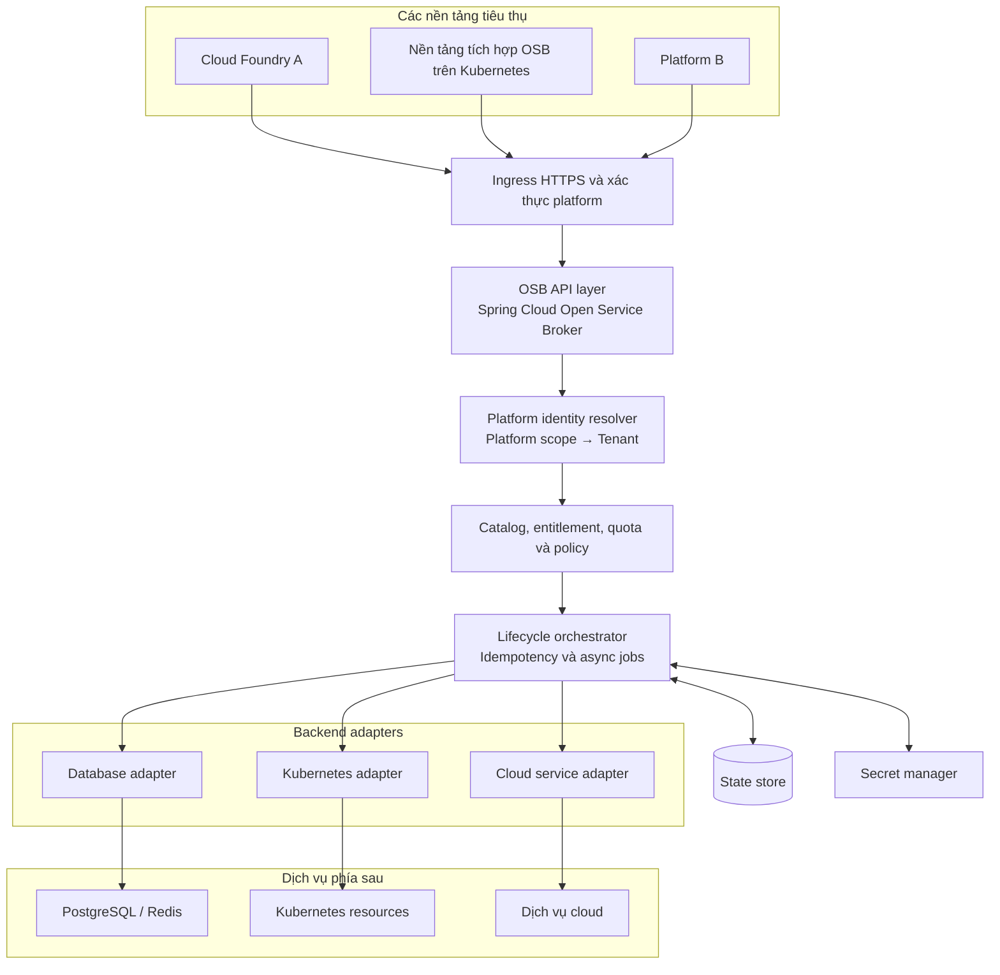
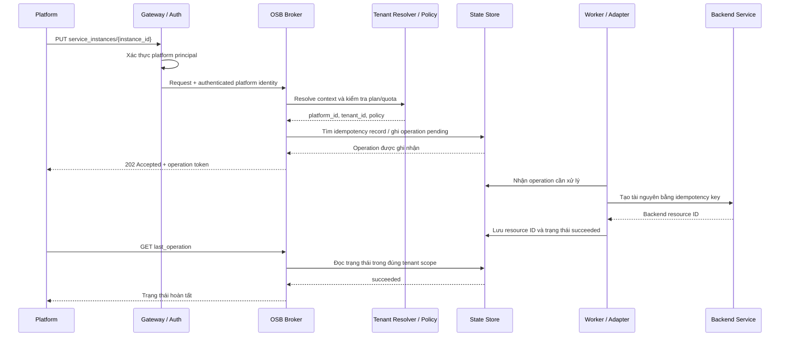

# Thiết kế broker phục vụ nhiều nền tảng và nhiều khách hàng

## Bài toán kiến trúc

Một service broker thường bắt đầu bằng một kịch bản đơn giản: một nền tảng gọi một broker để cấp phát một loại dịch vụ cho ứng dụng. Khi mở rộng, cùng một broker có thể phải phục vụ nhiều nền tảng như các cụm Cloud Foundry khác nhau hoặc các hệ thống tích hợp OSB API trong môi trường Kubernetes. Mỗi nền tảng lại có nhiều tổ chức, không gian triển khai, namespace hoặc khách hàng sử dụng dịch vụ.

Module `SPRING_CLOUD_SERVICE_BROKER` xây dựng service broker theo **Open Service Broker API (OSB API)** bằng Spring Cloud. Vì vậy, kiến trúc cần giữ được hợp đồng giao tiếp thống nhất, đồng thời xử lý được khác biệt về danh tính nền tảng, ranh giới khách hàng, quyền sử dụng service plan và hệ thống hạ tầng phía sau.

Hai chiều mở rộng cần được phân biệt:

- **Multi-platform:** một broker phục vụ nhiều nền tảng tiêu thụ dịch vụ. Mỗi nền tảng có thể có cách xác thực, định danh tổ chức và khả năng tích hợp khác nhau.
- **Multi-tenant:** một broker phục vụ nhiều khách hàng độc lập. Mỗi khách hàng có dữ liệu, tài nguyên, giới hạn sử dụng và quyền truy cập riêng.

Một nền tảng có thể chứa nhiều tenant. Một tenant cũng có thể sử dụng dịch vụ qua nhiều nền tảng. Vì thế, không nên mặc định `platform`, `organization`, `namespace` và `tenant` là cùng một khái niệm. Kiến trúc cần một mô hình định danh nội bộ rõ ràng để tránh tạo nhầm tài nguyên hoặc để lộ dữ liệu giữa các khách hàng.

## Mục tiêu và nguyên tắc thiết kế

Một broker phục vụ nhiều nền tảng và khách hàng cần đạt các mục tiêu sau:

1. Tiếp nhận yêu cầu OSB API từ nhiều nền tảng bằng một hợp đồng ổn định.
2. Xác định được nền tảng gọi và tenant sở hữu yêu cầu dựa trên danh tính đã xác thực.
3. Cô lập service instance, binding, thao tác, cấu hình và bí mật giữa các tenant.
4. Cho phép áp dụng catalog, service plan, quota và chính sách khác nhau theo nền tảng hoặc tenant.
5. Duy trì idempotency và trạng thái nhất quán khi nền tảng retry hoặc khi broker chạy nhiều bản sao.
6. Tích hợp nhiều loại hạ tầng phía sau mà không để chi tiết nhà cung cấp lan vào lớp giao thức.
7. Có thể mở rộng tải, giám sát, xử lý sự cố và thay đổi chính sách mà không làm ảnh hưởng tenant khác.

Các nguyên tắc quan trọng là xác thực trước khi xác định tenant, kiểm tra quyền ở mọi thao tác vòng đời, gắn phạm vi sở hữu vào mọi bản ghi tài nguyên, và chỉ thực hiện retry đối với thao tác có cơ chế chống tạo trùng. Những nguyên tắc này cần được áp dụng xuyên suốt từ endpoint HTTP đến kho trạng thái và adapter gọi hạ tầng.

## Phân biệt platform, tenant và tài nguyên OSB

OSB API cung cấp các định danh như service, plan, service instance và binding. Nền tảng cũng có thể truyền context chứa thông tin về môi trường hoặc đối tượng sở hữu. Broker cần chuyển những thông tin đó thành mô hình định danh nội bộ.

| Khái niệm | Ý nghĩa trong kiến trúc | Ví dụ |
|---|---|---|
| Platform | Một hệ thống hoặc cụm nền tảng được cấp quyền gọi broker. | Cụm Cloud Foundry `cf-prod`; một bộ điều khiển tích hợp OSB trong Kubernetes. |
| Tenant | Khách hàng hoặc phạm vi sở hữu dữ liệu và tài nguyên độc lập. | Công ty A, nhóm sản phẩm B hoặc một khách hàng SaaS. |
| Platform scope | Không gian con do nền tảng định nghĩa và quản lý. | Organization/space trong Cloud Foundry; namespace hoặc project trong hệ thống tích hợp Kubernetes. |
| Service | Loại dịch vụ broker công bố. | PostgreSQL, Redis hoặc Kafka. |
| Plan | Gói cấu hình và giới hạn của một service. | PostgreSQL `small` hoặc `production`. |
| Service instance | Một lần cấp phát dịch vụ thuộc tenant và platform scope xác định. | Database `orders-db` của tenant A. |
| Binding | Thông tin truy cập hoặc liên kết cấp cho một consumer. | Tài khoản database riêng cho ứng dụng `orders-api`. |

Một mô hình nội bộ có thể biểu diễn quan hệ như sau:

```text
Platform
  └── Platform scope
        └── Tenant mapping
              ├── Service instance
              │     ├── Operation history
              │     └── Binding(s)
              └── Entitlements / Quotas
```

Quan hệ này là mô hình quản lý của broker. Nó không yêu cầu mọi nền tảng phải có cùng cấu trúc tổ chức. Adapter hoặc bộ phân giải context chịu trách nhiệm ánh xạ cấu trúc riêng của nền tảng sang `tenant_id` và `platform_scope_id` nội bộ.

## Kiến trúc thành phần

Một kiến trúc tham khảo có thể chia thành các lớp sau:

- **Ingress và xác thực:** tiếp nhận HTTPS, xác thực thông tin đăng nhập của nền tảng, áp dụng giới hạn lưu lượng và chuyển danh tính đã xác thực vào xử lý nghiệp vụ.
- **OSB API layer:** sử dụng Spring Cloud Open Service Broker để triển khai hợp đồng catalog, provision, update, deprovision, bind, unbind và truy vấn trạng thái thao tác.
- **Platform identity resolver:** nhận diện platform từ thông tin xác thực; kiểm tra context của yêu cầu và ánh xạ platform scope sang tenant nội bộ.
- **Catalog và policy service:** trả catalog phù hợp với quyền của platform/tenant; xác thực service plan, quota và các chính sách tại thời điểm thực hiện thao tác.
- **Lifecycle orchestrator:** điều phối vòng đời tài nguyên, ghi nhận trạng thái, xử lý idempotency, tạo công việc bất đồng bộ và phối hợp bù trừ khi cần.
- **State store:** lưu quan hệ platform, tenant, service instance, binding, operation và tham chiếu đến bí mật.
- **Backend adapters:** chuyển yêu cầu nghiệp vụ thành lệnh gọi đến hệ thống cloud, database, message broker, Kubernetes operator hoặc dịch vụ nội bộ.
- **Secret manager và observability:** bảo vệ thông tin xác thực; cung cấp log, metric, trace và audit theo phạm vi truy cập phù hợp.



Spring Cloud Open Service Broker cung cấp lớp tích hợp giao thức OSB API trong ứng dụng Spring. Những thành phần như identity resolver, policy service, state store và adapter là trách nhiệm kiến trúc của ứng dụng broker; chúng có thể được triển khai thành các module trong cùng ứng dụng hoặc thành dịch vụ riêng tùy quy mô.

## Nhận diện platform và tenant một cách tin cậy

Đây là điểm quyết định tính an toàn của kiến trúc multi-tenant. Broker phải biết ai đang gọi trước khi quyết định yêu cầu thuộc tenant nào.

### Xác thực danh tính platform

Mỗi platform registration nên có thông tin xác thực riêng, chẳng hạn cặp username/password riêng cho từng đăng ký broker, hoặc một cơ chế xác thực mạnh hơn được gateway hỗ trợ. Sau khi xác thực thành công, broker ánh xạ principal sang một bản ghi platform đã đăng ký:

```text
Thông tin xác thực
       ↓
Platform principal đã xác thực
       ↓
platform_id = cf-prod
       ↓
Kiểm tra platform còn hoạt động và được phép gọi API
```

Nếu nhiều platform dùng chung một credential thì broker không thể phân biệt chúng chỉ dựa trên credential đó. Khi phải dùng chung endpoint, cần một cơ chế tin cậy khác để xác định platform, ví dụ gateway xác thực từng client rồi truyền danh tính đã xác minh qua kênh nội bộ được bảo vệ. Không lấy một header tùy ý do client gửi như `X-Platform-Id` làm bằng chứng danh tính.

### Ánh xạ context sang tenant

Yêu cầu OSB có thể mang context do platform cung cấp. Broker có thể dùng các trường này làm dữ liệu đầu vào để tìm tenant, ví dụ organization/space hoặc namespace/project. Tuy nhiên, context chỉ là thông tin cần kiểm tra; nó không tự chứng minh caller có quyền sở hữu tenant đó.

Quy trình phân giải nên gồm các bước:

1. Lấy `platform_id` từ principal đã xác thực.
2. Đọc context theo định dạng mà platform đó hỗ trợ.
3. Kiểm tra platform scope có thuộc platform đã xác thực và đang được phép sử dụng broker.
4. Tra cứu ánh xạ đã được quản trị hoặc đăng ký để lấy `tenant_id` nội bộ.
5. Kiểm tra tenant đang hoạt động, có entitlement và không vượt giới hạn áp dụng.
6. Gắn `platform_id`, `platform_scope_id` và `tenant_id` vào execution context của request.

Nếu không thể xác định tenant duy nhất hoặc context không hợp lệ, broker phải từ chối yêu cầu. Không nên tự tạo tenant mới chỉ vì nhận được một giá trị organization hoặc namespace chưa từng thấy.

### Một số trường hợp ánh xạ

| Platform | Thông tin nguồn có thể gặp | Cách broker chuẩn hóa |
|---|---|---|
| Cloud Foundry | Organization, space và thông tin context của request. | Ánh xạ cặp platform + organization/space đến tenant và platform scope. |
| Kubernetes qua service catalog/controller tương thích | Namespace, cluster hoặc project do thành phần tích hợp cung cấp. | Ánh xạ cluster đã xác thực + namespace/project đến tenant. |
| Platform nội bộ | Account, workspace hoặc project ID. | Dùng adapter riêng để chuẩn hóa thành tenant ID ổn định. |

Các trường cụ thể phụ thuộc phiên bản API và thành phần tích hợp của platform. Broker nên giữ phần ánh xạ trong adapter hoặc resolver riêng thay vì để logic Cloud Foundry hay Kubernetes rải rác trong từng handler nghiệp vụ.

## Cô lập dữ liệu và định danh tài nguyên

Mọi truy vấn và thay đổi trạng thái cần được giới hạn theo tenant cùng platform scope. Chỉ lưu `instance_id` hoặc `binding_id` là chưa đủ nếu cùng một endpoint phục vụ nhiều platform và các platform có thể tạo ra những ID trùng nhau.

Một khóa định danh nội bộ có thể kết hợp:

```text
service_instance_key = (platform_id, tenant_id, instance_id)
binding_key          = (platform_id, tenant_id, instance_id, binding_id)
```

Nếu một tenant được dùng qua nhiều platform, `platform_id` vẫn giúp broker xác định nguồn yêu cầu và áp dụng chính sách riêng cho từng platform. Nếu kiến trúc quy định một instance có thể được quản lý xuyên platform, cần một mô hình ownership rõ ràng và quy tắc chuyển giao riêng; không nên ngầm coi hai bản ghi có cùng `instance_id` là một tài nguyên.

### Mô hình dữ liệu tham khảo

| Bảng hoặc aggregate | Trường quan trọng | Ràng buộc cần có |
|---|---|---|
| `platform` | `platform_id`, `credential_ref`, `status` | ID ổn định; credential được lưu hoặc tham chiếu an toàn. |
| `tenant` | `tenant_id`, `status`, `policy_ref` | Tenant có vòng đời và chính sách riêng. |
| `platform_tenant_mapping` | `platform_id`, `platform_scope_id`, `tenant_id` | Không ánh xạ một scope đang hoạt động sang nhiều tenant ngoài chủ đích. |
| `service_instance` | `platform_id`, `tenant_id`, `instance_id`, `service_id`, `plan_id`, `backend_resource_id`, `state` | Unique theo phạm vi định danh đã chọn; mọi truy vấn đều có điều kiện ownership. |
| `service_binding` | `platform_id`, `tenant_id`, `instance_id`, `binding_id`, `secret_ref`, `state` | Binding phải thuộc đúng instance và tenant. |
| `operation` | `operation_id`, `platform_id`, `tenant_id`, `instance_id`, `type`, `state`, `request_hash` | Có khóa chống xử lý lặp và lịch sử trạng thái. |
| `tenant_entitlement` | `tenant_id`, `service_id`, `plan_id`, `quota` | Kiểm tra quyền và hạn mức trước khi cấp phát. |

Các trường trên là mô hình khái niệm, không phải schema bắt buộc của Spring Cloud Open Service Broker. Khi triển khai bằng SQL, nên dùng khóa ngoại và unique constraint để bảo vệ các quan hệ quan trọng ở cấp dữ liệu. Những truy vấn đọc, cập nhật hoặc xóa phải luôn mang tenant scope; không lấy một ID từ URL rồi truy vấn toàn cục mà bỏ qua quyền sở hữu.

### Lựa chọn mức độ cô lập

| Mô hình | Ưu điểm | Đánh đổi |
|---|---|---|
| Chung database, chung schema, có `tenant_id` | Chi phí vận hành thấp, dễ tổng hợp và mở rộng ứng dụng. | Cần kỷ luật tenant scoping ở mọi truy vấn; một lỗi lọc có thể ảnh hưởng nhiều khách hàng. |
| Chung database, schema riêng hoặc nhóm schema | Tăng mức tách biệt dữ liệu và có thể hỗ trợ tùy biến theo khách hàng. | Migration, connection pool và vận hành phức tạp hơn. |
| Database riêng cho từng tenant | Ranh giới dữ liệu rõ, dễ đáp ứng yêu cầu cô lập cao. | Chi phí, quản lý kết nối, backup và nâng cấp tăng theo số tenant. |
| Broker/control plane riêng cho tenant hoặc platform | Có thể tách credential, tải và miền lỗi. | Nhiều deployment, cấu hình và phiên bản cần quản lý. |

Không có một mô hình phù hợp cho mọi hệ thống. Broker SaaS với nhiều tenant nhỏ thường bắt đầu từ database dùng chung và tenant ID bắt buộc, sau đó bổ sung schema hoặc database riêng cho nhóm khách hàng có yêu cầu cao. Những tenant có tải lớn hoặc yêu cầu tuân thủ đặc biệt có thể được chuyển sang worker pool hay deployment riêng.

## Catalog, service plan và chính sách theo tenant

Catalog là hợp đồng mô tả những dịch vụ và plan mà broker công bố. Khi phục vụ nhiều platform, catalog cần nhất quán về định danh và ý nghĩa. `service_id` hoặc `plan_id` không nên thay đổi ngẫu nhiên giữa các lần trả catalog, vì platform có thể lưu lại và sử dụng các ID đó trong những request vòng đời sau.

Broker có thể áp dụng chính sách khác nhau theo platform hoặc tenant:

- Platform A được phép dùng PostgreSQL và Redis; Platform B chỉ được phép dùng PostgreSQL.
- Tenant có gói cơ bản chỉ được provision plan `small`.
- Tenant doanh nghiệp có thể được cấp plan hiệu năng cao hoặc quota lớn hơn.
- Một platform có thể không hỗ trợ một tính năng hoặc kiểu binding nhất định.

Có hai cách phổ biến để biểu diễn chính sách catalog:

1. **Catalog chung:** trả cùng danh sách service/plan cho các platform, sau đó kiểm tra entitlement và capability ở thời điểm provision. Cách này đơn giản và ổn định, nhưng người dùng có thể nhìn thấy plan mà tenant của họ không được phép chọn.
2. **Catalog theo phạm vi:** lọc danh sách dựa trên platform hoặc tenant đã xác thực. Cách này phản ánh quyền sử dụng rõ hơn, nhưng cần quản lý cache của platform và bảo đảm cùng một ID luôn có ý nghĩa ổn định.

Dù chọn cách nào, catalog không thay thế kiểm tra quyền khi thực hiện thao tác. Một client có thể gửi trực tiếp `service_id` và `plan_id`; broker phải kiểm tra lại entitlement, trạng thái tenant, quota và khả năng của platform trước khi provision hoặc update.

Không tái sử dụng một `plan_id` cho hai cấu hình có ý nghĩa khác nhau theo cách khiến tài nguyên cũ bị diễn giải sai. Khi cần thay đổi cấu hình, hãy xác định rõ cách versioning, migration và khả năng tương thích của plan.

## Luồng provision trong môi trường multi-platform, multi-tenant

Giả sử Cloud Foundry A và một nền tảng Kubernetes có controller tương thích cùng gọi một broker. Cả hai có nhiều tenant và đều muốn cấp PostgreSQL. Luồng provision nên được tổ chức như sau:

1. Ingress xác thực credential và xác định platform caller.
2. OSB API layer kiểm tra cấu trúc request theo hợp đồng.
3. Identity resolver kiểm tra context, tìm platform scope và ánh xạ sang tenant.
4. Policy service kiểm tra service, plan, entitlement, quota và khả năng của platform.
5. Orchestrator tạo hoặc tra cứu operation theo khóa idempotency trong phạm vi platform/tenant/instance.
6. State store ghi nhận yêu cầu và trạng thái ban đầu. Nếu xử lý bất đồng bộ, công việc được đưa vào hàng đợi bền vững hoặc outbox.
7. Backend adapter gọi hệ thống quản lý PostgreSQL bằng thông tin xác thực có phạm vi quyền phù hợp.
8. Broker lưu `backend_resource_id`, trạng thái và operation result; phản hồi đồng bộ hoặc `202 Accepted` theo kết quả thực tế.



Nếu thao tác hoàn tất ngay và nền tảng cho phép xử lý đồng bộ, broker có thể trả phản hồi đồng bộ phù hợp với OSB API. Nếu đã trả `202 Accepted`, broker cần duy trì trạng thái operation đủ lâu để platform truy vấn và không được báo thành công trước khi backend hoàn tất.

## Idempotency, trạng thái và xử lý bất đồng bộ

Trong môi trường nhiều platform, retry có thể xuất phát từ timeout của platform, gateway, broker hoặc backend. Vì vậy, khóa chống lặp phải được xác định theo phạm vi tài nguyên và thao tác, không dùng một khóa toàn cục có thể va chạm giữa tenant.

Một khóa logic tham khảo:

```text
idempotency_key = hash(
    platform_id,
    tenant_id,
    operation_type,
    instance_id,
    binding_id_if_present,
    request_fingerprint
)
```

`request_fingerprint` giúp phân biệt việc gửi lại cùng yêu cầu với việc dùng lại cùng ID nhưng thay đổi nội dung. Nếu khóa đã tồn tại:

- Cùng fingerprint và thao tác đang chạy: trả thông tin operation hiện có theo quy tắc API.
- Cùng fingerprint và thao tác đã hoàn tất: trả kết quả đã lưu, tránh tạo tài nguyên mới.
- Cùng định danh nhưng fingerprint khác: xử lý như xung đột theo quy tắc broker/API; không âm thầm chạy thêm một thao tác tạo tài nguyên.

Đối với công việc bất đồng bộ, nên ghi trạng thái operation và thông điệp công việc theo cách tránh trường hợp database đã ghi `PENDING` nhưng message không bao giờ được gửi. Mẫu transactional outbox là một lựa chọn: transaction ghi operation và outbox event; publisher chuyển event sang queue; worker xử lý và cập nhật kết quả. Worker vẫn phải idempotent vì queue có thể giao lại message.

Trạng thái có thể được mô hình hóa bằng các bước như `PENDING`, `IN_PROGRESS`, `SUCCEEDED` và `FAILED`. Chuyển trạng thái cần được kiểm soát bằng transaction hoặc optimistic locking để hai worker không cùng hoàn tất một operation theo cách gây sai lệch. Các lần retry cần có giới hạn, backoff và điều kiện dừng; không retry vô hạn những lỗi cấu hình hoặc lỗi quyền.

## Binding và bảo vệ bí mật theo tenant

Binding thường phát hành thông tin để một consumer kết nối tới service instance. Với multi-tenant, mỗi binding phải gắn với platform, tenant, instance và consumer tương ứng. Nếu backend hỗ trợ credential riêng cho từng binding, broker nên ưu tiên cách này để có thể thu hồi một consumer mà không làm gián đoạn các consumer khác.

Thông tin nhạy cảm như password, token, certificate hoặc private key cần được lưu trong secret manager hoặc kho mã hóa chuyên dụng. State store chỉ lưu `secret_ref` và metadata cần thiết. Broker chỉ trả bí mật cho caller đã xác thực và được quyền trên binding tương ứng; log, trace và audit không ghi giá trị bí mật.

Khi unbind, broker thu hồi credential hoặc quyền của binding đó. Khi deprovision, broker kiểm tra vòng đời binding và chính sách thu hồi tài nguyên trước khi xóa backend resource. Mọi thao tác phải kiểm tra ownership để một tenant không thể dùng `binding_id` hoặc `instance_id` của tenant khác để truy xuất hay thu hồi dữ liệu.

## Update, deprovision và bù trừ lỗi

Update có thể thay đổi plan, tham số hoặc cấu hình tài nguyên. Broker cần xác thực lại quyền và quota của tenant, kiểm tra khả năng chuyển đổi giữa plan cũ và mới, rồi điều phối adapter thực hiện thay đổi. Không nên cập nhật metadata plan trong state store trước khi backend xác nhận thành công, trừ khi có mô hình trạng thái chuyển tiếp và cơ chế phục hồi rõ ràng.

Deprovision cần xác nhận tài nguyên thuộc đúng platform và tenant. Broker nên xử lý yêu cầu lặp an toàn, xác định trạng thái binding, áp dụng chính sách retention/backup nếu có và ghi nhận kết quả thu hồi. Nếu backend đã xóa tài nguyên nhưng broker bị mất kết nối trước khi lưu kết quả, lần retry sau phải đối soát được tài nguyên đã biến mất và hoàn tất trạng thái mà không tạo hành động phụ ngoài ý muốn.

Một workflow gồm nhiều hệ thống không thể luôn được bảo vệ bằng một transaction ACID duy nhất. Có thể dùng saga hoặc các bước bù trừ. Ví dụ, nếu tạo database thành công nhưng không thể tạo user binding, broker có thể retry bước tạo user; nếu chính sách yêu cầu hủy toàn bộ provision, broker thực hiện hành động bù để xóa database và ghi nhận kết quả. Quyết định bù trừ phải phù hợp với tính chất dữ liệu và hợp đồng dịch vụ.

## Tích hợp nhiều platform và nhiều backend

OSB API tạo một ranh giới giao tiếp chung, nhưng mỗi platform có thể có cách đăng ký broker, xác thực, cung cấp context và xử lý capability riêng. Broker nên đặt logic đặc thù vào các adapter hoặc resolver nhỏ, sau đó chuyển về mô hình nghiệp vụ chuẩn hóa.

Tương tự, backend adapter che giấu cách tạo tài nguyên ở từng nhà cung cấp. Lifecycle orchestrator chỉ làm việc với các thao tác nghiệp vụ như `provision`, `bind`, `update` và `deprovision`; adapter chịu trách nhiệm gọi API cụ thể, chuyển đổi lỗi và ánh xạ ID tài nguyên.

| Ranh giới | Trách nhiệm adapter | Điều không nên để rò rỉ vào lõi nghiệp vụ |
|---|---|---|
| Platform adapter/resolver | Xác thực hoặc diễn giải danh tính platform, chuẩn hóa context và capability. | Tên trường organization/namespace riêng của một platform. |
| Backend adapter | Tạo, cập nhật, truy vấn và xóa tài nguyên; chuyển đổi lỗi nhà cung cấp. | URL API, payload và mã lỗi riêng của nhà cung cấp. |
| Secret adapter | Tạo, đọc tham chiếu và thu hồi bí mật. | Cách gọi API của secret manager cụ thể. |
| Queue adapter | Đưa operation vào hàng đợi và nhận kết quả xử lý. | Chi tiết giao thức của message broker. |

Trong môi trường Kubernetes, một thành phần service catalog/controller hoặc adapter tương thích có thể đóng vai trò client OSB API. Kubernetes core không tự động cung cấp toàn bộ hành vi của một nền tảng OSB. Khi tích hợp, cần xác định thành phần nào gửi request, danh tính platform được xác thực ra sao và tenant scope được ánh xạ từ cluster/namespace/project như thế nào.

## Các mô hình triển khai

Có thể chọn một trong ba hướng triển khai chính hoặc kết hợp chúng:

| Mô hình | Khi phù hợp | Lưu ý vận hành |
|---|---|---|
| Một broker endpoint dùng chung | Nhiều platform và tenant có chính sách tương tự, số lượng request vừa phải. | Credential phải phân biệt được platform; tenant isolation cần được kiểm tra xuyên suốt. |
| Một control plane chung, worker pool tách theo platform hoặc nhóm tenant | Có backend khác nhau, tải không đồng đều hoặc cần giới hạn ảnh hưởng khi một backend chậm. | Cần định tuyến job, quản lý queue và theo dõi trạng thái tập trung. |
| Deployment broker riêng theo platform/nhóm tenant | Có yêu cầu mạng, credential, tuân thủ hoặc miền lỗi riêng. | Cần quản lý phiên bản, catalog và migration nhất quán giữa các deployment. |

Một cách mở rộng thực tế là bắt đầu với một ứng dụng broker stateless chạy nhiều replica, một state store bền vững và worker bất đồng bộ. Khi tải tăng, tách worker theo backend hoặc platform để một nhà cung cấp chậm không làm nghẽn toàn bộ hệ thống. Những tenant có yêu cầu cô lập cao có thể được định tuyến sang worker pool hoặc deployment riêng nhưng vẫn dùng cùng mô hình nghiệp vụ và hợp đồng OSB API.

## Bảo mật và kiểm soát vận hành

Thiết kế multi-tenant làm tăng hậu quả của lỗi phân quyền. Vì vậy, kiểm soát bảo mật cần được đặt tại nhiều lớp:

- **Xác thực platform:** dùng TLS, credential riêng hoặc cơ chế xác thực tương đương; có quy trình xoay vòng và thu hồi credential.
- **Phân quyền tenant:** lấy tenant từ ánh xạ đã xác minh; kiểm tra ownership trên catalog, instance, binding và operation.
- **Cô lập backend:** dùng tài khoản dịch vụ hoặc credential có quyền tối thiểu; nếu có thể, tách credential theo tenant hoặc theo nhóm tài nguyên.
- **Bảo vệ bí mật:** lưu secret trong secret manager, mã hóa khi truyền và lưu, che dữ liệu trong log và trace.
- **Quota và rate limit:** giới hạn theo platform, tenant và loại thao tác để một khách hàng không chiếm hết tài nguyên chung.
- **Audit:** ghi lại caller, platform, tenant, resource ID, operation, thời điểm và kết quả; không ghi password hay token.
- **Kiểm soát truy cập quản trị:** thao tác hỗ trợ tenant phải có phân quyền, lý do và dấu vết audit rõ ràng.

Metric và trace nên gắn nhãn platform/tenant bằng ID nội bộ đã chuẩn hóa, đồng thời tránh đưa dữ liệu cá nhân hoặc bí mật vào nhãn có cardinality cao. Cần theo dõi số lượng operation đang chờ, thời gian provision/update/deprovision, tỷ lệ lỗi theo backend và tenant, số lần retry, quota gần chạm ngưỡng và độ trễ của state store.

## Ví dụ tổng hợp

Giả sử broker phục vụ hai platform:

- `cf-prod` có tenant `tenant-a` và `tenant-b`.
- `k8s-prod` có namespace của `tenant-a` và `tenant-c`, được ánh xạ bằng một controller OSB tương thích.

Tenant A sử dụng PostgreSQL plan `standard` từ cả hai platform. Tenant B chỉ được phép dùng plan `small`. Tenant C được phép dùng Redis nhưng chưa có entitlement cho PostgreSQL.

Khi có request provision:

1. Request từ `cf-prod` được xác thực bằng credential của platform đó.
2. Context organization/space được kiểm tra và ánh xạ thành `tenant-a`.
3. Broker xác nhận tenant A được dùng PostgreSQL `standard`.
4. Broker tạo instance record với phạm vi `cf-prod + tenant-a + instance_id`.
5. Adapter tạo database trên backend và lưu `backend_resource_id`.

Khi controller từ `k8s-prod` gửi một request có cùng chuỗi `instance_id`, broker vẫn xử lý trong phạm vi `k8s-prod + tenant-a + instance_id`. Hai request không tự động trỏ đến cùng một tài nguyên. Nếu nghiệp vụ muốn chia sẻ một database giữa hai platform, cần một quy trình chia sẻ ownership và binding được thiết kế rõ ràng.

Nếu tenant B gửi plan `standard`, broker từ chối theo entitlement dù plan đó xuất hiện trong catalog chung. Nếu tenant C gửi request PostgreSQL, broker từ chối vì tenant chưa được cấp quyền. Các quyết định này được thực hiện sau khi xác thực platform và phân giải tenant, tránh để caller tự chọn tenant bằng cách thay đổi payload.

## Những lỗi thiết kế thường gặp

| Lỗi | Hậu quả | Cách phòng tránh |
|---|---|---|
| Dùng `instance_id` làm khóa toàn cục | Hai platform hoặc tenant có thể va chạm ID. | Dùng khóa theo platform/tenant scope và unique constraint tương ứng. |
| Tin trực tiếp `tenant_id` trong request | Caller có thể giả mạo tenant khác. | Phân giải từ principal đã xác thực và mapping được quản trị. |
| Chỉ lọc tenant ở catalog | Request provision trực tiếp có thể vượt quyền. | Kiểm tra entitlement ở mọi thao tác vòng đời. |
| Lưu credential trong bảng instance hoặc log | Tăng nguy cơ lộ bí mật và khó xoay vòng. | Lưu secret riêng, state store chỉ giữ tham chiếu. |
| Dùng chung credential cho mọi platform | Khó xác định nguồn gọi và thu hồi riêng. | Credential riêng hoặc gateway identity có xác thực. |
| Retry lệnh tạo backend một cách mù quáng | Có thể tạo tài nguyên trùng hoặc tính phí lặp. | Idempotency key, đối soát và retry có điều kiện. |
| Để logic platform/backend nằm trong handler | Khó thêm platform, khó kiểm thử và dễ sai khác hành vi. | Tách resolver và adapter với hợp đồng nội bộ ổn định. |
| Dùng chung worker không giới hạn | Một tenant hoặc backend chậm gây nghẽn toàn hệ thống. | Quota, concurrency limit, queue và worker pool theo phạm vi. |

## Checklist thiết kế trước khi triển khai

- [ ] Mỗi platform có danh tính xác thực và quy trình xoay vòng credential.
- [ ] Có quy tắc ánh xạ platform scope sang tenant nội bộ và xử lý context không hợp lệ.
- [ ] Mọi service instance, binding và operation đều có thông tin ownership.
- [ ] Khóa định danh và unique constraint ngăn va chạm giữa platform/tenant.
- [ ] Catalog, plan, entitlement và quota có định danh ổn định và được kiểm tra tại thời điểm thực thi.
- [ ] Provision, update, bind, unbind và deprovision hỗ trợ retry an toàn.
- [ ] Operation bất đồng bộ được lưu bền vững và có thể phục hồi sau khi worker khởi động lại.
- [ ] Bí mật được lưu ngoài log và có cơ chế thu hồi theo binding/tenant.
- [ ] Backend adapter có timeout, giới hạn retry và cách đối soát trạng thái.
- [ ] Metric, trace, audit và cảnh báo có thể phân tích theo platform, tenant và backend.

Thiết kế broker phục vụ nhiều nền tảng và nhiều khách hàng thành công khi mỗi request được gắn với một platform đã xác thực, một tenant đã phân giải và một phạm vi tài nguyên rõ ràng. Trên nền tảng đó, Spring Cloud Open Service Broker xử lý hợp đồng OSB API, còn các thành phần policy, state store, orchestrator và adapter đảm bảo vòng đời dịch vụ được thực hiện nhất quán, an toàn và có thể mở rộng.
