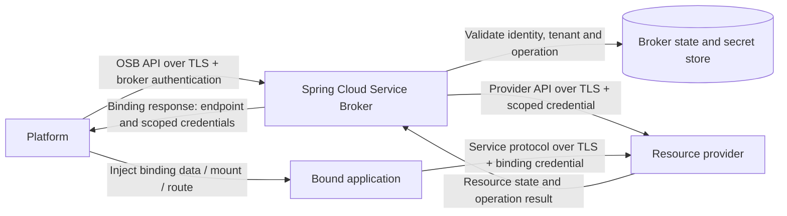

# Ranh giới tin cậy giữa nền tảng, broker, ứng dụng và nhà cung cấp

Một service broker theo Open Service Broker API (OSB API) đứng giữa nhiều hệ thống có quyền và dữ liệu khác nhau. Platform gọi broker để provision, update, bind hoặc deprovision tài nguyên. Ứng dụng nhận credentials hoặc endpoint từ binding. Broker tiếp tục gọi database provider, cloud API, Kubernetes hoặc nền tảng SaaS để tạo và quản lý tài nguyên thật.

Mỗi kết nối là một **ranh giới tin cậy**. Một thành phần chỉ được tin cậy trong phạm vi danh tính, quyền và dữ liệu đã xác minh. Việc request đến từ platform không có nghĩa mọi field trong request đều đúng; việc broker đã xác thực platform không có nghĩa broker được phép truy cập mọi tenant; việc ứng dụng nhận credentials không có nghĩa ứng dụng được quyền quản trị provider.

Bài học này xây dựng mô hình bảo mật cho bốn miền: platform, service broker, ứng dụng consumer và resource provider. Trọng tâm là xác định ai xác thực ai, ai được phép làm gì, dữ liệu nào có thể tin cậy, secret đi qua đâu và cách ngăn một lỗi ở một miền lan sang miền khác.

## 1. Bốn miền tin cậy và luồng dữ liệu

Một hệ thống service broker điển hình có bốn miền:

| Miền | Thành phần | Trách nhiệm | Dữ liệu/quyền quan trọng |
|---|---|---|---|
| Platform | Cloud Foundry, Kubernetes platform service catalog hoặc marketplace | Gửi request OSB và quản lý vòng đời instance/binding | Platform identity, tenant/org/space/namespace, service IDs, plan IDs |
| Broker | Spring Boot + Spring Cloud Open Service Broker | Xác thực request, kiểm tra quyền, điều phối operation và quản lý mapping | Broker database, operation store, secret references, provider credentials |
| Application | Ứng dụng được bind với service instance | Sử dụng endpoint và credentials được cấp | Binding credentials, TLS trust, quyền dữ liệu được cấp |
| Provider | Database, storage, Kubernetes API, cloud API hoặc SaaS | Tạo, cập nhật, thu hồi và cung cấp tài nguyên thật | Provider service account, API token, resource IDs, tenant/project scope |

Các luồng cần bảo vệ:



Luồng broker-to-provider và application-to-provider có thể đi qua cùng một endpoint nhưng phải dùng danh tính khác nhau. Broker dùng service identity có quyền quản trị giới hạn để provision tài nguyên; ứng dụng dùng binding identity chỉ có quyền truy cập dữ liệu hoặc chức năng đã được cấp.

## 2. Xác định ranh giới tin cậy

Trước khi viết code, hãy xác định các ranh giới sau:

1. **Platform → Broker:** platform có được phép gọi endpoint OSB này không? Request thuộc platform, tổ chức, space hoặc namespace nào?
2. **Broker → Provider:** broker có quyền thao tác đúng account, project, region và resource scope không?
3. **Platform → Application:** binding data được inject vào ứng dụng như thế nào? Ai có thể đọc environment variable, secret volume hoặc workload identity?
4. **Application → Provider:** credentials của binding cho phép thao tác gì, trên tài nguyên nào và trong bao lâu?
5. **Operator → Broker/Provider:** ai có thể truy cập dashboard, database broker, secret store và API quản trị?

Một request có thể hợp lệ ở ranh giới này nhưng không hợp lệ ở ranh giới khác. Ví dụ, platform đã được xác thực có thể gửi `service_instance_id` đúng định dạng, nhưng instance đó thuộc tenant khác. Broker phải kiểm tra authorization và ownership trước khi gọi provider.

### 2.1. Authentication và authorization

Hai khái niệm cần được tách biệt:

- **Authentication (xác thực):** xác minh danh tính của caller, ví dụ platform credential, mTLS client certificate hoặc workload identity.
- **Authorization (phân quyền):** xác định danh tính đó được phép thao tác trên tài nguyên nào, tenant nào và operation nào.

TLS mã hóa và xác minh endpoint server; mTLS còn xác thực certificate của client. HTTP Basic hoặc bearer token xác thực caller theo cơ chế ứng dụng. Không cơ chế nào tự thay thế kiểm tra authorization trong nghiệp vụ broker.

Ví dụ: một platform credential hợp lệ có thể gọi broker, nhưng request `DELETE /v2/service_instances/{id}` vẫn phải được kiểm tra rằng instance ID thuộc đúng platform scope, đang ở trạng thái có thể deprovision và service/plan query khớp dữ liệu đã lưu.

## 3. Bảo vệ luồng Platform → Broker

Đây là ranh giới điều khiển vòng đời tài nguyên. Nếu kẻ tấn công gọi được endpoint OSB, họ có thể tạo tài nguyên gây chi phí, đọc metadata, tạo credentials hoặc xóa database.

### 3.1. Xác thực platform

Các phương án thường gặp:

| Cơ chế | Cách hoạt động | Khi phù hợp |
|---|---|---|
| HTTP Basic over TLS | Platform gửi username/password trong Authorization header; broker xác minh credential | Cách tích hợp phổ biến trong đăng ký service broker |
| OAuth 2.0 bearer token | Platform gửi access token; broker kiểm tra signature, issuer, audience, expiry và scope | Khi platform và broker dùng identity provider chung |
| Mutual TLS (mTLS) | Hai phía xác minh certificate trong TLS handshake | Hệ thống private network hoặc yêu cầu workload identity bằng certificate |
| API gateway/service mesh | Gateway xác thực client và chuyển danh tính đã xác minh đến broker | Khi tổ chức đã có lớp quản lý identity tập trung |

OSB API không quy định một cơ chế authentication/authorization chung bắt buộc cho mọi endpoint broker. Platform cụ thể có thể yêu cầu HTTP Basic hoặc OAuth2 khi đăng ký broker; hai bên phải thống nhất cơ chế và credential. Spring Cloud Open Service Broker không tự cấu hình bảo mật cho endpoint, vì vậy ứng dụng phải thiết lập Spring Security hoặc security gateway phù hợp. Không nên giả định rằng chỉ cần bật starter là endpoint đã được bảo vệ.

Với HTTP Basic, chỉ gửi qua HTTPS. Không đặt password trong URL, query string, source code hoặc log. Dùng credential riêng cho từng platform/environment và hỗ trợ rotation có kiểm soát.

Với OAuth 2.0, broker phải xác minh ít nhất issuer, chữ ký, audience, thời hạn và scope. Không chỉ decode JWT rồi tin các claim. Nếu dùng opaque token, introspection endpoint cũng phải được gọi qua kết nối tin cậy.

Với mTLS, cần xác minh certificate chain, SAN/identity, thời hạn, trạng thái thu hồi theo policy và ánh xạ certificate sang platform principal. Không tin một header chứa subject certificate nếu request có thể đi thẳng đến broker mà không qua proxy đã xác thực.

### 3.2. Authorization theo platform và tenant

Sau khi xác thực, broker cần xác định scope của request. Một broker có thể phục vụ nhiều platform, tổ chức hoặc tenant; vì vậy, ID instance một mình thường chưa đủ để xác định quyền sở hữu.

Một khóa truy vấn an toàn có thể gồm:

```text
platform_id + tenant_id + service_instance_id
```

Với binding:

```text
platform_id + tenant_id + service_instance_id + binding_id
```

`platform_id` và `tenant_id` phải được lấy từ danh tính đã xác thực hoặc mapping tin cậy của broker. Không lấy tenant scope từ một field tùy ý trong JSON body rồi xem đó là bằng chứng caller được quyền truy cập tenant đó.

Ví dụ kiểm tra trước khi deprovision:

```java
public Mono<StoredServiceInstance> loadOwnedInstance(
        AuthenticatedPlatform platform,
        String serviceInstanceId) {

    return instanceRepository.findByPlatformIdAndInstanceId(
                    platform.platformId(), serviceInstanceId)
            .switchIfEmpty(Mono.error(
                    new ServiceInstanceDoesNotExistException(serviceInstanceId)));
}
```

`AuthenticatedPlatform`, `StoredServiceInstance` và `InstanceRepository` là model/repository do ứng dụng xây dựng. Ví dụ cho thấy việc truy vấn phải gắn với principal đã xác thực. Nếu broker cố tình che giấu sự tồn tại của tài nguyên thuộc tenant khác, có thể trả cùng lỗi not found để tránh tiết lộ resource ID.

### 3.3. Bảo vệ endpoint và HTTP layer

Các endpoint OSB cần được bảo vệ nhất quán, gồm catalog, instance, binding và last operation. Tùy platform, endpoint catalog có thể được truy cập qua cơ chế xác thực riêng, nhưng không nên mặc định catalog công khai nếu nó tiết lộ service IDs, plan IDs hoặc thông tin nội bộ.

Ngoài xác thực, nên cấu hình:

- HTTPS ở ingress hoặc trực tiếp tại broker; chỉ tin proxy header từ proxy nằm trong allowlist.
- Giới hạn request body size, header size, connection timeout và request rate.
- Rate limit riêng cho provision, update, bind và delete vì chúng có side effect hoặc chi phí.
- Validate `Content-Type`, API version và JSON schema của parameters.
- Từ chối request thiếu authentication trước khi chạy event flow hoặc gọi provider.
- Không để actuator, debug endpoint, heap dump hoặc endpoint quản trị nằm chung public route với OSB API.

## 4. Context và header OSB không tự tạo ra danh tính đáng tin

OSB request có thể chứa `context`, `bind_resource`, `previous_values`, `parameters` và một số header metadata. Những dữ liệu này hữu ích cho nghiệp vụ nhưng phải được đánh giá theo nguồn và mức độ tin cậy.

| Dữ liệu | Ý nghĩa | Quy tắc tin cậy |
|---|---|---|
| `context` | Metadata platform về organization, space, namespace hoặc platform instance | Chỉ dùng sau khi request đã được xác thực; kiểm tra schema và đối chiếu với mapping broker |
| `bind_resource` | Thông tin consumer/resource mà platform gửi khi bind | Dùng để định tuyến và cấu hình; không coi là bằng chứng quyền sở hữu nếu chưa kiểm tra |
| `parameters` | Cấu hình do người dùng/platform gửi | Luôn validate schema, allowlist và policy nghiệp vụ |
| `previous_values` | Giá trị trước update do platform cung cấp | Dùng như input đối chiếu, kiểm tra với trạng thái broker đã lưu |
| `X-Broker-API-Version` | Phiên bản OSB API mà platform sử dụng | Dùng cho compatibility, không phải authentication |
| `X-Broker-API-Request-Identity` | Request identity để trace | Dùng correlation/audit, không dùng làm principal |
| `X-Broker-API-Originating-Identity` | Thông tin identity người khởi tạo do platform chuyển tiếp | Chỉ tin trong kênh platform đã xác thực và theo hợp đồng identity đã cấu hình |

Đặc biệt, không được dùng `context.organization_guid`, `context.space_guid`, `bind_resource.app_guid` hoặc `X-Broker-API-Originating-Identity` làm danh tính đã xác thực chỉ vì chúng có trong request. Một caller giả mạo có thể gửi JSON/header tùy ý nếu endpoint không được bảo vệ. Hãy xác thực platform trước, sau đó mới diễn giải metadata theo trust contract.

`X-Broker-API-Originating-Identity` có thể chứa dữ liệu JSON được encode theo quy ước OSB. Encoding không phải mã hóa hay chữ ký số. Nếu cần tin identity cuối cùng của người dùng, broker phải xác minh nguồn platform và cách platform bảo đảm tính toàn vẹn của header đó.

## 5. Bảo vệ luồng Broker → Provider

Broker thường có quyền rộng hơn một ứng dụng consumer vì nó phải tạo và quản lý tài nguyên. Đây là credential có giá trị cao; nếu bị lộ, kẻ tấn công có thể truy cập nhiều tenant hoặc xóa tài nguyên hàng loạt.

### 5.1. Dùng provider identity riêng

Không dùng credentials của ứng dụng để gọi API quản trị provider. Tách ít nhất:

- **Broker service identity:** dùng để provision, inspect, update và deprovision resource.
- **Application binding identity:** dùng để ứng dụng truy cập một database/schema/volume/log stream cụ thể.
- **Operator identity:** dùng cho người vận hành, với quyền quản trị và audit riêng.

Provider credential nên được giới hạn theo account, project, namespace, region hoặc resource group. Ví dụ, broker quản lý PostgreSQL có thể dùng một service account chỉ được tạo database/user trong một cluster và không có quyền quản trị hạ tầng cloud rộng hơn.

### 5.2. Bảo vệ kết nối và credential

- Dùng TLS khi broker gọi provider API; xác minh certificate server và hostname.
- Dùng mTLS hoặc workload identity nếu provider hỗ trợ.
- Ưu tiên short-lived token hoặc credential tự động refresh thay vì static key dài hạn.
- Không tắt certificate validation trong production.
- Đặt timeout, retry có giới hạn và circuit breaker để tránh request treo giữ connection.
- Không truyền provider credential qua request parameters hoặc binding response.
- Tách provider credentials theo environment và tenant nếu mô hình provider cho phép.

### 5.3. Kiểm tra ownership trước thao tác phá hủy

Trước khi xóa resource, broker phải xác minh resource ID thuộc instance và tenant đang xử lý. Không chỉ ghép tên resource từ input vào lệnh CLI hoặc API provider.

Ví dụ metadata/tag của resource:

```json
{
  "managed_by": "spring-cloud-service-broker",
  "broker_instance_id": "pg-orders-01",
  "platform_id": "cf-east",
  "tenant_id": "org-82"
}
```

Tag là bằng chứng hỗ trợ, không phải nguồn duy nhất. Broker nên đối chiếu tag với bản ghi resource ID đã lưu, provider account và tenant scope. Khi có sai lệch, chuyển sang reconciliation/manual review thay vì xóa theo tên gần giống.

## 6. Bảo vệ luồng Application → Provider

Sau khi binding thành công, platform chuyển credentials hoặc thông tin truy cập cho ứng dụng. Đây là ranh giới khác với broker-to-provider: ứng dụng cần quyền tối thiểu để dùng dịch vụ, không cần quyền quản trị vòng đời resource.

### 6.1. Credentials theo binding

Ví dụ response tạo binding:

```json
{
  "credentials": {
    "hostname": "db.internal.example",
    "port": 5432,
    "database": "orders",
    "username": "app_orders_01",
    "password": "<generated-secret>",
    "sslmode": "verify-full"
  }
}
```

Mỗi binding nên có identity riêng hoặc ít nhất credential có scope rõ ràng. Nếu hai ứng dụng dùng chung một tài khoản database quản trị, broker không thể thu hồi quyền của một ứng dụng mà không ảnh hưởng ứng dụng kia.

Nên:

- Tạo database user hoặc token riêng cho mỗi binding khi provider hỗ trợ.
- Chỉ cấp quyền trên database/schema/table hoặc API scope mà consumer cần.
- Dùng quyền read-only nếu ứng dụng chỉ cần đọc.
- Có expiry/rotation policy và cơ chế revoke khi unbind.
- Không trả provider admin key, cloud access key hoặc Kubernetes service account token có quyền rộng cho ứng dụng.
- Không dùng cùng password giữa dev, staging và production.

### 6.2. Truyền credentials đến ứng dụng

Platform có thể inject binding credentials qua environment variables, mounted secret files hoặc cơ chế secret integration. Environment variable tiện dụng nhưng có thể bị lộ qua process inspection, crash dump, diagnostic endpoint hoặc log cấu hình.

Ứng dụng nên:

- Đọc secret từ binding/secret mount theo cơ chế platform hỗ trợ.
- Không log toàn bộ environment hoặc object binding.
- Không đưa credentials vào exception message, tracing baggage hoặc metrics label.
- Không lưu secret vào image, source control hoặc build artifact.
- Hạn chế quyền đọc secret trong container/pod.
- Dùng TLS và xác minh server certificate khi kết nối provider.

### 6.3. Thu hồi khi unbind

Unbind phải thu hồi identity của binding: revoke token, disable database user, xóa ACL hoặc ngắt volume/log registration theo chính sách. Nếu tài nguyên được chia sẻ, broker chỉ thu hồi quyền của binding đó và không xóa resource còn được binding khác sử dụng.

Khi credential bị rotate, broker cần phối hợp với platform/application để cập nhật secret theo khả năng hỗ trợ. Không xóa credential cũ trước khi đã có quy trình chuyển đổi an toàn nếu điều đó có thể làm ứng dụng mất kết nối ngoài dự kiến.

## 7. Thiết kế Spring Security cho endpoint broker

Spring Cloud Open Service Broker cung cấp controller và xử lý protocol, nhưng ứng dụng cần cấu hình authentication/authorization. Cách cấu hình phụ thuộc web stack: Spring MVC dùng servlet security; Spring WebFlux dùng reactive security.

### 7.1. Ví dụ Spring Security với WebFlux và HTTP Basic

Đây là skeleton minh họa cho broker chỉ nhận request từ một platform credential. Trong production, credentials phải lấy từ secret manager hoặc cấu hình bảo mật; không hardcode trong source code.

```java
@Configuration
@EnableWebFluxSecurity
public class BrokerSecurityConfiguration {

    @Bean
    SecurityWebFilterChain brokerSecurity(
            ServerHttpSecurity http,
            ReactiveAuthenticationManager authenticationManager) {

        return http
                .csrf(ServerHttpSecurity.CsrfSpec::disable)
                .authenticationManager(authenticationManager)
                .authorizeExchange(exchange -> exchange
                        .pathMatchers("/v2/**").authenticated()
                        .anyExchange().denyAll())
                .httpBasic(Customizer.withDefaults())
                .build();
    }
}
```

`ReactiveAuthenticationManager` phải được ứng dụng triển khai để xác minh credential và tạo principal đại diện cho platform. Với broker có nhiều platform, principal nên mang platform ID để lớp nghiệp vụ dùng trong tenant scoping. Ví dụ này không cấu hình authorization chi tiết theo từng instance; bước đó vẫn phải được thực hiện trong service/use case.

Không vô hiệu hóa CSRF một cách máy móc cho mọi ứng dụng. Với API machine-to-machine không dùng cookie session, CSRF có thể được tắt cho đúng API chain. Nếu ứng dụng còn giao diện web dùng session/cookie, cần phân tách security chain và giữ CSRF cho phần browser session phù hợp.

### 7.2. Ví dụ Spring Security với Spring MVC

Với servlet stack, dùng `SecurityFilterChain`:

```java
@Configuration
@EnableWebSecurity
public class BrokerServletSecurityConfiguration {

    @Bean
    SecurityFilterChain brokerSecurity(HttpSecurity http) throws Exception {
        return http
                .securityMatcher("/v2/**")
                .authorizeHttpRequests(authorize -> authorize
                        .anyRequest().authenticated())
                .httpBasic(Customizer.withDefaults())
                .csrf(csrf -> csrf.disable())
                .build();
    }
}
```

Ví dụ cần có `UserDetailsService` hoặc authentication provider được cấu hình để kiểm tra broker credential. Nếu dùng nhiều security chain, khai báo `@Order` và matcher rõ ràng để request OSB không rơi vào chain yếu hơn.

### 7.3. Không nhầm xác thực với kiểm tra quyền nghiệp vụ

Security filter chain xác minh caller có principal hợp lệ. Service layer vẫn cần kiểm tra:

- Principal có được phép thao tác platform/tenant này không?
- Instance hoặc binding ID có thuộc principal scope không?
- Operation có được phép theo trạng thái hiện tại không?
- Plan có hỗ trợ update/bind/fetch tương ứng không?
- Consumer identity có quyền nhận binding credentials này không?

Không nên đưa toàn bộ authorization vào controller; use case/domain service là nơi có đủ thông tin về tài nguyên và trạng thái để ra quyết định.

## 8. Quản lý secret trong toàn bộ vòng đời

Secret xuất hiện ở nhiều nơi: platform credential, provider API key, database password, binding token, TLS private key và encryption key. Mỗi loại cần owner, storage, rotation và revoke policy riêng.

| Secret | Ai sử dụng | Nơi lưu phù hợp | Vòng đời |
|---|---|---|---|
| Platform → broker credential | Platform và broker | Secret manager/configuration store bảo vệ | Rotate khi đổi platform credential hoặc nghi ngờ lộ |
| Broker → provider credential | Broker | Secret manager, workload identity hoặc short-lived token | Tự refresh/rotate; revoke khi broker identity thay đổi |
| Binding credential | Ứng dụng consumer | Provider secret store và platform secret injection | Tạo khi bind, rotate theo policy, revoke khi unbind |
| TLS private key/certificate | Broker, platform, provider | Certificate manager/secret store | Gia hạn trước expiry, rotate khi compromise |
| Encryption/HMAC key | Broker data layer | KMS/HSM/secret manager | Versioning, rotation và quy trình re-encrypt |

### 8.1. Không ghi secret vào log

Các trường dễ bị lộ:

- `Authorization` header.
- `credentials` trong binding response.
- `parameters` có password/token.
- Provider API request/response body.
- JDBC URL có username/password.
- Environment variables và configuration dump.

Nên redact theo allowlist field được phép log thay vì cố liệt kê tất cả secret name. Ví dụ, log operation ID, service instance ID, binding ID, provider status code và elapsed time; bỏ qua raw body và authentication headers.

### 8.2. Mã hóa và phân quyền secret store

Secret store cần được phân quyền theo service identity và tenant scope. Broker chỉ đọc secret cần cho operation hiện tại. Ứng dụng không được truy cập provider admin credential hoặc secret của binding khác.

Nếu broker lưu encrypted credentials trong database, encryption key phải được quản lý tách biệt khỏi database. Nên dùng envelope encryption với KMS khi phù hợp, version hóa key và có quy trình rotation. Không lưu encryption key cùng bảng ciphertext.

## 9. Bảo vệ dữ liệu trong broker database

Broker database thường chứa mapping nhạy cảm: provider resource IDs, tenant IDs, parameters, operation history, credentials references và trạng thái tài nguyên.

- Mã hóa kết nối đến database bằng TLS.
- Dùng database account riêng cho broker, chỉ cấp quyền trên schema/bảng cần thiết.
- Phân tách quyền migration, runtime và read-only reporting.
- Mã hóa field nhạy cảm hoặc lưu secret ngoài database rồi chỉ giữ reference.
- Bật backup encryption và kiểm soát quyền restore/export.
- Không dùng dữ liệu production có secret thật trong môi trường dev/test.
- Audit truy cập bảng credentials và operation store.
- Dùng retention policy để xóa payload/secret không còn cần thiết, nhưng giữ tombstone tối thiểu để bảo đảm idempotency và cleanup.

Đối với broker multi-tenant, mọi query và update cần gắn tenant scope. Có thể bổ sung database row-level security, nhưng không dùng RLS thay thế kiểm tra authorization trong ứng dụng.

## 10. Bảo vệ provider và platform tích hợp

### 10.1. Cloud Foundry

Trong Cloud Foundry, platform đăng ký broker bằng endpoint và credential được cấu hình. Broker nhận context như organization/space và app binding metadata. Cần xác thực request từ Cloud Controller theo credential đã đăng ký, sau đó ánh xạ organization/space vào tenant nội bộ.

Không xem `organization_guid` hoặc `space_guid` trong request body là quyền truy cập tự chứng minh. Broker cần xác minh chúng thuộc platform principal và dùng mapping đã lưu khi tạo instance. Với log drain hoặc route service, URL trả về phải được platform truy cập an toàn và không chứa token dài hạn có thể bị lộ qua log router.

### 10.2. Kubernetes

Khi broker tích hợp Kubernetes, có thể dùng ServiceAccount hoặc workload identity riêng cho broker. Không dùng `cluster-admin` nếu broker chỉ cần tạo resource trong một namespace.

Nên:

- Dùng Role/RoleBinding thay vì ClusterRoleBinding rộng nếu thao tác chỉ nằm trong namespace.
- Tách namespace hoặc project theo tenant khi mô hình triển khai yêu cầu.
- Hạn chế quyền đọc Secret; chỉ cấp cho controller cần thiết.
- Không trả Kubernetes service account token hoặc kubeconfig của broker trong binding credentials.
- Dùng short-lived projected service account token hoặc cloud workload identity khi cluster hỗ trợ.
- Kiểm tra namespace, owner reference và resource labels trước khi update/delete.
- Không tin namespace hoặc label do client gửi mà chưa xác minh ownership.

Nếu platform sử dụng CSI volume, broker chỉ nên trả thông tin volume mount theo contract và driver đã được cấu hình; quyền quản trị CSI vẫn thuộc platform/provider, không chuyển cho ứng dụng consumer.

## 11. Các tình huống tấn công và cách phòng vệ

| Tình huống | Rủi ro | Phòng vệ |
|---|---|---|
| Gọi endpoint OSB không xác thực | Provision/delete tài nguyên trái phép | Authentication bắt buộc, TLS và rate limit |
| Giả mạo tenant trong `context` | Truy cập chéo tenant | Lấy scope từ authenticated principal, đối chiếu mapping |
| Dùng instance ID của tenant khác | Đọc/xóa nhầm tài nguyên | Query theo platform/tenant scope và kiểm tra ownership |
| Lộ provider admin key qua binding | Consumer có quyền quản trị toàn provider | Tạo credential riêng theo binding với least privilege |
| Lộ secret qua log/trace | Credential bị đánh cắp | Redaction, không log body/header nhạy cảm |
| Gửi parameters độc hại | Injection, command execution hoặc resource abuse | Schema validation, allowlist, parameterized API/SQL, quota |
| Gọi provider API qua URL do user kiểm soát | SSRF hoặc truy cập metadata endpoint | Không nhận provider URL tùy ý; allowlist endpoint và egress policy |
| Replay request cũ | Tạo/xóa resource lặp hoặc gây chi phí | Idempotency, operation state và authorization |
| Credential bị đánh cắp | Truy cập trái phép trong thời gian dài | Short-lived token, rotation, revoke và audit |
| Lạm dụng endpoint async | Tạo hàng loạt operation/worker | Rate limit, quota, bounded queue và backpressure |
| Sai cấu hình TLS | MITM hoặc lộ dữ liệu | Verify certificate/hostname, quản lý CA và rotation |
| Operator account bị chiếm | Xóa hàng loạt hoặc đọc secret | MFA, least privilege, approval cho thao tác phá hủy và audit |

## 12. Checklist bảo mật theo từng ranh giới

| Ranh giới | Câu hỏi kiểm tra |
|---|---|
| Platform → Broker | Có TLS và authentication? Principal được ánh xạ sang platform ID? Có rate limit và request size limit? |
| Request → Domain | Context, parameters, bind_resource và previous_values có được validate? Tenant scope có lấy từ nguồn tin cậy? |
| Broker → Provider | Credential có least privilege? Account/region/resource ID có được xác minh? TLS có kiểm tra certificate? |
| Broker → Database/Secret Store | Runtime identity có quyền tối thiểu? Secret có mã hóa và audit? |
| Platform → Application | Binding credentials có được truyền qua secret mechanism an toàn? Có thể giới hạn người đọc? |
| Application → Provider | Credentials có scope theo binding? Có TLS, rotation và revoke? |
| Operator → System | Có MFA, role separation, audit và kiểm soát thao tác phá hủy? |

## 13. Kiểm thử bảo mật

Nên xây dựng test suite kiểm tra cả HTTP layer và domain authorization:

1. Request thiếu credential phải bị từ chối trước khi gọi service implementation hoặc provider.
2. Credential hợp lệ nhưng platform ID không sở hữu instance phải không đọc hoặc xóa được instance.
3. Tenant trong `context` khác tenant đã lưu phải bị phát hiện.
4. Request `bind` không có quyền consumer hoặc không đúng app phải bị từ chối.
5. Parameters có field ngoài allowlist hoặc giá trị vượt giới hạn phải bị từ chối trước side effect.
6. Binding response không được chứa broker/provider admin credential.
7. Log và tracing không chứa Authorization header, password hoặc token.
8. Provider 401/403 phải được phân biệt với resource not found; không tự retry vô hạn.
9. TLS certificate hết hạn hoặc hostname sai phải làm kết nối thất bại.
10. Request retry/replay không được tạo thêm resource hoặc bỏ qua authorization.
11. Unbind một binding không được revoke credential của binding khác.
12. Kubernetes service account chỉ có quyền cần thiết trong namespace được giao.

Ví dụ kiểm tra endpoint WebFlux bằng WebTestClient:

```java
@SpringBootTest(webEnvironment = SpringBootTest.WebEnvironment.RANDOM_PORT)
class BrokerSecurityIntegrationTests {

    @Autowired
    WebTestClient webTestClient;

    @Test
    void catalogRequiresPlatformAuthentication() {
        webTestClient.get()
                .uri("/v2/catalog")
                .exchange()
                .expectStatus().isUnauthorized();
    }
}
```

Test minh họa giả định security configuration yêu cầu HTTP Basic và không cấu hình anonymous access. Trong hệ thống thực tế, bổ sung test với credential hợp lệ, credential sai và authorization chéo tenant. Không chỉ xác minh `401`; cần xác minh provider mock không nhận request khi authentication/authorization thất bại.

## 14. Lỗi triển khai thường gặp

| Lỗi | Hậu quả | Cách khắc phục |
|---|---|---|
| Nghĩ starter tự bảo vệ endpoint | API broker có thể bị gọi trái phép | Cấu hình Spring Security hoặc security gateway |
| Chỉ xác thực nhưng không authorization | Platform hợp lệ có thể truy cập tenant khác | Gắn principal với platform/tenant scope |
| Tin `context` là danh tính | Caller có thể giả mạo org/space/namespace | Xác thực platform và đối chiếu metadata |
| Dùng request identity làm principal | Trace ID bị giả mạo hoặc thay đổi giữa retry | Dùng authentication principal; trace chỉ để correlation |
| Dùng broker provider credential cho app | App có quyền quá rộng | Credential riêng cho binding và least privilege |
| Ghi raw request/response vào log | Lộ password/token và context nhạy cảm | Redact theo allowlist, không log body nhạy cảm |
| Tắt TLS validation | Dễ bị MITM | Verify certificate và hostname |
| Dùng `cluster-admin` cho broker | Compromise broker ảnh hưởng toàn cluster | Role/RoleBinding theo namespace và resource cần thiết |
| Xóa resource chỉ dựa vào tên | Có thể xóa nhầm tenant/resource | Kiểm tra provider ID, account, tenant và ownership |
| Tắt CSRF toàn ứng dụng | Browser session endpoints có thể bị tấn công | Chỉ tắt cho machine-to-machine API chain phù hợp |

## 15. Checklist triển khai

- [ ] Lập danh sách trust boundary và data flow giữa platform, broker, app, provider và operator.
- [ ] Xác thực platform qua TLS bằng cơ chế đã thỏa thuận.
- [ ] Tách authentication khỏi authorization và kiểm tra tenant scope trong domain service.
- [ ] Không tin context, bind_resource, parameters hoặc originating identity nếu chưa xác minh nguồn.
- [ ] Tách broker provider identity, application binding identity và operator identity.
- [ ] Cấp provider credential theo least privilege, scope theo account/project/namespace.
- [ ] Dùng TLS/mTLS hoặc workload identity khi phù hợp; không tắt certificate validation.
- [ ] Binding credential riêng cho consumer, có rotation và revoke.
- [ ] Lưu secret trong secret manager hoặc cơ chế mã hóa phù hợp; không hardcode.
- [ ] Redact Authorization, credentials, parameters nhạy cảm và provider response khỏi log.
- [ ] Bảo vệ broker database, operation store, backup và secret store.
- [ ] Giới hạn request size, rate, concurrency và async queue.
- [ ] Kiểm tra ownership trước update/delete và reconciliation.
- [ ] Cấu hình Spring Security phù hợp MVC hoặc WebFlux.
- [ ] Kiểm thử unauthenticated, cross-tenant, replay, secret leakage và provider permission.

## 16. Tài liệu tham khảo

- [Open Service Broker API v2.17 Specification](https://github.com/openservicebrokerapi/servicebroker/blob/v2.17/spec.md)
- [Spring Cloud Open Service Broker 4.4.1 — Reference Guide](https://docs.spring.io/spring-cloud-open-service-broker/docs/4.4.1/reference/)
- [Spring Security — Reactive Applications](https://docs.spring.io/spring-security/reference/reactive/configuration/webflux.html)
- [Spring Security — Servlet Applications](https://docs.spring.io/spring-security/reference/servlet/configuration/java.html)
- [Kubernetes — RBAC Authorization](https://kubernetes.io/docs/reference/access-authn-authz/rbac/)
- [Kubernetes — Service Accounts](https://kubernetes.io/docs/concepts/security/service-accounts/)
- [OWASP API Security Top 10](https://owasp.org/API-Security/)

Các ví dụ Spring Security trong bài là skeleton minh họa cho HTTP Basic trên WebFlux hoặc MVC. Ứng dụng thực tế cần kết nối authentication manager/provider với credential store hoặc identity provider, thiết kế authorization theo platform/tenant và kiểm thử trên đúng web stack đã chọn.
