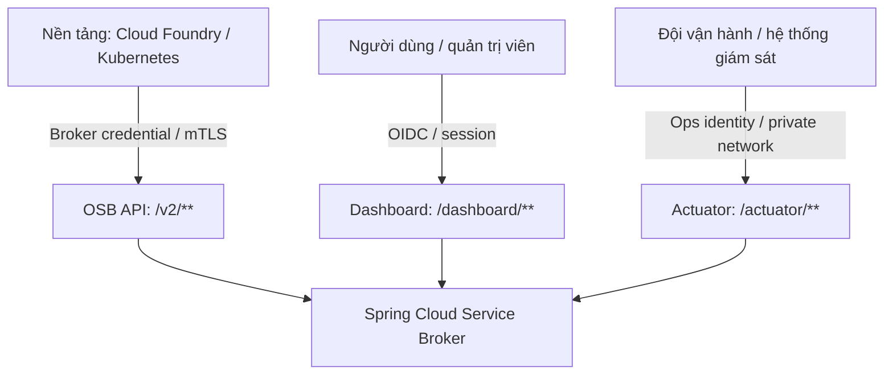

# Phân tách chính sách bảo mật endpoint OSB, dashboard và Actuator

## 1. Vì sao phải tách các bề mặt truy cập?

Một Spring Cloud Service Broker thường phục vụ ít nhất ba nhóm người gọi có mục đích và mức quyền khác nhau:

- **Nền tảng triển khai** gọi Open Service Broker API (OSB API) để đọc catalog, provision, update, bind, unbind và deprovision tài nguyên.
- **Người dùng hoặc quản trị viên dịch vụ** truy cập dashboard để xem thông tin, quản lý cấu hình hoặc theo dõi service instance.
- **Đội vận hành và hệ thống giám sát** truy cập Spring Boot Actuator để kiểm tra health, metrics và trạng thái ứng dụng.

Nếu cả ba nhóm dùng chung một chính sách xác thực hoặc cùng một tập quyền, một credential bị lộ có thể mở rộng phạm vi truy cập vượt quá nhu cầu. Ví dụ, credential mà Cloud Foundry dùng để gọi OSB API không nên tự động cho phép đăng nhập dashboard; tài khoản dashboard không nên có quyền xem heap dump; Prometheus không cần quyền xóa service instance.

Với module `SPRING_CLOUD_SERVICE_BROKER`, cần thiết kế ba security surface như ba ranh giới tin cậy riêng. Mỗi surface có đường dẫn, phương thức xác thực, principal, quyền, chính sách session/CSRF, network exposure và audit riêng.



Phân tách endpoint là bước đầu. Broker vẫn phải kiểm tra quyền ở tầng nghiệp vụ, ví dụ một platform chỉ được thao tác trên instance thuộc platform đó và một dashboard user chỉ được xem tenant mà họ có quyền quản lý.

## 2. Ba security surface và yêu cầu tương ứng

| Bề mặt | Người gọi | Mục tiêu | Chính sách thường dùng |
|---|---|---|---|
| OSB API | Cloud Foundry, Kubernetes service catalog hoặc platform broker client | Gọi API máy-máy theo hợp đồng OSB | HTTPS, HTTP Basic hoặc cơ chế broker authentication đã cấu hình, có thể bổ sung mTLS, stateless, quyền platform-scoped. |
| Dashboard | Người dùng, support hoặc service administrator | Giao diện tương tác và quản trị | OIDC/OAuth2 login, session, CSRF protection, role và tenant/instance authorization. |
| Actuator | Operator, monitoring và orchestration | Health, metrics và chẩn đoán | Management port/network riêng, chỉ expose endpoint cần thiết, quyền OPS hoặc quyền monitoring giới hạn. |

Không nên dùng một tài khoản `admin` chung cho cả ba. Nên tách identity store hoặc ít nhất tách authentication provider, role và credential theo caller. Khi một platform credential bị rotate hoặc thu hồi, dashboard user và monitoring identity không bị ảnh hưởng.

## 3. Bảo vệ OSB API cho giao tiếp máy-máy

OSB API là giao diện giữa nền tảng và broker. Các request như `GET /v2/catalog`, `PUT /v2/service_instances/{id}` và `DELETE /v2/service_instances/{id}` có thể tạo hoặc phá hủy tài nguyên thật, vì vậy endpoint phải được bảo vệ bằng xác thực và phân quyền.

### 3.1. Xác thực platform client

Một cấu hình thường gặp là HTTP Basic Authentication qua TLS. Nền tảng gửi credential đã được cấp riêng cho broker:

```http
GET /v2/catalog HTTP/1.1
Host: broker.example.com
Authorization: Basic <base64-encoded-credentials>
X-Broker-API-Version: 2.17
Accept: application/json
```

Base64 chỉ là mã hóa biểu diễn, không phải mã hóa bảo mật. Vì vậy, Basic Authentication phải đi qua HTTPS và credential phải được lưu trong secret store của nền tảng và broker. Không ghi header `Authorization` vào access log hoặc trace.

Các lựa chọn tăng cường:

- Cấp credential riêng cho từng platform hoặc từng broker registration để có thể rotate/revoke độc lập.
- Dùng mTLS ở gateway hoặc ingress nếu môi trường hỗ trợ xác thực client certificate.
- Giới hạn source network bằng firewall, security group hoặc Kubernetes NetworkPolicy.
- Giới hạn tốc độ và phát hiện brute force hoặc request bất thường.
- Xoay credential theo chu kỳ và có quy trình thay thế không làm gián đoạn platform.

Không nên giả định mọi nền tảng OSB hỗ trợ cùng một cơ chế xác thực mở rộng. Cần cấu hình thống nhất giữa platform, ingress và broker; HTTP Basic qua TLS là lựa chọn tương thích phổ biến, còn mTLS hoặc token authentication phụ thuộc khả năng tích hợp cụ thể.

### 3.2. Phân quyền theo platform

Xác thực thành công chỉ chứng minh request đến từ một broker client hợp lệ. Broker vẫn cần xác định platform đó có quyền thao tác trên instance đang yêu cầu hay không.

Ví dụ, nếu broker phục vụ nhiều platform, không nên tra cứu instance chỉ bằng `instance_id`. Khóa tra cứu cần bao gồm platform identity:

```text
platform_instance_id + service_instance_id
```

Tương tự, binding có thể được định danh bằng platform, instance và binding ID. Mọi thao tác retrieve, update, bind, unbind và deprovision phải kiểm tra quan hệ sở hữu này. Không dùng `organization_name`, `space_name` hoặc context do client gửi làm bằng chứng duy nhất về quyền.

### 3.3. Chính sách cho OSB API

- Chỉ cho phép các route OSB cần thiết, thường nằm dưới `/v2/**` hoặc base path đã cấu hình.
- Yêu cầu xác thực cho mọi route; không mở catalog công khai nếu chính sách broker không cho phép.
- Dùng stateless session cho giao tiếp máy-máy.
- Chỉ tắt CSRF trong security chain OSB nếu API không dùng cookie/session trình duyệt để xác thực.
- Không áp dụng CORS rộng cho OSB API. Đây là giao tiếp backend-to-backend; nếu có dashboard web gọi trực tiếp, cần xem lại kiến trúc và origin allowlist.
- Giới hạn request body, validate JSON Schema và kiểm tra tham số ở server.
- Audit thao tác có tác động tài nguyên, nhưng không ghi secret hoặc payload nhạy cảm.

## 4. Bảo vệ dashboard cho người dùng

Dashboard có mô hình truy cập khác OSB API. Người dùng đăng nhập bằng identity cá nhân hoặc identity thuộc tổ chức, thường qua OpenID Connect (OIDC) với nhà cung cấp danh tính của doanh nghiệp.

### 4.1. Xác thực người dùng

Dashboard có thể dùng Spring Security OAuth2 Login:

```java
http
    .securityMatcher("/dashboard/**")
    .authorizeHttpRequests(auth -> auth
        .requestMatchers("/dashboard/login", "/dashboard/assets/**").permitAll()
        .anyRequest().authenticated())
    .oauth2Login(Customizer.withDefaults());
```

Đây là phần cấu hình minh họa trong một `SecurityFilterChain` riêng. Cấu hình OIDC client, redirect URI, issuer, client ID và secret phải được cung cấp qua cấu hình bảo mật hoặc secret manager. Không hardcode client secret vào source code.

Nếu dashboard dùng session cookie, cần giữ CSRF protection cho các request thay đổi dữ liệu như tạo, sửa, rotate credential hoặc thay đổi cấu hình. Không tắt CSRF toàn ứng dụng chỉ vì OSB API là giao tiếp máy-máy.

### 4.2. Phân quyền theo tenant và tài nguyên

Role ở cấp giao diện chưa đủ để bảo vệ dữ liệu. Một người dùng có role `SERVICE_ADMIN` vẫn chỉ được xem instance thuộc tenant hoặc organization mà họ được cấp quyền.

Ví dụ:

| Role | Quyền có thể cấp |
|---|---|
| `VIEWER` | Xem service instance và trạng thái, không xem secret. |
| `SERVICE_OPERATOR` | Xem, thực hiện thao tác vận hành được cho phép và theo dõi operation. |
| `SERVICE_ADMIN` | Quản lý plan hoặc cấu hình trong tenant được ủy quyền. |
| `PLATFORM_ADMIN` | Quản trị platform scope theo chính sách riêng. |

Khi dashboard nhận `instance_id` từ URL, backend phải kiểm tra quyền truy cập instance đó. Không truy vấn theo ID rồi trả dữ liệu ngay; cách làm này có thể tạo lỗ hổng IDOR (Insecure Direct Object Reference), cho phép người dùng đổi ID trên URL để xem tài nguyên của tenant khác.

### 4.3. Không dùng dashboard session cho OSB API

OSB API không nên phụ thuộc vào cookie phiên đăng nhập của người dùng. Platform client phải xác thực bằng credential máy-máy. Dashboard user cũng không nên được dùng trực tiếp làm principal để gọi các thao tác quản trị nội bộ mà không có kiểm tra quyền platform/tenant tương ứng.

## 5. Bảo vệ Actuator và management endpoint

Spring Boot Actuator cung cấp endpoint vận hành như `health`, `info`, `metrics`, `prometheus`, `env`, `configprops`, `beans`, `loggers`, `heapdump` và các endpoint khác tùy dependency. Một số endpoint có thể tiết lộ thông tin cấu hình, biến môi trường, bean graph, thread hoặc dữ liệu nhạy cảm.

### 5.1. Chỉ expose endpoint cần thiết

Ví dụ cấu hình tối thiểu:

```yaml
management:
  server:
    port: 9001
  endpoints:
    web:
      exposure:
        include: health,info,prometheus
  endpoint:
    health:
      show-details: when_authorized
      probes:
        enabled: true
```

Ví dụ chỉ expose `health`, `info` và `prometheus`. Endpoint Prometheus chỉ hoạt động nếu ứng dụng có registry tương ứng, ví dụ Micrometer Prometheus registry. Không thêm `*` vào exposure trong production nếu không có lý do và biện pháp bảo vệ rõ ràng.

Nếu management server dùng port riêng, hãy giới hạn nó trong mạng nội bộ. Trong Kubernetes, có thể dùng NetworkPolicy để chỉ cho phép Prometheus hoặc kubelet/probe cần thiết truy cập. Nếu bind vào loopback, chỉ tiến trình trong cùng host/pod hoặc proxy cục bộ mới truy cập được; nếu bind vào interface nội bộ, phải giới hạn network tương ứng.

### 5.2. Endpoint health và chi tiết health

Health endpoint thường cần được probe mà không yêu cầu đăng nhập, nhưng chi tiết health có thể tiết lộ tên database, địa chỉ provider hoặc trạng thái dependency. Dùng `show-details: when_authorized` để chỉ trả chi tiết cho caller được cấp quyền.

Phân biệt liveness và readiness:

- **Liveness:** tiến trình có còn sống và có thể tiếp tục chạy không.
- **Readiness:** ứng dụng có sẵn sàng nhận request OSB hay chưa.

Không nên để liveness phụ thuộc vào mọi provider bên ngoài; một database provider tạm thời mất kết nối không nhất thiết có nghĩa process broker cần bị restart liên tục. Readiness có thể phản ánh những dependency thiết yếu cho việc nhận request, tùy kiến trúc.

### 5.3. Các endpoint không nên mở công khai

| Endpoint | Rủi ro nếu mở rộng quyền truy cập |
|---|---|
| `/actuator/env` | Có thể tiết lộ cấu hình và thông tin nhạy cảm nếu masking sai. |
| `/actuator/configprops` | Tiết lộ cấu hình đã bind vào ứng dụng. |
| `/actuator/beans` | Tiết lộ cấu trúc bean và thành phần nội bộ. |
| `/actuator/heapdump` | Có thể chứa token, password hoặc dữ liệu nhạy cảm trong memory. |
| `/actuator/threaddump` | Tiết lộ thông tin nội bộ và trạng thái thread. |
| `/actuator/loggers` | Cho phép thay đổi mức log nếu endpoint write được bật. |
| `/actuator/shutdown` | Có thể dừng ứng dụng nếu được bật và không bảo vệ đúng. |

Không expose những endpoint này ra internet hoặc mạng người dùng. Nếu cần chẩn đoán, chỉ cấp quyền operator có thời hạn, ghi audit và giới hạn đường truy cập.

## 6. Tổ chức Spring Security bằng nhiều SecurityFilterChain

Với ứng dụng Spring MVC/Servlet, có thể định nghĩa nhiều `SecurityFilterChain`, mỗi chain khớp một nhóm route và có thứ tự ưu tiên rõ ràng. Cách này giúp mỗi surface dùng chính sách riêng.

Ví dụ dưới đây minh họa ba chain cho OSB API, dashboard và Actuator:

```java
import org.springframework.boot.actuate.autoconfigure.security.servlet.EndpointRequest;
import org.springframework.context.annotation.Bean;
import org.springframework.core.annotation.Order;
import org.springframework.security.config.Customizer;
import org.springframework.security.config.annotation.web.builders.HttpSecurity;
import org.springframework.security.config.http.SessionCreationPolicy;
import org.springframework.security.web.SecurityFilterChain;
import org.springframework.security.config.annotation.web.configurers.AbstractHttpConfigurer;

@Bean
@Order(1)
SecurityFilterChain osbApiSecurity(
        HttpSecurity http,
        AuthenticationProvider osbAuthenticationProvider) throws Exception {
    http
        .securityMatcher("/v2/**")
        .authenticationProvider(osbAuthenticationProvider)
        .authorizeHttpRequests(auth -> auth.anyRequest().hasRole("PLATFORM"))
        .httpBasic(Customizer.withDefaults())
        .sessionManagement(session -> session
            .sessionCreationPolicy(SessionCreationPolicy.STATELESS))
        .csrf(AbstractHttpConfigurer::disable);
    return http.build();
}

@Bean
@Order(2)
SecurityFilterChain dashboardSecurity(HttpSecurity http) throws Exception {
    http
        .securityMatcher("/dashboard/**")
        .authorizeHttpRequests(auth -> auth
            .requestMatchers("/dashboard/login", "/dashboard/assets/**").permitAll()
            .anyRequest().authenticated())
        .oauth2Login(Customizer.withDefaults());
    // CSRF protection remains enabled for the browser session.
    return http.build();
}

@Bean
@Order(3)
SecurityFilterChain actuatorSecurity(HttpSecurity http) throws Exception {
    http
        .securityMatcher(EndpointRequest.toAnyEndpoint())
        .authorizeHttpRequests(auth -> auth
            .requestMatchers(EndpointRequest.to("health")).permitAll()
            .anyRequest().hasRole("OPS"))
        .httpBasic(Customizer.withDefaults())
        .sessionManagement(session -> session
            .sessionCreationPolicy(SessionCreationPolicy.STATELESS))
        .csrf(AbstractHttpConfigurer::disable);
    return http.build();
}
```

`osbAuthenticationProvider` phải xác thực credential của platform client. Tài khoản có role `PLATFORM` không đồng nghĩa được truy cập dashboard hoặc Actuator. Dashboard dùng OIDC identity; Actuator dùng operator identity hoặc cơ chế monitoring riêng.

### 6.1. Chain dự phòng cho route chưa khai báo

Khi tự định nghĩa các `SecurityFilterChain`, không nên để route chưa khớp rơi vào một chính sách mặc định không rõ ràng. Có thể thêm chain cuối cùng để từ chối mọi route chưa được khai báo:

```java
@Bean
@Order(99)
SecurityFilterChain denyUnmatchedRequests(HttpSecurity http) throws Exception {
    http
        .authorizeHttpRequests(auth -> auth.anyRequest().denyAll());
    return http.build();
}
```

Nếu ứng dụng có route công khai khác, ví dụ trang landing hoặc static resource, hãy khai báo rõ chúng trong chain phù hợp trước chain dự phòng. Không thêm `permitAll()` cho mọi route chỉ để ứng dụng khởi động được.

### 6.2. Nếu ứng dụng dùng WebFlux

Ví dụ `HttpSecurity` ở trên dành cho Servlet stack. Nếu ứng dụng chạy WebFlux, dùng `SecurityWebFilterChain` và `ServerHttpSecurity`; không trộn hai loại chain trong cùng một security configuration.

Ví dụ khung cho OSB API WebFlux:

```java
@Bean
@Order(1)
SecurityWebFilterChain osbApiSecurity(ServerHttpSecurity http) {
    return http
        .securityMatcher(new PathPatternParserServerWebExchangeMatcher("/v2/**"))
        .authorizeExchange(exchange -> exchange.anyExchange().hasRole("PLATFORM"))
        .httpBasic(Customizer.withDefaults())
        .securityContextRepository(NoOpServerSecurityContextRepository.getInstance())
        .csrf(ServerHttpSecurity.CsrfSpec::disable)
        .build();
}
```

Đây là khung minh họa; cần bổ sung `ReactiveAuthenticationManager` hoặc cơ chế xác thực phù hợp và các chain riêng cho dashboard/Actuator. Tên matcher và cách bảo vệ management endpoint cần điều chỉnh theo phiên bản Spring Security, Spring Boot và loại web stack của ứng dụng.

## 7. Cấu hình route và network độc lập

Tách filter chain trong ứng dụng chưa đủ nếu ingress hoặc reverse proxy vẫn công khai tất cả route. Cần phối hợp ba lớp:

1. **Application security:** Spring Security áp dụng authentication, authorization, session, CSRF và error handling.
2. **Network security:** firewall, private subnet, Kubernetes NetworkPolicy hoặc security group giới hạn nguồn truy cập.
3. **Edge security:** ingress/API gateway định tuyến, TLS termination, rate limit, request size limit và chặn route không cần công khai.

Một deployment có thể đặt OSB API ở public/private ingress dành cho platform, dashboard ở ingress người dùng và Actuator trên management port chỉ có thể truy cập nội bộ. Không nhất thiết phải chạy ba process riêng, nhưng phải giữ ranh giới identity và network.

Nếu dùng reverse proxy, chỉ tin `X-Forwarded-*` hoặc header identity từ proxy đã được cấu hình tin cậy. Không cho client ngoài tự gửi header rồi khiến broker hiểu nhầm scheme, host hoặc người dùng.

## 8. CORS, CSRF và cookie

Ba bề mặt có hành vi trình duyệt khác nhau:

| Chính sách | OSB API | Dashboard | Actuator |
|---|---|---|---|
| CORS | Thường không cần vì backend-to-backend. | Chỉ bật origin cụ thể nếu frontend khác origin. | Thường không cần; giới hạn nếu có nhu cầu giám sát từ browser. |
| CSRF | Có thể disable trong chain stateless không dùng cookie. | Giữ enabled cho session-based browser interaction. | Với machine-to-machine stateless auth có thể disable riêng chain; không dùng cookie session. |
| Session | Stateless. | Session bảo vệ bằng cookie Secure, HttpOnly, SameSite phù hợp. | Stateless hoặc auth riêng cho management. |
| Cookie | Không dùng cookie dashboard để xác thực platform. | Bảo vệ cookie và logout/session expiry. | Không dùng cookie dashboard làm quyền operator. |

Không tắt CSRF toàn ứng dụng chỉ vì một endpoint OSB cần xử lý PUT/DELETE. Chính sách phải được giới hạn trong đúng filter chain. Với dashboard, CSRF token phải được đưa vào request thay đổi dữ liệu; CORS không thay thế CSRF protection.

## 9. Quản lý credential, secret và rotation

Mỗi bề mặt có một loại credential riêng:

- OSB API: platform broker username/password, token hoặc client certificate.
- Dashboard: OIDC client secret và danh tính người dùng từ identity provider.
- Actuator: operator identity, service account hoặc credential của hệ thống monitoring.

Các credential cần được lưu trong secret manager hoặc hệ thống quản lý bí mật của môi trường triển khai. Không commit secret vào Git, Docker image, Helm values công khai hoặc application log.

Quy trình rotation nên gồm:

1. Cấp credential mới trong broker và nơi gọi tương ứng.
2. Cho phép khoảng thời gian chuyển tiếp nếu platform hỗ trợ hai credential đồng thời.
3. Cập nhật secret ở platform/gateway/monitoring.
4. Xác minh request dùng credential mới thành công.
5. Thu hồi credential cũ và ghi audit.

Không dùng cùng password cho OSB và Actuator. Khi một credential bị lộ, phạm vi thu hồi phải nhỏ nhất có thể.

## 10. Audit và logging theo từng surface

Log nên giúp xác định ai đã gọi endpoint nào và kết quả ra sao, nhưng không làm lộ bí mật.

| Surface | Trường nên ghi | Trường cần tránh |
|---|---|---|
| OSB API | Platform ID, route, method, instance/binding ID, operation ID, status, duration, correlation ID. | Authorization header, password, token, raw credentials map, secret parameters. |
| Dashboard | User subject đã chuẩn hóa, tenant ID, action, resource ID, result, trace ID. | Session cookie, access token, OIDC client secret, password. |
| Actuator | Operator/service identity, endpoint, thời điểm, kết quả truy cập nếu cần audit. | Heap dump, environment values, full configuration hoặc token. |

Nên dùng structured logging và masking tập trung. Với request body OSB, chỉ ghi các trường cần thiết; `parameters` có thể chứa thông tin nhạy cảm tùy service. Không ghi toàn bộ response binding vì response có thể chứa credential được cấp cho ứng dụng.

## 11. Kiểm thử phân tách chính sách

Kiểm thử không chỉ xác minh người có quyền truy cập được phép đi qua; cần xác minh một principal của surface này không thể truy cập surface khác.

| Request | Identity | Kết quả mong đợi |
|---|---|---|
| `GET /v2/catalog` | Platform credential hợp lệ | Cho phép. |
| `PUT /v2/service_instances/{id}` | Platform credential hợp lệ | Cho phép nếu request và quyền instance hợp lệ. |
| `GET /v2/catalog` | Không có credential hoặc credential sai | `401 Unauthorized`. |
| `GET /dashboard/**` | Platform credential | Không tự động được đăng nhập dashboard. |
| `GET /dashboard/**` | OIDC user hợp lệ | Cho phép sau khi xác thực và kiểm tra quyền tenant. |
| `GET /dashboard/instances/{otherTenantId}` | User không thuộc tenant | `403 Forbidden` hoặc `404` theo chính sách chống dò tài nguyên. |
| `GET /actuator/health` | Probe được phép | Cho phép theo network policy. |
| `GET /actuator/env` | Platform credential | Từ chối. |
| `GET /actuator/heapdump` | Dashboard user | Từ chối. |
| `GET /actuator/prometheus` | Monitoring identity/network hợp lệ | Cho phép theo chính sách scrape. |
| Route không được khai báo | Bất kỳ principal | Từ chối. |

Với Servlet stack có thể dùng MockMvc và Spring Security Test; với WebFlux dùng WebTestClient và Spring Security Test reactive. Integration test cần chạy qua filter chain thật để xác minh thứ tự `@Order`, matcher và fallback chain.

Các kiểm thử bảo mật quan trọng:

- Kiểm tra CSRF vẫn hoạt động trên dashboard POST/PUT/DELETE.
- Kiểm tra CSRF chỉ bị disable trong chain OSB/Actuator đã chọn.
- Kiểm tra platform principal không có role `OPS` hoặc dashboard role.
- Kiểm tra dashboard user không thể truy cập Actuator.
- Kiểm tra Actuator details không bị trả cho caller không đủ quyền.
- Kiểm tra management port không thể truy cập từ public ingress.
- Kiểm tra log không chứa Basic credential, cookie hoặc binding secret.

## 12. Lỗi cấu hình thường gặp

- **Một chain cho mọi endpoint:** mọi caller có cùng authentication và role, làm mất ranh giới giữa platform, người dùng và operator.
- **Matcher quá rộng:** chain `/api/**` vô tình bao phủ cả OSB API và dashboard API. Dùng matcher chính xác và thứ tự rõ ràng.
- **Tắt CSRF toàn ứng dụng:** làm dashboard dễ bị CSRF chỉ vì OSB API cần PUT/DELETE. Chỉ áp dụng ngoại lệ trong chain stateless tương ứng.
- **Actuator public:** mở `env`, `configprops`, `heapdump` hoặc `loggers` ra internet. Chỉ expose tối thiểu và giới hạn mạng/quyền.
- **Tin vào xác thực mà bỏ qua authorization:** người dùng đăng nhập được nhưng có thể truy cập instance tenant khác qua ID trên URL.
- **Dùng chung credential:** platform, dashboard và monitoring cùng dùng một tài khoản admin. Tách principal và rotation.
- **Chỉ bảo vệ ở ingress:** route nội bộ bị lộ qua port khác hoặc bypass gateway. Bảo vệ cả trong ứng dụng.
- **Không có fallback chain:** route mới được thêm vào nhưng vô tình không có chính sách rõ ràng.
- **Log toàn bộ request/response:** có thể ghi lại credential, token và parameters nhạy cảm.

## 13. Checklist trước khi đưa vào production

1. Liệt kê chính xác route OSB API, dashboard và Actuator.
2. Xác định principal, authentication provider và role riêng cho từng surface.
3. Bảo vệ OSB API bằng HTTPS và broker authentication; cân nhắc mTLS theo khả năng platform.
4. Kiểm tra platform/tenant ownership ở tầng nghiệp vụ cho mọi instance và binding.
5. Dùng OIDC hoặc cơ chế đăng nhập người dùng tương đương cho dashboard.
6. Giữ CSRF cho dashboard session và giới hạn CORS theo origin cần thiết.
7. Expose tối thiểu Actuator endpoint; bảo vệ health details, metrics và endpoint nhạy cảm.
8. Đặt management port trên network riêng và áp dụng firewall/NetworkPolicy.
9. Dùng nhiều `SecurityFilterChain` hoặc `SecurityWebFilterChain` theo đúng web stack.
10. Có fallback policy cho route chưa được khai báo.
11. Lưu và rotate credential qua secret manager; không dùng chung credential.
12. Mask log, trace, audit và không ghi secret.
13. Kiểm thử cả truy cập được phép và truy cập chéo surface bị từ chối.
14. Theo dõi 401/403, rate limit, lỗi authentication và truy cập Actuator bất thường.

## 14. Nguyên tắc cần ghi nhớ

- OSB API, dashboard và Actuator là ba security surface với caller và quyền khác nhau.
- Platform credential chỉ dùng cho giao tiếp broker-to-platform; không cấp quyền dashboard hoặc OPS.
- Dashboard cần authentication người dùng và authorization theo tenant/instance, cùng CSRF protection nếu dùng session.
- Actuator cần expose tối thiểu, management network riêng và quyền operator/monitoring giới hạn.
- Spring Security có thể dùng nhiều filter chain theo path/endpoint matcher; thứ tự và matcher phải được kiểm thử.
- Nếu ứng dụng dùng WebFlux, dùng `SecurityWebFilterChain`; không trộn với `SecurityFilterChain` của Servlet.
- Phân tách tại ứng dụng, ingress và network; một lớp không thay thế lớp còn lại.
- Credential, cookie, token và binding secret không được xuất hiện trong log.

Khi mỗi nhóm caller chỉ truy cập được đúng surface và tài nguyên mà họ chịu trách nhiệm, service broker giảm được phạm vi ảnh hưởng khi credential bị lộ, ngăn truy cập chéo tenant và giữ cho endpoint vận hành không trở thành đường vòng vào API quản trị.
