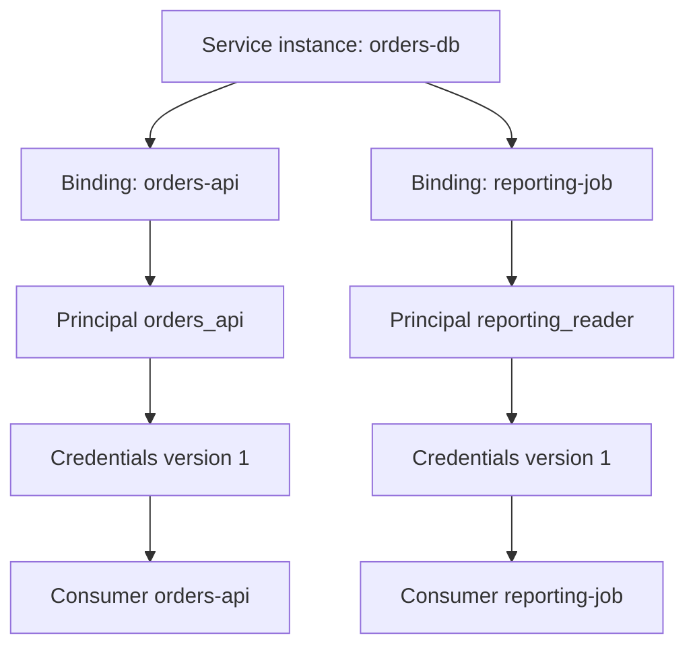
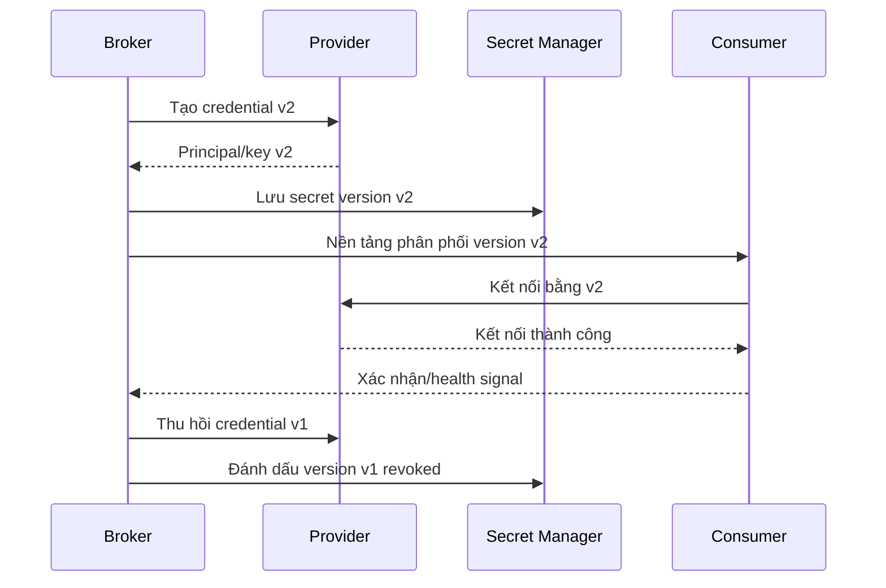
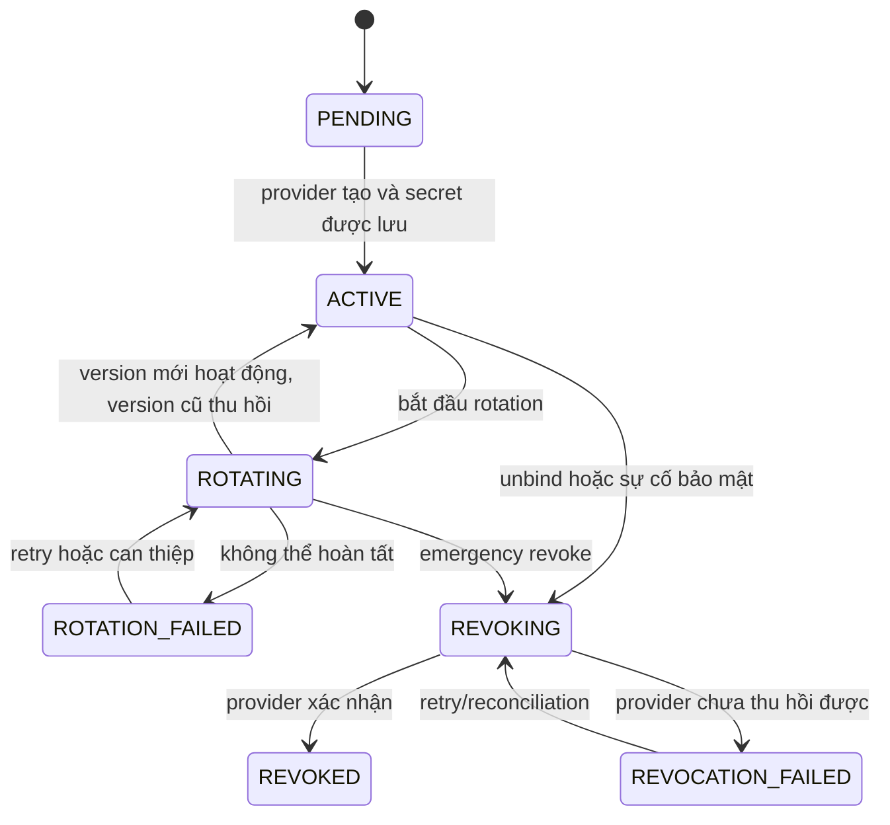

# Vòng đời credentials: cấp mới, phân phối, luân chuyển và thu hồi

Service broker cấp quyền để ứng dụng hoặc workload sử dụng tài nguyên mà broker quản lý. Với một PostgreSQL service instance, broker có thể tạo database role riêng cho từng binding; với Redis, broker có thể tạo ACL user; với object storage, broker có thể cấp access key hoặc policy; với API service, broker có thể tạo client credential hoặc token. Các thông tin này thường được gọi chung là credentials.

Credentials không chỉ là một chuỗi password. Chúng có thể gồm username, password, API key, access token, client secret, private key, certificate, endpoint và các thuộc tính kết nối. Broker phải quản lý toàn bộ vòng đời: cấp mới theo quyền tối thiểu, phân phối đến consumer đúng cách, luân chuyển mà không gây gián đoạn ngoài dự kiến và thu hồi quyền ở provider khi binding kết thúc hoặc có sự cố bảo mật.

Với `SPRING_CLOUD_SERVICE_BROKER`, service binding là ranh giới chính để cấp credentials cho consumer. Mỗi binding cần có mapping đến principal hoặc secret riêng ở provider để broker có thể kiểm soát, audit và thu hồi độc lập.

## 1. Credentials nằm ở đâu trong vòng đời service binding?

Service instance là tài nguyên dịch vụ mà broker quản lý, ví dụ database `orders-db`. Service binding là quan hệ giữa instance đó và một consumer, chẳng hạn ứng dụng `orders-api`. Khi tạo binding, broker thường tạo một principal hoặc quyền truy cập riêng, sau đó trả credentials cho nền tảng.



Mỗi binding có thể có credential riêng với scope khác nhau. Ví dụ `orders-api` cần quyền đọc/ghi, còn `reporting-job` chỉ cần quyền đọc. Khi unbind `orders-api`, broker thu hồi principal của binding đó mà không làm mất quyền của `reporting-job` hoặc xóa database.

Không nên dùng một tài khoản quản trị chung cho mọi consumer nếu provider hỗ trợ tạo principal riêng. Credential riêng giúp giới hạn ảnh hưởng khi một ứng dụng bị xâm nhập và cho phép thu hồi đúng binding.

## 2. Phân biệt thông tin kết nối và secret

Một binding response có thể chứa nhiều trường, nhưng không phải trường nào cũng là secret.

| Nhóm | Ví dụ | Yêu cầu bảo vệ |
|---|---|---|
| Endpoint | `hostname`, `port`, `database` | Có thể là thông tin nội bộ; giới hạn hiển thị theo tenant và network policy |
| Danh tính | `username`, `client_id`, `role` | Bảo vệ theo chính sách; thường không bí mật như password nhưng vẫn nhạy cảm |
| Secret xác thực | `password`, `client_secret`, API key, token | Không log; lưu trong secret manager hoặc mã hóa mạnh |
| Khóa riêng/chứng thư | `private_key`, client certificate | Bảo vệ nghiêm ngặt, quản lý version, expiry và rotation |
| Quyền/phạm vi | database grants, scopes, bucket policy | Cấp tối thiểu và thu hồi theo binding |
| Metadata | credential version, expiry, rotation time | Dùng cho lifecycle, audit và cảnh báo |

Ví dụ binding response:

```json
{
  "credentials": {
    "hostname": "postgres.internal.example",
    "port": 5432,
    "database": "orders",
    "username": "orders_api_v1",
    "password": "<generated-secret>",
    "sslmode": "verify-full",
    "credential_version": "1"
  }
}
```

`hostname` và `port` mô tả nơi kết nối; `password` là secret; `credential_version` là metadata hỗ trợ luân chuyển. Không nên đưa giá trị secret vào các trường description, log, metric label hoặc error message.

## 3. Cấp mới credentials khi bind

Trong OSB API, nền tảng gọi endpoint tạo service binding. Spring Cloud Open Service Broker chuyển request đến `createServiceInstanceBinding()` của `ServiceInstanceBindingService` hoặc API tương ứng theo phiên bản thư viện.

Một quy trình cấp mới an toàn gồm:

1. Xác thực nền tảng và xác định tenant/consumer từ context đáng tin cậy.
2. Tra cứu service instance và xác minh instance đang ở trạng thái cho phép bind.
3. Kiểm tra plan, schema parameters và quyền mà consumer yêu cầu.
4. Tạo principal hoặc policy riêng tại provider với quyền tối thiểu.
5. Sinh secret bằng bộ sinh số ngẫu nhiên mật mã hoặc dùng cơ chế credential do provider cấp.
6. Lưu provider principal ID và secret reference/version vào kho dữ liệu an toàn.
7. Tạo binding record gắn với instance, tenant và consumer.
8. Trả `credentials` trong binding response theo hợp đồng OSB API.

Nếu provider tự sinh password, broker cần nhận và chuyển secret an toàn đến secret manager. Nếu broker tự sinh password, không dùng UUID, timestamp, tên ứng dụng hoặc chuỗi dễ đoán làm password. Dùng `SecureRandom` hoặc dịch vụ quản lý secret chuyên dụng.

### Quyền tối thiểu theo consumer

Broker nên ánh xạ role của ứng dụng sang quyền provider rõ ràng. Ví dụ:

| Consumer | Quyền cần thiết | Quyền không nên cấp mặc định |
|---|---|---|
| Backend API | SELECT, INSERT, UPDATE, DELETE trên schema ứng dụng | SUPERUSER, CREATE ROLE, quyền quản trị cluster |
| Reporting job | SELECT trên view hoặc schema báo cáo | INSERT, UPDATE, DELETE |
| Migration job | DDL trong phạm vi schema được quản lý | Quyền quản trị toàn bộ database server |
| Object storage worker | Đọc/ghi bucket hoặc prefix cụ thể | Quyền truy cập mọi bucket trong account |

Không tin `role=admin` trong request parameters nếu đó là giá trị do consumer tự chọn. Broker phải áp dụng policy của service/plan và tenant.

## 4. Sinh secret bằng nguồn ngẫu nhiên an toàn

Nếu broker tự sinh secret, dùng bộ sinh ngẫu nhiên mật mã. Ví dụ Java:

```java
import java.security.SecureRandom;
import java.util.Base64;

public final class SecretGenerator {
    private final SecureRandom secureRandom = new SecureRandom();

    public String generate(int bytes) {
        if (bytes < 32) {
            throw new IllegalArgumentException("Use at least 32 random bytes");
        }

        byte[] value = new byte[bytes];
        secureRandom.nextBytes(value);
        return Base64.getUrlEncoder()
                .withoutPadding()
                .encodeToString(value);
    }
}
```

Với 32 byte ngẫu nhiên, entropy đầu vào là 256 bit. Encoding Base64 URL-safe chỉ chuyển biểu diễn byte thành chuỗi thuận tiện; nó không phải mã hóa bí mật. Secret phải được bảo vệ khi lưu và truyền.

Nếu provider yêu cầu quy tắc password riêng, broker cần sinh secret đáp ứng policy mà vẫn giữ entropy cao. Tránh tự viết thuật toán ngẫu nhiên bằng `Math.random()`, `Random`, thời gian hệ thống hoặc hash của dữ liệu công khai.

Trong nhiều trường hợp, để provider sinh credential sẽ tốt hơn vì provider quản lý password policy, token format và principal lifecycle. Broker vẫn phải nhận diện credential đó, lưu secret an toàn nếu cần tái sử dụng response, và biết cách thu hồi principal.

## 5. Lưu credentials và secret reference

Broker cần phân biệt dữ liệu có thể đọc lại và dữ liệu chỉ cần xác minh. Nếu broker chỉ cần kiểm tra một token do client gửi lên, hash có thể đủ. Nhưng khi broker phải trả lại credentials trong lần fetch binding hoặc retry theo hợp đồng, chỉ lưu hash sẽ không thể khôi phục secret.

Các lựa chọn phổ biến:

- **Secret manager:** lưu secret trong Vault hoặc dịch vụ quản lý secret của cloud; database broker chỉ lưu `secret_ref` và version.
- **Envelope encryption:** nếu buộc phải lưu trong database, mã hóa bằng data encryption key và bảo vệ key bằng KMS/HSM; không lưu key giải mã cùng dữ liệu.
- **Provider-managed secret:** lưu principal ID và tham chiếu do provider quản lý; chỉ lấy secret qua API có kiểm soát khi cần.
- **Không lưu lại secret:** chỉ phù hợp nếu broker có cách tái tạo hoặc rotate an toàn và không cần fetch lại credential cũ.

Ví dụ binding record:

```json
{
  "binding_id": "binding-9a",
  "instance_id": "instance-42",
  "tenant_id": "tenant-7",
  "provider_principal_id": "db-user-881",
  "secret_ref": "kv/brokers/instance-42/bindings/binding-9a",
  "secret_version": "3",
  "credential_status": "ACTIVE"
}
```

Không lưu password plaintext trong bảng binding. Nếu secret manager có versioning, lưu version chính xác để response và rotation có thể tái tạo trạng thái nhất quán.

## 6. Phân phối credentials đến consumer

Sau khi tạo binding, broker trả credentials cho nền tảng. Nền tảng chịu trách nhiệm phân phối thông tin kết nối đến consumer theo cách tích hợp của nó.

### Cloud Foundry

Trong Cloud Foundry, service binding credentials thường được nền tảng cung cấp cho ứng dụng qua `VCAP_SERVICES` hoặc cơ chế binding tương ứng. Ứng dụng đọc cấu hình binding từ môi trường runtime. Broker không nên gửi credentials trực tiếp đến process của ứng dụng; broker trả response cho nền tảng theo OSB API.

Ứng dụng cần tránh in toàn bộ `VCAP_SERVICES` ra log, vì nội dung có thể chứa password và token. Khi cập nhật credentials, việc consumer nhận giá trị mới có thể cần restage/restart hoặc quy trình cập nhật binding tùy nền tảng và loại ứng dụng.

### Kubernetes

Một nền tảng tích hợp service binding trên Kubernetes có thể lưu credentials trong Kubernetes Secret rồi mount vào Pod dưới dạng file hoặc environment variables. Broker thường trả response cho control plane hoặc binding controller; controller tạo Secret trong namespace của workload.

Kubernetes Secret mặc định được biểu diễn bằng base64 trong manifest/API, điều đó không tự bảo đảm mã hóa dữ liệu ở etcd. Cần cấu hình encryption at rest, RBAC giới hạn đọc Secret, TLS, namespace isolation và kiểm soát quyền của service account. Không đưa secret vào ConfigMap hoặc image layer.

### Quy tắc phân phối chung

- Chỉ truyền credentials qua TLS và endpoint đã xác thực.
- Không gửi secret qua query string, URL hoặc log.
- Giới hạn consumer được đọc binding theo tenant/namespace.
- Ưu tiên mount secret dưới dạng file nếu ứng dụng hỗ trợ và cần giảm lộ qua process environment.
- Hỗ trợ reload/restart có kiểm soát khi credential được rotate.
- Không để secret xuất hiện trong CI output, crash dump hoặc diagnostic bundle.

## 7. `bindings_retrievable` và khả năng trả lại credentials

OSB API cho phép broker công bố capability `bindings_retrievable` trong catalog. Nếu broker khai báo hỗ trợ fetch binding, nền tảng có thể gọi endpoint GET binding để truy xuất thông tin binding theo hợp đồng.

Điều này ảnh hưởng đến cách lưu secret. Nếu broker không thể trả lại credentials sau khi bind thành công, không nên khai báo khả năng retrievable cho binding đó. Nếu cần hỗ trợ fetch, broker phải giữ secret trong secret manager hoặc có cơ chế tái tạo an toàn tương đương.

Khi xử lý GET binding:

1. Xác thực caller và xác minh binding thuộc instance/tenant.
2. Đọc binding record và kiểm tra trạng thái `ACTIVE`.
3. Lấy đúng secret version từ secret manager.
4. Tạo response chỉ gồm trường được phép trả cho binding.
5. Không trả secret của binding khác hoặc phiên bản đã bị thu hồi.

Không dùng GET binding như một endpoint tùy ý để xem secret của mọi consumer. Phải kiểm tra quyền và capability đã công bố.

## 8. Luân chuyển credentials là gì?

Rotation thay credential hiện tại bằng credential mới để giảm thời gian sử dụng của secret, ứng phó rò rỉ hoặc tuân thủ chính sách bảo mật. Rotation có thể thay password, API key, certificate, token hoặc principal.

Các lý do phổ biến:

- Credential sắp hết hạn hoặc đã vượt thời hạn sử dụng.
- Nhân sự hoặc workload có quyền truy cập đã thay đổi.
- Có dấu hiệu credential bị lộ trong log, repository hoặc thiết bị.
- Provider yêu cầu thay khóa theo policy.
- Tổ chức muốn giảm thời gian tồn tại của secret và giới hạn tác động khi bị đánh cắp.

Rotation cần phối hợp giữa provider và consumer. Nếu broker đổi password ngay lập tức trong khi ứng dụng vẫn dùng password cũ, kết nối sẽ thất bại. Nếu broker phân phối secret mới trước khi provider chấp nhận nó, consumer cũng không thể kết nối. Vì vậy cần một quy trình chuyển tiếp có kiểm soát.

## 9. OSB API có endpoint rotation credentials riêng không?

OSB API định nghĩa các thao tác vòng đời như provision, update, bind, unbind và deprovision. Giao thức không định nghĩa một endpoint chuẩn riêng chỉ để “rotate credentials” của một service binding đang tồn tại.

Do đó, broker cần chọn chiến lược rotation phù hợp với provider và nền tảng:

- Dùng API quản trị hoặc extension riêng của sản phẩm để rotate secret, nếu nền tảng và broker hỗ trợ.
- Tạo credential mới song song cho cùng consumer, cập nhật secret distribution, xác nhận consumer đã chuyển sang credential mới rồi thu hồi credential cũ.
- Tạo một binding thay thế với binding ID mới, triển khai consumer dùng binding mới, sau đó unbind binding cũ.
- Với provider hỗ trợ nhiều key trên cùng principal, tạo key mới, chuyển consumer, rồi disable key cũ.

Không giả định `PATCH service instance` tự động rotate credential của mọi binding. Update instance và rotation binding là hai nghiệp vụ khác nhau. Cần mô tả rõ cơ chế rotation trong tài liệu dịch vụ và bảo đảm không phá vỡ hợp đồng OSB API.

## 10. Quy trình rotation không gián đoạn với hai credential cùng hiệu lực

Nếu provider cho phép hai credential hoặc hai principal cùng hoạt động trong một khoảng thời gian, có thể dùng quy trình overlap:

1. Tạo credential mới ở provider, giữ credential cũ còn hiệu lực.
2. Lưu secret mới ở secret manager với version mới.
3. Cập nhật binding response hoặc Secret ở nền tảng.
4. Yêu cầu consumer reload/restart hoặc triển khai phiên bản mới.
5. Xác minh consumer kết nối thành công bằng credential mới.
6. Theo dõi một khoảng overlap đủ để các replica/workload chuyển đổi.
7. Thu hồi credential cũ ở provider.
8. Đánh dấu version cũ là `REVOKED`, ghi audit và hoàn tất rotation.



Không thu hồi credential cũ chỉ vì secret mới đã được ghi vào Vault. Cần có bằng chứng consumer đã nhận và sử dụng secret mới hoặc có quyết định chấp nhận downtime theo chính sách.

## 11. Rotation khi provider không hỗ trợ hai credential đồng thời

Một số provider chỉ cho phép một password trên một principal. Khi đổi password, credential cũ mất hiệu lực ngay. Có thể cân nhắc:

- Tạo principal thứ hai với cùng scope, chuyển consumer sang principal mới rồi xóa principal cũ.
- Tạo binding thay thế và triển khai consumer song song.
- Dùng cửa sổ bảo trì có thông báo nếu không thể chuyển đổi không gián đoạn.
- Với API key, tạo client/key mới nếu provider hỗ trợ nhiều key; nếu không, phối hợp đổi key và restart consumer trong một transaction vận hành.

Nếu provider chỉ cho phép một credential và không có khả năng xác minh consumer đã chuyển đổi, broker phải công bố rõ downtime/risk và dùng quy trình có kiểm soát. Không thể bảo đảm rotation không gián đoạn khi provider và consumer không hỗ trợ overlap hoặc reload.

## 12. Trạng thái credential và binding

Credential có vòng đời riêng, không nhất thiết trùng với trạng thái service instance. Một mô hình nội bộ có thể gồm:



Đây là state machine nội bộ minh họa. Một binding có thể chứa nhiều credential version trong thời gian overlap. Cần lưu version hiện tại, version đang chuyển đổi, trạng thái provider principal và thời điểm hết hiệu lực.

Không đánh dấu binding `REVOKED` chỉ vì secret reference đã bị xóa khỏi Vault. Quyền ở provider phải được thu hồi hoặc vô hiệu hóa thực tế. Ngược lại, nếu provider đã revoke nhưng broker chưa cập nhật database do crash, cần reconciliation để hoàn tất trạng thái.

## 13. Thu hồi credentials khi unbind

Khi nền tảng gửi DELETE binding, broker phải thu hồi principal hoặc quyền đã cấp trong thao tác bind. Quy trình:

1. Xác thực request và tìm binding theo `binding_id`, `instance_id`, tenant.
2. Claim binding để tránh hai worker/request thu hồi đồng thời.
3. Lấy provider principal ID và credential references đã lưu.
4. Vô hiệu hóa key/token, thu hồi grants hoặc xóa principal ở provider.
5. Nếu cần, chấm dứt session đang hoạt động theo khả năng provider.
6. Xác nhận credential cũ không còn được dùng để truy cập.
7. Đánh dấu credential version `REVOKED`, binding `REVOKED` và ghi audit.
8. Xóa hoặc hết hạn secret material theo retention policy.

Unbind không xóa service instance dùng chung. Ví dụ thu hồi user `orders_api` không được xóa database `orders-db` hoặc user `reporting_reader`.

Nếu provider trả timeout, không xóa binding mapping. Giữ trạng thái `REVOKING` để retry hoặc đối soát. Nếu provider xác nhận principal đã không còn tồn tại, broker có thể hoàn tất thu hồi theo quy tắc idempotent.

## 14. Thu hồi khẩn cấp khi credential bị lộ

Trong sự cố rò rỉ, ưu tiên ngăn truy cập trái phép hơn việc giữ consumer hoạt động. Một runbook khẩn cấp có thể:

1. Đánh dấu credential version nghi bị lộ là `COMPROMISED`.
2. Xác định binding, instance, tenant và provider principal liên quan.
3. Vô hiệu hóa credential ở provider ngay khi có thể.
4. Chấm dứt session/token còn hiệu lực nếu provider hỗ trợ.
5. Phát cảnh báo cho chủ sở hữu service và đội vận hành.
6. Tạo credential thay thế và phân phối qua secret manager.
7. Khôi phục consumer sau khi xác minh credential mới.
8. Kiểm tra audit/provider logs để xác định hoạt động bất thường.
9. Xóa secret cũ khỏi cache, deployment manifest hoặc nơi lưu trữ do broker quản lý.
10. Ghi biên bản sự cố và nguyên nhân gốc.

Không trì hoãn revoke chỉ để chờ tất cả consumer xác nhận nếu credential đã bị xâm phạm. Trong tình huống này, downtime có thể là hệ quả cần chấp nhận để ngăn truy cập trái phép.

## 15. Idempotency và xử lý lỗi khi cấp/rotate/revoke

Các thao tác provider có thể timeout hoặc được retry. Broker phải thiết kế từng bước có thể lặp an toàn.

| Tình huống | Hành vi cần có |
|---|---|
| Bind request gửi lại cùng binding ID | Tìm binding hiện có và trả kết quả tương ứng, không tạo principal trùng |
| Provider tạo principal nhưng broker crash trước khi lưu | Tìm principal theo idempotency key/tag hoặc provider request reference |
| Vault lưu secret thành công nhưng database chưa cập nhật | Dùng secret version/idempotency key để nối lại mapping |
| Rotation được gửi lại | Tiếp tục cùng rotation operation/version, không tạo nhiều credential mới |
| Consumer chưa dùng credential mới | Giữ credential cũ còn hiệu lực nếu policy overlap cho phép |
| Provider revoke timeout | Giữ trạng thái `REVOKING`, đối soát trước khi retry |
| Provider báo principal không tồn tại | Xác minh trạng thái thực tế rồi hoàn tất revoke idempotent |
| Hai rotation chạy đồng thời | Dùng optimistic lock/lease để chỉ một rotation được điều phối |

Nên có operation/fingerprint riêng cho rotation nội bộ. Vì OSB API không định nghĩa endpoint rotation chuẩn, operation này có thể thuộc workflow quản trị hoặc extension của broker; không được giả mạo nó thành operation chuẩn của endpoint khác.

## 16. Thiết kế lưu trữ credential metadata

Database broker có thể lưu metadata mà không lưu secret plaintext:

| Trường | Ý nghĩa |
|---|---|
| `binding_id` | Binding sở hữu credential |
| `provider_principal_id` | User/client/key identity ở provider |
| `secret_ref` | Đường dẫn/ID trong secret manager |
| `secret_version` | Phiên bản secret được phân phối |
| `credential_type` | Password, API key, certificate, token |
| `status` | Pending, active, rotating, revoked, compromised |
| `created_at`, `expires_at` | Thời gian tạo và hết hạn |
| `rotated_at`, `revoked_at` | Thời gian luân chuyển/thu hồi |
| `rotation_id` | Workflow rotation hiện tại nếu có |
| `last_verified_at` | Thời điểm xác minh gần nhất |

Không lưu giá trị password trong cột `secret_value` dạng rõ. Nếu cần ciphertext, lưu riêng và bảo vệ bằng envelope encryption. Database backup cũng phải được coi là dữ liệu nhạy cảm vì metadata có thể tiết lộ secret path, account và principal.

## 17. Ví dụ Spring use case cấp binding credential

Tách logic tạo principal, lưu secret và binding record khỏi adapter OSB:

```java
public Mono<BindingResult> createBinding(CreateBindingCommand command) {
    return bindingRepository.find(command.instanceId(), command.bindingId())
            .flatMap(existing -> bindingResult(existing))
            .switchIfEmpty(Mono.defer(() ->
                    providerCredentialClient.createPrincipal(
                                    command.providerResourceId(),
                                    command.bindingId(),
                                    command.grants())
                            .flatMap(created -> secretStore.put(
                                    secretPath(command), created.secret())
                                    .flatMap(secretRef -> bindingRepository.save(
                                            BindingRecord.active(
                                                    command, created.principalId(), secretRef)))
                                    .map(saved -> BindingResult.created(
                                            saved, created.publicCredentials())))));
}
```

Đây là pseudocode minh họa, cần điều chỉnh transaction và reactive API theo implementation thực tế. Không giữ secret trong log hoặc Reactor Context. Nếu provider đã tạo principal nhưng bước lưu secret/database thất bại, cần compensation hoặc reconciliation để thu hồi principal mồ côi.

Trong handler `ServiceInstanceBindingService`, adapter ánh xạ kết quả thành `CreateServiceInstanceBindingResponse` với credentials theo đúng response contract. Không để domain use case phụ thuộc trực tiếp vào response model của Spring Cloud Open Service Broker.

## 18. Ví dụ quy trình rotation có version

Một workflow rotation nội bộ có thể thực hiện:

```java
public RotationResult rotate(RotationCommand command) {
    BindingRecord binding = bindings.requireActive(command.bindingId());
    binding.assertNoRotationInProgress();

    Rotation rotation = rotations.start(binding.id(), binding.activeVersion());
    ProviderCredential next = provider.rotateOrCreateNext(
            binding.providerPrincipalId(), rotation.idempotencyKey());
    SecretReference nextSecret = secretStore.storeVersion(
            binding.secretRef(), next.secret(), rotation.targetVersion());

    bindings.markRotationPending(
            binding.id(), rotation.id(), nextSecret.version());
    return RotationResult.awaitingConsumerRollout(rotation.id());
}
```

Pseudocode trên mới mô tả giai đoạn tạo version mới. Workflow thực tế cần bước phân phối, xác minh consumer, thu hồi version cũ và xử lý rollback. Không đánh dấu rotation hoàn tất ngay khi provider tạo secret mới.

Nếu consumer không có callback xác nhận, có thể dùng health check hoặc quy trình rollout do nền tảng quản lý. Nếu không có cách xác minh, cần có thời gian overlap và quyết định vận hành rõ ràng trước khi revoke version cũ.

## 19. Audit, logging và quan sát

Credential lifecycle cần audit đủ để trả lời ai đã cấp, rotate hoặc revoke quyền, nhưng log không được chứa secret.

Nên ghi:

- `tenant_id`, `instance_id`, `binding_id`.
- Actor/service account yêu cầu thao tác.
- Provider và principal reference đã được kiểm soát.
- Credential version, loại credential và trạng thái.
- Rotation/revocation operation ID.
- Thời điểm bắt đầu, hoàn tất, lỗi đã chuẩn hóa.
- Lý do rotation hoặc emergency revoke nếu có.

Không ghi password, access token, private key, secret response body hoặc toàn bộ `VCAP_SERVICES`/Kubernetes Secret. Nếu cần trace request, dùng correlation ID và che các field nhạy cảm ở mọi lớp log.

Metric hữu ích:

- Số credential sắp hết hạn.
- Số rotation đang chờ consumer rollout.
- Thời gian rotation từ tạo version mới đến revoke version cũ.
- Số revoke thất bại hoặc credential ở trạng thái `COMPROMISED`.
- Số binding không có provider principal mapping.
- Số lần provider trả lỗi khi create/revoke principal.

## 20. Kiểm thử vòng đời credentials

Kiểm thử cần bao phủ cả broker, secret manager, provider và cách nền tảng phân phối secret.

| Trường hợp | Kết quả cần xác minh |
|---|---|
| Bind mới | Principal riêng được tạo với least privilege |
| Secret generation | Dùng nguồn ngẫu nhiên an toàn, không trùng hoặc dễ đoán |
| Secret storage | Database chỉ lưu reference/version hoặc ciphertext an toàn |
| Binding response | Chỉ trả credentials của binding hiện tại qua TLS |
| Fetch binding | Chỉ hoạt động khi capability được công bố và secret version còn hiệu lực |
| Cloud Foundry distribution | Consumer nhận credentials qua binding mechanism, không lộ trong log |
| Kubernetes distribution | Secret có RBAC và encryption-at-rest phù hợp |
| Rotation overlap | Consumer chuyển sang version mới trước khi version cũ bị revoke |
| Rotation lỗi giữa chừng | Có thể retry/reconcile mà không tạo credential vô hạn |
| Emergency revoke | Provider credential cũ bị vô hiệu hóa và audit được ghi |
| Unbind | Principal đúng binding bị thu hồi, instance và binding khác còn nguyên |
| Provider timeout | Mapping được giữ để retry; không đánh dấu revoke thành công sớm |
| Concurrent rotation | Chỉ một workflow được thực hiện cho binding |
| Secret rotation in Vault | Version reference được cập nhật và consumer nhận đúng version |

Ngoài unit test, nên có integration test với provider giả lập và secret manager test instance. Kiểm tra rằng credential cũ thực sự không còn truy cập được sau revoke, không chỉ kiểm tra database có trạng thái `REVOKED`.

## 21. Những lỗi triển khai thường gặp

**Dùng chung credential quản trị:** một binding bị lộ có thể ảnh hưởng toàn bộ instance. Tạo principal riêng và quyền tối thiểu.

**Dùng `Random` hoặc timestamp để sinh password:** secret có thể đoán được. Dùng `SecureRandom` hoặc provider/secret manager.

**Lưu password plaintext trong database:** backup, query hoặc log có thể làm lộ secret. Dùng secret manager hoặc envelope encryption.

**Chỉ cập nhật Vault mà không cập nhật provider:** consumer nhận password mới nhưng provider không chấp nhận. Phối hợp provider và secret version trong một workflow.

**Revoke credential cũ ngay khi tạo credential mới:** consumer chưa reload có thể mất kết nối. Dùng overlap nếu provider hỗ trợ và xác minh rollout.

**Cho rằng OSB có endpoint rotation chuẩn:** dễ tạo API không tương thích. Thiết kế rotation như workflow riêng hoặc replacement binding.

**Chỉ xóa secret khi unbind:** principal ở provider có thể vẫn hoạt động. Thu hồi quyền thực tế trước khi xóa secret material.

**Đánh dấu revoked khi provider timeout:** trạng thái broker không phản ánh thực tế. Giữ `REVOKING` và reconciliation.

**Không kiểm tra consumer sau rotation:** secret mới có thể chưa được phân phối. Dùng health check, rollout signal hoặc cửa sổ overlap.

## 22. Trình tự triển khai cho service broker

Khi xây dựng credential lifecycle cho `SPRING_CLOUD_SERVICE_BROKER`, có thể đi theo trình tự:

1. Xác định loại credential và principal mà từng plan/service cần.
2. Thiết kế quyền tối thiểu theo consumer và tenant.
3. Chọn cơ chế sinh secret hoặc provider-managed credential.
4. Tích hợp secret manager, lưu reference/version và kiểm soát quyền đọc.
5. Triển khai `createServiceInstanceBinding()` để tạo principal, lưu mapping và trả credentials.
6. Công bố `bindings_retrievable` chỉ khi có thể trả lại binding an toàn theo hợp đồng.
7. Thiết kế phân phối secret qua Cloud Foundry/Kubernetes và hướng dẫn consumer reload.
8. Xây dựng rotation workflow có version, overlap, verification và rollback.
9. Triển khai unbind để revoke provider principal, vô hiệu hóa secret và ghi audit.
10. Xử lý idempotency, provider timeout, partial failure và reconciliation.
11. Thiết lập cảnh báo expiry, rotation backlog, revoke failure và credential compromise.
12. Kiểm thử end-to-end từ cấp mới đến phân phối, rotation và thu hồi.

Vòng đời credentials chỉ hoàn tất khi quyền được cấp đúng consumer, secret được phân phối an toàn, phiên bản mới được xác minh trước khi thay thế phiên bản cũ và quyền cũ thực sự mất hiệu lực sau khi thu hồi. Quản lý chặt từng bước giúp service broker bảo vệ dữ liệu của service instance, giảm gián đoạn khi rotation và giới hạn ảnh hưởng khi credential bị lộ.
