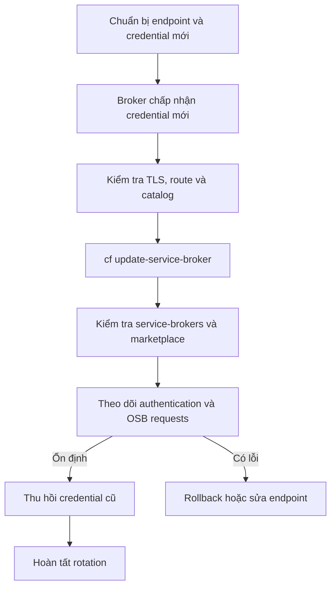

# Cập nhật thông tin đăng ký bằng cf update-service-broker

## 1. Vai trò của thông tin đăng ký Service Broker

Cloud Foundry lưu thông tin đăng ký của mỗi service broker để Cloud Controller biết cách kết nối tới broker. Thông tin này thường gồm tên đăng ký, URL của endpoint broker, username và password dùng cho giao tiếp giữa nền tảng với broker.

Khi triển khai broker mới, quản trị viên đăng ký bằng `cf create-service-broker`. Trong quá trình vận hành, URL hoặc credential có thể thay đổi do chuyển môi trường, đổi domain, triển khai endpoint mới, xoay mật khẩu hoặc xử lý sự cố bảo mật. Lệnh `cf update-service-broker` cập nhật thông tin đăng ký hiện có mà không cần tạo một đăng ký broker khác.

Trong module `SPRING_CLOUD_SERVICE_BROKER`, Spring Cloud Open Service Broker cung cấp các endpoint OSB API; Cloud Foundry lưu địa chỉ và credential để gọi các endpoint đó. Vì vậy, cập nhật đăng ký là một thao tác control plane quan trọng: nếu URL hoặc credential không khớp với cấu hình broker, nền tảng có thể không đọc được catalog hoặc không thực hiện được các thao tác provisioning, binding và deprovisioning tiếp theo.

`cf update-service-broker` thay đổi cấu hình kết nối mà Cloud Foundry dùng cho broker. Lệnh này không tự sửa code của broker, không thay thế cấu hình secret bên trong ứng dụng và không trực tiếp thay đổi tài nguyên của các service instance đang tồn tại.

## 2. Cú pháp lệnh

Cú pháp phổ biến của Cloud Foundry CLI:

```bash
cf update-service-broker SERVICE_BROKER_NAME USERNAME PASSWORD URL
```

| Tham số | Ý nghĩa |
|---|---|
| `SERVICE_BROKER_NAME` | Tên đăng ký broker hiện có trong Cloud Foundry. |
| `USERNAME` | Username mà Cloud Controller dùng khi xác thực với broker. |
| `PASSWORD` | Password tương ứng với username. |
| `URL` | Base URL của service broker mà Cloud Controller sẽ gọi. |

Ví dụ:

```bash
cf update-service-broker orders-broker broker-client '<new-password>' https://broker.example.com
```

Lệnh trên cập nhật đăng ký có tên `orders-broker` với username, password và URL được cung cấp. Hãy thay các giá trị minh họa bằng thông tin đúng của môi trường. Không dùng chuỗi placeholder trong production.

Lệnh yêu cầu tên broker đã tồn tại. Nếu tên chưa được đăng ký, hãy kiểm tra bằng `cf service-brokers` và xác định có cần tạo broker mới bằng `cf create-service-broker` hay không. Không đổi tên broker bằng cách đoán tham số của lệnh update; hãy dùng đúng thao tác quản lý đăng ký được CLI và quyền quản trị của nền tảng hỗ trợ.

## 3. Chuẩn bị trước khi cập nhật

Trước khi chạy lệnh, xác định rõ Cloud Foundry foundation và organization/space context của phiên CLI. Việc nhầm foundation có thể cập nhật nhầm đăng ký broker ở môi trường khác.

Kiểm tra target:

```bash
cf api https://api.sys.example.com
cf target
cf service-brokers
```

`cf service-brokers` liệt kê các service broker đã đăng ký mà tài khoản hiện tại được phép xem. Đối chiếu tên broker với change request hoặc thông tin vận hành đã được phê duyệt.

Các điều kiện cần chuẩn bị:

1. Tài khoản CLI có quyền quản lý service broker trên foundation mục tiêu.
2. URL mới truy cập được từ Cloud Controller, không chỉ từ máy phát triển.
3. DNS, route, ingress, firewall và TLS certificate của URL mới đã sẵn sàng.
4. Broker đang chạy và các endpoint OSB API cần thiết phản hồi đúng.
5. Username/password mới đã được cấu hình trong broker hoặc authentication gateway.
6. Có kế hoạch rollback về URL/credential trước đó nếu xác minh thất bại.
7. Đã đánh giá ảnh hưởng tới các thao tác đang chạy và các request nền tảng sẽ gửi trong thời gian chuyển đổi.

Không nên bắt đầu bằng cách cập nhật Cloud Foundry sang credential mới trong khi broker vẫn chỉ chấp nhận credential cũ. Hãy bảo đảm hai phía có thể chuyển đổi theo thứ tự an toàn.

## 4. Cập nhật URL của broker

URL đăng ký là địa chỉ Cloud Controller sử dụng để gọi broker. URL thường trỏ tới base endpoint của ứng dụng, còn các route OSB API được framework phục vụ bên dưới base path theo cấu hình.

Ví dụ broker chuyển từ domain cũ sang domain mới:

```text
URL cũ: https://broker-old.example.com
URL mới: https://broker.example.com
```

Lệnh:

```bash
cf update-service-broker orders-broker broker-client '<current-password>' https://broker.example.com
```

Khi đổi URL, cần kiểm tra:

- DNS của domain mới phân giải đúng từ mạng Cloud Controller.
- Ingress hoặc load balancer định tuyến đến đúng deployment.
- TLS certificate còn hiệu lực, hostname khớp và certificate chain được tin cậy.
- Route OSB API hoạt động, ví dụ `/v2/catalog` và các route service instance/binding.
- Authentication gateway không chặn request từ Cloud Controller.
- Network policy cho phép kết nối từ platform tới broker.

Không chuyển URL sang một endpoint chỉ phục vụ dashboard hoặc Actuator. URL đăng ký phải là endpoint service broker mà Cloud Controller có thể gọi theo OSB API.

### 4.1. Chuyển endpoint theo kiểu blue/green

Nếu cần giảm gián đoạn, có thể triển khai endpoint mới song song với endpoint cũ:

1. Deploy broker mới hoặc ingress mới với cùng catalog và dữ liệu vận hành cần thiết.
2. Cấu hình endpoint mới chấp nhận credential hiện tại hoặc credential mới đã chuẩn bị.
3. Kiểm tra `/v2/catalog` từ mạng có thể truy cập như Cloud Controller.
4. Cập nhật URL bằng `cf update-service-broker`.
5. Theo dõi request và operation đi tới endpoint mới.
6. Chỉ ngừng endpoint cũ sau khi đã xác minh không còn request hoặc worker phụ thuộc vào nó.

Nếu broker dùng operation store hoặc database nội bộ, các deployment phải chia sẻ dữ liệu cần thiết hoặc có cơ chế chuyển trạng thái phù hợp. Chỉ chuyển URL mà không chuyển operation store có thể khiến nền tảng polling last operation ở deployment mới nhưng operation lại chỉ tồn tại trong bộ nhớ hoặc database của deployment cũ.

## 5. Xoay username và password

Username/password trong đăng ký được Cloud Controller dùng khi gọi endpoint broker có bảo vệ bằng broker authentication. Khi xoay credential, cần đồng bộ hai phía:

- Broker hoặc authentication gateway phải chấp nhận credential mới.
- Cloud Foundry phải lưu và dùng credential mới sau khi lệnh update hoàn tất.

Ví dụ:

```bash
cf update-service-broker orders-broker broker-client-v2 '<rotated-password>' https://broker.example.com
```

Không thay đổi password ở broker trước rồi mới tìm cách cập nhật Cloud Foundry nếu việc đó làm credential cũ bị từ chối ngay lập tức. Trong một số kiến trúc, có thể tạm thời cho phép cả credential cũ và mới trong một khoảng chuyển tiếp; sau khi Cloud Foundry đã cập nhật và request thành công bằng credential mới, thu hồi credential cũ.

### 5.1. Quy trình rotation an toàn

1. Sinh username/password mới bằng secret manager hoặc cơ chế cấp credential an toàn.
2. Cấu hình broker/gateway chấp nhận credential mới. Nếu hệ thống hỗ trợ, giữ credential cũ trong thời gian chuyển tiếp.
3. Thực hiện `cf update-service-broker` với username/password mới và URL hiện tại.
4. Xác minh lệnh thành công và Cloud Controller đọc được catalog.
5. Theo dõi log authentication và request OSB API để xác nhận credential mới đang được sử dụng.
6. Thu hồi credential cũ sau khi đã xác nhận không còn request hợp lệ phụ thuộc vào nó.
7. Ghi audit thời điểm rotation, người thực hiện và phiên bản secret reference; không ghi password thật.

Nếu broker chỉ hỗ trợ một credential duy nhất, cần có cửa sổ chuyển đổi được điều phối để tránh thời điểm Cloud Controller dùng credential mới nhưng broker chưa nhận, hoặc broker đã bỏ credential cũ trong khi Cloud Foundry chưa cập nhật.

### 5.2. Bảo vệ password khi chạy lệnh

Password là đối số của CLI nên có thể xuất hiện trong shell history, log phiên terminal, công cụ ghi hình hoặc danh sách process tùy môi trường. Vì vậy:

- Không đặt password thật trong tài liệu, ticket hoặc ví dụ lệnh.
- Dùng terminal/session được kiểm soát và tuân thủ quy trình secret handling của tổ chức.
- Tránh chia sẻ transcript có chứa lệnh đã điền password.
- Không bật shell tracing hoặc command logging ghi lại secret.
- Sau rotation, không lưu password trong file cấu hình không được mã hóa.

Nếu tổ chức có wrapper hoặc cơ chế thực thi lệnh tích hợp secret manager, hãy dùng cách đó theo hướng dẫn vận hành nội bộ. Cú pháp CLI cơ bản vẫn nhận password ở vị trí tham số thứ ba sau broker name và username.

## 6. Cập nhật URL và credential cùng lúc

Lệnh update nhận đủ username, password và URL. Khi chỉ muốn thay đổi một trường, cung cấp lại giá trị hiện tại cho những trường còn lại đã xác minh. Không để trống tham số với giả định CLI sẽ tự giữ giá trị cũ nếu cú pháp của phiên bản CLI yêu cầu đủ đối số.

Ví dụ chỉ đổi password, giữ username và URL:

```bash
cf update-service-broker orders-broker broker-client '<new-password>' https://broker.example.com
```

Ví dụ đổi URL, giữ username và password:

```bash
cf update-service-broker orders-broker broker-client '<current-password>' https://broker-v2.example.com
```

Nếu đổi cả ba trường, cần kiểm tra trước rằng endpoint mới đã chấp nhận credential mới và trả catalog hợp lệ. Thay đổi đồng thời nhiều trường làm tăng số nguyên nhân có thể gây lỗi; nếu không cần thiết, tách thành các thay đổi nhỏ có thể xác minh và rollback độc lập.

## 7. Cloud Foundry cập nhật đăng ký và catalog như thế nào?

Sau khi thông tin đăng ký được cập nhật, Cloud Controller sử dụng URL và credential mới khi giao tiếp với broker. Quá trình cập nhật broker cũng liên quan tới việc đồng bộ catalog từ endpoint `/v2/catalog` theo hành vi của phiên bản Cloud Foundry đang triển khai.

Catalog xác định service offering, plan, metadata và capability mà nền tảng nhìn thấy. Vì vậy, sau khi update, cần xác minh catalog hiện tại và không chỉ dựa vào việc CLI báo lệnh thành công.

Một số điểm cần phân biệt:

- **Broker registration:** thông tin kết nối gồm URL và credential.
- **Catalog synchronization:** dữ liệu service/plan mà Cloud Foundry đọc từ broker.
- **Service access:** quyền cho phép organization hoặc consumer nhìn thấy và sử dụng service/plan.
- **Service instance:** tài nguyên đã được người dùng provision.

Thay đổi đăng ký không đồng nghĩa service access tự động được bật cho mọi organization. Sau khi catalog thay đổi, quản trị viên vẫn cần kiểm tra quyền truy cập service/plan theo chính sách foundation.

Các lệnh kiểm tra thường dùng:

```bash
cf service-brokers
cf marketplace
cf service-access
```

Nếu service hoặc plan chưa hiển thị như mong đợi, kiểm tra catalog response, broker logs và quá trình đồng bộ của Cloud Controller. Không dùng `cf enable-service-access` để sửa URL hoặc password; lệnh đó điều khiển khả năng hiển thị/truy cập service hoặc plan theo scope được hỗ trợ.

## 8. Phân biệt update broker với các lệnh Cloud Foundry khác

| Lệnh | Mục đích | Khi sử dụng |
|---|---|---|
| `cf create-service-broker` | Tạo đăng ký broker mới. | Broker chưa tồn tại trong foundation. |
| `cf update-service-broker` | Cập nhật username, password và URL của đăng ký broker hiện có. | Xoay credential, đổi endpoint hoặc cập nhật thông tin kết nối. |
| `cf delete-service-broker` | Xóa đăng ký broker. | Ngừng cung cấp broker theo quy trình đã đánh giá tác động. |
| `cf enable-service-access` | Cho phép truy cập service/plan trong phạm vi được chỉ định. | Cấp quyền hiển thị và sử dụng offering. |
| `cf disable-service-access` | Tắt quyền truy cập service/plan. | Ngừng cho consumer mới sử dụng service/plan theo chính sách. |
| `cf update-service` | Thay đổi tham số hoặc plan của một service instance nếu broker hỗ trợ update. | Người dùng thay đổi một instance cụ thể. |

`cf update-service-broker` không phải `cf update-service`. Một lệnh cập nhật thông tin đăng ký kết nối giữa Cloud Foundry và broker; lệnh còn lại yêu cầu thay đổi cấu hình của một service instance đã provision.

Tương tự, không xóa rồi tạo lại broker chỉ để đổi password nếu `cf update-service-broker` đáp ứng nhu cầu. Xóa đăng ký có thể ảnh hưởng catalog, service access và các thao tác vòng đời của instance hiện hữu.

## 9. Ảnh hưởng tới service instance và operation đang chạy

Thay đổi URL hoặc credential đăng ký không tự động provision lại, deprovision hay đổi plan của các service instance hiện hữu. Broker vẫn phải giữ mapping `instance_id`, service ID, plan ID, binding ID và operation để tiếp tục xử lý vòng đời.

Tuy nhiên, các request mới từ Cloud Controller sau thời điểm cập nhật sẽ đi tới endpoint và dùng credential mới. Vì vậy:

- Provisioning mới có thể thất bại nếu endpoint mới không trả catalog hoặc không xử lý create request.
- Binding/unbinding có thể lỗi nếu endpoint mới không dùng chung dữ liệu binding hoặc không nhận diện credential.
- Polling last operation có thể không tìm thấy operation nếu operation store không được chia sẻ.
- Deprovision có thể không thu hồi được resource nếu deployment mới thiếu provider mapping hoặc secret reference cũ.
- Các request đang xử lý trên endpoint cũ có thể hoàn tất ở đó; cần giữ endpoint cũ đủ lâu để xử lý request đang chạy nếu kiến trúc yêu cầu.

Khi di chuyển broker giữa hai deployment, cần bảo đảm database broker, operation store, secret references, provider credentials và encryption keys được chuyển hoặc dùng chung an toàn. URL mới chỉ là một phần của quá trình chuyển đổi.

## 10. Xác minh sau khi chạy lệnh

Sau khi CLI báo update thành công, thực hiện kiểm tra theo nhiều lớp.

### 10.1. Kiểm tra đăng ký

```bash
cf service-brokers
```

Xác nhận tên broker vẫn tồn tại trong danh sách và không vô tình tạo thêm một đăng ký trùng tên hoặc nhầm foundation.

### 10.2. Kiểm tra catalog và marketplace

```bash
cf marketplace
cf service-access
```

Xác nhận service offering và plan mong đợi xuất hiện. Kiểm tra trạng thái access riêng vì catalog có service không có nghĩa mọi organization đều được cấp quyền sử dụng.

### 10.3. Kiểm tra kết nối broker

Từ mạng phù hợp với Cloud Controller, xác minh:

- URL đăng ký trỏ tới đúng broker.
- TLS handshake và certificate validation thành công.
- Authentication được chấp nhận.
- `GET /v2/catalog` trả JSON hợp lệ theo phiên bản OSB API.
- Các route service instance và binding được định tuyến đúng.

Không kiểm tra bằng cách đưa password vào URL hoặc gửi secret qua kênh không mã hóa. Nếu cần kiểm tra trực tiếp, dùng môi trường và phương pháp được tổ chức cho phép, tránh ghi credential vào shell history.

### 10.4. Kiểm tra log và telemetry

Theo dõi broker log, Cloud Controller log và ingress/access log quanh thời điểm update. Tìm các dấu hiệu:

- `401 Unauthorized` hoặc `403 Forbidden` khi Cloud Controller gọi broker.
- DNS resolution, TLS handshake hoặc connection timeout.
- Lỗi parse catalog hoặc service/plan ID không hợp lệ.
- Request tới URL cũ sau khi chuyển đổi.
- Operation polling không tìm thấy operation ID.

Không bật logging ghi header `Authorization` hoặc password để điều tra lỗi. Dùng request ID, timestamp, endpoint, status code và correlation ID để đối chiếu.

## 11. Quy trình rollback

Nếu sau update Cloud Controller không thể truy cập broker, cần xác định lỗi nằm ở URL, DNS/TLS, credential, catalog hay deployment state. Nếu endpoint/credential cũ vẫn hoạt động và được phép dùng lại, có thể khôi phục thông tin đăng ký bằng lệnh update với các giá trị cũ đã xác minh.

Ví dụ minh họa:

```bash
cf update-service-broker orders-broker broker-client '<previous-password>' https://broker-old.example.com
```

Rollback cần thực hiện có kiểm soát:

1. Xác nhận URL và credential cũ vẫn hợp lệ, không bị thu hồi vì lý do bảo mật.
2. Cập nhật đăng ký về endpoint/credential trước đó.
3. Kiểm tra catalog và authentication từ Cloud Controller.
4. Theo dõi các request lifecycle và operation đang chạy.
5. Ghi nhận nguyên nhân lỗi và quyết định có tiếp tục chuyển đổi hay không.

Nếu credential cũ bị rotate do nghi ngờ lộ lọt, không khôi phục nó chỉ để rollback nhanh. Hãy sửa endpoint mới hoặc cấp một credential mới khác. Bảo mật credential quan trọng hơn việc khôi phục một cấu hình đã biết là không an toàn.

## 12. Xử lý lỗi thường gặp

| Hiện tượng | Nguyên nhân có thể | Hướng xử lý |
|---|---|---|
| CLI báo không tìm thấy broker | Tên đăng ký sai hoặc đang target nhầm foundation. | Kiểm tra `cf api`, `cf target`, `cf service-brokers`. |
| CLI báo không đủ quyền | Tài khoản không có quyền quản lý broker. | Dùng identity được ủy quyền trên foundation đúng. |
| Cloud Controller nhận `401` | Username/password mới không khớp broker. | Kiểm tra cấu hình auth ở broker và rotation sequence. |
| Cloud Controller nhận `403` | Credential hợp lệ nhưng bị policy từ chối. | Kiểm tra role, allowlist, proxy và authentication gateway. |
| Lỗi kết nối hoặc timeout | URL, DNS, route, firewall hoặc broker không sẵn sàng. | Kiểm tra đường mạng từ Cloud Controller tới endpoint. |
| TLS handshake thất bại | Certificate hết hạn, sai hostname hoặc chain không tin cậy. | Sửa certificate/chain và kiểm tra trust store. |
| Catalog không đồng bộ | `/v2/catalog` lỗi hoặc response không hợp lệ. | Kiểm tra broker logs, JSON và OSB API version. |
| Service không xuất hiện trong marketplace | Service access chưa được bật hoặc catalog không có offering. | Kiểm tra catalog và dùng lệnh access phù hợp. |
| Polling operation không tìm thấy | Endpoint mới không dùng chung operation store. | Khôi phục dữ liệu hoặc cấu hình persistence dùng chung. |
| Request vẫn tới endpoint cũ | Có cache, request đang chạy hoặc nhiều thành phần dùng URL khác. | Theo dõi Cloud Controller và giữ endpoint cũ trong thời gian chuyển tiếp phù hợp. |

Không kết luận lỗi chỉ từ một thông báo CLI. Hãy đối chiếu thời điểm update, request ID và log của Cloud Controller, ingress và broker để xác định chính xác lớp gây lỗi.

## 13. Quy trình vận hành mẫu

Một lần xoay credential và cập nhật endpoint có thể được thực hiện theo trình tự:



Ví dụ các lệnh theo thứ tự:

```bash
# 1. Xác nhận foundation và broker registration
cf api https://api.sys.example.com
cf target
cf service-brokers

# 2. Cập nhật thông tin kết nối
cf update-service-broker orders-broker broker-client-v2 '<new-password>' https://broker.example.com

# 3. Xác minh catalog và quyền truy cập
cf marketplace
cf service-access
```

Các lệnh trong ví dụ không thay thế bước xác minh endpoint từ mạng Cloud Controller hoặc kiểm thử vòng đời trong môi trường phù hợp. Với production, nên thực hiện trong maintenance/change window, có người chịu trách nhiệm theo dõi và có phương án rollback.

## 14. Checklist trước và sau khi update

**Trước khi update:**

1. Đã target đúng Cloud Foundry foundation.
2. Đã xác minh tên service broker đăng ký.
3. Đã xác nhận quyền quản trị broker.
4. URL mới truy cập được từ Cloud Controller.
5. TLS certificate và DNS hợp lệ.
6. Broker chấp nhận username/password mới.
7. Đã chuẩn bị rollback và kiểm tra endpoint cũ nếu cần.
8. Đã xác định tác động tới catalog, instance, binding và operation đang chạy.

**Sau khi update:**

1. CLI báo cập nhật thành công.
2. `cf service-brokers` vẫn liệt kê đúng đăng ký.
3. Catalog được đồng bộ và `cf marketplace` hiển thị đúng offering.
4. Service access vẫn đúng theo chính sách foundation.
5. Authentication và TLS từ Cloud Controller hoạt động.
6. Broker logs không có lỗi xác thực hoặc kết nối bất thường.
7. Provisioning, binding, unbinding, polling và deprovision được kiểm tra trong môi trường phù hợp.
8. Credential cũ chỉ bị thu hồi sau khi chuyển đổi đã được xác minh.
9. Audit record ghi nhận người thực hiện và thời điểm thay đổi mà không lưu password.

## 15. Nguyên tắc cần ghi nhớ

- `cf update-service-broker` cập nhật thông tin đăng ký broker hiện có: username, password và URL.
- Cú pháp cần đúng tên broker và đủ các tham số theo CLI: `SERVICE_BROKER_NAME USERNAME PASSWORD URL`.
- Broker phải chấp nhận credential mới trước khi Cloud Foundry chuyển sang dùng nó.
- URL mới phải truy cập được từ Cloud Controller, có TLS hợp lệ và phục vụ đúng OSB API.
- Sau update, kiểm tra catalog và service access; hai khái niệm này không giống thông tin đăng ký.
- Lệnh update broker không thay thế `cf update-service`, không tự sửa code broker và không provision lại service instance.
- Khi chuyển endpoint, operation store, instance mapping và secret references phải tiếp tục khả dụng.
- Giữ endpoint/credential cũ trong thời gian chuyển đổi phù hợp; chỉ thu hồi sau khi xác minh.
- Không đưa password thật vào tài liệu, ticket hoặc log terminal.

## Nguồn tham khảo

- [Cloud Foundry CLI – update-service-broker](https://cli.cloudfoundry.org/en-US/v8/update-service-broker.html): cú pháp và tham số của lệnh cập nhật service broker.
- [Cloud Foundry CLI – service-brokers](https://cli.cloudfoundry.org/en-US/v8/service-brokers.html): kiểm tra danh sách service broker đã đăng ký.
- [Cloud Foundry CLI – marketplace](https://cli.cloudfoundry.org/en-US/v8/marketplace.html): kiểm tra service offering và plan được công bố.
- [Cloud Foundry CLI – enable-service-access](https://cli.cloudfoundry.org/en-US/v8/enable-service-access.html): phân biệt cập nhật đăng ký với cấp quyền truy cập service/plan.
- [Open Service Broker API v2.17](https://github.com/cloudfoundry/servicebroker/blob/v2.17/spec.md): hợp đồng catalog và các thao tác service broker mà Cloud Controller gọi.
