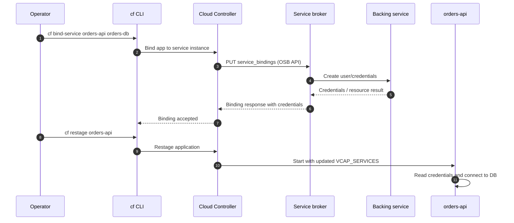

# Liên kết ứng dụng bằng cf bind-service và phân phối cấu hình qua VCAP_SERVICES

Trong Cloud Foundry, ứng dụng không cần lưu trực tiếp password database hoặc token của từng dịch vụ trong source code. Người vận hành tạo service instance, liên kết instance với ứng dụng bằng lệnh `cf bind-service`, rồi Cloud Controller phối hợp với service broker để tạo binding. Broker trả thông tin credentials theo Open Service Broker API (OSB API); Cloud Foundry đưa dữ liệu binding vào môi trường chạy của ứng dụng thông qua biến `VCAP_SERVICES`.

Ứng dụng đọc `VCAP_SERVICES` khi khởi động hoặc khi nền tảng staging ứng dụng, lấy đúng credentials của binding và cấu hình kết nối tới backing service. Cách làm này tách thông tin truy cập khỏi mã nguồn, hỗ trợ triển khai nhiều môi trường và cho phép platform quản lý vòng đời binding.

Trong module `SPRING_CLOUD_SERVICE_BROKER`, cần hiểu cả hai phía của luồng: broker xử lý request bind và trả credentials đúng hợp đồng; ứng dụng Cloud Foundry nhận dữ liệu qua `VCAP_SERVICES` và sử dụng an toàn. Bài học này hướng dẫn quy trình từ CLI tới ứng dụng Spring Boot, cách đọc cấu trúc biến môi trường, cập nhật sau bind/unbind và các lỗi thường gặp.

## Mục tiêu học tập

Sau bài này, bạn có thể:

- Giải thích vai trò của `cf bind-service`, Cloud Controller và service broker.
- Mô tả cách credentials từ response OSB API được phân phối qua `VCAP_SERVICES`.
- Thực hiện bind, restage, kiểm tra environment và unbind một service instance.
- Đọc cấu trúc JSON `VCAP_SERVICES` mà không phụ thuộc vị trí phần tử trong mảng.
- Tích hợp credentials vào ứng dụng Spring Boot một cách có kiểm soát.
- Phân biệt application binding với service key.
- Bảo vệ credentials khỏi log, source code, image và endpoint quản trị.
- Chẩn đoán lỗi binding, restage và kết nối tới backing service.

## 1. Các thành phần trong luồng binding

Giả sử ứng dụng `orders-api` cần truy cập một PostgreSQL service instance tên `orders-db`. Người vận hành đã tạo service instance từ catalog của broker. Khi chạy `cf bind-service`, Cloud Foundry điều phối việc tạo binding giữa ứng dụng và service instance.

Các thành phần tham gia:

| Thành phần | Vai trò |
|---|---|
| Cloud Foundry CLI (`cf`) | Gửi yêu cầu bind/unbind tới Cloud Controller. |
| Cloud Controller | Quản lý application, service instance và service binding; gọi broker theo OSB API. |
| Service broker | Xác minh request, tạo binding và credentials ở backing service. |
| Backing service | PostgreSQL, Redis, RabbitMQ hoặc dịch vụ thực tế mà ứng dụng sử dụng. |
| Staging/runtime | Cung cấp thông tin binding cho ứng dụng trong môi trường chạy. |
| `VCAP_SERVICES` | Biến môi trường JSON chứa danh sách service binding và credentials tương ứng. |



Cloud Controller quản lý binding và phân phối dữ liệu tới ứng dụng. Ứng dụng thường không gọi trực tiếp endpoint bind của broker và không tự tạo `binding_id` theo cách riêng. Broker nhận request có định danh do platform quản lý, tạo credentials và trả response theo OSB API.

## 2. Chuẩn bị service instance và ứng dụng

Trước khi bind, cần có một service instance đã được provision và một ứng dụng đã được push lên Cloud Foundry.

Ví dụ tạo PostgreSQL service instance:

```bash
cf create-service postgresql standard orders-db
```

Trong lệnh này:

- `postgresql` là tên service offering trong catalog.
- `standard` là plan mà platform công bố.
- `orders-db` là tên service instance do người vận hành chọn.

Tên offering và plan phụ thuộc catalog của broker đang đăng ký với Cloud Foundry. Kiểm tra các lựa chọn bằng:

```bash
cf marketplace
```

Kiểm tra trạng thái service instance:

```bash
cf services
cf service orders-db
```

Nếu provision đang bất đồng bộ, Cloud Controller có thể hiển thị trạng thái đang tạo. Chỉ bind khi instance đã ở trạng thái sẵn sàng theo chính sách của platform.

Ứng dụng cần tồn tại trong org/space phù hợp với service instance và chính sách chia sẻ service của Cloud Foundry. Nếu ứng dụng và service instance ở những phạm vi khác nhau, cần kiểm tra khả năng share service instance và quyền tương ứng trước khi bind.

## 3. Thực hiện `cf bind-service`

Lệnh cơ bản:

```bash
cf bind-service orders-api orders-db
```

Tham số đầu là tên ứng dụng; tham số thứ hai là tên service instance. Cloud Controller nhận yêu cầu, xác minh quyền và gọi service broker để tạo service binding.

Một số broker hỗ trợ tham số riêng cho binding. Cloud Foundry CLI có thể chuyển JSON parameters bằng tùy chọn `-c`:

```bash
cf bind-service orders-api orders-db -c '{"access":"read-write","schema":"orders"}'
```

Các key trong JSON do service broker định nghĩa và phải được broker công bố/tài liệu hóa. Không gửi `username`, `password` tự chọn rồi giả định broker sẽ chấp nhận; credentials thường do broker hoặc backing service cấp. Nếu service không hỗ trợ binding parameters, bỏ tùy chọn `-c`.

Tùy phiên bản CLI, có thể có các tùy chọn bổ sung như binding name. Hãy kiểm tra cú pháp của CLI đang cài:

```bash
cf help bind-service
```

Sau khi bind thành công, Cloud Controller lưu quan hệ binding và thông tin credentials do broker trả về. Một service instance có thể có nhiều binding, mỗi binding có thể có credentials riêng nếu broker thiết kế theo mô hình đó.

### 3.1. Điều gì xảy ra ở phía broker?

Cloud Controller gửi request create service binding tới broker theo OSB API. Request thường chứa:

- `service_id` và `plan_id` xác định offering/plan.
- `instance_id` trong URL xác định service instance.
- `binding_id` trong URL xác định binding mới.
- `app_guid` hoặc thông tin application trong `bind_resource` tùy phiên bản và loại binding.
- `parameters` nếu operator truyền binding parameters.
- `context` mô tả platform và môi trường.

Broker kiểm tra service/plan, instance, quyền, binding parameters và capability bindable. Sau đó broker tạo principal hoặc credentials ở backing service, lưu binding record và trả response chứa `credentials` cùng metadata phù hợp.

Ví dụ response rút gọn từ broker:

```json
{
  "credentials": {
    "uri": "postgresql://db.example.internal:5432/orders",
    "hostname": "db.example.internal",
    "port": 5432,
    "database": "orders",
    "username": "orders_app",
    "password": "<secret>",
    "sslmode": "require"
  }
}
```

Đây là ví dụ dữ liệu response của broker. Cấu trúc `credentials` do broker định nghĩa cho service offering; OSB API không bắt buộc mọi broker phải trả cùng một bộ key. Không đưa secret thật vào log hoặc tài liệu.

## 4. `VCAP_SERVICES` là gì?

`VCAP_SERVICES` là biến môi trường JSON do Cloud Foundry cung cấp cho ứng dụng để mô tả các service binding mà ứng dụng được liên kết. Dữ liệu thường được nhóm theo service label; mỗi nhóm là một mảng chứa các binding instance. Mỗi phần tử có thể có tên instance, label, plan, tags, credentials và các trường bổ sung khác.

Ví dụ rút gọn:

```json
{
  "postgresql": [
    {
      "name": "orders-db",
      "label": "postgresql",
      "plan": "standard",
      "tags": ["postgresql", "relational"],
      "credentials": {
        "uri": "postgresql://db.example.internal:5432/orders",
        "hostname": "db.example.internal",
        "port": 5432,
        "database": "orders",
        "username": "orders_app",
        "password": "<secret>",
        "sslmode": "require"
      }
    }
  ]
}
```

Các trường minh họa thường gặp:

| Field | Ý nghĩa |
|---|---|
| Key cấp cao nhất (`postgresql`) | Service label dùng để nhóm binding. |
| `name` | Tên service instance hiển thị trong Cloud Foundry. |
| `label` | Label của service offering. |
| `plan` | Tên plan đã chọn. |
| `tags` | Nhãn hỗ trợ ứng dụng hoặc thư viện nhận diện service. |
| `credentials` | Object do broker trả về, chứa dữ liệu kết nối/secret. |
| `syslog_drain_url` | Endpoint cho log drain nếu service hỗ trợ. |
| `volume_mounts` | Thông tin volume mount nếu service hỗ trợ. |

Không phải mọi binding đều có đủ mọi field. Broker có thể trả cấu trúc credentials tùy chỉnh; Cloud Foundry đưa dữ liệu đó vào `VCAP_SERVICES` mà không áp đặt một schema credentials chung cho mọi loại dịch vụ. Ứng dụng phải đọc theo hợp đồng của service cụ thể và xử lý field có thể thiếu.

### 4.1. Một ứng dụng có thể có nhiều binding

`VCAP_SERVICES` không phải một object chỉ chứa một database. Ứng dụng có thể bind nhiều service instance cùng label hoặc khác label:

```json
{
  "postgresql": [
    { "name": "orders-db", "credentials": { "database": "orders" } },
    { "name": "audit-db", "credentials": { "database": "audit" } }
  ],
  "redis": [
    { "name": "orders-cache", "credentials": { "host": "redis.example.internal" } }
  ]
}
```

Vì vậy, không nên lấy phần tử `[0]` rồi mặc định đó là database cần dùng. Hãy chọn theo service label và tên instance/binding name hoặc quy ước đã thống nhất với operator.

### 4.2. Tên binding và tên service instance

Một số phiên bản/cấu hình Cloud Foundry có thể cung cấp thêm thông tin như `instance_name` hoặc `binding_name`. Những field này hữu ích khi một ứng dụng có nhiều binding tới cùng offering hoặc service instance. Hãy kiểm tra payload thực tế được platform cung cấp và tài liệu của môi trường đang dùng; không giả định field tùy chọn luôn tồn tại.

## 5. Kiểm tra `VCAP_SERVICES` bằng Cloud Foundry CLI

Sau khi bind, có thể xem environment của ứng dụng bằng:

```bash
cf env orders-api
```

Lệnh này hiển thị environment variables, bao gồm `VCAP_SERVICES` nếu ứng dụng có service bindings. Output có thể chứa password, token hoặc URI nhạy cảm. Chỉ người có quyền phù hợp mới được chạy lệnh; không dán output vào ticket, chat, terminal recording hoặc log công khai.

Nếu vừa bind nhưng ứng dụng chưa nhận dữ liệu mới, thực hiện:

```bash
cf restage orders-api
```

Restage tạo/stage lại droplet với cấu hình môi trường hiện tại và khởi động ứng dụng. Sau khi restage hoàn tất, kiểm tra trạng thái app và log:

```bash
cf app orders-api
cf logs orders-api --recent
```

Log chỉ nên chứa thông báo kết nối thành công/thất bại và thông tin đã làm sạch; không log toàn bộ `VCAP_SERVICES`.

### 5.1. Bind không đồng nghĩa process đang chạy tự đọc lại environment

Environment variables được cung cấp cho process khi platform khởi chạy ứng dụng. Một process đang chạy không tự động đọc lại `VCAP_SERVICES` chỉ vì binding đã thay đổi. Restage/restart theo quy trình Cloud Foundry giúp workload nhận cấu hình mới.

Với service binding mới, quy trình phổ biến là bind rồi restage ứng dụng. Với thay đổi credentials hoặc unbind, cần bảo đảm app instances đã được cập nhật trước khi thu hồi credentials cũ. Chi tiết rollout phụ thuộc loại app, phiên bản platform và cách triển khai.

## 6. Đọc `VCAP_SERVICES` trong ứng dụng Spring Boot

Spring Boot không nên giả định mọi broker trả cùng một schema credentials. Ứng dụng có thể dùng thư viện tích hợp Cloud Foundry phù hợp với phiên bản Spring Boot hoặc tự đọc JSON bằng Jackson. Dù chọn cách nào, cần có lớp adapter để chuyển cấu trúc platform thành cấu hình nội bộ có kiểu rõ ràng.

Ví dụ Java dùng Jackson `JsonNode`:

```java
import com.fasterxml.jackson.databind.JsonNode;
import com.fasterxml.jackson.databind.ObjectMapper;
import org.springframework.stereotype.Component;

import java.io.IOException;

@Component
public class VcapServicesReader {

    private final JsonNode root;

    public VcapServicesReader(ObjectMapper objectMapper) throws IOException {
        String raw = System.getenv("VCAP_SERVICES");
        this.root = (raw == null || raw.isBlank())
                ? objectMapper.createObjectNode()
                : objectMapper.readTree(raw);
    }

    public JsonNode credentials(String serviceLabel, String instanceName) {
        JsonNode bindings = root.path(serviceLabel);
        if (!bindings.isArray()) {
            throw new IllegalStateException("Không tìm thấy service label: " + serviceLabel);
        }

        for (JsonNode binding : bindings) {
            if (instanceName.equals(binding.path("name").asText())) {
                JsonNode credentials = binding.path("credentials");
                if (credentials.isMissingNode() || credentials.isNull()) {
                    throw new IllegalStateException("Binding không có credentials");
                }
                return credentials;
            }
        }

        throw new IllegalStateException("Không tìm thấy binding: " + instanceName);
    }
}
```

Đây là adapter tối giản để minh họa cách chọn service theo label và instance name. Trong ứng dụng production, nên:

- Kiểm tra JSON malformed và báo lỗi cấu hình mà không in raw JSON.
- Validate kiểu và field bắt buộc của credentials theo service contract.
- Tránh giữ bản sao credentials ở nhiều object hoặc cache không cần thiết.
- Xử lý trường hợp nhiều binding có cùng tên hoặc binding name khác instance name.
- Không giả định `credentials` luôn là một cấu trúc cố định giữa các broker.
- Tách dữ liệu Cloud Foundry khỏi domain service để có thể chạy local/test và trên platform khác.

### 6.1. Chuyển credentials thành cấu hình có kiểu

Sau khi lấy đúng binding, ứng dụng có thể ánh xạ sang record:

```java
public record DatabaseBinding(
        String jdbcUrl,
        String username,
        String password,
        String sslMode
) {}
```

Ví dụ adapter ánh xạ:

```java
JsonNode credentials = vcapServicesReader.credentials("postgresql", "orders-db");

DatabaseBinding database = new DatabaseBinding(
        credentials.path("jdbcUrl").asText(),
        credentials.path("username").asText(),
        credentials.path("password").asText(),
        credentials.path("sslmode").asText("require")
);
```

Tên key `jdbcUrl`, `username`, `password`, `sslmode` phụ thuộc response của broker minh họa ở bài này. Nếu broker trả `uri` thay vì `jdbcUrl`, adapter phải parse hoặc ánh xạ theo đúng contract. Không suy đoán tên field bằng cách thử nhiều key trong production mà không có validation.

### 6.2. Dùng credentials để cấu hình DataSource

Trong Spring Boot, có thể tạo `DataSource` từ cấu hình đã ánh xạ. Ví dụ khái niệm:

```java
@Configuration
public class DatabaseConfiguration {

    @Bean
    DataSource dataSource(DatabaseBinding binding) {
        HikariConfig config = new HikariConfig();
        config.setJdbcUrl(binding.jdbcUrl());
        config.setUsername(binding.username());
        config.setPassword(binding.password());
        config.setMaximumPoolSize(10);
        return new HikariDataSource(config);
    }
}
```

Đây là ví dụ tạo pool; cần bảo đảm dependency HikariCP có trong ứng dụng và JDBC URL phù hợp driver. Trong dự án thực tế, có thể dùng Spring Boot configuration properties hoặc thư viện Cloud Foundry binding để giảm code ánh xạ. Không ghi password trong `toString()`, log startup hoặc actuator endpoint.

### 6.3. Local development và môi trường không có VCAP_SERVICES

Khi chạy local, `VCAP_SERVICES` thường không tồn tại. Ứng dụng nên có cấu hình local riêng qua environment variables hoặc secret store dành cho developer, không hardcode credentials production trong `application.yml`.

Ví dụ kiểm tra môi trường:

```java
String vcap = System.getenv("VCAP_SERVICES");
if (vcap == null || vcap.isBlank()) {
    // Dùng cấu hình local được cấp riêng hoặc báo thiếu binding.
}
```

Không đặt `VCAP_SERVICES` giả vào manifest production để che lỗi binding. Nếu cần fixture cho test, dùng dữ liệu giả không chứa secret thật và chỉ trong profile test.

## 7. Phân biệt application binding và service key

Application binding và service key đều có thể tạo credentials, nhưng mục đích phân phối khác nhau.

| Cơ chế | Mục đích | Credentials đến đâu? |
|---|---|---|
| `cf bind-service APP INSTANCE` | Liên kết service instance với ứng dụng | Cloud Foundry cung cấp binding trong môi trường app, thường qua `VCAP_SERVICES`. |
| `cf create-service-key INSTANCE KEY_NAME` | Tạo credentials độc lập để công cụ hoặc người dùng truy cập service | Người vận hành lấy thông tin bằng lệnh service-key; không tự động đưa vào `VCAP_SERVICES` của app. |

Ví dụ tạo service key:

```bash
cf create-service-key orders-db reporting-key
cf service-key orders-db reporting-key
```

Service key hữu ích cho migration tool, batch job ngoài ứng dụng hoặc thao tác quản trị. Output của `cf service-key` cũng có thể chứa secret; bảo vệ tương tự `cf env`.

Không tạo service key chỉ để thay thế application binding nếu ứng dụng chạy trong Cloud Foundry và cần lifecycle binding. Binding giúp platform quản lý quan hệ giữa app và service instance, hỗ trợ cập nhật environment khi restage và cho phép broker quản lý credentials theo từng consumer.

## 8. Unbind và thu hồi cấu hình

Khi ứng dụng không còn cần service, người vận hành có thể unbind:

```bash
cf unbind-service orders-api orders-db
```

Cloud Controller gọi broker để xóa binding theo OSB API. Broker thu hồi credentials hoặc quyền truy cập gắn với binding theo chính sách của provider, rồi cập nhật binding record. Nếu broker dùng một principal riêng cho mỗi binding, thao tác unbind có thể thu hồi principal đó. Nếu credentials dùng chung giữa nhiều binding, broker không được thu hồi secret khi các consumer khác vẫn cần nó.

Sau unbind, restage ứng dụng để process mới nhận environment không còn binding đó:

```bash
cf restage orders-api
```

Trước khi unbind, cần xác minh ứng dụng không còn sử dụng kết nối hoặc credentials của binding. Trong triển khai production, nên rollout ứng dụng đã bỏ dependency trước, rồi mới unbind và thu hồi credentials. Connection pool có thể giữ kết nối cũ một thời gian; việc xóa binding ở platform không nhất thiết đóng mọi kết nối đã được thiết lập.

### 8.1. Unbind không phải deprovision

- `cf unbind-service APP INSTANCE` xóa quan hệ binding giữa ứng dụng và service instance.
- `cf delete-service INSTANCE` yêu cầu xóa service instance và tài nguyên được provision.

Một service instance có thể được bind với nhiều ứng dụng. Unbind một ứng dụng không nên xóa database dùng chung của các ứng dụng khác. Chỉ deprovision khi service instance không còn cần thiết và người vận hành đã xác nhận ảnh hưởng.

## 9. Cập nhật credentials và restage ứng dụng

Credentials có thể thay đổi khi broker rotation secret, khi binding được tạo lại hoặc khi provider yêu cầu thay khóa. Cloud Foundry phân phối thông tin binding theo cơ chế platform; process đang chạy không tự động đọc lại environment đã khởi tạo.

Một quy trình thay credentials an toàn có thể gồm:

1. Broker/provider tạo credentials mới theo chính sách overlap nếu hỗ trợ.
2. Platform nhận hoặc truy xuất dữ liệu binding mới theo cơ chế đã triển khai.
3. Ứng dụng được restage/restart để nhận environment mới.
4. Health check xác minh ứng dụng kết nối bằng credentials mới.
5. Sau thời gian chuyển tiếp, broker thu hồi credentials cũ.

OSB API không định nghĩa một thao tác rotate credentials chung cho binding đang tồn tại. Vì vậy, broker và operator cần thống nhất cơ chế phân phối/cập nhật thực tế, ví dụ tạo binding mới, dùng secret versioning hoặc quy trình riêng của platform. Không chỉ thay password ở provider rồi giả định `VCAP_SERVICES` của process đang chạy tự cập nhật.

## 10. Bảo mật `VCAP_SERVICES` và credentials

`VCAP_SERVICES` có thể chứa password, token, private key hoặc URI có thông tin xác thực. Hãy coi toàn bộ biến này là dữ liệu nhạy cảm.

Các nguyên tắc cần áp dụng:

- Không commit credentials vào Git, Dockerfile, buildpack config hoặc manifest.
- Không log toàn bộ `VCAP_SERVICES` hay `cf env` output.
- Không đưa secret vào exception message, metrics label, trace attribute hoặc crash report.
- Giới hạn quyền operator có thể đọc environment của app.
- Dùng TLS khi kết nối backing service và xác minh certificate theo chính sách.
- Chỉ cấp quyền tối thiểu cho từng binding; tránh dùng tài khoản admin dùng chung.
- Rotate credentials và revoke binding khi ứng dụng không còn cần.
- Bảo vệ actuator `/env`, heap dump, thread dump và endpoint chẩn đoán có thể làm lộ cấu hình.
- Không gửi secret trong URL query string hoặc command line có thể lưu vào shell history.

Cloud Foundry có thể hiển thị environment cho người có quyền quản trị phù hợp. Quyền truy cập CLI và platform cần được quản lý theo vai trò; việc ứng dụng có thể đọc secret trong process không có nghĩa mọi người dùng platform đều được phép xem secret đó.

### 10.1. Không in credentials khi debug

Thay vì:

```java
log.info("VCAP_SERVICES={}", System.getenv("VCAP_SERVICES"));
```

hãy ghi log thông tin đã làm sạch:

```java
log.info("Loaded PostgreSQL binding for service instance {}", "orders-db");
```

Không log username/password hoặc URI chứa credentials. Nếu cần chẩn đoán, ghi tên binding, service label, trạng thái parse và correlation ID.

## 11. Chẩn đoán lỗi binding và VCAP_SERVICES

| Triệu chứng | Nguyên nhân có thể | Cách kiểm tra |
|---|---|---|
| `cf bind-service` báo service instance không tồn tại | Sai tên instance, khác org/space hoặc chưa provision xong | `cf services`, `cf service INSTANCE`, kiểm tra target org/space. |
| Broker trả lỗi khi bind | Plan không bindable, parameters sai, quota/provider lỗi | Xem mô tả lỗi đã làm sạch, broker operation/audit và trạng thái provider. |
| Bind thành công nhưng app không thấy service | App chưa restage hoặc binding chưa được phân phối | Chạy `cf restage APP`, kiểm tra `cf env APP` bằng tài khoản có quyền. |
| `VCAP_SERVICES` không có label mong đợi | Service label khác tên giả định hoặc app bind sai instance | Kiểm tra key cấp cao nhất và binding name trong payload đã được bảo vệ. |
| Có nhiều binding cùng label | Ứng dụng chọn phần tử đầu tiên sai | Lọc theo `name`, `instance_name` hoặc binding name theo contract. |
| Credentials thiếu field | Broker trả schema khác hoặc binding response không đúng | So sánh contract của service và response broker; không log secret. |
| App báo authentication failed | Credentials hết hạn/sai, app chưa nhận version mới hoặc quyền chưa cấp | Xác minh binding version, restage, kiểm tra provider và quyền user. |
| App kết nối timeout | Network policy, route, DNS, TLS hoặc provider chưa sẵn sàng | Kiểm tra hostname/port, certificate, network và health provider. |
| Unbind xong app vẫn giữ kết nối | Process/pool cũ vẫn chạy hoặc chưa restage | Restage/restart theo rollout plan và đóng connection pool cũ. |

Các lệnh chẩn đoán cơ bản:

```bash
cf target
cf services
cf service orders-db
cf app orders-api
cf env orders-api
cf logs orders-api --recent
```

`cf env` có thể hiển thị secret; chỉ chạy trong terminal được kiểm soát và không chia sẻ output nguyên bản.

## 12. Kiểm thử luồng end-to-end

Nên kiểm thử cả broker, Cloud Controller và ứng dụng consumer thay vì chỉ kiểm tra handler bind.

| Tình huống | Kết quả mong đợi |
|---|---|
| Bind app với service instance hợp lệ | Broker nhận request, tạo binding và trả credentials đúng contract. |
| Broker không bindable hoặc plan không hỗ trợ | Platform từ chối binding; không tạo principal ngoài ý muốn. |
| Bind có parameters hợp lệ | Broker validate và áp dụng đúng binding parameters. |
| Bind lặp cùng binding ID | Broker trả kết quả idempotent, không tạo credentials trùng. |
| App được restage sau bind | `VCAP_SERVICES` có binding tương ứng và ứng dụng kết nối được. |
| App có nhiều instance cùng label | Adapter chọn đúng service instance theo tên/định danh. |
| Thiếu `VCAP_SERVICES` ở local | Ứng dụng dùng cấu hình local được cấp riêng hoặc báo thiếu cấu hình rõ ràng. |
| Unbind một app trong nhiều consumer | Chỉ binding tương ứng bị thu hồi; service instance còn hoạt động cho consumer khác. |
| Unbind rồi restage | Process mới không còn nhận binding đã xóa. |
| Credentials rotation | App chuyển sang credentials mới trước khi secret cũ bị revoke. |
| Log/actuator/debug | Không lộ password, token hoặc toàn bộ JSON credentials. |

Trong integration test, có thể dùng fixture `VCAP_SERVICES` giả và provider test double. Không sử dụng credentials production. Test cần kiểm tra cả trường hợp JSON malformed, thiếu key, nhiều binding cùng label và credentials không đúng kiểu.

## 13. Những lỗi thiết kế thường gặp

- **Hardcode password trong `application.yml`:** secret đi cùng source code và dễ bị lộ.
- **Giả định `VCAP_SERVICES` chỉ có một binding:** ứng dụng có thể kết nối nhầm service khi có nhiều instance.
- **Lấy phần tử đầu tiên trong array:** thứ tự binding không phải định danh ổn định.
- **Log toàn bộ environment:** vô tình công khai credentials.
- **Quên restage sau bind:** process đang chạy vẫn dùng environment cũ.
- **Nhầm service key với app binding:** service key không tự động xuất hiện trong `VCAP_SERVICES` của app.
- **Unbind rồi deprovision ngay:** có thể xóa tài nguyên còn được ứng dụng khác sử dụng.
- **Tự tạo schema credentials chung:** broker khác nhau có thể trả các field khác nhau; cần contract rõ theo service.
- **Thay secret ở provider mà không rollout consumer:** app vẫn giữ credentials cũ và kết nối thất bại sau revoke.
- **Đưa `VCAP_SERVICES` vào manifest:** tạo một bản sao cấu hình có thể lỗi thời và ghi đè dữ liệu platform quản lý.

## 14. Checklist triển khai

- [ ] Service instance đã provision và ở trạng thái sẵn sàng.
- [ ] Ứng dụng và service instance nằm trong phạm vi org/space được phép bind hoặc đã được share hợp lệ.
- [ ] Catalog service/plan hỗ trợ binding.
- [ ] Broker trả `credentials` theo schema đã tài liệu hóa.
- [ ] `cf bind-service APP INSTANCE` hoàn tất thành công.
- [ ] Binding parameters chỉ chứa key broker hỗ trợ.
- [ ] Ứng dụng được restage để nhận environment mới.
- [ ] Adapter đọc `VCAP_SERVICES` theo service label và instance/binding name.
- [ ] Ứng dụng không phụ thuộc thứ tự phần tử trong mảng.
- [ ] Credentials được chuyển thành cấu hình nội bộ có kiểu và validate.
- [ ] Không log hoặc commit credentials.
- [ ] Kết nối backing service dùng TLS và quyền tối thiểu.
- [ ] Unbind được thực hiện sau khi consumer không còn sử dụng binding.
- [ ] Unbind không kéo theo deprovision service instance nếu còn consumer khác.
- [ ] Có quy trình restage/rotation để cập nhật credentials.
- [ ] Có test cho nhiều binding, thiếu env, JSON sai và secret redaction.

## Kết luận

`cf bind-service` yêu cầu Cloud Controller tạo quan hệ giữa ứng dụng và service instance. Cloud Controller gọi service broker theo OSB API, nhận credentials từ binding response rồi phân phối chúng cho ứng dụng qua `VCAP_SERVICES`. Ứng dụng Spring Boot cần đọc đúng binding theo service label và tên instance, validate schema credentials và cấu hình kết nối mà không làm lộ secret. Sau bind, unbind hoặc thay đổi credentials, cần restage/rollout để process nhận cấu hình mới. Khi tách rõ application binding, service key và deprovision, đồng thời quản lý credentials theo vòng đời, ứng dụng Cloud Foundry có thể sử dụng dịch vụ an toàn và nhất quán.
