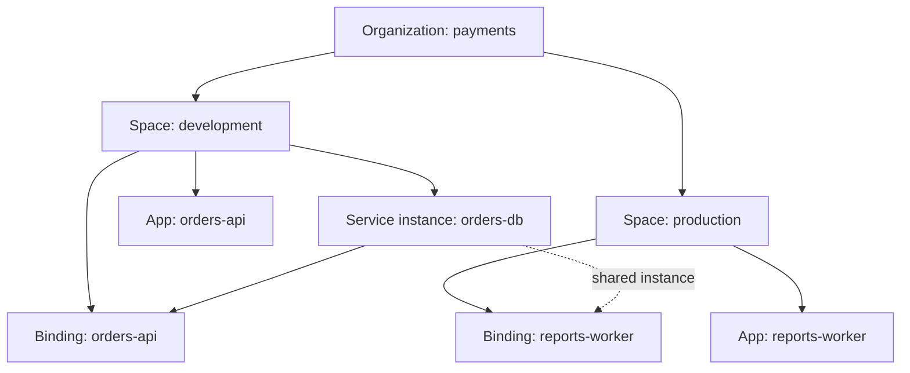
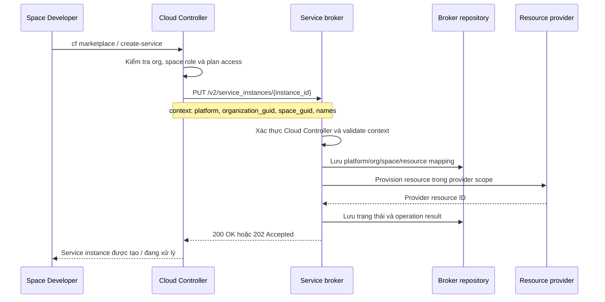

# Đối chiếu context, tổ chức, không gian và quyền truy cập dịch vụ

Khi tích hợp service broker với Cloud Foundry, request Open Service Broker API (OSB API) mang theo thông tin về tổ chức (organization), không gian (space), service instance và ứng dụng consumer. Broker dùng những dữ liệu này để xác định phạm vi tài nguyên, lưu mapping với provider và quyết định binding nào được phép truy cập tài nguyên nào.

Tuy nhiên, ba khái niệm thường bị nhầm lẫn:

1. **Context** mô tả môi trường Cloud Foundry nơi service instance hoặc binding được sử dụng.
2. **Service plan access** quyết định tổ chức hoặc người dùng nào được phép nhìn thấy và provision một plan trên marketplace.
3. **Service instance sharing** cho phép ứng dụng ở space hoặc organization khác bind vào một instance đã tồn tại.

Đây là ba lớp khác nhau. `context` không cấp quyền sử dụng plan; việc plan xuất hiện trong marketplace không chứng minh một instance thuộc space nào; và việc một instance được chia sẻ không có nghĩa mọi app nhận cùng một quyền truy cập. Broker cần đối chiếu đúng từng lớp để tránh cấp nhầm tài nguyên hoặc credentials.

## 1. Mô hình organization, space và service trong Cloud Foundry

Cloud Foundry tổ chức tài nguyên theo cấu trúc organization và space:

- **Organization (org):** tài khoản phát triển cấp cao, nơi các cộng tác viên chia sẻ quota, ứng dụng, khả năng sử dụng service và domain.
- **Space:** vùng làm việc nằm trong một org. Mỗi app, service instance và route thuộc một space. Role được gán ở cấp space chỉ có hiệu lực trong space đó.
- **Service broker:** tích hợp service bên ngoài với Cloud Controller qua Service Broker API.
- **Service offering:** loại dịch vụ được broker công bố, ví dụ PostgreSQL hoặc Redis.
- **Service plan:** cấu hình hoặc mức dịch vụ của một offering, ví dụ `small`, `standard` hoặc `high-availability`.
- **Service instance:** tài nguyên thực tế được provision theo một plan trong một space.
- **Service binding:** liên kết service instance với app hoặc consumer khác để cung cấp credentials hay thông tin kết nối.



Một org có thể có nhiều space. App và service instance thường thuộc một space cụ thể. Nếu broker hỗ trợ service instance sharing, instance được tạo ở một space có thể được bind từ app ở space khác hoặc org khác. Vì vậy, broker cần lưu cả phạm vi gốc của instance và phạm vi consumer của từng binding.

## 2. `context` trong OSB API và Cloud Foundry

OSB định nghĩa `context` là một JSON object chứa thông tin môi trường của platform hoặc application. Đây là object có cấu trúc mở; platform và broker cần thống nhất các field theo profile của platform.

Cloud Foundry profile là hướng dẫn mở rộng theo platform và có tính optional trong OSB API chung. Khi broker tích hợp theo Cloud Foundry profile, hai phía nên tuân thủ các field và semantics được mô tả trong profile để dữ liệu org/space được hiểu thống nhất.

Trong Cloud Foundry profile, field chung bắt buộc của context là:

```json
"platform": "cloudfoundry"
```

Các field Cloud Foundry quan trọng:

| Field | Ý nghĩa | Phiên bản profile giới thiệu | Cách sử dụng |
|---|---|---:|---|
| `organization_guid` | GUID của org gắn với service instance | OSB 2.11 | Khóa phạm vi org; nên lưu làm định danh ổn định |
| `organization_name` | Tên org | OSB 2.15 | Hiển thị, audit và hỗ trợ vận hành |
| `space_guid` | GUID của space gắn với service instance | OSB 2.11 | Khóa phạm vi space gốc |
| `space_name` | Tên space | OSB 2.15 | Hiển thị; tên có thể thay đổi |
| `instance_name` | Tên service instance trong Cloud Foundry | OSB 2.15 | Hiển thị; không dùng làm khóa chính |
| `organization_annotations` | Annotations của org | OSB 2.16 | Metadata bổ sung, có thể thay đổi |
| `space_annotations` | Annotations của space | OSB 2.16 | Metadata bổ sung, có thể thay đổi |
| `instance_annotations` | Annotations của service instance | OSB 2.16 | Metadata bổ sung, có thể thay đổi |

Cloud Foundry profile xác định các field được gửi theo từng endpoint:

| OSB request | Các field context của Cloud Foundry |
|---|---|
| `PUT /v2/service_instances/{instance_id}` | `organization_guid`, `organization_name`, `space_guid`, `space_name`, `instance_name` |
| `PATCH /v2/service_instances/{instance_id}` | `organization_guid`, `organization_name`, `space_guid`, `space_name`, `instance_name` |
| `PUT /v2/service_instances/{instance_id}/service_bindings/{binding_id}` | `organization_guid`, `organization_name`, `space_guid`, `space_name` |

Ví dụ context khi provision:

```json
{
  "context": {
    "platform": "cloudfoundry",
    "organization_guid": "org-8f12",
    "organization_name": "payments",
    "space_guid": "space-91ab",
    "space_name": "production",
    "instance_name": "orders-db",
    "organization_annotations": {
      "example.com/cost-center": "CC-410"
    },
    "space_annotations": {
      "example.com/environment": "production"
    },
    "instance_annotations": {
      "example.com/data-classification": "internal"
    }
  }
}
```

Annotations là optional metadata. Cloud Foundry gửi các annotation này đến broker trên những installation dùng Cloud Controller API v1.108.0 trở lên; không nên giả định mọi phiên bản Cloud Foundry đều gửi đủ các field annotation.

### 2.1. GUID và tên có vai trò khác nhau

GUID là định danh để broker lưu mapping. Tên org, space và instance có thể thay đổi, nên chỉ dùng cho hiển thị hoặc audit.

Ví dụ, org `payments` được đổi tên thành `finance-platform`. GUID của org vẫn là `org-8f12`; broker không được tạo tenant mới hoặc chuyển resource sang provider account khác chỉ vì tên thay đổi.

Một bản ghi broker có thể lưu:

| Field nội bộ | Nguồn | Vai trò |
|---|---|---|
| `platform_id` | Broker xác định từ cấu hình/credential của Cloud Foundry foundation | Phân biệt foundation nếu broker phục vụ nhiều foundation |
| `organization_guid` | `context.organization_guid` | Khóa tenant/org |
| `organization_name` | `context.organization_name` | Tên hiển thị gần nhất |
| `space_guid` | `context.space_guid` | Khóa space gốc của instance |
| `space_name` | `context.space_name` | Tên hiển thị gần nhất |
| `service_instance_id` | ID trong OSB request path | Khóa service instance do platform cấp |
| `instance_name` | `context.instance_name` | Tên hiển thị; có thể được đổi tên |

Không dùng tên org, tên space hoặc tên instance để tạo unique key. Hai org khác nhau có thể có cùng tên; một org cũng có thể đổi tên theo thời gian.

### 2.2. Tương thích field cũ `organization_guid` và `space_guid`

Trong OSB API, các field `organization_guid` và `space_guid` ở cấp cao nhất của request provision đã được đánh dấu deprecated để chuyển sang `context`. Đặc tả khuyến nghị platform gửi cả field cũ và context trong giai đoạn chuyển tiếp nhằm tương thích với implementation cũ và mới.

Broker nên áp dụng các quy tắc:

1. Ưu tiên `context.organization_guid` và `context.space_guid` khi xử lý Cloud Foundry profile.
2. Có thể đọc field top-level cũ để tương thích với platform/client phiên bản cũ.
3. Nếu cả hai dạng cùng xuất hiện, kiểm tra chúng phải khớp nhau.
4. Nếu hai giá trị mâu thuẫn, từ chối request hoặc đưa vào luồng xử lý lỗi rõ ràng; không âm thầm chọn một giá trị.
5. Không lưu hai bản sao như hai tenant khác nhau.

Ví dụ request tương thích có thể chứa:

```json
{
  "service_id": "postgresql",
  "plan_id": "standard",
  "organization_guid": "org-8f12",
  "space_guid": "space-91ab",
  "context": {
    "platform": "cloudfoundry",
    "organization_guid": "org-8f12",
    "organization_name": "payments",
    "space_guid": "space-91ab",
    "space_name": "production",
    "instance_name": "orders-db"
  }
}
```

## 3. Phân biệt context, request identity và quyền truy cập

`context` cho broker biết request thuộc môi trường Cloud Foundry nào và resource gắn với org/space nào. Nó không phải credential và không chứng minh caller có quyền trên org hoặc space đó.

| Thành phần | Mục đích | Không được dùng để |
|---|---|---|
| `context.platform` | Xác định profile platform, ví dụ `cloudfoundry` | Xác thực Cloud Controller |
| `context.organization_guid` | Xác định org gắn với instance | Chứng minh caller là Org Manager |
| `context.space_guid` | Xác định space gắn với instance | Chứng minh caller là Space Developer |
| `X-Broker-API-Originating-Identity` | Chuyển tiếp danh tính người khởi tạo request | Thay thế xác thực platform hoặc kiểm tra role |
| HTTP Basic credential hoặc cơ chế xác thực broker đã cấu hình | Xác thực Cloud Controller/platform khi gọi broker | Tự động cấp quyền cho mọi resource ID |
| `service_id`, `plan_id` | Xác định offering và plan được yêu cầu | Chứng minh plan đã được enable cho org |

Khi đăng ký standard broker, Cloud Controller lưu username/password được cung cấp dưới dạng mã hóa và sử dụng chúng để xác thực các API call đến broker. Broker vẫn phải kiểm tra credential trên từng request; nếu không, người ngoài có thể gọi trực tiếp endpoint để xóa instance hoặc tạo tài nguyên.

Nếu broker phục vụ nhiều Cloud Foundry foundation, `context.platform` vẫn chỉ là chuỗi `cloudfoundry`, không đủ để phân biệt foundation. Có thể dùng URL riêng hoặc credential riêng cho từng foundation. Cloud Foundry cũng cung cấp header `X-Api-Info-Location` chứa URL `/v2/info` của foundation gửi request; broker có thể dùng cơ chế này nếu đã thiết kế mapping và bảo vệ phù hợp.

### 3.1. Originating Identity của Cloud Foundry

Cloud Foundry profile định nghĩa `X-Broker-API-Originating-Identity` với platform value `cloudfoundry`. Phần value là JSON đã serialize và Base64 encode; field bắt buộc là `user_id` lấy từ Cloud Foundry JWT token. Platform có thể gửi thêm thuộc tính khác.

Ví dụ JSON trước khi encode:

```json
{
  "user_id": "683ea748-3092-4ff4-b656-39cacc4d5360"
}
```

Header có dạng:

```http
X-Broker-API-Originating-Identity: cloudfoundry <base64-encoded-json>
```

Đây là danh tính người dùng khởi tạo thao tác, khác với danh tính Cloud Controller dùng để xác thực request đến broker. Broker chỉ nên sử dụng header này sau khi xác thực kênh gọi từ Cloud Foundry và kiểm tra format. Base64 chỉ là encoding, không phải chữ ký hay mã hóa. Nếu header và context cùng xuất hiện, `platform` trong hai nơi phải khớp.

Không phải mọi nghiệp vụ broker đều cần biết người dùng cuối. Nếu broker chỉ cần quản lý tài nguyên theo org/space, có thể lưu `user_id` trong audit khi header có mặt. Nếu cần quyết định quyền theo user, phải có hợp đồng rõ ràng về độ tin cậy và cách xác minh identity; không tự suy ra role từ `user_id`.

## 4. Organization và space quyết định phạm vi tài nguyên

Cloud Foundry sử dụng RBAC để quản lý quyền. Org là vùng chia sẻ quota, service availability và domain. Space là phạm vi chứa app, service instance và route; role ở space chỉ áp dụng trong space tương ứng.

Một số role quan trọng:

| Role | Phạm vi | Quyền liên quan service |
|---|---|---|
| Admin | Toàn foundation | Quản lý global service broker và service plan access |
| Org Manager | Một org | Quản trị org, quota và space; không mặc nhiên được bind service hoặc quản lý app trong space |
| Space Manager | Một space | Quản lý space và các thành viên/thiết lập trong phạm vi được phép |
| Space Developer | Một space | Quản lý app, service; được provision instance và bind service vào app trong space |
| Space Auditor | Một space | Đọc thông tin trong space |
| Space Supporter | Một space, tùy CAPI | Hỗ trợ troubleshoot app và service binding |

Một người dùng có thể có nhiều role. Org Manager không tự động có quyền push app hoặc bind service; các thao tác đó cần role phù hợp ở space, ví dụ Space Developer. UAA client cũng có thể là principal không phải người dùng và được gán org/space role để chạy automation hoặc CI/CD.

Điều này quan trọng với service broker vì request OSB không phải bản sao đầy đủ của Cloud Foundry RBAC. Cloud Controller thực hiện kiểm tra quyền người dùng trước khi chấp nhận thao tác. Broker cần xác thực Cloud Controller, kiểm tra mapping resource và tenant scope của mình; không nên giả định chỉ vì request có `space_guid` là caller đã có Space Developer role.

## 5. Service plan access: ai được phép provision plan?

Service plan access là quyền nhìn thấy và tạo instance của plan trong marketplace. Đây là chính sách do Cloud Foundry quản lý, độc lập với việc broker có service definition/plan trong catalog.

### 5.1. Standard broker

Với standard broker:

- Admin tạo và quản lý broker bằng `cf create-service-broker`.
- Cloud Controller tải catalog từ broker, validate và lưu vào database.
- Service plan mới mặc định ở trạng thái private (`none`).
- Admin phải bật quyền cho tất cả org hoặc một số org/plan cụ thể trước khi user sử dụng.

Ví dụ đăng ký broker:

```bash
cf create-service-broker orders-broker broker-user broker-password https://broker.example.com
```

Cloud Controller gọi catalog và lưu cấu hình broker. Khi broker URL dùng HTTPS, Cloud Controller gọi broker qua HTTPS. Broker phải xác thực username/password mà Cloud Controller gửi trong các request.

### 5.2. Kiểm tra quyền truy cập plan

Admin có thể xem trạng thái bằng:

```bash
cf service-access
```

Lệnh hiển thị trạng thái access:

| Giá trị | Ý nghĩa |
|---|---|
| `all` | Plan công khai cho mọi org/user |
| `none` | Plan private, không org nào được sử dụng |
| `limited` | Plan chỉ khả dụng trong các org được liệt kê |

Để bật plan `standard` cho org `payments`:

```bash
cf enable-service-access postgresql -p standard -o payments
```

Các cách dùng flag:

| Lệnh | Kết quả |
|---|---|
| `cf enable-service-access SERVICE` | Bật tất cả plan của service cho mọi org |
| `cf enable-service-access SERVICE -p PLAN` | Bật một plan cho mọi org |
| `cf enable-service-access SERVICE -o ORG` | Bật tất cả plan của service cho một org |
| `cf enable-service-access SERVICE -p PLAN -o ORG` | Bật một plan cho một org |

Tắt quyền của một plan trong một org:

```bash
cf disable-service-access postgresql -p standard -o payments
```

Các lệnh `enable-service-access` và `disable-service-access` yêu cầu quyền admin. Khi plan được enable cho một org, user trong org nhìn thấy plan qua `cf marketplace`; Space Developer trong space của org có thể provision instance của plan đó.

Nếu nhiều broker công bố service trùng tên, cần dùng thêm `-b BROKER` để xác định broker đích.

### 5.3. Space-scoped broker

Cloud Foundry hỗ trợ space-scoped broker. Broker loại này được đăng ký trong một space bởi Space Developer bằng tùy chọn `--space-scoped`:

```bash
cf create-service-broker local-orders-broker broker-user broker-password https://broker.example.com --space-scoped
```

Các plan của space-scoped broker chỉ hiển thị cho user trong space nơi broker được tạo. Quyền hiển thị không được quản lý riêng bằng `cf enable-service-access`; plan mới được công bố cho các user trong space đó.

Không nhầm standard broker với space-scoped broker. Standard broker phù hợp với dịch vụ được admin quản lý và phân phối cho nhiều org; space-scoped broker phù hợp với broker do Space Developer quản lý trong một space.

### 5.4. Service plan access không phải service instance sharing

Hai tính năng có mục đích khác nhau:

| Cơ chế | Câu hỏi được trả lời | Phạm vi |
|---|---|---|
| Service plan access | Org nào được nhìn thấy và tạo instance mới từ plan? | Marketplace/plan access |
| Service instance sharing | App ở space/org nào được bind vào một instance đã tạo? | Một service instance cụ thể |

Enable plan cho org không tự chia sẻ instance đã có. Share instance cũng không tự làm mọi plan của service xuất hiện trong marketplace của org đích.

## 6. Luồng provision từ marketplace đến broker

Một luồng điển hình:



Cloud Controller kiểm tra user có thể sử dụng plan trong org/space trước khi gọi broker. Broker vẫn phải validate:

- `service_id` có phải offering broker đang quản lý không.
- `plan_id` có thuộc service definition tương ứng và đang được broker hỗ trợ không.
- `organization_guid` và `space_guid` có hợp lệ theo profile không.
- Instance ID đã tồn tại chưa và có thuộc cùng platform/org/space không.
- Parameters có hợp lệ theo schema/policy của plan không.
- Provider account/region/namespace nào sẽ được dùng cho org/space đó.

Ví dụ CLI:

```bash
cf target -o payments -s production
cf marketplace
cf create-service postgresql standard orders-db
cf services
```

`cf marketplace` chỉ hiển thị service/plan mà org hiện tại được phép truy cập. `cf create-service` gửi yêu cầu provision và Cloud Controller chuyển context phù hợp đến broker.

## 7. Binding và service instance sharing

Khi app được bind với instance, Cloud Foundry gửi request tạo binding. Context của binding mô tả org/space gắn với service instance; `bind_resource` mô tả consumer/platform resource được bind.

Ví dụ binding trong cùng space:

```json
{
  "service_id": "postgresql",
  "plan_id": "standard",
  "context": {
    "platform": "cloudfoundry",
    "organization_guid": "org-8f12",
    "organization_name": "payments",
    "space_guid": "space-91ab",
    "space_name": "production"
  },
  "bind_resource": {
    "app_guid": "app-10aa",
    "space_guid": "space-91ab",
    "app_annotations": {
      "example.com/team": "orders"
    }
  }
}
```

Trong Cloud Foundry profile:

- `bind_resource.app_guid` là GUID của app liên quan đến binding và duy nhất trong phạm vi platform.
- `bind_resource.space_guid` là space chứa app được bind, nếu platform gửi field này.
- `bind_resource.app_annotations` là metadata annotations của app, được gửi bởi các phiên bản Cloud Controller hỗ trợ.
- `context.space_guid` là space nơi service instance được tạo.

`app_annotations` là optional metadata của ứng dụng, không phải bằng chứng quyền truy cập. Broker có thể dùng nó cho routing, policy metadata hoặc audit sau khi xác thực request; không dùng annotation để thay thế kiểm tra platform role.

Nếu hai space GUID giống nhau, app nằm trong space gốc của instance. Nếu khác nhau, có thể đây là binding đến một instance đã được chia sẻ.

### 7.1. Bật service instance sharing

Broker phải chủ động công bố service offering có thể share bằng metadata Cloud Foundry-specific:

```json
{
  "services": [
    {
      "id": "postgresql",
      "name": "postgresql",
      "description": "Managed PostgreSQL",
      "bindable": true,
      "metadata": {
        "shareable": true
      },
      "plans": [
        {
          "id": "standard",
          "name": "standard",
          "description": "Standard PostgreSQL plan"
        }
      ]
    }
  ]
}
```

`metadata.shareable` là extension của Cloud Foundry. Nếu giá trị là `false` hoặc không có, service instance sharing bị tắt. Đây không phải field bắt buộc của OSB API chung.

Khi instance được tạo ở `development` và chia sẻ sang `production`, app trong cả hai space có thể bind vào cùng instance nếu platform cho phép. Broker nên phân biệt nguồn và consumer:

```text
context.space_guid      = space-development
bind_resource.space_guid = space-production
```

### 7.2. Cấp quyền binding theo space

Broker có thể cấp credentials khác nhau tùy app được bind từ space gốc hay space được chia sẻ.

Ví dụ cho dịch vụ messaging:

| Binding từ | Quyền có thể cấp |
|---|---|
| Space gốc `development` | Read và write |
| Space được chia sẻ `production` | Chỉ read |
| Không xác định được consumer space | Không tự suy đoán quyền; xử lý theo policy hoặc từ chối nếu field bắt buộc |

Điều này giúp app trong space chia sẻ không có quyền ghi hoặc quản trị dữ liệu mà app ở space gốc sở hữu. Broker có thể dùng `app_guid` để tạo credential riêng cho mỗi binding và lưu quan hệ giữa binding, instance và consumer.

Không nên chỉ cấp một database admin user dùng chung cho mọi binding. Nếu mỗi binding có credentials riêng, broker có thể thu hồi quyền của một app mà không làm gián đoạn các app khác.

### 7.3. Service key và CredHub

Cloud Foundry có thể tạo service key mà không gắn với app. Trong trường hợp request là service key, `bind_resource` có thể chứa:

```json
{
  "credential_client_id": "cc_service_key_client"
}
```

Field `credential_client_id` là CredHub client ID mà broker cần cấp quyền đọc nếu broker chọn lưu credentials trong CredHub và trả về reference thay vì credentials plaintext. Broker phải được cấu hình quyền CredHub out-of-band và cấp quyền đọc cho đúng client ID. Không nhầm `credential_client_id` với `app_guid`: một field phục vụ service key/CredHub, field kia định danh app binding.

### 7.4. Hành vi khi unshare

Cloud Foundry có thể xóa các binding và thu hồi quyền truy cập credentials tương ứng khi unshare một service instance. Tuy nhiên, service key có quy tắc riêng: chỉ developer có quyền ở space gốc mới có thể tạo service key, và unshare không tự xóa các service key đã tồn tại. Broker cần thiết kế credential lifecycle và cleanup phù hợp, không giả định unshare luôn xóa mọi dạng credential.

## 8. Xử lý context trong Spring Cloud Open Service Broker

Spring Cloud Open Service Broker cung cấp request model cho các operation OSB. Broker nên tách việc đọc context thành một adapter riêng, sau đó chuyển sang model nội bộ ổn định. Không rải việc đọc raw JSON map ở nhiều service implementation.

### 8.1. Model Cloud Foundry context nội bộ

Ví dụ model ứng dụng:

```java
public record CloudFoundryScope(
        String organizationGuid,
        String organizationName,
        String spaceGuid,
        String spaceName,
        String instanceName) {
}
```

`CloudFoundryScope` là model do ứng dụng định nghĩa, không phải class OSB bắt buộc. Adapter đọc `context` từ request model của framework và chuyển thành `Map<String, Object>` hoặc DTO tương đương.

### 8.2. Validate và chuẩn hóa context

Ví dụ resolver dùng `Map` để minh họa quy tắc kiểm tra. `legacyOrganizationGuid` và `legacySpaceGuid` là các field top-level cũ nếu request model có cung cấp:

```java
import java.util.Map;
import java.util.Objects;

public final class CloudFoundryContextResolver {

    public CloudFoundryScope resolve(
            Map<String, Object> context,
            String legacyOrganizationGuid,
            String legacySpaceGuid) {

        if (context == null || !"cloudfoundry".equals(context.get("platform"))) {
            throw new IllegalArgumentException("Unsupported or missing platform context");
        }

        String organizationGuid = consistentValue(
                text(context, "organization_guid"),
                legacyOrganizationGuid,
                "organization_guid");

        String spaceGuid = consistentValue(
                text(context, "space_guid"),
                legacySpaceGuid,
                "space_guid");

        return new CloudFoundryScope(
                required(organizationGuid, "organization_guid"),
                required(text(context, "organization_name"), "organization_name"),
                required(spaceGuid, "space_guid"),
                required(text(context, "space_name"), "space_name"),
                required(text(context, "instance_name"), "instance_name"));
    }

    private static String text(Map<String, Object> source, String key) {
        Object value = source.get(key);
        return value instanceof String string ? string : null;
    }

    private static String consistentValue(String contextValue,
                                          String legacyValue,
                                          String field) {
        if (contextValue != null && legacyValue != null
                && !Objects.equals(contextValue, legacyValue)) {
            throw new IllegalArgumentException("Conflicting " + field + " values");
        }
        return contextValue != null ? contextValue : legacyValue;
    }

    private static String required(String value, String field) {
        if (value == null || value.isBlank()) {
            throw new IllegalArgumentException("Missing " + field);
        }
        return value;
    }
}
```

Đây là resolver minh họa cho Cloud Foundry profile. Trong ứng dụng thực tế, nên dùng exception validation/domain phù hợp để framework ánh xạ thành lỗi OSB. Nếu broker phải hỗ trợ client Cloud Foundry cũ không gửi đủ context field, tạo một compatibility policy riêng và chỉ cho phép fallback đã được xác định; không âm thầm nhận một context thiếu hoặc mâu thuẫn.

### 8.3. Gắn scope vào provision

Service implementation có thể gọi resolver qua adapter:

```java
@Service
public class CloudFoundryInstanceService implements ServiceInstanceService {

    private final CloudFoundryRequestContextMapper contextMapper;
    private final CloudFoundryContextResolver contextResolver;
    private final InstanceProvisioner provisioner;

    public CloudFoundryInstanceService(
            CloudFoundryRequestContextMapper contextMapper,
            CloudFoundryContextResolver contextResolver,
            InstanceProvisioner provisioner) {
        this.contextMapper = contextMapper;
        this.contextResolver = contextResolver;
        this.provisioner = provisioner;
    }

    @Override
    public Mono<CreateServiceInstanceResponse> createServiceInstance(
            CreateServiceInstanceRequest request) {

        return Mono.fromSupplier(() -> contextResolver.resolve(
                        contextMapper.toMap(request),
                        contextMapper.legacyOrganizationGuid(request),
                        contextMapper.legacySpaceGuid(request)))
                .flatMap(scope -> provisioner.provision(
                        request.getServiceInstanceId(),
                        request.getServiceDefinitionId(),
                        request.getPlanId(),
                        scope,
                        request.getParameters()));
    }
}
```

`CloudFoundryRequestContextMapper` và `InstanceProvisioner` là abstraction do ứng dụng xây dựng. Mapper chịu trách nhiệm chuyển model context của phiên bản Spring Cloud Open Service Broker đang dùng sang `Map`; nhờ vậy, logic nghiệp vụ không phụ thuộc chi tiết cách framework biểu diễn context. Code trên chỉ minh họa luồng create; class production cần triển khai các phương thức `ServiceInstanceService` khác theo catalog và capability đã công bố.

Trong repository, lưu GUID làm khóa và lưu name/annotations như metadata có thể cập nhật. Khi nhận request update chỉ thay đổi tên hoặc annotations, broker có thể cập nhật metadata nội bộ mà không tạo provider resource mới.

### 8.4. Xử lý context khi bind service instance được share

Tạo một model binding riêng:

```java
public enum BindingLocation {
    ORIGIN_SPACE,
    SHARED_SPACE,
    UNKNOWN
}

public record CloudFoundryBindingScope(
        String instanceOrganizationGuid,
        String instanceSpaceGuid,
        String consumerSpaceGuid,
        String appGuid,
        BindingLocation location) {
}
```

Resolver cần phân biệt `context.space_guid` và `bind_resource.space_guid`:

```java
public CloudFoundryBindingScope resolveBinding(
        CloudFoundryScope instanceScope,
        String consumerSpaceGuid,
        String appGuid) {

    BindingLocation location = consumerSpaceGuid == null
            ? BindingLocation.UNKNOWN
            : instanceScope.spaceGuid().equals(consumerSpaceGuid)
                    ? BindingLocation.ORIGIN_SPACE
                    : BindingLocation.SHARED_SPACE;

    return new CloudFoundryBindingScope(
            instanceScope.organizationGuid(),
            instanceScope.spaceGuid(),
            consumerSpaceGuid,
            appGuid,
            location);
}
```

Nếu `consumerSpaceGuid` không được gửi, kết quả là `UNKNOWN`, không được coi là shared-space hay origin-space. Nếu policy cần biết consumer space, hãy từ chối hoặc yêu cầu platform cung cấp field đó.

Sau khi xác định scope, binding use case chọn role/permission cho credential. Ví dụ app trong origin space được quyền read-write, app trong shared space chỉ read-only. Không nên suy ra quyền chỉ từ tên space hoặc `app_guid`.

## 9. Context có thể thay đổi theo thời gian

Cloud Foundry cho phép đổi tên org, space và service instance. Annotations cũng có thể được thêm, sửa hoặc xóa. Vì vậy, context không phải snapshot bất biến của toàn bộ thông tin hiển thị.

Broker nên phân loại:

| Field | Có thể thay đổi? | Cách lưu |
|---|---|---|
| `organization_guid` | Không nên xem là giá trị đổi khi rename | Stable org identity |
| `space_guid` | Không nên xem là giá trị đổi khi rename | Stable space identity |
| `organization_name` | Có | Cập nhật display metadata |
| `space_name` | Có | Cập nhật display metadata |
| `instance_name` | Có | Cập nhật display metadata |
| `organization_annotations` | Có | Thay snapshot metadata theo policy |
| `space_annotations` | Có | Thay snapshot metadata theo policy |
| `instance_annotations` | Có | Thay snapshot metadata theo policy |

Nếu broker hỗ trợ platform gửi update chỉ để thay đổi context, broker phải công bố `allow_context_updates: true` trong catalog endpoint theo OSB profile. Khi nhận context-only update, chỉ cập nhật các metadata được phép; không diễn giải việc tên org hoặc space thay đổi thành yêu cầu migrate provider resource.

Nếu GUID thay đổi bất ngờ, đây không phải rename thông thường. Broker cần xác minh request, mapping và chính sách move/share của platform trước khi cập nhật tenant scope. Không chuyển ownership của resource chỉ vì một request mới mang GUID khác.

## 10. Bảo vệ context và tenant boundary

Context do platform gửi qua request body. Broker chỉ nên tin nó sau khi đã xác thực Cloud Controller bằng credential đã đăng ký hoặc cơ chế tương đương. Các biện pháp quan trọng:

1. Xác thực mọi request đến endpoint broker; không chỉ bảo vệ provision mà bỏ qua bind, update hoặc delete.
2. Gắn platform/foundation ID với credential hoặc endpoint đã xác thực; không dùng `platform: cloudfoundry` để phân biệt nhiều foundation.
3. Query repository theo platform ID + org GUID + instance ID, không chỉ theo instance ID.
4. Với binding, kiểm tra instance owner scope và consumer scope riêng.
5. Không dùng org/space name làm authorization key.
6. Không tin annotations như role hoặc quyền. Annotation là metadata do platform quản lý, không phải credential.
7. Không log raw parameters, credentials hoặc originating identity nếu không cần thiết.
8. Khi context và legacy fields mâu thuẫn, từ chối request và ghi audit đã redact.

Nếu broker cần gọi Cloud Controller API để đọc thêm dữ liệu, dùng UAA client riêng và cấp role tối thiểu. Cloud Foundry hỗ trợ UAA client không phải người dùng với client credentials; có thể gán org/space roles cho client. Không dùng token admin toàn foundation chỉ để tra cứu một org hoặc space.

## 11. Kiểm thử đối chiếu org, space và service access

Nên kiểm thử cả request OSB và cấu hình marketplace Cloud Foundry:

| Tình huống | Kết quả mong đợi |
|---|---|
| Provision với context `platform=cloudfoundry` và GUID hợp lệ | Broker lưu đúng platform/org/space scope |
| Thiếu `organization_guid` hoặc `space_guid` theo profile | Request bị từ chối rõ ràng |
| Context và legacy top-level GUID giống nhau | Request được chuẩn hóa thành một scope |
| Context và legacy GUID khác nhau | Request bị từ chối; không gọi provider |
| Org hoặc space đổi tên, GUID giữ nguyên | Cập nhật display metadata, không tạo tenant/resource mới |
| Annotation không được gửi từ CAPI cũ | Broker vẫn xử lý được vì annotation optional |
| Standard broker plan chưa enable | Plan không xuất hiện cho user org và không thể provision từ marketplace |
| Admin enable plan cho một org | Space Developer trong org nhìn thấy plan và có thể provision trong space |
| Org Manager không có Space Developer role | Không mặc định cho phép bind hoặc instantiate service trong space |
| Space-scoped broker | Plan chỉ hiển thị trong space đăng ký broker |
| Instance shareable, app bind từ origin space | Broker nhận diện consumer trong space gốc |
| Instance shareable, app bind từ space khác | Broker so sánh `context.space_guid` với `bind_resource.space_guid` và áp dụng policy shared-space |
| Service key có `credential_client_id` | Broker cấp quyền CredHub cho đúng client nếu dùng credential reference |
| Một foundation khác gọi cùng broker URL/credential không được phân biệt | Kiến trúc phải bổ sung URL hoặc credential riêng trước khi dùng multi-foundation |

Ví dụ kiểm thử resolver:

```java
class CloudFoundryContextResolverTests {

    private final CloudFoundryContextResolver resolver =
            new CloudFoundryContextResolver();

    @Test
    void rejectsConflictingLegacyAndContextGuids() {
        Map<String, Object> context = Map.of(
                "platform", "cloudfoundry",
                "organization_guid", "org-a",
                "organization_name", "payments",
                "space_guid", "space-a",
                "space_name", "production",
                "instance_name", "orders-db");

        assertThatThrownBy(() -> resolver.resolve(context, "org-b", "space-a"))
                .isInstanceOf(IllegalArgumentException.class)
                .hasMessageContaining("organization_guid");
    }
}
```

Test trên dùng JUnit và AssertJ; import và test fixture có thể được bổ sung theo cấu hình project. Ngoài unit test, nên có integration test với Cloud Controller hoặc test environment để xác minh service access, role và sharing được platform áp dụng đúng.

## 12. Lỗi thường gặp

| Lỗi | Hậu quả | Cách xử lý |
|---|---|---|
| Dùng `organization_name` làm tenant ID | Rename org có thể tạo tenant mới hoặc mất mapping | Dùng `organization_guid` |
| Dùng `space_name` làm resource scope | Space rename làm lệch ownership | Dùng `space_guid` |
| Coi context là authentication | Caller giả mạo org/space trong JSON | Xác thực Cloud Controller và kiểm tra resource ownership |
| Coi `context.platform` là foundation ID | Nhiều Cloud Foundry foundation bị gộp chung | Dùng URL hoặc credential riêng cho từng foundation |
| Nhầm service plan access với instance sharing | Mở plan không đúng org hoặc cấp quyền binding quá rộng | Quản lý hai cơ chế riêng |
| Cho rằng Org Manager tự có quyền bind service | User có thể bị từ chối thao tác trong space | Kiểm tra Space Developer hoặc role phù hợp |
| Chỉ lưu context của instance, bỏ consumer space | Không thể phân biệt binding từ origin/shared space | Lưu `bind_resource.space_guid` và app GUID theo binding |
| Coi annotation là quyền | Metadata có thể thay đổi và không phải bằng chứng role | Chỉ dùng annotation cho policy metadata đã xác minh |
| Mọi binding dùng chung credentials | Unbind một app ảnh hưởng app khác | Credentials riêng cho mỗi binding khi phù hợp |
| Coi `credential_client_id` là app GUID | Cấp quyền CredHub sai principal | Phân biệt service key và app binding |
| Cho rằng disable plan sẽ xóa instance cũ | Có thể gây cleanup sai hoặc gián đoạn không mong muốn | Phân biệt quyền provision mới với lifecycle instance hiện có |

## 13. Checklist triển khai

- [ ] Xác thực Cloud Controller trước khi xử lý OSB request.
- [ ] Đọc `context.platform` và xác nhận là `cloudfoundry` khi áp dụng Cloud Foundry profile.
- [ ] Lưu org/space GUID làm định danh; tên chỉ dùng hiển thị.
- [ ] Kiểm tra context GUID với top-level legacy GUID khi cả hai cùng có mặt.
- [ ] Xử lý annotation như metadata optional, không phải quyền truy cập.
- [ ] Gắn platform/foundation ID với credential hoặc URL đã xác thực.
- [ ] Kiểm tra service plan access ở Cloud Foundry trước khi provision.
- [ ] Phân biệt standard broker và space-scoped broker.
- [ ] Hiểu role Space Developer, Space Manager, Org Manager và Admin.
- [ ] Nếu hỗ trợ sharing, công bố `metadata.shareable: true` và kiểm tra consumer space khi bind.
- [ ] Lưu riêng origin space và consumer space của binding.
- [ ] Cấp credentials theo binding và revoke đúng scope khi unbind/unshare.
- [ ] Chỉ dùng `credential_client_id` cho luồng service key/CredHub tương ứng.
- [ ] Nếu hỗ trợ context-only update, công bố `allow_context_updates: true`.
- [ ] Kiểm thử rename, plan access, role, sharing, multi-foundation và context conflict.

## 14. Tài liệu tham khảo

- [Open Service Broker API v2.17 Specification](https://github.com/cloudfoundry/servicebroker/blob/v2.17/spec.md)
- [Open Service Broker API Profile — Cloud Foundry Context Object](https://github.com/cloudfoundry/servicebroker/blob/master/profile.md#cloud-foundry-context-object)
- [Cloud Foundry — Managing Service Brokers](https://docs.cloudfoundry.org/services/managing-service-brokers.html)
- [Cloud Foundry — Managing access to Service Plans](https://docs.cloudfoundry.org/services/access-control.html)
- [Cloud Foundry — Orgs, spaces, roles, and permissions](https://docs.cloudfoundry.org/concepts/roles.html)
- [Cloud Foundry — Service Instance sharing](https://docs.cloudfoundry.org/services/enable-sharing.html)
- [Cloud Foundry — Using metadata](https://docs.cloudfoundry.org/adminguide/metadata.html)
- [Cloud Foundry — Managing service instances with the cf CLI](https://docs.cloudfoundry.org/devguide/services/managing-services.html)

Các field `context`, `bind_resource` và `X-Broker-API-Originating-Identity` trong bài dựa trên Open Service Broker API Profile cho Cloud Foundry. Quyền marketplace, service plan access, role và sharing dựa trên tài liệu Cloud Foundry; hành vi cụ thể có thể khác theo phiên bản Cloud Controller và cf CLI mà foundation đang vận hành.
