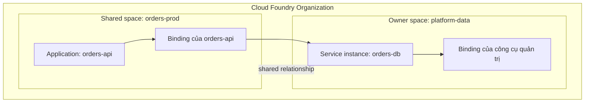
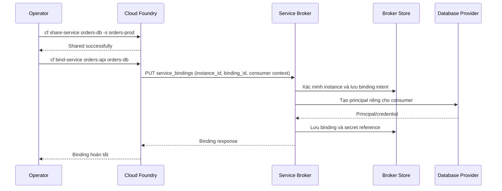
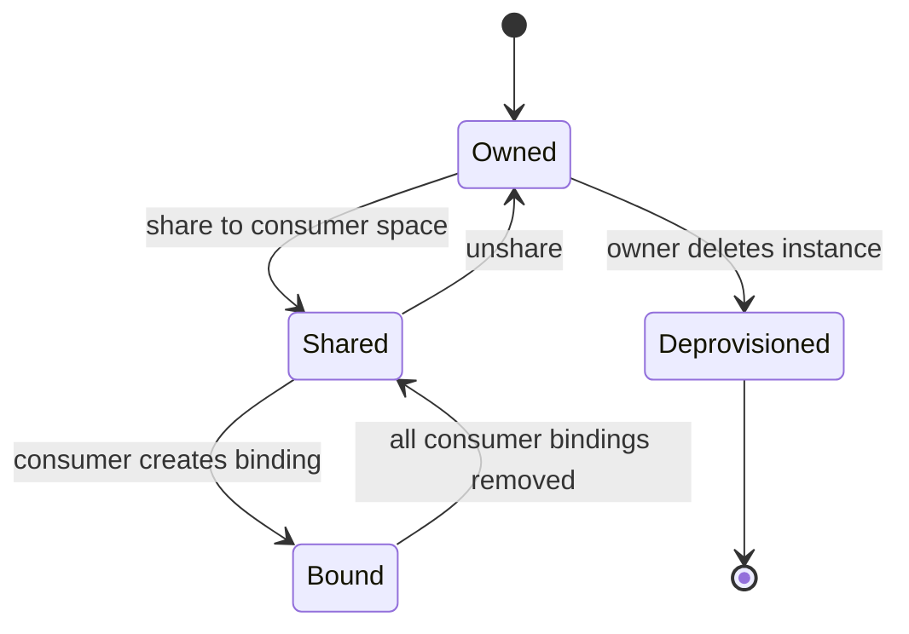
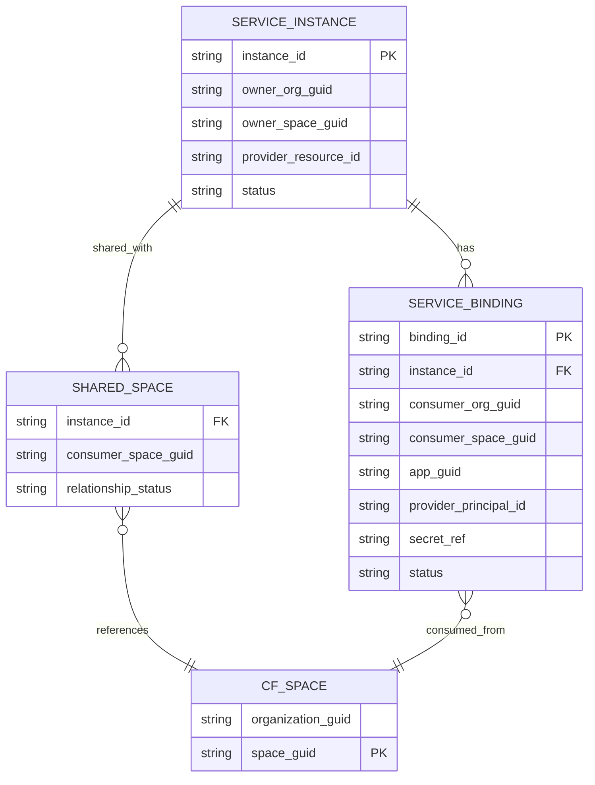

# Chia sẻ service instance giữa các space và ảnh hưởng đến phân quyền

Trong Cloud Foundry, một service instance thường được tạo trong một space và được quản lý theo vòng đời tại space đó. Khi nhiều ứng dụng ở các space khác nhau cần dùng cùng một dịch vụ, nền tảng có thể chia sẻ service instance từ space sở hữu sang các space tiêu thụ. Cách này cho phép nhiều nhóm dùng chung một tài nguyên đã cấp phát, đồng thời vẫn giữ một định danh instance và một nơi quản lý vòng đời.

Chia sẻ service instance ảnh hưởng trực tiếp đến phân quyền. Space sở hữu (owner space) chịu trách nhiệm quản lý instance; space được chia sẻ (consumer/shared space) có thể nhìn thấy và tạo binding cho ứng dụng theo quyền được cấp. Quyền sử dụng một binding không đồng nghĩa với quyền update, unshare hoặc deprovision instance. Service broker cần hiểu sự khác biệt giữa nơi sở hữu instance và nơi phát sinh binding để cấp credentials đúng consumer, thu hồi đúng quyền và không xóa nhầm tài nguyên dùng chung.

Với `SPRING_CLOUD_SERVICE_BROKER`, Cloud Foundry điều phối quan hệ chia sẻ ở control plane. Broker vẫn quản lý một service instance theo OSB API, nhưng có thể nhận nhiều binding được tạo từ các space khác nhau. Vì vậy, dữ liệu context và consumer identity của từng binding phải được lưu riêng.

## 1. Service instance sharing giải quyết vấn đề gì?

Giả sử một tổ chức có hai space:

- `platform-data`: space của nhóm nền tảng, nơi tạo service instance PostgreSQL `orders-db`.
- `orders-prod`: space chạy backend production, cần kết nối đến `orders-db`.

Nếu không có chia sẻ, nhóm backend có thể phải yêu cầu tạo một database khác trong `orders-prod`. Điều này làm tăng tài nguyên, chi phí, dữ liệu phải đồng bộ và công việc vận hành. Khi service instance sharing được bật, owner space có thể chia sẻ `orders-db` sang `orders-prod`. Ứng dụng trong `orders-prod` sau đó bind đến instance đã được chia sẻ.



Điểm quan trọng là `orders-db` vẫn là một instance. Chia sẻ không tạo thêm database, không nhân đôi service instance và không tự động sao chép dữ liệu. Nó mở rộng phạm vi space có thể sử dụng instance theo chính sách của foundation.

## 2. Phân biệt owner space và consumer space

Hai vai trò space có trách nhiệm khác nhau:

| Khái niệm | Vai trò | Ví dụ |
|---|---|---|
| Owner space | Space nơi service instance được tạo và quản lý | `platform-data` |
| Shared/consumer space | Space được cấp quyền sử dụng instance | `orders-prod` |
| Service instance | Tài nguyên dịch vụ duy nhất được chia sẻ | `orders-db` |
| Consumer application | Ứng dụng bind đến instance trong consumer space | `orders-api` |
| Service binding | Quan hệ và credentials dành cho một consumer | Binding của `orders-api` |

Owner space giữ quyền quản lý vòng đời instance theo mô hình Cloud Foundry. Consumer space sử dụng instance trong phạm vi được chia sẻ và có thể tạo binding cho ứng dụng nếu có quyền phù hợp. Người dùng ở consumer space không tự động trở thành owner và không nhận quyền quản trị tài nguyên provider.

Đối với broker, cần lưu owner context khi provision và consumer context cho từng binding. Không ghi đè owner space bằng space của ứng dụng vừa bind.

## 3. Điều kiện nền tảng để bật service instance sharing

Service instance sharing là tính năng do Cloud Foundry foundation cung cấp. Hành vi thực tế phụ thuộc phiên bản Cloud Controller, cấu hình operator, feature flag và phiên bản CF CLI/API.

Trước khi triển khai, quản trị viên nền tảng cần xác nhận:

- Foundation có hỗ trợ service instance sharing hay không.
- Tính năng sharing đã được operator bật hay chưa; một số foundation quản lý bằng feature flag `service_instance_sharing`.
- Service instance thuộc loại được phép chia sẻ theo phiên bản nền tảng.
- Owner và consumer space thuộc phạm vi tổ chức mà foundation cho phép chia sẻ; cơ chế Cloud Foundry phổ biến là chia sẻ giữa các space trong cùng organization.
- Người thực hiện có role phù hợp ở source space và target space.
- Service broker và plan tương ứng đáp ứng các yêu cầu của nền tảng khi có nhiều consumer.

Nếu tính năng sharing chưa bật, lệnh `cf share-service` có thể bị từ chối dù service instance và broker đều hoạt động bình thường. Đây là khác biệt giữa khả năng của control plane và khả năng provision/bind của broker.

## 4. Chia sẻ service instance bằng CF CLI

Giả sử người vận hành đã target đúng foundation và organization. Để chia sẻ instance `orders-db` từ space hiện tại sang `orders-prod`, dùng lệnh:

```bash
cf share-service orders-db -s orders-prod
```

Lệnh này tạo quan hệ chia sẻ giữa instance và target space. Nó không gọi một lệnh provision mới đến broker. Sau khi chia sẻ thành công, người dùng có quyền trong `orders-prod` có thể nhìn thấy instance và bind ứng dụng theo policy của nền tảng.

Để kiểm tra:

```bash
cf target
cf services
cf service orders-db
```

Kết quả hiển thị phụ thuộc space đang target và phiên bản CF CLI. Trong owner space, người vận hành kiểm tra instance gốc và danh sách shared spaces theo thông tin mà CLI/API cung cấp. Trong consumer space, instance được chia sẻ có thể xuất hiện trong danh sách service instance có thể bind.

Để gỡ chia sẻ khỏi target space:

```bash
cf unshare-service orders-db -s orders-prod
```

Trước khi unshare, cần kiểm tra binding còn tồn tại trong target space. Một số phiên bản hoặc trạng thái nền tảng có thể từ chối unshare khi instance vẫn được bind; hãy gỡ binding theo quy trình của ứng dụng trước rồi thử lại. Không giả định unshare sẽ tự động thu hồi mọi credential tại provider nếu control plane chưa hoàn tất vòng đời binding.

## 5. Chia sẻ khác với service access và catalog visibility

Cloud Foundry có nhiều lớp quyền thường bị nhầm lẫn:

| Cơ chế | Quyết định điều gì? | Có tạo quyền dùng một instance cụ thể không? |
|---|---|---|
| Catalog visibility/service access | Tổ chức có được nhìn thấy hoặc được cấp quyền sử dụng offering/plan trong marketplace không | Không |
| Service instance sharing | Một service instance đã tạo có được hiển thị cho space khác trong phạm vi được phép không | Có, với instance cụ thể |
| Service binding | Ứng dụng/consumer được cấp thông tin kết nối và quyền truy cập nào | Có, ở cấp consumer |
| Organization/space RBAC | Người dùng được thực hiện hành động quản trị nào | Không tự tạo binding hoặc credential |

Ví dụ, bật service access cho plan PostgreSQL làm cho organization có thể chọn plan đó khi tạo instance. Nó không tự chia sẻ `orders-db` hiện có sang `orders-prod`. Ngược lại, chia sẻ `orders-db` không làm mọi plan trong catalog trở nên nhìn thấy hoặc cho phép consumer space tạo thêm instance tùy ý.

Broker cần phân biệt các lớp này khi điều tra lỗi: không nhìn thấy offering là vấn đề catalog/access; nhìn thấy instance nhưng không bind được có thể là sharing/RBAC/bindability; bind thành công nhưng kết nối thất bại có thể là credentials, network hoặc provider policy.

## 6. Ảnh hưởng đến OSB service instance

Trong OSB API, service instance có một `instance_id` do nền tảng quản lý. Việc chia sẻ trong Cloud Foundry không nên được broker diễn giải thành một lần provision thứ hai với ID khác. Broker tiếp tục quản lý cùng instance và provider resource.

Điều này có một số hệ quả:

- Provision được thực hiện trong owner space và tạo một instance record.
- Quan hệ shared space do Cloud Foundry control plane quản lý.
- Consumer space có thể gửi yêu cầu bind đến cùng service instance ID.
- Broker tạo binding record riêng cho từng `binding_id` và consumer.
- Update/deprovision instance vẫn chịu quyền và vòng đời của owner, không phải quyền mặc định của mọi consumer.
- Unshare là thay đổi quan hệ chia sẻ ở nền tảng; nó không tương đương deprovision.

Broker không nên tự tạo bản sao database hoặc tự nhân đôi `service_instance_id` chỉ vì nhận thấy một binding đến từ space khác. Việc nhân bản sẽ phá vỡ semantics của sharing và có thể dẫn đến dữ liệu phân tán ngoài ý muốn.

## 7. Context của owner và consumer trong request

OSB API cho phép nền tảng truyền `context` trong request. Với Cloud Foundry, context thường chứa thông tin nền tảng như organization và space; binding request có thể mang context của consumer đang yêu cầu bind. Cấu trúc cụ thể phụ thuộc phiên bản Cloud Foundry và cách tích hợp.

Broker nên phân biệt:

- **Provision context:** ngữ cảnh nơi instance được tạo; dùng để lưu owner organization/space đã xác minh.
- **Binding context:** ngữ cảnh của consumer thực hiện bind; có thể là một space được chia sẻ.
- **Bind resource:** thông tin resource tiêu thụ, ví dụ `app_guid` khi binding cho ứng dụng.

Ví dụ model nội bộ:

```java
public record CloudFoundrySpaceRef(
        String organizationGuid,
        String spaceGuid) {
}

public record ServiceInstanceOwnership(
        String instanceId,
        CloudFoundrySpaceRef ownerSpace) {
}

public record BindingConsumerContext(
        String bindingId,
        String instanceId,
        CloudFoundrySpaceRef consumerSpace,
        String applicationGuid) {
}
```

Đây là model minh họa. Adapter cần đọc context từ đúng request model của Spring Cloud Open Service Broker và xác minh nguồn dữ liệu theo trust boundary. Không dùng organization/space GUID do client tùy ý gửi làm bằng chứng quyền sở hữu.

## 8. Binding từ consumer space

Khi ứng dụng trong `orders-prod` bind đến `orders-db` đã được chia sẻ, Cloud Foundry chuyển request binding đến broker theo OSB API. Broker cần xử lý như một binding mới trên cùng instance.

Luồng minh họa:



Broker cần kiểm tra service instance tồn tại, đang ở trạng thái cho phép bind và plan hỗ trợ binding. Consumer context phải được lưu cùng binding để audit, áp dụng policy và thu hồi đúng quyền khi unbind.

Không phải mọi service đều cần tạo một user database mới cho mỗi binding; một số provider có cơ chế policy hoặc token riêng. Tuy nhiên, nếu credentials được chia sẻ giữa các consumer, broker phải hiểu tác động khi một consumer bị thu hồi. Credential riêng theo binding thường giúp phân quyền và thu hồi chính xác hơn.

## 9. Phân quyền người dùng Cloud Foundry

Chia sẻ instance không thay thế RBAC của Cloud Foundry. Người dùng cần role phù hợp để chia sẻ hoặc sử dụng instance. Quyền chính xác có thể thay đổi theo phiên bản foundation và cấu hình, nhưng mô hình vận hành thường là:

| Chủ thể | Quyền cần thiết | Giới hạn |
|---|---|---|
| Operator/foundation admin | Bật tính năng sharing và quản trị cấu hình nền tảng | Quyền quản trị cấp foundation |
| Space Developer ở owner space | Quản lý instance và thực hiện share theo policy | Không tự có quyền quản trị toàn organization |
| Space Developer ở consumer space | Quản lý ứng dụng và bind instance đã được chia sẻ | Không trở thành owner của instance |
| Space Auditor | Xem thông tin theo quyền audit | Không được mặc định bind, update hoặc unshare |
| Org Manager | Quản lý tổ chức/role theo quyền được cấp | Không thay thế mọi kiểm tra ownership của broker |

Trong thực tế, thao tác share có thể yêu cầu người dùng có quyền phù hợp ở cả source và target space. Hãy kiểm tra yêu cầu RBAC của phiên bản Cloud Foundry đang vận hành trước khi xây dựng runbook. Không cấp `OrgManager` hoặc quyền admin chỉ để xử lý một thao tác share nếu role thấp hơn đáp ứng được.

### Quy tắc phân quyền quan trọng

- Người có quyền bind ở consumer space chỉ được tạo binding cho ứng dụng mà họ quản lý.
- Quyền bind không tự cấp quyền xem secret của binding khác.
- Quyền sử dụng shared instance không tự cấp quyền update plan hoặc deprovision.
- Quyền unshare thuộc người có quyền quản lý quan hệ chia sẻ tại owner space.
- Broker vẫn phải xác thực nền tảng và kiểm tra ownership của instance/binding theo dữ liệu đáng tin cậy.

## 10. Credentials và cách ly giữa các space

Chia sẻ service instance không có nghĩa mọi consumer dùng chung một credential. Khi `orders-api` và `reporting-job` ở hai space khác nhau cùng bind đến `orders-db`, broker nên lưu hai binding record độc lập.

Ví dụ:

| Binding | Consumer space | Provider principal | Quyền |
|---|---|---|---|
| `binding-api` | `orders-prod` | `orders_api_user` | Đọc/ghi schema orders |
| `binding-report` | `analytics` | `report_reader` | Chỉ đọc view báo cáo |

Khi `orders-api` unbind, broker chỉ thu hồi `orders_api_user`. Credential của `report_reader` vẫn hoạt động. Nếu dùng chung một user/password cho tất cả consumer, broker không thể thu hồi riêng một binding mà không làm gián đoạn các consumer còn lại.

Credentials phải được phân phối qua cơ chế binding của nền tảng, lưu secret reference an toàn và không đưa consumer space thành một phần của secret path theo cách có thể gây nhầm lẫn tenant. Có thể đưa consumer identity vào metadata/audit nhưng cần kiểm tra quyền truy cập dữ liệu.

## 11. Ảnh hưởng của share và unshare đến lifecycle

Chia sẻ và gỡ chia sẻ là thay đổi quan hệ giữa instance với space, không phải thao tác tạo/xóa tài nguyên provider.

Một lifecycle điển hình:

1. Owner tạo instance trong `platform-data`.
2. Owner chia sẻ instance sang `orders-prod`.
3. Consumer bind ứng dụng `orders-api`.
4. Broker tạo credential riêng và lưu binding.
5. Consumer unbind khi ứng dụng ngừng sử dụng.
6. Owner gỡ chia sẻ khỏi `orders-prod` khi không còn consumer cần dùng.
7. Owner deprovision instance nếu dịch vụ không còn cần thiết ở bất kỳ space nào.



Đây là state model khái niệm. Một instance có thể được chia sẻ với nhiều space cùng lúc và có nhiều binding trong mỗi space. Do đó, mô hình thực tế nên lưu quan hệ `shared_spaces` và các binding riêng thay vì một cờ boolean `is_shared`.

## 12. Unshare không phải unbind hoặc deprovision

Ba thao tác có tác động khác nhau:

| Thao tác | Tác động | Ai thường thực hiện? |
|---|---|---|
| Unbind | Thu hồi credential/quyền của một consumer binding | Người quản lý ứng dụng trong consumer space |
| Unshare | Gỡ quan hệ chia sẻ giữa instance và một consumer space | Người có quyền quản lý instance ở owner space |
| Deprovision | Xóa service instance và tài nguyên provider | Owner theo RBAC và policy của nền tảng |

Unshare không nên được hiểu là lệnh yêu cầu broker xóa database. Nó cũng không nhất thiết tự gọi OSB `DELETE service_binding` cho mọi binding. Nền tảng có thể yêu cầu các binding phải được gỡ trước khi unshare hoặc áp dụng quy tắc cụ thể theo phiên bản. Vì vậy, runbook nên liệt kê và unbind consumer bindings trước, xác nhận không còn phụ thuộc rồi mới unshare.

Deprovision cần kiểm tra mọi quan hệ chia sẻ và binding còn tồn tại. Nếu instance vẫn được consumer space sử dụng, xóa instance có thể gây outage cho nhiều ứng dụng. Broker nên dựa vào request hợp lệ của nền tảng và state nội bộ, đồng thời xử lý lỗi provider nếu tài nguyên vẫn có binding/consumer dependency.

## 13. Cách lưu ownership và shared-space mapping trong broker

Một mô hình dữ liệu nên tách instance ownership, quan hệ chia sẻ và consumer binding:



Đây là schema gợi ý cho metadata nội bộ, không phải các bảng mà Cloud Foundry yêu cầu broker tạo. Nếu Cloud Controller là source of truth cho shared-space relationship, broker chỉ lưu snapshot cần thiết cho audit/policy và phải có cách đồng bộ khi share/unshare thay đổi ngoài broker.

Các ràng buộc cần cân nhắc:

- `instance_id` chỉ có một owner record.
- Một instance có thể được chia sẻ đến nhiều consumer space; cặp `(instance_id, consumer_space_guid)` cần duy nhất.
- Mỗi `binding_id` gắn với một instance và một consumer context.
- Provider principal/secret reference phải được liên kết với binding cụ thể.
- Unshare không xóa owner mapping hoặc provider resource mapping.
- Deprovision chỉ hoàn tất sau khi tài nguyên thực sự được thu hồi theo policy.

## 14. Broker có nên tự quản lý thao tác share/unshare?

Trong Cloud Foundry, share/unshare thường là thao tác control plane được thực hiện qua CF CLI/API. Không nên tự thêm một endpoint OSB không chuẩn hoặc tạo một service instance mới để mô phỏng sharing.

Broker vẫn cần chuẩn bị cho hệ quả của sharing:

- Chấp nhận nhiều binding cho cùng instance từ nhiều consumer space nếu service/plan hỗ trợ.
- Lưu consumer context riêng theo binding.
- Kiểm tra binding request có liên quan đến instance hợp lệ và tenant được phép.
- Cấp credentials theo consumer và policy.
- Không để consumer space thay đổi owner metadata.
- Xử lý unbind của từng consumer độc lập.
- Có thể phát hiện hoặc đối soát shared-space relationships nếu tích hợp nền tảng cung cấp thông tin đó.

Nếu một foundation có extension hoặc broker-specific API để thông báo share/unshare, triển khai adapter riêng theo contract đã được thống nhất. Không coi extension đó là endpoint chuẩn của OSB API.

## 15. Catalog, bindability và plan policy

Service instance sharing không tự làm cho một service offering bindable. Broker vẫn công bố `bindable` trong catalog và nền tảng kiểm tra capability theo service/plan.

Các khái niệm cần phân biệt:

- `bindable`: service có hỗ trợ tạo binding hay không.
- Plan: cấu hình và quyền sử dụng dịch vụ được cung cấp.
- Service access: organization có thể nhìn thấy/sử dụng offering và plan hay không.
- Instance sharing: một instance đã tạo được dùng từ space khác hay không.
- Binding policy: consumer nào được cấp quyền và credential gì.

Nếu một plan không bindable, chia sẻ instance không làm plan đó bindable. Nếu organization chưa được cấp service access, share instance cũng không nên được dùng như cách vòng qua chính sách marketplace. Broker và operator cần giữ các lớp policy độc lập.

## 16. Context update và thông tin consumer thay đổi

Trong môi trường chia sẻ, context của owner và consumer có thể khác nhau. Không nên cập nhật context của instance mỗi khi có binding mới từ consumer space.

Ví dụ:

- Instance context lúc provision: owner organization `org-platform`, owner space `platform-data`.
- Binding A: consumer organization `org-platform`, space `orders-prod`, app `app-81`.
- Binding B: consumer organization `org-platform`, space `analytics`, app `app-92`.

Broker nên giữ context provision như metadata sở hữu instance. Mỗi binding lưu consumer context riêng. Nếu service hỗ trợ cập nhật context instance theo OSB API, việc update phải theo contract và policy riêng; không dùng binding context để ghi đè owner context.

Khi consumer app được chuyển sang space khác hoặc binding được tạo lại, broker cần cập nhật mapping binding theo request mới và thu hồi principal cũ khi binding cũ được unbind. Không giả định app GUID hoặc space GUID là bất biến trong toàn bộ vòng đời.

## 17. Rủi ro phân quyền khi chia sẻ

Chia sẻ instance làm tăng số consumer có thể tiếp cận một tài nguyên. Nếu policy không rõ, có thể xảy ra các rủi ro:

- Consumer được bind nhưng nhận credential có quyền quá rộng.
- Người dùng ở target space xem hoặc thao tác dữ liệu của owner ngoài phạm vi cần thiết.
- Broker nhầm consumer space với owner space và cho phép update/deprovision sai quyền.
- Một binding bị xóa làm thu hồi credential dùng chung của nhiều space.
- Unshare khi binding còn tồn tại làm consumer mất kết nối bất ngờ.
- Deprovision instance khi vẫn còn shared-space dependencies gây outage diện rộng.
- Metadata owner/consumer bị ghi đè do xử lý context không phân biệt.

Biện pháp giảm rủi ro:

- Xác minh owner và consumer từ nguồn context đáng tin cậy.
- Cấp principal riêng theo binding hoặc scope có thể thu hồi độc lập.
- Tách quyền bind khỏi quyền update/deprovision/unshare.
- Lưu audit cho share/unshare nếu nền tảng cung cấp event hoặc API visibility.
- Kiểm tra shared-space relationship và binding trước khi xóa instance.
- Dùng tenant/space-aware authorization trong broker.
- Không đưa credentials vào log, CLI transcript hoặc output hỗ trợ.

## 18. Xử lý lỗi và trạng thái không nhất quán

Một số tình huống có thể xảy ra:

| Tình huống | Nguyên nhân có thể | Hướng xử lý |
|---|---|---|
| `cf share-service` bị từ chối | Sharing chưa bật, role thiếu hoặc target space không hợp lệ | Kiểm tra feature flag, foundation version và RBAC |
| Consumer không nhìn thấy instance | Share relationship chưa được tạo hoặc đang target sai space/org | Kiểm tra `cf target`, owner space và trạng thái share |
| Bind từ consumer space thất bại | Instance không bindable, plan/policy không phù hợp, context không hợp lệ | Kiểm tra catalog, binding capability và broker logs |
| Broker cho rằng consumer là owner | Dùng binding context ghi đè provision context | Tách owner metadata và consumer metadata |
| Unshare không thành công | Còn binding hoặc điều kiện control plane chưa thỏa | Kiểm kê binding, unbind trước nếu cần |
| Owner deprovision bị lỗi | Instance còn dependency hoặc provider từ chối xóa | Kiểm tra shared spaces/bindings và provider state |
| Một consumer mất kết nối sau unbind | Credential không được thu hồi/phân phối đúng | Kiểm tra binding record và principal tương ứng |

Khi Cloud Controller đã thay đổi share relationship nhưng broker chưa có thông tin mới, broker cần xem control plane là nguồn sự thật cho quan hệ chia sẻ. Nếu broker giữ cache, cần TTL/synchronization và cách xử lý khi cache stale.

## 19. Kiểm thử service instance sharing

Nên tạo một integration test với ít nhất hai space trong cùng organization:

1. Tạo owner space và consumer space.
2. Tạo service instance trong owner space.
3. Chia sẻ instance sang consumer space.
4. Xác minh consumer nhìn thấy instance đã chia sẻ.
5. Bind một application trong consumer space.
6. Xác minh broker nhận đúng instance ID và consumer context.
7. Kiểm tra binding credentials có scope đúng và được lưu riêng.
8. Tạo binding thứ hai từ một consumer khác và xác minh không dùng chung principal ngoài policy.
9. Unbind consumer thứ nhất và xác minh consumer thứ hai vẫn hoạt động.
10. Thử update/deprovision từ consumer space và xác minh bị giới hạn theo RBAC/control plane.
11. Gỡ binding còn lại, unshare instance và xác minh quan hệ shared-space đã bị xóa.
12. Deprovision từ owner space và xác minh provider resource được thu hồi.

Ma trận test bổ sung:

| Kiểm thử | Kết quả mong đợi |
|---|---|
| User thiếu role ở owner space | Không thể share instance |
| User thiếu role ở target space | Không thể thực hiện share theo policy |
| Target space ngoài phạm vi cho phép | Control plane từ chối |
| Instance không bindable | Không tạo binding chỉ vì đã share |
| Consumer context khác owner context | Hai context được lưu đúng vai trò |
| Hai consumer cùng bind | Có hai binding mapping độc lập |
| Unbind một consumer | Chỉ thu hồi quyền của binding đó |
| Unshare khi còn binding | Xử lý theo quy tắc nền tảng, không âm thầm bỏ qua binding |
| Deprovision khi còn shared dependency | Không xóa nhầm instance đang được dùng |
| Cache share relationship cũ | Có cơ chế refresh/đối soát |

## 20. Runbook vận hành share và unshare

Một quy trình vận hành có thể áp dụng:

### Trước khi share

- Xác nhận instance đang hoạt động và thuộc đúng owner space.
- Xác nhận target space trong cùng phạm vi organization mà foundation hỗ trợ.
- Kiểm tra plan bindable, network connectivity và policy dữ liệu.
- Xác nhận người thực hiện có role ở source/target space.
- Thông báo cho nhóm owner và consumer về trách nhiệm vận hành.

### Khi share

- Target đúng organization và owner space.
- Chạy `cf share-service SERVICE_INSTANCE -s TARGET_SPACE`.
- Kiểm tra quan hệ chia sẻ qua CLI/API được foundation hỗ trợ.
- Chuyển sang target space và xác nhận instance có thể được nhìn thấy.
- Thực hiện bind bằng tài khoản có quyền phù hợp.
- Kiểm tra ứng dụng kết nối và audit binding.

### Trước khi unshare

- Liệt kê ứng dụng và binding đang dùng instance ở target space.
- Phối hợp consumer ngừng sử dụng và unbind.
- Xác nhận provider principal của các binding đã được thu hồi đúng.
- Chạy `cf unshare-service SERVICE_INSTANCE -s TARGET_SPACE`.
- Kiểm tra target space không còn quan hệ chia sẻ.
- Giữ nguyên owner instance và các shared space khác.

### Trước khi deprovision

- Xác nhận không còn consumer space cần instance.
- Gỡ tất cả share relationships theo policy.
- Kiểm tra binding và operation đang chạy.
- Deprovision từ owner space bằng quyền hợp lệ.
- Xác minh provider resource đã được thu hồi và broker mapping được cập nhật.

## 21. Ví dụ xử lý binding trong Spring service broker

Adapter có thể chuẩn hóa request binding thành command nội bộ chứa instance ID và consumer context:

```java
public record BindConsumerCommand(
        String instanceId,
        String bindingId,
        String ownerOrganizationGuid,
        String ownerSpaceGuid,
        String consumerOrganizationGuid,
        String consumerSpaceGuid,
        String applicationGuid) {
}
```

Khi xử lý command, use case cần:

```java
public Mono<BindingResult> bind(BindConsumerCommand command) {
    return instanceRepository.findById(command.instanceId())
            .switchIfEmpty(Mono.error(new InstanceNotFoundException()))
            .flatMap(instance -> authorizationPolicy
                    .assertConsumerCanBind(instance, command.consumerSpaceGuid())
                    .then(bindingRepository.createForConsumer(
                            instance, command.consumerSpaceGuid(),
                            command.applicationGuid(), command.bindingId())))
            .flatMap(binding -> credentialService.createForBinding(binding));
}
```

Đây là ví dụ cấu trúc. Trong triển khai thật, owner space nên được đọc từ instance record đã lưu lúc provision; không lấy lại từ command của consumer. `authorizationPolicy` cần dùng thông tin đã xác thực từ Cloud Foundry adapter hoặc API phù hợp, không chỉ kiểm tra chuỗi GUID có tồn tại.

Nếu Cloud Foundry là nguồn duy nhất quản lý share relationship, broker có thể dựa vào việc control plane đã cho phép bind và chỉ áp dụng các policy nghiệp vụ của riêng broker. Nếu broker có yêu cầu cách ly bổ sung, cần xác minh consumer space qua một nguồn đáng tin cậy trước khi cấp credential.

## 22. Checklist thiết kế phân quyền

Trước khi đưa sharing vào production, hãy xác nhận:

- [ ] Service instance có một owner space rõ ràng.
- [ ] Danh sách shared spaces được quản lý theo control plane và có thể đối soát.
- [ ] Service access/catalog visibility không bị nhầm với instance sharing.
- [ ] RBAC cho share, bind, unshare, update và deprovision được phân biệt.
- [ ] Broker lưu owner context và consumer context riêng.
- [ ] Mỗi binding có mapping và credentials phù hợp consumer.
- [ ] Unbind thu hồi đúng principal, không ảnh hưởng binding khác.
- [ ] Unshare không bị xem là deprovision.
- [ ] Deprovision kiểm tra shared-space dependencies và binding.
- [ ] Audit ghi nhận consumer space và actor theo chính sách.
- [ ] Integration test có ít nhất hai space và nhiều consumer.
- [ ] Runbook xử lý role thiếu, sharing chưa bật, unshare và resource orphan.

## 23. Trình tự triển khai cho service broker

Khi tích hợp service instance sharing của Cloud Foundry, có thể thực hiện theo trình tự:

1. Xác nhận foundation hỗ trợ và đã bật service instance sharing.
2. Kiểm tra RBAC yêu cầu ở owner space và consumer space.
3. Tạo instance trong owner space và lưu owner context bền vững.
4. Chia sẻ instance bằng CF CLI/API của foundation.
5. Bind ứng dụng từ consumer space và kiểm tra request context OSB.
6. Lưu consumer identity riêng cho từng binding, không ghi đè owner metadata.
7. Cấp credentials theo nguyên tắc least privilege và binding isolation.
8. Kiểm thử unbind, unshare và deprovision theo đúng thứ tự lifecycle.
9. Đối soát share relationship, binding record và provider principals.
10. Thiết lập audit, monitoring và runbook cho các tình huống RBAC hoặc sharing lỗi.

Service instance sharing cho phép nhiều space sử dụng cùng một tài nguyên mà vẫn giữ quyền sở hữu và quản lý tập trung. Để triển khai an toàn, Cloud Foundry control plane phải quản lý quan hệ chia sẻ, broker phải tách owner context khỏi consumer context, và mỗi binding phải có quyền/credentials độc lập. Khi phân biệt rõ catalog access, share, bind, unbind và deprovision, nền tảng có thể tái sử dụng tài nguyên mà không mở rộng quyền quá mức hoặc làm gián đoạn consumer khác.
