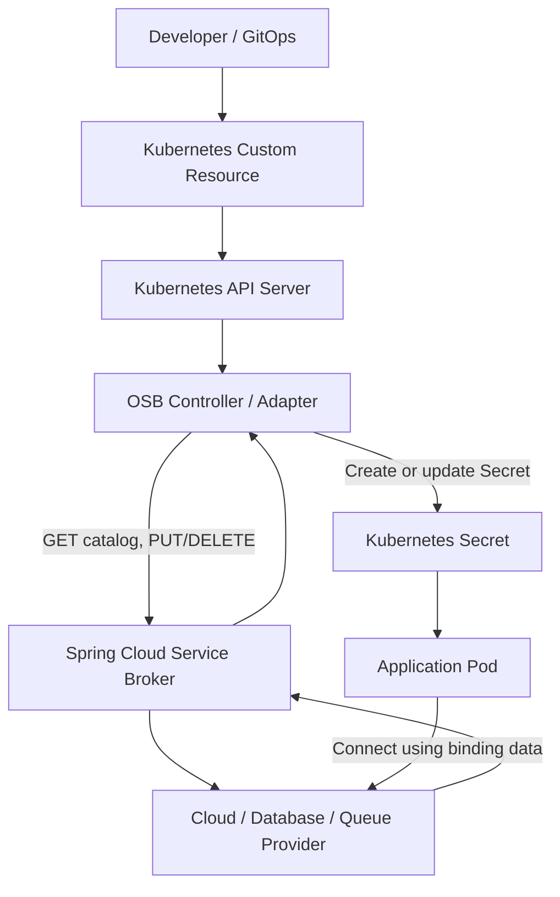

# Điều kiện tích hợp OSB API và giới hạn hỗ trợ sẵn có của Kubernetes

Kubernetes cung cấp API để quản lý workload, Service, Secret, ConfigMap, namespace và các tài nguyên mở rộng. Tuy nhiên, Kubernetes core không triển khai Open Service Broker API (OSB API) và không tự động biến một service broker thành dịch vụ có thể provision/bind chỉ bằng cách tạo một `Service` hoặc `Deployment`. Muốn dùng broker tuân thủ OSB API trong Kubernetes, cần một thành phần tích hợp như controller/operator, adapter hoặc một hệ thống quản lý dịch vụ có khả năng gọi OSB API và ánh xạ vòng đời của broker sang tài nguyên Kubernetes.

Với `SPRING_CLOUD_SERVICE_BROKER`, Spring Cloud Open Service Broker có thể triển khai phía server: công bố catalog và xử lý provision, update, deprovision, bind, unbind. Phía Kubernetes cần một client/controller chịu trách nhiệm đăng ký broker, đọc catalog, tạo resource đại diện cho service instance/binding, gọi endpoint OSB và đồng bộ trạng thái. Cần phân biệt rõ API Kubernetes, OSB API và các chuẩn binding khác để không kỳ vọng Kubernetes core cung cấp những khả năng mà nó không có.

## 1. Kubernetes core hỗ trợ gì và không hỗ trợ gì?

Kubernetes core quản lý desired state của các object trong cluster thông qua API server và controller reconciliation. Nó cung cấp primitives để chạy ứng dụng và lưu cấu hình, nhưng không định nghĩa sẵn catalog service broker theo OSB API.

| Khả năng | Kubernetes core | Thành phần tích hợp OSB cần bổ sung |
|---|---|---|
| Quản lý Pod, Deployment, StatefulSet, Service | Có | Không cần broker để tạo workload cơ bản. |
| Lưu cấu hình và dữ liệu nhạy cảm qua ConfigMap/Secret | Có primitives | Adapter/controller quyết định cách chuyển credential OSB vào Secret và bảo vệ Secret. |
| Namespace và RBAC | Có | Cần ánh xạ tenant, namespace và quyền gọi broker. |
| Custom Resource Definition (CRD) | Có cơ chế mở rộng API | Dự án phải định nghĩa schema, controller và lifecycle cho resource OSB. |
| Đọc OSB catalog | Không có endpoint OSB native | Controller hoặc adapter gọi `GET /v2/catalog`. |
| Provision service instance qua OSB | Không có sẵn | Controller gọi `PUT /v2/service_instances/{instance_id}`. |
| Bind/unbind qua OSB | Không có sẵn | Controller gọi PUT/DELETE binding và phân phối credential cho workload. |
| Polling `last_operation` | Không có semantics OSB native | Controller lưu operation và reconcile/poll theo OSB API. |
| Idempotency giữa Kubernetes và provider | Không tự giải quyết | Controller, broker và provider cần phối hợp định danh/idempotency. |

Vì vậy, chỉ cài một broker Spring Boot vào cluster không làm cho Kubernetes tự phát hiện catalog hoặc gọi các endpoint OSB. Cần cấu hình rõ controller nào sẽ làm client OSB, nó theo dõi resource nào và ai chịu trách nhiệm retry, polling, credential distribution cũng như cleanup.

## 2. Kiến trúc tích hợp tổng quát

Một kiến trúc phổ biến gồm bốn phần:

1. **Spring Cloud Service Broker:** triển khai server OSB API, quản lý catalog, service instance, binding và provider resources.
2. **Kubernetes API:** lưu các custom resource hoặc resource đại diện cho yêu cầu service instance/binding.
3. **OSB controller/adapter:** theo dõi custom resource, gọi broker, cập nhật status, xử lý async operation và retry.
4. **Workload:** nhận credential/configuration qua Secret hoặc cơ chế binding phù hợp rồi kết nối tới service.



Controller đóng vai trò client OSB API. Nó không nhất thiết phải chạy cùng process với broker; broker có thể nằm ngoài cluster hoặc trong cluster nhưng được expose qua endpoint bảo mật. Điều quan trọng là controller có thể truy cập endpoint, xác thực đúng và lưu trạng thái để phục hồi sau restart.

## 3. Vai trò của OSB controller hoặc adapter

Controller theo dõi object khai báo bởi người dùng và biến desired state đó thành thao tác OSB API. Ví dụ, một custom resource yêu cầu PostgreSQL plan `small` sẽ khiến controller:

1. Xác thực custom resource và namespace/tenant.
2. Xác định broker registration và service/plan ID tương ứng.
3. Gửi provision request với instance ID ổn định.
4. Nếu broker trả `202 Accepted`, lưu operation và polling `last_operation`.
5. Khi provision thành công, cập nhật status của custom resource.
6. Khi người dùng yêu cầu binding, gọi endpoint bind với binding ID ổn định.
7. Đưa credentials vào Secret đúng namespace và cập nhật reference trong status.
8. Khi resource bị xóa, thực hiện unbind/deprovision theo finalizer và policy.

Controller nên dùng reconciliation loop thay vì chỉ thực hiện một lần khi nhận event. Event có thể bị mất hoặc xử lý lặp; reconciliation sẽ đọc lại desired state, trạng thái Kubernetes và trạng thái broker để tiếp tục đạt trạng thái mong muốn.

## 4. Những mô hình tích hợp thường gặp

Có nhiều cách kết nối Kubernetes với dịch vụ theo OSB API. Chúng có mức độ chuẩn hóa và trạng thái bảo trì khác nhau.

### Service Catalog (mô hình lịch sử)

Kubernetes Service Catalog từng là một dự án mở rộng Kubernetes nhằm tích hợp service broker thông qua OSB API. Dự án sử dụng các resource như broker registration, service class/plan, service instance và service binding; tên và phạm vi resource thay đổi theo phiên bản/triển khai.

Service Catalog không phải thành phần của Kubernetes core. Đây là extension cần cài CRD, controller và các thành phần liên quan. Dự án lịch sử này không nên được mặc định là lựa chọn được hỗ trợ hoặc duy trì trong mọi cluster hiện nay. Trước khi sử dụng, phải xác minh trạng thái repository, phiên bản Kubernetes tương thích, bản phân phối, security fixes và khả năng vận hành của tổ chức.

### Controller/operator riêng

Một tổ chức có thể xây dựng CRD và controller riêng để gọi OSB API. Cách này cho phép thiết kế schema phù hợp với platform, nhưng đội vận hành phải chịu trách nhiệm cho catalog sync, state mapping, retry, async polling, Secret lifecycle, finalizer và nâng cấp CRD.

### Adapter hoặc platform service trung gian

Một hệ thống quản lý dịch vụ khác có thể đứng giữa Kubernetes và broker. Adapter có thể cung cấp API thân thiện với Kubernetes rồi chuyển đổi thành OSB API. Cần xác định hệ thống nào là nguồn sự thật cho instance/binding, ai lưu broker credentials và ai thực hiện cleanup khi adapter hoặc cluster gặp sự cố.

## 5. Phân biệt OSB API với Kubernetes Service Binding

Kubernetes Service Binding Specification và OSB API giải quyết các phần liên quan nhưng không phải cùng một giao thức.

- **OSB API** là hợp đồng HTTP giữa platform/client và service broker để khám phá catalog, provision, update, deprovision, bind và unbind.
- **Service Binding Specification for Kubernetes** mô tả cách cung cấp binding data cho workload trong môi trường Kubernetes, gồm quy ước và cơ chế phân phối thông tin binding.
- **Kubernetes Secret** là một primitive lưu trữ dữ liệu nhạy cảm trong cluster; nó không tự gọi broker và không tự tạo service binding.

Một controller có thể dùng OSB API để tạo binding, rồi chuyển kết quả thành Secret hoặc object binding theo specification được hỗ trợ. Việc có Secret không chứng minh broker đã tạo binding; ngược lại, broker đã tạo binding cũng không bảo đảm workload tự động nhận được credential nếu controller chưa phân phối.

Không nên gọi mọi Secret chứa connection string là “OSB binding”. Cần lưu mapping giữa OSB `binding_id`, Kubernetes namespace/workload, Secret name và trạng thái phân phối.

## 6. Thiết kế custom resource

Nếu xây dựng controller riêng, CRD nên mô tả desired state và status một cách rõ ràng. Ví dụ minh họa:

```yaml
apiVersion: services.example.io/v1alpha1
kind: ServiceInstance
metadata:
  name: orders-db
  namespace: checkout
spec:
  brokerRef:
    name: platform-broker
  serviceId: postgres-service-id
  planId: postgres-small-plan
  parameters:
    storage_gb: 20
    region: ap-southeast-1
status:
  phase: Provisioning
  instanceId: 9d8f... # ID ổn định do controller tạo/lưu
  operation: op-123
  conditions:
    - type: Ready
      status: "False"
      reason: Provisioning
```

Đây là CRD do tổ chức tự định nghĩa, không phải resource Kubernetes built-in hoặc schema OSB chuẩn. Không đưa broker password, provider token hoặc binding credential vào `spec`. `spec` là desired state có thể được lưu trong GitOps, log hoặc audit; chỉ nên chứa reference tới Secret và tham số không nhạy cảm.

### Các nguyên tắc schema

- Dùng `apiVersion` có version và có kế hoạch nâng cấp schema.
- `brokerRef` tham chiếu một registration đã được cấu hình, không chứa URL/credential tùy ý do người dùng không được phép kiểm soát.
- `serviceId` và `planId` phải được xác thực với catalog broker đã sync.
- Parameters cần schema validation, giới hạn kiểu/giá trị và policy theo namespace.
- ID OSB phải ổn định qua reconcile và controller restart.
- `status` chứa phase, operation ID, external reference an toàn, conditions và observed generation.
- Không lưu secret trong status; status thường được nhiều role đọc và có thể xuất hiện trong công cụ quan sát.

## 7. Catalog discovery và mapping service/plan

OSB controller cần đọc `GET /v2/catalog` từ broker và ánh xạ service/plan sang cách khai báo trong Kubernetes. Việc sync catalog có thể theo lịch, theo event quản trị hoặc khi người dùng tham chiếu broker.

Controller cần lưu hoặc cache:

- Broker registration identity và API version được hỗ trợ.
- Service ID, tên hiển thị và các capability như `bindable`, `instances_retrievable`, `plan_updateable`.
- Plan ID, schema parameters và metadata cần thiết.
- Thời điểm catalog được đọc lần cuối và version/fingerprint nếu có.
- Trạng thái catalog sync và lỗi xác thực/kết nối.

Không dùng service name hoặc plan name làm khóa duy nhất nếu OSB API cung cấp ID ổn định. Người dùng có thể đổi tên hiển thị; `service_id` và `plan_id` mới là định danh dùng trong request lifecycle.

### Kiểm tra capability

Controller phải kiểm tra capability trước khi cho phép thao tác:

| Capability/điều kiện | Ý nghĩa cho controller |
|---|---|
| `bindable` | Chỉ tạo binding nếu service hỗ trợ bind. |
| `plan_updateable` | Chỉ gửi update plan khi service công bố hỗ trợ. |
| `instances_retrievable` | Chỉ gọi GET instance khi capability được công bố. |
| Async support | Tôn trọng `accepts_incomplete` và xử lý `202`/`last_operation`. |
| Parameter schema | Validate spec trước khi gửi request để giảm lỗi từ broker. |

Catalog cache có thể cũ khi broker thay đổi plan hoặc capability. Controller cần có chính sách refresh và xử lý lỗi khi một plan đã bị ẩn hoặc ngừng cung cấp nhưng instance cũ vẫn tồn tại.

## 8. Provision và ánh xạ instance ID

Kubernetes controller phải dùng một `instance_id` ổn định cho mỗi custom resource. Không tạo UUID mới ở mỗi lần reconcile, vì cùng một object có thể được xử lý hàng chục lần.

Một số cách tạo ID:

- Tạo UUID một lần và lưu trong status/annotation sau khi claim resource.
- Dùng một ID deterministic từ Kubernetes object UID kết hợp broker registration ID.
- Lưu mapping bền vững trong database/controller store nếu status có thể bị reset hoặc object được migrate.

Ví dụ request OSB:

```http
PUT /v2/service_instances/9d8f...?accepts_incomplete=true HTTP/1.1
X-Broker-API-Version: 2.14
Content-Type: application/json

{
  "service_id": "postgres-service-id",
  "plan_id": "postgres-small-plan",
  "context": {
    "platform": "kubernetes",
    "namespace": "checkout",
    "cluster_id": "cluster-prod-a"
  },
  "parameters": {
    "storage_gb": 20,
    "region": "ap-southeast-1"
  }
}
```

`context.platform`, `namespace` và `cluster_id` trong ví dụ là context do tích hợp thỏa thuận; không phải mọi trường đều bắt buộc hoặc được mọi broker hiểu giống nhau. Controller và broker cần thống nhất schema context. Không gửi dữ liệu nhận diện nhạy cảm hoặc thông tin cluster không cần thiết.

Nếu broker trả `202`, controller lưu operation ID trong status và polling endpoint `last_operation`. Không đánh dấu CR `Ready=True` cho tới khi broker báo `succeeded` và điều kiện sẵn sàng cần thiết đã được xác nhận.

## 9. Async operation và reconciliation loop

Kubernetes controller vốn hoạt động theo vòng lặp reconcile. Điều này phù hợp với OSB async operation, nhưng cần lưu trạng thái để không gửi provision lặp mỗi lần reconcile.

Ví dụ status:

```yaml
status:
  phase: Provisioning
  instanceId: 9d8f...
  operation: op-123
  nextPollTime: "2026-11-27T10:30:00Z"
  conditions:
    - type: Ready
      status: "False"
      reason: OperationInProgress
```

Controller thực hiện:

1. Nếu chưa có instance ID/operation, khởi tạo ID ổn định và gửi provision.
2. Nếu nhận `202`, lưu operation ID trước khi kết thúc reconcile.
3. Nếu operation đang chạy, lên lịch reconcile sau khoảng thời gian phù hợp; có thể dùng `Retry-After` nếu broker trả header và controller hỗ trợ.
4. Nếu `last_operation` là `succeeded`, cập nhật phase và conditions.
5. Nếu `failed`, ghi reason/message an toàn và áp dụng policy retry hoặc yêu cầu người vận hành can thiệp.
6. Nếu controller restart, đọc status hiện tại rồi tiếp tục polling operation cũ.

Không tạo một operation mới chỉ vì reconcile được gọi lại. Controller phải phân biệt “chưa gửi request”, “đã được accept và đang theo dõi”, “đã thành công” và “kết quả chưa xác định”.

## 10. Binding và phân phối credentials

Khi workload cần dùng service, controller tạo binding với `binding_id` ổn định. Sau khi broker trả credentials, controller lưu dữ liệu vào Kubernetes Secret trong namespace được phép và cập nhật reference trong custom resource status.

Ví dụ CR binding:

```yaml
apiVersion: services.example.io/v1alpha1
kind: ServiceBinding
metadata:
  name: orders-db-binding
  namespace: checkout
spec:
  instanceRef:
    name: orders-db
  workloadRef:
    apiVersion: apps/v1
    kind: Deployment
    name: orders-api
status:
  phase: Ready
  bindingId: 4ac1...
  secretRef:
    name: orders-db-credentials
```

Ví dụ Secret được controller tạo:

```yaml
apiVersion: v1
kind: Secret
metadata:
  name: orders-db-credentials
  namespace: checkout
type: Opaque
stringData:
  uri: postgresql://db.example.internal:5432/orders
  username: orders_app
  password: <secret-value>
```

Đây là ví dụ cấu trúc; Secret thật phải được tạo bằng Kubernetes API với credential thực từ broker. Không commit Secret có giá trị thật vào Git. Workload có thể mount Secret dưới dạng environment variables hoặc volume, tùy ứng dụng và chính sách rotation.

Controller cần xác định rõ:

- Secret name có deterministic và không xung đột trong namespace.
- Chỉ service account/workload được phép đọc Secret.
- Secret chỉ được tạo sau khi binding thành công.
- Khi credential rotate, controller cập nhật Secret và có cơ chế khiến workload reload/restart an toàn.
- Khi unbind, controller xóa hoặc vô hiệu hóa Secret theo policy sau khi credential đã được revoke.
- Binding của namespace này không thể tham chiếu Secret hoặc instance của namespace khác nếu không có cơ chế cross-namespace được cho phép.

## 11. RBAC, namespace và tenant isolation

Kubernetes namespace là ranh giới tổ chức hữu ích nhưng không tự đảm bảo mọi dịch vụ bên ngoài cũng được cô lập. Controller cần RBAC tối thiểu:

- Chỉ đọc CRD cần thiết trong namespace được quản lý.
- Chỉ tạo/cập nhật Secret thuộc binding do controller sở hữu.
- Chỉ cập nhật status/subresource của custom resource tương ứng.
- Chỉ đọc broker credential Secret trong namespace quản trị hoặc namespace được chỉ định.
- Không cấp quyền đọc mọi Secret toàn cluster nếu không cần.
- Không cho workload thông thường sửa broker registration hoặc provider credential.

Nếu controller chạy cluster-scoped, cần kiểm tra namespace của object và policy trước khi gọi broker. Nếu controller chạy namespace-scoped, RBAC và watch scope có thể giới hạn blast radius tốt hơn, nhưng cần quản lý nhiều controller/registration khi số namespace tăng.

Broker cũng phải kiểm tra tenant context mà controller gửi. Không coi `namespace` trong JSON context là bằng chứng authorization. Cần xác thực controller identity ở broker, gắn registration với cluster/tenant scope và lưu mapping instance với namespace đã xác thực.

## 12. Bảo vệ broker credentials và Kubernetes Secrets

Kubernetes Secret là API object chứa dữ liệu nhạy cảm, nhưng giá trị trong YAML thường được biểu diễn Base64. Base64 không phải encryption. Cần cấu hình encryption at rest cho etcd theo chính sách cluster, RBAC chặt chẽ, audit và giới hạn quyền đọc Secret.

Broker credentials dùng để controller gọi OSB API phải được quản lý riêng với service binding credentials mà workload nhận:

- Broker credentials chỉ controller/service account được đọc.
- Provider credentials chỉ broker được đọc; không đưa chúng vào cluster Secret của workload.
- Binding credentials chỉ workload tương ứng được đọc.
- Không lưu credential trong CR spec, annotation, event message hoặc status.
- Không log Authorization header, request body có secret hoặc OSB response credentials.
- Dùng rotation và revoke có kiểm soát cho broker/provider credentials.

Nếu dùng external secret manager, controller có thể ghi reference hoặc đồng bộ secret theo một integration đã được phê duyệt. Không để nhiều controller có quyền đọc tất cả secret chỉ để tiện triển khai.

## 13. Finalizer và cleanup khi xóa custom resource

Khi người dùng xóa `ServiceInstance` custom resource, Kubernetes có thể xóa object ngay nếu controller không đặt finalizer. Điều đó có thể khiến broker instance và provider resource còn tồn tại mà controller mất mapping để deprovision.

Finalizer giúp controller hoàn tất cleanup trước khi Kubernetes xóa object:

1. Khi nhận object mới, controller thêm finalizer quản lý service instance.
2. Khi `deletionTimestamp` xuất hiện, controller ngừng tạo binding mới.
3. Controller unbind các binding còn hoạt động theo policy.
4. Controller gửi deprovision tới broker.
5. Nếu broker trả `202`, giữ finalizer và polling `last_operation`.
6. Khi deprovision thành công hoặc đã đạt trạng thái đích theo policy, xóa Secret còn lại và gỡ finalizer.
7. Nếu cleanup thất bại, giữ finalizer, cập nhật condition lỗi và phát cảnh báo để operator xử lý.

Không gỡ finalizer chỉ để object biến mất khi broker chưa được deprovision, trừ khi có quy trình force deletion có kiểm soát và chấp nhận xử lý tài nguyên mồ côi riêng. Cũng không giữ finalizer vô hạn mà không có condition, retry/backoff và hướng dẫn vận hành.

## 14. Idempotency và xử lý đồng thời

Kubernetes reconcile có thể chạy nhiều lần, event có thể được giao lại và controller có thể có nhiều replica. Vì vậy, mọi OSB request phải có định danh ổn định:

- Một CR service instance ánh xạ tới một `instance_id` OSB ổn định.
- Một CR binding ánh xạ tới một `binding_id` ổn định.
- Operation ID được lưu trong status hoặc controller store.
- Provider idempotency key được broker quản lý ở phía server.
- Controller dùng optimistic concurrency/resourceVersion khi cập nhật status.

Nếu hai reconcile cùng xử lý một object, leader election hoặc work queue deduplication giúp giảm trùng lặp, nhưng không thay thế idempotency ở broker/provider. Broker vẫn phải bảo vệ side effect bằng unique constraint, operation state và provider idempotency.

Nếu request timeout sau khi broker/provider có thể đã tạo tài nguyên, controller không nên tạo ID mới. Nó phải đọc lại status, truy vấn operation hoặc gửi lại cùng request ID theo semantics OSB API; broker sẽ nhận diện request lặp và trả trạng thái/kết quả đã lưu.

## 15. Network, TLS và authentication

Controller phải truy cập được broker endpoint qua network policy, DNS và route phù hợp. Nếu broker ở ngoài cluster, cần egress policy cho phép đúng hostname/port. Nếu broker ở trong cluster, không nên expose Service ra Internet nếu chỉ controller nội bộ cần gọi.

Các yêu cầu:

- Dùng HTTPS và xác minh certificate chain/hostname.
- Lưu broker credentials trong Secret được bảo vệ hoặc external secret manager.
- Dùng auth scheme mà broker và controller cùng hỗ trợ, ví dụ Basic Auth qua TLS hoặc mTLS theo integration.
- Rotate credentials và certificate trước khi hết hạn.
- Giới hạn egress tới broker và provider endpoints cần thiết.
- Không tắt TLS verification để khắc phục lỗi certificate.
- Không cho CR user chỉ định broker URL tùy ý nếu có nguy cơ SSRF hoặc gọi nhầm endpoint.

Nếu controller hỗ trợ nhiều broker registration, mỗi registration cần endpoint, credential reference, API version và scope riêng. Không dùng một Secret mặc định toàn cluster cho mọi broker nếu các tenant có quyền khác nhau.

## 16. Giới hạn vận hành và khả năng tương thích

Kubernetes không tự giải quyết những khác biệt giữa broker implementations:

- Broker có thể hỗ trợ các capability OSB khác nhau.
- Catalog parameters và schema có thể thay đổi theo version.
- Provider có thể chỉ hỗ trợ một số operation đồng bộ hoặc bất đồng bộ.
- Credential response có thể có cấu trúc riêng theo service.
- Một số broker yêu cầu context hoặc metadata tùy nền tảng.
- Broker endpoint có thể nằm ngoài cluster và chịu policy mạng riêng.

Controller phải kiểm tra API version, capability và schema trước khi gửi request. Không giả định mọi broker hỗ trợ `instances_retrievable`, `bindings_retrievable`, plan update hoặc mọi kiểu binding. Cũng không giả định mọi service binding response đều chỉ có `credentials`; route service, syslog drain hoặc volume binding có thể cần cách xử lý riêng.

Kubernetes cũng không tự đồng bộ thay đổi trong Secret tới ứng dụng theo một cách thống nhất cho mọi workload. Environment variables không tự cập nhật trong process đang chạy; Secret volume có thể được cập nhật trên filesystem theo điều kiện của kubelet, nhưng ứng dụng vẫn cần reload hoặc restart để sử dụng giá trị mới. Rotation cần thiết kế end-to-end.

## 17. Quan sát, trạng thái và xử lý sự cố

Controller nên cập nhật Kubernetes Conditions có ý nghĩa thay vì chỉ ghi một chuỗi phase khó hiểu. Ví dụ:

| Condition | Ý nghĩa |
|---|---|
| `Accepted` | Spec đã qua validation và được controller chấp nhận. |
| `Provisioning` | Broker đã nhận request hoặc operation đang chạy. |
| `Ready` | Instance đã provision thành công và sẵn sàng theo policy. |
| `BindingReady` | Binding đã tạo và Secret đã được phân phối. |
| `Deprovisioning` | Đang unbind/deprovision và finalizer còn giữ object. |
| `Failed` | Operation thất bại hoặc cần operator can thiệp. |

Status nên có `observedGeneration` để người vận hành biết controller đã xử lý phiên bản spec nào. Message cần ngắn, an toàn và có operation reference. Không đưa credential, raw provider response hoặc stack trace vào status.

Metric/log nên theo dõi:

- Số operation provision/bind/unbind/deprovision đang chạy.
- Thời gian polling và độ trễ reconcile.
- Số lần retry, lỗi xác thực, lỗi provider và timeout.
- Số finalizer bị giữ lâu.
- Số Secret thiếu hoặc không khớp binding status.
- Catalog sync age và broker reachability.

Không dùng namespace, instance ID hoặc binding ID làm metric label không giới hạn nếu có thể gây cardinality lớn. Dùng structured log/trace với correlation ID để truy vết chi tiết.

## 18. Kiểm thử tích hợp Kubernetes và broker

Kiểm thử nên có nhiều lớp:

1. **CRD schema test:** spec thiếu service ID, plan ID hoặc parameter sai kiểu phải bị từ chối.
2. **Catalog mapping test:** service/plan ID được ánh xạ đúng; capability không hỗ trợ thì thao tác tương ứng bị chặn.
3. **Provision contract test:** controller gửi đúng OSB request và dùng instance ID ổn định.
4. **Async test:** broker trả `202`; controller lưu operation, polling và cập nhật Ready sau `succeeded`.
5. **Retry test:** controller restart hoặc nhận event trùng không tạo instance/binding trùng.
6. **Binding test:** credential chỉ xuất hiện trong Secret đúng namespace và workload reference đúng Secret.
7. **RBAC test:** service account không đọc được Secret ngoài phạm vi được cấp.
8. **Finalizer test:** xóa CR kích hoạt unbind/deprovision; object chỉ biến mất sau cleanup thành công theo policy.
9. **Failure test:** broker timeout, provider lỗi, TLS certificate sai và credential hết hạn được phản ánh bằng condition phù hợp.
10. **Rotation test:** Secret cập nhật và workload reload/restart theo quy trình đã thiết kế.
11. **Tenant isolation test:** namespace/cluster không được phép không thể tham chiếu broker registration hoặc instance khác.
12. **Upgrade test:** CRD schema/controller upgrade không làm mất operation ID, binding ID hoặc external mapping.

Có thể dùng fake OSB broker hoặc môi trường broker test để kiểm tra contract; dùng Kubernetes envtest/kind hoặc cluster test cho CRD, RBAC, Secret và finalizer. Test phải xác minh side effect ở provider fake, không chỉ xác minh controller đã cập nhật status.

## 19. Checklist trước khi triển khai

- Xác định controller/adapter nào thực hiện vai trò OSB client.
- Không giả định Kubernetes core có OSB API hoặc service broker lifecycle tích hợp sẵn.
- Kiểm tra trạng thái bảo trì và tương thích của Service Catalog nếu định dùng dự án lịch sử đó.
- Chọn CRD schema và versioning phù hợp nếu tự xây controller.
- Sync catalog bằng service ID/plan ID và kiểm tra capability.
- Giữ instance ID, binding ID và operation ID ổn định qua reconcile/restart.
- Xử lý `202`/`last_operation`, retry và unknown outcome bền vững.
- Phân phối credentials qua Secret/external secret mechanism với RBAC tối thiểu.
- Bảo vệ Secret bằng encryption at rest, audit và rotation; nhớ Base64 không phải encryption.
- Dùng finalizer để cleanup unbind/deprovision trước khi xóa CR.
- Xác minh namespace/tenant scope ở cả controller và broker.
- Dùng TLS, authentication và network policy cho broker endpoint.
- Có integration tests cho catalog, lifecycle, async, retry, Secret, RBAC và finalizer.

Kubernetes cung cấp primitives để chạy workload và mở rộng API, còn OSB API cung cấp hợp đồng vòng đời service broker. Muốn kết hợp hai bên, cần controller hoặc adapter làm cầu nối, ánh xạ CRD sang OSB request, theo dõi operation, phân phối binding data và cleanup có kiểm soát. Khi phân biệt rõ giới hạn của Kubernetes core, chọn đúng integration layer và bảo vệ state/Secret/tenant boundary, Spring Cloud Service Broker có thể phục vụ workload Kubernetes mà không nhầm khả năng của cluster với khả năng thực tế của broker hoặc provider.
