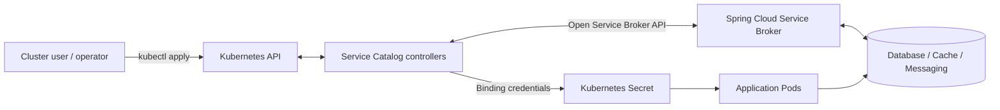
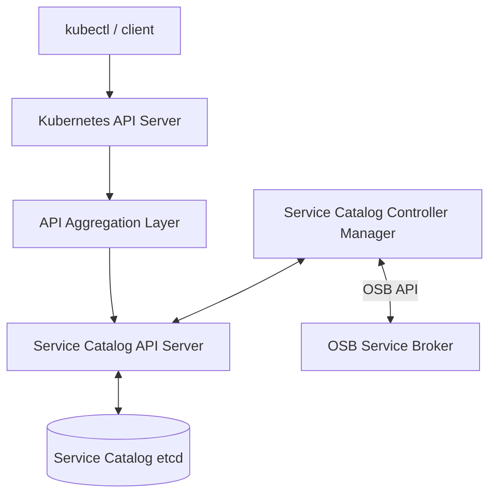
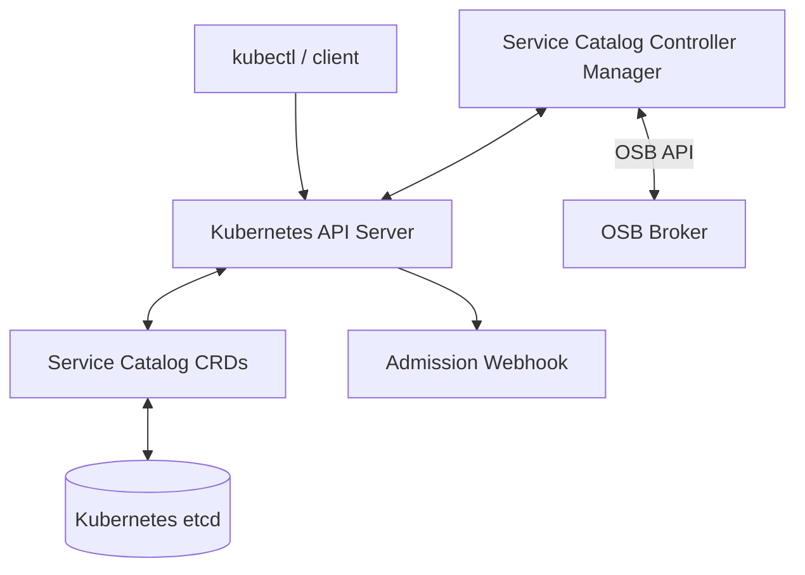
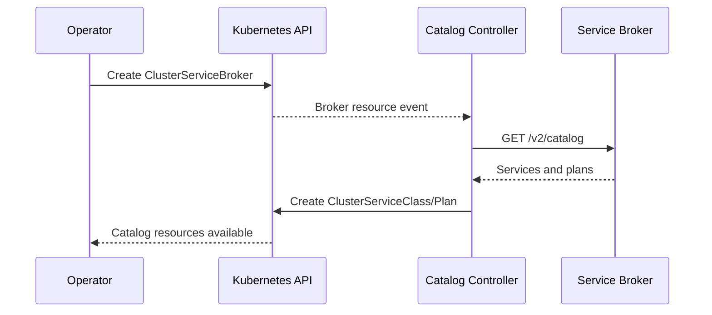
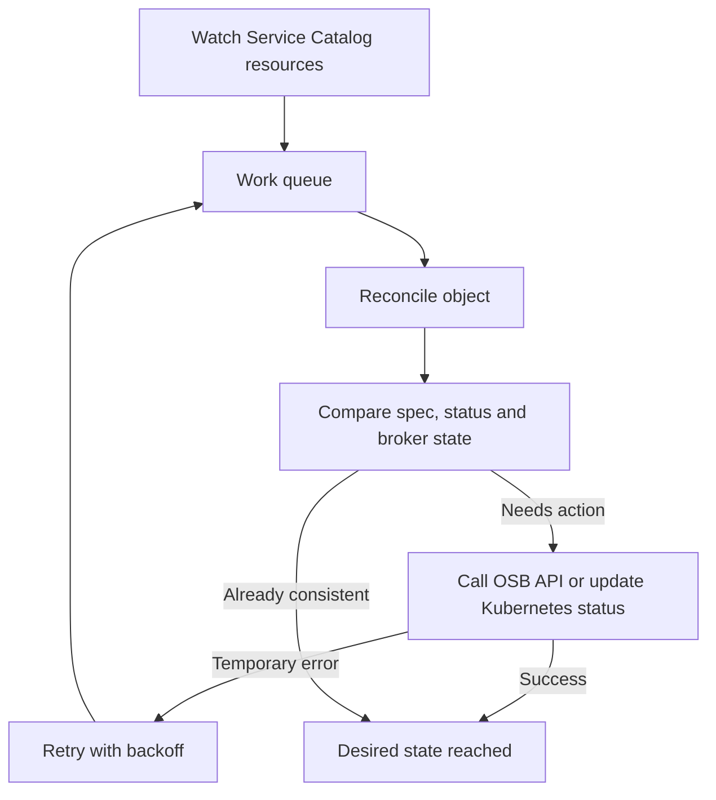
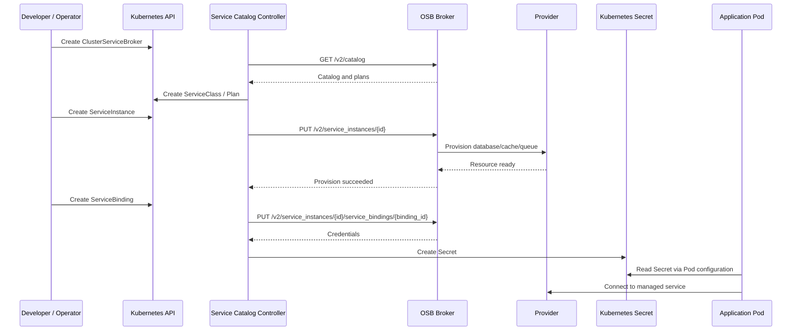

# Kiến trúc Service Catalog trong các hệ thống Kubernetes cũ sử dụng OSB

## 1. Service Catalog giải quyết vấn đề gì?

Kubernetes cung cấp API để quản lý Pod, Deployment, Service, ConfigMap và các tài nguyên chạy trong cluster. Tuy nhiên, ứng dụng trong cluster thường còn phụ thuộc vào dịch vụ bên ngoài như database được quản lý, cache, message broker, dịch vụ email hoặc nền tảng SaaS. Nếu mỗi đội ứng dụng tự gọi API của từng nhà cung cấp, họ phải tự quản lý credential, quy trình tạo/xóa tài nguyên và cách đưa thông tin kết nối vào Pod.

Kubernetes Service Catalog từng được phát triển để chuẩn hóa quy trình này. Nó cho phép người dùng đăng ký service broker, khám phá service/plan, yêu cầu cấp phát một service instance và tạo binding để ứng dụng nhận credential. Service Catalog đóng vai trò client của Open Service Broker API (OSB API), chuyển các Kubernetes API resource thành request OSB gửi tới broker.

Trong module `SPRING_CLOUD_SERVICE_BROKER`, Spring Cloud Open Service Broker giúp xây dựng broker server triển khai OSB API. Khi tích hợp với một Kubernetes Service Catalog cũ, broker server là hệ thống cung cấp dịch vụ; Service Catalog là thành phần điều phối trong cluster; Kubernetes API lưu trạng thái mong muốn và kết quả của các thao tác.



Service Catalog không phải thành phần cốt lõi luôn có sẵn trong mọi Kubernetes cluster. Đây là một dự án mở rộng lịch sử, cần cài API và controller riêng. Khi học kiến trúc này, cần phân biệt nó với Kubernetes `Service` resource dùng cho service discovery và load balancing nội bộ.

## 2. Các thành phần chính trong kiến trúc

Một hệ thống Kubernetes cũ sử dụng Service Catalog và OSB thường có các thành phần sau:

| Thành phần | Vai trò |
|---|---|
| Kubernetes API Server | Tiếp nhận yêu cầu quản lý resource, xác thực, authorization và lưu trạng thái API. |
| Service Catalog API | Cung cấp API group `servicecatalog.k8s.io` và các resource broker, class, plan, instance, binding. |
| Service Catalog Controller Manager | Watch resource, gọi broker qua OSB API và reconcile trạng thái thực tế với trạng thái mong muốn. |
| Admission Webhook Server | Kiểm tra hoặc chuẩn hóa một số Service Catalog resource trong kiến trúc CRD-based. |
| Service Broker | Server tương thích OSB API, cung cấp catalog và thực hiện provisioning, binding, update, deprovision. |
| Infrastructure Provider | Hệ thống thực tế tạo database, cache, message queue hoặc dịch vụ SaaS. |
| Kubernetes Secret | Lưu credential và thông tin kết nối mà broker trả về khi binding. |
| Application Pod | Đọc Secret để kết nối tới dịch vụ đã được cấp phát. |

Service Catalog điều phối vòng đời; broker quyết định cách tạo tài nguyên; provider thực hiện thao tác hạ tầng. Nhờ tách vai trò, cùng một Kubernetes resource model có thể làm việc với nhiều broker khác nhau.

## 3. Hai thế hệ triển khai Service Catalog

Khi đọc tài liệu hoặc vận hành cluster cũ, cần nhận biết Service Catalog đã có thay đổi kiến trúc qua các giai đoạn.

### 3.1. Kiến trúc API Server extension đời đầu

Phiên bản đời đầu triển khai Service Catalog như một extension API server và controller manager. API aggregation layer của Kubernetes cho phép đăng ký API server mở rộng, cung cấp API group riêng cho Service Catalog. Phiên bản này có datastore etcd riêng cho API server mở rộng.

Các khối chính:

- Kubernetes API Server nhận request từ `kubectl` và chuyển request thuộc API group Service Catalog tới aggregated API server.
- Service Catalog API Server phục vụ resource API riêng.
- etcd lưu các object của API server mở rộng.
- Controller Manager theo dõi object và gọi OSB broker để thực hiện nghiệp vụ.



Điểm cần nhớ: API Server extension không phải một controller thông thường. Nó trực tiếp cung cấp API endpoint và storage cho resource group mở rộng; controller manager mới là thành phần thực hiện điều phối nghiệp vụ với broker.

### 3.2. Kiến trúc CRD-based

Service Catalog về sau chuyển sang kiến trúc dựa trên CustomResourceDefinition (CRD). API resource được khai báo như CRD trong Kubernetes API Server chính. Controller Manager watch các object CRD và thực hiện reconciliation. Admission Webhook Server xử lý validation hoặc mutation theo cấu hình của dự án.

Trong mô hình này, các object Service Catalog được lưu cùng hệ thống storage của Kubernetes API Server chính, thay vì cần một API server extension với etcd riêng cho Service Catalog.



Hai kiến trúc có cùng mục tiêu và mô hình nghiệp vụ chính, nhưng khác cách cung cấp API và lưu trữ. Khi vận hành cluster cũ, hãy kiểm tra phiên bản Service Catalog và cách cài đặt thực tế trước khi áp dụng hướng dẫn về API server, CRD, webhook hoặc storage.

## 4. Mô hình resource của Service Catalog

Service Catalog biểu diễn broker và các dịch vụ broker cung cấp bằng Kubernetes API resource. Những resource quan trọng gồm:

| Resource | Scope | Ý nghĩa |
|---|---|---|
| `ClusterServiceBroker` | Cluster | Đăng ký broker và công bố catalog trên toàn cluster. |
| `ServiceBroker` | Namespace | Đăng ký broker trong phạm vi một namespace. |
| `ClusterServiceClass` | Cluster | Một service offering được đồng bộ từ cluster-scoped broker. |
| `ServiceClass` | Namespace | Một service offering được đồng bộ từ namespaced broker. |
| `ClusterServicePlan` | Cluster | Một plan của cluster-scoped service class. |
| `ServicePlan` | Namespace | Một plan của namespaced service class. |
| `ServiceInstance` | Namespace | Yêu cầu cấp phát một instance của service/plan. |
| `ServiceBinding` | Namespace | Yêu cầu liên kết ứng dụng với một service instance. |

Các resource class và plan được Service Catalog tạo ra khi đồng bộ catalog từ broker. Người dùng thường tạo `ServiceInstance` và `ServiceBinding` để yêu cầu dịch vụ.

### 4.1. Cluster-scoped và namespace-scoped broker

`ClusterServiceBroker` đăng ký broker để các namespace được phép sử dụng catalog của broker theo policy cluster. `ServiceBroker` giới hạn đăng ký ở một namespace. Tương ứng, catalog entries được tạo thành `ClusterServiceClass`/`ClusterServicePlan` hoặc `ServiceClass`/`ServicePlan`.

`ServiceInstance` và `ServiceBinding` luôn thuộc namespace. Khi dùng `ServiceClass` và `ServicePlan` namespaced, các resource liên quan phải ở cùng namespace theo mô hình Service Catalog.

### 4.2. Không nhầm ServiceClass với Kubernetes Service

`ServiceClass` trong Service Catalog là loại dịch vụ được một broker cung cấp, ví dụ PostgreSQL managed database hoặc Redis cache. Kubernetes `Service` là resource mạng đại diện cho một tập endpoint/Pod trong cluster. Hai khái niệm có tên gần giống nhưng khác API group, mục đích và vòng đời.

## 5. Đăng ký broker và đồng bộ catalog

Cluster operator tạo một resource `ClusterServiceBroker` hoặc `ServiceBroker` để Service Catalog biết URL và thông tin xác thực của broker. Controller đọc resource, gọi endpoint catalog của broker và tạo các class/plan tương ứng.

Ví dụ đăng ký cluster-scoped broker:

```yaml
apiVersion: servicecatalog.k8s.io/v1beta1
kind: ClusterServiceBroker
metadata:
  name: spring-cloud-broker
spec:
  url: https://broker.example.com
  authInfo:
    basic:
      secretRef:
        namespace: service-catalog
        name: spring-cloud-broker-auth
```

Secret `spring-cloud-broker-auth` chứa credential mà Service Catalog sử dụng khi gọi broker. Cấu trúc chi tiết của Secret và authInfo phải khớp phiên bản Service Catalog đang cài đặt; ví dụ trên minh họa mô hình Basic Authentication.

Sau khi broker được đăng ký, controller gọi `GET /v2/catalog` và chuyển service offering/plan thành các resource catalog. Quá trình đồng bộ giúp người dùng tra cứu bằng `kubectl` hoặc công cụ `svcat`.



Khi catalog broker thay đổi, controller có thể đồng bộ lại các class/plan. Nếu broker không truy cập được hoặc response không hợp lệ, resource broker có thể thể hiện lỗi trạng thái và catalog không được cập nhật như mong đợi. Không nên tạo class/plan thủ công nếu controller đang quản lý chúng từ broker.

## 6. Cấp phát ServiceInstance

Người dùng tạo `ServiceInstance` để yêu cầu một service/plan cụ thể. Controller theo dõi object mới, tra class/plan, rồi gửi provisioning request tới broker theo OSB API.

Ví dụ:

```yaml
apiVersion: servicecatalog.k8s.io/v1beta1
kind: ServiceInstance
metadata:
  name: orders-database
  namespace: production
spec:
  clusterServiceClassExternalName: postgresql
  clusterServicePlanExternalName: standard
  parameters:
    storage_gb: 50
    backup_enabled: true
```

Tên trường class/plan phụ thuộc resource scope và phiên bản API. Với cluster-scoped catalog, ví dụ dùng `clusterServiceClassExternalName` và `clusterServicePlanExternalName`. Với catalog namespaced, resource dùng các trường tương ứng `serviceClassExternalName` và `servicePlanExternalName`.

Controller ánh xạ object thành OSB request:

```http
PUT /v2/service_instances/{instance_id}?accepts_incomplete=true
Content-Type: application/json

{
  "service_id": "<service-id-from-catalog>",
  "plan_id": "<plan-id-from-catalog>",
  "parameters": {
    "storage_gb": 50,
    "backup_enabled": true
  }
}
```

ID bên ngoài từ catalog được dùng để xác định đúng service và plan. Controller lưu external ID và operation state để theo dõi kết quả. Nếu broker xử lý bất đồng bộ, Service Catalog polling last operation cho đến khi operation thành công hoặc thất bại rồi cập nhật trạng thái `ServiceInstance`.

Không nên giả định tên Kubernetes object chính là provider resource ID. Broker có thể tạo ID riêng và lưu mapping giữa `instance_id` do OSB client cung cấp với resource ID thật ở provider.

## 7. ServiceBinding và Kubernetes Secret

Sau khi instance đã provision thành công, ứng dụng tạo `ServiceBinding` để yêu cầu broker cấp credential. Service Catalog gửi bind request tới broker; broker trả thông tin kết nối; controller ghi dữ liệu vào Kubernetes Secret.

Ví dụ:

```yaml
apiVersion: servicecatalog.k8s.io/v1beta1
kind: ServiceBinding
metadata:
  name: orders-api-database
  namespace: production
spec:
  instanceRef:
    name: orders-database
  secretName: orders-database-credentials
```

Controller gửi request tương ứng:

```http
PUT /v2/service_instances/{instance_id}/service_bindings/{binding_id}?accepts_incomplete=true
Content-Type: application/json

{
  "service_id": "<service-id-from-catalog>",
  "plan_id": "<plan-id-from-catalog>",
  "bind_resource": {
    "app_guid": "<application-guid>"
  }
}
```

Khi broker trả binding credentials, Service Catalog tạo Secret `orders-database-credentials` trong namespace `production`. Ứng dụng có thể mount Secret thành file hoặc đưa các key vào environment variable.

Ví dụ Deployment sử dụng Secret dưới dạng environment variables:

```yaml
apiVersion: apps/v1
kind: Deployment
metadata:
  name: orders-api
  namespace: production
spec:
  replicas: 2
  selector:
    matchLabels:
      app: orders-api
  template:
    metadata:
      labels:
        app: orders-api
    spec:
      containers:
        - name: app
          image: example.com/orders-api:1.0
          envFrom:
            - secretRef:
                name: orders-database-credentials
```

Tên key trong Secret phụ thuộc dữ liệu credentials mà broker trả về. Ứng dụng phải biết schema credential của broker, ví dụ `host`, `port`, `database`, `username`, `password` hoặc `uri`.

## 8. Controller Manager và reconciliation loop

Controller Manager là trung tâm điều phối của Service Catalog. Nó watch API resource và thực hiện hành động để trạng thái thực tế tiến gần trạng thái mong muốn.

Ví dụ:

- Khi tạo `ClusterServiceBroker`, controller fetch catalog và đồng bộ class/plan.
- Khi tạo `ServiceInstance`, controller gửi provision request.
- Khi tạo `ServiceBinding`, controller gửi bind request và ghi Secret.
- Khi xóa `ServiceBinding`, controller gửi unbind request và dọn binding/Secret theo vòng đời.
- Khi xóa `ServiceInstance`, controller gửi deprovision request.
- Khi broker trả operation bất đồng bộ, controller polling last operation và cập nhật status.

Controller thường dựa vào watch event nhưng không nên chỉ xử lý một event rồi quên. Kubernetes controller cần reconciliation: định kỳ hoặc khi có event, đọc lại object, so sánh `spec` mong muốn với `status` và trạng thái bên ngoài, rồi tiếp tục bước còn thiếu.



Reconciliation giúp xử lý controller restart, network timeout và request retry. Broker vì thế phải hỗ trợ idempotency: cùng một instance/binding ID không được tạo tài nguyên trùng khi controller gửi lại request.

## 9. Luồng end-to-end: từ catalog đến ứng dụng

Một luồng phổ biến gồm bốn giai đoạn:

1. Operator đăng ký broker.
2. Service Catalog đồng bộ service và plan.
3. Developer tạo ServiceInstance để provision dịch vụ.
4. Developer tạo ServiceBinding để nhận Secret và cấu hình Pod sử dụng dịch vụ.



Ứng dụng không cần trực tiếp gọi API quản trị của provider. Nó chỉ cần đọc thông tin kết nối đã được binding cung cấp và tuân thủ quy tắc bảo mật Secret.

## 10. Xử lý thao tác bất đồng bộ

Tạo database managed, cache cluster hoặc messaging service có thể mất nhiều phút. OSB API hỗ trợ asynchronous provisioning và binding khi client gửi `accepts_incomplete=true`.

Luồng cơ bản:

1. Controller gửi PUT với `accepts_incomplete=true`.
2. Broker tiếp nhận request, lưu operation và trả `202 Accepted` cùng operation ID tùy chọn.
3. Controller lưu trạng thái operation trong Kubernetes resource status.
4. Controller gọi endpoint `last_operation` để polling.
5. Khi state là `succeeded`, controller cập nhật resource thành sẵn sàng.
6. Nếu state là `failed`, controller lưu điều kiện lỗi để operator/developer xử lý.

Ví dụ response:

```http
HTTP/1.1 202 Accepted
Content-Type: application/json

{
  "operation": "provision-orders-database"
}
```

Broker nên lưu operation bền vững, không chỉ giữ trong memory của một replica. Controller có thể restart hoặc request polling có thể được xử lý sau một khoảng thời gian; operation ID phải còn tra cứu được.

Nếu operation thất bại một phần, broker cần compensation hoặc cleanup workflow. Service Catalog không thể tự biết cách xóa database, user hoặc network policy provider đã tạo dở; đó là trách nhiệm của broker.

## 11. Authentication, Secret và phân quyền

Service Catalog cần credential để gọi broker. Thông tin này được cấu hình trong broker resource, thường tham chiếu tới Kubernetes Secret. Broker cần xác thực client và giới hạn quyền thao tác theo platform context.

Khi binding, broker trả credential cho ứng dụng và Service Catalog lưu trong Secret. Vì Kubernetes Secret thường được lưu trong etcd và dữ liệu mặc định được biểu diễn bằng base64, base64 không phải encryption. Cluster operator cần cấu hình encryption at rest cho Secret trong etcd, RBAC giới hạn quyền đọc Secret và TLS cho giao tiếp API.

Các nguyên tắc:

- Chỉ Service Catalog controller hoặc identity cần thiết mới được đọc broker-auth Secret.
- Chỉ namespace/application được ủy quyền mới được đọc binding Secret.
- Không đưa broker password hoặc binding credential vào ConfigMap, image hoặc source control.
- Không mount Secret vào container không cần sử dụng dịch vụ.
- Thu hồi credential khi xóa binding và cập nhật Secret theo vòng đời binding.
- Dùng TLS để bảo vệ giao tiếp Service Catalog-broker và ứng dụng-provider.
- Dùng Kubernetes RBAC để hạn chế ai được tạo `ServiceInstance`, `ServiceBinding` và đọc Secret.
- Broker vẫn phải xác thực và authorization request; không mặc định mọi request nội bộ cluster đều đáng tin.

## 12. Vòng đời xóa binding và instance

Khi ứng dụng không còn cần dịch vụ, cần xóa binding trước rồi mới deprovision instance nếu không còn consumer nào sử dụng.

- Xóa `ServiceBinding`: controller gọi OSB unbind, broker revoke credential và quyền riêng binding, sau đó Service Catalog dọn Secret tương ứng theo trạng thái hoàn tất.
- Xóa `ServiceInstance`: controller gọi OSB deprovision; broker thu hồi tài nguyên instance như database, cache allocation hoặc queue/vhost.

Không xóa database hoặc shared cluster chỉ vì một binding bị xóa. Binding sở hữu credential và quyền truy cập của consumer; instance sở hữu tài nguyên dịch vụ nền.

Nếu thao tác unbind/deprovision bất đồng bộ, controller cần polling last operation trước khi hoàn tất việc xóa resource. Finalizer hoặc cơ chế bảo vệ vòng đời trong phiên bản Service Catalog có thể giữ object cho đến khi thao tác broker hoàn tất; hành vi chính xác cần kiểm tra theo phiên bản đang vận hành.

Nếu broker không thể deprovision do còn binding hoặc provider gặp lỗi, trạng thái resource có thể ở trạng thái lỗi hoặc chờ xử lý. Không nên xóa thủ công object khỏi storage để ép hoàn tất vì có thể để lại tài nguyên và credential mồ côi ở provider.

## 13. Vai trò của Spring Cloud Service Broker

Trong kiến trúc này, Spring Cloud Service Broker là OSB server ở phía ngoài Service Catalog. Các interface chính thường gồm:

| Nghiệp vụ | OSB endpoint | Spring Cloud service |
|---|---|---|
| Catalog | `GET /v2/catalog` | `CatalogService` |
| Provision instance | `PUT /v2/service_instances/{id}` | `ServiceInstanceService` |
| Retrieve instance nếu hỗ trợ | `GET /v2/service_instances/{id}` | `ServiceInstanceService` |
| Update instance nếu hỗ trợ | `PATCH /v2/service_instances/{id}` | `ServiceInstanceService` |
| Deprovision instance | `DELETE /v2/service_instances/{id}` | `ServiceInstanceService` |
| Create binding | `PUT /v2/service_instances/{id}/service_bindings/{binding_id}` | `ServiceInstanceBindingService` |
| Delete binding | `DELETE /v2/service_instances/{id}/service_bindings/{binding_id}` | `ServiceInstanceBindingService` |
| Poll operation | `GET .../last_operation` | Service tương ứng với instance hoặc binding operation |

Service Catalog chỉ hiểu OSB API contract và resource model. Nó không cần biết broker dùng PostgreSQL, Redis, RabbitMQ, Kafka hay provider cloud nào. Broker ánh xạ `service_id`, `plan_id`, `instance_id`, `binding_id` và parameters sang provider adapter, đồng thời lưu operation và resource mapping.

## 14. Giới hạn và lưu ý khi vận hành hệ thống cũ

Service Catalog là dự án lịch sử, không phải tính năng cốt lõi được cài mặc định trong Kubernetes hiện đại. Repository dự án đã được chuyển vào tổ chức `kubernetes-retired` và archived vào năm 2022. Vì vậy, hệ thống đang sử dụng Service Catalog cần được xem là tích hợp legacy; không nên mặc định có bản vá bảo mật, tương thích Kubernetes mới hoặc hỗ trợ upstream.

Một số điểm cần đánh giá:

- Phiên bản Service Catalog và Kubernetes API mà cluster đang chạy.
- Kiến trúc đang dùng là API Server extension đời đầu hay CRD-based.
- API group `servicecatalog.k8s.io/v1beta1` còn được phục vụ và controller còn hoạt động không.
- Admission webhook certificate, service account, RBAC và CRD có còn đúng không.
- OSB API version và authentication method broker đang hỗ trợ.
- Tính tương thích của controller với API server, etcd và runtime Kubernetes hiện tại.
- Tình trạng lưu trữ Secret, encryption at rest và policy đọc Secret.
- Khả năng backup/restore ServiceInstance, ServiceBinding, Secret và operation state.

Không cài một chart hoặc binary cũ vào cluster mới chỉ vì manifest còn apply được. Cần thử nghiệm trên môi trường cô lập, đánh giá bảo mật và có kế hoạch di chuyển. Nếu xây dựng nền tảng mới, hãy đánh giá các mô hình hiện đại như Kubernetes Operator hoặc Crossplane theo yêu cầu quản lý tài nguyên; chúng không phải bản thay thế trực tiếp hoàn toàn cho mọi hành vi OSB.

## 15. Quan sát và xử lý sự cố

Khi một `ServiceInstance` không chuyển sang trạng thái sẵn sàng, cần xác định lỗi ở lớp nào:

1. Kubernetes API có lưu object không?
2. Controller Manager có watch và reconcile object không?
3. Broker registration có trạng thái hợp lệ và URL truy cập được không?
4. Broker có nhận request OSB không; authentication có thành công không?
5. Provider có tạo tài nguyên không; operation có bị timeout hoặc thất bại không?
6. Secret có được tạo sau khi binding thành công không?
7. Pod có quyền đọc Secret và kết nối được endpoint không?

Các lệnh quan sát cơ bản:

```bash
kubectl get clusterservicebrokers
kubectl get clusterserviceclasses
kubectl get clusterserviceplans
kubectl get serviceinstances -n production
kubectl get servicebindings -n production
kubectl get secrets -n production
```

Có thể dùng `kubectl describe` trên broker, instance hoặc binding để xem conditions và event:

```bash
kubectl describe clusterservicebroker spring-cloud-broker
kubectl describe serviceinstance orders-database -n production
kubectl describe servicebinding orders-api-database -n production
```

Tên resource plural và command availability phụ thuộc CRD/API version được cài đặt. Với namespace-scoped broker, dùng `kubectl get servicebrokers -n <namespace>` và resource class/plan namespaced tương ứng.

Theo dõi log của controller manager, webhook server, broker và provider adapter. Khi request thất bại, dùng `instance_id`, `binding_id`, operation ID và timestamp để nối các log; không ghi broker credential hoặc binding secret.

## 16. Kiểm thử tích hợp Service Catalog với broker

Kiểm thử nên đi từ catalog tới deprovision, không chỉ xác minh endpoint catalog.

| Giai đoạn | Điều cần xác minh |
|---|---|
| Broker registration | Service Catalog kết nối được URL và xác thực broker. |
| Catalog sync | Service class và plan được tạo đúng từ broker catalog. |
| Provision | Tạo `ServiceInstance` dẫn tới đúng OSB provision request và provider resource. |
| Async operation | Controller polling last operation và cập nhật trạng thái cuối. |
| Binding | Tạo `ServiceBinding` dẫn tới OSB bind và Kubernetes Secret. |
| Application consumption | Pod đọc Secret và kết nối tới dịch vụ. |
| Unbind | Credential bị thu hồi và Secret được xử lý đúng vòng đời. |
| Deprovision | Tài nguyên instance được thu hồi, shared infrastructure còn nguyên. |
| Retry | Controller restart hoặc retry không tạo resource trùng. |
| Failure recovery | Provider timeout, partial failure và operation pending được reconcile. |
| Authorization | RBAC ngăn namespace khác đọc Secret hoặc tạo resource ngoài quyền. |

Một kịch bản integration test hữu ích:

1. Đăng ký broker test bằng `ClusterServiceBroker`.
2. Chờ catalog đồng bộ và xác minh class/plan.
3. Tạo `ServiceInstance` cho database test.
4. Chờ controller hoàn tất provisioning.
5. Tạo `ServiceBinding` và xác minh Secret được tạo.
6. Chạy Pod test đọc Secret và kết nối database.
7. Xóa binding, xác minh credential bị revoke.
8. Xóa instance, xác minh database được thu hồi.
9. Gửi lại thao tác hoặc restart controller để kiểm tra idempotency và reconciliation.

## 17. Nguyên tắc cần ghi nhớ

- Service Catalog là lớp tích hợp lịch sử giúp Kubernetes sử dụng dịch vụ bên ngoài qua OSB API.
- Service Catalog gồm API resource model, controller manager và các thành phần API/webhook tùy thế hệ triển khai.
- `ClusterServiceBroker`/`ServiceBroker` đăng ký broker; class/plan phản ánh catalog; `ServiceInstance` provision; `ServiceBinding` cấp credential.
- Controller Manager watch resource và reconcile trạng thái Kubernetes với broker/provider.
- Broker server như Spring Cloud Open Service Broker thực hiện provisioning, binding, update và deprovision theo OSB API.
- Binding credentials được ghi vào Kubernetes Secret để ứng dụng mount hoặc inject vào container.
- Async operation, idempotency, retry và reconciliation là yêu cầu quan trọng vì controller có thể restart hoặc gửi request lặp.
- Phân biệt Service Catalog `ServiceClass` với Kubernetes `Service` resource.
- Service Catalog đã được retire/archive; kiến trúc này chủ yếu phục vụ hiểu và vận hành hệ thống legacy.

## Nguồn tham khảo

- [Kubernetes Service Catalog – Design of the Service Catalog](https://github.com/kubernetes-retired/service-catalog/blob/master/docs/design.md): kiến trúc, API resource, webhook server và controller.
- [Kubernetes Service Catalog – Concepts](https://github.com/kubernetes-retired/service-catalog/blob/master/docs/concepts.md): định nghĩa broker, class, plan, instance và binding.
- [Kubernetes Service Catalog – Resources](https://github.com/kubernetes-retired/service-catalog/blob/master/docs/resources.md): scope và cấu trúc các resource Service Catalog.
- [Kubernetes Service Catalog – Walkthrough](https://github.com/kubernetes-retired/service-catalog/blob/master/docs/walkthrough.md): luồng đăng ký broker, provision instance và tạo binding.
- [Kubernetes 1.8 – Service Catalog](https://docs.huihoo.com/kubernetes/1.8/docs/concepts/service-catalog/index.html): kiến trúc API aggregation, extension API server và etcd của thế hệ đầu.
- [Kubernetes Retired – Service Catalog repository](https://github.com/kubernetes-retired/service-catalog): lịch sử dự án, thay đổi sang CRD-based architecture và trạng thái archived.
- [Open Service Broker API v2.17](https://github.com/openservicebrokerapi/servicebroker/blob/v2.17/spec.md): hợp đồng catalog, provision, binding, update và deprovision.
