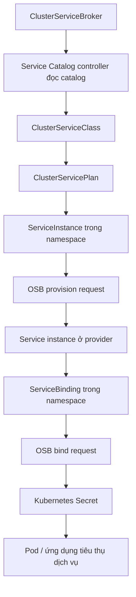
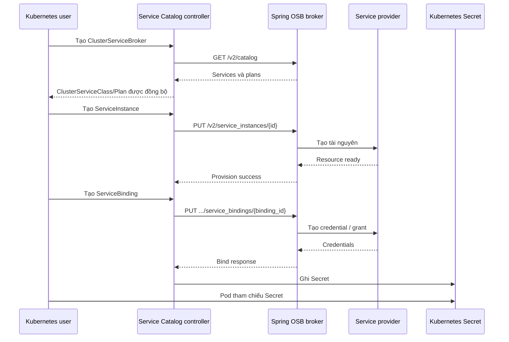

# `ClusterServiceBroker`, `ServiceInstance` và `ServiceBinding` trong Service Catalog

## Service Catalog kết nối Kubernetes với service broker như thế nào?

Kubernetes Service Catalog là một dự án mở rộng Kubernetes từng cung cấp các Custom Resource Definition (CRD) để người dùng tiêu thụ dịch vụ bên ngoài thông qua Open Service Broker API (OSB API). Thay vì tự viết manifest cho từng loại database, queue hay dịch vụ SaaS, người vận hành đăng ký một service broker; người dùng chọn service và plan, tạo `ServiceInstance`, rồi tạo `ServiceBinding` để nhận thông tin kết nối dưới dạng Kubernetes Secret.

Trong module `SPRING_CLOUD_SERVICE_BROKER`, service broker được xây dựng bằng Spring Cloud Open Service Broker. Broker công bố catalog và xử lý các thao tác provision, bind, unbind, update hoặc deprovision theo OSB API. Service Catalog đóng vai trò client OSB ở phía Kubernetes: nó chuyển các thao tác trên CRD thành HTTP request đến broker và phản ánh kết quả trở lại trạng thái resource.

Điểm cần lưu ý về bối cảnh: Kubernetes Service Catalog là dự án add-on/CRD lịch sử, không phải resource API có sẵn trong mọi Kubernetes cluster hiện nay. Repository chính thức đã được chuyển vào tổ chức `kubernetes-retired` và archive ở chế độ read-only ngày 6/5/2022; SIG Service Catalog cũng đã nghỉ hoạt động. Bài học này giải thích mô hình và cách các resource phối hợp với OSB API, hữu ích khi đọc hệ thống cũ hoặc tích hợp tương thích. Trước khi triển khai mới, cần xác minh distribution/fork còn được duy trì và đánh giá giải pháp hiện hành của nền tảng.

## Bản đồ các resource trong mô hình Service Catalog

Service Catalog biểu diễn broker, offering, plan, instance và binding bằng các Kubernetes resource riêng:

| Resource | Scope | Vai trò |
|---|---|---|
| `ClusterServiceBroker` | Cluster-scoped | Đăng ký một broker dùng chung trong cluster. |
| `ClusterServiceClass` | Cluster-scoped | Đại diện cho một service offering mà broker công bố. |
| `ClusterServicePlan` | Cluster-scoped | Đại diện cho một plan của service class. |
| `ServiceInstance` | Namespace-scoped | Yêu cầu broker provision một instance của service/plan đã chọn. |
| `ServiceBinding` | Namespace-scoped | Yêu cầu broker bind một instance cho consumer và lưu credential vào Secret. |
| `Secret` | Namespace-scoped | Lưu dữ liệu kết nối/credential broker trả về cho binding. |

Service Catalog còn có resource `ServiceBroker`, `ServiceClass` và `ServicePlan` ở namespace scope cho mô hình broker chỉ phục vụ một namespace. Bài này tập trung vào `ClusterServiceBroker` cùng `ServiceInstance` và `ServiceBinding`, đồng thời nhắc đến class/plan vì hai resource đó là kết quả đồng bộ catalog và là tham chiếu để provision.



`ClusterServiceBroker`, `ClusterServiceClass` và `ClusterServicePlan` có scope cluster vì chúng mô tả dịch vụ được cung cấp chung. `ServiceInstance` và `ServiceBinding` có namespace vì chúng thuộc về workload/nhóm người dùng cụ thể. Secret do binding tạo cũng nằm trong namespace của `ServiceBinding`, giúp ứng dụng trong cùng namespace tham chiếu theo quy tắc Kubernetes.

## `ClusterServiceBroker`: đăng ký broker ở phạm vi cluster

`ClusterServiceBroker` là resource do cluster operator tạo để Service Catalog biết địa chỉ của một service broker và cách kết nối đến nó. Broker có thể chạy trong cluster, ở cluster khác hoặc trên một hạ tầng cloud bên ngoài, miễn là controller của Service Catalog truy cập được endpoint.

Manifest tối giản minh họa:

```yaml
apiVersion: servicecatalog.k8s.io/v1beta1
kind: ClusterServiceBroker
metadata:
  name: platform-database-broker
spec:
  url: https://broker.example.internal
```

`apiVersion: servicecatalog.k8s.io/v1beta1` là API group/version của dự án Service Catalog lịch sử. Cluster chỉ chấp nhận resource này khi CRD và controller tương ứng đã được cài đặt. Đây không phải API resource mặc định của Kubernetes upstream.

Khi tạo `ClusterServiceBroker`, controller đọc `spec.url`, xác thực broker theo cấu hình được khai báo, rồi gọi endpoint catalog theo OSB API. Catalog response chứa các service offering và plan mà broker hỗ trợ. Service Catalog tạo hoặc cập nhật các resource catalog tương ứng trong Kubernetes.

### Broker authentication và TLS

Broker có thể yêu cầu xác thực service-to-service. Tùy phiên bản Service Catalog và CRD, cấu hình broker có thể chứa thông tin xác thực tham chiếu đến Secret (ví dụ Basic Auth hoặc bearer token). Hãy dùng đúng schema của bản Service Catalog đang vận hành; không đặt username/password hoặc token trực tiếp trong manifest được commit vào Git.

Các nguyên tắc quan trọng:

- Endpoint broker nên dùng HTTPS với certificate được controller tin cậy.
- Secret chứa thông tin xác thực broker chỉ được cấp cho controller/service account cần thiết.
- Giới hạn quyền đọc Secret bằng RBAC và namespace policy.
- Xoay credential theo quy trình có kiểm soát và cập nhật broker registration tương ứng.
- Không expose broker API ra mạng công cộng nếu không cần thiết; nếu có, phải có authentication, TLS và network policy phù hợp.

`ClusterServiceBroker` chỉ đăng ký điểm kết nối và catalog của broker. Nó không đại diện cho một database đã được tạo và cũng không cấp credential cho ứng dụng.

## Từ catalog đến `ClusterServiceClass` và `ClusterServicePlan`

Service Catalog đọc catalog từ broker rồi tạo các resource mô tả service và plan. Với một `ClusterServiceBroker`, các resource tương ứng có scope cluster:

- `ClusterServiceClass` đại diện cho một service offering, thường được nhận diện bằng external ID và external name của broker.
- `ClusterServicePlan` đại diện cho một lựa chọn plan của service class, chẳng hạn `small`, `standard` hoặc `enterprise`.

Một class có thể có nhiều plan. Ví dụ:

| Service class | Plan | Ý nghĩa minh họa |
|---|---|---|
| `postgresql` | `small` | Database nhỏ cho môi trường dev. |
| `postgresql` | `standard` | Database cho ứng dụng production quy mô vừa. |
| `postgresql` | `ha` | Cấu hình có tính sẵn sàng cao. |

Tên Kubernetes resource thường do Service Catalog tạo từ catalog metadata; người dùng nên tham chiếu theo external name hoặc external ID được CRD hỗ trợ, thay vì tự tạo hoặc chỉnh sửa `ClusterServiceClass`/`ClusterServicePlan` do controller quản lý.

Nếu broker đổi catalog, controller có thể đồng bộ lại các class/plan. Việc thay đổi ID service hoặc plan cần được quản lý cẩn thận vì các `ServiceInstance` hiện hữu tham chiếu đến định danh của catalog. Không tái sử dụng một external ID cho một dịch vụ có ngữ nghĩa khác.

## `ServiceInstance`: khai báo ý định provision

`ServiceInstance` là resource namespaced đại diện cho một instance cụ thể của service. Người dùng tạo resource này để yêu cầu Service Catalog gọi broker provision. Controller theo dõi resource, gửi request OSB tương ứng và cập nhật status/conditions theo kết quả xử lý.

Ví dụ tham chiếu cluster-scoped class và plan:

```yaml
apiVersion: servicecatalog.k8s.io/v1beta1
kind: ServiceInstance
metadata:
  name: orders-database
  namespace: payments
spec:
  clusterServiceClassExternalName: postgresql
  clusterServicePlanExternalName: standard
```

Vì đang dùng `ClusterServiceClass` và `ClusterServicePlan`, các trường `clusterServiceClassExternalName` và `clusterServicePlanExternalName` được dùng để xác định service/plan. Nếu dùng `ServiceClass` và `ServicePlan` namespaced, resource `ServiceInstance` phải nằm trong cùng namespace và dùng các trường tham chiếu tương ứng như `serviceClassExternalName` và `servicePlanExternalName`.

Khi controller xử lý resource, luồng khái quát là:

1. Đọc service class và plan được tham chiếu.
2. Xác định broker sở hữu class/plan.
3. Chuẩn hóa `instance_id` và request parameters.
4. Gọi OSB API `PUT /v2/service_instances/{instance_id}`.
5. Nếu broker xử lý đồng bộ, cập nhật kết quả vào resource status.
6. Nếu broker trả `202 Accepted`, controller polling `last_operation` theo OSB API.
7. Khi provision thành công, đánh dấu instance sẵn sàng theo status/condition của Service Catalog.

Tên `instance_id` gửi đến broker được quản lý bởi Service Catalog/controller và không nhất thiết giống tên Kubernetes `metadata.name`. Người vận hành nên dùng các trường status/external ID do controller ghi nhận khi điều tra, không tự giả định hai ID giống nhau.

## Parameters cho ServiceInstance

`ServiceInstance` có thể truyền parameters cho broker để tùy chỉnh tài nguyên, ví dụ tên database, dung lượng, chế độ backup hoặc vùng triển khai. Service Catalog hỗ trợ truyền parameters inline hoặc tham chiếu Kubernetes Secret theo schema của phiên bản CRD.

Ví dụ inline:

```yaml
apiVersion: servicecatalog.k8s.io/v1beta1
kind: ServiceInstance
metadata:
  name: orders-database
  namespace: payments
spec:
  clusterServiceClassExternalName: postgresql
  clusterServicePlanExternalName: standard
  parameters:
    storage_gb: 50
    backup_enabled: true
```

Với tham số nhạy cảm, nên tham chiếu Secret thay vì đưa trực tiếp vào YAML được lưu trong Git. Khi dùng đồng thời inline parameters và parameters từ Secret, Service Catalog gộp hai object theo quy tắc của phiên bản triển khai; nếu hai nguồn có cùng tên property cấp cao nhất thì có thể bị báo lỗi. Cần kiểm tra schema và tài liệu CRD của bản cài đặt trước khi sử dụng.

Một lưu ý vận hành quan trọng: cập nhật nội dung Secret được tham chiếu không tự động có nghĩa Service Catalog gửi lại update request đến broker. Tài liệu Service Catalog lịch sử mô tả việc tăng `UpdateRequests` trên `ServiceInstance` để chủ động kích hoạt update sau khi Secret parameters đã thay đổi. Hãy kiểm tra tính năng này trong phiên bản/fork đang dùng.

Broker phải validate parameters theo schema của service/plan. Kubernetes API server kiểm tra cấu trúc CRD, nhưng không tự hiểu toàn bộ quy tắc nghiệp vụ của database hoặc SaaS provider. Broker vẫn cần kiểm tra quota, kiểu dữ liệu, quyền và khả năng cập nhật.

## `ServiceBinding`: khai báo consumer muốn dùng instance

Sau khi `ServiceInstance` được provision thành công, ứng dụng có thể yêu cầu binding. `ServiceBinding` là resource namespaced biểu diễn ý định kết nối tới một instance. Controller gọi OSB bind endpoint của broker và lưu thông tin kết nối trả về vào Kubernetes Secret.

Ví dụ:

```yaml
apiVersion: servicecatalog.k8s.io/v1beta1
kind: ServiceBinding
metadata:
  name: orders-api-database
  namespace: payments
spec:
  instanceRef:
    name: orders-database
  secretName: orders-database-credentials
```

Trong ví dụ:

- `instanceRef.name` tham chiếu `ServiceInstance` trong cùng namespace.
- `secretName` là tên Secret mà Service Catalog tạo hoặc quản lý để lưu credentials.
- Nếu không khai báo `secretName`, Service Catalog lịch sử mặc định dùng tên của `ServiceBinding` làm tên Secret.

Khi xử lý binding, controller gửi request OSB tương ứng, ví dụ `PUT /v2/service_instances/{instance_id}/service_bindings/{binding_id}`. Khi broker trả thành công, Service Catalog ghi response credentials vào Secret được chỉ định trong cùng namespace với binding.

## Secret được ứng dụng sử dụng như thế nào?

Broker quyết định cấu trúc credentials theo hợp đồng service của mình. OSB API không áp đặt một schema chung cho mọi trường trong object `credentials`; broker cần tài liệu hóa các key mà ứng dụng sẽ nhận.

Ví dụ Secret có thể chứa:

```yaml
apiVersion: v1
kind: Secret
metadata:
  name: orders-database-credentials
  namespace: payments
type: Opaque
stringData:
  host: postgres.example.internal
  port: "5432"
  database: orders
  username: orders_api
  password: REPLACE_WITH_SECRET_VALUE
```

Đây là ví dụ minh họa cấu trúc Secret; trong thực tế Secret được Service Catalog tạo từ binding response, không nên tự tạo song song với controller cho cùng binding. Không commit password thật vào manifest hoặc source control.

Pod có thể tham chiếu Secret dưới dạng biến môi trường:

```yaml
apiVersion: apps/v1
kind: Deployment
metadata:
  name: orders-api
  namespace: payments
spec:
  replicas: 2
  selector:
    matchLabels:
      app: orders-api
  template:
    metadata:
      labels:
        app: orders-api
    spec:
      containers:
        - name: app
          image: example.internal/orders-api:1.0
          envFrom:
            - secretRef:
                name: orders-database-credentials
```

Ứng dụng đọc các biến như `HOST`, `PORT`, `DATABASE`, `USERNAME` và `PASSWORD` theo cách Kubernetes ánh xạ key của Secret thành environment variable. Với key có ký tự không phù hợp tên biến môi trường hoặc cần kiểm soát chặt từng trường, dùng `env.valueFrom.secretKeyRef` hoặc mount Secret thành volume và điều chỉnh key names theo hợp đồng broker.

### Bảo vệ credentials

Secret là đối tượng lưu dữ liệu nhạy cảm nhưng không tự động giải quyết mọi yêu cầu bảo mật. Cần:

- Dùng RBAC để chỉ Pod/service account và operator cần thiết được đọc Secret.
- Bật encryption at rest cho dữ liệu Secret trong etcd theo cấu hình cluster.
- Hạn chế quyền `list`/`watch` Secret trong namespace.
- Không in nội dung Secret vào log, event hoặc pipeline CI.
- Xoay credential và cập nhật binding theo khả năng broker.
- Dùng network policy để giới hạn workload nào có thể truy cập endpoint service.

Secret do binding tạo nằm trong namespace của binding. Điều này hỗ trợ cô lập theo namespace, nhưng không thay thế authorization ở provider: broker vẫn phải tạo credential với quyền tối thiểu và không cấp quyền rộng hơn nhu cầu consumer.

## Vòng đời binding và instance

Quan hệ vòng đời có thứ tự:

1. Cluster operator đăng ký `ClusterServiceBroker`.
2. Service Catalog đồng bộ catalog thành `ClusterServiceClass` và `ClusterServicePlan`.
3. Người dùng tạo `ServiceInstance` để provision.
4. Sau khi instance sẵn sàng, người dùng tạo `ServiceBinding`.
5. Controller gọi bind và ghi credentials vào Secret.
6. Ứng dụng dùng Secret để kết nối service.
7. Khi ứng dụng không còn cần service, xóa `ServiceBinding`; controller gọi unbind và xử lý Secret theo vòng đời binding.
8. Khi không còn consumer, xóa `ServiceInstance`; controller gọi deprovision.



Unbind nên diễn ra trước deprovision vì binding thường tạo credential, role hoặc grant phụ thuộc vào instance. Nếu xóa instance trong khi binding còn tồn tại, ứng dụng có thể mất kết nối đột ngột và broker có thể không còn đủ thông tin để thu hồi quyền riêng của từng consumer.

## Trạng thái và reconciliation

Kubernetes resource có `spec` mô tả trạng thái mong muốn và `status` phản ánh kết quả do controller quan sát. Với Service Catalog, người dùng tạo hoặc cập nhật resource; controller theo dõi event, gọi broker và cập nhật status/conditions.

Ví dụ:

- `ClusterServiceBroker` được tạo nhưng catalog fetch lỗi: broker registration chưa sẵn sàng.
- `ServiceInstance` tồn tại nhưng provision đang chạy: instance chưa thể được xem là usable.
- `ServiceBinding` tồn tại nhưng bind thất bại: Secret có thể chưa được tạo hoặc chưa có credentials hợp lệ.

Controller có thể retry hoặc reconcile khi có event mới, nhưng không nên giả định mọi provider call được thực hiện đúng một lần. Broker cần idempotency cho provision/bind/unbind/deprovision và lưu operation để request lặp không tạo tài nguyên hoặc credential trùng.

Khi điều tra, kiểm tra cả resource và status:

```bash
kubectl get clusterservicebrokers
kubectl describe clusterservicebroker platform-database-broker

kubectl get clusterserviceclasses
kubectl get clusterserviceplans

kubectl -n payments get serviceinstances
kubectl -n payments describe serviceinstance orders-database

kubectl -n payments get servicebindings
kubectl -n payments describe servicebinding orders-api-database
kubectl -n payments get secret orders-database-credentials
```

Các lệnh trên chỉ có tác dụng nếu Service Catalog CRD/controller đã được cài đặt. `kubectl describe` giúp xem conditions và event; không nên chỉ nhìn việc object tồn tại rồi kết luận provision/bind thành công.

## Liên hệ với Spring Cloud Open Service Broker

Service Catalog là OSB client. Spring Cloud Open Service Broker là framework giúp xây dựng server thực hiện hợp đồng OSB. Hai bên giao tiếp qua HTTP, không chia sẻ Kubernetes object trực tiếp.

| Resource Kubernetes | Tác động OSB điển hình | Phần broker Spring xử lý |
|---|---|---|
| `ClusterServiceBroker` | `GET /v2/catalog` | Công bố service offering và plan. |
| `ServiceInstance` create | `PUT /v2/service_instances/{instance_id}` | Provision tài nguyên và lưu trạng thái instance. |
| `ServiceInstance` update | `PATCH /v2/service_instances/{instance_id}` | Kiểm tra khả năng update và áp dụng thay đổi. |
| `ServiceInstance` delete | `DELETE /v2/service_instances/{instance_id}` | Deprovision tài nguyên sau khi xử lý binding phụ thuộc. |
| `ServiceBinding` create | `PUT /v2/service_instances/{instance_id}/service_bindings/{binding_id}` | Tạo credential, role hoặc policy và trả credentials. |
| `ServiceBinding` delete | `DELETE /v2/service_instances/{instance_id}/service_bindings/{binding_id}` | Thu hồi credential/quyền của binding. |
| Async operation | `GET .../last_operation` | Trả tiến độ provision/update/deprovision/bind/unbind. |

Trong Spring Cloud Open Service Broker, ứng dụng thường cung cấp catalog service và triển khai service instance/binding service tương ứng với phiên bản thư viện. Tên interface, request model và response model phải được đối chiếu với dependency đang dùng. Service Catalog không yêu cầu broker phải được viết bằng Java hoặc Spring; chỉ cần broker tuân thủ OSB API và đáp ứng network/authentication mà controller cấu hình.

### Ví dụ response bind

Broker có thể trả credentials trong response bind:

```json
{
  "credentials": {
    "host": "postgres.example.internal",
    "port": 5432,
    "database": "orders",
    "username": "orders_api",
    "password": "generated-secret"
  }
}
```

Service Catalog lấy các key trong `credentials` và ghi vào Secret. Vì schema credentials do broker quyết định, nhóm phát triển broker và ứng dụng cần thống nhất tên key, kiểu dữ liệu, cách xoay credential và cách xử lý thay đổi schema.

## Phân quyền và phạm vi sử dụng

`ClusterServiceBroker` là cluster-scoped nên việc tạo/sửa thường thuộc cluster operator. `ServiceInstance` và `ServiceBinding` là namespaced, vì vậy quyền tạo chúng có thể được cấp cho nhóm người dùng ở namespace cụ thể.

Một số nguyên tắc phân quyền:

- Chỉ cluster operator được đăng ký broker có phạm vi cluster.
- Chỉ cho phép namespace/role được cấp quyền tạo instance từ class/plan phù hợp.
- Hạn chế quyền tạo `ServiceBinding` vì thao tác này có thể cấp credential.
- Hạn chế quyền đọc Secret do binding tạo.
- Kiểm soát namespace nào được tham chiếu đến cluster-scoped class/plan.
- Giới hạn broker network egress và credential truy cập provider.

Không coi `ClusterServiceBroker` là cơ chế authorization duy nhất. Quyền Kubernetes RBAC kiểm soát ai được tạo CRD; broker vẫn phải kiểm tra quyền và quota ở lớp nghiệp vụ/provider. Nếu nhiều tenant cùng dùng broker, cần phân vùng resource, credential và quota theo tenant.

## Những giới hạn cần biết trước khi áp dụng

Kubernetes Service Catalog lịch sử từng cung cấp mô hình CRD và controller tiện dụng, nhưng repository upstream đã archive. Điều này có nghĩa:

- Không giả định các CRD `servicecatalog.k8s.io/v1beta1` có sẵn trên cluster Kubernetes hiện đại.
- Không thêm manifest `ClusterServiceBroker`, `ServiceInstance` hoặc `ServiceBinding` vào production trước khi xác minh CRD/controller tương thích đã được cài và duy trì.
- Các ví dụ YAML trong bài phản ánh API Service Catalog lịch sử; có thể cần điều chỉnh theo fork/distribution.
- Không nhầm `ServiceBinding` của Service Catalog với các API hoặc operator khác có tên tương tự trong hệ sinh thái Kubernetes.
- Nếu xây dựng hệ thống mới, đánh giá maintained operator, cloud provider integration, External Secrets/CSI driver hoặc giải pháp platform service binding hiện hành theo nhu cầu thực tế.

Mô hình OSB vẫn có giá trị kiến trúc: broker cung cấp catalog và vòng đời service; một control plane khác có thể chuyển yêu cầu người dùng thành OSB calls, quản lý trạng thái và phân phối credential. Tuy nhiên, lựa chọn controller/CRD cụ thể phải dựa trên trạng thái bảo trì hiện tại.

## Checklist triển khai và vận hành

1. Xác minh Service Catalog CRD/controller thực sự có mặt và được hỗ trợ trong cluster.
2. Xác định broker cần dùng cluster scope hay namespace scope.
3. Đăng ký `ClusterServiceBroker` với URL HTTPS và authentication an toàn.
4. Kiểm tra catalog đã đồng bộ thành class/plan đúng external ID và external name.
5. Tạo `ServiceInstance` tham chiếu đúng class/plan và namespace.
6. Validate parameters tại broker; dùng Secret cho dữ liệu nhạy cảm.
7. Chờ instance provision thành công trước khi tạo binding.
8. Tạo `ServiceBinding` với `instanceRef` đúng và `secretName` có chủ đích.
9. Kiểm tra Secret đã được tạo trong cùng namespace và chứa đúng key credentials.
10. Cấp RBAC tối thiểu cho việc tạo binding và đọc Secret.
11. Kiểm tra status/conditions và controller logs khi operation chưa hoàn tất.
12. Xóa binding trước instance để unbind trước deprovision.
13. Đảm bảo broker xử lý request lặp idempotent và hỗ trợ reconciliation.
14. Không nhầm ví dụ Service Catalog lịch sử với API Kubernetes mặc định hiện nay.

## Kết luận

Trong Kubernetes Service Catalog, `ClusterServiceBroker` đăng ký broker ở phạm vi cluster; controller đọc catalog và tạo `ClusterServiceClass`/`ClusterServicePlan`. Người dùng tạo `ServiceInstance` để yêu cầu provision, sau đó tạo `ServiceBinding` để yêu cầu bind và nhận credentials trong Kubernetes Secret cùng namespace. Pod tham chiếu Secret để kết nối dịch vụ. Ở phía broker, Spring Cloud Open Service Broker xử lý các request OSB tương ứng và phải duy trì idempotency, trạng thái operation, bảo mật credentials cùng vòng đời unbind/deprovision. Đây là mô hình tích hợp lịch sử có giá trị học tập; Service Catalog upstream đã archive, vì vậy cần xác minh giải pháp được duy trì trước khi áp dụng cho hệ thống mới.

## Tài liệu tham khảo

- [Kubernetes Service Catalog – Resources](https://service-catalog.drycc.cc/docs/resources/): scope của broker/class/plan, manifest `ServiceInstance`, `ServiceBinding`, parameters và Secret.
- [Kubernetes Service Catalog – Concepts](https://service-catalog.drycc.cc/docs/concepts/): kiến trúc Service Catalog, vai trò controller và quan hệ với OSB API.
- [Kubernetes Service Catalog – Design](https://service-catalog.drycc.cc/docs/design/): cách controller chuyển Kubernetes resource thành OSB API calls.
- [kubernetes-retired/service-catalog](https://github.com/kubernetes-retired/service-catalog): repository Service Catalog được archive ngày 6/5/2022.
- [Kubernetes SIG Service Catalog retirement discussion](https://groups.google.com/a/kubernetes.io/g/dev/c/QRcg6XacYRw/m/4ghGcUk3EwAJ): thông tin SIG nghỉ hoạt động và không có giải pháp thay thế trực tiếp trong Kubernetes project tại thời điểm công bố.
