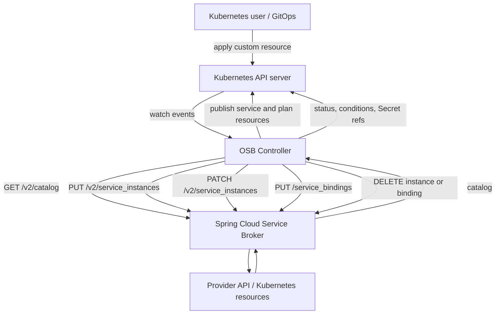
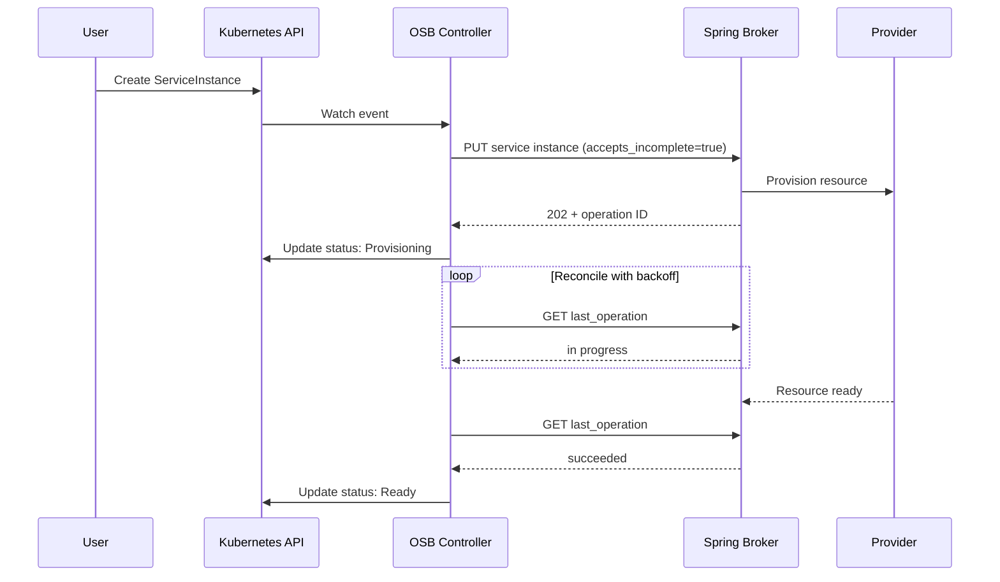
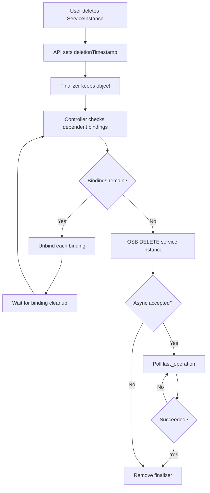

# Luồng đồng bộ danh mục và quản lý vòng đời qua bộ điều khiển OSB

Kubernetes quản lý workload thông qua các API resource và controller liên tục đối chiếu trạng thái mong muốn với trạng thái thực tế. Khi tích hợp Open Service Broker API (OSB API), một bộ điều khiển phía platform có thể dùng cùng mô hình đó để đồng bộ catalog của service broker và quản lý vòng đời service instance, binding. Controller đọc cấu hình broker, gọi endpoint OSB, lưu kết quả vào các Kubernetes resource và tiếp tục reconcile khi có thay đổi hoặc lỗi.

Trong kiến trúc này, Spring Cloud Service Broker là phía cung cấp API OSB. Kubernetes-side controller là client của broker: nó đăng ký hoặc cấu hình broker, đọc catalog, chuyển service/plan thành đối tượng mà người dùng Kubernetes có thể chọn, rồi gọi provision, update, bind, unbind và deprovision theo vòng đời resource. Hai thành phần có trách nhiệm khác nhau: broker quản lý nghiệp vụ và tài nguyên phía sau; controller quản lý desired state của Kubernetes và đồng bộ nó với broker.

## 1. Kiến trúc tổng thể

Một luồng tích hợp điển hình có các thành phần:

- **Kubernetes API server:** lưu custom resources, trạng thái và metadata.
- **OSB controller:** theo dõi resource, đồng bộ catalog và gọi broker.
- **ServiceBroker configuration resource:** mô tả URL, thông tin xác thực và phiên bản API của broker.
- **Catalog resources:** biểu diễn service offering và plan được broker công bố.
- **ServiceInstance resource:** mô tả service instance mà người dùng muốn tạo hoặc cập nhật.
- **ServiceBinding resource:** mô tả liên kết giữa service instance với ứng dụng hoặc consumer.
- **Spring Cloud Service Broker:** cung cấp endpoint OSB và điều phối provider.
- **Provider:** database, message broker, dịch vụ cloud hoặc tài nguyên Kubernetes mà broker quản lý.



Kubernetes không có sẵn một OSB controller trong mọi bản phân phối. Mô hình này cần một extension, operator hoặc controller được cài đặt riêng. Một số implementation Service Catalog trước đây dùng các resource như `ServiceBroker`, `ServiceClass`, `ServicePlan`, `ServiceInstance` và `ServiceBinding`; đó là API mở rộng/CRD của implementation, không phải resource core Kubernetes. Các operator mới có thể dùng tên và schema CRD khác nhau.

## 2. Phân biệt catalog, service instance và binding

OSB catalog mô tả những dịch vụ broker có thể cung cấp. Service instance và binding là các tài nguyên cụ thể được tạo theo catalog đó.

| Đối tượng | Nguồn dữ liệu | Mục đích |
|---|---|---|
| Service catalog | `GET /v2/catalog` của broker | Liệt kê service offering và plan |
| Service class | Controller tạo từ service trong catalog | Đại diện một loại dịch vụ có thể chọn |
| Service plan | Controller tạo từ plan trong catalog | Đại diện cấu hình/giới hạn của service |
| Service instance | Custom resource do người dùng tạo | Yêu cầu một tài nguyên dịch vụ cụ thể |
| Service binding | Custom resource do người dùng tạo | Yêu cầu kết nối một consumer với instance |
| Kubernetes Secret | Controller tạo sau binding | Lưu credentials/connection details để workload sử dụng |

Không nhầm OSB service definition với Kubernetes `Service`. Kubernetes Service là đối tượng network để truy cập Pod; OSB service là một loại dịch vụ mà broker có thể provision, ví dụ PostgreSQL hoặc Redis. Một OSB service instance có thể được broker triển khai bằng database bên ngoài, một workload trong cluster hoặc dịch vụ managed cloud.

## 3. Cấu hình broker trong Kubernetes

Controller cần biết địa chỉ broker, phiên bản OSB API và credential dùng để gọi broker. Có thể biểu diễn bằng một CRD cấu hình:

```yaml
apiVersion: broker.example.io/v1alpha1
kind: ServiceBroker
metadata:
  name: platform-services
spec:
  url: https://broker.example.com
  authInfo:
    basic:
      secretRef:
        name: platform-services-auth
        namespace: broker-system
  apiVersion: "2.17"
  catalogRefreshInterval: 10m
```

Đây là schema minh họa, không phải CRD chuẩn của Kubernetes hoặc OSB. Tên field và scope phụ thuộc controller đang triển khai. Secret được tham chiếu có thể chứa username/password Basic Authentication; không đưa password trực tiếp vào spec, annotation hoặc Git manifest.

Controller cần:

1. Validate URL và cấu hình TLS.
2. Đọc Secret qua Kubernetes API bằng service account có quyền tối thiểu.
3. Xác thực kết nối broker và gọi endpoint catalog.
4. Ghi điều kiện trạng thái như `Ready`, `CatalogSynced` hoặc `AuthenticationFailed`.
5. Không log Authorization header hay secret.
6. Theo dõi thay đổi URL, Secret reference và API version để đồng bộ lại khi cấu hình thay đổi.

Khi broker nằm ngoài cluster, URL phải trỏ đến endpoint HTTPS có certificate hợp lệ. Không tắt certificate verification để xử lý lỗi CA hoặc hostname. Nếu dùng private CA, cấu hình trust bundle cho controller.

## 4. Đồng bộ catalog từ OSB broker

### 4.1. Gọi endpoint catalog

Sau khi cấu hình broker hợp lệ, controller gọi:

```http
GET /v2/catalog HTTP/1.1
Host: broker.example.com
X-Broker-API-Version: 2.17
Authorization: Basic <broker-credentials>
```

Broker trả catalog JSON. Một phần response minh họa:

```json
{
  "services": [
    {
      "id": "postgresql-service-v1",
      "name": "postgresql",
      "description": "Managed PostgreSQL",
      "bindable": true,
      "plan_updateable": true,
      "bindings_retrievable": true,
      "plans": [
        {
          "id": "postgresql-standard-v1",
          "name": "standard",
          "description": "Standard PostgreSQL plan"
        }
      ]
    }
  ]
}
```

Các ID `service.id` và `plan.id` là định danh ổn định mà controller phải giữ khi tạo OSB request. Tên service/plan phục vụ hiển thị, không nên dùng thay cho ID trong request lifecycle. Controller cũng cần đọc các capability như `bindable`, `plan_updateable` và `bindings_retrievable` để quyết định tính năng nào được phép.

### 4.2. Chuyển catalog thành Kubernetes resources

Controller có thể tạo một resource service class cho mỗi service definition và một resource service plan cho mỗi plan. Các trường cần giữ gồm:

- Broker reference và broker identity.
- Service ID, name, description.
- Binding capability và các capability update/retrieve.
- Plan ID, name, description.
- Metadata cần thiết để người dùng chọn plan.
- Thời điểm đồng bộ và catalog generation/hash.

Ví dụ một service class resource:

```yaml
apiVersion: catalog.example.io/v1alpha1
kind: ServiceClass
metadata:
  name: postgresql-service-v1
spec:
  brokerRef: platform-services
  serviceID: postgresql-service-v1
  serviceName: postgresql
  bindable: true
  planUpdateable: true
  plans:
    - planID: postgresql-standard-v1
      name: standard
```

Schema này chỉ minh họa cách biểu diễn. Một controller có thể tạo ServiceClass và ServicePlan thành hai CRD riêng, hoặc lưu chúng trong cache nội bộ. Người dùng chỉ nên tham chiếu đến class/plan đã được controller xác nhận là thuộc broker tương ứng.

### 4.3. Đồng bộ định kỳ và thay đổi catalog

Catalog có thể thay đổi khi broker thêm plan, sửa mô tả hoặc retire một service. Controller cần hỗ trợ:

- Đồng bộ lần đầu khi broker được đăng ký.
- Làm mới theo chu kỳ cấu hình.
- Làm mới khi URL, credential hoặc API version thay đổi.
- Retry khi broker tạm thời không truy cập được.
- Ghi nhận thời điểm đồng bộ thành công gần nhất.
- Phát hiện service/plan mới, thay đổi và bị loại khỏi catalog.

Không nên xóa ngay service class hoặc plan chỉ vì nó biến mất khỏi lần catalog refresh mới. Service instance đang tồn tại có thể vẫn cần plan ID cũ để update, retrieve hoặc deprovision. Nên đánh dấu class/plan là unavailable hoặc deprecated cho yêu cầu mới, đồng thời giữ metadata cần thiết cho lifecycle của instance cũ.

Controller không được tự ý thay đổi service ID hoặc plan ID khi tên hiển thị thay đổi. Nếu broker thay ID, đó thường là một định danh mới; cần xử lý migration hoặc retire theo policy thay vì coi hai ID là cùng một plan.

### 4.4. Catalog refresh thất bại

Nếu broker tạm thời không khả dụng, controller nên giữ catalog snapshot cuối cùng đã đồng bộ thành công và ghi điều kiện `CatalogSynced=False` cùng thời điểm lỗi. Không xóa catalog cũ chỉ vì một lần GET timeout. Tuy nhiên, snapshot cũ không đồng nghĩa broker hiện tại chắc chắn còn hỗ trợ provision mới; controller có thể chặn thao tác mới theo freshness policy trong khi vẫn giữ thông tin để quản lý instance cũ.

## 5. Biểu diễn service instance bằng custom resource

Người dùng tạo một custom resource mô tả service instance mong muốn:

```yaml
apiVersion: services.example.io/v1alpha1
kind: ServiceInstance
metadata:
  name: orders-db
  namespace: production
spec:
  brokerRef: platform-services
  serviceClassRef: postgresql-service-v1
  planRef: postgresql-standard-v1
  parameters:
    storage_gb: 100
    backup_retention_days: 14
```

Controller đọc spec và gọi OSB provision. Nó có thể tạo một OSB service instance ID ổn định từ Kubernetes object UID hoặc lưu ID đã cấp trong status/annotation được quản lý. Không dùng tên resource đơn lẻ làm ID toàn cục vì hai namespace có thể có cùng tên.

Một status minh họa:

```yaml
status:
  observedGeneration: 1
  phase: Provisioning
  serviceInstanceID: 7f8b...stable-id
  operationID: provision-2026-000891
  conditions:
    - type: Ready
      status: "False"
      reason: OperationInProgress
      message: Provider is provisioning the service.
```

`status` là dữ liệu controller ghi, không phải phần người dùng dùng để khai báo desired state. `observedGeneration` cho biết controller đã xử lý đến generation nào của spec. Tên phase và condition cụ thể tùy CRD implementation.

## 6. Provision: từ ServiceInstance đến OSB PUT

Khi controller phát hiện ServiceInstance mới, nó:

1. Kiểm tra broker reference và catalog entry.
2. Kiểm tra service ID, plan ID và capability.
3. Validate parameters theo schema broker công bố nếu controller có schema.
4. Tạo hoặc lấy stable OSB instance ID.
5. Gọi endpoint provision.
6. Lưu kết quả đồng bộ hoặc operation ID vào status.
7. Reconcile tiếp cho đến khi instance sẵn sàng hoặc thất bại.

Request OSB minh họa:

```http
PUT /v2/service_instances/7f8b...stable-id?accepts_incomplete=true
X-Broker-API-Version: 2.17
Content-Type: application/json

{
  "service_id": "postgresql-service-v1",
  "plan_id": "postgresql-standard-v1",
  "context": {
    "platform": "kubernetes",
    "namespace": "production"
  },
  "parameters": {
    "storage_gb": 100,
    "backup_retention_days": 14
  }
}
```

Controller có thể gửi `accepts_incomplete=true` nếu implementation hỗ trợ asynchronous provisioning. Nếu broker trả 201 Created, controller ghi nhận instance đã provision thành công. Nếu broker trả 202 Accepted, controller lưu `operation` rồi polling `last_operation`.

Broker cần đảm bảo idempotency cho cùng service instance ID. Nếu controller restart sau khi broker đã tạo tài nguyên nhưng trước khi status được cập nhật, controller gửi lại cùng instance ID và cùng dữ liệu nghiệp vụ; broker phải nhận diện request lặp theo hợp đồng OSB thay vì tạo một resource mới. Nếu request cùng ID nhưng service/plan/parameters xung đột, controller phải xử lý lỗi conflict thay vì tự sinh ID mới để che lỗi.

## 7. Theo dõi operation bất đồng bộ

OSB provision, update và deprovision có thể chạy bất đồng bộ khi platform chấp nhận incomplete operation. Controller lưu operation ID và truy vấn:

```http
GET /v2/service_instances/{instance_id}/last_operation?service_id={service_id}&plan_id={plan_id}&operation={operation_id}
```

Response có state:

- `in progress`: broker vẫn đang thực hiện hoặc chờ retry.
- `succeeded`: operation đã hoàn tất.
- `failed`: operation đã kết thúc thất bại.

Khi nhận `in progress`, controller không nên polling liên tục. Nó requeue resource sau một khoảng delay, có backoff và jitter. Khi `succeeded`, cập nhật phase và condition `Ready=True`. Khi `failed`, cập nhật condition lỗi với message an toàn và giữ đủ metadata để người vận hành xử lý.



Khi controller không truy cập được broker trong lúc polling, nó giữ operation ID và retry. Không xóa operation ID hoặc gửi một provision mới với ID khác chỉ vì một lần GET timeout.

## 8. Update service instance

Người dùng có thể thay đổi plan hoặc parameters trong spec của ServiceInstance nếu broker và plan hỗ trợ. Controller so sánh spec mới với trạng thái đã quan sát và tạo OSB PATCH:

```http
PATCH /v2/service_instances/{instance_id}?accepts_incomplete=true
X-Broker-API-Version: 2.17
Content-Type: application/json

{
  "service_id": "postgresql-service-v1",
  "plan_id": "postgresql-high-availability-v1",
  "parameters": {
    "storage_gb": 200
  },
  "previous_values": {
    "service_id": "postgresql-service-v1",
    "plan_id": "postgresql-standard-v1"
  }
}
```

Trước khi PATCH, controller kiểm tra:

- Broker catalog công bố khả năng update plan nếu plan thay đổi.
- Plan đích còn khả dụng cho yêu cầu mới.
- Parameters hợp lệ với plan đích.
- Instance không có operation mutation khác đang chạy.
- Spec generation mới chưa được xử lý trước đó.

Nếu broker trả 202, controller lưu operation ID và theo dõi như provision. Chỉ cập nhật status plan đã áp dụng sau khi operation thành công. Nếu PATCH bị conflict do operation khác đang chạy, controller requeue sau khi operation hiện tại hoàn tất; không tạo thêm mutation cạnh tranh.

Controller nên định nghĩa rõ semantics của parameters. Nếu field bị lược bỏ nghĩa là giữ nguyên, không được tự gửi object rỗng như thể người dùng yêu cầu reset toàn bộ cấu hình. Với các field không thể cập nhật sau provision, CRD validation hoặc controller phải trả condition rõ ràng thay vì lặp PATCH vô hạn.

## 9. Binding và Kubernetes Secret

Sau khi service instance sẵn sàng, người dùng có thể tạo ServiceBinding custom resource tham chiếu instance và consumer:

```yaml
apiVersion: services.example.io/v1alpha1
kind: ServiceBinding
metadata:
  name: orders-api-db
  namespace: production
spec:
  instanceRef: orders-db
  application:
    appGUID: orders-api
  secretName: orders-db-credentials
```

Controller xác minh instance Ready và service bindable, sau đó gọi OSB binding endpoint:

```http
PUT /v2/service_instances/{instance_id}/service_bindings/{binding_id}
X-Broker-API-Version: 2.17
Content-Type: application/json

{
  "service_id": "postgresql-service-v1",
  "plan_id": "postgresql-standard-v1",
  "bind_resource": {
    "app_guid": "orders-api"
  }
}
```

Với application binding, broker có thể trả `credentials` chứa hostname, port, database, username và password. Controller tạo Kubernetes Secret để workload mount hoặc đọc qua environment/configuration. Secret data phải được ghi dưới dạng bytes/base64 theo Kubernetes API; Base64 trong Secret manifest không phải mã hóa. Cần bật encryption at rest ở etcd và giới hạn RBAC.

Với route binding, request có thể chứa `bind_resource.route` và response có thể chứa `route_service_url`. Controller chỉ hỗ trợ kiểu binding mà platform integration và broker thực sự công bố.

Không đưa credentials vào `ServiceBinding.status`, event message, log hoặc annotation. Status chỉ nên chứa tên Secret và condition. Khi Secret đã tồn tại, controller cần tránh ghi đè thủ công do người dùng quản lý nếu CRD cho phép chỉ định Secret name; có thể dùng owner reference và ownership label để phân biệt Secret do controller tạo.

OSB binding thường được xử lý đồng bộ theo contract mà broker công bố; không mặc định áp dụng async polling cho mọi binding request. Controller phải tuân theo khả năng và response thực tế của API version/implementation.

## 10. Unbind và deprovision khi Kubernetes resource bị xóa

Khi ServiceBinding bị xóa, controller cần gọi OSB DELETE binding để thu hồi principal hoặc route registration. Khi service instance bị xóa, controller phải bảo đảm các binding phụ thuộc đã được gỡ theo lifecycle policy trước khi gọi deprovision instance.

Kubernetes finalizer giúp controller hoàn tất cleanup trước khi API server xóa hẳn custom resource:

1. Controller thêm finalizer khi bắt đầu quản lý resource.
2. Người dùng xóa object; API server đặt `deletionTimestamp` nhưng giữ object vì finalizer còn tồn tại.
3. Controller nhận biết deletion và gọi OSB DELETE.
4. Nếu broker xử lý async, controller lưu operation ID và polling đến khi `succeeded`.
5. Controller xóa Secret do binding quản lý sau khi unbind hoàn tất.
6. Khi cleanup được xác nhận, controller gỡ finalizer.
7. Kubernetes mới xóa object hoàn toàn.



Nếu broker unavailable, finalizer vẫn được giữ và controller retry theo backoff. Điều này có nghĩa object sẽ ở trạng thái Terminating lâu hơn, nhưng tránh xóa record Kubernetes trong khi tài nguyên provider còn tồn tại. Không tự động gỡ finalizer chỉ để làm object biến mất nếu chưa xác minh cleanup; hành động force-finalize có thể để lại tài nguyên mồ côi và cần quy trình vận hành có audit.

## 11. Reconciliation loop và idempotency

Kubernetes controller hoạt động theo mô hình level-based reconciliation: mỗi lần reconcile đọc trạng thái hiện tại của object, so sánh spec mong muốn với status và trạng thái bên ngoài, sau đó thực hiện bước tiếp theo. Event chỉ là tín hiệu để reconcile; không nên xem mỗi event là một lệnh OSB độc lập.

Một reconcile function cho service instance có thể theo logic:

    reconcile(instance):
      if instance is deleting:
        ensure bindings are removed
        ensure OSB deprovision is complete
        remove finalizer
        return

      ensure finalizer exists
      load broker and catalog references
      if no OSB instance ID exists:
        derive or persist stable instance ID
        submit provision once
      else if operation ID exists:
        poll last_operation
      else if desired spec differs from applied spec:
        submit update once
      else:
        verify or refresh observed status

Đây là pseudocode mô tả trách nhiệm, không phải controller framework API cụ thể. Mọi side effect phải có khóa ổn định và được ghi nhận trước hoặc ngay sau khi gửi request theo một quy trình phục hồi rõ ràng.

Các nguyên tắc:

- Cùng một object UID phải dùng cùng OSB instance ID qua retry và restart.
- Cùng một binding UID phải dùng cùng OSB binding ID.
- Lưu operation ID trước khi chuyển sang bước tiếp theo.
- Nếu response bị mất, tra cứu trạng thái broker hoặc gửi lại cùng request identity nghiệp vụ theo semantics idempotency.
- Không tạo resource mới chỉ vì status update bị conflict.
- Dùng `resourceVersion`, optimistic concurrency hoặc patch status có điều kiện.
- Dùng work queue có rate limiter để tránh retry quá nhanh.
- Dùng leader election hoặc claim/lease nếu controller có nhiều replica; vẫn phải bảo đảm idempotency vì event có thể giao nhiều lần.

OSB broker cũng phải hỗ trợ idempotency. Controller và broker cùng cần bảo vệ side effect: controller giữ ID ổn định, broker kiểm tra instance/binding đã tồn tại và trả kết quả nhất quán cho request lặp.

## 12. Status, condition và quan sát vận hành

Không nên biểu diễn toàn bộ vòng đời chỉ bằng một chuỗi phase. Conditions giúp người vận hành biết nguyên nhân:

| Condition | Ý nghĩa |
|---|---|
| `CatalogSynced` | Catalog đã được tải và chuyển đổi thành công |
| `Ready` | Service instance hoặc binding đã sẵn sàng |
| `Provisioning` | Provision operation đang chạy |
| `Updating` | Update operation đang chạy |
| `Deprovisioning` | Cleanup instance đang chạy |
| `CredentialsAvailable` | Secret đã được tạo và có thể dùng |
| `BrokerReachable` | Controller kết nối broker thành công |

Các condition type có thể khác giữa implementation. Nên ghi `reason`, message an toàn, `lastTransitionTime` và `observedGeneration`. Message không chứa password, token, raw provider response hoặc endpoint nội bộ nhạy cảm.

Metric vận hành nên theo dõi:

- Thời gian catalog sync và thời điểm sync thành công gần nhất.
- Số ServiceInstance ở Provisioning, Updating, Deprovisioning hoặc Failed.
- Tuổi operation chưa terminal.
- Số lần retry và lỗi broker/provider theo nhóm.
- Số object Terminating do finalizer.
- Số Secret binding được tạo hoặc cleanup.
- Queue depth và thời gian reconcile.

Không dùng tên instance hoặc binding làm metric label có cardinality cao. Dùng log và event để truy vấn chi tiết, metric tổng hợp theo broker, operation type và error category.

## 13. Bảo mật và phân quyền

Controller có quyền gọi broker và tạo Secret nên cần được cấp quyền tối thiểu:

- RBAC chỉ cho phép đọc CRD broker/catalog và quản lý status/finalizer của resource cần thiết.
- Chỉ cho phép đọc Secret chứa broker credentials và ghi Secret binding trong namespace được quản lý.
- Không cấp quyền đọc toàn bộ Secret cluster nếu không cần.
- Dùng HTTPS và xác minh certificate của broker.
- Hạn chế broker URL theo policy để tránh controller bị lợi dụng gọi endpoint tùy ý (SSRF).
- Không log Authorization header, credentials, raw binding response hoặc Secret data.
- Giới hạn parameters và kiểm tra dữ liệu trước khi gửi broker.
- Áp dụng namespace/tenant scope để một namespace không thể tham chiếu service instance của namespace khác nếu không được phép.
- Bảo vệ CRD spec/status bằng Kubernetes RBAC và admission policy.

Nếu broker credentials được lưu trong Secret, cần có quy trình rotation. Controller phải phát hiện Secret version/resourceVersion thay đổi, cập nhật client và kiểm tra kết nối lại mà không làm lộ credential. Nếu credential mới không hợp lệ, giữ catalog snapshot cuối cùng và báo `BrokerReachable=False`; không xóa service instance đang tồn tại.

## 14. Xử lý lỗi và phục hồi

| Tình huống | Hành vi controller |
|---|---|
| Broker trả 401/403 | Kiểm tra Secret credentials và quyền; không retry nhanh vô hạn |
| Broker timeout khi GET catalog | Giữ catalog snapshot cuối, đánh dấu sync lỗi và retry |
| Broker trả catalog sai schema | Không publish catalog một phần; ghi condition lỗi |
| Provision trả 202 | Lưu operation ID và poll last_operation |
| Provision response bị mất | Dùng lại stable instance ID, kiểm tra broker state trước khi tạo lại |
| Update trả 409 ConcurrencyError | Chờ operation hiện tại và reconcile lại |
| Provider lỗi sau khi broker nhận async | Broker quản lý retry; controller tiếp tục polling |
| Binding Secret write thất bại | Giữ trạng thái binding chưa sẵn sàng, retry tạo Secret từ dữ liệu được lưu an toàn |
| Unbind/deprovision broker unavailable | Giữ finalizer, backoff và báo condition |
| Controller restart | Đọc spec/status hiện tại và tiếp tục từ operation ID đã lưu |
| Catalog bỏ một plan đang được dùng | Không xóa metadata cần cho instance hiện hữu; chặn tạo mới theo policy |

Không đánh dấu `Ready=True` chỉ vì broker trả HTTP 202. 202 nghĩa là broker đã nhận operation; controller chỉ đánh dấu Ready khi last_operation trả succeeded và các điều kiện cần thiết khác đã được xác nhận.

## 15. Kiểm thử catalog sync và lifecycle controller

Các kiểm thử quan trọng:

1. Broker mới được cấu hình; controller gọi GET catalog và tạo service/plan resources tương ứng.
2. Catalog có nhiều service và plan; ID được giữ nguyên, tên chỉ dùng để hiển thị.
3. Catalog refresh thêm plan mới; controller publish plan mà không làm thay đổi instance đang hoạt động.
4. Plan bị retire; instance cũ vẫn có thể deprovision bằng plan ID đã lưu.
5. Broker GET catalog timeout; snapshot cũ không bị xóa.
6. ServiceInstance mới tạo; controller gửi OSB PUT đúng service ID, plan ID, context và parameters.
7. Broker trả 201; status instance chuyển Ready.
8. Broker trả 202; controller lưu operation ID, poll có backoff và chỉ chuyển Ready sau succeeded.
9. Controller restart giữa provision và status update; cùng instance ID được dùng lại và không tạo tài nguyên trùng.
10. Spec thay đổi plan/parameters; controller gửi PATCH nếu capability cho phép.
11. Update khi operation khác đang chạy; controller xử lý ConcurrencyError và không tạo mutation song song.
12. ServiceBinding tạo thành công; credentials được ghi vào Secret và không xuất hiện trong status/log.
13. Xóa ServiceBinding; controller unbind trước khi xóa Secret và gỡ finalizer.
14. Xóa ServiceInstance khi còn binding; controller xử lý dependency theo thứ tự.
15. Deprovision async; finalizer được giữ đến khi operation succeeded.
16. Broker outage trong lúc delete; object ở Terminating và retry được sau khi broker phục hồi.
17. Hai controller replica nhận cùng event; chỉ một side effect nghiệp vụ được tạo.
18. RBAC ngăn namespace không được phép đọc Secret hoặc quản lý instance khác.
19. Broker certificate không hợp lệ; controller báo lỗi TLS thay vì tắt xác minh.
20. Catalog schema không hợp lệ; controller không publish catalog dở dang.

Nên kết hợp unit test cho catalog mapper/state machine, fake Kubernetes client cho reconcile logic và contract/integration test với broker giả lập. Broker giả lập cần tạo được response 201, 202, 409, 4xx/5xx, timeout và trạng thái last_operation khác nhau.

## 16. Lỗi thiết kế thường gặp

| Lỗi | Hậu quả | Cách khắc phục |
|---|---|---|
| Coi OSB service là Kubernetes Service | Nhầm service offering với network Service | Tách catalog service khỏi core Service object |
| Giả định Kubernetes có OSB controller mặc định | Manifest không có CRD hoặc controller xử lý | Cài và kiểm tra extension/operator phù hợp |
| Dùng tên service/plan thay ID | Request lifecycle sai khi tên đổi | Lưu service ID và plan ID từ catalog |
| Xóa plan ngay khi catalog không còn trả về | Instance cũ không thể update/deprovision | Retire metadata nhưng giữ reference cho instance hiện hữu |
| Tạo OSB instance ID mới sau mỗi retry | Tạo resource trùng | Dùng ID ổn định theo Kubernetes object UID |
| Coi 202 là Ready | Workload dùng service trước khi provision xong | Poll last_operation đến succeeded |
| Xóa CR trước khi gọi deprovision | Tài nguyên provider bị mồ côi | Dùng finalizer và cleanup có retry |
| Xóa Secret trước khi unbind hoàn tất | Mất dữ liệu cần cho cleanup hoặc ứng dụng đang dùng | Thu hồi binding rồi mới cleanup Secret theo policy |
| Poll last_operation liên tục | Tăng tải broker | Requeue với backoff và jitter |
| Ghi credentials vào status hoặc log | Rò rỉ secret | Chỉ lưu trong Secret và giới hạn RBAC |
| Dùng event làm lệnh OSB không idempotent | Event trùng tạo side effect trùng | Reconcile theo level state và stable identity |
| Force-remove finalizer khi broker lỗi | Để lại resource provider không được quản lý | Chỉ force-finalize theo quy trình có xác minh và audit |

## 17. Quy trình thực hành tổng thể

Một quy trình triển khai có thể thực hiện theo thứ tự:

1. Cài CRD và OSB controller tương thích với Kubernetes cluster.
2. Tạo Secret chứa broker credentials trong namespace quản trị.
3. Tạo ServiceBroker resource với HTTPS URL, Secret reference và API version.
4. Chờ condition catalog sync thành công.
5. Kiểm tra service class và plan được tạo từ catalog.
6. Tạo ServiceInstance resource tham chiếu đúng service/plan ID.
7. Theo dõi status và operation đến khi instance Ready.
8. Tạo ServiceBinding resource cho workload.
9. Kiểm tra Kubernetes Secret chứa credentials và mount vào ứng dụng.
10. Thay đổi spec để update plan/parameters nếu capability cho phép.
11. Xóa binding để unbind và xác nhận Secret được cleanup.
12. Xóa instance; controller deprovision provider resource rồi mới gỡ finalizer.

Với Spring Cloud Service Broker, phía broker cần triển khai catalog và các service lifecycle endpoint, bảo đảm operation bền vững, idempotency, authorization và provider adapter. Phía Kubernetes controller cần quản lý catalog snapshot, custom resources, status, Secret và finalizer. Hai phía cùng tuân thủ OSB API giúp người dùng thao tác dịch vụ bằng Kubernetes declarative workflow mà không cần biết chi tiết provider.

## 18. Kết luận

Bộ điều khiển OSB kết nối mô hình declarative của Kubernetes với service catalog và lifecycle API của broker. Controller đồng bộ catalog bằng GET /v2/catalog, chuyển service/plan thành tài nguyên có thể chọn, rồi reconcile ServiceInstance và ServiceBinding với các endpoint OSB. Provision, update và deprovision có thể bất đồng bộ nên controller phải lưu operation ID, polling last_operation với backoff và cập nhật status theo kết quả đã xác nhận. Finalizer bảo đảm unbind/deprovision hoàn tất trước khi Kubernetes xóa object; stable IDs, idempotency và concurrency control giúp phục hồi sau restart hoặc event trùng. Khi bảo vệ broker credentials, binding Secret và RBAC đúng cách, mô hình này cho phép quản lý dịch vụ qua Kubernetes một cách có thể quan sát, lặp lại và an toàn.
