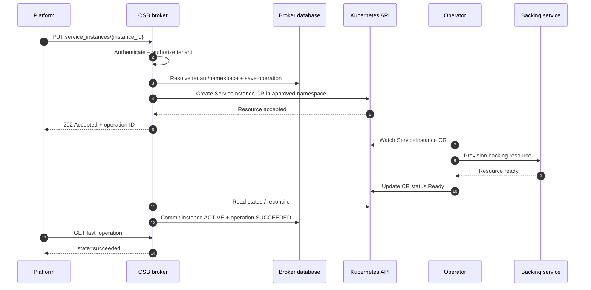

# Namespace, tài khoản dịch vụ, RBAC và cô lập khách hàng

Khi một service broker triển khai tài nguyên trên Kubernetes, broker thường phải thao tác với nhiều namespace, service account, Secret, workload hoặc custom resource. Nếu broker dùng một danh tính có quyền quản trị toàn cluster cho mọi yêu cầu, một lỗi kiểm tra tenant hoặc một lỗ hổng trong handler có thể làm lộ dữ liệu và ảnh hưởng tới workload của khách hàng khác.

Kubernetes cung cấp namespace để phân nhóm tài nguyên, ServiceAccount để định danh workload và Role-Based Access Control (RBAC) để giới hạn hành động của từng danh tính. Các cơ chế này là nền tảng cho cô lập tenant, nhưng cần được thiết kế cùng network policy, quota, policy admission, quản lý Secret và quy trình xác minh quyền ở tầng service broker.

Trong module `SPRING_CLOUD_SERVICE_BROKER`, broker triển khai Open Service Broker API (OSB API), nhận yêu cầu provision, update, bind và deprovision, rồi điều phối tài nguyên trên Kubernetes. Bài học này tập trung vào cách ánh xạ tenant và service instance tới namespace, tách danh tính broker khỏi danh tính ứng dụng, cấp RBAC tối thiểu và ngăn một tenant truy cập tài nguyên của tenant khác.

## Mục tiêu học tập

Sau bài này, bạn có thể:

- Giải thích vai trò và giới hạn của namespace trong cô lập tenant.
- Phân biệt danh tính platform gọi broker, broker gọi Kubernetes API và ứng dụng chạy trong Pod.
- Chọn mô hình namespace theo tenant, theo service instance hoặc mô hình kết hợp.
- Tạo ServiceAccount riêng cho broker và workload ứng dụng.
- Dùng Role, RoleBinding, ClusterRole và ClusterRoleBinding đúng phạm vi.
- Thiết kế RBAC least privilege và hiểu giới hạn của `resourceNames`.
- Ánh xạ context OSB sang tenant/namespace đã được xác minh.
- Kết hợp RBAC với NetworkPolicy, ResourceQuota, Pod Security và quản lý Secret.
- Kiểm thử quyền bằng `kubectl auth can-i` và audit hành vi cross-tenant.

## 1. Namespace là ranh giới tổ chức tài nguyên

Namespace chia một Kubernetes cluster thành các phạm vi tên riêng cho nhiều loại resource namespaced như Pod, Deployment, Service, ConfigMap, Secret, ServiceAccount, Role và RoleBinding. Hai namespace có thể chứa resource cùng tên mà không xung đột:

```text
cluster
├── broker-system
│   ├── Deployment/broker-api
│   ├── ServiceAccount/broker-controller
│   └── Service/broker
├── tenant-acme-prod
│   ├── Deployment/orders-api
│   ├── ServiceAccount/orders-api
│   ├── Secret/orders-db-binding
│   └── ResourceQuota/tenant-quota
└── tenant-zenith-prod
    ├── Deployment/billing-api
    ├── ServiceAccount/billing-api
    └── Secret/billing-db-binding
```

Trong ví dụ, broker chạy trong `broker-system`; workload của khách hàng Acme và Zenith chạy trong namespace riêng. Namespace giúp phân nhóm resource, áp dụng RBAC và quota theo phạm vi. Tuy nhiên, namespace không tự động tạo ra một ranh giới bảo mật hoàn chỉnh. Các quyền cluster-scoped, workload đặc quyền, node dùng chung, network policy thiếu cấu hình hoặc controller có quyền quá rộng vẫn có thể làm suy yếu cô lập.

### 1.1. Namespace không phải một cluster độc lập

Namespace không cung cấp kernel, control plane, node hay network riêng. Các workload trong cùng cluster vẫn có thể chia sẻ node và hạ tầng. Một Pod được cấp quyền truy cập Kubernetes API quá rộng có thể vượt qua ranh giới namespace thông qua danh tính của nó.

Vì vậy:

- Dùng namespace để tổ chức resource và giới hạn quyền namespaced.
- Dùng RBAC để kiểm soát danh tính nào được thao tác resource nào.
- Dùng NetworkPolicy để kiểm soát traffic giữa Pod/namespace khi CNI hỗ trợ.
- Dùng ResourceQuota và LimitRange để giới hạn tài nguyên.
- Dùng Pod Security Standards/admission policy để hạn chế Pod đặc quyền.
- Cân nhắc cluster hoặc node pool riêng khi yêu cầu cô lập cần mức bảo đảm cao hơn.

### 1.2. Resource namespaced và cluster-scoped

Không phải mọi Kubernetes resource đều thuộc một namespace.

| Loại | Ví dụ | Phạm vi |
|---|---|---|
| Namespaced | Pod, Deployment, Service, ConfigMap, Secret, ServiceAccount, Role, RoleBinding | Tồn tại trong một namespace cụ thể. |
| Cluster-scoped | Namespace, Node, PersistentVolume, ClusterRole, ClusterRoleBinding, CustomResourceDefinition | Có phạm vi toàn cluster. |

Một Role chỉ cấp quyền với resource namespaced trong namespace mà Role được tạo. Nếu broker cần tạo Namespace hoặc thao tác resource cluster-scoped, cần một quyền cluster-scoped riêng. Không mở rộng toàn bộ quyền của broker chỉ vì một bước bootstrap cần quyền cấp cluster.

## 2. Chọn mô hình namespace cho tenant và service instance

Service broker cần một quy tắc ổn định để xác định tài nguyên Kubernetes thuộc tenant nào. Có ba mô hình phổ biến.

| Mô hình | Cách tổ chức | Ưu điểm | Đánh đổi |
|---|---|---|---|
| Namespace theo tenant | Mỗi tenant có một hoặc vài namespace theo môi trường | Quản lý quota, policy và quyền theo tenant thuận tiện; nhiều service instance có thể cùng tồn tại. | Cần kiểm soát chặt quyền trong namespace vì nhiều instance chia sẻ phạm vi. |
| Namespace theo service instance | Mỗi service instance có namespace riêng | Cô lập resource và quyền giữa các instance rõ hơn. | Tăng số namespace, chi phí vận hành và yêu cầu quản lý quota/policy. |
| Mô hình kết hợp | Namespace theo tenant/môi trường, một số dịch vụ nhạy cảm có namespace riêng | Cân bằng giữa chi phí và mức cô lập. | Cần quy tắc mapping và lifecycle rõ ràng. |

Ví dụ, tenant Acme có thể có `tenant-acme-dev` và `tenant-acme-prod`. Database dùng chung theo tenant có thể được quản lý trong namespace production; một dịch vụ chứa dữ liệu nhạy cảm hoặc yêu cầu policy riêng có thể được đặt trong namespace riêng.

### 2.1. Namespace là lựa chọn kiến trúc, không phải ID do client tự quyết định

Không nên nhận một chuỗi `namespace` từ request rồi dùng trực tiếp trong Kubernetes API. Một caller có thể gửi tên namespace của tenant khác, namespace hệ thống hoặc một namespace đặc quyền.

Broker nên duy trì mapping đã xác minh:

```text
authenticated principal
        │
        ▼
authorized tenant ID
        │
        ▼
tenant/environment mapping
        │
        ▼
Kubernetes namespace đã được broker quản lý
```

Mapping có thể dựa trên danh tính platform đã xác thực, dữ liệu tenant được lưu trong broker và context OSB đã được kiểm tra. `organization_guid`, `space_guid`, namespace name hoặc project ID trong request chỉ là dữ liệu tham chiếu; chúng không tự chứng minh caller sở hữu tenant đó.

### 2.2. Mapping service instance và binding

Một bản ghi service instance nội bộ có thể lưu:

| Field | Ý nghĩa |
|---|---|
| `instance_id` | ID do platform gửi trong OSB request. |
| `tenant_id` | Tenant đã được xác thực và cấp quyền. |
| `namespace` | Namespace đã được broker chọn từ mapping tin cậy. |
| `resource_name` | Tên CRD/Deployment/Service hoặc resource provider tạo. |
| `service_id`, `plan_id` | Offering và plan được provision. |
| `state` | Trạng thái vòng đời nội bộ. |

Binding record có thể liên kết `binding_id`, `instance_id`, consumer identity và Secret reference. Không đưa password hoặc token thô vào metadata chỉ để tiện tra cứu.

## 3. Phân biệt ba lớp danh tính

Trong một triển khai OSB trên Kubernetes có ít nhất ba ranh giới xác thực khác nhau:

<box>
  <list connector="solid" marker="number" gap={2}>
    <list-item>
      **Platform → broker**

      Cloud Foundry, platform hoặc client OSB xác thực với broker bằng cơ chế đã cấu hình như Basic credentials, mTLS hoặc token. Broker dùng principal này để xác định caller và quyền tenant.
    </list-item>
    <list-item>
      **Broker → Kubernetes API**

      Pod broker dùng Kubernetes ServiceAccount hoặc workload identity để gọi Kubernetes API. RBAC của danh tính này quyết định broker được phép tạo/đọc/sửa resource nào.
    </list-item>
    <list-item>
      **Application Pod → Kubernetes API/backing service**

      Workload của tenant có ServiceAccount riêng nếu cần gọi Kubernetes API; credentials của service binding dùng để truy cập database, queue hoặc backing service. Hai loại quyền này không được nhập làm một.
    </list-item>
  </list>
</box>

Không dùng platform credential làm Kubernetes API credential. Cũng không đưa token ServiceAccount của broker vào `VCAP_SERVICES`, Kubernetes Secret của ứng dụng hoặc response binding. Ứng dụng chỉ nên nhận credentials dành riêng cho backing service mà nó được phép sử dụng.

## 4. ServiceAccount cho broker và workload

ServiceAccount là danh tính Kubernetes dành cho process chạy trong Pod. Pod có thể chỉ định `serviceAccountName`; Kubernetes cung cấp token và thông tin cần thiết theo cấu hình. ServiceAccount không tự có quyền quản trị: quyền API được quyết định bởi RBAC binding gắn với danh tính đó.

### 4.1. ServiceAccount riêng cho broker

Tạo ServiceAccount trong namespace hệ thống:

```yaml
apiVersion: v1
kind: ServiceAccount
metadata:
  name: broker-controller
  namespace: broker-system
automountServiceAccountToken: true
```

Deployment broker sử dụng danh tính này:

```yaml
apiVersion: apps/v1
kind: Deployment
metadata:
  name: broker-api
  namespace: broker-system
spec:
  replicas: 2
  selector:
    matchLabels:
      app: broker-api
  template:
    metadata:
      labels:
        app: broker-api
    spec:
      serviceAccountName: broker-controller
      containers:
        - name: broker
          image: example.invalid/service-broker:1.0.0
          ports:
            - name: http
              containerPort: 8080
```

Image trong ví dụ chỉ là placeholder. Broker cần token để gọi Kubernetes API, vì vậy không tắt việc mount token ở Pod này nếu nó dùng in-cluster authentication. Token nên là token ngắn hạn được cấp qua projected volume và được client refresh theo cơ chế Kubernetes hỗ trợ.

### 4.2. ServiceAccount riêng cho ứng dụng tenant

Ứng dụng thường không cần gọi Kubernetes API. Nếu không cần, tắt tự động mount ServiceAccount token ở Pod hoặc ServiceAccount:

```yaml
apiVersion: v1
kind: ServiceAccount
metadata:
  name: orders-api
  namespace: tenant-acme-prod
automountServiceAccountToken: false
```

Deployment của ứng dụng:

```yaml
apiVersion: apps/v1
kind: Deployment
metadata:
  name: orders-api
  namespace: tenant-acme-prod
spec:
  replicas: 2
  selector:
    matchLabels:
      app: orders-api
  template:
    metadata:
      labels:
        app: orders-api
    spec:
      serviceAccountName: orders-api
      automountServiceAccountToken: false
      containers:
        - name: app
          image: example.invalid/orders-api:1.0.0
```

Nếu ứng dụng cần Kubernetes API, chỉ cấp ServiceAccount và RBAC cho đúng hành động cần thiết. Không dùng `default` ServiceAccount làm danh tính chung cho mọi workload nếu có thể tạo danh tính riêng.

### 4.3. Token ServiceAccount

Không tạo hoặc phân phối token dài hạn không cần thiết. Kubernetes hiện hỗ trợ token ngắn hạn qua TokenRequest/projected service account token. Token được ràng buộc với audience và thời hạn; client cần refresh theo cơ chế phù hợp.

Không lưu token broker trong source code, image, ConfigMap hoặc event payload. Nếu cần truy cập từ ngoài cluster, ưu tiên workload identity hoặc cơ chế credential ngắn hạn do nền tảng hỗ trợ thay vì copy token tĩnh ra ngoài.

## 5. RBAC: Role, RoleBinding, ClusterRole và ClusterRoleBinding

RBAC xác định danh tính nào được thực hiện verb nào trên resource nào trong phạm vi nào.

| Object | Phạm vi | Vai trò |
|---|---|---|
| `Role` | Một namespace | Cấp quyền với resource namespaced trong namespace đó. |
| `RoleBinding` | Một namespace | Gắn Role hoặc ClusterRole vào User, Group hoặc ServiceAccount; quyền có hiệu lực trong namespace của binding. |
| `ClusterRole` | Cluster-wide definition | Định nghĩa quyền có thể dùng cho resource cluster-scoped hoặc được bind ở một/một số namespace. |
| `ClusterRoleBinding` | Toàn cluster | Gắn ClusterRole cho subject trên phạm vi cluster. |

### 5.1. Role và RoleBinding trong namespace tenant

Ví dụ broker cần quản lý custom resource `serviceinstances` trong namespace của tenant. Tạo Role giới hạn trong namespace đó:

```yaml
apiVersion: rbac.authorization.k8s.io/v1
kind: Role
metadata:
  name: broker-serviceinstance-manager
  namespace: tenant-acme-prod
rules:
  - apiGroups: ["broker.example.io"]
    resources: ["serviceinstances"]
    verbs: ["get", "list", "watch", "create", "update", "patch", "delete"]
```

Gắn Role cho ServiceAccount broker đang ở `broker-system`:

```yaml
apiVersion: rbac.authorization.k8s.io/v1
kind: RoleBinding
metadata:
  name: broker-controller-serviceinstances
  namespace: tenant-acme-prod
subjects:
  - kind: ServiceAccount
    name: broker-controller
    namespace: broker-system
roleRef:
  apiGroup: rbac.authorization.k8s.io
  kind: Role
  name: broker-serviceinstance-manager
```

ServiceAccount nằm ở namespace `broker-system`, nhưng RoleBinding được tạo trong `tenant-acme-prod`. Broker chỉ nhận quyền trên resource `serviceinstances` thuộc namespace tenant này. Không vì vậy mà broker có quyền đọc Secret, sửa Deployment hoặc truy cập namespace khác.

Khi thêm tenant mới, có thể tạo Role/RoleBinding tương ứng sau khi xác minh tenant. Nếu broker cần thao tác trên nhiều namespace, cần quy trình cấp binding có kiểm soát và thu hồi khi tenant/service ngừng hoạt động.

### 5.2. Dùng ClusterRole qua RoleBinding

Có thể định nghĩa một ClusterRole dùng lại cho nhiều namespace, rồi tạo RoleBinding riêng trong từng namespace. Khi ClusterRole được tham chiếu qua RoleBinding, quyền namespaced của nó chỉ áp dụng trong namespace của RoleBinding đó.

```yaml
apiVersion: rbac.authorization.k8s.io/v1
kind: ClusterRole
metadata:
  name: broker-serviceinstance-manager
rules:
  - apiGroups: ["broker.example.io"]
    resources: ["serviceinstances"]
    verbs: ["get", "list", "watch", "create", "update", "patch", "delete"]
```

Mỗi tenant vẫn có RoleBinding riêng trỏ tới ClusterRole trên. Không tạo ClusterRoleBinding cho broker nếu mục tiêu chỉ là quản lý service instance trong từng namespace, vì ClusterRoleBinding mở quyền theo phạm vi cluster.

### 5.3. Không cấp quyền rộng theo thói quen

Tránh các cấu hình như:

```yaml
kind: ClusterRoleBinding
roleRef:
  kind: ClusterRole
  name: cluster-admin
```

cho ServiceAccount broker chỉ để tiện gọi Kubernetes API. Quyền `cluster-admin` cho phép kiểm soát gần như toàn bộ cluster; một lỗi trong xử lý request tenant có thể trở thành sự cố toàn cluster.

## 6. Thiết kế least privilege cho broker

Least privilege nghĩa là mỗi thành phần chỉ có quyền tối thiểu để thực hiện nhiệm vụ cụ thể. Không nên có một ServiceAccount duy nhất với quyền CRUD mọi resource ở mọi namespace nếu broker chỉ cần tạo một loại custom resource và Secret có tên xác định.

### 6.1. Liệt kê hành động trước khi viết Role

Tạo ma trận quyền theo chức năng:

| Chức năng broker | Resource cần thao tác | Verb có thể cần |
|---|---|---|
| Kiểm tra service instance | Custom resource instance | `get` |
| Provision | Custom resource hoặc resource do operator quản lý | `create`, đôi khi `get` |
| Theo dõi operation | Custom resource/status hoặc operation record | `get`, `watch` tùy kiến trúc |
| Update | Resource tương ứng | `get`, `patch`/`update` |
| Deprovision | Resource tương ứng | `get`, `delete` |
| Tạo binding Secret | Secret trong namespace tenant | `create`; có thể cần `get`/`update`/`delete` theo lifecycle |
| Đọc trạng thái Pod | Pod hoặc custom resource status | Chỉ `get`/`list` nếu thực sự cần |

Không cấp `list` hoặc `watch` nếu handler không cần đọc toàn bộ collection. Không cấp `deletecollection`, `impersonate`, `bind`, `escalate` hoặc quyền quản lý RBAC cho broker thông thường. Những quyền đặc biệt này có thể cho phép vượt qua ranh giới quyền dự kiến.

### 6.2. Cẩn thận với quyền Secret

Quyền `get`, `list` hoặc `watch` Secret có thể làm lộ nhiều credentials trong namespace. Nếu broker chỉ cần tạo một Secret cho binding, hãy tách quyền tạo khỏi quyền đọc và giới hạn các thao tác khác theo tên khi API/RBAC cho phép.

Ví dụ một rule đọc và cập nhật Secret đã có tên:

```yaml
- apiGroups: [""]
  resources: ["secrets"]
  resourceNames: ["orders-db-binding"]
  verbs: ["get", "update", "patch", "delete"]
```

Lưu ý quan trọng: `resourceNames` không thể giới hạn một thao tác `create`, vì tên resource trong request create không được RBAC dùng theo cách đó. Nếu cấp `create` trên `secrets`, quyền này có thể cho phép tạo Secret với nhiều tên trong namespace. Để giảm phạm vi, có thể:

- Dùng namespace chuyên biệt cho binding/service instance.
- Tách Secret provisioner thành controller nhỏ có API hẹp, validate tên và owner.
- Dùng admission policy để kiểm soát tên/label/owner của Secret.
- Giới hạn quyền đọc/list/watch và không cấp chúng nếu không cần.
- Dùng một custom resource làm yêu cầu, để controller có quyền phù hợp tạo Secret theo quy tắc.

Không cho ứng dụng tenant đọc Secret của binding khác chỉ vì chúng nằm cùng namespace. RBAC không phải lúc nào cũng đủ để biểu diễn quyền theo từng consumer nếu tất cả workload dùng chung một ServiceAccount; khi cần cô lập chặt hơn, dùng namespace riêng hoặc danh tính riêng cho từng workload.

### 6.3. Quyền tạo Namespace là quyền cluster-scoped

Namespace là resource cluster-scoped. Nếu broker tự tạo namespace, nó cần quyền cluster-scoped như `create` trên resource `namespaces`. Quyền tạo namespace không thể được giới hạn theo `resourceNames` theo cách thông thường cho thao tác create.

Vì vậy, một mô hình an toàn hơn là:

1. Namespace được platform/admin hoặc một namespace provisioner chuyên biệt tạo sau khi xác minh tenant.
2. Broker runtime chỉ nhận RoleBinding trong namespace đã được phê duyệt.
3. Một controller/provisioner riêng có quyền tạo namespace thực hiện bước bootstrap với allowlist và policy bắt buộc.
4. Broker không được phép tự chọn tùy ý namespace hệ thống hoặc namespace tenant khác.

Nếu kiến trúc buộc broker tạo namespace trực tiếp, hãy tách component có quyền cluster-scoped, giới hạn API mà component đó nhận, audit mọi lần tạo và không cấp `cluster-admin` cho toàn bộ broker.

## 7. RBAC cho ứng dụng và service binding

Ứng dụng thường không cần quyền thao tác Kubernetes API để kết nối tới database hoặc queue. Broker tạo credentials cho backing service và phân phối chúng qua Secret hoặc cơ chế binding của platform. ServiceAccount của ứng dụng chỉ cần quyền Kubernetes nếu ứng dụng thực sự đọc ConfigMap/Secret hoặc gọi API.

### 7.1. Ví dụ RoleBinding chỉ đọc một ConfigMap

```yaml
apiVersion: rbac.authorization.k8s.io/v1
kind: Role
metadata:
  name: orders-runtime-config-reader
  namespace: tenant-acme-prod
rules:
  - apiGroups: [""]
    resources: ["configmaps"]
    resourceNames: ["orders-runtime-config"]
    verbs: ["get"]
---
apiVersion: rbac.authorization.k8s.io/v1
kind: RoleBinding
metadata:
  name: orders-api-runtime-config
  namespace: tenant-acme-prod
subjects:
  - kind: ServiceAccount
    name: orders-api
    namespace: tenant-acme-prod
roleRef:
  apiGroup: rbac.authorization.k8s.io
  kind: Role
  name: orders-runtime-config-reader
```

Role này chỉ cho phép ServiceAccount `orders-api` đọc ConfigMap cụ thể. Nếu ứng dụng không gọi Kubernetes API mà nhận cấu hình qua volume/environment do platform cung cấp, không cần cấp quyền đọc ConfigMap/Secret qua API.

### 7.2. Không chia sẻ ServiceAccount giữa tenant

Nếu nhiều tenant cùng dùng một ServiceAccount, mọi quyền gắn với danh tính đó sẽ được chia sẻ. Một Pod bị xâm nhập có thể dùng token của ServiceAccount để thực hiện hành động mà workload khác cũng được phép. Hãy tạo ServiceAccount riêng theo workload hoặc nhóm workload có cùng trust boundary.

## 8. Ánh xạ tenant từ OSB context sang Kubernetes namespace

OSB request có thể chứa `context` do platform gửi. Với Cloud Foundry, context có thể bao gồm organization/space GUID và thông tin platform. Với tích hợp Kubernetes, context có thể mang thông tin cluster, namespace hoặc tenant theo hợp đồng tích hợp cụ thể.

Broker cần xác minh dữ liệu này bằng principal đã xác thực:

1. Xác thực platform/client gọi OSB endpoint.
2. Xác định tenant mà client được phép thao tác.
3. Đọc mapping tenant/environment trong kho dữ liệu tin cậy của broker.
4. So sánh context request với mapping và policy.
5. Lấy namespace đã được phê duyệt từ mapping; không dùng raw string từ request làm đích API.
6. Kiểm tra operation/instance record có thuộc tenant đó không trước khi đọc hoặc thay đổi resource.

Ví dụ mapping nội bộ:

```json
{
  "tenant_id": "tenant-acme",
  "environment": "production",
  "cluster_id": "cluster-prod-a",
  "namespace": "tenant-acme-prod",
  "status": "ACTIVE"
}
```

Đây là metadata nội bộ, không phải OSB request. `namespace` được broker chọn sau khi xác minh tenant. Không tin một field `namespace: tenant-zenith-prod` do caller của Acme gửi lên.

### 8.1. Chống namespace confusion và IDOR

Một lỗi phổ biến là handler nhận `instance_id` rồi tìm resource chỉ theo tên, không kèm tenant. Nếu tenant Acme đoán được ID của Zenith, handler có thể trả thông tin hoặc xóa tài nguyên của Zenith.

Mọi truy vấn nên ràng buộc cả định danh và tenant:

```text
find instance where
    instance_id = request.instance_id
    AND tenant_id = authenticated_tenant_id
```

Sau đó lấy namespace từ bản ghi đã xác minh. Không nhận namespace trực tiếp từ parameters, query string hoặc event payload chưa được xác thực.

### 8.2. Label và annotation quản lý ownership

Broker có thể gắn label/annotation để hỗ trợ quản lý:

```yaml
metadata:
  labels:
    app.kubernetes.io/managed-by: spring-cloud-service-broker
    broker.example.com/tenant: tenant-acme
    broker.example.com/instance-id-hash: 7f21a9
  annotations:
    broker.example.com/instance-id: "instance-123"
```

Không đưa password, token hoặc dữ liệu nhạy cảm vào label/annotation. Label có thể được hiển thị qua API/listing và dùng trong selector; annotation cũng không phải kho bí mật. Nếu `instance_id` nhạy cảm hoặc có khả năng lộ thông tin, lưu hash/opaque identifier trong label và giữ mapping chi tiết trong database broker.

## 9. Cô lập khách hàng cần nhiều lớp

Namespace và RBAC là hai lớp quan trọng, nhưng chưa đủ để cô lập workload hoàn chỉnh.

### 9.1. NetworkPolicy

NetworkPolicy có thể giới hạn Pod nào được giao tiếp với Pod nào, namespace nào hoặc endpoint nào, nếu network plugin của cluster hỗ trợ enforcement.

Ví dụ policy mặc định chặn ingress và egress trong namespace tenant:

```yaml
apiVersion: networking.k8s.io/v1
kind: NetworkPolicy
metadata:
  name: default-deny
  namespace: tenant-acme-prod
spec:
  podSelector: {}
  policyTypes:
    - Ingress
    - Egress
```

Sau đó thêm các policy cho DNS, ingress từ gateway và traffic tới backing service cần thiết. Một default-deny policy mà không có rule cho DNS hoặc dependency có thể làm ứng dụng không hoạt động. Cần kiểm thử với CNI thực tế; resource NetworkPolicy tồn tại không có nghĩa mọi plugin đều enforce như nhau.

### 9.2. ResourceQuota và LimitRange

ResourceQuota giới hạn tổng tài nguyên hoặc số lượng object trong namespace; LimitRange đặt giới hạn/default cho từng container hoặc resource.

```yaml
apiVersion: v1
kind: ResourceQuota
metadata:
  name: tenant-quota
  namespace: tenant-acme-prod
spec:
  hard:
    requests.cpu: "8"
    requests.memory: 16Gi
    limits.cpu: "16"
    limits.memory: 32Gi
    pods: "40"
    persistentvolumeclaims: "10"
```

Quota cần được tính theo plan và chính sách tenant. Broker nên kiểm tra hoặc để admission/quota enforcement từ chối request; không tự giả định namespace còn capacity chỉ vì request provision hợp lệ.

### 9.3. Pod Security và admission policy

Áp dụng Pod Security Standards ở mức phù hợp, thường ưu tiên `restricted` cho workload tenant. Hạn chế privileged container, hostPath, hostNetwork, hostPID, capabilities không cần thiết và quyền chạy root. Admission policy có thể kiểm tra image registry, security context, label ownership và cấu hình Secret/ServiceAccount.

Không cho tenant tạo Pod dùng ServiceAccount đặc quyền hoặc sửa RoleBinding để tự cấp quyền cao hơn. Các policy cần được áp dụng nhất quán cho namespace mới, không chỉ những namespace đã tồn tại.

### 9.4. Secret isolation

Kubernetes Secret được lưu theo namespace, nhưng không tự động mã hóa ở mọi lớp lưu trữ nếu cluster chưa cấu hình encryption at rest. Cần:

- Bật encryption at rest cho Secret trong datastore/control plane theo khả năng cluster.
- Giới hạn `get`, `list`, `watch` Secret bằng RBAC.
- Không mount Secret vào container không cần.
- Dùng external secret manager hoặc CSI integration nếu phù hợp.
- Rotate credentials và thu hồi binding khi không còn sử dụng.
- Không chia sẻ một Secret chứa credentials của nhiều tenant.

## 10. Quy trình provision tenant-aware trên Kubernetes

Giả sử platform gửi request provision một service instance PostgreSQL cho tenant Acme. Broker cần tạo resource trong namespace `tenant-acme-prod` đã được xác minh.

1. Xác thực platform và kiểm tra quyền gọi broker.
2. Đọc `instance_id`, `service_id`, `plan_id`, parameters và context.
3. Ánh xạ caller sang `tenant-acme`; kiểm tra instance ID chưa thuộc tenant khác.
4. Lấy namespace từ mapping tin cậy; xác nhận namespace tồn tại và được quản lý.
5. Kiểm tra RBAC của broker có quyền cần thiết trong namespace đó.
6. Ghi operation/instance record bền vững và idempotency key.
7. Tạo custom resource hoặc resource yêu cầu provision trong namespace tenant.
8. Operator/controller chuyên trách tạo database hoặc backing resource.
9. Theo dõi trạng thái custom resource/operation; xác minh credentials và health.
10. Cập nhật instance `ACTIVE`, operation `SUCCEEDED` và trả response OSB phù hợp.



Trong mô hình này, broker có thể chỉ cần quyền tạo/đọc custom resource; operator có quyền provider-specific để thực hiện công việc. Tách broker khỏi operator giúp giảm quyền của HTTP-facing component. Tuy nhiên, CRD và controller phải có validation, ownership và authorization rõ ràng; không cho tenant tạo custom resource thay mặt tenant khác.

## 11. Update, bind và deprovision trong ranh giới namespace

### 11.1. Update

Update phải kiểm tra instance thuộc tenant và namespace đã lưu. Không lấy namespace từ request update mới để chuyển resource sang tenant khác. Nếu cần migration giữa namespace/cluster, thiết kế thành workflow riêng có xác thực, kiểm soát quyền và reconciliation.

Worker nên dùng resource version/optimistic locking để tránh hai update ghi đè. Chỉ cập nhật resource có ownership label/annotation khớp bản ghi broker đã xác minh. Không dùng selector quá rộng có thể chọn resource của tenant khác.

### 11.2. Bind

Binding có thể tạo Secret trong namespace ứng dụng hoặc namespace do platform chỉ định theo hợp đồng tích hợp. Broker phải xác minh consumer có quyền bind service instance và namespace đích thuộc tenant đó.

Nếu credentials được lưu vào Secret:

- Tạo Secret với tên ổn định theo `binding_id` đã chuẩn hóa/ánh xạ.
- Gắn owner reference hoặc metadata ownership phù hợp nếu vòng đời resource cho phép.
- Chỉ cung cấp cho workload cần thiết.
- Không cho tenant đọc Secret của binding khác.
- Xóa/rotate Secret khi unbind, nhưng chỉ sau khi xác minh không còn consumer hợp lệ.

### 11.3. Deprovision

Deprovision cần xác minh cả `instance_id`, tenant và resource ownership trước khi xóa. Không xóa toàn namespace tenant chỉ vì một service instance bị thu hồi. Nếu mỗi instance có namespace riêng, vẫn phải xác minh namespace chỉ chứa resource thuộc instance đó và không còn workload/volume cần giữ.

Giữ tombstone/operation history trong broker để nhận diện retry. Nếu Kubernetes API trả `NotFound`, có thể xem là trạng thái mong muốn đã đạt đối với một bước delete idempotent sau khi xác minh đúng resource identity.

## 12. Cô lập namespace bootstrap và quyền cluster-scoped

Một số thao tác không thể thực hiện bằng Role namespaced, ví dụ tạo Namespace hoặc đăng ký một số CRD. Không nên cấp các quyền này cho broker API chỉ để đơn giản hóa triển khai.

Mô hình tách quyền:

| Component | Quyền gợi ý |
|---|---|
| Broker API | Đọc mapping tenant; tạo/đọc custom resource trong namespace đã được cấp RoleBinding; ghi operation store. |
| Namespace provisioner | Tạo namespace theo yêu cầu đã xác minh; áp label, quota, network policy, Pod Security và RoleBinding chuẩn. |
| Service operator | Theo dõi custom resource và tạo resource backing service theo phạm vi được thiết kế. |
| Application workload | Không có Kubernetes API permission nếu không cần; chỉ nhận binding credentials của chính nó. |

Namespace provisioner có thể là controller riêng với input hẹp như `TenantNamespaceRequest`. Nó cần kiểm tra tenant ID, tên namespace theo quy tắc server-side, allowlist cluster và idempotency. Không cho caller gửi tùy ý tên resource cluster-scoped để provisioner tạo.

## 13. Kiểm tra quyền RBAC

`kubectl auth can-i` giúp xác minh một danh tính có được phép thực hiện hành động hay không.

Kiểm tra broker có thể tạo custom resource trong namespace Acme:

```bash
kubectl auth can-i create serviceinstances.broker.example.io \
  --as=system:serviceaccount:broker-system:broker-controller \
  --namespace=tenant-acme-prod
```

Kiểm tra broker không được đọc Secret trong namespace đó nếu chưa cấp quyền:

```bash
kubectl auth can-i get secrets \
  --as=system:serviceaccount:broker-system:broker-controller \
  --namespace=tenant-acme-prod
```

Kiểm tra broker không được xóa resource trong namespace khác:

```bash
kubectl auth can-i delete serviceinstances.broker.example.io \
  --as=system:serviceaccount:broker-system:broker-controller \
  --namespace=tenant-zenith-prod
```

Kết quả `no` là điều mong muốn nếu broker chưa được cấp quyền cho tenant Zenith. Người chạy lệnh cần có quyền impersonate danh tính được chỉ định; nếu thiếu quyền impersonation, lệnh có thể thất bại dù RBAC của ServiceAccount đã đúng.

### 13.1. Kiểm tra Role và RoleBinding

```bash
kubectl get role,rolebinding -n tenant-acme-prod
kubectl describe role broker-serviceinstance-manager -n tenant-acme-prod
kubectl describe rolebinding broker-controller-serviceinstances -n tenant-acme-prod
```

Không chỉ kiểm tra manifest nguồn; cần kiểm tra object thực tế trong cluster vì RoleBinding có thể bị thay đổi hoặc bị một chart/operator khác ghi đè.

### 13.2. Kiểm thử negative authorization

Một bài kiểm thử tốt phải xác nhận cả quyền được phép và quyền bị cấm:

- Broker được tạo resource trong namespace tenant đã được cấp quyền.
- Broker không đọc được Secret không thuộc nhiệm vụ.
- Broker không truy cập namespace của tenant khác.
- Application ServiceAccount không được sửa Role/RoleBinding.
- Tenant không thể tự tạo Pod dùng ServiceAccount của broker.
- Deprovision của một instance không xóa resource của instance khác.

## 14. Audit, giám sát và phản ứng sự cố

Kubernetes audit log có thể ghi nhận ai đã gọi API, verb, resource, namespace và kết quả. Kết hợp audit với `operation_id`, `instance_id`, `tenant_id` và correlation ID trong log broker để truy vết một thao tác từ OSB request tới Kubernetes API.

Theo dõi các chỉ số:

- Số lần RBAC từ chối theo service account, namespace và verb.
- Số request broker cố truy cập namespace không nằm trong mapping.
- Số Secret được tạo/đọc/xóa theo tenant và binding.
- Số operation provision/update/deprovision bị treo hoặc thất bại.
- Số lần Namespace provisioner tạo hoặc thay đổi policy.
- Số lần admission policy từ chối workload.
- ResourceQuota gần đạt ngưỡng và lỗi scheduling do thiếu capacity.

Khi nghi ngờ broker ServiceAccount bị lộ:

1. Giới hạn hoặc thu hồi danh tính/credential theo cơ chế cluster hỗ trợ.
2. Kiểm tra audit log để xác định namespace, resource và verb bị tác động.
3. Tạm dừng worker/operation có nguy cơ tạo thêm side effect.
4. Xoay vòng provider credentials và binding credentials bị ảnh hưởng.
5. Kiểm tra RoleBinding/ClusterRoleBinding bất thường và loại bỏ quyền không hợp lệ.
6. Đối soát resource thực tế với instance record trong broker.
7. Khôi phục policy và xác minh negative authorization trước khi mở lại traffic.

Không ghi token ServiceAccount, kubeconfig hoặc Secret data vào log sự cố. Audit record cần được bảo vệ và giới hạn quyền truy cập.

## 15. Những lỗi thiết kế thường gặp

- **Dùng `cluster-admin` cho broker:** một lỗi ở API handler có thể ảnh hưởng toàn cluster.
- **Dùng một ServiceAccount cho broker và ứng dụng:** workload tenant có thể thừa hưởng quyền của broker.
- **Tin namespace do client gửi:** dẫn tới namespace confusion hoặc IDOR cross-tenant.
- **Coi namespace là ranh giới bảo mật tuyệt đối:** bỏ qua node, network, privileged Pod và cluster-scoped resource.
- **Dùng ClusterRoleBinding thay vì RoleBinding:** vô tình cấp quyền toàn cluster.
- **Cấp `list`/`watch` Secret không cần thiết:** làm lộ credentials của nhiều binding.
- **Quên giới hạn quyền tạo Namespace:** broker có thể tạo namespace tùy ý trên cluster.
- **Dùng `default` ServiceAccount cho mọi workload:** khó kiểm soát quyền và audit theo ứng dụng.
- **Mount token vào mọi Pod:** tăng khả năng bị lạm dụng nếu container bị xâm nhập.
- **Xóa namespace khi deprovision một instance:** có thể xóa tài nguyên của tenant hoặc instance khác.
- **Chỉ test positive permission:** không phát hiện broker có thể truy cập tenant khác.
- **Không có NetworkPolicy/Quota/Pod Security:** namespace có thể vẫn giao tiếp tự do và tiêu thụ hết tài nguyên cluster.

## 16. Checklist triển khai tenant isolation

- [ ] Có quy tắc namespace theo tenant/environment/service instance được tài liệu hóa.
- [ ] Tenant được xác định từ principal đã xác thực và mapping tin cậy.
- [ ] Không dùng namespace raw từ request làm đích Kubernetes API.
- [ ] Broker, namespace provisioner, operator và application có ServiceAccount riêng.
- [ ] Workload không cần Kubernetes API đã tắt automount ServiceAccount token.
- [ ] Broker dùng token ngắn hạn/projected token hoặc workload identity phù hợp.
- [ ] Role/RoleBinding được ưu tiên cho phạm vi namespace.
- [ ] Không dùng ClusterRoleBinding/cluster-admin nếu không có yêu cầu cluster-wide được phê duyệt.
- [ ] Quyền Secret được giới hạn; hiểu hạn chế `resourceNames` với thao tác create.
- [ ] Quyền tạo Namespace được tách khỏi broker runtime hoặc kiểm soát riêng.
- [ ] Resource có label/annotation ownership không chứa dữ liệu bí mật.
- [ ] NetworkPolicy, ResourceQuota, LimitRange và Pod Security được áp dụng cho namespace mới.
- [ ] Secret được mã hóa/lưu an toàn và chỉ mount cho workload cần.
- [ ] Provision/update/bind/deprovision kiểm tra tenant và resource ownership.
- [ ] Có test `kubectl auth can-i` cho quyền được phép và quyền bị cấm.
- [ ] Có audit, metric và cảnh báo cho RBAC denial/cross-tenant attempt.
- [ ] Có quy trình revoke credential và đối soát khi ServiceAccount broker bị lộ.

## 17. Bài tập tự luyện

### Bài tập 1: Chọn mô hình namespace

Một tenant có 12 service instance cho nhiều ứng dụng production và development. Hãy chọn namespace theo tenant, theo instance hoặc mô hình kết hợp. Nêu cách áp dụng quota, RBAC và network policy cho lựa chọn đó.

### Bài tập 2: Thiết kế RoleBinding

Broker chạy trong `broker-system`, cần tạo custom resource `serviceinstances` trong `tenant-acme-prod` và không được đọc Secret. Hãy viết Role và RoleBinding phù hợp, sau đó nêu các lệnh `kubectl auth can-i` để kiểm tra quyền.

### Bài tập 3: Phát hiện namespace confusion

Một request của tenant Acme chứa `context.namespace=tenant-zenith-prod`. Hãy mô tả các bước broker phải thực hiện trước khi dùng namespace và cách ghi nhận hành vi truy cập không hợp lệ.

### Bài tập 4: Tách namespace provisioner

Broker cần tạo namespace mới nhưng không muốn có quyền cluster-scoped trong HTTP-facing process. Hãy đề xuất một component provisioner riêng, xác định input, quyền và kiểm tra cần có.

### Bài tập 5: Cô lập Secret

Hai ứng dụng trong cùng namespace cần hai binding database khác nhau. Hãy phân tích vì sao cùng một ServiceAccount có quyền `get secrets` có thể làm suy yếu cô lập, và đề xuất namespace hoặc identity design phù hợp.

## Kết luận

Namespace cung cấp phạm vi tổ chức và quyền namespaced; ServiceAccount định danh workload; RBAC quyết định danh tính được làm gì trên resource nào. Trong Kubernetes OSB integration, broker cần tách danh tính platform, broker controller, namespace provisioner, operator và ứng dụng. Tenant/namespace phải được ánh xạ từ dữ liệu đã xác thực, RoleBinding nên giới hạn quyền trong namespace đã phê duyệt, còn quyền cluster-scoped cần được tách và kiểm soát riêng. Kết hợp các lớp này với NetworkPolicy, quota, Pod Security, Secret management, audit và negative authorization tests giúp hạn chế truy cập chéo tenant và giảm ảnh hưởng khi một thành phần bị xâm nhập.
