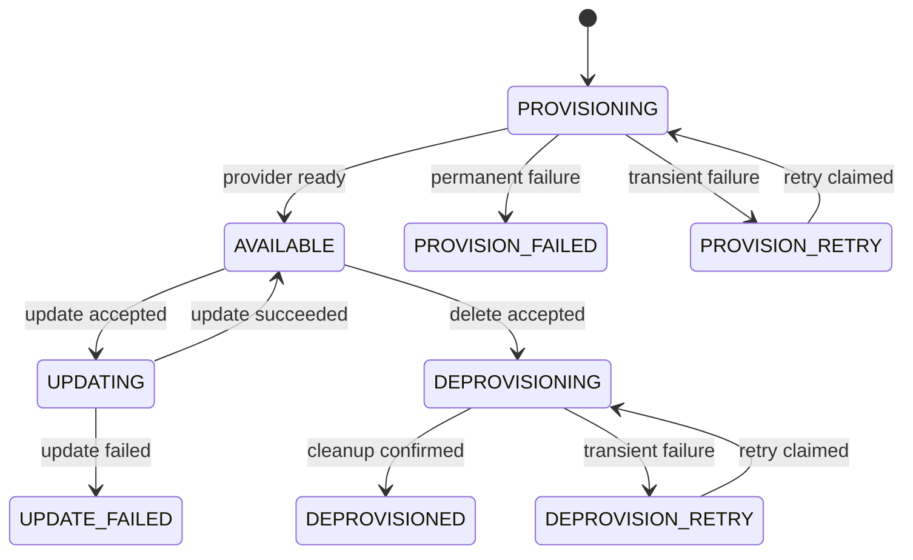

# Kiểm thử đơn vị vòng đời instance, binding và operation

Service broker xử lý nhiều trạng thái có liên hệ với nhau: service instance được provision, cập nhật và deprovision; binding được tạo và thu hồi; operation có thể chạy đồng bộ hoặc bất đồng bộ rồi được platform truy vấn qua `last_operation`. Một lỗi nhỏ trong chuyển trạng thái có thể tạo tài nguyên trùng, cấp credential cho instance đang bị xóa hoặc báo thành công khi provider chưa hoàn tất. Unit test giúp kiểm tra các quy tắc nghiệp vụ này nhanh chóng và độc lập với cloud provider thật.

Với `SPRING_CLOUD_SERVICE_BROKER`, unit test nên tập trung vào domain service và application service: đầu vào được validate, state transition có hợp lệ không, repository được cập nhật thế nào, provider được gọi đúng lúc nào, operation có được ghi nhận bền vững và lỗi được xử lý ra sao. Spring Cloud Open Service Broker cung cấp lớp adapter OSB API; unit test của service nghiệp vụ không cần khởi động toàn bộ HTTP server cho mọi trường hợp. Những kiểm tra mapping HTTP, serialization và filter/security thuộc contract/integration test riêng.

## 1. Phạm vi của unit test

Một unit test tốt kiểm tra một quy tắc hoặc một hành vi có ý nghĩa với chi phí thấp. Nó không cần database, message broker hoặc cloud provider thật.

| Thành phần | Unit test nên kiểm tra | Dependency thường mock/fake |
|---|---|---|
| Domain state machine | Chuyển trạng thái hợp lệ, từ chối chuyển trạng thái sai | Không cần Spring context |
| Provision service | Validate request, tạo instance/operation, quyết định sync hay async | Repository, provider port, clock, operation service |
| Update service | So sánh plan/parameters, kiểm tra capability và trạng thái instance | Repository, provider client |
| Deprovision service | Ngăn xóa khi còn binding theo policy, cleanup đúng external ID | Repository, provider port |
| Binding service | Consumer/instance hợp lệ, credential thuộc đúng binding, idempotency | Binding repository, credential provider |
| Operation service | Lưu state, ánh xạ trạng thái và `last_operation` | Operation repository, clock |
| Retry/reconciliation policy | Phân loại lỗi, tính `nextRetryAt`, không retry lỗi vĩnh viễn | Clock, policy config |

Unit test không chứng minh được HTTP contract của OSB API, transaction thật của database hoặc behavior của provider. Các trường hợp đó cần contract test, repository test hoặc integration test tương ứng. Mục tiêu ở đây là kiểm tra logic nghiệp vụ mà không biến mọi test thành một lần khởi động ứng dụng.

## 2. Xác định state machine trước khi viết test

Trước khi viết assertion, cần biết các trạng thái và chuyển trạng thái hợp lệ. Một mô hình tham khảo:



Binding có state machine riêng:

```text
CREATING -> ACTIVE -> UNBINDING -> REVOKED
    |          |           |
    v          v           v
  FAILED     FAILED       RETRY
```

Operation có thể dùng các trạng thái nội bộ như `PENDING`, `IN_PROGRESS`, `SUCCEEDED`, `FAILED`, `RETRY` hoặc `UNKNOWN`. Đây là mô hình nội bộ; response OSB `last_operation` cần ánh xạ sang các state mà API hỗ trợ, thường là `in progress`, `succeeded` hoặc `failed`.

Unit test cần kiểm tra cả đường đi hợp lệ lẫn các chuyển trạng thái bị cấm. Ví dụ, `DEPROVISIONING` không được chuyển ngược thành `AVAILABLE` chỉ vì một worker provision/update cũ ghi kết quả muộn.

## 3. Chuẩn bị test fixture ổn định

Không nên lặp lại hàng chục constructor dài trong từng test. Dùng fixture factory hoặc test data builder để tạo instance, binding, operation và request hợp lệ; mỗi test chỉ thay đổi phần liên quan đến tình huống đang kiểm tra.

Ví dụ builder đơn giản:

```java
public final class TestInstances {
    private TestInstances() {}

    public static ServiceInstance available(String id) {
        return new ServiceInstance(
                id,
                "postgres-service",
                "postgres-small",
                "tenant-a",
                "db-external-123",
                InstanceState.AVAILABLE,
                3L
        );
    }

    public static ServiceInstance provisioning(String id) {
        return new ServiceInstance(
                id,
                "postgres-service",
                "postgres-small",
                "tenant-a",
                null,
                InstanceState.PROVISIONING,
                1L
        );
    }
}
```

Tên class, constructor và field ở đây minh họa cho domain model của ứng dụng; thay bằng model thực tế. Fixture nên có giá trị rõ ràng và hợp lệ. Tránh dùng một object mặc định với nhiều field `null`, vì test có thể vô tình kiểm tra một dữ liệu không giống production.

### Nguyên tắc đặt tên test

Tên test nên mô tả điều kiện và kết quả, ví dụ:

- `provision_creates_instance_and_operation_when_request_is_valid`
- `provision_reuses_existing_operation_for_same_instance_request`
- `bind_rejects_instance_that_is_deprovisioning`
- `unbind_revokes_only_credentials_of_requested_binding`
- `last_operation_returns_failed_when_worker_marks_operation_failed`

Tên cụ thể giúp đọc báo cáo test mà không phải mở từng method để hiểu lỗi.

## 4. Cấu hình JUnit 5 và Mockito

Với service thuần Java, JUnit 5 và Mockito thường đủ. Dùng `MockitoExtension` để khởi tạo mock và inject dependency:

```java
@ExtendWith(MockitoExtension.class)
class ProvisionServiceTest {

    @Mock
    ServiceInstanceRepository instanceRepository;

    @Mock
    OperationRepository operationRepository;

    @Mock
    ProviderProvisioner provider;

    @Mock
    OutboxPublisher outboxPublisher;

    @InjectMocks
    ProvisionService provisionService;
}
```

`@InjectMocks` phù hợp với service có constructor dependency rõ ràng. Nếu cần `Clock`, policy hoặc mapper, khai báo mock/fake tương ứng và truyền vào constructor. Không cần `@SpringBootTest` cho một service chỉ chứa logic Java và dependency đã mock.

## 5. Kiểm thử provision đồng bộ

Với provider có thể hoàn tất nhanh, service có thể tạo instance và trả response đồng bộ. Test nên kiểm tra:

1. Service tìm thấy service/plan và xác minh request.
2. Instance được lưu với trạng thái ban đầu phù hợp.
3. Provider được gọi đúng một lần với parameters đã chuẩn hóa.
4. External resource ID được lưu sau khi provider thành công.
5. Instance chuyển sang `AVAILABLE` và operation (nếu có) được ghi nhận thành công.
6. Provider không được gọi nếu request không hợp lệ.

Ví dụ minh họa:

```java
@Test
void provision_marks_instance_available_after_provider_success() {
    ProvisionCommand command = validProvisionCommand("instance-123");
    ProviderResource resource = new ProviderResource("db-123");

    when(instanceRepository.findById("instance-123"))
            .thenReturn(Optional.empty());
    when(provider.provision(any(ProvisionSpec.class)))
            .thenReturn(resource);

    ProvisionResult result = provisionService.provision(command);

    assertEquals("instance-123", result.instanceId());
    assertEquals(InstanceState.AVAILABLE, result.state());
    assertEquals("db-123", result.externalResourceId());
    verify(provider, times(1)).provision(any(ProvisionSpec.class));
    verify(instanceRepository).save(argThat(instance ->
            instance.state() == InstanceState.AVAILABLE
                    && "db-123".equals(instance.externalResourceId())
    ));
}
```

Đây là ví dụ theo service đồng bộ tự định nghĩa. Nếu ứng dụng dùng reactive API hoặc operation async, test cần kiểm tra publisher/operation state tương ứng thay vì giả định method trả về `ProvisionResult` trực tiếp.

### Kiểm tra provider không được gọi khi validation thất bại

```java
@Test
void provision_rejects_invalid_plan_without_calling_provider() {
    ProvisionCommand command = commandWithUnknownPlan("instance-123");

    assertThrows(PlanNotFoundException.class,
            () -> provisionService.provision(command));

    verifyNoInteractions(provider);
    verify(instanceRepository, never()).save(any());
}
```

Assertion `verifyNoInteractions` hữu ích khi muốn chứng minh side effect không xảy ra. Chỉ dùng trên dependency mà test thực sự kỳ vọng chưa được gọi; nếu service có thao tác đọc repository để validate thì hãy verify chính xác các lời gọi đọc thay vì kiểm tra toàn bộ repository không tương tác.

## 6. Kiểm thử provision bất đồng bộ

Khi provider cần thời gian dài, broker thường lưu operation và trả `202 Accepted`. Unit test service nên kiểm tra operation được tạo bền vững trước khi job được phát đi, và không đánh dấu instance `AVAILABLE` ngay khi mới chấp nhận request.

Các tình huống quan trọng:

- Request hợp lệ tạo instance `PROVISIONING` và operation `IN_PROGRESS`/`PENDING`.
- Outbox event được tạo cùng operation theo application service contract.
- Provider chưa được gọi trực tiếp trong HTTP acceptance path nếu worker chịu trách nhiệm side effect.
- Request lặp cùng instance ID không tạo operation thứ hai.
- Nếu request không cho phép async nhưng service bắt buộc async, trả lỗi `AsyncRequired` theo mapping OSB API.

Ví dụ:

```java
@Test
void accepts_async_provision_and_records_operation() {
    ProvisionCommand command = asyncProvisionCommand("instance-123");
    when(instanceRepository.findById("instance-123"))
            .thenReturn(Optional.empty());
    when(operationRepository.insert(any(Operation.class)))
            .thenAnswer(invocation -> invocation.getArgument(0));

    ProvisionAcceptance acceptance = provisionService.accept(command);

    assertTrue(acceptance.async());
    assertNotNull(acceptance.operationId());
    verify(operationRepository).insert(argThat(op ->
            op.state() == OperationState.IN_PROGRESS));
    verify(outboxPublisher).publish(any(ProvisionRequested.class));
    verifyNoInteractions(provider);
}
```

Nếu outbox được ghi trực tiếp trong cùng database transaction, `outboxPublisher` trong ví dụ có thể là repository thay vì message publisher. Unit test kiểm tra application service gọi đúng port; transaction atomic thực sự cần repository/integration test riêng.

## 7. Kiểm thử state transition của instance

Nên có test cho từng transition quan trọng và những transition không được phép:

| Trạng thái hiện tại | Sự kiện | Kết quả mong đợi |
|---|---|---|
| `PROVISIONING` | Provider xác nhận sẵn sàng | `AVAILABLE` |
| `PROVISIONING` | Lỗi tạm thời | `PROVISION_RETRY` hoặc operation retry |
| `AVAILABLE` | Update được chấp nhận | `UPDATING` |
| `UPDATING` | Update thành công | `AVAILABLE` với cấu hình mới |
| `AVAILABLE` | Deprovision được chấp nhận | `DEPROVISIONING` |
| `DEPROVISIONING` | Provider xác nhận xóa | `DEPROVISIONED` |
| `DEPROVISIONING` | Worker provision cũ báo success | Không được chuyển ngược sang `AVAILABLE` |
| `DEPROVISIONED` | Bind mới | Bị từ chối |

Ví dụ kiểm tra transition không hợp lệ:

```java
@Test
void deprovisioning_instance_cannot_become_available_from_stale_worker() {
    ServiceInstance instance = instanceInState(
            "instance-123", InstanceState.DEPROVISIONING, 8L);

    assertThrows(InvalidInstanceTransitionException.class,
            () -> instance.markAvailable("db-123", 7L));
}
```

Ví dụ này dùng version để biểu diễn worker cũ. Nếu domain model không nhận version trong method, kiểm tra optimistic locking ở application service/repository layer. Mấu chốt là kết quả cũ không được ghi đè trạng thái mới hơn.

## 8. Kiểm thử update service instance

Update thường phụ thuộc capability `plan_updateable`, plan hiện tại, plan đích và parameter schema. Unit test cần bao phủ:

- Từ chối update khi service/plan không hỗ trợ.
- Từ chối update khi instance đang provision hoặc deprovision.
- Chấp nhận update khi instance ở trạng thái cho phép và target plan hợp lệ.
- Gửi provider đúng delta/configuration thay vì tạo instance mới.
- Chỉ cập nhật plan/parameters hiện tại sau khi provider xác nhận thành công theo policy.
- Request lặp không áp dụng cùng một thay đổi nhiều lần.
- Lỗi provider không để broker ghi trạng thái mới như thể update đã hoàn tất.

Ví dụ:

```java
@Test
void update_rejects_instance_that_is_deprovisioning() {
    ServiceInstance instance = instanceInState(
            "instance-123", InstanceState.DEPROVISIONING, 4L);
    when(instanceRepository.findById("instance-123"))
            .thenReturn(Optional.of(instance));

    assertThrows(InvalidInstanceStateException.class,
            () -> updateService.update(validUpdateCommand("instance-123")));

    verifyNoInteractions(providerUpdater);
}
```

Đối với update bất đồng bộ, kiểm tra operation ID và trạng thái `UPDATING`; worker test riêng kiểm tra kết quả provider rồi cập nhật instance.

## 9. Kiểm thử deprovision đồng bộ và bất đồng bộ

Deprovision cần kiểm tra cả an toàn dữ liệu và side effect:

- Instance không tồn tại hoặc service/plan không khớp được xử lý theo contract.
- Binding còn hoạt động được xử lý theo chính sách; không xóa database đang được consumer sử dụng.
- Provider chỉ được gọi với external resource ID đã lưu.
- Khi provider xác nhận xóa, instance chuyển `DEPROVISIONED`.
- Khi provider timeout chưa rõ kết quả, operation không được đánh dấu thành công giả.
- Request DELETE lặp không tạo operation cleanup cạnh tranh hoặc xóa tài nguyên khác.
- Khi cleanup async, `last_operation` phản ánh trạng thái worker đã lưu.

Ví dụ kiểm tra binding còn hoạt động:

```java
@Test
void deprovision_is_rejected_when_active_bindings_remain() {
    ServiceInstance instance = TestInstances.available("instance-123");
    when(instanceRepository.findById("instance-123"))
            .thenReturn(Optional.of(instance));
    when(bindingRepository.countActiveByInstanceId("instance-123"))
            .thenReturn(2L);

    assertThrows(ActiveBindingsException.class,
            () -> deprovisionService.deprovision(
                    validDeleteCommand("instance-123")));

    verifyNoInteractions(providerDeprovisioner);
}
```

Nếu thiết kế cho phép force cleanup binding trong deprovision, test phải xác minh thứ tự revoke binding credentials trước khi xóa tài nguyên instance. Không giả định một policy duy nhất cho mọi broker; test phải phản ánh policy đã chọn.

## 10. Kiểm thử binding và unbinding

Binding là quyền truy cập riêng của consumer. Unit test cần chứng minh binding không bị nhầm với instance và unbind chỉ tác động đúng credential.

Các trường hợp cần kiểm tra:

1. Service công bố `bindable=true` và instance đang `AVAILABLE` thì mới cho bind.
2. `service_id`/`plan_id` khớp với instance đã provision.
3. Consumer identity và tenant context được validate.
4. Binding ID mới tạo credential riêng và lưu binding record.
5. Retry cùng binding ID trả lại kết quả đã lưu hoặc operation hiện tại.
6. Cùng binding ID nhưng consumer/instance khác bị từ chối.
7. Instance đang `DEPROVISIONING` không nhận binding mới.
8. Unbind thu hồi credential của binding tương ứng.
9. Unbind lặp được xử lý idempotent.
10. Lỗi revoke không đánh dấu binding đã thu hồi.

Ví dụ:

```java
@Test
void bind_creates_scoped_credential_for_consumer() {
    ServiceInstance instance = TestInstances.available("instance-123");
    BindCommand command = validBindCommand(
            "instance-123", "binding-456", "app-789");
    when(instanceRepository.findById("instance-123"))
            .thenReturn(Optional.of(instance));
    when(bindingRepository.findById("binding-456"))
            .thenReturn(Optional.empty());
    when(credentialProvider.createForBinding(eq("instance-123"),
            eq("binding-456"), any()))
            .thenReturn(new BindingCredentials("user_app", "secret-value"));

    BindingResult result = bindingService.bind(command);

    assertEquals("binding-456", result.bindingId());
    assertEquals("user_app", result.credentials().username());
    verify(bindingRepository).save(argThat(binding ->
            binding.instanceId().equals("instance-123")
                    && binding.consumerId().equals("app-789")
                    && binding.state() == BindingState.ACTIVE));
}
```

Trong test thật, không dùng secret production. Có thể dùng sentinel giả và xác minh nó không xuất hiện trong log/error. Nếu secret được lưu qua secret manager, test nên kiểm tra secret reference được lưu và credential không bị ghi vào record thông thường.

## 11. Kiểm thử operation và last_operation

Khi platform gọi `last_operation`, broker cần trả trạng thái operation đã lưu cho đúng instance và đúng operation ID. Unit test nên kiểm tra:

- Operation thuộc instance được truy vấn.
- Operation ID không khớp không trả trạng thái của operation khác.
- `IN_PROGRESS` ánh xạ thành `in progress`.
- `SUCCEEDED` ánh xạ thành `succeeded`.
- `FAILED` ánh xạ thành `failed` với description an toàn.
- Operation hoàn tất không bị thay đổi chỉ vì platform polling nhiều lần.
- Polling không gọi lại provider hoặc tạo side effect.
- `Retry-After`/polling interval (nếu có) được tính theo policy và không âm.

Ví dụ:

```java
@Test
void last_operation_returns_failed_without_restarting_provider_work() {
    Operation operation = failedOperation(
            "op-123", "instance-123", "PROVIDER_QUOTA_EXCEEDED");
    when(operationRepository.findById("op-123"))
            .thenReturn(Optional.of(operation));

    LastOperationResult result = operationService.lastOperation(
            "instance-123", "op-123");

    assertEquals("failed", result.state());
    assertTrue(result.description().contains("quota"));
    verifyNoInteractions(provider);
}
```

`LastOperationResult` là model domain minh họa. Response class thực tế do phiên bản Spring Cloud Open Service Broker quyết định. Test service tập trung vào state mapping; contract test riêng kiểm tra framework serialize đúng JSON OSB.

## 12. Kiểm thử reactive service bằng StepVerifier

Nếu service sử dụng Reactor `Mono`/`Flux`, không gọi `.block()` trong unit test để lấy kết quả. Dùng `StepVerifier` để kiểm tra emission, completion và error.

```java
@Test
void reactive_bind_emits_response_after_credential_is_saved() {
    when(instanceRepository.findById("instance-123"))
            .thenReturn(Mono.just(TestInstances.available("instance-123")));
    when(bindingRepository.findById("binding-456"))
            .thenReturn(Mono.empty());
    when(credentialProvider.createForBinding(any(), any(), any()))
            .thenReturn(Mono.just(testCredentials()));
    when(bindingRepository.save(any(ServiceBinding.class)))
            .thenAnswer(invocation -> Mono.just(invocation.getArgument(0)));

    StepVerifier.create(bindingService.bind(validReactiveBindCommand()))
            .assertNext(result -> {
                assertEquals("binding-456", result.bindingId());
                assertEquals("user_app", result.credentials().username());
            })
            .verifyComplete();

    verify(credentialProvider).createForBinding(any(), any(), any());
    verify(bindingRepository).save(any(ServiceBinding.class));
}
```

Các repository/provider method ở ví dụ là reactive port do ứng dụng định nghĩa. Với lỗi, dùng `.expectErrorMatches(...)` hoặc `.expectErrorSatisfies(...)`. Với publisher trì hoãn, có thể dùng `TestPublisher` để kiểm tra service chưa chuyển trạng thái trước khi provider hoàn tất.

Ví dụ kiểm tra error:

```java
StepVerifier.create(bindingService.bind(command))
        .expectError(InstanceNotFoundException.class)
        .verify();

verifyNoInteractions(credentialProvider);
```

## 13. Kiểm thử retry, idempotency và provider timeout

Retry là phần quan trọng vì provider có thể đã thực hiện side effect nhưng response bị mất. Test cần mô phỏng ít nhất các trường hợp:

- Provider timeout trước khi tạo resource.
- Provider tạo resource thành công nhưng response timeout.
- Provider trả rate limit và `Retry-After`.
- Provider trả lỗi vĩnh viễn như invalid request hoặc authorization failure.
- Worker nhận lại cùng event hoặc operation sau restart.
- Cùng instance/binding ID được gửi lại với fingerprint giống hoặc khác.

Unit test cần kiểm tra broker dùng cùng idempotency key qua các lần retry, không tăng attempt vô hạn và không tạo resource mới khi lookup tìm thấy resource cũ.

Ví dụ:

```java
@Test
void retry_uses_same_provider_idempotency_key() {
    ProvisionJob job = provisionJob(
            "op-123", "instance-123", "broker-instance-123-op-123");
    when(provider.create(any(), eq(job.idempotencyKey())))
            .thenThrow(new ProviderTimeoutException())
            .thenReturn(new ProviderResource("db-123"));

    assertThrows(ProviderTimeoutException.class,
            () -> provisionWorker.process(job));
    provisionWorker.process(job);

    verify(provider, times(2)).create(any(), eq("broker-instance-123-op-123"));
}
```

Test trên chỉ xác minh key ổn định qua hai lần gọi. Với tình huống timeout sau side effect, cần fake provider lưu resource trước khi ném timeout; lần sau fake provider phải trả lại cùng resource khi nhận cùng key. Như vậy test chứng minh hành vi idempotent thay vì chỉ đếm số lần gọi.

## 14. Kiểm thử thời gian và retry schedule

Không dùng `Thread.sleep()` để chờ retry hoặc expiry trong unit test. Inject `Clock` để điều khiển thời gian:

```java
class OperationRetryPolicyTest {

    @Test
    void computes_next_retry_time_from_injected_clock() {
        Instant now = Instant.parse("2026-11-27T10:00:00Z");
        Clock clock = Clock.fixed(now, ZoneOffset.UTC);
        OperationRetryPolicy policy = new OperationRetryPolicy(
                clock, Duration.ofMinutes(2), 5);

        Instant next = policy.nextRetryAt(1);

        assertEquals(now.plus(Duration.ofMinutes(2)), next);
    }
}
```

Nếu policy dùng exponential backoff và jitter, inject random/jitter source hoặc tách phần tính delay deterministic để test. Không phụ thuộc thời gian hệ thống thật vì test sẽ chập chờn theo tốc độ máy và lịch chạy CI.

## 15. Kiểm thử bảo mật và dữ liệu nhạy cảm

Unit test có thể kiểm tra một số quy tắc bảo mật ở service layer:

- Tenant/consumer không khớp bị từ chối trước provider call.
- Binding ID thuộc instance khác không được truy xuất credential.
- Secret không xuất hiện trong error description hoặc log event.
- Provider credential reference được lưu thay vì secret thô khi kiến trúc yêu cầu.
- Deprovision chỉ sử dụng external resource ID đã xác minh.
- Operation description không chứa raw provider response.

Ví dụ dùng secret sentinel giả:

```java
@Test
void error_description_does_not_expose_provider_secret() {
    String secret = "UNIT_TEST_SECRET_123";
    when(provider.provision(any()))
            .thenThrow(new ProviderException("failed using " + secret));

    BrokerException error = assertThrows(BrokerException.class,
            () -> provisionService.provision(validProvisionCommand("instance-123")));

    assertFalse(error.publicDescription().contains(secret));
}
```

Để kiểm tra log redaction, có thể gắn appender test vào logging framework và xác minh secret sentinel không xuất hiện trong event. Không dùng credential thật trong fixture hoặc test report.

## 16. Kiểm thử worker và xử lý đồng thời

Unit test worker nên xác minh operation được claim, side effect chạy đúng bước và kết quả được ghi nhận. Một số trường hợp:

- Operation đã `SUCCEEDED` thì worker không chạy provider lần nữa.
- Worker không claim được lease thì không thực hiện side effect.
- Operation bị hủy hoặc instance đã `DEPROVISIONING` thì worker cũ không ghi đè state.
- Provider thành công nhưng result recorder lỗi thì operation có thể được reconcile.
- Retry vượt giới hạn chuyển sang `FAILED` hoặc trạng thái cần can thiệp theo policy.

Ví dụ kiểm tra worker bỏ qua operation đã hoàn tất:

```java
@Test
void worker_does_not_repeat_completed_operation() {
    Operation operation = succeededOperation("op-123", "instance-123");
    when(operationRepository.claim("op-123"))
            .thenReturn(Optional.of(operation));

    worker.process("op-123");

    verifyNoInteractions(provider);
}
```

Race condition giữa hai JVM hoặc transaction isolation thật không thể được chứng minh chỉ bằng mock. Dùng repository/database integration test để xác minh unique constraint, optimistic locking, lease claim và transaction boundary. Unit test vẫn hữu ích để kiểm tra worker tuân theo kết quả claim.

## 17. Dùng ArgumentCaptor để kiểm tra dữ liệu gửi provider

Không chỉ verify provider được gọi; hãy kiểm tra request chứa đúng external ID, resource name, plan và ownership metadata:

```java
@Test
void deprovision_uses_external_id_from_instance_record() {
    ServiceInstance instance = TestInstances.available("instance-123");
    when(instanceRepository.findById("instance-123"))
            .thenReturn(Optional.of(instance));

    deprovisionService.deprovision(validDeleteCommand("instance-123"));

    ArgumentCaptor<String> resourceId = ArgumentCaptor.forClass(String.class);
    verify(providerDeprovisioner).delete(resourceId.capture());
    assertEquals("db-external-123", resourceId.getValue());
}
```

Nếu provider request là object, capture object rồi kiểm tra field cụ thể. Tránh assertion quá chi tiết vào mọi field nội bộ không liên quan; test nên tập trung vào những giá trị quyết định hành vi và an toàn.

## 18. Tách unit test khỏi contract và integration test

Không nên dùng một loại test để chứng minh mọi tầng:

| Loại test | Điều cần xác minh | Ví dụ công cụ |
|---|---|---|
| Domain unit test | State transition và policy | JUnit 5, AssertJ |
| Service unit test | Orchestration và side effect boundary | JUnit 5, Mockito |
| Reactive unit test | Emission/error/completion | Reactor StepVerifier, TestPublisher |
| Repository test | Query, unique constraint, optimistic locking | Testcontainers, database phù hợp |
| OSB contract test | HTTP status, JSON schema, path/query/header mapping | WebTestClient/MockMvc, contract fixtures |
| Provider adapter test | Mapping request/response và lỗi provider | MockWebServer/WireMock hoặc fake server |
| End-to-end test | Platform, broker và provider phối hợp | Môi trường tích hợp riêng |

Unit test không cần khởi động Spring context. Nếu test cần xác minh bean wiring, filter chain, JSON serialization hoặc endpoint OSB thật, đó là test ở tầng cao hơn và nên được đặt tên/phân loại tương ứng.

## 19. Những anti-pattern thường gặp

| Anti-pattern | Vấn đề | Cách cải thiện |
|---|---|---|
| Chỉ assert HTTP status | Không chứng minh state/side effect đúng | Assert instance, binding, operation và provider interaction. |
| Mock mọi domain object | Test chỉ xác minh cách gọi mock | Dùng domain object thật; mock boundary như repository/provider. |
| `Thread.sleep()` trong test | Chậm và flaky | Inject `Clock`, dùng StepVerifier/TestPublisher. |
| `@SpringBootTest` cho mọi unit test | Chậm, khó cô lập lỗi | Dùng JUnit/Mockito cho service; test context riêng khi cần. |
| Không kiểm tra provider call | Có thể tạo side effect khi request invalid | Verify provider không được gọi trong negative path. |
| Dùng cùng một test cho nhiều lifecycle action | Assertion khó đọc, khó định vị lỗi | Tách theo hành vi provision/update/bind/unbind/deprovision. |
| Chỉ test happy path | Bỏ sót retry, timeout, duplicate và race | Thêm failure matrix và idempotency tests. |
| Assert toàn bộ object quá chi tiết | Test dễ gãy khi refactor không đổi behavior | Assert field có ý nghĩa nghiệp vụ. |
| Dùng secret thật trong fixture | Rò rỉ qua log/report | Dùng sentinel giả và kiểm tra redaction. |

## 20. Ma trận kiểm thử tối thiểu cho lifecycle

| Nhóm | Happy path | Negative/failure path | Retry/concurrency |
|---|---|---|---|
| Provision | Tạo instance và resource | Plan sai, provider lỗi | Cùng instance ID, timeout sau side effect |
| Update | Áp dụng cấu hình mới | Plan không updateable, state không hợp lệ | Request lặp, update cạnh tranh deprovision |
| Deprovision | Cleanup hoàn tất | Còn binding, provider từ chối | DELETE lặp, timeout sau delete |
| Bind | Tạo credential riêng | Instance không tồn tại, không bindable | Binding ID lặp, consumer mismatch |
| Unbind | Revoke credential | Provider revoke lỗi | DELETE lặp, worker retry |
| Operation | Trả in progress/succeeded/failed | Operation ID sai, instance mismatch | Polling nhiều lần không side effect |

Không nhất thiết mọi hàng đều nằm trong cùng một test class. Hãy đặt test gần service/domain tương ứng và dùng fixture chung cho những dữ liệu thực sự lặp lại.

## 21. Checklist trước khi hoàn tất unit test

- Mỗi lifecycle action có test cho happy path và ít nhất một negative path quan trọng.
- State transition hợp lệ và transition bị cấm đều được kiểm tra.
- Provider chỉ được gọi sau khi validation và authorization thành công.
- Instance/binding/operation được lưu đúng trạng thái và đúng external ID.
- Request lặp không tạo side effect mới ngoài ý muốn.
- `last_operation` chỉ đọc state, không khởi chạy lại provider work.
- Async acceptance không đánh dấu instance `AVAILABLE` quá sớm.
- Timeout/unknown outcome được đối soát trước khi retry create.
- Binding và unbinding chỉ tác động credential của binding tương ứng.
- Worker cũ không ghi đè trạng thái mới hơn.
- Test thời gian dùng `Clock`, không dùng sleep.
- Reactive service được kiểm tra bằng StepVerifier/TestPublisher.
- Secret sentinel không xuất hiện trong error/log.
- Repository concurrency và transaction được kiểm tra ở integration test phù hợp.
- OSB HTTP contract được kiểm tra riêng qua endpoint thật.

Unit test vòng đời instance, binding và operation có giá trị khi nó chứng minh được quy tắc nghiệp vụ và side effect boundary. Hãy kiểm tra state machine, định danh, idempotency, operation async và hành vi khi provider lỗi; dùng repository/provider mock để cô lập service, `Clock` để kiểm soát thời gian và StepVerifier cho reactive flow. Kết hợp unit test với contract/repository/integration test ở đúng tầng sẽ giúp Spring Cloud Service Broker phát hiện lỗi lifecycle sớm mà vẫn giữ bộ test nhanh, dễ đọc và đáng tin cậy.
