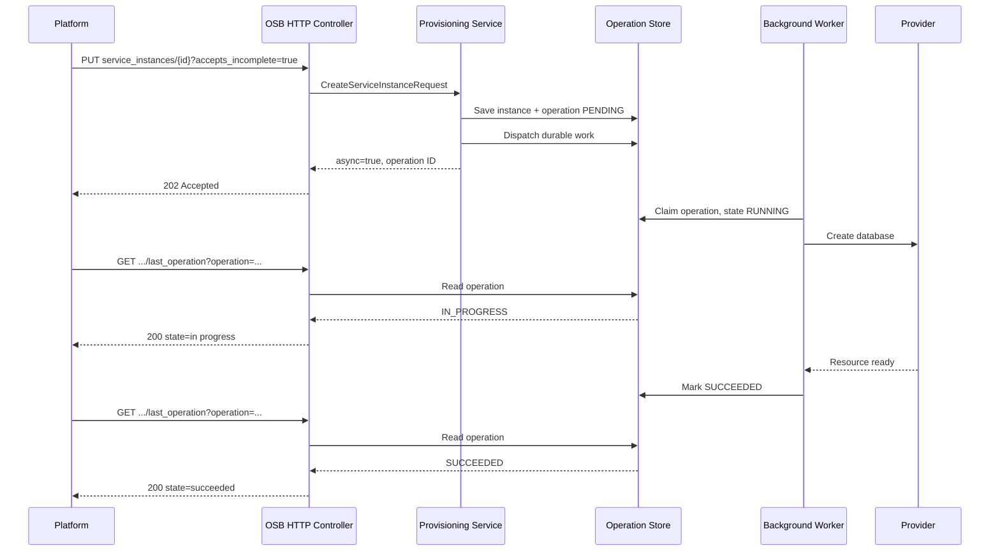
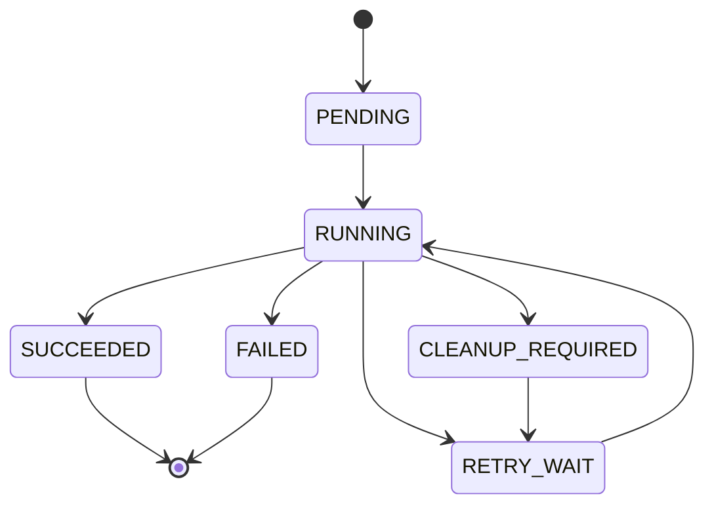

# Kiểm thử chuỗi bất đồng bộ từ HTTP 202 đến trạng thái cuối

## 1. Mục tiêu của kiểm thử asynchronous operation

Một thao tác trong service broker có thể mất nhiều thời gian hơn thời gian xử lý một HTTP request. Ví dụ, tạo managed database, cấu hình cache cluster, cấp quyền trên hệ thống nhắn tin hoặc thu hồi tài nguyên cloud có thể cần nhiều bước và phải chờ provider hoàn tất. Open Service Broker API (OSB API) cho phép broker tiếp nhận thao tác bất đồng bộ, trả `202 Accepted`, rồi để nền tảng truy vấn trạng thái cho đến khi operation kết thúc.

Với module `SPRING_CLOUD_SERVICE_BROKER`, kiểm thử không thể dừng ở việc xác minh endpoint trả `202`. Một chuỗi bất đồng bộ chỉ hoạt động đúng khi:

1. Broker tiếp nhận request hợp lệ và xác nhận client chấp nhận xử lý bất đồng bộ.
2. Broker lưu operation bền vững trước khi trả response.
3. Worker thực hiện đúng tác vụ với provider.
4. Trạng thái operation được cập nhật theo tiến độ thực tế.
5. Endpoint `last_operation` trả đúng trạng thái cho nền tảng polling.
6. Operation đi đến trạng thái cuối `succeeded` hoặc `failed`.
7. Retry, timeout, restart và request polling lặp không tạo tài nguyên trùng hoặc làm sai trạng thái.

Do đó, bài kiểm thử cần đi xuyên qua HTTP controller, service layer, operation repository, worker, provider adapter và endpoint polling. Unit test cho một method riêng lẻ không thể chứng minh toàn bộ chuỗi này hoạt động.

## 2. Luồng chuẩn từ 202 Accepted đến trạng thái cuối

Ví dụ nền tảng yêu cầu provision một database. Request gửi `accepts_incomplete=true` để broker có thể xử lý bất đồng bộ:

```http
PUT /v2/service_instances/inst-1001?accepts_incomplete=true HTTP/1.1
Host: broker.example.com
Authorization: Basic <broker-credentials>
X-Broker-API-Version: 2.17
Content-Type: application/json

{
  "service_id": "postgresql",
  "plan_id": "isolated",
  "organization_guid": "org-01",
  "space_guid": "space-01",
  "parameters": {
    "storage_gb": 100
  }
}
```

Broker lưu instance và operation, sau đó trả:

```http
HTTP/1.1 202 Accepted
Content-Type: application/json

{
  "operation": "provision-inst-1001-01"
}
```

Nền tảng gọi endpoint last operation:

```http
GET /v2/service_instances/inst-1001/last_operation?service_id=postgresql&plan_id=isolated&operation=provision-inst-1001-01 HTTP/1.1
Host: broker.example.com
Authorization: Basic <broker-credentials>
X-Broker-API-Version: 2.17
Accept: application/json
```

Trong lúc worker chạy, broker trả:

```http
HTTP/1.1 200 OK
Content-Type: application/json

{
  "state": "in progress",
  "description": "Đang tạo managed database"
}
```

Khi provider xác nhận database đã sẵn sàng:

```http
HTTP/1.1 200 OK
Content-Type: application/json

{
  "state": "succeeded",
  "description": "Database đã sẵn sàng"
}
```

Nếu operation thất bại:

```json
{
  "state": "failed",
  "description": "Provider không thể tạo database"
}
```

`operation` là mã do broker tạo và trả về nếu muốn phân biệt chính xác từng lần chạy. Nền tảng phải gửi lại giá trị đó trong query parameter `operation`. Nếu broker không trả operation ID, OSB API giới hạn số operation bất đồng bộ đồng thời trên cùng service instance; vì vậy, thiết kế operation ID riêng thường giúp việc polling và kiểm thử rõ ràng hơn.



## 3. Những thành phần phải được kiểm thử

| Thành phần | Điều cần xác minh |
|---|---|
| HTTP controller | Route, method, query parameter, header, authentication và HTTP status đúng OSB API. |
| Service interface | Request được ánh xạ đúng sang `ServiceInstanceService` hoặc `ServiceInstanceBindingService`. |
| Operation service | Tạo operation ID, kiểm tra trạng thái và bảo đảm idempotency. |
| Operation repository | Lưu trạng thái bền vững và đọc được từ nhiều replica. |
| Worker/queue | Nhận công việc đúng một cách an toàn, retry và cập nhật kết quả. |
| Provider adapter | Phân biệt thành công, lỗi tạm thời, lỗi cuối cùng và kết quả không xác định. |
| Last-operation endpoint | Trả `in progress`, `succeeded`, `failed` và response đặc thù của delete. |
| State machine | Không chuyển trạng thái sai thứ tự hoặc bỏ qua bước cleanup. |
| Audit/metrics | Ghi nhận tiến độ và lỗi mà không lộ secret. |

Một bài test end-to-end nên sử dụng application context thật và provider giả lập có thể điều khiển. Không cần kết nối cloud provider production để kiểm tra HTTP contract và chuyển trạng thái operation.

## 4. Thiết kế test fixture và provider giả lập

Để kiểm thử ổn định, tạo một provider adapter giả lập có thể điều khiển thời điểm hoàn tất và kết quả. Có thể cung cấp các chế độ:

- **Pending:** provider chưa trả kết quả, giúp kiểm tra trạng thái `in progress`.
- **Success:** provider trả resource ID và endpoint hợp lệ.
- **Retryable failure:** provider timeout, trả `429` hoặc lỗi `5xx`.
- **Permanent failure:** provider từ chối do cấu hình hoặc quyền không hợp lệ.
- **Unknown outcome:** request tới provider timeout sau khi provider có thể đã tạo resource.
- **Partial failure:** một bước đã hoàn tất nhưng bước tiếp theo thất bại.

Fixture nên tạo instance ID và operation ID xác định để assertion không phụ thuộc dữ liệu ngẫu nhiên. Có thể dùng repository test thật với database nhúng hoặc Testcontainers; worker và provider adapter được thay bằng test implementation.

Ví dụ abstraction test:

```java
interface TestProviderControl {
    void completeProvision(String operationId, String providerResourceId);
    void failProvision(String operationId, String errorCode);
    void keepProvisionPending(String operationId);
}
```

Đây là API test nội bộ do ứng dụng định nghĩa. Mục tiêu là điều khiển kết quả provider mà không phải dùng `Thread.sleep()` để chờ một khoảng thời gian cố định.

## 5. Kiểm thử HTTP 202 và operation ID

Test đầu tiên xác minh request được tiếp nhận bất đồng bộ và operation đã được lưu trước khi response gửi về client.

Ví dụ với Spring Boot WebFlux và `WebTestClient`:

```java
@SpringBootTest(webEnvironment = SpringBootTest.WebEnvironment.RANDOM_PORT)
@AutoConfigureWebTestClient
class AsyncProvisioningHttpTest {

    @Autowired
    WebTestClient webTestClient;

    @Autowired
    OperationRepository operationRepository;

    @Test
    void provisioningReturnsAcceptedWithPersistedOperation() {
        webTestClient.put()
                .uri("/v2/service_instances/inst-1001?accepts_incomplete=true")
                .headers(headers -> headers.setBasicAuth("broker-client", "test-secret"))
                .header("X-Broker-API-Version", "2.17")
                .contentType(MediaType.APPLICATION_JSON)
                .bodyValue(Map.of(
                        "service_id", "postgresql",
                        "plan_id", "isolated",
                        "parameters", Map.of("storage_gb", 100)))
                .exchange()
                .expectStatus().isAccepted()
                .expectBody()
                .jsonPath("$.operation").isNotEmpty();

        StepVerifier.create(operationRepository.findByInstanceId("inst-1001"))
                .assertNext(operation -> {
                    assertThat(operation.getState()).isIn("PENDING", "RUNNING");
                    assertThat(operation.getOperationId()).isNotBlank();
                })
                .verifyComplete();
    }
}
```

Đây là skeleton minh họa; tên repository, trạng thái và cách cấu hình security phụ thuộc ứng dụng. Nếu worker có thể chạy rất nhanh, trạng thái sau HTTP response có thể đã là `RUNNING` hoặc `SUCCEEDED`. Test không nên bắt buộc `PENDING` nếu hệ thống cho phép worker claim operation ngay sau khi enqueue.

Các assertion quan trọng:

- HTTP status là `202 Accepted`.
- Response body có operation ID nếu broker chọn trả trường này.
- Operation ID trong response trùng ID được lưu trong repository.
- Instance và operation được lưu bền vững trước khi request được coi là đã tiếp nhận.
- Provider adapter được gọi đúng một lần cho operation ban đầu.

Không chỉ kiểm tra status `202`. Nếu response trả operation ID nhưng không có record tương ứng, nền tảng sẽ polling một operation mà broker không thể tìm thấy.

## 6. Kiểm thử last_operation khi operation đang chạy

Sau khi nhận `202`, test gọi endpoint last operation với đúng instance ID, service ID, plan ID và operation ID.

```java
webTestClient.get()
        .uri(uriBuilder -> uriBuilder
                .path("/v2/service_instances/{instanceId}/last_operation")
                .queryParam("service_id", "postgresql")
                .queryParam("plan_id", "isolated")
                .queryParam("operation", operationId)
                .build("inst-1001"))
        .headers(headers -> headers.setBasicAuth("broker-client", "test-secret"))
        .header("X-Broker-API-Version", "2.17")
        .exchange()
        .expectStatus().isOk()
        .expectBody()
        .jsonPath("$.state").isEqualTo("in progress");
```

Test cần xác minh:

- Route có `instance_id` đúng.
- Query parameter `service_id`, `plan_id` và `operation` được đọc đúng.
- Operation ID không bị bỏ qua khi có nhiều operation cũ của cùng instance.
- Trạng thái nội bộ `PENDING` hoặc `RUNNING` được ánh xạ thành `in progress`.
- Response không chứa credential, provider admin token hoặc thông tin nội bộ nhạy cảm.
- Polling không khởi chạy lại provisioning và không tạo side effect.

Nếu request gửi operation ID không tồn tại hoặc không thuộc instance đó, broker không được trả trạng thái của một operation khác. Hãy trả lỗi phù hợp theo hợp đồng và chính sách của broker.

## 7. Kiểm thử chuyển sang succeeded

Sau khi xác minh operation đang chạy, test điều khiển provider giả lập trả thành công. Worker phải lưu provider resource ID, cập nhật instance và operation sang trạng thái cuối.

Trình tự assertion:

1. Gọi provisioning và nhận `202` cùng operation ID.
2. Poll last operation và xác nhận `in progress`.
3. Điều khiển provider giả lập hoàn tất.
4. Chờ worker xử lý và ghi `SUCCEEDED`.
5. Poll lại đúng operation ID.
6. Xác nhận response `state: succeeded`.
7. Kiểm tra instance ở trạng thái `ACTIVE` và resource mapping tồn tại.
8. Xác nhận provider chỉ tạo một resource.

Ví dụ kiểm tra cuối:

```java
testProviderControl.completeProvision(operationId, "db-provider-7821");

await().atMost(Duration.ofSeconds(10))
        .untilAsserted(() -> {
            webTestClient.get()
                    .uri(lastOperationUri("inst-1001", operationId))
                    .headers(headers -> headers.setBasicAuth("broker-client", "test-secret"))
                    .header("X-Broker-API-Version", "2.17")
                    .exchange()
                    .expectStatus().isOk()
                    .expectBody()
                    .jsonPath("$.state").isEqualTo("succeeded");
        });
```

`await()` ở đây minh họa Awaitility. Dùng thời hạn chờ có giới hạn và polling interval phù hợp; không chờ vô hạn. `lastOperationUri()` là helper do test định nghĩa để tạo URI với query parameter đã encode.

Sau khi state thành `succeeded`, test nên kiểm tra các điều kiện hậu provisioning như resource ID, plan, parameters đã chuẩn hóa và metadata cần thiết. Không chỉ kiểm tra JSON response vì worker có thể trả trạng thái thành công nhưng chưa lưu mapping đủ để retrieve, bind hoặc deprovision sau này.

## 8. Kiểm thử trạng thái failed

Một operation có thể thất bại do provider từ chối request, thiếu quota, credential provider không hợp lệ hoặc lỗi cấu hình. Broker cần lưu trạng thái cuối `FAILED` và cung cấp mô tả đã được làm sạch.

Ví dụ:

```java
testProviderControl.failProvision(operationId, "QUOTA_EXCEEDED");

await().atMost(Duration.ofSeconds(10))
        .untilAsserted(() -> {
            webTestClient.get()
                    .uri(lastOperationUri("inst-1001", operationId))
                    .headers(headers -> headers.setBasicAuth("broker-client", "test-secret"))
                    .header("X-Broker-API-Version", "2.17")
                    .exchange()
                    .expectStatus().isOk()
                    .expectBody()
                    .jsonPath("$.state").isEqualTo("failed");
        });
```

Các điều cần kiểm tra:

- Operation chuyển sang `FAILED`, không tiếp tục trả `in progress` vô thời hạn.
- `description` không chứa password, token, SQL hoặc stack trace.
- Lỗi được lưu với error code có thể truy vết trong log/audit nội bộ.
- Instance không bị đánh dấu `ACTIVE` nếu tài nguyên chưa sẵn sàng.
- Nếu đã tạo một phần tài nguyên, compensation hoặc cleanup state được ghi nhận.
- Nền tảng polling nhận trạng thái cuối nhất quán sau nhiều lần gọi.

Với last-operation của provisioning hoặc update, response thường là HTTP `200 OK` cùng `state: failed`. Không biến lỗi nghiệp vụ thành HTTP `500` chỉ vì operation đã thất bại; HTTP `500` dành cho lỗi xử lý request polling hoặc lỗi server không thể trả trạng thái operation.

## 9. Kiểm thử accepts_incomplete và AsyncRequired

Nếu broker có thể xử lý đồng bộ, request không có `accepts_incomplete=true` có thể được hoàn tất trong request. Nếu thao tác chỉ có thể xử lý bất đồng bộ, broker phải yêu cầu client chấp nhận async.

| Request | Hành vi mong đợi |
|---|---|
| `accepts_incomplete=true`, operation cần thời gian | `202 Accepted`, operation ID nếu được trả. |
| `accepts_incomplete=false` hoặc không gửi, broker có thể hoàn tất đồng bộ | Hoàn tất và trả response thành công đồng bộ theo hợp đồng endpoint. |
| `accepts_incomplete=false` hoặc không gửi, broker bắt buộc async | `422 Unprocessable Entity`, `error: AsyncRequired`. |

Ví dụ test:

```java
webTestClient.put()
        .uri("/v2/service_instances/inst-async-required")
        .headers(headers -> headers.setBasicAuth("broker-client", "test-secret"))
        .header("X-Broker-API-Version", "2.17")
        .contentType(MediaType.APPLICATION_JSON)
        .bodyValue(validProvisionRequest())
        .exchange()
        .expectStatus().isEqualTo(422)
        .expectBody()
        .jsonPath("$.error").isEqualTo("AsyncRequired");
```

Test này cần xác minh broker không tạo một operation chạy nền rồi trả `202` trái với khả năng client đã khai báo. Nếu broker đã ghi một reservation trước khi phát hiện async không được chấp nhận, cần rollback reservation hoặc bảo đảm không có tài nguyên/operation mồ côi.

## 10. Kiểm thử retry và idempotency

HTTP client hoặc controller nền tảng có thể gửi lại request ban đầu khi response bị mất. Provider cũng có thể đã tạo resource nhưng broker chưa nhận được response. Test cần chứng minh retry không tạo hai tài nguyên cho cùng một instance.

Kịch bản:

1. Gửi PUT provisioning với `instance_id` cố định.
2. Giữ provider ở trạng thái pending hoặc giả lập timeout sau khi provider đã tạo resource.
3. Gửi lại cùng request với service ID, plan ID và parameters giống hệt.
4. Xác minh broker tìm thấy instance/operation hiện tại và không tạo operation/resource độc lập gây trùng.
5. Hoàn tất provider và xác minh chỉ có một allocation được lưu.

Các trường hợp cần phân biệt:

- Cùng instance ID và cùng nội dung có ý nghĩa: xử lý idempotent, trả kết quả hoặc operation hiện tại theo OSB contract.
- Cùng instance ID nhưng service/plan/parameters xung đột: trả conflict phù hợp, không sửa resource cũ âm thầm.
- Retry với operation ID cũ: last operation vẫn trỏ đúng lần chạy cũ.
- Hai request đồng thời: unique constraint hoặc locking ngăn hai worker cùng provision.
- Provider timeout không xác định: tra cứu resource theo idempotency key/tag trước khi gọi create lại.

Không chỉ mock repository để trả cùng một operation ID. Nên có integration test với unique constraint và transaction thật để chứng minh nhiều request cạnh tranh không tạo bản ghi trùng.

## 11. Kiểm thử operation persistence và worker restart

Operation không được chỉ lưu trong biến hoặc cache cục bộ của một process. Nếu broker trả `202` rồi restart, nền tảng vẫn có thể polling và worker phải có khả năng tiếp tục công việc.

Test persistence có thể thực hiện:

1. Gửi provisioning và nhận operation ID.
2. Xác nhận operation record được commit.
3. Dừng hoặc tái tạo application context/worker.
4. Khởi động lại worker với cùng database operation store.
5. Poll last operation từ instance mới.
6. Xác minh operation vẫn tồn tại và được tiếp tục hoặc được reconciliation.

Nếu dùng queue, cần kiểm thử khoảng thời gian giữa commit operation và publish message. Transactional outbox là một cách giảm rủi ro lưu operation thành công nhưng message không được gửi. Test cần chứng minh outbox publisher có thể gửi lại event sau restart mà không tạo side effect trùng.

Một operation bị `RUNNING` quá lâu cần được phát hiện. Reconciliation job có thể kiểm tra lease/heartbeat, tra provider state và tiếp tục bước còn thiếu. Không tự động chuyển mọi operation cũ thành `FAILED` nếu provider có thể đã hoàn thành tác vụ nhưng response bị mất.

## 12. Kiểm thử provider timeout và kết quả không xác định

Timeout không chứng minh provider chưa thực hiện thao tác. Ví dụ request tạo database đã tới provider, provider tạo xong nhưng response bị mất trên mạng. Broker nhìn thấy timeout; nếu retry create mù quáng, có thể tạo thêm database.

Test cần mô phỏng:

- Provider trả timeout trước khi thực hiện thao tác.
- Provider thực hiện xong nhưng response timeout.
- Provider trả `429` hoặc `503` rồi thành công ở lần retry.
- Provider trả lỗi cuối cùng như quota hoặc policy violation.
- Provider trả resource ID nhưng bước lưu mapping trong broker thất bại.

Hành vi đúng:

1. Lưu kết quả không xác định hoặc trạng thái retryable.
2. Tra cứu provider bằng idempotency key, tag hoặc external request ID.
3. Nếu resource đã tồn tại và thuộc instance, tiếp tục từ bước lưu mapping/configuration.
4. Nếu chắc chắn chưa tạo, retry với backoff.
5. Nếu không thể xác định, giữ operation ở trạng thái chờ reconciliation và phát cảnh báo.

Test phải xác minh provider create count, số allocation và mapping cuối cùng. Chỉ xác minh HTTP `202` không phát hiện được lỗi tạo trùng ở provider.

## 13. Kiểm thử các loại operation khác nhau

OSB API có nhiều luồng bất đồng bộ. Cấu trúc kiểm thử tương tự nhau nhưng route, response terminal và side effect khác nhau.

| Operation | Request khởi tạo | Endpoint polling | Điều cần xác minh ở trạng thái cuối |
|---|---|---|---|
| Provision | `PUT /v2/service_instances/{id}` | `/v2/service_instances/{id}/last_operation` | `succeeded` chỉ khi instance sẵn sàng; `failed` nếu không thể provision. |
| Update | `PATCH /v2/service_instances/{id}` | Cùng last-operation instance | `succeeded` sau khi cấu hình/plan đã cập nhật; không trả snapshot nửa cũ nửa mới. |
| Deprovision | `DELETE /v2/service_instances/{id}` | Cùng last-operation instance | Khi deprovision async thành công, endpoint last operation dùng `410 Gone` theo OSB contract. |
| Create binding | `PUT /v2/service_instances/{id}/service_bindings/{binding_id}` | `/v2/service_instances/{id}/service_bindings/{binding_id}/last_operation` | `succeeded` khi credential và quyền đã sẵn sàng. |
| Delete binding | `DELETE /v2/service_instances/{id}/service_bindings/{binding_id}` | Cùng last-operation binding | Khi unbind async thành công, endpoint last operation dùng `410 Gone` theo OSB contract. |

Đặc biệt, không dùng một assertion HTTP terminal chung cho mọi loại operation. Với provisioning/update, trạng thái cuối thường được trả bằng HTTP `200 OK` và `state: succeeded`; với deprovision/unbind bất đồng bộ đã thành công, `410 Gone` biểu thị tài nguyên đã bị xóa theo hợp đồng OSB API.

## 14. Kiểm thử polling, Retry-After và giới hạn thời gian

Nền tảng có thể polling nhiều lần trong lúc operation chạy. Broker cần trả trạng thái ổn định và không làm thay đổi operation mỗi khi nhận GET.

Kiểm thử nên xác minh:

- Poll liên tục khi worker pending luôn trả `in progress`.
- Poll sau khi worker hoàn tất trả trạng thái cuối.
- Poll lặp sau terminal state vẫn trả cùng kết quả trong thời gian lưu operation.
- Poll với operation ID sai không làm lộ trạng thái của operation khác.
- Poll đồng thời từ nhiều request không khóa worker hoặc làm hỏng state.
- `Retry-After` nếu broker phát ra phải là giá trị hợp lệ theo chính sách và không làm test phụ thuộc vào timing chính xác.
- Operation quá thời hạn được cảnh báo/reconcile; không bị giữ `in progress` vô hạn.

Không viết test dùng `Thread.sleep(5000)` với giả định worker chắc chắn đã xong. Dùng tín hiệu test, `StepVerifier`, Awaitility với deadline hoặc test scheduler phù hợp. Thời gian test phải có giới hạn để tránh treo CI.

## 15. Kiểm thử state transition và invariant

Operation thường có state nội bộ chi tiết hơn OSB API. Ví dụ:



Không cho phép các chuyển trạng thái tùy tiện như `SUCCEEDED -> RUNNING` hoặc `FAILED -> SUCCEEDED` mà không có operation/recovery policy rõ ràng. Nếu retry là một lần chạy mới, có thể tạo operation mới và giữ lịch sử operation trước đó.

Các invariant nên được kiểm tra:

- Một operation ID chỉ đại diện cho một operation.
- Một instance không có hai provisioning operation đang chạy xung đột.
- `ACTIVE` chỉ được ghi sau khi provider resource sẵn sàng và mapping được lưu.
- `SUCCEEDED` không xuất hiện trước khi các bước bắt buộc hoàn tất.
- `FAILED` có error code và trạng thái cleanup rõ ràng.
- Polling không tạo side effect hoặc thay đổi state.
- Operation terminal vẫn có thể đọc được trong thời gian retention.
- Worker chỉ cập nhật state nếu còn giữ lease/version hợp lệ.

Test state machine có thể dùng property-based test hoặc parameterized test để thử nhiều chuỗi transition hợp lệ/không hợp lệ. Với concurrency, dùng nhiều thread hoặc request song song cùng một instance để xác minh optimistic locking/unique constraint.

## 16. Kiểm thử HTTP security và tính đúng đắn của response

Các endpoint khởi tạo operation và last operation đều cần được bảo vệ. Test nên kiểm tra:

- Thiếu hoặc sai broker credential nhận `401 Unauthorized`.
- Caller không có quyền trên platform/instance không đọc được operation của tenant khác.
- `X-Broker-API-Version` được kiểm tra theo cấu hình broker.
- `service_id` và `plan_id` không khớp không được trả operation của instance khác.
- `operation` query parameter được URL decode và đối chiếu đúng.
- Response `description` không chứa secret, provider token, stack trace hoặc nội dung nhạy cảm.
- Response state chỉ dùng giá trị OSB API cho phép: `in progress`, `succeeded`, `failed`.
- Response HTTP của deprovision/unbind terminal tuân thủ ngữ nghĩa `410 Gone`.

Nếu broker hỗ trợ multi-tenant, hãy tạo hai platform identity và hai instance trong test. Xác minh identity A không thể poll operation của instance B dù biết instance ID hoặc operation ID.

## 17. Kết hợp unit test, integration test và contract test

Không có một loại test duy nhất bao phủ toàn bộ chuỗi bất đồng bộ.

| Loại test | Phạm vi | Công cụ gợi ý |
|---|---|---|
| Unit test | State mapping, plan resolver, idempotency decision, error mapping. | JUnit 5, Mockito, AssertJ. |
| Reactive unit test | Publisher completion, error và thứ tự các bước reactive. | Reactor Test `StepVerifier`. |
| HTTP integration test | PUT/PATCH/DELETE trả 202, GET last operation trả trạng thái đúng. | `@SpringBootTest`, `WebTestClient` hoặc `MockMvc` theo web stack. |
| Persistence integration test | Operation commit, unique constraint, transaction và restart. | Testcontainers hoặc database test tương ứng. |
| Worker integration test | Queue, retry, lease, outbox và reconciliation. | Test queue adapter hoặc container tương ứng. |
| Provider adapter test | Success, not found, timeout, rate limit và lỗi cuối. | WireMock, MockWebServer hoặc provider sandbox. |
| Contract test | Request/response tuân thủ OSB API version. | OSB API test suite và test HTTP của broker. |

Test HTTP phải chạy qua controller và security filter chain thật. Unit test gọi trực tiếp `getLastOperation()` không chứng minh route, query parameter, HTTP status hoặc authentication đã được cấu hình đúng.

## 18. Ma trận kiểm thử end-to-end tối thiểu

| Kịch bản | HTTP khởi tạo | Polling | Kết quả cuối / invariant |
|---|---|---|---|
| Provision thành công | `202` | `in progress` rồi `succeeded` | Instance `ACTIVE`, một provider resource. |
| Provision thất bại | `202` | `in progress` rồi `failed` | Không đánh dấu `ACTIVE`, lưu lỗi/cleanup. |
| Async không được chấp nhận | `422 AsyncRequired` | Không có operation được chạy | Không có resource mồ côi. |
| Duplicate request | `202` hoặc kết quả nhất quán theo operation hiện tại | Cùng operation ID | Không tạo resource trùng. |
| Provider timeout không rõ kết quả | `202` nếu đã nhận async | `in progress`/retry state | Tra cứu provider trước khi create lại. |
| Worker restart | Request ban đầu `202` | Poll tiếp sau restart | Operation persistence và recovery hoạt động. |
| Update thành công | `202` | `in progress` rồi `succeeded` | Plan/config mới được áp dụng. |
| Deprovision thành công | `202` | Poll last operation | `410 Gone` khi async deprovision hoàn tất. |
| Create binding thành công | `202` | `in progress` rồi `succeeded` | Credential sẵn sàng, không lộ secret trong log. |
| Unbind thành công | `202` | Poll last operation | `410 Gone` khi async unbind hoàn tất. |
| Sai operation ID | GET lỗi phù hợp | Không trả operation khác | Không rò rỉ dữ liệu tenant. |
| Operation quá hạn | Request đã được nhận | Poll vẫn pending quá deadline | Alert/reconciliation kích hoạt. |

## 19. Lỗi kiểm thử thường gặp

- **Chỉ assert `202`:** không xác minh operation có được lưu và worker có chạy.
- **Dùng sleep cố định:** làm test flaky khi CI chậm hoặc worker chạy nhanh.
- **Mock last-operation response:** không kiểm tra operation store, state transition và worker thực tế.
- **Không test retry:** có thể bỏ sót lỗi tạo tài nguyên trùng sau timeout.
- **Không test restart:** operation chỉ nằm trong memory có thể mất sau khi process dừng.
- **Không phân biệt operation type:** deprovision/unbind có terminal HTTP semantics khác provisioning/update.
- **Không kiểm tra resource state:** operation báo `succeeded` nhưng provider resource hoặc mapping chưa tồn tại.
- **Không kiểm tra secret:** error description hoặc log có thể làm lộ credential.
- **Chờ vô hạn:** test suite bị treo khi worker chết hoặc queue không xử lý message.
- **Chỉ test service method:** bỏ sót lỗi route, authentication, header và JSON response.

## 20. Checklist hoàn thành kiểm thử chuỗi bất đồng bộ

1. Test khởi tạo request có `accepts_incomplete=true` và nhận đúng `202`.
2. Test operation ID được lưu bền vững trước khi trả response.
3. Test polling trả `in progress` khi worker chưa hoàn tất.
4. Test worker success dẫn đến `succeeded` và instance/resource state nhất quán.
5. Test worker failure dẫn đến `failed`, có error code và cleanup state.
6. Test `AsyncRequired` khi client không chấp nhận async.
7. Test duplicate request và concurrent request không tạo operation/resource trùng.
8. Test provider timeout, retry, outbox và worker restart.
9. Test polling lặp, sai operation ID và operation retention.
10. Test terminal semantics riêng cho provision/update, deprovision, create binding và unbind.
11. Test security, tenant isolation và không lộ secret.
12. Dùng deadline có giới hạn, test signal và fake provider điều khiển được.
13. Chạy HTTP integration test qua controller thật và contract test theo OSB API version.

## 21. Nguyên tắc cần ghi nhớ

- `202 Accepted` chỉ xác nhận broker đã tiếp nhận công việc bất đồng bộ; chưa có nghĩa tài nguyên đã sẵn sàng.
- Operation phải được lưu bền vững trước khi trả `202` và có thể đọc từ mọi replica.
- Nền tảng polling last operation bằng instance/binding ID và operation ID tương ứng.
- Trạng thái OSB API gồm `in progress`, `succeeded` và `failed`; trạng thái nội bộ phải được ánh xạ đúng.
- Worker success/failure phải cập nhật cả operation và resource state một cách nhất quán.
- Retry, timeout và restart cần được kiểm thử để chứng minh idempotency và khả năng phục hồi.
- Provision/update và deprovision/unbind có response terminal khác nhau; không dùng chung một assertion status cho mọi operation.
- Test HTTP end-to-end phải đi qua controller, security, persistence, worker, provider adapter và last-operation endpoint.
- Dùng fake provider có thể điều khiển, deadline hữu hạn và không phụ thuộc `Thread.sleep()`.

## Nguồn tham khảo

- [Open Service Broker API v2.17 – Asynchronous Operations](https://github.com/openservicebrokerapi/servicebroker/blob/v2.17/spec.md#asynchronous-operations): `accepts_incomplete`, response `202`, operation và polling last operation.
- [Open Service Broker API v2.17 – Provisioning a Service Instance](https://github.com/openservicebrokerapi/servicebroker/blob/v2.17/spec.md#provisioning-a-service-instance): hợp đồng provisioning và idempotency.
- [Open Service Broker API v2.17 – Polling Last Operation](https://github.com/openservicebrokerapi/servicebroker/blob/v2.17/spec.md#polling-last-operation): state response và polling semantics.
- [Spring Cloud Open Service Broker 4.4.1 Reference](https://docs.spring.io/spring-cloud-open-service-broker/docs/4.4.1/reference/): service interfaces, request/response model và asynchronous operation support.
- [Spring Framework – WebTestClient](https://docs.spring.io/spring-framework/reference/testing/webtestclient.html): kiểm thử HTTP endpoint trên WebFlux hoặc MVC.
- [Project Reactor – Testing](https://projectreactor.io/docs/core/release/reference/testing.html): `StepVerifier` và kiểm thử reactive publisher.
