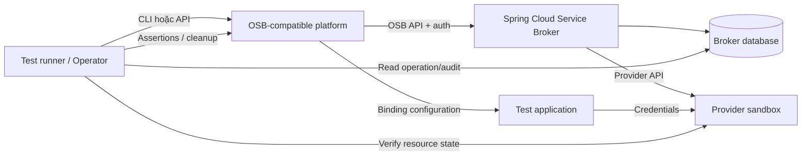

# Kiểm thử toàn trình với nền tảng OSB tương thích

Một service broker có thể vượt qua unit test nhưng vẫn không hoạt động đúng khi được đăng ký vào Cloud Foundry hoặc một platform tương thích Open Service Broker API (OSB API). Lỗi thực tế thường nằm ở ranh giới giữa các thành phần: catalog không đúng schema, platform gửi một field khác với giả định của broker, response bất đồng bộ thiếu operation ID, `last_operation` trả trạng thái không nhất quán, credentials binding không được phân phối tới ứng dụng hoặc deprovision để lại tài nguyên ở provider.

Kiểm thử toàn trình (end-to-end testing) xác minh luồng thật từ platform tới broker, từ broker tới backing service và ngược lại. Một kịch bản hoàn chỉnh không chỉ kiểm tra HTTP status; nó phải chứng minh platform nhận đúng kết quả, broker lưu đúng trạng thái và provider thực sự tạo, cập nhật, liên kết hoặc thu hồi tài nguyên theo yêu cầu.

Trong module `SPRING_CLOUD_SERVICE_BROKER`, mục tiêu là xây dựng service broker theo OSB API bằng Spring Cloud, hỗ trợ catalog, service plan, provision, update, bind, unbind, deprovision, xử lý bất đồng bộ, idempotency và bảo mật. Bài học này hướng dẫn tổ chức môi trường kiểm thử, đăng ký broker vào platform, chạy lifecycle thật, xác minh kết quả ở nhiều lớp và dọn dẹp dữ liệu sau test.

## Mục tiêu học tập

Sau bài này, bạn có thể:

- Phân biệt unit test, component/contract test, integration test và end-to-end test.
- Chuẩn bị platform OSB tương thích, broker, provider sandbox và dữ liệu test cô lập.
- Kiểm tra catalog và đăng ký broker với Cloud Foundry hoặc platform tương đương.
- Thực hiện đầy đủ provision, update, bind, fetch binding, unbind và deprovision.
- Kiểm thử cả thao tác đồng bộ lẫn bất đồng bộ và polling `last_operation`.
- Kiểm tra idempotency, lỗi validation, timeout, retry và quyền tenant.
- Xác minh trạng thái trên platform, broker database và backing service.
- Thu thập log/metric theo correlation ID và dọn dẹp tài nguyên an toàn.

## 1. Kiểm thử toàn trình khác gì kiểm thử handler?

Unit test thường gọi trực tiếp một class hoặc service và thay provider bằng mock. Integration test kiểm tra nhiều thành phần thật cùng hoạt động, ví dụ HTTP endpoint của broker, database và provider adapter. End-to-end test đưa request qua platform tương thích OSB, để platform thực hiện giao thức như một consumer thực tế.

| Loại kiểm thử | Phạm vi | Câu hỏi cần trả lời |
|---|---|---|
| Unit test | Một hàm/class, dependency thường được mock | Logic validate, mapping, state transition có đúng không? |
| Component test | Một module broker hoặc provider adapter | Handler và repository phối hợp đúng không? |
| Contract test | Request/response đối chiếu OSB API và contract provider | Schema, status code, header và field có đúng giao thức không? |
| Integration test | Broker + database + provider sandbox/fake server | Transaction, credentials và side effect có hoạt động đúng không? |
| End-to-end test | Platform OSB + broker + provider + ứng dụng consumer | Người vận hành có thể dùng service từ platform và ứng dụng có kết nối thật không? |

Không nên thay thế toàn bộ các lớp test bằng E2E. E2E chậm hơn, phụ thuộc môi trường và khó khoanh vùng lỗi. Dùng unit/contract test để phát hiện lỗi sớm, rồi dùng một tập E2E có chọn lọc để xác nhận các luồng quan trọng trên platform thật.

### 1.1. Những gì một E2E test cần chứng minh

Với một service instance, cần kiểm tra ít nhất ba góc nhìn:

1. **Platform:** platform nhận response đúng, hiển thị service instance/binding đúng trạng thái và cho phép ứng dụng sử dụng.
2. **Broker:** broker lưu instance, operation, binding, revision và ownership đúng; response theo OSB API nhất quán.
3. **Provider:** tài nguyên thực tế đã được tạo/cập nhật/xóa; credentials hoạt động và quyền truy cập đúng.

Chỉ kiểm tra `cf services` thấy instance tồn tại chưa chứng minh database đã được tạo. Chỉ kiểm tra database tồn tại cũng chưa chứng minh platform đã ghi nhận operation thành công hoặc ứng dụng nhận được credentials.

## 2. Kiến trúc môi trường kiểm thử

Một môi trường E2E tối thiểu gồm:

| Thành phần | Vai trò | Cấu hình test cần có |
|---|---|---|
| OSB-compatible platform | Consumer gửi request catalog/lifecycle tới broker | Org/space hoặc project riêng; quyền đăng ký broker và tạo service. |
| Spring Cloud Service Broker | Thực hiện OSB API | Bản build được kiểm thử, endpoint HTTPS, authentication và log. |
| Broker database | Lưu instance, operation, binding và idempotency | Database riêng, có thể reset theo test run. |
| Provider sandbox | Tạo tài nguyên thật hoặc tài nguyên giả lập có trạng thái | Account/project/namespace riêng, quota giới hạn và API credentials test. |
| Test application | Consumer nhận binding credentials | App nhỏ có health endpoint và thao tác kết nối tới backing service. |
| Test runner | Khởi tạo, điều phối và xác minh kịch bản | Lưu run ID, resource IDs và kết quả assert. |



### 2.1. Tách môi trường test khỏi production

Không chạy E2E với service instance, database, namespace hoặc credentials production. Một test có thể deprovision tài nguyên hoặc cố tình gửi parameters sai; nếu target nhầm production, hậu quả có thể nghiêm trọng.

Nên có:

- Platform foundation hoặc org/space riêng cho test.
- Broker registration và database riêng.
- Provider project/account/namespace riêng với quota giới hạn.
- Credentials có quyền tối thiểu, chỉ dùng cho tài nguyên test.
- Domain/route test không nhận traffic người dùng thật.
- Chính sách TTL/cleanup cho tài nguyên test bị bỏ dở.

Đặt nhãn theo test run, ví dụ `e2e-run-2026-11-27-01`, trên resource provider nếu hỗ trợ. Dùng prefix riêng cho instance/binding để dễ tìm và cleanup.

### 2.2. Ghi nhận phiên bản và cấu hình

Mỗi lần chạy E2E cần ghi lại:

- Phiên bản OSB API mà platform gửi trong `X-Broker-API-Version`.
- Phiên bản ứng dụng broker và Spring Cloud Open Service Broker.
- Platform/foundation và phiên bản CLI.
- Service ID, plan ID và catalog snapshot.
- Provider endpoint/region hoặc sandbox identifier, không ghi secret.
- Test run ID, thời gian bắt đầu và kết quả cuối.

Khi một test chỉ thất bại trên một platform version, các thông tin này giúp tái hiện lỗi và phân biệt lỗi tương thích với lỗi logic broker.

## 3. Chuẩn bị broker trước khi đăng ký

Trước khi platform kết nối broker, xác minh broker có thể khởi động và cung cấp endpoint ổn định.

Checklist chuẩn bị:

1. Cấu hình database broker và migration schema.
2. Cấu hình provider sandbox credentials qua secret manager/environment an toàn.
3. Bật HTTPS với certificate mà platform tin cậy.
4. Cấu hình authentication cho platform, ví dụ HTTP Basic hoặc mTLS theo platform hỗ trợ.
5. Kiểm tra endpoint `/v2/catalog` trả response hợp lệ.
6. Kiểm tra log không ghi password, token hoặc response credentials nguyên vẹn.
7. Xác minh health/readiness endpoint không tiết lộ thông tin nội bộ.
8. Đảm bảo callback/egress tới provider sandbox hoạt động.

Broker phải xử lý `X-Broker-API-Version` theo phiên bản OSB API hỗ trợ. Không nên chỉ dựa vào việc endpoint trả `200 OK`; cần kiểm tra catalog có service/plan ID ổn định, capability đúng và schema response đúng.

## 4. Đăng ký broker vào platform

Với Cloud Foundry, người vận hành có thể đăng ký service broker bằng CLI. Cú pháp cơ bản:

```bash
cf create-service-broker e2e-broker broker-user broker-password https://broker-e2e.example.test
```

Trong đó:

- `e2e-broker` là tên broker registration trong Cloud Foundry.
- `broker-user` và `broker-password` là credentials dùng để platform gọi broker.
- URL là endpoint broker có thể truy cập qua HTTPS.

Không gõ password production hoặc để lộ password trong shell history. Với môi trường tự động, lấy secret từ secret store và dùng cơ chế chạy lệnh bảo vệ output theo chính sách CI.

Sau khi đăng ký, kiểm tra broker:

```bash
cf service-brokers
```

Cho phép org/space sử dụng service offering nếu platform yêu cầu enable access:

```bash
cf enable-service-access postgresql
```

Tên service ở đây phải khớp `name` trong catalog. Một số platform hoặc phiên bản Cloud Foundry có cách quản lý access khác; hãy dùng đúng lệnh/cơ chế của môi trường E2E.

### 4.1. Kiểm tra catalog từ góc nhìn platform

Platform gọi `GET /v2/catalog` và dùng catalog để hiển thị offering/plan. Kiểm tra:

- `service_id` và `plan_id` là ID ổn định, không đổi giữa các lần restart broker.
- `name`, `description` và metadata phù hợp với offering.
- `bindable` phản ánh khả năng binding thực tế.
- `plans` có đúng các plan broker hỗ trợ.
- `requires` và `dashboard_client` chỉ xuất hiện khi phù hợp.
- `instances_retrievable`, `bindings_retrievable`, `allow_context_updates` hoặc các capability khác phản ánh đúng implementation.
- Các field/feature không hỗ trợ không được công bố sai.

Ví dụ catalog rút gọn:

```json
{
  "services": [
    {
      "id": "postgres-service-id",
      "name": "postgresql",
      "description": "PostgreSQL cho ứng dụng test",
      "bindable": true,
      "plans": [
        {
          "id": "postgres-standard-plan-id",
          "name": "standard",
          "description": "Plan kiểm thử tiêu chuẩn"
        }
      ]
    }
  ]
}
```

ID trong ví dụ chỉ minh họa. Khi E2E, dùng ID thật trong catalog của broker và assert platform nhìn thấy đúng service/plan.

### 4.2. Xác minh authentication

Thử request tới broker với credentials hợp lệ và không hợp lệ. Platform phải truy cập được catalog/lifecycle theo quyền đã cấu hình; request không xác thực phải bị từ chối. Không kiểm tra authentication chỉ bằng một request catalog, vì endpoint mutation và endpoint polling cũng phải đi qua security policy đúng.

## 5. Kịch bản provision end-to-end

Provision là điểm bắt đầu vòng đời service instance. Với Cloud Foundry, lệnh CLI cơ bản:

```bash
cf create-service postgresql standard orders-db-e2e
```

Cloud Controller gọi broker theo OSB API. Broker kiểm tra service/plan/parameters, tạo tài nguyên ở provider và trả response.

### 5.1. Provision đồng bộ

Nếu broker hoàn tất trong request và platform chấp nhận xử lý đồng bộ, response thành công thường là `201 Created`. E2E cần xác minh:

1. CLI/platform báo tạo service thành công.
2. `cf service orders-db-e2e` hiển thị trạng thái sẵn sàng.
3. Broker database có đúng một instance record gắn với platform instance ID.
4. Provider sandbox có đúng một tài nguyên tương ứng.
5. Resource được gắn tenant/ownership/run ID đúng.
6. Không có secret bị ghi vào log hoặc response không liên quan.

### 5.2. Provision bất đồng bộ

Nếu request có `accepts_incomplete=true` và broker cần thời gian xử lý, broker trả `202 Accepted` và có thể kèm `operation`. Platform tiếp tục polling `last_operation`.

E2E cần xác minh:

- Broker lưu operation trước khi trả `202`.
- Response có operation ID nếu implementation dùng field này.
- `last_operation` trả `in progress` khi worker chưa hoàn tất.
- `Retry-After` hợp lý nếu broker cung cấp.
- Khi provider hoàn tất, operation chuyển sang `succeeded`.
- Khi lỗi vĩnh viễn, operation kết thúc `failed` và mô tả an toàn.
- Polling không kích hoạt thêm provider create call.
- Instance state và provider state khớp với operation cuối.

Các giá trị `in progress`, `succeeded`, `failed` là giá trị OSB API; state nội bộ như `QUEUED`, `RUNNING`, `RETRY_WAIT` hoặc `RECONCILING` phải được ánh xạ phù hợp.

### 5.3. Kiểm tra idempotency provision

Gửi lại cùng request/instance identity theo cách platform có thể retry, ví dụ mô phỏng mất response sau khi broker đã commit. Broker không được tạo thêm database hoặc instance record thứ hai.

Kiểm tra:

- Cùng `instance_id` và cùng ý định trả kết quả nhất quán.
- Cùng ID nhưng parameters/service/plan xung đột được xử lý theo hợp đồng, thường trả conflict.
- Provider resource chỉ được tạo một lần hoặc được reconcile về một resource duy nhất.
- Operation cũ được tra cứu đúng; không trả trạng thái operation khác.

Không tạo hai request song song trên cùng instance chỉ để “thử idempotency” nếu broker chưa có cơ chế khóa; hãy chạy trong môi trường test có thể quan sát và dọn dẹp.

## 6. Kiểm thử update

Nếu service/plan công bố hỗ trợ update, kiểm tra lệnh update qua platform. Với Cloud Foundry CLI, cú pháp thường có dạng:

```bash
cf update-service orders-db-e2e -p large
```

Các tùy chọn parameters phụ thuộc CLI và service offering. Dùng `cf help update-service` và tài liệu của service trong môi trường đang test.

Kịch bản cần bao gồm:

1. Update hợp lệ trong cùng service, đổi plan hoặc parameters được hỗ trợ.
2. Update không hợp lệ, ví dụ plan không tồn tại hoặc parameters ngoài giới hạn.
3. Update khi instance đang có operation khác.
4. Update bất đồng bộ và polling `last_operation`.
5. Provider timeout sau khi nhận request; broker phải reconcile trước khi retry.
6. Update lặp cùng ý định; không áp dụng side effect nhiều lần.
7. Update thất bại giữa chừng; xác minh instance vẫn active, degraded hoặc cần reconciliation đúng với thực tế.

Sau update, kiểm tra đồng thời:

- Platform hiển thị plan/configuration mới hoặc trạng thái lỗi phù hợp.
- Broker lưu revision và parameters đích đã được xác nhận.
- Provider thực sự có cấu hình mới.
- Ứng dụng đang sử dụng dịch vụ vẫn hoạt động nếu loại update cam kết không gián đoạn.

Nếu offering không hỗ trợ update, test phải xác nhận platform/broker từ chối đúng cách thay vì âm thầm thay đổi tài nguyên.

## 7. Kiểm thử binding và phân phối credentials

Binding xác nhận ứng dụng có thể sử dụng tài nguyên đã provision. Với Cloud Foundry:

```bash
cf bind-service orders-api orders-db-e2e
cf restage orders-api
```

Cloud Controller gửi request create binding tới broker. Broker tạo credentials và trả response; platform phân phối dữ liệu cho ứng dụng, thường qua `VCAP_SERVICES`.

### 7.1. Xác minh binding response

Kiểm tra:

- Binding ID duy nhất và liên kết đúng instance.
- Response có `credentials` theo schema broker đã tài liệu hóa.
- `binding_existed`/response status phù hợp với binding mới hoặc binding đã tồn tại theo model framework.
- Binding có đúng consumer context và parameters.
- Credentials không chứa quyền vượt quá nhu cầu ứng dụng.
- Broker lưu binding record và provider principal/permission tương ứng.

### 7.2. Xác minh ứng dụng nhận credentials

Ứng dụng test nên có health check hoặc một endpoint nội bộ chỉ trả trạng thái kết nối, không trả credentials. Sau restage, xác minh app đọc đúng binding và kết nối tới backing service.

Ví dụ các bước CLI:

```bash
cf app orders-api
cf env orders-api
cf logs orders-api --recent
```

`cf env` có thể hiển thị secret. Chỉ dùng trong môi trường được kiểm soát; không lưu output nguyên bản vào CI artifact hoặc ticket. Ứng dụng không được log toàn bộ `VCAP_SERVICES`.

### 7.3. Binding lặp và binding xung đột

Kiểm tra cùng `binding_id`/ý định được retry không tạo user hoặc Secret trùng. Nếu cùng binding ID nhưng parameters khác, broker cần phát hiện xung đột và không ghi đè binding cũ một cách âm thầm.

Nếu catalog công bố `bindings_retrievable: true`, kiểm thử endpoint fetch binding và xác minh response chứa đúng thông tin binding theo hợp đồng. Nếu capability không được công bố, platform không nên giả định endpoint fetch được hỗ trợ.

## 8. Kiểm thử unbind và deprovision

Unbind xóa quan hệ binding và credentials gắn với consumer; deprovision xóa service instance và tài nguyên tương ứng. Hai thao tác không được nhầm lẫn.

### 8.1. Unbind

```bash
cf unbind-service orders-api orders-db-e2e
cf restage orders-api
```

Xác minh:

- Platform không còn binding của ứng dụng.
- Broker đánh dấu binding đã thu hồi hoặc xóa record theo retention policy.
- Provider credential/principal của binding bị revoke nếu không còn consumer dùng.
- Service instance vẫn tồn tại.
- Ứng dụng sau restage không còn nhận binding cũ.
- Binding khác của cùng service instance vẫn hoạt động.

### 8.2. Deprovision

```bash
cf delete-service orders-db-e2e
```

Cloud Controller gọi deprovision theo OSB API. Xác minh:

- Platform hiển thị service instance đã bị xóa.
- Broker operation kết thúc `succeeded` hoặc trạng thái lỗi phù hợp.
- Provider xác nhận tài nguyên không còn tồn tại.
- Binding còn sót được xử lý theo chính sách; không để credentials hoạt động ngoài dự kiến.
- Broker giữ tombstone/audit đủ để xử lý request lặp nếu cần.
- Resource của tenant/instance khác không bị xóa nhầm.

### 8.3. Deprovision lặp

Gửi lại yêu cầu deprovision trong một kịch bản có kiểm soát. Broker cần xử lý theo semantics OSB API và provider, không tạo side effect nguy hiểm. Nếu provider trả `NotFound`, xác minh resource identity và trạng thái mong muốn trước khi coi thao tác đã hoàn tất.

## 9. Kiểm thử catalog và capability

Catalog là hợp đồng để platform biết service có thể làm gì. E2E nên kiểm tra cả dữ liệu catalog lẫn hành vi thực tế.

| Capability/field | Kiểm tra |
|---|---|
| `bindable` | Platform chỉ cho phép bind khi service/plan hỗ trợ. |
| `plans` | Platform hiển thị đúng plan; ID không thay đổi bất ngờ. |
| `requires` | Các capability như `syslog_drain`, `route_forwarding` được công bố đúng với handler. |
| `instances_retrievable` | Chỉ công bố khi endpoint fetch instance được triển khai đúng. |
| `bindings_retrievable` | Chỉ công bố khi endpoint fetch binding được hỗ trợ. |
| `allow_context_updates` | Chỉ bật khi broker thực sự xử lý update context theo hợp đồng. |
| `plan_updateable` | Chỉ bật khi update plan được hỗ trợ theo semantics OSB. |
| `maintenance_info` | Metadata maintenance phản ánh version/description hợp lệ nếu dùng. |

Không bật capability chỉ để platform hiển thị nút thao tác. Một capability sai có thể khiến platform gọi endpoint mà broker không hỗ trợ hoặc tạo ra trạng thái không nhất quán.

## 10. Kiểm thử lỗi, bảo mật và quyền tenant

E2E cần có negative path, không chỉ happy path.

| Tình huống | Kết quả mong đợi |
|---|---|
| Thiếu/sai broker credentials | Request bị từ chối; không có side effect. |
| Tenant không có quyền với instance | Không đọc hoặc thay đổi tài nguyên tenant khác. |
| `service_id`/`plan_id` không hợp lệ | Lỗi giao thức phù hợp; không gọi provider. |
| Parameters sai schema | Request bị từ chối trước side effect. |
| Provider trả `429`/`503` | Retry có giới hạn, backoff và tôn trọng `Retry-After`. |
| Provider timeout sau khi nhận lệnh | Reconciliation trước retry; không tạo tài nguyên trùng. |
| Worker restart giữa operation | Operation tiếp tục từ trạng thái bền vững. |
| Platform gửi request lặp | Idempotency trả kết quả nhất quán. |
| Polling `last_operation` liên tục | Không phát sinh provider side effect mới. |
| Credentials bị revoke | Consumer không thể tiếp tục truy cập bằng secret cũ. |
| Request vượt quyền | Audit ghi nhận; không lộ dữ liệu của tenant khác. |

Không đưa secret thật vào test report. Với negative test, kiểm tra cả HTTP response, broker audit và provider state để bảo đảm request bị từ chối trước khi tạo tài nguyên.

## 11. Xác minh trạng thái ở ba lớp

Một E2E assertion nên kết hợp các bằng chứng:

| Luồng | Platform | Broker | Provider |
|---|---|---|---|
| Provision | Instance xuất hiện và ready | Instance + operation đúng | Database/resource tồn tại |
| Update | Platform hiển thị plan/config mới | Revision và operation đúng | Resource thực tế có cấu hình mới |
| Bind | App có binding | Binding record đúng | Principal/permission hoạt động |
| Fetch binding | Platform lấy được dữ liệu nếu capability bật | Response mapping đúng | Credentials/resource vẫn hợp lệ |
| Unbind | Binding biến mất khỏi app | Binding được thu hồi | Credentials riêng của binding bị revoke |
| Deprovision | Instance biến mất | Operation/tombstone đúng | Resource bị xóa |

Nếu một lớp không thể truy vấn trực tiếp, cần một tín hiệu thay thế đáng tin cậy, ví dụ provider audit API hoặc health check từ consumer. Không dùng một log “success” duy nhất làm bằng chứng cho toàn bộ trạng thái.

## 12. Thiết kế test data và cleanup

E2E test tạo tài nguyên có chi phí và có thể tồn tại sau khi test runner bị dừng. Mỗi test run nên quản lý resource inventory của riêng nó.

Một test manifest nội bộ có thể ghi:

```json
{
  "run_id": "e2e-2026-11-27-01",
  "platform_org": "broker-e2e-org",
  "platform_space": "lifecycle-tests",
  "service_instance_names": ["orders-db-e2e"],
  "application_names": ["orders-api-e2e"],
  "created_at": "2026-11-27T10:00:00Z",
  "cleanup_required": true
}
```

Đây là dữ liệu điều phối test, không phải OSB payload. Có thể bổ sung instance ID, binding ID và provider resource ID nhưng không lưu credentials.

### 12.1. Cleanup theo thứ tự

1. Dừng hoặc scale down test application nếu cần.
2. Unbind từng binding đã tạo.
3. Xác minh credentials riêng đã bị revoke.
4. Deprovision service instance.
5. Xác minh provider resource đã bị xóa.
6. Xóa app, route và dữ liệu platform test nếu không còn cần.
7. Giữ test report và audit đã làm sạch; xóa secret/test artifact nhạy cảm.

Không xóa database broker trước khi hoàn tất cleanup provider; nếu xóa operation/instance record quá sớm, broker có thể mất thông tin để thu hồi tài nguyên. Với test thất bại, cleanup cần tra cứu provider resource bằng run ID/ownership tag trước khi xóa.

### 12.2. Cleanup phải idempotent

Test runner có thể chạy cleanup nhiều lần. Mỗi bước cần kiểm tra resource có tồn tại và thuộc đúng run ID trước khi xóa. Không xóa resource chỉ dựa trên prefix chung nếu có thể trùng với dữ liệu của người dùng khác.

## 13. Tự động hóa E2E trong CI/CD

Không nhất thiết chạy toàn bộ E2E sau mỗi commit. Có thể phân tầng:

| Khi nào | Bộ kiểm thử |
|---|---|
| Mỗi commit | Unit, component và contract test nhanh. |
| Pull request hoặc merge | Integration với database/provider fake và một số lifecycle test. |
| Nightly hoặc trước release | E2E trên platform sandbox với provider sandbox thật. |
| Thay đổi OSB/Spring/platform version | Compatibility suite tập trung vào catalog, request/response, async và lifecycle. |

CI cần:

- Provision platform/broker test environment theo cách lặp lại được.
- Lấy credentials từ secret store, không lưu trong repository.
- Đăng ký broker và enable service access.
- Chạy test với run ID duy nhất.
- Thu thập log/trace đã làm sạch khi thất bại.
- Luôn chạy cleanup trong bước cuối, kể cả khi test fail hoặc timeout.
- Báo cáo platform version, broker build, test case và resource còn sót.

Nếu môi trường platform dùng chung, tránh test song song trên cùng service instance ID hoặc tên resource. Dùng namespace/org/space riêng theo worker hoặc test run.

## 14. Quan sát và chẩn đoán khi E2E thất bại

Một request lifecycle có thể đi qua platform, broker, worker và provider. Cần giữ các ID liên kết:

- Platform instance ID và binding ID.
- Broker operation ID.
- Provider request/resource ID.
- Test run ID và correlation ID.
- Tenant/org/space đã được xác minh.

Metric nên theo dõi tỷ lệ provision/update/bind/unbind/deprovision thành công, thời gian operation, số lần polling, retry count, provider latency, operation bị treo và resource cleanup thất bại.

Khi test fail, phân loại theo điểm lỗi:

1. Platform không gọi broker: kiểm tra registration, URL, TLS, authentication và network.
2. Broker nhận request nhưng trả lỗi: kiểm tra schema/version, validation, authorization và catalog capability.
3. Broker trả `202` nhưng không hoàn tất: kiểm tra outbox, queue, worker, lease và `last_operation`.
4. Broker báo thành công nhưng provider không có resource: kiểm tra provider adapter và transaction boundary.
5. Binding thành công nhưng app không kết nối: kiểm tra credentials schema, environment distribution, network và TLS.
6. Deprovision thành công nhưng resource còn tồn tại: kiểm tra provider delete semantics, async worker và reconciliation.

Không ghi log request/response có credentials nguyên vẹn. Test report cần mô tả lỗi bằng mã đã chuẩn hóa và thông tin correlation, không chứa password/token.

## 15. Ma trận E2E tối thiểu

| Nhóm | Kịch bản | Assertion chính |
|---|---|---|
| Registration | Đăng ký broker, xác thực, catalog | Platform đọc được catalog và đúng capability. |
| Provision | Sync thành công | Platform, broker và provider đều xác nhận instance. |
| Provision | Async thành công | `202`, operation ID, polling và terminal state đúng. |
| Provision | Request lặp | Không tạo resource/instance trùng. |
| Update | Thành công và thất bại | Revision/provider state khớp kết quả operation. |
| Binding | Tạo binding và app connect | Credentials đúng, app truy cập được provider. |
| Binding | Fetch khi capability bật | Response fetch đúng binding. |
| Binding | Request lặp/xung đột | Idempotent hoặc conflict đúng semantics. |
| Unbind | Thu hồi một binding | Binding/credentials tương ứng bị thu hồi, instance còn. |
| Deprovision | Xóa instance | Platform, broker và provider đều phản ánh đã xóa. |
| Error | Auth, validation, quota, provider 429/timeout | Không side effect sai; retry/reconcile đúng. |
| Isolation | Tenant A truy cập instance tenant B | Request bị từ chối, audit có ghi nhận. |
| Recovery | Broker/worker restart | Operation tiếp tục hoặc reconcile, không tạo trùng. |
| Cleanup | Test bị dừng giữa chừng | Resource theo run ID được tìm và thu hồi an toàn. |

## 16. Ví dụ một kịch bản kiểm thử toàn trình

Một test run kiểm tra PostgreSQL offering từ lúc platform đăng ký broker tới khi deprovision:

1. Khởi động broker với database test và provider sandbox.
2. Đăng ký broker vào platform, xác minh catalog có `postgresql/standard`.
3. Tạo service instance `orders-db-e2e`.
4. Chờ platform báo ready; xác minh provider database và broker instance record.
5. Tạo app `orders-api-e2e`, bind với `orders-db-e2e`.
6. Restage app và chạy health check thực hiện một truy vấn database đơn giản.
7. Nếu plan hỗ trợ update, đổi cấu hình hợp lệ và xác minh provider state/revision.
8. Unbind app; restage và xác minh binding credential không còn được phân phối.
9. Deprovision service instance và xác minh provider resource đã bị xóa.
10. Lưu test report đã làm sạch và chạy cleanup kiểm tra lần cuối.

Ví dụ lệnh Cloud Foundry minh họa:

```bash
cf create-service postgresql standard orders-db-e2e
cf create-app orders-api-e2e
cf push orders-api-e2e -p ./test-app
cf bind-service orders-api-e2e orders-db-e2e
cf restage orders-api-e2e
cf app orders-api-e2e
cf unbind-service orders-api-e2e orders-db-e2e
cf restage orders-api-e2e
cf delete-service orders-db-e2e
cf delete orders-api-e2e -f
```

Lệnh push và các tùy chọn phụ thuộc buildpack, runtime và CLI version. Trong pipeline thực tế, test runner cần chờ trạng thái từng lệnh và kiểm tra lỗi trước khi chạy bước tiếp theo. Không chạy cleanup mù quáng nếu tên resource không được xác nhận thuộc test run hiện tại.

## 17. Những lỗi kiểm thử thường gặp

- **Chỉ test broker trực tiếp bằng curl:** bỏ qua cách platform tạo request và xử lý response.
- **Chỉ kiểm tra HTTP 2xx:** không xác minh provider resource hoặc app connectivity.
- **Không test async:** operation có thể bị treo dù sync test thành công.
- **Polling kích hoạt side effect:** `last_operation` không còn là endpoint đọc trạng thái.
- **Không test duplicate request:** platform retry có thể tạo tài nguyên trùng.
- **Dùng provider mock cho toàn bộ E2E:** không phát hiện khác biệt network, auth, quota và semantics provider thật.
- **Dùng production credentials:** test có thể thay đổi hoặc xóa tài nguyên thật.
- **Không kiểm tra fetch binding capability:** platform có thể gọi endpoint không được hỗ trợ.
- **Không phân biệt unbind và deprovision:** test vô tình xóa service instance khi chỉ muốn xóa binding.
- **Không cleanup khi test fail:** tạo chi phí và gây nhiễu các lần chạy sau.
- **Không gắn correlation ID:** khó tìm request liên quan giữa platform, broker và provider.
- **Lưu log chứa secret:** test artifact trở thành nguồn rò rỉ credentials.

## 18. Checklist trước khi kết luận E2E PASS

- [ ] Broker được đăng ký trên đúng platform test và xác thực thành công.
- [ ] Catalog, service ID, plan ID và capability đúng với implementation.
- [ ] Provision sync/async được kiểm tra theo khả năng offering.
- [ ] `last_operation` trả đúng state và không tạo side effect.
- [ ] Update được kiểm tra hoặc được từ chối đúng nếu không hỗ trợ.
- [ ] Binding tạo credentials đúng và ứng dụng consumer kết nối thành công.
- [ ] Fetch binding được kiểm tra nếu `bindings_retrievable` bật.
- [ ] Binding retry/xung đột được xử lý idempotent.
- [ ] Unbind không deprovision nhầm service instance.
- [ ] Deprovision xóa đúng tài nguyên provider.
- [ ] Negative tests xác minh authentication, authorization và tenant isolation.
- [ ] Provider timeout/retry/reconciliation và worker restart được kiểm tra.
- [ ] Platform, broker database và provider state khớp nhau.
- [ ] Log/trace/report không chứa credentials.
- [ ] Cleanup hoàn tất hoặc mọi resource còn lại được liệt kê rõ.
- [ ] Test report lưu platform/broker/provider version và test run ID.

## Kết luận

Kiểm thử toàn trình với platform OSB tương thích xác minh service broker hoạt động đúng trong luồng sử dụng thực tế, từ catalog và đăng ký broker tới provision, update, binding, unbind và deprovision. Một E2E test đáng tin cậy cần kiểm tra response của platform, state trong broker và tài nguyên thực tế ở provider; đồng thời bao gồm async polling, idempotency, lỗi, bảo mật và cleanup. Khi môi trường được cô lập, test run có định danh, credentials được bảo vệ và kết quả được đối chiếu ở cả ba lớp, nhóm phát triển có thể phát hiện sớm lỗi tương thích giao thức và giảm rủi ro khi triển khai broker lên platform thật.
