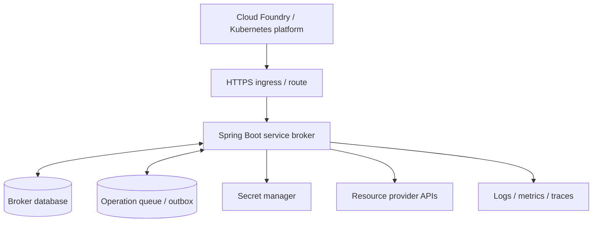

# Đóng gói broker và quản lý cấu hình theo môi trường

Service broker theo Open Service Broker API (OSB API) là một ứng dụng chạy lâu dài, nhận request từ platform, lưu trạng thái operation và gọi các resource provider để tạo hoặc quản lý tài nguyên. Vì vậy, triển khai broker cần bảo đảm ba điều: artifact có thể tái tạo, cấu hình phù hợp với từng môi trường và trạng thái nghiệp vụ được lưu bền vững khi ứng dụng restart hoặc chạy nhiều replica.

Một bản build nên tạo ra cùng một artifact có thể đưa qua development, staging và production. Mỗi môi trường cung cấp endpoint, database, provider credentials, giới hạn tài nguyên và chính sách vận hành riêng thông qua externalized configuration. Không đóng gói secret hoặc cấu hình phụ thuộc môi trường vào JAR hay container image.

Bài học này đi từ executable JAR đến OCI container image, sau đó triển khai trên Kubernetes hoặc Cloud Foundry. Các ví dụ Spring Cloud Open Service Broker dùng Spring Boot và giả định ứng dụng đã có service implementation, catalog, database và provider adapter phù hợp.

## 1. Kiến trúc triển khai của một service broker

Trong production, broker thường gồm nhiều thành phần:

| Thành phần | Trách nhiệm | Yêu cầu triển khai |
|---|---|---|
| Broker API | Nhận catalog, provision, update, bind, unbind, deprovision và polling request | Có HTTPS, route ổn định và khả năng scale |
| Broker database | Lưu service instance, binding, provider resource ID và tenant mapping | Bền vững, backup, migration và connection pool |
| Operation store/queue | Theo dõi thao tác đồng bộ hoặc bất đồng bộ | Bền vững, retry có kiểm soát và xử lý trùng |
| Provider API | Database, storage, Kubernetes hoặc SaaS | Egress network, credential và timeout phù hợp |
| Secret manager | Lưu provider credential và binding secret | Phân quyền, rotation và audit |
| Telemetry | Log, metrics, trace và health endpoint | Không làm lộ credentials hoặc dữ liệu nhạy cảm |



Broker API có thể chạy nhiều replica, nhưng tất cả replica phải dùng chung database và operation store. Không lưu trạng thái duy nhất trong memory hoặc filesystem tạm của container. Nếu một pod bị thay thế, request retry và worker khác vẫn phải tìm thấy service instance và operation cũ.

## 2. Chọn cách đóng gói ứng dụng

Có hai artifact phổ biến:

| Cách đóng gói | Mô tả | Khi phù hợp |
|---|---|---|
| Executable JAR | Spring Boot đóng gói ứng dụng và dependency thành một JAR chạy bằng Java | Cloud Foundry buildpack, VM hoặc môi trường đã có Java runtime |
| OCI container image | JAR và runtime được đóng gói thành image có thể chạy trên container platform | Kubernetes, container platform hoặc Cloud Foundry hỗ trợ image |

Với Spring Boot, JAR có thể được chạy trực tiếp:

```bash
./mvnw clean package
java -jar target/service-broker.jar
```

Tên file trong ví dụ cần khớp `finalName` hoặc version artifact thực tế của project. Không đưa file cấu hình production hoặc secret vào JAR. JAR nên giống nhau giữa các môi trường; runtime cung cấp cấu hình tương ứng.

### 2.1. Chọn Java runtime và dependency

Chọn Java runtime tương thích với Spring Boot và Spring Cloud Open Service Broker đang sử dụng. Nếu ứng dụng dùng Spring Cloud Open Service Broker 4.4.1, hãy kiểm tra BOM/dependency management của project và ma trận tương thích Spring Boot/Java trước khi nâng runtime.

Dependency thường gồm:

```groovy
dependencies {
    implementation "org.springframework.cloud:spring-cloud-starter-open-service-broker"
    implementation "org.springframework.boot:spring-boot-starter-actuator"
    implementation "org.springframework.boot:spring-boot-starter-validation"

    // Chọn đúng web stack của ứng dụng:
    implementation "org.springframework.boot:spring-boot-starter-webflux"
    // Hoặc dùng spring-boot-starter-web nếu ứng dụng chạy Spring MVC.
}
```

Phiên bản dependency nên được quản lý bằng Spring Boot/Spring Cloud BOM tương ứng thay vì khai báo rời rạc mỗi thư viện. Không thêm đồng thời MVC và WebFlux nếu không có chủ đích rõ ràng; chọn web stack mà ứng dụng đã kiểm thử.

### 2.2. Đóng gói executable JAR

Với Maven, Spring Boot Maven Plugin tạo executable archive:

```xml
<build>
    <plugins>
        <plugin>
            <groupId>org.springframework.boot</groupId>
            <artifactId>spring-boot-maven-plugin</artifactId>
        </plugin>
    </plugins>
</build>
```

Build artifact:

```bash
./mvnw clean verify
```

Trước khi phát hành, cần kiểm tra:

- JAR có `Main-Class` và Spring Boot launcher phù hợp.
- Dependency runtime có đủ web server, database driver và provider client cần thiết.
- Không đóng gói local configuration, private key hoặc file `.env`.
- Version artifact được gắn với commit/build number để truy vết.
- Unit/integration test và kiểm tra dependency hoàn tất trong CI.

## 3. Đóng gói thành OCI container image

Container image nên chứa runtime và application artifact, không chứa secret hoặc dữ liệu runtime. Có thể dùng Spring Boot buildpacks hoặc Dockerfile multi-stage.

### 3.1. Build image bằng Spring Boot buildpacks

Spring Boot Maven Plugin hỗ trợ tạo image thông qua Cloud Native Buildpacks:

```bash
./mvnw spring-boot:build-image \
  -Dspring-boot.build-image.imageName=registry.example.com/platform/service-broker:1.0.0
```

Buildpack chọn base image và đóng gói ứng dụng theo quy trình chuẩn. Trong CI, nên cấu hình builder/run image phù hợp với chính sách runtime, quét image và push image đã tạo lên registry nội bộ.

### 3.2. Dockerfile multi-stage

Nếu tổ chức cần kiểm soát build/runtime image, có thể dùng multi-stage Dockerfile:

```dockerfile
FROM maven:3.9-eclipse-temurin-21 AS build
WORKDIR /workspace

COPY .mvn .mvn
COPY mvnw pom.xml ./
RUN chmod +x mvnw && ./mvnw -B dependency:go-offline

COPY src src
RUN ./mvnw -B -DskipTests package

FROM eclipse-temurin:21-jre
WORKDIR /app

RUN groupadd --system --gid 10001 broker \
    && useradd --system --uid 10001 --gid broker broker

COPY --from=build --chown=10001:10001 \
    /workspace/target/service-broker.jar /app/app.jar

USER 10001:10001
EXPOSE 8080

ENTRYPOINT ["java", "-XX:MaxRAMPercentage=75.0", "-jar", "/app/app.jar"]
```

Điều chỉnh tên JAR, phiên bản Maven/Java và lệnh build theo project. Nếu build cần private Maven repository, truyền credential qua secret mount hoặc cơ chế secret của CI; không đưa token vào `ARG`, `ENV` hoặc layer image.

Multi-stage giúp loại bỏ Maven và source code khỏi runtime image. Chạy process bằng user không phải root, giới hạn quyền ghi filesystem và chỉ mở port cần thiết.

### 3.3. Image tag và chuỗi cung ứng phần mềm

Không dùng tag `latest` làm định danh triển khai production. Một image nên được gắn tag bất biến, ví dụ:

```text
registry.example.com/platform/service-broker:1.4.2
registry.example.com/platform/service-broker:git-a81f2c9
```

Sau khi build:

1. Ghi lại commit SHA, version, builder/runtime base image và dependency lock/BOM.
2. Tạo SBOM và quét lỗ hổng dependency/base image.
3. Ký image hoặc xác minh provenance theo chính sách tổ chức.
4. Push image lên registry đã được bảo vệ.
5. Triển khai theo digest hoặc immutable tag để các replica chạy cùng artifact.

Không rebuild cùng version riêng cho từng môi trường. Nếu build lại có thể kéo base image hoặc dependency khác, artifact thực tế sẽ không còn giống nhau.

## 4. Nguyên tắc quản lý cấu hình theo môi trường

Externalized configuration là cấu hình được cung cấp khi chạy ứng dụng thay vì ghi cố định vào source code hoặc artifact. Mỗi môi trường có thể thay đổi endpoint, database, provider account, timeout, concurrency và security policy mà không cần build lại JAR/image.

Phân loại cấu hình:

| Loại | Ví dụ | Cách quản lý |
|---|---|---|
| Application defaults | Port mặc định, tên application, timeout mặc định | `application.yml` |
| Environment settings | Provider endpoint, database URL, public broker URL | Profile hoặc ConfigMap/platform environment |
| Secret | Password, API token, private key | Secret manager, Kubernetes Secret hoặc platform binding |
| Operational tuning | Worker concurrency, connection pool, retry limit | Externalized property có validation |
| Feature/capability | Provider adapter, catalog feature, async support | Cấu hình được kiểm soát và kiểm thử trước deploy |

Không đưa secret vào `application-prod.yml`, manifest, Dockerfile hoặc Git. Profile chỉ chọn nhóm cấu hình; profile không phải secret store.

## 5. Cấu trúc application.yml và Spring profiles

Một cấu hình mặc định có thể chứa giá trị không nhạy cảm:

```yaml
spring:
  application:
    name: service-broker
  lifecycle:
    timeout-per-shutdown-phase: 30s

server:
  port: ${PORT:8080}
  shutdown: graceful

management:
  endpoints:
    web:
      exposure:
        include: health,info,prometheus
  endpoint:
    health:
      probes:
        enabled: true

broker:
  public-base-url: ${BROKER_PUBLIC_BASE_URL:http://localhost:8080}
  operations:
    connect-timeout: 2s
    response-timeout: 10s
    max-concurrency: 8
```

Nếu bật `prometheus` trong danh sách endpoint exposure, thêm Micrometer Prometheus registry tương ứng vào dependency. Chỉ expose endpoint này trên mạng monitoring nội bộ.

`PORT` thường được platform như Cloud Foundry cấp. Trên Kubernetes, có thể dùng port mặc định hoặc đặt `SERVER_PORT`. `BROKER_PUBLIC_BASE_URL` phải là URL mà platform gọi được qua HTTPS trong môi trường triển khai; không để giá trị localhost ở production.

### 5.1. Profile cho từng môi trường

Ví dụ `application-staging.yml`:

```yaml
broker:
  public-base-url: https://broker-staging.example.com
  provider:
    endpoint: https://api.staging.provider.example.com
  operations:
    max-concurrency: 4
```

Ví dụ `application-prod.yml`:

```yaml
broker:
  public-base-url: https://broker.example.com
  provider:
    endpoint: https://api.provider.example.com
  operations:
    max-concurrency: 16
```

Kích hoạt profile:

```bash
SPRING_PROFILES_ACTIVE=staging java -jar app.jar
```

Trong Kubernetes hoặc Cloud Foundry, đặt `SPRING_PROFILES_ACTIVE` qua deployment environment. Không tạo profile chứa password hoặc token. Những giá trị đó phải đến từ secret source riêng.

### 5.2. Thứ tự ưu tiên property

Spring Boot hỗ trợ nhiều nguồn cấu hình. Với các nguồn thường gặp, command-line arguments và environment variables có thể ghi đè cấu hình trong file; profile-specific config được áp dụng trên cấu hình mặc định. Cần tham khảo thứ tự property source của đúng phiên bản Spring Boot khi có nhiều nguồn cùng khai báo một key.

Ví dụ, `broker.operations.max-concurrency` trong environment variable `BROKER_OPERATIONS_MAX_CONCURRENCY` có thể ghi đè giá trị trong YAML. Cần thống nhất một nguồn cấu hình authoritative cho mỗi môi trường để tránh khó xác định giá trị runtime thực tế.

## 6. Định nghĩa cấu hình có kiểu và validation

Không nên đọc mọi property bằng `@Value` rải rác trong service. Gom cấu hình nghiệp vụ vào `@ConfigurationProperties`, dùng kiểu dữ liệu rõ ràng và validation để fail fast khi thiếu hoặc sai giá trị.

```java
@ConfigurationProperties(prefix = "broker")
@Validated
public record BrokerProperties(
        @NotNull URI publicBaseUrl,
        @Valid @NotNull Provider provider,
        @Valid @NotNull Operations operations) {

    public record Provider(
            @NotNull URI endpoint,
            @NotNull Duration connectTimeout,
            @NotNull Duration responseTimeout) {
    }

    public record Operations(
            @Min(1) @Max(64) int maxConcurrency,
            @NotNull Duration operationTimeout) {
    }
}
```

Đăng ký properties bằng một trong hai cách:

```java
@Configuration
@EnableConfigurationProperties(BrokerProperties.class)
public class BrokerConfiguration {
}
```

Hoặc bật `@ConfigurationPropertiesScan` trên application class. Không cần dùng cả hai cho cùng một class.

Ví dụ YAML tương ứng:

```yaml
broker:
  public-base-url: https://broker.example.com
  provider:
    endpoint: https://api.provider.example.com
    connect-timeout: 2s
    response-timeout: 10s
  operations:
    max-concurrency: 16
    operation-timeout: 15m
```

Validation nên kiểm tra:

- URL có scheme và hostname phù hợp; production không dùng HTTP cho endpoint công khai.
- Timeout và retry count nằm trong giới hạn vận hành.
- Worker concurrency và connection pool không vượt khả năng provider/database.
- Public base URL khớp route platform đã đăng ký.
- Provider type có adapter tương ứng.
- Catalog feature được bật phải có service implementation hỗ trợ.

Không log toàn bộ `BrokerProperties` nếu nó có thể chứa secret hoặc endpoint nội bộ.

## 7. Quản lý secret và cấu hình nhạy cảm

Secret bao gồm platform-to-broker credential, broker-to-provider API key, database password, binding credentials, TLS private key và encryption key. Không lưu chúng trong Git, source code, Docker image hoặc log.

Nguồn secret thường dùng:

| Nền tảng | Cơ chế |
|---|---|
| Kubernetes | Secret volume, `secretKeyRef`, external secret operator hoặc secret manager CSI driver |
| Cloud Foundry | Service binding, CredHub hoặc cơ chế credential injection do foundation cấu hình |
| VM/container runtime | Secret manager hoặc mounted file có quyền truy cập giới hạn |
| CI/CD | Secret store của pipeline, chỉ cấp trong job cần thiết |

### 7.1. Đọc secret từ environment variable

Ví dụ application property tham chiếu environment variable:

```yaml
broker:
  provider:
    api-token: ${BROKER_PROVIDER_API_TOKEN}
```

Runtime phải cung cấp `BROKER_PROVIDER_API_TOKEN`. Không đặt giá trị token trong YAML. Nếu property bắt buộc mà không có giá trị, ứng dụng nên fail fast thay vì âm thầm chạy với credential rỗng.

### 7.2. Đọc secret từ mounted file bằng configtree

Spring Boot hỗ trợ config tree import, phù hợp với secret được mount thành file:

```yaml
spring:
  config:
    import: "optional:configtree:/run/secrets/"
```

Ví dụ file trong thư mục mount:

```text
/run/secrets/
  broker.provider.api-token
  spring.datasource.password
```

Tên file được ánh xạ thành property key; nội dung file là giá trị. Có thể cấu hình `BROKER_PROVIDER_API_TOKEN` hoặc import configtree tùy platform. Chọn một cách rõ ràng và kiểm thử trên runtime thực tế.

### 7.3. Rotation và thu hồi

Secret có vòng đời riêng:

1. Cấp credential với quyền tối thiểu.
2. Lưu vào secret manager và inject vào broker khi khởi động hoặc refresh theo cơ chế đã cấu hình.
3. Theo dõi expiry và cảnh báo trước khi credential hết hạn.
4. Rotate theo quy trình cho phép credential cũ và mới cùng tồn tại trong giai đoạn chuyển tiếp nếu provider hỗ trợ.
5. Xác nhận broker đã sử dụng credential mới.
6. Revoke credential cũ và ghi audit.

Không giả định mọi property được refresh tự động khi secret file hoặc environment variable thay đổi. Nếu ứng dụng không có cơ chế refresh rõ ràng, cần restart/rollout có kiểm soát để nạp secret mới.

## 8. Cấu hình database và trạng thái bền vững

Broker lưu service instance, binding, provider resource ID, idempotency key và operation state. Những dữ liệu này phải nằm trong database hoặc store bền vững, không nằm trong writable layer của container.

Ví dụ cấu hình datasource qua environment:

```yaml
spring:
  datasource:
    url: ${BROKER_DB_URL}
    username: ${BROKER_DB_USERNAME}
    password: ${BROKER_DB_PASSWORD}
    hikari:
      maximum-pool-size: 12
      connection-timeout: 3000
```

Các điểm cần tính:

- Tổng connection pool phải phù hợp số replica: `replicas × pool size` không vượt giới hạn database.
- Connection timeout ngắn hơn request/operation deadline phù hợp.
- Dùng TLS và xác minh certificate database khi môi trường hỗ trợ.
- Chạy schema migration theo pipeline có kiểm soát; không để mọi replica đồng thời chạy migration nguy hiểm.
- Backup và kiểm tra restore định kỳ.
- Không xóa operation/tombstone cần thiết cho retry và deprovision.
- Dùng transaction và optimistic locking để bảo vệ request đồng thời.

Nếu dùng Flyway hoặc Liquibase, quản lý migration như một bước release riêng. Migration nên tương thích với phiên bản ứng dụng cũ trong thời gian rolling deployment; ưu tiên expand-and-contract thay đổi schema.

## 9. Triển khai trên Kubernetes

Kubernetes chạy broker dưới dạng Deployment, cung cấp Service nội bộ và Ingress/Gateway HTTPS. ConfigMap dùng cho cấu hình không nhạy cảm; Secret hoặc external secret integration dùng cho credential.

### 9.1. Deployment mẫu

Ví dụ rút gọn:

```yaml
apiVersion: apps/v1
kind: Deployment
metadata:
  name: service-broker
  namespace: platform-services
spec:
  replicas: 2
  selector:
    matchLabels:
      app: service-broker
  template:
    metadata:
      labels:
        app: service-broker
    spec:
      automountServiceAccountToken: false
      terminationGracePeriodSeconds: 60
      securityContext:
        runAsNonRoot: true
        runAsUser: 10001
        runAsGroup: 10001
      containers:
        - name: broker
          image: registry.example.com/platform/service-broker:1.4.2
          ports:
            - name: http
              containerPort: 8080
          env:
            - name: SPRING_PROFILES_ACTIVE
              value: prod
            - name: SPRING_CONFIG_IMPORT
              value: "optional:configtree:/run/secrets/"
          envFrom:
            - configMapRef:
                name: service-broker-config
          volumeMounts:
            - name: broker-secrets
              mountPath: /run/secrets
              readOnly: true
          startupProbe:
            httpGet:
              path: /actuator/health/liveness
              port: http
            periodSeconds: 10
            failureThreshold: 30
          livenessProbe:
            httpGet:
              path: /actuator/health/liveness
              port: http
            periodSeconds: 20
          readinessProbe:
            httpGet:
              path: /actuator/health/readiness
              port: http
            periodSeconds: 10
          resources:
            requests:
              cpu: 250m
              memory: 512Mi
            limits:
              cpu: "1"
              memory: 1Gi
          securityContext:
            allowPrivilegeEscalation: false
            readOnlyRootFilesystem: true
            capabilities:
              drop: ["ALL"]
      volumes:
        - name: broker-secrets
          secret:
            secretName: service-broker-runtime
```

Manifest này giả định image chạy được với root filesystem read-only, Actuator health endpoints đã được bật và secret volume đã được tạo bởi quy trình bảo mật của cluster. Nếu ứng dụng cần ghi file tạm, mount một `emptyDir` riêng với quyền phù hợp; không mở writable root filesystem chỉ để giải quyết một thư mục tạm.

Nếu broker cần gọi Kubernetes API để quản lý resource, `automountServiceAccountToken: false` phải được thay đổi theo thiết kế workload identity. Tạo ServiceAccount và Role/RoleBinding giới hạn trong namespace/resource cần thiết; không cấp `cluster-admin` mặc định.

### 9.2. ConfigMap và Secret

ConfigMap chứa giá trị không nhạy cảm như public base URL, provider endpoint, worker concurrency hoặc feature flag. Secret chứa credential và private material. Quyền đọc Secret phải giới hạn theo namespace và service account; bật encryption at rest cho datastore của cluster nếu chính sách yêu cầu.

Không commit manifest chứa giá trị secret đã encode Base64. Base64 không phải encryption. Dùng external secret manager hoặc quy trình tạo Secret bảo mật trong pipeline.

### 9.3. Readiness, liveness và startup probe

Ba probe có mục đích khác nhau:

| Probe | Câu hỏi | Hành vi khi thất bại |
|---|---|---|
| Startup | Ứng dụng đã khởi động xong chưa? | Kubernetes tiếp tục chờ trong ngưỡng cấu hình; chưa chạy liveness/readiness |
| Liveness | Process có còn hoạt động và có thể tự phục hồi không? | Kubernetes restart container |
| Readiness | Instance có thể nhận request OSB không? | Kubernetes bỏ pod khỏi Service endpoint |

Không đưa mọi provider API vào liveness probe. Provider tạm thời mất kết nối không có nghĩa process broker bị dead; nếu liveness phụ thuộc provider, sự cố provider có thể làm toàn bộ pod restart liên tục.

Readiness có thể kiểm tra dependency thiết yếu như broker database nếu request không thể xử lý khi database mất. Cần quyết định rõ: broker vẫn có thể trả catalog khi provider tạm unavailable hay không, và có nên nhận provision mới trong thời gian provider outage hay không.

Spring Boot Actuator có thể cung cấp liveness/readiness health group khi bật probe support. Chỉ expose endpoint health cần thiết qua mạng nội bộ hoặc ingress được bảo vệ; không public toàn bộ Actuator.

### 9.4. Service và ingress

Service nội bộ:

```yaml
apiVersion: v1
kind: Service
metadata:
  name: service-broker
  namespace: platform-services
spec:
  selector:
    app: service-broker
  ports:
    - name: http
      port: 80
      targetPort: http
```

Ingress/Gateway kết thúc TLS hoặc chuyển TLS đến broker theo kiến trúc mạng. Platform phải gọi được một URL ổn định, ví dụ `https://broker.example.com`. Cấu hình `broker.public-base-url` phải khớp URL đăng ký với platform, đặc biệt nếu broker trả callback URL hoặc endpoint operation trong response.

## 10. Triển khai trên Cloud Foundry

Cloud Foundry có thể chạy broker dưới dạng ứng dụng buildpack hoặc container image. Với buildpack Java, platform cung cấp runtime phù hợp và inject biến môi trường như `PORT`.

### 10.1. Manifest mẫu

```yaml
applications:
  - name: service-broker
    path: target/service-broker.jar
    instances: 2
    memory: 1G
    disk_quota: 1G
    buildpacks:
      - java_buildpack_offline
    health-check-type: http
    health-check-http-endpoint: /actuator/health/readiness
    env:
      SPRING_PROFILES_ACTIVE: cloud-foundry
      BROKER_PUBLIC_BASE_URL: https://service-broker.apps.example.com
    services:
      - broker-database
```

Tên buildpack, route, service binding và health check cần điều chỉnh theo foundation. Không đặt broker username/password hoặc provider token trong manifest được commit vào Git.

Deploy:

```bash
cf push -f manifest.yml
cf app service-broker
cf logs service-broker --recent
```

Nếu thay đổi environment variable bằng `cf set-env`, cần restart hoặc restage ứng dụng theo loại thay đổi và buildpack/runtime đang dùng để process nạp giá trị mới. Không giả định mọi thay đổi environment tự động cập nhật vào process đang chạy.

Cloud Foundry cung cấp service binding qua environment, thường gồm `VCAP_SERVICES`. Ứng dụng cần có cơ chế đọc binding tương ứng (ví dụ Spring Cloud Connectors hoặc adapter/configuration riêng) để ánh xạ credentials của `broker-database` sang datasource; chỉ khai báo tên service trong manifest không tự bảo đảm datasource đã được cấu hình.

### 10.2. Đăng ký broker với Cloud Foundry

Sau khi app có route HTTPS và endpoint `/v2/catalog` hoạt động, Admin đăng ký broker với Cloud Controller:

```bash
cf create-service-broker orders-broker <broker-username> <broker-password> https://service-broker.apps.example.com
```

Username/password trong lệnh là credential mà Cloud Controller dùng để gọi broker. Chúng phải khớp cấu hình authentication của broker và được quản lý như secret. Tránh lưu command đã điền credential thật vào shell history, ticket hoặc pipeline log.

Kiểm tra broker và catalog:

```bash
cf service-brokers
cf service-access
cf marketplace
```

Nếu broker đã đăng ký nhưng catalog không tải được, kiểm tra route, TLS trust, authentication, API version và log broker. Nếu catalog hợp lệ nhưng plan chưa hiển thị, kiểm tra service plan access và trạng thái plan trong Cloud Foundry.

## 11. Cấu hình khác nhau giữa các môi trường

Không nên chỉ dựa vào tên profile. Cần quản lý một ma trận cấu hình có owner và nguồn rõ ràng:

| Cấu hình | Development | Staging | Production |
|---|---|---|---|
| Public broker URL | localhost/dev route | staging HTTPS route | production HTTPS route |
| Provider endpoint | sandbox/mock | provider staging | provider production |
| Database | local/test database | staging database | HA/managed database |
| Provider credential | test credential | staging secret | production secret manager |
| Worker concurrency | thấp | gần production | theo quota và tải provider |
| Operation timeout | ngắn cho test | theo SLA | theo SLA và provider behavior |
| Log level | DEBUG có kiểm soát | INFO | INFO/WARN, không log secret |
| Actuator | local access | internal | internal/secured |
| Catalog | test offering | staging offering | offering đã phê duyệt |

Các nguyên tắc:

- Không trỏ staging vào production provider/database trừ khi có lý do và quyền được phê duyệt.
- Dùng catalog/service plan ID ổn định giữa môi trường nếu platform integration yêu cầu cùng offering.
- Không để development flag hoặc mock provider bật ở production.
- Cấu hình quota, rate limit và worker concurrency theo capacity provider.
- Dùng cùng image digest cho các môi trường khi promote cùng một release.
- Ghi nhận config version để biết deployment đang chạy với bộ cấu hình nào.

## 12. Quản lý thay đổi cấu hình và rollout

Spring Boot thường đọc externalized configuration khi application context khởi tạo. Environment variable, ConfigMap hoặc Secret thay đổi không đảm bảo bean đang chạy tự cập nhật. Có ba cách phổ biến:

1. **Restart/rollout:** thay đổi config, sau đó tạo process/pod mới để nạp cấu hình. Đây là cách đơn giản và dễ kiểm soát.
2. **Refresh mechanism:** dùng Spring Cloud Config/refresh infrastructure nếu ứng dụng đã được thiết kế và kiểm thử cho dynamic refresh.
3. **Provider/client credential refresh:** một số client hỗ trợ reload token hoặc credential riêng; cần dùng API chính thức của client.

Không tự giả định `@ConfigurationProperties` sẽ tự cập nhật khi file thay đổi. Nếu dùng dynamic refresh, cần xác định bean nào được refresh, bean nào giữ connection pool/client cũ và cách rollback khi cấu hình mới không hợp lệ.

### 12.1. Rolling deployment nhiều replica

Với Kubernetes, Deployment có thể rollout lần lượt pod mới. Cần bảo đảm:

- Readiness chỉ thành công khi pod có thể nhận request an toàn.
- Pod cũ có thời gian graceful shutdown để hoàn thành request đang xử lý.
- Worker không mất operation khi pod bị terminate; operation state phải bền vững.
- Không chạy hai migration không tương thích đồng thời.
- Phiên bản mới và cũ cùng đọc/ghi schema trong giai đoạn rollout.
- Scheduler hoặc background job có distributed lock/leader election nếu chỉ một worker được chạy một lần.

Với broker chạy nhiều replica, tránh lưu idempotency state, catalog state hoặc operation status chỉ trong memory. Retry request có thể đến replica khác.

### 12.2. Graceful shutdown và xử lý operation

Khi nhận tín hiệu terminate, ứng dụng nên ngừng nhận request mới, cho request đang xử lý thời gian hoàn tất và dừng worker an toàn. Spring Boot hỗ trợ graceful shutdown qua `server.shutdown=graceful` và `spring.lifecycle.timeout-per-shutdown-phase`.

Không thể dựa vào graceful shutdown để bảo đảm một operation dài luôn hoàn tất. Worker cần checkpoint trạng thái, lưu provider operation ID và cho phép replica khác tiếp tục sau restart. Với async operation, platform tiếp tục polling last operation; broker phải trả trạng thái từ store bền vững.

## 13. Health, metrics, logging và tracing

Triển khai production cần quan sát được cả API và side effect provider.

### 13.1. Health indicator

Actuator health có thể báo trạng thái:

- Liveness: process và application context còn hoạt động.
- Readiness: broker có thể nhận request theo policy.
- Dependency health: database, queue hoặc provider API nếu cần hiển thị riêng.

Không để health check gọi thao tác tạo/xóa tài nguyên. Health endpoint phải nhẹ, có timeout và không tạo side effect.

### 13.2. Metrics

Các metric hữu ích:

| Metric | Ý nghĩa |
|---|---|
| Request count/latency theo endpoint | Theo dõi `/v2/catalog`, provision, update, bind, delete và last operation |
| Operation state count | Số operation `IN_PROGRESS`, `SUCCEEDED`, `FAILED`, `UNKNOWN` |
| Provider latency/error | Phát hiện provider chậm hoặc lỗi |
| Database pool utilization | Phát hiện cạn connection |
| Worker queue depth | Phát hiện operation tồn đọng |
| Idempotency replay/conflict | Phát hiện retry và request xung đột |
| Reconciliation drift | Theo dõi resource lệch trạng thái |

Không dùng `service_instance_id`, `binding_id`, username hoặc tenant ID làm metric label nếu số lượng có thể tăng không giới hạn. Dùng log/trace để truy vết từng resource; metric label nên có cardinality thấp như operation type, result và provider type.

### 13.3. Logging và tracing

Log cần có correlation ID, operation ID, service instance ID và provider request ID ở dạng phù hợp chính sách. Không log:

- `Authorization` header hoặc broker password.
- Binding credentials, database password hoặc provider token.
- Raw request body có parameters nhạy cảm.
- Secret trong exception message hoặc JDBC URL.

Tracing nên nối OSB request với provider call và async worker qua trace/correlation context đã lưu. Với worker chạy sau khi HTTP request kết thúc, lưu correlation ID trong operation record/outbox để tiếp tục trace.

## 14. Network và TLS khi triển khai

Broker cần hai hướng network:

- Inbound: platform hoặc marketplace gọi broker API.
- Outbound: broker gọi database, provider API, secret manager, telemetry backend và queue.

Kiểm tra:

1. DNS và route public của broker ổn định.
2. TLS certificate hợp lệ, hostname khớp và có kế hoạch gia hạn.
3. Ingress/gateway chuyển tiếp đúng scheme/host nếu broker tạo URL tuyệt đối.
4. Outbound egress chỉ mở tới provider endpoint cần thiết.
5. Network policy không chặn callback hoặc webhook hợp lệ.
6. Timeout ở load balancer, ingress, application và provider client không mâu thuẫn.
7. API version header `X-Broker-API-Version` được platform gửi và broker kiểm tra theo cấu hình.

Nếu broker nằm sau reverse proxy, chỉ tin forwarded headers từ proxy được cấu hình. Không dùng `X-Forwarded-Host` tùy ý từ internet để tạo public callback URL hoặc redirect.

## 15. Migration và tương thích phiên bản

Service broker có state lâu dài. Một bản release mới có thể thay schema database, catalog, provider adapter hoặc operation format. Cần lập kế hoạch nâng cấp tương thích.

Quy trình tham khảo:

1. Kiểm tra schema hiện tại và dữ liệu production.
2. Tạo migration mở rộng: thêm cột nullable, bảng mới hoặc index tương thích.
3. Deploy phiên bản có thể đọc cả schema cũ và mới.
4. Backfill dữ liệu theo batch và quan sát lỗi.
5. Chuyển code sang schema mới.
6. Chỉ xóa cột/field cũ trong release sau khi mọi replica và consumer không còn sử dụng.

Catalog cũng là contract với platform. Không xóa service ID hoặc plan ID đang có instance tồn tại nếu chưa có migration/deprecation plan. Thay đổi `bindable`, updateability hoặc async behavior có thể ảnh hưởng platform operation; cần kiểm thử trước khi refresh catalog production.

## 16. CI/CD và quy trình phát hành

Một pipeline có thể gồm:

```mermaid
flowchart LR
    COMMIT[Commit]
    TEST[Unit / integration tests]
    PACKAGE[Build executable JAR]
    IMAGE[Build OCI image]
    SCAN[Dependency and image scan]
    SBOM[Generate SBOM / provenance]
    PUSH[Push immutable image]
    STAGING[Deploy staging]
    VERIFY[Smoke / contract tests]
    APPROVE[Release approval]
    PROD[Promote same image to production]

    COMMIT --> TEST --> PACKAGE --> IMAGE --> SCAN --> SBOM --> PUSH
    PUSH --> STAGING --> VERIFY --> APPROVE --> PROD
```



Các bước nên tự động hóa:

- Kiểm tra format, compile và test.
- Kiểm tra dependency vulnerability và license theo policy.
- Build JAR/image một lần và gắn commit SHA.
- Tạo SBOM, scan và ký image nếu quy trình yêu cầu.
- Deploy staging với secret/config staging.
- Chạy smoke test catalog, provision/bind giả lập hoặc integration test an toàn.
- Promote cùng image digest sang production.
- Theo dõi readiness, error rate, provider latency và operation queue sau rollout.
- Có rollback image và config version; migration phải hỗ trợ rollback hoặc forward-fix.

Không chạy destructive provision/deprovision test trên provider production trong smoke test nếu không có sandbox và cleanup được kiểm soát.

## 17. Kiểm thử trước và sau deploy

| Giai đoạn | Kiểm tra | Kết quả mong đợi |
|---|---|---|
| Build | JAR, dependency, main class | Artifact chạy được với runtime đã chọn |
| Image | User, filesystem, base image, port | Image non-root, không chứa secret, có thể khởi động |
| Config | Required property, profile, secret mount | Thiếu config bắt buộc thì fail fast |
| Startup | Application context, database, migration | Pod/app khởi động và readiness đúng |
| Catalog | `GET /v2/catalog` với authentication | Catalog hợp lệ và plan ID ổn định |
| Provision | Request mới và retry | Không tạo tài nguyên trùng; state được lưu bền vững |
| Async | `202 Accepted` và polling | Operation ID tồn tại qua restart |
| Binding | Tạo/xóa binding | Credentials đúng scope và được revoke khi unbind |
| Provider outage | Timeout/5xx/rate limit | Broker xử lý lỗi có kiểm soát, không restart storm |
| Scale | Nhiều replica nhận request | Shared state và idempotency hoạt động |
| Shutdown | Terminate pod/app trong operation | Operation có thể tiếp tục hoặc được reconcile |
| Rollback | Deploy phiên bản cũ tương thích schema | API tiếp tục phục vụ và không mất state |

Sau deploy, kiểm tra route HTTPS từ phía platform, xác thực broker, catalog response, API version, health endpoints và log. Không chỉ kiểm tra rằng pod ở trạng thái `Running`; cần xác minh readiness và một request OSB thực tế.

## 18. Lỗi triển khai thường gặp

| Lỗi | Hậu quả | Cách xử lý |
|---|---|---|
| Build JAR riêng cho mỗi môi trường | Artifact không đồng nhất | Build một lần, externalize config |
| Đưa secret vào Dockerfile hoặc Git | Secret tồn tại trong image/history | Secret manager hoặc mounted secret |
| Dùng tag `latest` | Khó xác định image đang chạy | Immutable tag hoặc digest |
| Chạy container bằng root | Tăng tác động khi process bị compromise | Non-root user và security context |
| Lưu operation trong memory | Mất trạng thái khi restart/scale | Database hoặc durable queue |
| Dùng SQLite/local filesystem cho production nhiều replica | State không chia sẻ và dễ mất | Managed database/shared persistent store |
| Không giới hạn connection pool | Database quá tải khi scale replica | Tính tổng pool theo số replica |
| Liveness phụ thuộc provider API | Provider outage gây restart liên tục | Liveness chỉ kiểm tra process; readiness theo policy |
| Readiness luôn pass khi DB mất | Request lỗi hàng loạt sau khi vào pod | Kiểm tra dependency thiết yếu trong readiness |
| ConfigMap/Secret đổi nhưng không rollout | Process tiếp tục dùng config cũ | Restart/rollout hoặc refresh mechanism đã kiểm thử |
| Mọi replica chạy migration cùng lúc | Lock contention hoặc schema race | Migration job/leader và expand-contract |
| Không có graceful shutdown | Request đang xử lý bị cắt | Graceful shutdown và durable operation state |
| Mở toàn bộ Actuator public | Lộ thông tin runtime | Chỉ expose endpoint cần thiết và bảo vệ mạng |
| Broker URL khác public base URL | Platform không gọi được callback/endpoint | Đồng bộ route, forwarded header và public URL |

## 19. Checklist triển khai

- [ ] Build executable JAR có version và commit reference.
- [ ] Chọn Java runtime tương thích Spring Boot/Spring Cloud Open Service Broker.
- [ ] Build OCI image multi-stage hoặc buildpack; chạy non-root.
- [ ] Không chứa secret, production config hoặc dữ liệu runtime trong artifact/image.
- [ ] Dùng immutable image tag/digest, scan và SBOM theo policy.
- [ ] Tách application defaults, environment config và secret.
- [ ] Dùng Spring profiles cho nhóm cấu hình, không dùng profile làm secret store.
- [ ] Gom cấu hình nghiệp vụ vào `@ConfigurationProperties` và validate.
- [ ] Inject secret qua secret manager, mounted file hoặc platform binding.
- [ ] Dùng database bền vững cho instance, binding và operation state.
- [ ] Tính connection pool theo tổng số replica.
- [ ] Triển khai readiness/liveness/startup probe phù hợp.
- [ ] Không đưa provider outage vào liveness probe.
- [ ] Cấu hình TLS, ingress, DNS và outbound egress.
- [ ] Thiết lập graceful shutdown, durable worker và retry recovery.
- [ ] Quản lý migration tương thích rolling deployment.
- [ ] Bảo vệ Actuator và log/metrics không chứa secret.
- [ ] Kiểm thử catalog, provision, binding, async polling, retry và multi-replica.
- [ ] Có rollback image/config và quan sát sau deploy.

## 20. Tài liệu tham khảo

- [Spring Boot — Externalized Configuration](https://docs.spring.io/spring-boot/reference/features/external-config.html)
- [Spring Boot — Profiles](https://docs.spring.io/spring-boot/reference/features/profiles.html)
- [Spring Boot — Container Images](https://docs.spring.io/spring-boot/reference/packaging/container-images/index.html)
- [Spring Boot — Actuator Endpoints](https://docs.spring.io/spring-boot/reference/actuator/endpoints.html)
- [Spring Boot — Kubernetes Probes](https://docs.spring.io/spring-boot/reference/actuator/endpoints.html#actuator.endpoints.kubernetes-probes)
- [Spring Cloud Open Service Broker 4.4.1 — Reference Guide](https://docs.spring.io/spring-cloud-open-service-broker/docs/4.4.1/reference/)
- [Cloud Foundry — Deploying with App Manifests](https://docs.cloudfoundry.org/devguide/deploy-apps/manifest.html)
- [Cloud Foundry — Managing Service Brokers](https://docs.cloudfoundry.org/services/managing-service-brokers.html)
- [Kubernetes — Deployments](https://kubernetes.io/docs/concepts/workloads/controllers/deployment/)
- [Kubernetes — ConfigMaps](https://kubernetes.io/docs/concepts/configuration/configmap/)
- [Kubernetes — Secrets](https://kubernetes.io/docs/concepts/configuration/secret/)
- [Kubernetes — Container Security Context](https://kubernetes.io/docs/tasks/configure-pod-container/security-context/)

Các manifest và lệnh trong bài là ví dụ triển khai. Cần điều chỉnh image name, runtime version, buildpack, namespace, secret integration, database driver, health path và resource limits theo phiên bản Spring Boot, Cloud Foundry foundation hoặc Kubernetes cluster thực tế.
