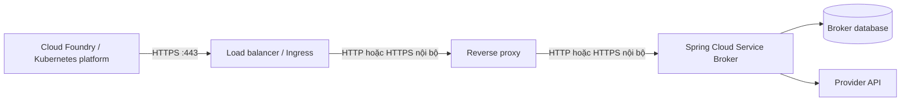

# Thiết lập TLS, reverse proxy và đường dẫn công khai

Spring Cloud Service Broker thường được triển khai sau một ingress controller, load balancer hoặc reverse proxy. Platform như Cloud Foundry cần một URL HTTPS ổn định để gọi các endpoint Open Service Broker API (OSB API), ví dụ `GET /v2/catalog`, `PUT /v2/service_instances/{instance_id}` và `GET .../last_operation`. Cấu hình public endpoint phải bảo đảm certificate hợp lệ, request được chuyển đúng đến ứng dụng Spring, các header và query parameter được giữ nguyên, đồng thời thông tin xác thực không bị lộ.

TLS bảo vệ kết nối từ platform đến endpoint công khai. Reverse proxy định tuyến request đến broker, có thể kết thúc TLS hoặc mã hóa lại kết nối đến backend. Spring Boot cần nhận biết đúng scheme, host và port bên ngoài khi tạo URL hoặc xử lý redirect. Nếu proxy viết lại path hoặc loại bỏ header không đúng, request OSB có thể thất bại dù ứng dụng broker vẫn chạy bình thường.

## 1. Kiến trúc triển khai

Một triển khai phổ biến đặt broker phía sau reverse proxy:



Các thành phần có trách nhiệm:

- **Public DNS:** ánh xạ hostname broker đến địa chỉ ingress/load balancer.
- **TLS endpoint:** trình certificate cho platform và mã hóa kết nối.
- **Reverse proxy:** định tuyến path, chuyển tiếp HTTP method, headers, query string và body.
- **Spring Boot:** xử lý xác thực OSB, catalog, lifecycle request và operation.
- **Provider adapter:** gọi database service, Kubernetes API hoặc provider cloud.

Có thể gộp load balancer và reverse proxy trong cùng một ingress controller. Điều quan trọng là xác định rõ nơi kết thúc TLS, nơi kiểm tra certificate và các hop nào tiếp tục được mã hóa.

## 2. Chọn public URL cho broker

Public URL là địa chỉ platform lưu khi đăng ký service broker. Ví dụ:

    https://broker.example.com

Platform sẽ gọi các đường dẫn OSB tương đối với base URL này:

    GET    https://broker.example.com/v2/catalog
    PUT    https://broker.example.com/v2/service_instances/{instance_id}
    PATCH  https://broker.example.com/v2/service_instances/{instance_id}
    DELETE https://broker.example.com/v2/service_instances/{instance_id}

Base URL cần ổn định trong suốt vòng đời broker registration. Khi đổi hostname, path prefix hoặc certificate authority, cần cập nhật cấu hình platform theo quy trình đăng ký broker của nền tảng.

Một public URL tốt cần:

- Dùng HTTPS và hostname có thể phân giải từ mạng của platform.
- Có certificate hợp lệ với hostname đó.
- Định tuyến đến đúng broker environment.
- Không phụ thuộc vào địa chỉ Pod, container hoặc máy ảo có thể thay đổi.
- Không chứa username, password, token hoặc secret trong URL.
- Có path prefix nhất quán nếu triển khai broker dưới một đường dẫn con.

Không dùng localhost, địa chỉ IP nội bộ hoặc Kubernetes service DNS làm URL broker nếu platform gọi từ ngoài network tương ứng. Đối với broker nội bộ trong cluster, chỉ dùng internal URL khi platform controller thực sự chạy trong cluster và DNS/network policy cho phép.

## 3. TLS certificate, hostname và SNI

Khi platform kết nối đến HTTPS broker, TLS client kiểm tra certificate server. Certificate cần có Subject Alternative Name (SAN) chứa hostname mà platform sử dụng. Common Name đơn lẻ không nên được coi là cách thay thế SAN trong cấu hình hiện đại.

Các kiểm tra cần thực hiện:

1. Certificate còn hiệu lực tại thời điểm kết nối.
2. SAN khớp với public hostname.
3. Certificate chain dẫn đến CA mà platform tin cậy.
4. Certificate có mục đích sử dụng phù hợp cho TLS server.
5. TLS protocol và cipher suite đáp ứng baseline bảo mật.
6. DNS trỏ đến đúng ingress/load balancer và SNI chọn đúng certificate khi có nhiều hostname.

Ví dụ kiểm tra certificate từ máy có thể truy cập public endpoint:

```bash
openssl s_client -connect broker.example.com:443 -servername broker.example.com -showcerts
```

Tham số -servername gửi SNI để server chọn certificate phù hợp với hostname. Sau khi kết nối, cần kiểm tra chain, thời hạn và SAN; việc lệnh mở được TCP connection không chứng minh certificate đã hợp lệ.

Nên dùng TLS 1.2 trở lên và ưu tiên TLS 1.3 khi các thành phần hỗ trợ. Tắt SSL cũ và các TLS version yếu theo policy của môi trường. Không tắt certificate verification ở platform hoặc trong HTTP client của controller để né lỗi CA/hostname; hãy sửa certificate chain hoặc trust store.

## 4. Hai mô hình TLS giữa proxy và broker

### 4.1. TLS termination tại ingress

Ingress nhận HTTPS từ platform, kiểm tra certificate server và giải mã request. Sau đó ingress chuyển HTTP đến Spring Boot trên mạng nội bộ:

    Platform -- HTTPS --> Ingress -- HTTP private network --> Spring Boot

Ưu điểm là quản lý certificate tập trung ở ingress và giảm cấu hình TLS trong ứng dụng. Rủi ro là traffic sau ingress không được mã hóa. Chỉ dùng mô hình này khi backend hop nằm trong network được kiểm soát, có network policy/firewall chặn truy cập trực tiếp và không đi qua mạng không tin cậy.

Không được để port HTTP backend có thể truy cập từ Internet hoặc từ workload không liên quan. Nếu broker xử lý credentials hoặc binding secrets, cần cân nhắc mã hóa cả internal hop.

### 4.2. TLS re-encryption

Ingress kết thúc TLS từ platform rồi mở một kết nối TLS mới đến Spring Boot:

    Platform -- HTTPS --> Ingress -- HTTPS --> Spring Boot

Mô hình này mã hóa cả hai chặng. Có thể dùng certificate nội bộ riêng cho backend. Nếu yêu cầu xác thực hai chiều, dùng mTLS giữa ingress và broker; khi đó broker hoặc service mesh xác minh client certificate của proxy.

TLS re-encryption không tự động bảo đảm ingress là proxy được tin cậy. Cần kiểm tra certificate backend, giới hạn network access và không nhận forwarded headers từ nguồn không xác thực.

### 4.3. Chọn mô hình

| Tiêu chí | TLS termination | TLS re-encryption |
|---|---|---|
| TLS client của platform xác thực | Ingress certificate | Ingress certificate |
| Mã hóa ingress đến broker | Không, nếu dùng HTTP | Có |
| Quản lý certificate backend | Không cần TLS cert ở app | Cần certificate/trust config |
| Cấu hình vận hành | Đơn giản hơn | Phức tạp hơn |
| Phù hợp | Backend network riêng được bảo vệ | Mạng nhiều zone hoặc yêu cầu mã hóa end-to-end theo từng hop |

Chọn mô hình dựa trên ranh giới mạng, chính sách dữ liệu và khả năng quản lý certificate. Dù chọn mô hình nào, platform vẫn phải kết nối đến public endpoint bằng HTTPS.

## 5. Reverse proxy phải giữ nguyên hợp đồng OSB

Reverse proxy không nên thay đổi ý nghĩa của request OSB. Với mỗi request, proxy cần chuyển tiếp đúng:

- HTTP method: GET, PUT, PATCH hoặc DELETE.
- Path OSB, ví dụ /v2/catalog và /v2/service_instances/{id}.
- Query parameters, đặc biệt accepts_incomplete và operation.
- Authorization header dùng cho Basic Authentication.
- X-Broker-API-Version nếu platform gửi.
- Content-Type, Accept và body JSON.
- Request correlation header nếu có.

Ví dụ request update:

```http
PATCH /v2/service_instances/db-123?accepts_incomplete=true HTTP/1.1
Host: broker.example.com
Authorization: Basic <redacted>
X-Broker-API-Version: 2.17
Content-Type: application/json

{"service_id":"postgresql-v1","plan_id":"standard-v2","parameters":{"storage_gb":200}}
```

Proxy phải chuyển nguyên method PATCH, query accepts_incomplete=true và JSON body. Nếu proxy chỉ cho phép GET/POST hoặc bỏ query string, lifecycle operation sẽ lỗi hoặc bị chuyển sang xử lý đồng bộ ngoài ý muốn.

Không cache response của endpoint OSB một cách mặc định. Catalog có thể có chính sách cache riêng nếu broker và platform cho phép, nhưng response binding, credentials, last_operation và các response phụ thuộc trạng thái phải được chuyển tiếp theo request hiện tại. Đặc biệt, không cache response chứa credentials, token hoặc connection details.

## 6. Cấu hình Nginx làm reverse proxy

Ví dụ sau minh họa Nginx terminate TLS và chuyển tiếp đến Spring Boot đang lắng nghe trên mạng nội bộ. Đường dẫn public được giữ nguyên:

```nginx
upstream service_broker {
    server 10.20.0.15:8080;
    keepalive 32;
}

server {
    listen 443 ssl;
    server_name broker.example.com;

    ssl_certificate     /etc/nginx/tls/broker-fullchain.pem;
    ssl_certificate_key /etc/nginx/tls/broker-private-key.pem;
    ssl_protocols TLSv1.2 TLSv1.3;

    location / {
        proxy_pass http://service_broker;
        proxy_http_version 1.1;

        proxy_set_header Host $host;
        proxy_set_header X-Forwarded-Host $host;
        proxy_set_header X-Forwarded-Proto https;
        proxy_set_header X-Forwarded-Port 443;
        proxy_set_header X-Forwarded-For $proxy_add_x_forwarded_for;

        proxy_set_header Authorization $http_authorization;
        proxy_set_header X-Broker-API-Version $http_x_broker_api_version;
        proxy_set_header X-Request-ID $request_id;

        proxy_connect_timeout 5s;
        proxy_send_timeout 60s;
        proxy_read_timeout 60s;
    }
}
```

Đây là cấu hình minh họa; cần điều chỉnh địa chỉ upstream, certificate path, timeout và log policy theo môi trường. Nginx mặc định chuyển tiếp phần lớn request headers, nhưng ví dụ thể hiện rõ các header quan trọng của OSB. Không ghi Authorization header vào access log.

Nếu broker xử lý một request đồng bộ lâu hơn proxy_read_timeout, proxy có thể đóng kết nối dù provider vẫn đang làm việc. Nên thiết kế provision/update/deprovision dài theo OSB asynchronous flow: broker lưu operation, trả 202 nhanh và platform polling last_operation. Timeout của proxy vẫn phải đủ cho catalog, binding và các request đồng bộ hợp lệ.

Không cấu hình proxy tự retry mutation PUT/PATCH/DELETE khi upstream timeout trừ khi đã chứng minh retry an toàn theo idempotency contract. Proxy có thể không biết broker đã thực hiện side effect trước khi kết nối bị đứt. Retry mù có thể tạo tài nguyên trùng hoặc chạy deprovision hai lần.

## 7. Triển khai broker dưới path prefix

Một số tổ chức muốn public broker dưới URL:

    https://api.example.com/service-broker

Khi đó platform gọi:

    https://api.example.com/service-broker/v2/catalog

Cần chọn một cách xử lý path nhất quán:

**Cách A: Spring Boot nhận path prefix.** Ứng dụng được cấu hình context path /service-broker, proxy chuyển tiếp nguyên path đến backend. Spring controller vẫn khai báo route OSB tương đối như /v2/catalog.

**Cách B: Proxy loại bỏ prefix.** Public path /service-broker/v2/catalog được rewrite thành /v2/catalog trước khi chuyển đến ứng dụng. Khi đó broker cần được cấu hình để không tạo URL hoặc redirect chứa path prefix sai.

Không vừa cấu hình context path ở Spring vừa strip prefix tại proxy nếu không có chủ đích; điều này dễ dẫn đến path bị lặp hoặc 404.

Ví dụ Nginx strip prefix có chủ đích:

```nginx
location /service-broker/ {
    proxy_pass http://service_broker/;
    proxy_set_header Host $host;
    proxy_set_header X-Forwarded-Host $host;
    proxy_set_header X-Forwarded-Proto https;
    proxy_set_header X-Forwarded-Prefix /service-broker;
    proxy_set_header X-Forwarded-For $proxy_add_x_forwarded_for;
}
```

Trong Nginx, dấu slash ở URI của proxy_pass ảnh hưởng cách ghép và thay thế URI. Hãy kiểm thử chính xác mapping path; không chỉ dựa vào việc trang root trả 200. Kiểm tra cả /v2/catalog, provision, update, binding và last_operation qua public URL.

Public base URL và path prefix phải được đăng ký nhất quán ở Cloud Foundry hoặc platform client. Không đổi prefix trong proxy mà quên cập nhật broker URL đã đăng ký.

## 8. Forwarded headers và cấu hình Spring Boot

Khi proxy kết thúc TLS, backend có thể nhận request HTTP dù platform ban đầu dùng HTTPS. Spring Boot cần biết thông tin public scheme/host nếu ứng dụng tạo absolute URL, xử lý redirect hoặc ghi nhận request origin.

Proxy thường truyền:

- Forwarded hoặc X-Forwarded-Proto: scheme ban đầu.
- X-Forwarded-Host: public hostname.
- X-Forwarded-Port: public port.
- X-Forwarded-For: địa chỉ client qua các proxy.
- X-Forwarded-Prefix: public path prefix nếu có.

Spring Boot có thể cấu hình:

```yaml
server:
  forward-headers-strategy: framework
```

Tên thuộc tính và hành vi cụ thể phụ thuộc phiên bản Spring Boot và servlet container. Chỉ bật forwarded-header handling khi ứng dụng nhận traffic từ proxy được tin cậy. Nếu backend cũng nhận kết nối trực tiếp từ mạng khác, forwarded headers có thể bị client giả mạo.

Ở ingress/proxy, phải loại bỏ header forwarded do client gửi và ghi đè bằng giá trị proxy tự xác định. Hạn chế network để chỉ proxy được phép gọi backend. Không tin X-Forwarded-Proto: https chỉ vì header có mặt.

Không phải mọi endpoint OSB đều cần Spring tạo absolute URL; phần lớn OSB request/response dùng path và operation ID. Tuy nhiên, cấu hình forwarded headers đúng giúp log, audit, redirect và thành phần web khác không nhầm request HTTPS thành HTTP.

## 9. Spring Security và Authorization header

Nếu broker dùng HTTP Basic theo hợp đồng OSB, reverse proxy phải chuyển tiếp Authorization đến Spring Security. Một số gateway có thể được cấu hình để xóa header hoặc dùng nó cho cơ chế xác thực riêng; cần tránh xung đột hai lớp.

Kiến trúc nên xác định một nơi kiểm tra OSB credentials:

- Proxy có thể thực hiện network allowlist, mTLS hoặc kiểm soát truy cập ở edge.
- Spring Security xác thực Basic credentials và ánh xạ platform principal.
- Broker kiểm tra quyền theo platform scope trước khi đọc hoặc thay đổi service instance.

Không để proxy xác thực xong rồi bỏ Authorization trong khi ứng dụng vẫn yêu cầu Basic, dẫn đến mọi request nhận 401. Ngược lại, không tin một header X-Authenticated-User do client bên ngoài gửi; nếu dùng identity header do proxy chèn, proxy phải xóa header đầu vào cùng tên và backend chỉ nhận traffic từ proxy tin cậy.

Không log Authorization ở Nginx, ingress, Spring Security debug log, tracing agent hoặc APM. Dùng principal ID và request ID để truy vết thay cho credential.

## 10. Timeout, body size và kết nối

Reverse proxy cần giới hạn tài nguyên nhưng không được cắt request hợp lệ của OSB:

| Cấu hình | Mục đích | Cách chọn |
|---|---|---|
| Connect timeout | Giới hạn thời gian mở kết nối backend | Ngắn, phản ánh network nội bộ |
| Read timeout | Giới hạn chờ response backend | Đủ cho request đồng bộ hợp lệ; async operation nên trả 202 nhanh |
| Send timeout | Giới hạn thời gian gửi request đến backend | Phù hợp body size và network |
| Max body size | Chặn request body quá lớn | Đặt theo giới hạn parameters broker hỗ trợ |
| Keep-alive | Tái sử dụng kết nối | Phối hợp với connection pool và idle timeout |
| Concurrent connection limit | Bảo vệ backend | Dựa trên capacity broker và provider |

Parameters OSB có thể chứa cấu hình JSON nhưng không nên cho phép payload không giới hạn. Broker cần validate kích thước và schema; proxy có thể đặt giới hạn tổng thể lớn hơn một chút để chặn payload bất thường trước khi đến ứng dụng.

Không dùng timeout cực lớn như cách thay thế asynchronous operation. Với provision hoặc deprovision mất vài phút, broker nên lưu operation bền vững và trả 202 nếu platform chấp nhận incomplete operation. Platform sau đó polling last_operation.

## 11. Caching, compression và response headers

OSB API có các response với tính chất khác nhau:

- Catalog thường ít thay đổi hơn lifecycle data, nhưng chỉ cache nếu có policy rõ về freshness và invalidation.
- Provision/update/delete response phụ thuộc trạng thái hiện tại, không nên cache.
- Last operation phải phản ánh trạng thái mới nhất; cache lâu có thể khiến platform polling thấy kết quả cũ.
- Binding response có thể chứa credentials; không cache ở shared proxy/cache.

Với response nhạy cảm, broker có thể đặt:

    Cache-Control: no-store

Proxy cần tôn trọng chỉ thị cache và không tự bật cache cho OSB API. Compression có thể hữu ích cho catalog lớn, nhưng không được làm hỏng body hoặc bỏ header; với response chứa secret, cân nhắc chính sách compression theo threat model và cấu hình TLS.

Nếu proxy thay đổi response headers, phải giữ Content-Type và status code. Đặc biệt, 201, 202, 204, 4xx và 5xx có ý nghĩa khác nhau đối với OSB client. Không rewrite mọi upstream status thành 200.

## 12. Health check và public exposure

Health endpoint giúp nền tảng triển khai biết broker có sẵn sàng nhận traffic không. Spring Boot Actuator có thể cung cấp liveness/readiness endpoint, nhưng chúng không phải OSB endpoint.

Phân biệt:

- **Liveness:** process có còn hoạt động; không nên phụ thuộc trực tiếp vào provider bên ngoài nếu provider outage không đồng nghĩa process cần restart.
- **Readiness:** instance broker có thể nhận request; có thể xét database connection, migration state và dependency bắt buộc.
- **Startup:** ứng dụng đã hoàn tất khởi động và có thể tham gia service.

Không công khai toàn bộ Actuator endpoints trên public hostname. Chỉ expose health path cần thiết và giới hạn bằng network policy, authentication hoặc ingress rule. Không expose environment, configprops, heapdump, logfile hoặc mappings cho người gọi bên ngoài.

Health check không nên gọi provider tạo/xóa tài nguyên. Có thể dùng lightweight connectivity check với timeout ngắn hoặc health state được cập nhật nền. Nếu provider tạm thời lỗi nhưng broker vẫn có thể trả catalog hoặc theo dõi operation, readiness policy cần phản ánh khả năng thực tế thay vì làm toàn bộ broker bị loại khỏi load balancer.

## 13. Triển khai trên Kubernetes Ingress hoặc Gateway

Trong Kubernetes, public endpoint thường được tạo qua Ingress hoặc Gateway API tùy controller được cài đặt. Các manifest sau chỉ mô tả ý tưởng, vì field TLS, annotation và routing khác nhau giữa Nginx Ingress, cloud load balancer và Gateway implementation.

Ví dụ Ingress tổng quát:

```yaml
apiVersion: networking.k8s.io/v1
kind: Ingress
metadata:
  name: service-broker
  namespace: broker-system
spec:
  ingressClassName: nginx
  tls:
    - hosts:
        - broker.example.com
      secretName: broker-public-tls
  rules:
    - host: broker.example.com
      http:
        paths:
          - path: /
            pathType: Prefix
            backend:
              service:
                name: service-broker
                port:
                  number: 8080
```

Ingress TLS Secret thường chứa certificate và private key theo format controller yêu cầu. RBAC cần giới hạn quyền đọc Secret này. Service broker backend chỉ nên được expose nội bộ qua ClusterIP; không đồng thời tạo NodePort/LoadBalancer public nếu không có nhu cầu và chính sách riêng.

Với Gateway API, có thể dùng Gateway listener HTTPS và HTTPRoute trỏ đến Service broker. Cần xác minh GatewayClass/controller đang dùng hỗ trợ TLS termination, hostname matching, route prefix và header policy ra sao.

NetworkPolicy nên giới hạn pod broker chỉ nhận traffic từ ingress namespace hoặc workload được tin cậy. Nếu dùng TLS re-encryption, backend Service và certificate/trust bundle phải được cấu hình tương ứng.

## 14. Triển khai trên Cloud Foundry hoặc nền tảng có load balancer

Khi broker chạy trên Cloud Foundry hoặc nền tảng PaaS, route/router có thể đã đảm nhiệm TLS termination và load balancing. Cần xác minh:

- Public route có HTTPS và certificate đúng hostname.
- Platform gọi broker qua route công khai đã đăng ký.
- Backend app nhận được forwarded scheme/host theo contract của platform.
- Health check path và port đúng với application.
- Request timeout của router không cắt request đồng bộ hợp lệ.
- Broker không phụ thuộc vào IP hoặc instance cụ thể vì app có thể scale/restart.

Nếu dùng route nội bộ hoặc private networking, URL đăng ký broker phải có thể truy cập từ Cloud Controller/platform component thực hiện lời gọi OSB, không chỉ từ laptop developer.

## 15. Certificate rotation và thay đổi endpoint

Certificate có thời hạn. Cần tự động hóa gia hạn và kiểm tra trước khi hết hạn:

1. Cấp certificate mới có SAN đúng public hostname.
2. Cập nhật Secret hoặc certificate store tại ingress.
3. Xác nhận ingress đã nạp certificate mới trên mọi replica.
4. Kiểm tra TLS handshake từ network của platform.
5. Giữ certificate cũ trong trust chain nếu có client phụ thuộc CA cũ trong giai đoạn chuyển đổi.
6. Thu hồi hoặc loại bỏ certificate cũ theo chính sách sau khi xác nhận.

Khi đổi public hostname hoặc path prefix, cập nhật platform broker registration và kiểm thử endpoint mới trước khi ngừng endpoint cũ. Với credential Basic, không để redirect từ URL cũ sang host mới trở thành cơ chế duy nhất; client có thể không chuyển tiếp Authorization header qua hostname khác vì lý do bảo mật.

## 16. Logging và bảo mật tại proxy

Proxy thường có access log chi tiết. Cần cấu hình log sao cho không ghi:

- Authorization header.
- Password, token hoặc binding credentials trong request/response body.
- Query string nếu query có thể chứa dữ liệu nhạy cảm.
- Raw response body từ binding hoặc retrieve endpoint.

Các trường log an toàn hơn:

- Timestamp, request ID và upstream request ID.
- Method, path đã loại bỏ identifier nhạy cảm nếu cần.
- Response status và request duration.
- Upstream status, upstream latency.
- Client network identity theo chính sách.
- TLS protocol/cipher và hostname đã chọn nếu phục vụ điều tra.

Đặt security header phù hợp với public endpoint nếu cần, nhưng không thêm header tùy tiện làm thay đổi behavior của API machine-to-machine. HSTS có thể bật cho hostname HTTPS sau khi xác minh toàn bộ endpoint và subdomain liên quan đều hỗ trợ HTTPS. Không bật includeSubDomains nếu có subdomain chưa sẵn sàng HTTPS.

## 17. Kiểm thử public endpoint từ đầu đến cuối

Không chỉ kiểm tra trang root hoặc health endpoint. Hãy kiểm tra đúng OSB path qua public hostname:

1. DNS public hostname phân giải đến load balancer/ingress mong muốn.
2. TLS certificate có SAN đúng và chain được platform tin cậy.
3. TLS handshake dùng version được phép.
4. GET /v2/catalog trả đúng status, Content-Type và catalog JSON.
5. Authorization header đến được Spring Security và credential sai nhận 401.
6. X-Broker-API-Version được giữ nguyên đến broker.
7. Query accepts_incomplete=true không bị proxy loại bỏ.
8. PUT provision giữ method, body và path.
9. PATCH update giữ method và JSON body.
10. DELETE deprovision được chuyển đúng, không bị proxy chặn hoặc đổi method.
11. GET last_operation nhận đúng operation query và không bị cache response cũ.
12. Binding response không bị shared cache lưu lại.
13. Path prefix được xử lý đúng nếu public URL có prefix.
14. Request body lớn hơn giới hạn bị từ chối có chủ đích; request hợp lệ vẫn đi qua.
15. Timeout proxy không tạo retry side effect ngoài ý muốn.
16. Health endpoint chỉ được expose trong phạm vi cần thiết.
17. Access log và trace không chứa Authorization hoặc credentials.
18. Certificate rotation không làm gián đoạn kết nối của platform.

Ví dụ kiểm tra catalog:

```bash
curl --fail --show-error --cacert broker-ca.pem \
  --user platform-client \
  -H "X-Broker-API-Version: 2.17" \
  https://broker.example.com/v2/catalog
```

Để tránh lưu password trong shell history, không truyền password trực tiếp cùng --user username:password; curl có thể hỏi password tương tác nếu chỉ cung cấp username. Không dùng tùy chọn bỏ qua xác minh certificate trong môi trường production.

## 18. Lỗi thường gặp và cách khắc phục

| Lỗi | Nguyên nhân | Cách khắc phục |
|---|---|---|
| TLS hostname mismatch | SAN không chứa public hostname | Cấp certificate đúng SAN và kiểm tra SNI |
| Unknown CA | Platform không tin CA phát hành | Cấu hình certificate chain hoặc trust store hợp lệ |
| 404 tại /v2/catalog | Proxy rewrite path hoặc context path sai | Kiểm tra public path và upstream mapping |
| 401 dù credentials đúng | Proxy xóa Authorization header | Giữ header đến Spring Security |
| 400/415 | Proxy hoặc app làm thay đổi Content-Type/body | Giữ nguyên JSON body và Content-Type |
| Provision không chạy async | Query accepts_incomplete bị loại bỏ | Giữ nguyên query string |
| Platform nhận response cũ | Proxy cache lifecycle endpoint | Tắt cache cho OSB lifecycle và binding response |
| Operation bị timeout ở ingress | Read timeout quá ngắn hoặc broker xử lý đồng bộ lâu | Dùng async operation và điều chỉnh timeout hợp lý |
| URL sinh ra dùng HTTP | Spring không nhận forwarded scheme | Cấu hình trusted forwarded headers |
| Host sai trong log/redirect | Proxy không truyền public host | Thiết lập X-Forwarded-Host/Host chính xác |
| Credentials lộ trong log | Access log ghi Authorization hoặc body | Mask header và không log binding payload |
| 502/504 khi scale broker | Upstream pool, readiness hoặc network sai | Kiểm tra endpoint, capacity, health và timeout |
| Delete bị gửi lặp | Proxy retry mutation khi upstream timeout | Tắt retry tự động cho mutation và dùng idempotency tại broker |

## 19. Quy trình triển khai

Một quy trình triển khai an toàn có thể thực hiện theo thứ tự:

1. Chọn public hostname và xác nhận DNS từ mạng platform.
2. Cấp certificate có SAN phù hợp và CA được platform tin cậy.
3. Chọn TLS termination hoặc re-encryption dựa trên ranh giới mạng.
4. Cấu hình reverse proxy route đến broker backend.
5. Giữ nguyên method, path, query, Authorization, OSB version header và body.
6. Cấu hình Spring Boot forwarded headers chỉ cho proxy tin cậy.
7. Giới hạn backend network và các endpoint quản trị.
8. Tắt cache cho lifecycle, last_operation và binding responses.
9. Đặt timeout, body size và connection limits theo workload.
10. Đăng ký đúng HTTPS base URL với platform.
11. Kiểm thử catalog, provision, update, binding, last_operation và deprovision qua public endpoint.
12. Theo dõi certificate expiry, proxy errors, upstream latency và broker readiness.

## 20. Kết luận

Public endpoint của Spring Cloud Service Broker cần cung cấp một URL HTTPS ổn định, certificate khớp hostname và reverse proxy chuyển tiếp chính xác hợp đồng OSB. Proxy phải giữ nguyên method, path, query parameters, Authorization, API version header và body; không cache response lifecycle hoặc binding chứa dữ liệu nhạy cảm, cũng không tự retry mutation khi chưa bảo đảm idempotency. Spring Boot chỉ nên tin forwarded headers do proxy được kiểm soát tạo ra. Khi kết hợp TLS termination hoặc re-encryption, path mapping rõ ràng, timeout phù hợp với asynchronous operation, health check giới hạn và quy trình certificate rotation, broker có thể được platform truy cập ổn định qua Cloud Foundry, Kubernetes hoặc load balancer của tổ chức.
