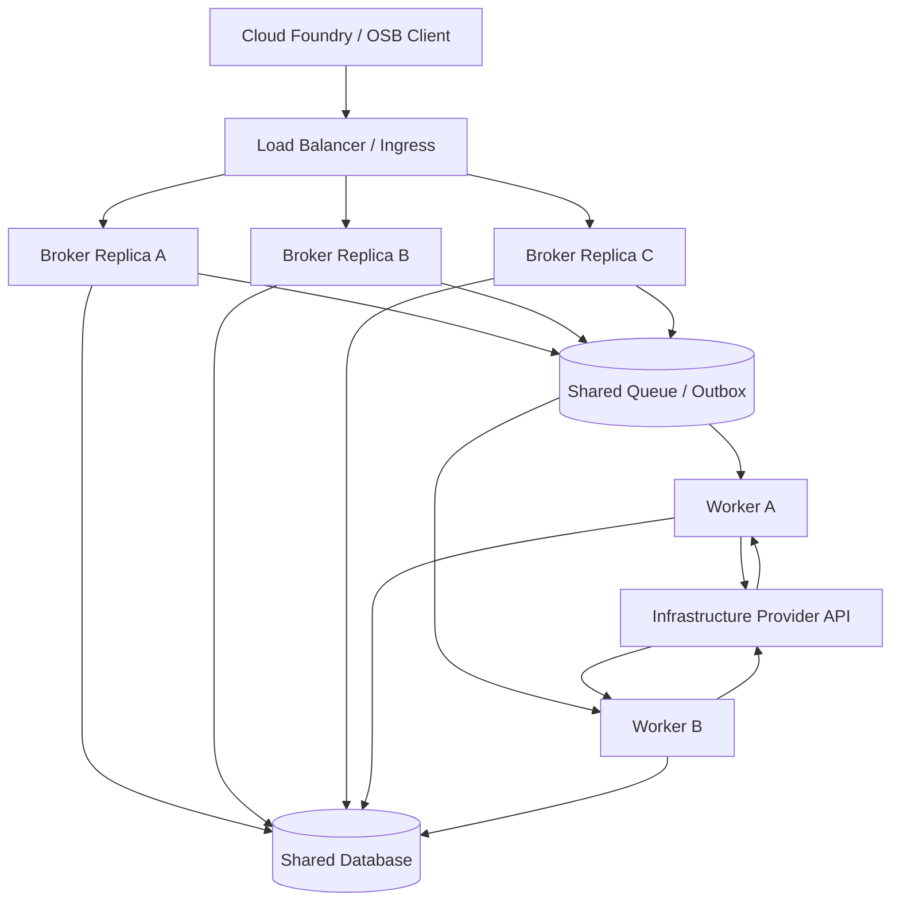
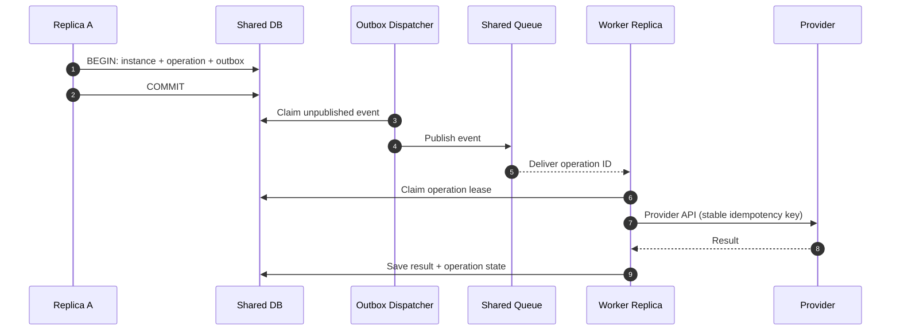

# Vận hành nhiều bản sao với trạng thái dùng chung

Service broker thường phải phục vụ nhiều platform request cùng lúc và duy trì các operation có thể kéo dài từ vài giây tới vài phút. Khi tải tăng hoặc cần khả năng chịu lỗi, broker có thể chạy nhiều bản sao (replica) phía sau load balancer. Để mô hình này hoạt động đúng, mọi replica phải nhìn thấy cùng trạng thái service instance, binding, operation và tài nguyên provider. Một request có thể đến replica A, lần retry đến replica B, còn worker xử lý operation lại chạy trên replica C.

Với `SPRING_CLOUD_SERVICE_BROKER`, triển khai nhiều bản sao đòi hỏi tách trạng thái bền vững khỏi bộ nhớ của process, dùng database/queue dùng chung, điều phối worker an toàn và giữ idempotency xuyên suốt. Spring Cloud Open Service Broker cung cấp các abstraction để xử lý OSB API, nhưng ứng dụng vẫn phải thiết kế persistence, concurrency, provider integration, health check và rollout phù hợp. Chỉ tăng số Pod hoặc JVM không tự làm cho broker trở thành hệ thống multi-replica an toàn.

## 1. Kiến trúc nhiều replica

Một mô hình triển khai phổ biến gồm load balancer, nhiều broker instance, kho trạng thái dùng chung và hệ thống provider bên ngoài:



Mỗi replica có thể nhận HTTP request và xử lý logic stateless. Trạng thái dài hạn được lưu trong database dùng chung; công việc bất đồng bộ được ghi qua outbox hoặc queue bền vững. Worker có thể chạy cùng process với HTTP server hoặc ở deployment riêng, nhưng phải dùng chung operation store và tuân thủ cơ chế claim/lease.

Các thành phần cần được phân biệt:

- **Broker replica:** một process/JVM/Pod chạy cùng phiên bản ứng dụng và phục vụ request.
- **Load balancer:** phân phối request tới replica healthy; không phải nơi lưu trạng thái nghiệp vụ.
- **Shared database:** nguồn sự thật cho instance, binding, operation, idempotency và external resource mapping.
- **Queue/outbox:** lưu công việc cần thực hiện và cho phép worker tiếp tục sau restart.
- **Provider:** hệ thống bên ngoài tạo hoặc thu hồi tài nguyên thật.
- **Configuration/secret store:** cung cấp cùng cấu hình và credential phù hợp cho các replica.

## 2. Vì sao trạng thái không được nằm trong memory của một replica?

Giả sử platform gửi `PUT /v2/service_instances/instance-123` tới replica A. A lưu trạng thái `PROVISIONING` trong một `HashMap` và trả `202 Accepted`. Khi platform polling `last_operation`, load balancer có thể chuyển request tới replica B. B không có dữ liệu trong memory nên trả instance/operation không tồn tại.

Ngay cả khi bật sticky session để platform thường xuyên tới A, hệ thống vẫn lỗi khi A restart, bị thay thế hoặc health check loại khỏi load balancer. Sticky session chỉ điều khiển định tuyến, không cung cấp persistence hoặc high availability cho state.

Không lưu các dữ liệu nghiệp vụ sau chỉ trong memory:

- Service instance và lifecycle state.
- Binding, consumer identity và secret reference.
- Operation ID, operation state, retry count và next retry time.
- Provider external resource ID và ownership metadata.
- Idempotency key/fingerprint và kết quả cần phục hồi sau retry.
- Outbox event chưa publish hoặc worker claim/lease cần phục hồi.

Memory vẫn hữu ích cho cache catalog, connection pool hoặc dữ liệu tạm có thể tái tạo. Cache cần TTL/refresh và không được là nguồn sự thật cho quyền truy cập hay lifecycle. Khi một cache miss xảy ra, replica phải có thể đọc lại dữ liệu từ shared store.

## 3. Shared database là nguồn sự thật

Tất cả replica cần kết nối tới cùng một logical database hoặc một cụm database cung cấp consistency phù hợp. Database có thể là PostgreSQL, MySQL hoặc hệ quản trị được ứng dụng hỗ trợ; điều quan trọng là mọi replica nhìn thấy cùng dữ liệu đã commit và cùng ràng buộc unique/transaction semantics.

Các nhóm dữ liệu thường cần dùng chung:

| Nhóm dữ liệu | Nội dung cần lưu |
|---|---|
| `service_instance` | Instance ID, service/plan, tenant context, desired/observed state, external resource mapping. |
| `service_binding` | Binding ID, instance ID, consumer, state, secret reference và provider credential identity. |
| `operation` | Operation ID, instance/binding, type, state, progress, retry metadata và lỗi đã chuẩn hóa. |
| `idempotency_record` | Scope/key, request fingerprint, operation ID và kết quả có thể replay an toàn. |
| `outbox_event` | Event chưa publish, event ID, operation ID, payload không chứa secret và timestamp. |
| `worker_lease` (nếu tách bảng) | Worker owner, lease expiry, attempt/version và thời điểm claim. |

Ví dụ schema rút gọn:

```sql
CREATE TABLE broker_operation (
    operation_id VARCHAR(100) PRIMARY KEY,
    resource_id VARCHAR(255) NOT NULL,
    operation_type VARCHAR(40) NOT NULL,
    state VARCHAR(40) NOT NULL,
    attempt_count INTEGER NOT NULL DEFAULT 0,
    next_retry_at TIMESTAMP,
    claimed_by VARCHAR(100),
    lease_until TIMESTAMP,
    version BIGINT NOT NULL DEFAULT 0,
    created_at TIMESTAMP NOT NULL,
    updated_at TIMESTAMP NOT NULL
);

CREATE INDEX ix_operation_due
    ON broker_operation(state, next_retry_at);
```

Đây là schema minh họa. Cần bổ sung foreign key, index, uniqueness và retention theo mô hình dữ liệu thực tế. Không tạo một operation table mới trong mỗi replica hoặc dùng local embedded database riêng cho từng Pod.

### Database consistency và failover

Các replica cần kết nối tới endpoint database có failover phù hợp. Nếu dùng read replica, không đọc operation ngay sau khi ghi từ một replica đọc có replication lag nếu OSB polling cần thấy trạng thái mới tức thì. Có thể đọc từ primary cho các truy vấn read-after-write hoặc dùng consistency strategy phù hợp.

Database failover có thể làm connection cũ bị đóng. Connection pool cần phát hiện connection lỗi và tạo connection mới; ứng dụng phải xử lý transaction rollback/unknown commit theo cách an toàn. Không giả định một câu lệnh đã gửi tới database chắc chắn chưa commit chỉ vì client nhận exception.

## 4. Stateless HTTP replica

HTTP layer nên có thể phục vụ cùng request trên bất kỳ replica nào. Điều này đòi hỏi:

- Không giữ operation state chỉ trong object field hoặc local map.
- Không phụ thuộc session affinity để tìm instance/binding.
- Lưu dữ liệu cần thiết trước khi trả response cho platform.
- Dùng request ID/correlation ID cho trace, nhưng không dùng nó thay thế khóa nghiệp vụ.
- Mỗi replica dùng cùng contract, auth policy và configuration version tương thích.
- Mọi response được dựng từ database/operation store hoặc kết quả đã được xác định an toàn.

Một service có thể dùng Spring MVC hoặc WebFlux. Dù stack nào, các instance đều phải đọc/ghi shared store. Với reactive stack, repository và transaction manager phải tương thích reactive nếu cần transaction R2DBC; không trộn JDBC blocking vào event loop. Với MVC, vẫn cần transaction ngắn và không giữ connection trong lúc chờ provider HTTP.

## 5. Worker nhiều replica và cơ chế claim operation

Nếu tất cả replica đều chạy scheduler quét operation `PENDING`, nhiều replica có thể cùng chọn một operation và gọi provider đồng thời. Broker cần cơ chế claim nguyên tử để một worker sở hữu operation trong một khoảng thời gian.

Một quy trình claim:

1. Worker tìm operation đến hạn.
2. Trong transaction ngắn, cập nhật state/lease nếu operation chưa được claim hoặc lease cũ đã hết hạn.
3. Chỉ worker cập nhật thành công đúng một record mới được xử lý.
4. Commit transaction rồi mới gọi provider.
5. Sau khi có kết quả, mở transaction khác để lưu state và external ID.
6. Nếu worker chết, lease hết hạn để worker khác có thể tiếp tục.

Ví dụ SQL dùng conditional update:

```sql
UPDATE broker_operation
SET claimed_by = :worker_id,
    lease_until = :lease_until,
    state = 'RUNNING',
    version = version + 1,
    updated_at = CURRENT_TIMESTAMP
WHERE operation_id = :operation_id
  AND state IN ('PENDING', 'RETRY')
  AND (lease_until IS NULL OR lease_until < CURRENT_TIMESTAMP);
```

Worker chỉ xử lý khi số dòng cập nhật là `1`. Nếu là `0`, operation đã được worker khác claim hoặc không còn ở trạng thái hợp lệ. Tùy database, có thể dùng `SELECT ... FOR UPDATE SKIP LOCKED`, optimistic locking hoặc queue visibility timeout để triển khai cùng ý tưởng.

Không giữ row lock hoặc database transaction mở trong lúc gọi provider. Lease cũng không thay thế idempotency: worker cũ có thể vẫn chạy sau khi lease hết hạn do network call chưa dừng. Provider call phải dùng idempotency key hoặc có cách lookup/reconcile.

## 6. Outbox và queue dùng chung

Nếu broker cần đẩy công việc async, ghi instance/operation và outbox event trong cùng transaction database. Một dispatcher hoặc worker đọc outbox và phát message. Điều này tránh tình huống database commit nhưng queue publish bị mất.



Queue thường cung cấp delivery at-least-once. Một event có thể được phát lại nếu dispatcher chết sau publish nhưng trước khi đánh dấu `published`. Worker cần deduplicate theo event/operation ID và kiểm tra trạng thái trước side effect. Không tuyên bố exactly-once chỉ vì đã dùng queue.

Nếu dùng database làm queue đơn giản, cần index cho các operation đến hạn, giới hạn batch size và cơ chế claim không tranh chấp. Khi tải tăng, có thể chuyển sang message broker riêng nhưng vẫn giữ outbox hoặc một cơ chế đảm bảo không mất job giữa DB và queue.

## 7. Idempotency xuyên suốt các replica

Một platform request có thể tới replica A và retry tới B. Hai replica phải nhận diện đó là cùng một nghiệp vụ logic:

- Dùng `instance_id` làm định danh ổn định cho service instance.
- Dùng `binding_id` làm định danh ổn định cho binding.
- Lưu unique constraint trên instance/binding ID theo scope phù hợp.
- Lưu operation ID và fingerprint request đã chấp nhận.
- Tạo provider idempotency key ổn định từ operation logic, không tạo key mới mỗi lần retry.
- Khi cùng ID nhưng fingerprint khác, trả conflict theo policy; không ghi đè record.
- Khi kết quả provider chưa rõ, lookup/reconcile trước khi tạo side effect lần nữa.

Ví dụ hai request đồng thời:

```text
Platform -> Replica A: PUT instance-123
Platform -> Replica B: retry PUT instance-123

Replica A -> Shared DB: INSERT instance-123 (unique key)
Replica B -> Shared DB: INSERT instance-123 (duplicate key)

Replica A: tạo operation op-456 + outbox
Replica B: đọc lại instance/operation đã tồn tại

Provider: chỉ nhận một logical create nhờ idempotency key
```

Không dùng synchronized block hoặc `ConcurrentHashMap` làm khóa phân tán. Các cấu trúc đó chỉ phối hợp thread trong một JVM và không ngăn replica khác thực hiện cùng thao tác.

## 8. Operation polling phải đọc shared state

OSB API có thể yêu cầu platform polling `last_operation` sau khi broker trả `202 Accepted`. Bất kỳ replica nào nhận GET cũng phải đọc cùng operation record.

Các nguyên tắc:

- Operation ID được lưu trước khi trả response async.
- Operation state, description an toàn và retry metadata được commit vào shared database.
- GET `last_operation` chỉ đọc trạng thái; không khởi chạy lại provider work.
- Polling nhiều lần không làm tăng attempt count hoặc tạo side effect.
- Replica mới khởi động có thể tiếp tục trả đúng state của operation cũ.
- Nếu dùng cache, phải invalidation/TTL và không để cache stale che giấu trạng thái đã hoàn tất.

Khi operation chuyển `SUCCEEDED` hoặc `FAILED`, mọi replica phải nhìn thấy kết quả sau commit theo consistency contract. Nếu dùng read replica có lag, polling nên đọc primary hoặc có cơ chế read-your-writes.

## 9. Configuration và secret phải nhất quán

Các replica cần cùng cấu hình logic nhưng không nhất thiết cùng mọi giá trị runtime. Ví dụ endpoint provider, broker API version, database schema version và policy cần tương thích; `POD_NAME`, hostname hoặc worker ID phải khác nhau.

Nhóm cấu hình nên được quản lý tập trung:

| Cấu hình | Cách quản lý |
|---|---|
| Database URL/pool | Config theo môi trường, endpoint HA và pool size có giới hạn. |
| Broker authentication | Secret manager/Kubernetes Secret/VCAP services theo nền tảng. |
| Provider credential | Workload identity hoặc secret store, quyền tối thiểu. |
| Encryption key | KMS/secret manager; mọi replica cần truy cập key version còn hiệu lực. |
| OSB/catalog configuration | Versioned configuration, rollout đồng bộ và kiểm tra tương thích. |
| Worker identity | ID riêng theo replica/process để audit và lease ownership. |

Không hardcode password trong image hoặc commit vào `application.yml`. Nếu binding credential được mã hóa trong database, mọi replica cần truy cập cùng key material hoặc KMS key alias để giải mã; key rotation phải có giai đoạn tương thích với dữ liệu cũ.

## 10. Load balancing, readiness và liveness

Load balancer chỉ nên gửi traffic tới replica đã khởi tạo đủ dependency cần thiết để phục vụ request. Cần phân biệt:

- **Liveness:** process còn hoạt động và có thể tiếp tục chạy; lỗi provider tạm thời không nhất thiết phải làm liveness fail.
- **Readiness:** replica có thể nhận traffic; ví dụ application context đã sẵn sàng, cấu hình hợp lệ và database có thể truy cập theo policy.
- **Startup probe:** dành thời gian cho ứng dụng khởi động hoặc migration/initialization trước khi liveness bắt đầu.

Không đưa mọi dependency vào liveness. Nếu provider tạm thời down mà liveness fail, orchestrator có thể restart tất cả replica liên tục và làm sự cố nặng hơn. Readiness có thể phản ánh database không truy cập được, nhưng cần tránh flapping quá nhanh; dùng timeout, threshold và grace period phù hợp.

Ví dụ cấu hình Spring Boot Actuator và Kubernetes probe:

```yaml
management:
  endpoint:
    health:
      probes:
        enabled: true
  endpoints:
    web:
      exposure:
        include: health,info,prometheus
```

```yaml
spec:
  containers:
    - name: broker
      ports:
        - name: http
          containerPort: 8080
      startupProbe:
        httpGet:
          path: /actuator/health/liveness
          port: http
        periodSeconds: 5
        failureThreshold: 30
      livenessProbe:
        httpGet:
          path: /actuator/health/liveness
          port: http
        periodSeconds: 10
      readinessProbe:
        httpGet:
          path: /actuator/health/readiness
          port: http
        periodSeconds: 5
```

Đây là ví dụ cấu hình; endpoint health và property phụ thuộc Spring Boot version, security chain và management port. Chỉ expose health endpoint tối thiểu tới mạng probe, bảo vệ các endpoint actuator còn lại.

## 11. Graceful shutdown và xử lý worker đang chạy

Khi deploy phiên bản mới hoặc scale down, replica có thể nhận SIGTERM. Nếu process dừng ngay trong lúc xử lý provider call, operation có thể ở trạng thái `RUNNING` mà chưa ghi kết quả.

Ứng dụng nên:

1. Ngừng nhận request mới khi bắt đầu shutdown theo cơ chế server/orchestrator.
2. Ngừng claim operation mới.
3. Cho request đang chạy thời gian hoàn tất trong shutdown grace period.
4. Commit state/result đã xác nhận trước khi đóng connection pool.
5. Nếu worker không thể hoàn tất, để lease hết hạn và operation có thể được worker khác tiếp quản.
6. Khi worker mới tiếp quản, kiểm tra provider state/idempotency trước side effect.

Không đánh dấu operation `FAILED` chỉ vì JVM bị dừng. Nếu chưa biết provider đã thực hiện side effect hay chưa, lưu trạng thái có thể đối soát (`UNKNOWN`/`RECONCILIATION_REQUIRED`) hoặc để lease hết hạn theo thiết kế.

## 12. Scale HTTP replica và worker độc lập

HTTP request và provider background work có tải khác nhau. Có thể chạy cùng một deployment hoặc tách thành hai workload:

| Mô hình | Ưu điểm | Điều kiện |
|---|---|---|
| Cùng replica chạy API và worker | Đơn giản, ít thành phần | Phải giới hạn worker concurrency để không làm nghẽn request. |
| API deployment riêng, worker deployment riêng | Scale độc lập theo request và backlog | Dùng chung DB/queue, schema và operation contract. |
| Worker theo loại provider/operation | Cô lập quota và timeout provider | Routing job và quyền credential phải được kiểm soát. |

Nếu tách worker, API replica vẫn ghi operation/outbox; worker replica xử lý queue. Không để mỗi API Pod tự giữ một scheduler in-memory không có coordination.

### Concurrency và provider quota

Scale worker quá nhanh có thể vượt quota provider, tăng rate limit hoặc tạo connection pressure. Cần giới hạn:

- Số operation đồng thời toàn hệ thống.
- Số operation đồng thời theo provider account/region.
- Số request theo tenant/service plan.
- Timeout, retry budget và backoff.
- Kích thước connection pool và queue consumer concurrency.

Có thể dùng semaphore phân tán, queue partition hoặc quota store để điều phối giới hạn toàn hệ thống. Semaphore trong JVM chỉ giới hạn một replica; nếu dùng local limit, tổng concurrency sẽ tăng theo số replica.

## 13. Rolling deployment và tương thích schema

Khi chạy rolling update, phiên bản cũ và mới có thể cùng hoạt động trong một khoảng thời gian. Chúng cùng đọc/ghi shared database nên schema migration phải tương thích ngược trong thời gian rollout.

Chiến lược expand-contract:

1. **Expand:** thêm cột/bảng/index nullable hoặc tương thích với code cũ.
2. Deploy phiên bản mới có thể đọc cả schema cũ và mới.
3. Backfill dữ liệu nếu cần bằng job có kiểm soát.
4. Chuyển write path sang schema mới khi mọi replica tương thích.
5. **Contract:** chỉ xóa cột/field cũ sau khi không còn replica hoặc worker cũ sử dụng.

Không deploy một migration phá vỡ schema rồi mới cập nhật replica nếu rolling deployment cho phép hai version chạy song song. Dùng Flyway/Liquibase hoặc công cụ migration tương ứng với một quy trình rõ ràng; tránh để mọi replica cùng chạy migration không được điều phối nếu công cụ/thiết kế không hỗ trợ.

Operation payload và outbox event cũng cần versioning. Worker phiên bản mới có thể nhận event cũ còn trong queue; hãy duy trì backward compatibility hoặc có bước chuyển đổi payload.

## 14. Blue-green và rollback

Blue-green deployment chạy song song môi trường cũ và mới, sau đó chuyển traffic khi kiểm tra đạt. Với service broker, cần chú ý cả HTTP traffic lẫn worker:

- Không để blue và green cùng xử lý một operation mà không có claim/idempotency.
- Cả hai phiên bản phải tương thích với shared database và message schema trong giai đoạn chuyển tiếp.
- Nếu đổi provider API behavior hoặc credential format, cần migration và rollout theo thứ tự.
- Khi rollback code, schema vẫn phải tương thích với phiên bản cũ.
- Không rollback một thay đổi đã tạo side effect provider mà không có reconciliation/compensation phù hợp.

Rollback binary không thể tự khôi phục database/provider state đã thay đổi. Cần phân biệt rollback deployment với rollback nghiệp vụ.

## 15. Observability trên nhiều replica

Log và metric cần giúp xác định replica nào xử lý request nhưng vẫn truy vết được cùng một operation qua các replica.

Log có cấu trúc nên chứa:

- `service_instance_id` hoặc `binding_id` khi phù hợp.
- `operation_id` và correlation/trace ID.
- `replica_id`/Pod name và worker ID.
- Operation type, state transition, attempt count.
- Provider request ID và external resource ID đã được kiểm soát.
- Thời gian xử lý, error category và retry decision.

Không log password, token, Authorization header, raw binding credentials hoặc provider response có secret. Không dùng instance ID/operation ID làm metric label không giới hạn vì cardinality lớn; dùng log/trace cho định danh chi tiết.

Metric cần theo dõi:

| Metric | Mục đích |
|---|---|
| HTTP request rate/latency/error | Đánh giá tải và chất lượng API. |
| Active operations by state | Phát hiện backlog hoặc operation bị kẹt. |
| Outbox/queue backlog and age | Theo dõi độ trễ dispatch/worker. |
| Worker lease expiry/reclaim | Phát hiện worker chết hoặc xử lý quá lâu. |
| Provider latency/rate-limit/error | Theo dõi phụ thuộc hạ tầng. |
| Database pool active/idle/wait | Phát hiện connection exhaustion. |
| Readiness transitions/restarts | Phát hiện replica không ổn định. |
| Reconciliation and idempotency conflicts | Phát hiện trạng thái lệch hoặc request xung đột. |

Dashboard nên phân biệt lỗi do một replica với lỗi toàn hệ thống, provider outage và database outage. Nếu mọi replica cùng lỗi database, restart từng Pod không giải quyết nguyên nhân gốc.

## 16. Kiểm soát database connection pool

Mỗi replica thường có connection pool riêng. Nếu có `N` replica và mỗi pool cho phép `M` connection, tổng số connection tiềm năng gần `N × M`, chưa tính worker, migration và tác vụ quản trị.

Ví dụ, 6 replica với pool tối đa 20 connection có thể tạo tới 120 connection. Nếu database chỉ chịu được 80 connection cho broker, scale out sẽ gây lỗi dù từng replica chạy ổn khi đứng riêng.

Hãy:

- Tính tổng connection budget cho toàn deployment.
- Giới hạn pool theo số replica tối đa và tải thực tế.
- Đặt connection timeout và validation phù hợp.
- Giữ transaction ngắn; không giữ connection khi gọi provider HTTP.
- Theo dõi active, idle, pending và timeout.
- Chừa capacity cho migration, failover và tác vụ vận hành.
- Dùng pooler nếu kiến trúc/database cần, nhưng kiểm tra transaction/connection semantics.

## 17. Tích hợp Cloud Foundry và Kubernetes

### Cloud Foundry

Một broker registration trỏ tới endpoint logic của broker. Khi broker chạy nhiều instance sau router/load balancer, mọi instance cần dùng chung database, operation store, provider configuration và broker authentication policy. Không dựa vào việc platform gọi lại đúng một application instance sau retry hoặc polling.

Nếu dùng VCAP services hoặc binding môi trường để cấp database/credential cho broker app, mỗi instance cần nhận cùng logical service binding và quyền truy cập phù hợp. Cần xác minh cách platform scale app instances, health check và rolling restart trong foundation đang dùng.

### Kubernetes

Deployment có thể chạy nhiều Pod và Service/Ingress phân phối request. Readiness probe loại Pod chưa sẵn sàng khỏi endpoint; liveness probe kiểm tra process. Dùng PersistentVolume cho database riêng chỉ khi kiến trúc thực sự yêu cầu; trong nhiều triển khai broker, database là dịch vụ managed bên ngoài cluster.

Worker có thể là Deployment riêng với replica count và autoscaling theo queue backlog. Nếu dùng CronJob hoặc scheduled task cho reconciliation, cần bảo đảm không chạy đồng thời không kiểm soát; dùng distributed lock/lease hoặc job idempotent.

Pod disruption budget, termination grace period và rolling update strategy có thể giảm gián đoạn, nhưng không thay thế durable operation state và graceful shutdown trong ứng dụng.

## 18. Kiểm thử triển khai nhiều replica

Unit test không đủ để chứng minh shared state hoạt động giữa các process. Cần có integration/load/failure test phù hợp:

1. Gửi provision tới replica A, polling `last_operation` qua replica B; B phải thấy cùng operation.
2. Gửi hai request cùng `instance_id` đồng thời tới hai replica; chỉ một logical resource được tạo.
3. Hai worker cùng nhìn thấy một operation; chỉ một worker claim thành công.
4. Dừng worker sau provider success nhưng trước DB commit; worker khác reconcile cùng resource thay vì tạo mới.
5. Restart một replica khi operation đang chạy; replica khác tiếp tục phục vụ request/polling.
6. Database failover làm connection cũ mất; application pool phục hồi và không tạo side effect trùng.
7. Queue/outbox phát event lặp; consumer deduplicate theo operation/event ID.
8. Rolling deploy có hai phiên bản cùng chạy; schema và event payload vẫn tương thích.
9. Scale worker lên; provider quota và database connection budget không bị vượt.
10. Readiness fail trên một Pod; load balancer ngừng gửi traffic tới Pod đó.
11. Graceful shutdown ngừng claim job mới và để lease phục hồi job bị dở.
12. Credential rotation có hiệu lực trên mọi replica và không làm lộ secret.

Nên dùng database/queue test instance và provider fake có thể mô phỏng timeout sau side effect. Kiểm tra số lượng resource thực sự được tạo, trạng thái database và log/metric; chỉ kiểm tra HTTP 200/202 là chưa đủ.

## 19. Checklist trước khi scale out

- Mọi replica dùng chung logical database và operation store.
- Không lưu instance, binding hoặc operation state chỉ trong memory/session.
- Instance ID, binding ID, operation ID và provider idempotency key ổn định qua replica.
- Unique constraint và optimistic locking bảo vệ request cạnh tranh.
- Worker claim operation bằng lease/queue/lock có coordination dùng chung.
- Outbox và consumer xử lý at-least-once, không giả định exactly-once.
- `last_operation` đọc shared state và không tạo side effect.
- Provider quota và worker concurrency có giới hạn toàn hệ thống.
- Cấu hình, broker credential, provider secret và encryption key nhất quán/được rotate an toàn.
- Readiness/liveness được tách đúng; health check không tạo restart storm.
- Graceful shutdown và lease recovery xử lý operation đang chạy.
- Database pool được tính theo tổng số replica.
- Migration và outbox payload tương thích trong rolling/blue-green deployment.
- Log/trace liên kết operation qua replica nhưng không chứa secret.
- Có integration test cho multi-replica, concurrency, failover, retry và rollout.

Vận hành nhiều bản sao chỉ an toàn khi các replica là những worker stateless trên cùng một trạng thái bền vững. Hãy lưu instance, binding và operation trong shared database; dùng outbox/queue cùng claim lease cho background work; giữ idempotency xuyên request và provider; rồi triển khai health check, graceful shutdown, pool sizing và migration tương thích. Khi đó platform có thể gửi request hoặc polling tới bất kỳ replica healthy nào mà broker vẫn trả kết quả nhất quán và phục hồi được sau khi một process bị dừng.
