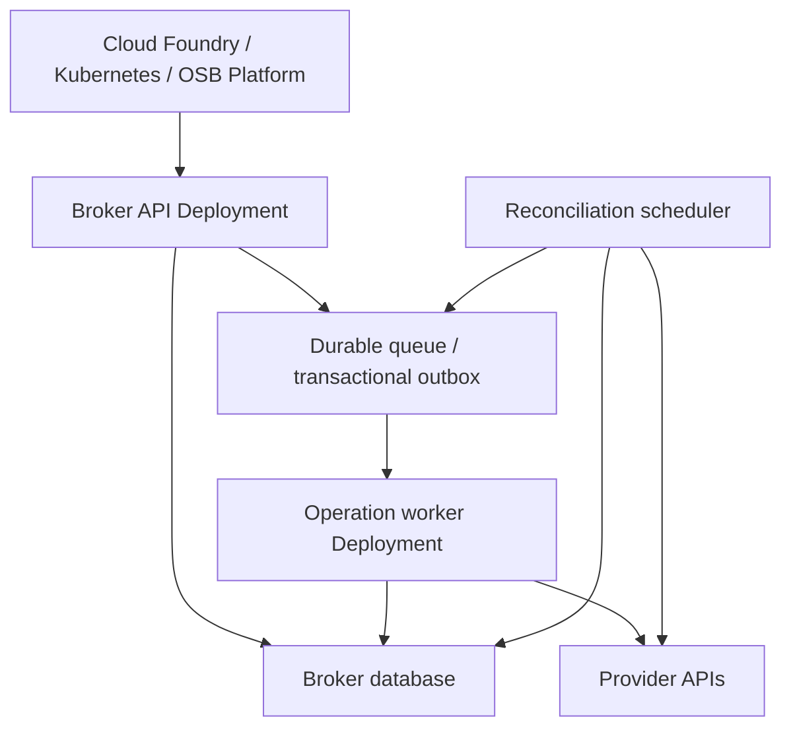

# Giới hạn tài nguyên, kết nối và năng lực xử lý theo tải

## Vì sao service broker cần kế hoạch năng lực?

Service broker nằm giữa platform và các hệ thống cung cấp dịch vụ. Một request OSB API có thể tạo ra nhiều công việc phía sau: ghi operation, gửi message vào queue, gọi provider API, tạo database hoặc credential, cập nhật trạng thái và thực hiện reconciliation. Khi tải tăng, nút thắt có thể xuất hiện ở CPU, memory, connection pool, database, worker concurrency, provider quota hoặc hàng đợi.

Nếu chỉ tăng số replica của ứng dụng, broker có thể tạo ra nhiều kết nối và request đồng thời hơn mức database/provider cho phép. Nếu chỉ tăng CPU/memory, worker vẫn có thể bị giới hạn bởi quota API phía sau. Ngược lại, giới hạn quá thấp làm operation nằm chờ lâu, platform polling nhiều lần và thời gian hoàn tất vượt SLA.

Với `SPRING_CLOUD_SERVICE_BROKER`, năng lực cần được tính cho cả hai đường xử lý:

- **Đường API:** nhận request từ Cloud Foundry/Kubernetes hoặc platform OSB, xác thực, validate, đọc/ghi metadata và trả response.
- **Đường worker:** xử lý operation bất đồng bộ, gọi provider, retry, cleanup và reconciliation.

Hai đường có đặc tính tải khác nhau. API cần latency ổn định và khả năng nhận request; worker cần concurrency được kiểm soát, queue có giới hạn và khả năng tiếp tục sau restart. Thiết kế triển khai phải giữ được các giới hạn này khi chạy một replica lẫn nhiều replica.

## Xác định các tài nguyên cần giới hạn

| Tài nguyên | Nơi tiêu thụ | Rủi ro khi thiếu giới hạn |
|---|---|---|
| CPU | HTTP handler, JSON validation, serialization, worker và encryption. | CPU throttling, tăng latency, queue xử lý chậm. |
| Memory | JVM heap, direct buffer, thread stack, cache, request/response và queue in-memory. | GC kéo dài, OOMKill, restart liên tục. |
| HTTP connections | Kết nối từ broker đến provider và từ platform vào broker. | Cạn socket, pool chờ lâu hoặc provider bị quá tải. |
| Database connections | Đọc/ghi instance, binding, operation, outbox và audit. | Hết connection, transaction chờ và làm nghẽn cả API lẫn worker. |
| Worker concurrency | Số operation đang được xử lý. | Quá nhiều side effect đồng thời hoặc quá ít throughput. |
| Queue capacity | Operation đang chờ worker. | Backlog tăng vô hạn, thời gian chờ dài và thiếu bộ nhớ/storage. |
| Provider quota | Request theo account, project, endpoint hoặc tenant. | HTTP 429, throttling hoặc khóa account. |
| File descriptors và thread | Socket, file, thread pool và runtime. | Không tạo thêm kết nối/thread hoặc tăng context switching. |

Mỗi giới hạn nên có một chủ sở hữu và metric theo dõi. Ví dụ, connection pool giới hạn số socket, bulkhead giới hạn số lời gọi đang chạy, còn rate limiter giới hạn tốc độ gửi request. Không dùng một con số duy nhất để thay thế tất cả.

## Tách API workload và worker workload

Với broker có operation bất đồng bộ, nên cân nhắc tách tiến trình API và worker thành hai Deployment hoặc hai nhóm process. Cả hai có thể dùng chung codebase và domain service, nhưng profile/entrypoint và resource allocation khác nhau.

| Thành phần | Công việc chính | Đặc điểm tải |
|---|---|---|
| Broker API | Catalog, provision/update/bind request, last_operation và validation. | Nhiều request ngắn, cần latency và availability tốt. |
| Operation worker | Gọi provider, theo dõi job, retry và compensation. | Ít request HTTP hơn nhưng mỗi job có thể kéo dài và chiếm tài nguyên lâu. |
| Reconciliation worker | Đối soát operation quá hạn, orphan và trạng thái provider. | Chạy nền, cần giới hạn tốc độ để không cạnh tranh với operation mới. |
| Scheduler/maintenance | Dọn dữ liệu hết hạn, audit retention và cập nhật cache. | Tải định kỳ, cần tránh chạy đồng loạt trên mọi replica. |

Tách workload giúp scale API theo request rate và worker theo queue depth/age. Nếu chạy chung một Deployment, phải bảo đảm số thread, connection pool và CPU không để job dài chiếm hết năng lực xử lý request OSB.

Ví dụ topology:



Queue/outbox và operation database phải dùng storage dùng chung, bền vững giữa các replica. Không lưu trạng thái operation duy nhất trong memory của một Pod; Pod có thể bị reschedule bất kỳ lúc nào.

## Ước lượng throughput và concurrency

Trước khi chọn số replica, hãy xác định tải dự kiến:

- Request rate đến OSB API (request/giây).
- Tỷ lệ request đồng bộ và bất đồng bộ.
- Số provider call trung bình cho mỗi operation.
- Thời gian xử lý trung bình và phân vị p95/p99.
- Tỷ lệ retry, lỗi provider và reconciliation.
- Quota của provider, database và queue.

Định luật Little cung cấp một cách ước lượng số công việc đồng thời:

\[
L = \lambda \times W
\]

Trong đó:

- `L` là số operation trung bình đang ở trong hệ thống.
- `λ` là tốc độ operation đến (operation/giây).
- `W` là thời gian trung bình từ lúc nhận đến khi hoàn tất (giây).

Ví dụ broker nhận trung bình 2 operation/giây và mỗi operation mất 20 giây, hệ thống có khoảng 40 operation đang chạy hoặc chờ tại một thời điểm. Nếu chỉ cho phép 10 worker xử lý đồng thời, queue sẽ tăng khi arrival rate vượt khả năng hoàn tất của worker.

Giới hạn throughput của worker có thể ước lượng gần đúng:

\[
Throughput_{worker} \leq \frac{C}{S}
\]

`C` là số operation đồng thời và `S` là thời gian worker chiếm slot cho một operation. Đây là giới hạn lý thuyết đơn giản; thực tế còn phụ thuộc số provider call, thời gian chờ I/O, retry và quota.

Throughput thực tế bị chặn bởi nút thắt nhỏ nhất:

\[
Throughput \leq \min(WorkerCapacity, ProviderQuota, DatabaseCapacity, QueueCapacity)
\]

Không tăng concurrency vượt quá quota provider chỉ để làm queue ngắn hơn. Làm vậy thường chỉ chuyển backlog thành HTTP 429 và retry, khiến tổng thời gian hoàn tất còn dài hơn.

## Cấu hình CPU và memory cho JVM trong container

Khi chạy Spring Boot trong Kubernetes, cần đặt `requests` và `limits` phù hợp với mức tiêu thụ thực tế.

- `requests.cpu` và `requests.memory` là cơ sở Kubernetes dùng để lập lịch Pod và tính một số chính sách cấp phát.
- `limits.cpu` giới hạn CPU mà container được sử dụng; khi chạm limit, container có thể bị throttling.
- `limits.memory` là giới hạn cứng; nếu vượt, container có thể bị OOMKilled.

Ví dụ khởi điểm để đo tải, không phải cấu hình tối ưu chung:

```yaml
resources:
  requests:
    cpu: "500m"
    memory: "768Mi"
  limits:
    cpu: "2"
    memory: "1536Mi"
```

Chọn requests từ mức tiêu thụ ổn định và nhu cầu khi tải bình thường; chọn limits từ peak đã đo, khả năng của node và chính sách cluster. Nếu CPU limit quá sát mức cần thiết, JVM có thể bị throttling ngay cả khi node còn CPU rảnh. Nếu memory limit thấp hơn heap cộng native/direct memory, thread stack và metaspace, container có thể bị OOM dù heap chưa đầy.

### Tính heap trong giới hạn container

Memory của JVM không chỉ gồm heap. Tổng sử dụng còn có metaspace, code cache, direct buffers, thread stacks, native library và các vùng runtime khác. Không đặt `-Xmx` bằng toàn bộ `limits.memory`.

Có thể dùng container-aware JVM và `MaxRAMPercentage` để tính heap tối đa theo memory limit:

```yaml
env:
  - name: JAVA_TOOL_OPTIONS
    value: "-XX:MaxRAMPercentage=65.0 -XX:+ExitOnOutOfMemoryError"
```

Giá trị 65% chỉ là ví dụ khởi điểm. Cần đo heap peak, direct memory, số thread và GC ở tải thực tế rồi điều chỉnh. Nếu đặt `-Xmx` tường minh, kiểm tra nó không vượt ngân sách container. Giữ phần dự phòng cho native memory, agent, TLS buffer và tăng tải đột biến.

### Theo dõi CPU throttling và GC

Metric hữu ích:

- CPU usage và CPU throttled time.
- Heap used/committed, allocation rate và GC pause.
- Container working set và OOMKilled/restart count.
- Số thread, blocked thread và thread pool queue.
- Direct buffer usage nếu ứng dụng dùng Netty/WebFlux.

Nếu CPU throttling tăng cùng latency, kiểm tra CPU limit và request trước khi tăng replica. Nếu memory tăng theo số operation chờ, có thể queue đang giữ payload trong memory; chuyển sang durable queue và giới hạn số message prefetch/in-flight.

## Giới hạn database connection pool

Database broker thường lưu service instance, binding, operation, outbox, idempotency key và audit. Mỗi replica có thể tạo một connection pool riêng. Do đó tổng số connection tăng theo số replica:

\[
Connections_{total} = Replicas \times PoolSize_{perPod}
\]

Ví dụ 6 replica, mỗi replica `maximumPoolSize=15` có thể mở tối đa 90 connection. Nếu database chỉ cấp 100 connection cho toàn ứng dụng, cần giữ phần dự phòng cho migration, monitoring, admin và các ứng dụng khác.

Một công thức ngân sách:

\[
PoolBudget = DBMaxConnections - ReservedConnections - OtherWorkloads
\]

\[
PoolPerPod \leq \frac{PoolBudget}{MaxReplicas}
\]

Hãy tính theo `maxReplicas` của autoscaler, không phải số replica hiện tại. Nếu HPA tăng từ 2 lên 10 Pod nhưng mỗi Pod vẫn có pool 30 connection, tổng connection tiềm năng tăng từ 60 lên 300.

Ví dụ cấu hình HikariCP:

```yaml
spring:
  datasource:
    hikari:
      maximum-pool-size: 12
      minimum-idle: 2
      connection-timeout: 2000
      validation-timeout: 1000
      max-lifetime: 25m
      idle-timeout: 5m
```

Các giá trị trên chỉ minh họa. `maximum-pool-size` phải được tính cùng max replica và connection budget. `connection-timeout` giới hạn thời gian chờ lấy connection, không phải query timeout. Cấu hình `max-lifetime` nên phù hợp timeout của database/proxy và được đặt thấp hơn giới hạn đóng connection từ phía hạ tầng khi cần.

Không tăng pool size vô hạn để xử lý backlog. Khi database đã bão hòa, thêm connection thường làm context switching, lock contention và latency xấu hơn. Theo dõi active, idle, pending connection, acquisition time, transaction duration và query latency.

## Giới hạn outbound HTTP connections đến provider

Broker thường gọi nhiều provider khác nhau. Mỗi provider có thể có giới hạn connection và quota riêng. Nếu dùng Reactor Netty WebClient, cấu hình connection pool theo dependency thay vì một pool không giới hạn.

Ví dụ:

```java
ConnectionProvider providerPool = ConnectionProvider.builder("database-provider")
        .maxConnections(30)
        .pendingAcquireMaxCount(60)
        .pendingAcquireTimeout(Duration.ofSeconds(2))
        .build();

HttpClient httpClient = HttpClient.create(providerPool)
        .option(ChannelOption.CONNECT_TIMEOUT_MILLIS, 2_000)
        .responseTimeout(Duration.ofSeconds(10));

WebClient providerClient = WebClient.builder()
        .clientConnector(new ReactorClientHttpConnector(httpClient))
        .build();
```

Đây là cấu hình minh họa cho một provider adapter. Nếu có 5 replica, mỗi replica cho phép 30 connection thì tổng lý thuyết là 150 connection. Cần so sánh với quota provider và cân nhắc bulkhead/rate limiter dùng chung giữa các replica.

`maxConnections` giới hạn connection trong pool; `pendingAcquireMaxCount` giới hạn số request chờ lấy connection. Không nên đặt pending queue quá lớn vì request chờ vẫn giữ memory và làm tăng latency. Khi queue đầy hoặc chờ quá lâu, trả lỗi nội bộ có kiểm soát hoặc để operation retry theo chính sách, không giữ request vô thời hạn.

## Concurrency và quota theo provider

Provider quota thường được tính theo API key, account, project, region hoặc endpoint. Một semaphore nằm trong memory của mỗi Pod chỉ giới hạn concurrency cục bộ. Nếu có 5 Pod, mỗi Pod cho phép 10 lời gọi đồng thời, tổng có thể lên 50.

Phân biệt:

| Giới hạn | Phạm vi | Khi scale nhiều replica |
|---|---|---|
| Local semaphore/bulkhead | Một process/Pod | Tổng concurrency tăng theo số Pod. |
| Shared/distributed semaphore | Nhiều Pod cùng provider scope | Giữ giới hạn tổng nếu cơ chế cấp permit có tính atomic. |
| Local token bucket | Một process/Pod | Tổng rate có thể tăng theo số Pod. |
| Distributed rate limiter | Provider account/API key dùng chung | Kiểm soát tốc độ toàn hệ thống. |
| Connection pool | Một HTTP client trong một Pod | Tổng connection là tổng các pool của mọi replica. |

Với quota toàn account, dùng Redis, database atomic counter hoặc một admission service để chia sẻ token/permit. Phải xác định key đúng phạm vi quota: nếu provider tính riêng từng project hoặc endpoint, limiter key cũng cần phân biệt các scope đó.

Giới hạn theo tenant giúp một khách hàng không chiếm hết capacity của provider. Có thể kết hợp:

- Global limit theo provider account.
- Limit theo API class (create, update, read, delete).
- Limit theo tenant hoặc org.
- Limit riêng cho reconciliation để cleanup không cạnh tranh hoàn toàn với operation mới.

Không đặt concurrency của worker cao hơn khả năng xử lý của database và provider. Ví dụ 40 worker cùng ghi operation vào một database đã gần hết connection sẽ làm tăng lock và pool wait, không nhất thiết tăng throughput.

## Queue capacity, backpressure và backlog

Nếu broker trả `202 Accepted`, operation/job phải được ghi bền vững trước khi xác nhận đã tiếp nhận. Queue cần có giới hạn dung lượng và chính sách khi đầy.

Các metric quan trọng:

- `queue_depth`: số operation đang chờ.
- `oldest_message_age`: tuổi message chờ lâu nhất.
- `in_flight`: số job worker đang xử lý.
- `completion_rate`: số operation hoàn tất mỗi giây.
- `retry_rate`: tỷ lệ job được retry.
- `dead_letter_count`: số job chuyển sang dead-letter/reconciliation queue.

Nếu arrival rate lớn hơn completion rate trong thời gian dài, backlog tăng. Ước lượng thời gian drain:

\[
DrainTime \approx \frac{QueueDepth}{CompletionRate - ArrivalRate}
\]

Công thức chỉ có ý nghĩa khi completion rate lớn hơn arrival rate và tải tương đối ổn định. Nếu `CompletionRate <= ArrivalRate`, queue không thể tự drain; cần giảm admission, tăng capacity an toàn hoặc xử lý bottleneck.

Không giữ toàn bộ operation payload trong memory queue không giới hạn. Durable queue/outbox phải có retention, retry policy, dead-letter policy và cách replay có idempotency. Giới hạn prefetch để worker không nhận nhiều message hơn số slot có thể xử lý.

Khi queue đầy, broker có thể từ chối request mới bằng response tạm thời phù hợp trước khi tạo operation, hoặc áp dụng admission control. Không trả `202 Accepted` nếu operation/job chưa được lưu bền vững hoặc không có khả năng được worker nhận xử lý.

## Autoscaling theo loại tải

Kubernetes HPA có thể scale Deployment dựa trên CPU/memory hoặc custom/external metrics. Với broker, CPU đơn thuần không phản ánh hết tình trạng worker: worker có thể chờ provider I/O trong khi queue tăng, CPU vẫn thấp.

### API Deployment

Các tín hiệu phù hợp:

- CPU utilization.
- Request rate và p95/p99 latency.
- Số request đang xử lý.
- HTTP 5xx/429 và connection pool wait.

Ví dụ HPA dựa trên CPU:

```yaml
apiVersion: autoscaling/v2
kind: HorizontalPodAutoscaler
metadata:
  name: broker-api
  namespace: service-broker
spec:
  scaleTargetRef:
    apiVersion: apps/v1
    kind: Deployment
    name: broker-api
  minReplicas: 2
  maxReplicas: 8
  metrics:
    - type: Resource
      resource:
        name: cpu
        target:
          type: Utilization
          averageUtilization: 65
```

Ngưỡng 65% chỉ là ví dụ. Cần kiểm tra CPU requests, latency và khả năng của downstream. `maxReplicas` cũng là một giới hạn bảo vệ: scale API lên quá nhiều Pod có thể làm tăng tổng DB pool và outbound connection.

### Worker Deployment

Worker nên scale theo queue depth, oldest message age hoặc số operation chờ trên mỗi worker. Ví dụ nếu mục tiêu là tối đa 20 message chờ trên mỗi worker:

\[
DesiredReplicas = \left\lceil \frac{QueueDepth}{TargetQueuePerWorker} \right\rceil
\]

Giới hạn kết quả trong `minReplicas` và `maxReplicas`, sau đó điều chỉnh theo provider quota. Có thể dùng custom metrics adapter hoặc KEDA nếu queue backend được hỗ trợ.

Không scale worker vô hạn theo queue depth. Khi provider đã chạm quota, thêm worker chỉ làm tăng `429` và retry. Đặt `maxReplicas` sao cho:

\[
MaxReplicas \times ConcurrencyPerPod \leq ProviderConcurrencyBudget
\]

Nếu provider quota là global, concurrency/rate limiter phân tán vẫn cần thiết vì số replica có thể thay đổi trong lúc scale.

## Kubernetes Deployment và probe

Một Deployment API minh họa:

```yaml
apiVersion: apps/v1
kind: Deployment
metadata:
  name: broker-api
  namespace: service-broker
spec:
  replicas: 2
  selector:
    matchLabels:
      app: broker-api
  template:
    metadata:
      labels:
        app: broker-api
    spec:
      terminationGracePeriodSeconds: 60
      containers:
        - name: broker
          image: registry.example.internal/broker:1.0.0
          ports:
            - name: http
              containerPort: 8080
          resources:
            requests:
              cpu: "500m"
              memory: "768Mi"
            limits:
              cpu: "2"
              memory: "1536Mi"
          readinessProbe:
            httpGet:
              path: /actuator/health/readiness
              port: http
            periodSeconds: 10
            timeoutSeconds: 2
            failureThreshold: 3
          livenessProbe:
            httpGet:
              path: /actuator/health/liveness
              port: http
            periodSeconds: 20
            timeoutSeconds: 2
            failureThreshold: 3
```

Probe path cần khớp với Spring Boot Actuator health group đã bật. Không nên để liveness probe phụ thuộc trực tiếp vào provider API hoặc database chập chờn nếu điều đó khiến Kubernetes restart mọi Pod liên tục. Liveness nên phát hiện process không còn hoạt động đúng; readiness xác định Pod có thể nhận traffic mới.

Với broker async, readiness có thể cần kiểm tra database/queue thiết yếu để tiếp nhận operation an toàn. Tuy nhiên provider tạm thời lỗi không nhất thiết đồng nghĩa API không thể nhận request: nếu broker có thể lưu operation bền vững và trả lỗi/tiến độ đúng, việc đưa mọi API Pod khỏi Service có thể làm gián đoạn toàn bộ broker. Hãy xác định dependency nào thực sự bắt buộc cho khả năng phục vụ request.

## Graceful shutdown và rolling deployment

Khi Kubernetes terminate Pod, broker cần dừng nhận traffic mới và cho request/job đang chạy đủ thời gian kết thúc hoặc nhường quyền xử lý cho worker khác.

Với Spring Boot:

```yaml
server:
  shutdown: graceful

spring:
  lifecycle:
    timeout-per-shutdown-phase: 45s
```

Kubernetes `terminationGracePeriodSeconds` phải dài hơn thời gian graceful shutdown dự kiến và bao gồm thời gian cần thiết cho preStop hook nếu có. Các con số ví dụ phải được điều chỉnh theo thời gian drain và quy trình deploy.

Với worker:

1. Ngừng nhận message mới khi nhận SIGTERM.
2. Hoàn tất job hiện tại nếu còn đủ thời gian và provider call có thể kết thúc an toàn.
3. Nếu không thể hoàn tất, không ack message; giải phóng lease hoặc để lease hết hạn để worker khác nhận lại.
4. Đảm bảo operation record/checkpoint đã lưu bền vững trước khi process thoát.
5. Khi worker mới nhận lại, tiếp tục bằng idempotency key và reconciliation, không tạo side effect trùng.

PodDisruptionBudget giúp giới hạn số Pod bị voluntary disruption cùng lúc, ví dụ khi drain node:

```yaml
apiVersion: policy/v1
kind: PodDisruptionBudget
metadata:
  name: broker-api-pdb
  namespace: service-broker
spec:
  minAvailable: 1
  selector:
    matchLabels:
      app: broker-api
```

PDB không thay thế readiness, replica count hoặc graceful shutdown. Nó cũng không bảo đảm Pod không bị mất do node failure/OOM. Với worker, PDB cần phối hợp lease và queue redelivery; không thể chỉ dựa vào việc giữ Pod sống.

## Hạn chế retry storm và provider overload

Khi provider chậm hoặc trả `429`, nhiều worker có thể cùng retry. Nếu mọi worker dùng cùng delay cố định, chúng sẽ gọi lại đồng thời và tạo retry storm.

Nên kết hợp:

- Exponential backoff và jitter.
- Retry budget theo operation và provider.
- Rate limiter theo quota scope.
- Bulkhead/concurrency limit.
- Circuit breaker khi provider liên tục lỗi.
- Deadline tổng của operation.
- Dead-letter/reconciliation queue cho kết quả chưa xác định.

Với mỗi operation, ghi rõ attempt count, lần retry kế tiếp và provider request ID. Không retry vô hạn các lỗi validation hoặc authorization. Với lỗi timeout sau side effect không rõ, tra cứu bằng idempotency key hoặc resource marker trước khi gọi lại.

## Kiểm thử tải và xác định giới hạn thực tế

Capacity planning cần được xác minh bằng tải đại diện. Nên kiểm tra nhiều kiểu workload:

| Kịch bản | Điều cần quan sát |
|---|---|
| Nhiều request catalog | CPU, cache hit, response latency và DB query. |
| Burst provision async | Queue depth, admission, worker throughput và provider quota. |
| Nhiều bind đồng thời trên một instance | DB locking, idempotency conflict và provider role/credential quota. |
| Update/deprovision hỗn hợp | Fairness, concurrency guard và thời gian operation. |
| Provider chậm hoặc trả 429 | Backoff, retry budget, queue growth và circuit breaker. |
| Worker restart trong lúc xử lý | Lease expiry, redelivery, duplicate side effect và reconciliation. |
| HPA scale out/in | Tổng DB connections, provider calls và thời gian drain Pod. |
| Rolling deployment | Request lỗi, operation bị gián đoạn và thời gian phục hồi. |

Đo ít nhất:

- Request rate, p50/p95/p99 latency và HTTP status distribution.
- CPU usage/throttling, memory working set, heap và GC pause.
- DB pool active/idle/pending, query latency và transaction duration.
- Outbound connection pool active/pending và response time provider.
- Worker active count, queue depth, oldest message age và completion rate.
- Provider 429/5xx, retry count, circuit state và quota consumption.
- Operation duration từ lúc nhận request đến terminal state.
- Pod restart, OOMKilled, readiness failure và termination duration.

Kiểm thử cả steady-state, burst và soak test. Một hệ thống vượt qua burst ngắn nhưng queue tăng liên tục trong soak test vẫn chưa có capacity ổn định. Xác định ngưỡng admission trước khi provider/database quá tải, không chỉ đo điểm tối đa mà hệ thống có thể chịu trong vài giây.

## Ví dụ tính ngân sách cho một triển khai

Giả sử môi trường production dự kiến có:

| Thông số | Giá trị giả định |
|---|---:|
| API replicas | 2–8 |
| Worker replicas | 2–6 |
| Worker concurrency mỗi Pod | 4 operation |
| Provider concurrency budget | 24 call |
| Database connection budget dành cho broker | 100 connection |
| DB pool mỗi API Pod | 6 connection |
| DB pool mỗi worker Pod | 8 connection |

Ở max scale, tổng connection database là:

\[
8 \times 6 + 6 \times 8 = 96
\]

96 connection đã gần chạm ngân sách 100, nên phải giữ pool nhỏ hoặc dành thêm phần dự phòng cho migration/monitoring. Tổng worker concurrency là `6 × 4 = 24`, bằng provider concurrency budget giả định. Nếu có nhiều provider với quota riêng, cần phân chia 24 slot theo dependency thay vì dùng một con số chung.

Khi scale worker lên 8 Pod, concurrency lý thuyết thành 32 và vượt quota provider. Do đó `maxReplicas` cần bị giới hạn hoặc distributed bulkhead phải giữ tổng provider calls không vượt 24. Đây là lý do HPA, pool size và provider quota phải được tính cùng nhau.

Các giá trị trong ví dụ chỉ minh họa phương pháp tính. Số production phải dựa trên benchmark, quota hợp đồng, DB max connections và mục tiêu SLA của tổ chức.

## Checklist triển khai

1. Tách hoặc cô lập API, worker và reconciliation workload theo đặc tính tải.
2. Đặt CPU/memory requests và limits dựa trên measurement, có dự phòng native memory.
3. Cấu hình JVM heap phù hợp container limit, không dùng hết memory cho heap.
4. Tính tổng DB pool theo `maxReplicas`, không theo replica hiện tại.
5. Giới hạn outbound HTTP connection và pending acquire cho từng provider.
6. Đặt bulkhead/concurrency và distributed rate limit theo quota thật của provider.
7. Giới hạn queue depth, prefetch, retry và dead-letter; có backpressure khi quá tải.
8. Scale worker theo queue depth/age nhưng giới hạn bởi provider quota.
9. Scale API theo latency/request rate và theo dõi downstream connection budget.
10. Readiness/liveness phản ánh đúng khả năng phục vụ, tránh restart loop khi provider tạm lỗi.
11. Bật graceful shutdown, worker lease/fencing và queue redelivery.
12. Cấu hình PDB phù hợp với số replica và maintenance window.
13. Có metric cho CPU throttling, GC, pool wait, queue age, provider 429 và operation duration.
14. Chạy load, burst, soak và failure test trước khi chốt capacity.
15. Kiểm tra rolling deployment không làm mất operation hoặc tạo side effect trùng.

## Kết luận

Năng lực của service broker bị giới hạn bởi toàn bộ chuỗi từ API, JVM, database, queue, worker đến provider. Tăng replica chỉ có ích khi connection pool, concurrency và rate quota được tính lại theo tổng số Pod. Với Spring Cloud Service Broker, hãy tách đường API và worker khi cần, lưu operation bền vững, giới hạn queue, tính DB pool theo `maxReplicas`, kiểm soát provider calls bằng bulkhead/rate limiter và scale worker theo backlog trong giới hạn downstream. Cuối cùng, load test và graceful shutdown xác nhận broker vẫn xử lý đúng operation khi tải tăng, Pod scale hoặc deployment diễn ra.
