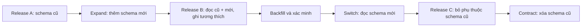

# Nâng cấp cuốn chiếu và tương thích schema dữ liệu

## 1. Vì sao service broker cần nâng cấp cuốn chiếu an toàn?

Service broker thường chạy nhiều replica để duy trì khả năng phục vụ khi một Pod hoặc một node gặp sự cố. Trong lúc nâng cấp, phiên bản cũ và phiên bản mới có thể cùng tồn tại trong một khoảng thời gian. Kubernetes lần lượt tạo Pod mới, chờ Pod sẵn sàng rồi mới thu hẹp số Pod cũ. Đây là cách triển khai cuốn chiếu (*rolling upgrade*).

Vấn đề khó nhất không chỉ là giữ HTTP endpoint hoạt động. Các replica cùng truy cập database broker, operation store, message queue, secret references và provider resource mapping. Nếu phiên bản mới thay đổi schema theo cách phiên bản cũ không hiểu, hai phiên bản có thể ghi đè dữ liệu hoặc xử lý cùng một operation không nhất quán.

Với module `SPRING_CLOUD_SERVICE_BROKER`, cần duy trì tương thích giữa:

- Các phiên bản ứng dụng Spring Cloud Service Broker đang chạy đồng thời.
- Schema database mà các phiên bản đó cùng đọc và ghi.
- Operation và worker message được tạo bởi phiên bản trước nhưng xử lý bởi phiên bản mới.
- OSB API request/response mà Cloud Foundry, Kubernetes integration hoặc platform client đang sử dụng.
- Catalog, service ID, plan ID, binding và service instance đã tồn tại trước lần nâng cấp.

Mục tiêu là phiên bản mới có thể bắt đầu phục vụ mà không làm phiên bản cũ hỏng trong thời gian chuyển tiếp. Thay đổi schema phá hủy hoặc thay đổi contract chỉ được thực hiện sau khi mọi thành phần cũ không còn phụ thuộc vào cấu trúc trước đó.

## 2. Các lớp tương thích cần bảo đảm

Nâng cấp broker có nhiều lớp tương thích, không chỉ database schema.

| Lớp | Câu hỏi cần trả lời |
|---|---|
| HTTP/OSB API | Phiên bản mới có tiếp tục hỗ trợ route, header, status code và response mà platform đang dùng không? |
| Catalog | Service ID, plan ID và capability đã công bố có còn ổn định không? |
| Database schema | Phiên bản cũ có đọc/ghi được schema sau migration không? Phiên bản mới có đọc được dữ liệu cũ không? |
| Operation record | Worker phiên bản mới có xử lý operation được tạo bởi phiên bản cũ không? |
| Queue/event payload | Consumer mới có đọc message cũ và consumer cũ có thể gặp message mới không? |
| Provider mapping | Resource ID, credential reference và state cũ có được giữ nguyên không? |
| Configuration/secret | Pod cũ và mới có thể dùng cấu hình/credential trong giai đoạn chuyển tiếp không? |

Một rolling deployment chỉ an toàn khi tất cả lớp cần dùng chung đều tương thích trong khoảng thời gian các phiên bản cùng chạy. Ví dụ, API response vẫn tương thích nhưng worker mới không đọc được operation payload cũ thì provisioning đang chạy có thể bị kẹt sau nâng cấp.

## 3. Mô hình Expand–Migrate–Contract

Mẫu phổ biến để thay đổi database mà không làm gián đoạn ứng dụng là **Expand–Migrate–Contract**. Thay vì đổi schema và code trong một lần, chia thay đổi thành các giai đoạn tương thích.

1. **Expand:** thêm cấu trúc mới theo cách không phá vỡ code hiện tại, ví dụ thêm cột nullable hoặc bảng mới.
2. **Migrate:** triển khai code có thể đọc cả dữ liệu cũ và mới, dual-write nếu cần, rồi backfill dữ liệu lịch sử.
3. **Switch:** chuyển luồng đọc sang cấu trúc mới sau khi dữ liệu đã được xác minh.
4. **Contract:** chỉ sau khi không còn phiên bản cũ hoặc consumer cũ, mới xóa cột/bảng/format không còn dùng.



Ví dụ đổi cột `provider_id` thành `provider_resource_id`:

- Release đầu thêm `provider_resource_id`, vẫn giữ `provider_id`.
- Code mới đọc `provider_resource_id` nếu có, nếu chưa có thì fallback sang `provider_id`.
- Trong giai đoạn chuyển tiếp, ghi đồng thời cả hai cột hoặc có cơ chế đồng bộ nhất quán.
- Backfill `provider_resource_id` từ `provider_id` theo batch.
- Xác minh không còn row hợp lệ nào thiếu cột mới.
- Chuyển mọi code sang cột mới.
- Sau khi mọi replica, worker và công cụ vận hành cũ đã được loại bỏ, release sau mới xóa `provider_id`.

Không rename/drop cột trong cùng release mà code cũ vẫn đang chạy. Rename trực tiếp thường làm câu SQL của phiên bản cũ thất bại ngay khi migration hoàn tất.

## 4. Ví dụ migration database an toàn

Giả sử bảng `service_instance` đang lưu provider resource ID trong cột `provider_id`. Phiên bản mới muốn đổi sang tên `provider_resource_id` để rõ nghĩa hơn.

### 4.1. Release mở rộng schema

Migration chỉ thêm cột mới:

```sql
ALTER TABLE service_instance
    ADD COLUMN provider_resource_id VARCHAR(255);
```

Ở thời điểm này, code cũ vẫn đọc/ghi `provider_id`. Cột mới nullable nên insert từ code cũ không bị lỗi.

Nếu cần index lớn trên PostgreSQL, hãy đánh giá `CREATE INDEX CONCURRENTLY` để giảm khóa ghi. Lệnh này có giới hạn riêng và không chạy bên trong transaction block thông thường; phải kiểm tra cách migration tool thực thi trước khi dùng.

### 4.2. Code chuyển tiếp đọc cả hai cột

Ví dụ Java domain mapping:

```java
String providerResourceId = row.getProviderResourceId();
if (providerResourceId == null || providerResourceId.isBlank()) {
    providerResourceId = row.getProviderId();
}
```

Đây là logic chuyển tiếp. Khi ghi, có thể cập nhật cả hai cột trong cùng transaction:

```sql
UPDATE service_instance
SET provider_id = :resourceId,
    provider_resource_id = :resourceId
WHERE id = :instanceId;
```

Nếu có nhiều writer hoặc worker cũ, cần bảo đảm writer cũ không thể làm cột mới bị stale. Có thể dùng trigger đồng bộ tạm thời, dual-write từ tất cả writer đã nâng cấp, hoặc một cơ chế khác được kiểm soát. Không giả định chỉ HTTP application là writer; worker, scheduled job và script vận hành cũng có thể ghi database.

### 4.3. Backfill dữ liệu cũ

Chạy backfill theo batch để tránh transaction quá lớn:

```sql
UPDATE service_instance
SET provider_resource_id = provider_id
WHERE provider_resource_id IS NULL
  AND provider_id IS NOT NULL;
```

Với bảng lớn, hãy phân trang theo primary key hoặc dùng batch job có checkpoint. Theo dõi thời gian khóa, WAL/replication lag và tải database. Backfill phải idempotent để có thể chạy lại sau lỗi.

### 4.4. Xác minh trước khi contract

```sql
SELECT COUNT(*)
FROM service_instance
WHERE provider_id IS NOT NULL
  AND provider_resource_id IS NULL;
```

Kết quả cần bằng 0 theo điều kiện dữ liệu hợp lệ của hệ thống. Cũng cần so sánh giá trị hai cột, kiểm tra application logs và xác minh mọi code path đã đọc cột mới.

Chỉ ở một release sau, khi không còn code hoặc công cụ nào dùng `provider_id`, mới xóa cột cũ:

```sql
ALTER TABLE service_instance
    DROP COLUMN provider_id;
```

Không chạy bước contract trong cùng deployment với bước expand nếu vẫn cần khả năng rollback về phiên bản cũ.

## 5. Tương thích N và N-1 trong rolling deployment

Trong rolling upgrade, có thể tồn tại phiên bản N (mới) và N-1 (cũ) cùng lúc. Vì vậy, code mới phải tương thích với schema và dữ liệu mà code cũ đang sử dụng; đồng thời schema mới không được khiến code cũ hỏng.

| Thành phần | Yêu cầu trong giai đoạn N-1 và N cùng chạy |
|---|---|
| Database | Giữ cột/bảng cũ; cấu trúc mới là additive và nullable/default an toàn. |
| Application read | Code mới hiểu dữ liệu cũ; không giả định mọi row đã backfill. |
| Application write | Code mới không ghi format khiến code cũ không đọc được. |
| Worker | Worker mới đọc được operation/message do phiên bản cũ tạo. |
| Event consumer | Message mới không được gửi tới consumer cũ nếu payload không tương thích. |
| API | Response và behavior vẫn đáp ứng contract mà platform đang dùng. |
| Config | Cấu hình mới có default hoặc được rollout đồng bộ trước khi code phụ thuộc nó. |

Một quy tắc thực tế: release N trước tiên phải mở rộng khả năng tương thích, release N+1 mới chuyển hoàn toàn sang cấu trúc mới, release N+2 mới loại bỏ cấu trúc cũ. Số release có thể thay đổi, nhưng nguyên tắc là không tạo thay đổi phá vỡ ngay trong thời gian rollback còn cần thiết.

## 6. Tương thích operation store và worker

Service broker thường lưu operation để hỗ trợ `202 Accepted` và `last_operation`. Trong rolling upgrade, operation có thể được tạo bởi Pod cũ nhưng worker mới xử lý, hoặc được tạo bởi Pod mới nhưng Pod cũ vẫn có thể đọc khi polling.

Operation record nên có schema rõ ràng, ví dụ:

```text
operation
  operation_id
  instance_id
  binding_id
  operation_type
  state
  payload_version
  payload
  current_step
  retry_count
  created_at
  updated_at
```

`payload_version` cho phép worker xác định format của payload. Khi thay đổi cấu trúc operation:

- Giữ parser cho payload version cũ trong thời gian operation cũ còn tồn tại.
- Chỉ phát payload version mới khi mọi consumer có thể đọc nó.
- Không xóa field cũ cho đến khi không còn operation hoặc worker cũ cần field đó.
- Giữ operation terminal đủ lâu cho platform polling, audit và troubleshooting.
- Kiểm thử cả operation được tạo trước nâng cấp và operation được tạo sau nâng cấp.

Không lưu một Java serialized object phụ thuộc class name/version vào database hoặc queue nếu không có chiến lược tương thích. JSON có field tùy chọn và `payload_version` thường dễ tiến hóa hơn, nhưng vẫn phải kiểm soát enum, field type và semantics.

### 6.1. Worker chạy song song với nhiều phiên bản

Nếu worker của cả Pod cũ và mới cùng đọc một queue, cần bảo đảm:

- Message được claim theo cơ chế visibility timeout, lease hoặc consumer group phù hợp.
- Một operation không bị hai worker thực hiện đồng thời ngoài ý muốn.
- Worker mới hiểu payload cũ.
- Worker cũ không nhận payload mới nếu không hiểu format.
- Retry và dead-letter policy không làm mất operation.
- State transition có optimistic locking hoặc compare-and-set để tránh worker cũ ghi đè trạng thái mới.

Nếu không thể bảo đảm consumer cũ đọc message mới, chỉ bật producer phát payload mới sau khi toàn bộ consumer đã được nâng cấp. Có thể dùng feature flag hoặc capability registry để điều khiển thời điểm chuyển format.

## 7. Tương thích OSB API và catalog

Rolling upgrade không được vô tình phá vỡ contract mà Cloud Foundry hoặc platform client đã sử dụng.

Các nguyên tắc:

- Giữ route OSB API hiện tại và các method đã công bố.
- Không đổi nghĩa HTTP status, error code hoặc response field theo cách platform cũ không hiểu.
- Giữ `service_id` và `plan_id` ổn định cho các instance hiện hữu.
- Không xóa service offering/plan đang được instance sử dụng nếu chưa có migration/retirement policy.
- Giữ khả năng retrieve, update, bind, unbind và deprovision cho instance được tạo từ phiên bản cũ.
- Nếu thêm field response, bảo đảm platform client có thể bỏ qua field không biết theo contract.
- Nếu thêm capability catalog như async, bindings retrievable hoặc instances retrievable, chỉ công bố khi implementation đã sẵn sàng trên mọi replica.

Ví dụ catalog có thêm metadata hoặc capability mới cần được triển khai theo trình tự an toàn:

1. Deploy code hỗ trợ capability trên tất cả replica.
2. Xác minh route và behavior hoạt động trên mọi phiên bản.
3. Sau đó mới công bố capability trong catalog.

Không công bố `instances_retrievable: true` khi một số replica trong rolling deployment chưa triển khai `getServiceInstance()`. Platform có thể gửi GET tới replica cũ và nhận lỗi không nhất quán.

Tương tự, không xóa plan ID chỉ vì plan không còn được bán cho instance mới. Instance cũ vẫn cần deprovision và có thể cần retrieve/update theo policy. Có thể ngừng cho provision mới nhưng vẫn giữ khả năng quản lý instance đã tồn tại.

## 8. Cấu hình Kubernetes Deployment cho rolling update

Kubernetes Deployment hỗ trợ chiến lược `RollingUpdate`. `maxSurge` xác định số Pod có thể vượt số replica mong muốn trong lúc update; `maxUnavailable` xác định số Pod có thể không sẵn sàng so với số replica mong muốn.

Ví dụ:

```yaml
apiVersion: apps/v1
kind: Deployment
metadata:
  name: service-broker
  namespace: platform-services
spec:
  replicas: 3
  strategy:
    type: RollingUpdate
    rollingUpdate:
      maxSurge: 1
      maxUnavailable: 0
  selector:
    matchLabels:
      app: service-broker
  template:
    metadata:
      labels:
        app: service-broker
    spec:
      terminationGracePeriodSeconds: 60
      containers:
        - name: broker
          image: registry.example.com/service-broker:2.4.0
          ports:
            - name: http
              containerPort: 8080
          readinessProbe:
            httpGet:
              path: /actuator/health/readiness
              port: http
            periodSeconds: 5
            failureThreshold: 3
          livenessProbe:
            httpGet:
              path: /actuator/health/liveness
              port: http
            periodSeconds: 10
            failureThreshold: 3
```

Với `maxUnavailable: 0`, Kubernetes giữ số Pod sẵn sàng không thấp hơn replica mong muốn trong quá trình rollout, nếu cluster đủ tài nguyên để tạo Pod surge và Pod mới vượt qua readiness. Giá trị `maxSurge: 1` cần cluster có thêm capacity tương ứng.

Readiness quan trọng hơn việc process đã mở port. Broker chỉ nên trở thành Ready khi có thể nhận request an toàn, kết nối được các dependency bắt buộc và cấu hình đã nạp đầy đủ. Không nên để readiness phụ thuộc vào mọi provider tùy chọn nếu một provider tạm thời lỗi sẽ làm toàn bộ broker ngừng nhận request.

Liveness trả lời process có cần restart hay không; không dùng liveness để kiểm tra mọi dependency từ xa. Nếu provider outage làm liveness fail, Kubernetes có thể restart liên tục tất cả Pod mà không khắc phục được sự cố.

## 9. Graceful shutdown và xử lý request đang chạy

Trong rolling upgrade, Pod cũ bị terminate sau khi Pod mới sẵn sàng. Broker cần ngừng nhận request mới một cách có kiểm soát và hoàn tất hoặc chuyển giao công việc đang chạy.

Các điểm cần bảo đảm:

1. Pod nhận tín hiệu termination và chuyển readiness sang không sẵn sàng.
2. Endpoint không nhận request mới sau khi Pod đã rời khỏi Service endpoints.
3. HTTP request đang xử lý có thời gian hoàn tất trong termination grace period.
4. Worker không mất operation khi process dừng.
5. Lease/lock của worker được giải phóng hoặc hết hạn để Pod khác tiếp tục.
6. Message chưa xử lý được trả về queue hoặc được queue redeliver.
7. Không đánh dấu operation `SUCCEEDED` nếu provider side effect chưa được xác minh và persist.

Spring Boot hỗ trợ graceful shutdown cho embedded server. Ví dụ cấu hình:

```yaml
server:
  shutdown: graceful

spring:
  lifecycle:
    timeout-per-shutdown-phase: 45s
```

`terminationGracePeriodSeconds` của Kubernetes phải dài hơn thời gian shutdown dự kiến cộng khoảng đệm phù hợp. Nếu grace period hết, process có thể bị kill trước khi hoàn tất. Worker cần được thiết kế để có thể tiếp tục sau restart thay vì phụ thuộc vào việc một thread sống đến cùng.

Nếu worker xử lý operation lâu hơn shutdown grace period, nên dừng claim operation mới, hoàn tất bước hiện tại nếu an toàn hoặc persist checkpoint rồi nhả lease. Không giữ distributed lock vô thời hạn.

## 10. Migration job và thứ tự triển khai

Không nên để mọi replica tự chạy migration phá vỡ schema khi khởi động. Trong rolling deployment, nhiều Pod có thể khởi động gần như đồng thời; migration đồng thời có thể tranh chấp lock hoặc chạy nhiều lần.

Một quy trình phổ biến:

1. Build artifact và chạy migration compatibility test.
2. Chạy migration expand qua một job hoặc release step được kiểm soát.
3. Xác minh schema và index đã sẵn sàng.
4. Triển khai application version mới theo rolling update.
5. Theo dõi readiness, error rate, operation latency và worker backlog.
6. Chạy backfill theo batch độc lập nếu cần.
7. Chuyển đọc/ghi sang schema mới khi đã xác minh.
8. Trong release sau, chạy contract migration để xóa cấu trúc cũ.

Ví dụ Kubernetes Job khái niệm:

```yaml
apiVersion: batch/v1
kind: Job
metadata:
  name: service-broker-schema-expand-2026-11
  namespace: platform-services
spec:
  backoffLimit: 2
  template:
    spec:
      restartPolicy: Never
      containers:
        - name: migrate
          image: registry.example.com/service-broker:2.4.0
          command: ["java", "-jar", "app.jar", "--spring.flyway.enabled=true", "--app.migration-only=true"]
```

Đây là manifest minh họa; ứng dụng phải có profile/entrypoint migration-only thực tế và không khởi chạy HTTP server hoặc worker trong Job. Không chạy nguyên broker deployment như một migration job nếu command không được thiết kế riêng.

Nếu dùng Flyway hoặc Liquibase, cấu hình migration lock và version history phù hợp. Migration phải được thực thi một lần theo quy trình release; không giả định Kubernetes Job tự bảo đảm không có job trùng do thao tác vận hành hoặc pipeline retry.

## 11. Backfill dữ liệu lớn mà không gây gián đoạn

Backfill dữ liệu hàng triệu operation hoặc instance có thể gây tải database, lock và replication lag. Hãy tách backfill khỏi migration DDL:

- Chạy theo batch nhỏ, có checkpoint hoặc key range.
- Có thể pause/resume và chạy lại idempotent.
- Không giữ transaction kéo dài cho toàn bộ bảng.
- Theo dõi CPU, I/O, lock wait, WAL và replication lag.
- Giới hạn tốc độ để không ảnh hưởng provisioning và polling.
- Đối chiếu số row đã xử lý và số row còn thiếu.
- Chỉ chuyển read path khi backfill đã hoàn tất theo tiêu chí rõ ràng.

Ví dụ batch logic:

```text
last_id = checkpoint
repeat:
    rows = load next 500 rows where id > last_id
    if rows empty: stop
    map legacy fields to new fields
    update only rows still needing migration
    commit batch
    save checkpoint = max(rows.id)
```

Nếu ứng dụng vẫn ghi dữ liệu trong khi backfill chạy, cần dual-write hoặc cơ chế reconciliation để các row mới không bị bỏ sót. Sau backfill, chạy truy vấn kiểm tra và so sánh tổng số bản ghi theo các invariant nghiệp vụ.

## 12. Tương thích message queue và event schema

Broker có thể dùng queue để dispatch provisioning, binding, unbind hoặc deprovision. Rolling upgrade có thể khiến producer phiên bản mới và consumer phiên bản cũ cùng hoạt động.

Một payload nên có schema version:

```json
{
  "event_type": "PROVISION_SERVICE_INSTANCE",
  "schema_version": 2,
  "operation_id": "op-1001",
  "instance_id": "inst-1001",
  "service_id": "postgresql",
  "plan_id": "isolated",
  "parameters": {
    "storage_gb": 100
  }
}
```

Quy tắc tiến hóa payload:

- Thêm field optional trước khi consumer phụ thuộc field đó.
- Không đổi kiểu dữ liệu của field hiện có trong cùng schema version.
- Không tái sử dụng tên field cũ với ý nghĩa mới.
- Consumer bỏ qua field chưa biết nếu contract cho phép.
- Giữ parser cho version cũ trong thời gian message cũ còn nằm trong queue/DLQ.
- Nếu thay đổi không tương thích, tạo version mới và triển khai consumer hỗ trợ trước producer phát version mới.

Không xóa queue, topic hoặc dead-letter message cũ trong lúc rollout. Message cũ có thể là operation hợp lệ cần tiếp tục xử lý hoặc phục hồi.

## 13. Catalog, plan và configuration rollout

Catalog là contract mà platform đọc để biết broker cung cấp service/plan và capability nào. Trong nâng cấp cuốn chiếu, các replica nên trả catalog nhất quán.

Một số thay đổi cần triển khai theo thứ tự:

| Thay đổi | Thứ tự an toàn |
|---|---|
| Thêm capability mới | Deploy implementation trên mọi replica, kiểm thử route, sau đó công bố capability. |
| Thêm plan mới | Deploy provider strategy/config trước, xác minh mọi replica đọc được config, rồi công bố plan. |
| Ngừng bán plan cũ | Ngăn provision mới trước; giữ khả năng quản lý/deprovision instance cũ. |
| Đổi service/plan ID | Tránh đổi ID đang được instance tham chiếu; dùng migration/alias có kế hoạch nếu thật sự cần. |
| Đổi parameter schema | Chấp nhận format cũ trong thời gian chuyển tiếp; validate format mới theo capability/version rõ ràng. |
| Đổi dashboard URL hoặc config | Deploy cấu hình tương thích và kiểm tra cả Pod cũ/mới trước khi xóa giá trị cũ. |

Nếu config mới bắt buộc phải tồn tại trước code, triển khai config trước. Nếu config mới có thể làm code cũ lỗi, dùng key mới và chỉ bật sau khi toàn bộ Pod cũ đã được thay thế. Feature flag giúp tách thời điểm deploy code khỏi thời điểm bật behavior.

## 14. Rollback ứng dụng và migration

Rollback image không tự động rollback database schema. Đây là lý do expand-contract cần được thiết kế từ đầu.

Trong giai đoạn expand:

- Có thể rollback application về phiên bản cũ vì schema cũ vẫn còn.
- Không cần drop cột mới khi rollback code.
- Có thể giữ dữ liệu mới nhưng code cũ bỏ qua.

Trong giai đoạn contract:

- Nếu đã drop cột cũ, image cũ có thể không còn chạy được.
- Không nên kỳ vọng `flyway undo` hoặc reverse migration sẽ phục hồi dữ liệu đã mất.
- Thường cần roll forward bằng bản sửa tương thích thay vì rollback schema.

Trước mỗi release, xác định:

1. Image cũ có chạy trên schema sau migration không?
2. Code mới có đọc được record do code cũ tạo không?
3. Worker cũ có đọc message mới không?
4. Có thể rollback application mà không khôi phục schema không?
5. Dữ liệu nào không thể phục hồi nếu migration contract đã chạy?

Backup và point-in-time recovery là lớp bảo vệ dữ liệu, không phải phương án rollback tức thì cho mọi migration. Khôi phục database có thể làm mất các thay đổi mới phát sinh sau thời điểm backup và cần quy trình đồng bộ provider resource tương ứng.

## 15. Kiểm thử tương thích trước khi rollout

Một release cần kiểm tra ma trận phiên bản thay vì chỉ chạy test với schema mới nhất và code mới nhất.

| Application | Schema | Mục tiêu |
|---|---|---|
| N-1 | Schema cũ | Baseline trước migration. |
| N-1 | Schema expanded | Xác minh code cũ không hỏng sau bước expand. |
| N | Schema expanded | Xác minh code mới hoạt động trên schema mở rộng. |
| N | Dữ liệu cũ chưa backfill | Xác minh fallback/read compatibility. |
| N | Dữ liệu đã backfill | Xác minh read path mới. |
| N và N-1 cùng chạy | Schema expanded | Xác minh rolling coexistence. |
| Worker N | Operation payload N-1 | Xác minh worker mới xử lý operation cũ. |
| Consumer N-1 | Message N | Chỉ chạy nếu tương thích ngược được cam kết; nếu không, xác minh producer chưa phát message mới trước thời điểm consumer nâng cấp. |

Các bài test cần có:

- Migration test từ snapshot database của phiên bản trước.
- Integration test chạy code cũ trên schema expanded.
- Integration test chạy code mới với record chưa backfill.
- Test dual-write và kiểm tra hai cột không lệch nhau.
- Test backfill có thể chạy lại và tiếp tục từ checkpoint.
- Test worker đọc operation record và queue payload cũ.
- Test API contract và catalog nhất quán giữa các replica.
- Test rolling deployment với readiness và graceful shutdown.
- Test rollback application trong giai đoạn expand.
- Test contract migration chỉ chạy khi không còn consumer cũ.

## 16. Quan sát rollout và tiêu chí dừng

Trong lúc rollout, theo dõi cả Kubernetes và nghiệp vụ broker:

| Chỉ số | Dấu hiệu cần chú ý |
|---|---|
| Ready replicas | Không đạt số replica mong muốn hoặc Pod mới liên tục fail readiness. |
| HTTP 5xx/latency | Tăng sau khi một phần traffic chuyển sang phiên bản mới. |
| OSB 4xx | Có thể do catalog, plan, parameter hoặc authentication behavior thay đổi. |
| Operation age | Operation `IN_PROGRESS` tăng tuổi bất thường. |
| Worker backlog | Queue lag tăng hoặc consumer không xử lý message cũ. |
| Database locks/latency | Migration hoặc backfill ảnh hưởng request production. |
| Provider error rate | Phiên bản mới gọi provider sai API hoặc sai credential. |
| Reconciliation drift | Instance, binding hoặc resource mapping không còn đồng nhất. |

Đặt ngưỡng dừng rollout trước khi triển khai, ví dụ readiness fail, 5xx vượt ngưỡng, operation pending tăng nhanh hoặc database lock kéo dài. Khi vượt ngưỡng, pause rollout để điều tra; không tiếp tục thay Pod cũ khi Pod mới chưa ổn định.

Với Kubernetes, dùng rollout status/history để theo dõi:

```bash
kubectl rollout status deployment/service-broker -n platform-services
kubectl rollout history deployment/service-broker -n platform-services
kubectl get pods -n platform-services -l app=service-broker
```

`kubectl rollout undo` có thể khôi phục revision Deployment trước đó, nhưng chỉ an toàn nếu schema, config, queue payload và operation record vẫn tương thích với image cũ.

## 17. Ví dụ kế hoạch nâng cấp thực tế

Giả sử broker phiên bản `2.3` dùng cột `provider_id`; phiên bản `2.4` cần cột `provider_resource_id` và thêm `payload_version` cho operation.

### Giai đoạn A — Chuẩn bị

- Build `2.4` nhưng chưa deploy.
- Chạy migration compatibility test trên snapshot database production đã được làm sạch dữ liệu nhạy cảm.
- Xác minh `2.3` chạy được sau migration expand.
- Xác minh worker `2.4` đọc được operation payload do `2.3` tạo.
- Chuẩn bị dashboard metrics, alert và rollback plan.

### Giai đoạn B — Expand

- Thêm `provider_resource_id` nullable.
- Thêm `payload_version` với default hoặc giá trị tương thích.
- Chưa xóa `provider_id` và chưa thay đổi payload producer.
- Xác minh các Pod `2.3` vẫn hoạt động.

### Giai đoạn C — Rolling deploy

- Triển khai `2.4` với `maxUnavailable: 0` và readiness probe.
- Worker `2.4` đọc cả payload version cũ và mới.
- Trong thời gian coexistence, code ghi dữ liệu tương thích với cả hai phiên bản.
- Theo dõi request, operation, queue và database.

### Giai đoạn D — Migrate và switch

- Backfill `provider_resource_id` theo batch.
- Đối chiếu dữ liệu và resource mapping.
- Chuyển code đọc sang cột mới, giữ fallback trong release chuyển tiếp.
- Bật producer phát operation payload version mới sau khi mọi consumer tương thích.

### Giai đoạn E — Contract ở release sau

- Xác minh không còn Pod/worker/script dùng `provider_id`.
- Xác minh không còn message hoặc operation cần parser cũ.
- Drop cột cũ và xóa fallback code trong release riêng.
- Theo dõi sau migration và giữ backup theo retention policy.

## 18. Lỗi thường gặp khi nâng cấp cuốn chiếu

- **Rename/drop cột ngay:** Pod cũ vẫn chạy và query thất bại sau migration.
- **Chỉ test code mới với schema mới:** bỏ sót trường hợp Pod cũ đọc schema expanded hoặc Pod mới đọc dữ liệu cũ.
- **Migration chạy ở mọi replica:** nhiều Pod tranh chấp migration lock hoặc chạy side effect đồng thời.
- **Backfill trong transaction lớn:** gây lock, replication lag và ảnh hưởng request broker.
- **Worker payload không version:** worker mới không đọc được operation cũ sau deployment.
- **Producer phát message mới quá sớm:** consumer cũ nhận payload không hiểu.
- **Xóa plan/service ID:** instance cũ không còn được retrieve, update hoặc deprovision đúng cách.
- **Readiness quá nông:** Pod mới nhận traffic trước khi schema/config/dependency sẵn sàng.
- **Shutdown không graceful:** request hoặc worker operation bị ngắt giữa chừng.
- **Rollback image nhưng quên schema:** image cũ không tương thích với migration đã contract.
- **Dùng PDB như bảo đảm duy nhất:** PodDisruptionBudget chủ yếu điều khiển eviction tự nguyện; nó không thay thế `maxUnavailable`, readiness và strategy của Deployment trong rolling update.
- **Không giữ operation history:** platform polling operation cũ nhưng broker đã xóa record hoặc parser.

## 19. Checklist production

1. Liệt kê tất cả writer và reader của database, queue, operation store và resource mapping.
2. Thiết kế migration theo Expand–Migrate–Contract.
3. Xác minh N-1 hoạt động trên schema expanded.
4. Xác minh N đọc được dữ liệu cũ chưa backfill.
5. Version hóa operation/event payload khi cấu trúc thay đổi.
6. Triển khai consumer tương thích trước producer phát format mới.
7. Giữ service ID, plan ID và OSB contract cho instance hiện hữu.
8. Chạy migration một lần theo release job có kiểm soát.
9. Backfill theo batch, có checkpoint, retry và metric.
10. Cấu hình rolling update, readiness, liveness và capacity phù hợp.
11. Bật graceful shutdown và thiết kế worker có thể resume.
12. Đặt tiêu chí dừng rollout và theo dõi HTTP, operation, queue, DB, provider.
13. Xác minh rollback image tương thích với schema/config hiện tại.
14. Chỉ contract sau khi không còn Pod, worker, message hoặc tool cũ phụ thuộc.
15. Giữ backup, audit và operation retention theo chính sách.

## 20. Nguyên tắc cần ghi nhớ

- Rolling upgrade tạo khoảng thời gian phiên bản cũ và mới cùng chạy; mọi schema và contract dùng chung phải tương thích trong khoảng này.
- Expand–Migrate–Contract tách thay đổi phá vỡ thành nhiều release có thể kiểm soát.
- Schema mới nên được mở rộng theo hướng additive trước; xóa hoặc rename cấu trúc cũ chỉ làm ở giai đoạn contract.
- Code mới phải đọc được dữ liệu cũ; code cũ phải tiếp tục hoạt động trên schema expanded.
- Operation record và queue payload cần versioning để worker mới xử lý được công việc cũ.
- Giữ OSB route, service ID, plan ID và capability nhất quán trong thời gian rollout.
- Kubernetes readiness, rolling strategy và graceful shutdown bảo vệ traffic; worker persistence bảo vệ công việc dài hạn.
- Migration và backfill phải có kiểm soát, idempotent và có khả năng resume.
- Rollback ứng dụng không đồng nghĩa rollback schema; sau contract migration thường cần roll forward hoặc phục hồi dữ liệu có kế hoạch.
- Chỉ xóa schema, message format và catalog entry cũ khi đã xác minh không còn consumer hoặc instance cần chúng.

## Nguồn tham khảo

- [Kubernetes Deployments – Rolling updates](https://kubernetes.io/docs/concepts/workloads/controllers/deployment/#rolling-update-deployment): `maxSurge`, `maxUnavailable` và cách Deployment thay Pod.
- [Kubernetes Probes](https://kubernetes.io/docs/concepts/configuration/liveness-readiness-startup-probes/): phân biệt liveness, readiness và startup probe.
- [Kubernetes Pod lifecycle – termination](https://kubernetes.io/docs/concepts/workloads/pods/pod-lifecycle/#pod-termination): tín hiệu dừng và thời gian graceful termination.
- [Spring Boot – Graceful Shutdown](https://docs.spring.io/spring-boot/reference/web/graceful-shutdown.html): cấu hình shutdown cho embedded web server.
- [Flyway – Versioned migrations](https://documentation.red-gate.com/flyway/flyway-concepts/migrations/versioned-migrations): quản lý migration có version và history.
- [Open Service Broker API v2.17](https://github.com/openservicebrokerapi/servicebroker/blob/v2.17/spec.md): tương thích contract catalog và service instance/binding trong quá trình nâng cấp.
