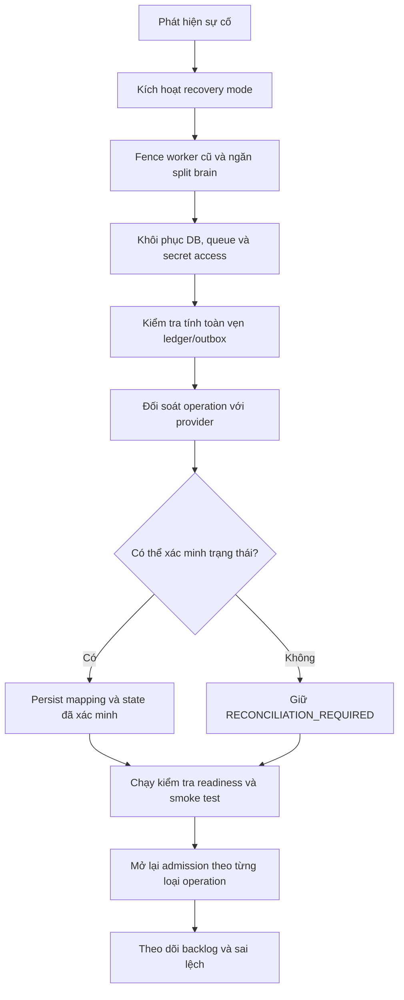

# Quy trình phục hồi broker và đối soát tài nguyên sau sự cố

## Vì sao phục hồi service broker phức tạp?

Service broker quản lý một vòng đời trải qua nhiều hệ thống: platform gọi OSB API, broker lưu instance/binding/operation, worker gọi provider để tạo hoặc thay đổi tài nguyên, rồi broker trả kết quả cho platform. Các thành phần này không nằm trong một transaction duy nhất. Khi database broker hỏng, Pod bị mất, provider ngừng hoạt động hoặc mạng bị chia cắt, trạng thái giữa broker và provider có thể không còn khớp.

Ví dụ, broker đã tạo database trên provider nhưng chưa ghi `provider_resource_id` vào database nội bộ. Sau khi khôi phục database từ backup cũ, broker có thể không biết database đó đã tồn tại. Nếu worker chạy lại provision với một định danh mới, hệ thống có thể tạo database trùng. Trường hợp ngược lại cũng nguy hiểm: database broker ghi instance `READY` nhưng provider đã mất tài nguyên do sự cố riêng.

Với `SPRING_CLOUD_SERVICE_BROKER`, phục hồi cần giữ được ba loại sự thật:

- **Platform intent:** platform đã yêu cầu service instance hoặc binding nào và đang mong đợi kết quả nào.
- **Broker ledger:** broker đã tiếp nhận operation nào, đã thực hiện bước nào và lưu mapping nào tới provider resource.
- **Provider reality:** tài nguyên, credential, policy và trạng thái thực tế đang tồn tại ở hệ thống cung cấp dịch vụ.

OSB API xem platform là nguồn sự thật về service instance và binding ở cấp vòng đời. Broker cần duy trì đủ dữ liệu để thực hiện các yêu cầu platform và đối soát với provider. OSB API không cung cấp một endpoint chuẩn để broker liệt kê toàn bộ instance của platform; vì vậy broker không thể giả định rằng nó có thể khôi phục toàn bộ intent chỉ bằng cách gọi platform. Operation ledger, backup và định danh ổn định là nền tảng phục hồi.

## Mục tiêu phục hồi và các bất biến cần giữ

Trước khi thiết kế runbook, xác định Recovery Time Objective (RTO) và Recovery Point Objective (RPO):

- **RTO:** thời gian tối đa chấp nhận để broker trở lại khả năng phục vụ.
- **RPO:** lượng dữ liệu tối đa có thể mất tính theo thời gian, ví dụ tối đa 5 phút operation metadata.

RPO của broker cần được đánh giá cùng khả năng phục hồi của provider. Nếu database broker có thể mất 5 phút dữ liệu nhưng provider side effect vẫn diễn ra liên tục, có thể xuất hiện tài nguyên được tạo sau thời điểm backup mà broker không còn mapping.

Một số bất biến nên được bảo vệ trong mọi tình huống:

1. Không tạo side effect mới khi kết quả của operation trước trên cùng resource còn chưa xác định.
2. Một operation được retry phải dùng lại operation ID và provider idempotency key đã lưu.
3. Không xóa provider resource nếu chưa xác minh quyền sở hữu và liên kết với instance/binding cụ thể.
4. Không đánh dấu instance `READY` chỉ vì broker process đã khởi động hoặc database nội bộ đã được restore.
5. Không đánh dấu operation `SUCCEEDED` trước khi kết quả và mapping cần thiết đã được persist bền vững.
6. Không cấp lại credential cũ nếu broker không thể xác minh credential đó còn hợp lệ và an toàn.
7. Mọi quyết định reconcile phải có audit record, operation reference và kết quả kiểm tra.

Các bất biến này quan trọng hơn việc đưa mọi endpoint trở lại trạng thái `200` càng sớm càng tốt. Trong thời gian phục hồi, broker có thể tạm dừng một số thao tác mutation để tránh làm sai lệch tài nguyên.

## Kiến trúc dữ liệu phục hồi

Broker nên lưu trạng thái vận hành ở kho bền vững, không phụ thuộc vào memory của Pod. Tối thiểu cần các nhóm dữ liệu:

| Dữ liệu | Nội dung cần giữ | Mục đích phục hồi |
|---|---|---|
| Service instance ledger | `instance_id`, service/plan ID, provider resource ID, state, revision. | Tìm tài nguyên provider thuộc instance. |
| Binding ledger | `binding_id`, `instance_id`, consumer reference, provider credential/resource reference, state. | Thu hồi hoặc tái tạo binding đúng consumer. |
| Operation ledger | operation ID, loại thao tác, request fingerprint, state, step/checkpoint, provider job ID. | Biết thao tác đã chạy đến đâu. |
| Idempotency ledger | Key ổn định, request identity, kết quả provider hoặc resource reference. | Retry an toàn sau timeout/restart. |
| Outbox/inbox | Event cần gửi và message đã nhận/xử lý. | Khôi phục job không bị mất hoặc xử lý lặp có kiểm soát. |
| Audit log | Actor, thời điểm, action, trạng thái trước/sau, quyết định cleanup. | Điều tra và chứng minh thao tác phục hồi. |
| Secret references | ID trong secret store, version, rotation metadata. | Khôi phục khả năng truy cập secret mà không lưu secret dạng rõ trong DB. |

Backup cần bao gồm database và các metadata cần để giải mã hoặc truy cập secret store. Backup DB mà không có key encryption, secret reference hoặc cấu hình provider account tương ứng có thể không đủ để khôi phục service.

Ví dụ cấu trúc operation ledger:

```text
broker_operation
----------------
operation_id
resource_type
resource_id
operation_type
request_fingerprint
provider_name
provider_account_ref
provider_idempotency_key
provider_job_id
provider_resource_id
state
current_step
completed_steps
attempt_count
next_retry_at
lease_owner
lease_until
fencing_token
created_at
updated_at
completed_at
```

Đây là mô hình nội bộ minh họa. Không lưu password hoặc token dạng rõ trong operation record. Các trường định danh và checkpoint phải đủ để worker xác định cùng một ý định sau restart hoặc database restore.

## Phân biệt các nguồn trạng thái

Không nên gộp trạng thái broker và provider thành một field duy nhất. Broker cần biết cả điều nó đã ghi nhận lẫn điều provider xác nhận.

| Broker ledger | Provider lookup | Diễn giải | Hướng xử lý |
|---|---|---|---|
| Instance `READY` | Resource tồn tại và khớp | Hai phía nhất quán. | Tiếp tục phục vụ theo policy. |
| Instance `PROVISIONING` | Resource đã tồn tại, cấu hình khớp | Provider đã hoàn tất nhưng broker chưa cập nhật terminal state. | Xác minh ownership rồi persist mapping/state. |
| Instance `READY` | Resource không tồn tại | Broker có thể giữ trạng thái cũ sau provider failure hoặc xóa ngoài luồng. | Chuyển sang trạng thái cần xử lý; không cấp binding mới cho resource mất. |
| Không có mapping | Resource có marker của broker | Có thể là side effect sau backup hoặc operation mất mapping. | Xác minh marker, tenant và operation trước khi nhận mapping. |
| Binding `BOUND` | Credential/relation không tồn tại | Binding không còn hoạt động thực tế. | Thu hồi/đánh dấu invalid và yêu cầu bind lại theo quy trình. |
| Binding `UNBINDING` | Credential đã bị thu hồi | Provider đã hoàn tất một phần cleanup. | Ghi nhận bước hoàn tất và tiếp tục phần còn lại. |
| Operation `IN_PROGRESS` quá hạn | Provider job vẫn chạy | Provider còn xử lý. | Theo dõi job; không khởi chạy operation trùng. |
| Operation `IN_PROGRESS` quá hạn | Không tìm thấy job/resource | Có thể chưa thực hiện hoặc provider không còn giữ dấu vết. | Tra cứu bằng idempotency key/marker; nếu chưa đủ bằng chứng, yêu cầu can thiệp. |

Không phải mọi provider đều hỗ trợ lookup theo idempotency key hoặc tag. Provider adapter cần khai báo khả năng tra cứu, cách xác minh ownership và mức độ chắc chắn của kết quả. Nếu không thể chứng minh một resource thuộc broker, không tự động adopt hoặc delete nó.

## Quy trình phục hồi tổng thể sau sự cố

Một runbook có thể chia thành các giai đoạn sau:



### Giai đoạn 1: Khoanh vùng và bảo vệ dữ liệu

1. Xác định phạm vi: một Pod, một node, database, queue, provider hay toàn region.
2. Ghi nhận thời điểm bắt đầu, operation có thể bị ảnh hưởng và các provider account liên quan.
3. Nếu kết quả operation không xác định, tạm dừng admission của mutation bị ảnh hưởng.
4. Ngăn worker cũ tiếp tục ghi dữ liệu nếu đang chuyển sang instance database khác.
5. Bảo toàn log, event, backup metadata và provider request ID trước khi cleanup.

Không xóa queue hoặc operation record để “làm sạch” hệ thống trong lúc chưa hiểu trạng thái. Các message và checkpoint có thể là bằng chứng duy nhất để khôi phục tài nguyên.

### Giai đoạn 2: Fence worker và tránh split brain

Nếu broker chạy nhiều replica, phải bảo đảm chỉ một tập worker được phép xử lý operation trên cùng resource sau khi chuyển vùng hoặc khôi phục database.

- Dùng lease/lock phân tán và fencing token tăng dần.
- Dừng worker ở vùng cũ trước khi mở worker ở vùng mới.
- Kiểm tra queue consumer group và quyền ghi database.
- Không để hai cluster cùng nhận request OSB cho một broker identity trong khi chưa có cơ chế active-active được thiết kế.
- Đảm bảo idempotency key vẫn giống nhau sau failover.

DNS failover hoặc scale Deployment không tự bảo đảm tránh split brain. Nếu hai vùng cùng xử lý một operation, một worker cũ có thể ghi kết quả muộn và ghi đè state mới. Fencing token hoặc cơ chế version check ở database giúp từ chối write từ worker đã mất quyền.

### Giai đoạn 3: Khôi phục database và queue

Khôi phục database theo quy trình backup/PITR đã kiểm thử:

1. Chọn backup và thời điểm restore phù hợp với RPO.
2. Khôi phục vào một database/cluster được cô lập.
3. Kiểm tra schema version, row count và constraint quan trọng.
4. Xác minh operation, instance, binding, idempotency và outbox có liên kết hợp lệ.
5. Kiểm tra secret reference và key encryption có thể truy cập.
6. Chỉ mở quyền ghi cho đúng broker deployment đã được fence.

Queue cần được xử lý cùng database. Với transactional outbox, event chưa publish có thể được publish lại. Với message đã publish nhưng worker chưa ack, queue có thể redeliver. Cả hai trường hợp đều yêu cầu worker idempotent và kiểm tra operation terminal trước provider call.

Không replay toàn bộ queue ngay lập tức nếu provider đang suy giảm hoặc chưa có quota. Chia batch, giới hạn concurrency và ưu tiên operation theo rủi ro/tuổi backlog.

## Khôi phục sau khi database broker bị mất dữ liệu

Database restore có thể quay về một thời điểm trước một số provider side effect. Đây là trường hợp cần đối soát cẩn thận nhất.

Ví dụ:

1. Backup được tạo lúc 10:00.
2. Provision `inst-100` bắt đầu lúc 10:02.
3. Provider tạo database lúc 10:03.
4. Broker lưu mapping lúc 10:04.
5. Database broker hỏng lúc 10:05.
6. Restore từ backup 10:00.

Sau restore, broker không còn operation hoặc mapping `inst-100`, nhưng provider database vẫn tồn tại. Không được chạy provision mới với một operation ID khác. Trước hết phải tìm tài nguyên bằng tên xác định, tag/marker hoặc provider idempotency key đã ghi ở hệ thống ngoài database nếu có.

Nếu broker không còn idempotency key do restore lùi thời gian, cần dùng dấu vết khác như provider job ID, audit log, immutable event store hoặc resource marker. Đây là lý do cần lưu operation journal và backup với RPO thấp, đồng thời có thể lưu bản sao audit/outbox ở storage độc lập.

### Đối soát tài nguyên không còn mapping

Một tài nguyên provider không có mapping trong database broker có thể là:

- Side effect hợp lệ bị mất mapping sau restore.
- Resource do người dùng tạo ngoài broker.
- Resource của broker khác hoặc tenant khác.
- Resource mồ côi từ sự cố trước.

Quy trình xử lý:

1. Liệt kê resource theo provider account/project mà broker quản lý.
2. Lọc theo tag/label, naming convention hoặc ownership marker của broker.
3. Đối chiếu `instance_id`, `operation_id`, tenant và thời điểm tạo nếu có.
4. Kiểm tra cấu hình thực tế và service plan dự kiến.
5. Nếu đủ bằng chứng, tạo lại mapping với audit event ghi rõ nguồn khôi phục.
6. Nếu thiếu bằng chứng, đưa vào danh sách review; không tự động xóa hoặc nhận quyền sở hữu.

Không dùng tên tài nguyên đơn thuần làm bằng chứng ownership. Tên có thể trùng, bị tái sử dụng hoặc được người dùng tạo thủ công.

## Khôi phục sau provider outage

Khi provider API không truy cập được nhưng broker database vẫn hoạt động, broker cần bảo vệ operation đang chạy và tránh tạo retry storm.

1. Giữ operation chưa xác định ở trạng thái nội bộ `IN_PROGRESS` hoặc `RECONCILIATION_REQUIRED` tùy khả năng xác định kết quả.
2. Tôn trọng timeout, retry budget, backoff, jitter và `Retry-After` nếu provider trả throttling.
3. Không đổi provider idempotency key khi retry cùng operation.
4. Giới hạn concurrency/rate để khi provider phục hồi, broker không gửi toàn bộ backlog cùng lúc.
5. Kiểm tra provider health trước khi mở admission mới.
6. Xử lý operation cũ theo thứ tự và mức ưu tiên đã định, tránh starvation của deprovision/cleanup.

Provider outage không đồng nghĩa broker phải đánh dấu mọi operation `FAILED` ngay lập tức. Nếu broker đã trả `202 Accepted`, nền tảng có thể tiếp tục polling `last_operation`; broker cần giữ trạng thái nhất quán và terminal state chỉ khi đã có kết quả xác định hoặc deadline/policy yêu cầu kết thúc.

## Khôi phục operation và outbox

Mỗi operation cần được phân loại sau khi phục hồi:

| Nhóm | Dấu hiệu | Hành động |
|---|---|---|
| Chưa bắt đầu | `PENDING`, không có provider request reference. | Đưa lại vào queue nếu request intent còn hợp lệ. |
| Provider đang xử lý | Có provider job ID và job còn active. | Tiếp tục polling provider job, không tạo job mới. |
| Provider đã xong, broker chưa persist | Resource/job tồn tại và có thể xác minh. | Persist provider result và cập nhật instance/binding. |
| Provider thất bại, không có side effect | Có response terminal xác nhận không tạo resource. | Đánh dấu operation failed và lưu lỗi. |
| Side effect một phần | Một số bước đã thành công, một số chưa. | Tiếp tục workflow hoặc compensation theo checkpoint. |
| Kết quả không xác định | Timeout, mất provider history, không có marker. | Giữ reconciliation required và cần quyết định có kiểm soát. |
| Operation đã terminal | Broker record cho biết succeeded/failed và mapping đã persist. | Không chạy lại side effect; chỉ xử lý message redelivery như duplicate. |

Outbox event có thể được phát lại sau restore. Trước khi thực hiện, worker phải đọc operation record mới nhất, kiểm tra state và fencing token. Event cũ không được phép làm lùi trạng thái hoặc ghi đè kết quả mới hơn.

## Đối soát service instance và binding

### Service instance

Đối soát instance nên kiểm tra:

- `instance_id`, `service_id`, `plan_id` và tenant/platform reference.
- Provider resource ID, account/project và ownership marker.
- Provider state, desired configuration và revision.
- Operation gần nhất, operation đang chạy và checkpoint.
- Binding đang tồn tại có phụ thuộc vào instance hay không.

Nếu instance trong broker `READY` nhưng provider resource không tồn tại, không cho phép bind mới. Tạo incident hoặc state nội bộ cần phục hồi, sau đó xác định có thể recreate, restore từ backup provider hay phải thông báo platform rằng instance không còn usable.

Nếu provider resource tồn tại nhưng broker ledger không có instance, chỉ adopt khi chứng minh được resource thuộc một operation của broker và platform intent có thể được xác định. Nếu không, giữ orphan candidate để review.

### Service binding

Đối soát binding cần kiểm tra credential/role/grant cụ thể:

- Binding ID có tồn tại trong broker ledger không?
- Provider credential hoặc role có tồn tại và còn hiệu lực không?
- Secret reference có thể truy cập không?
- Consumer reference có khớp app/route/volume context đã lưu không?
- Binding đang `BOUND`, `UNBINDING`, `FAILED` hay cần rotation?

Không khôi phục bằng cách ghi lại password cũ từ log hoặc tạo credential mới rồi ghi đè Secret mà không có quy trình rotation. Nếu credential đã bị lộ hoặc secret store mất key, phải chạy rotation có kiểm soát, cập nhật consumer theo chính sách và thu hồi credential cũ sau khi xác minh.

## Reconciliation an toàn và có thể chạy lặp

Reconciliation không phải một lệnh “sửa mọi thứ cho giống database”. Nó là quy trình so sánh desired state, broker ledger và provider reality rồi áp dụng hành động có bằng chứng.

Một vòng reconcile:

1. Chọn resource/operation cần kiểm tra bằng trạng thái và tuổi bản ghi.
2. Đọc broker ledger và snapshot revision.
3. Tra cứu provider theo ID hoặc marker đã xác minh.
4. So sánh trạng thái và cấu hình.
5. Phân loại drift: missing, orphan candidate, partial, stale credential hoặc operation still running.
6. Chọn hành động không phá hủy trước: cập nhật mapping, tiếp tục polling, tạo cleanup task hoặc đưa vào review.
7. Thực hiện mutation bằng idempotency key và fencing.
8. Persist kết quả, actor/reason và provider evidence.
9. Chạy lại kiểm tra để xác nhận trạng thái hội tụ.

Reconciliation phải idempotent: chạy lại cùng một vòng không tạo thêm tài nguyên, credential hoặc delete request ngoài ý muốn. Mỗi hành động cần có precondition về revision/ownership để tránh xử lý trên snapshot đã cũ.

### Phân loại drift

| Drift | Ví dụ | Hành động an toàn ban đầu |
|---|---|---|
| Missing provider resource | Broker `READY`, provider không tìm thấy resource. | Chặn bind mới, xác minh provider account và kiểm tra backup. |
| Unmapped provider resource | Provider có resource marker của broker nhưng DB không có mapping. | Xác minh ownership/operation rồi mới adopt. |
| Partial provisioning | Database có nhưng role/network policy thiếu. | Tiếp tục bước còn thiếu hoặc compensation. |
| Stale binding | Ledger `BOUND`, credential đã thu hồi. | Đánh dấu cần rebind/rotation và thông báo qua kênh vận hành phù hợp. |
| Pending deletion | Broker `DEPROVISIONING`, provider vẫn còn resource. | Tiếp tục cleanup theo resource ID đã xác minh. |
| Unknown ownership | Resource trùng tên nhưng marker không khớp. | Không adopt hoặc delete tự động; đưa vào review. |

## Quy trình recovery cho Spring Cloud Service Broker

Trong ứng dụng Spring, có thể tổ chức các thành phần sau:

- `RecoveryModeService`: bật/tắt chế độ hạn chế admission và xác định loại operation được phép.
- `OperationRepository`: truy vấn operation chưa terminal hoặc quá hạn.
- `OutboxRepository`: phát lại event chưa hoàn tất sau khi kiểm tra operation.
- `ProviderAdapter`: lookup resource/job và kiểm tra ownership theo từng provider.
- `InstanceReconciliationService`: so sánh broker instance với provider resource.
- `BindingReconciliationService`: kiểm tra credential, role, grant và Secret reference.
- `RecoveryCoordinator`: điều phối batch, concurrency, checkpoint và audit.
- `FencingService`: cấp token/lease để chỉ worker hợp lệ được ghi kết quả.

Ví dụ pseudocode:

```java
public Mono<ReconciliationResult> reconcile(OperationSnapshot snapshot) {
    return fencingService.verifyCurrentOwner(
                    snapshot.resourceId(), snapshot.fencingToken())
            .then(operationRepository.reload(snapshot.operationId()))
            .flatMap(current -> {
                if (current.isTerminal()) {
                    return Mono.just(ReconciliationResult.alreadyCompleted());
                }

                return providerAdapter.inspect(current)
                        .flatMap(evidence -> recoveryPolicy.classify(current, evidence))
                        .flatMap(decision -> recoveryCoordinator.apply(
                                current, decision));
            });
}
```

Đây là pseudocode domain-level, không phải API cố định của Spring Cloud Open Service Broker. `OperationSnapshot`, `ReconciliationResult`, `ProviderEvidence` và policy là kiểu nội bộ. Triển khai thật cần xử lý timeout, provider error, stale revision, transaction, lease renewal và audit. Không giữ transaction database mở trong khi gọi provider.

### Recovery mode

Một cách vận hành hữu ích là có các chế độ:

| Mode | Hành vi |
|---|---|
| `NORMAL` | Nhận và xử lý operation theo quota bình thường. |
| `READ_ONLY_RECOVERY` | Cho phép catalog/status và truy vấn; tạm dừng mutation chưa an toàn. |
| `RECONCILING` | Chỉ worker phục hồi được chạy theo batch/concurrency giới hạn. |
| `LIMITED_ADMISSION` | Nhận operation mới có chọn lọc sau khi dữ liệu cốt lõi đã ổn định. |
| `NORMAL_AFTER_RECOVERY` | Mở lại toàn bộ chức năng sau smoke test và phê duyệt vận hành. |

Mode có thể được lưu ở cấu hình điều phối bền vững hoặc hệ thống control plane, không chỉ trong memory của một Pod. Nếu mỗi replica có giá trị recovery mode riêng, có thể xảy ra tình trạng Pod này nhận provision còn Pod khác đang khóa mutation.

## Ví dụ runbook: khôi phục sau khi broker database bị restore lùi

Giả sử database broker được khôi phục về backup trước 15 phút, trong khi provider vẫn hoạt động và có thể đã tạo hoặc xóa tài nguyên trong khoảng thời gian bị mất.

### Bước 1: Cô lập mutation

- Bật `READ_ONLY_RECOVERY` hoặc giới hạn các endpoint mutation.
- Dừng worker cũ và xác nhận fencing token của chúng không còn hợp lệ.
- Giữ platform polling endpoint nếu broker có đủ dữ liệu để trả trạng thái; nếu không, phản hồi lỗi tạm thời theo hợp đồng và giữ incident.

### Bước 2: Khôi phục và kiểm tra ledger

- Khôi phục DB từ backup/PITR.
- Kiểm tra instance/binding/operation/outbox counts và constraints.
- Kiểm tra secret store, key encryption và provider credentials.
- Xác định khoảng thời gian dữ liệu có thể bị mất.

### Bước 3: Thu thập provider evidence

- Liệt kê resource có broker tag/marker trong account/project liên quan.
- Tra cứu operation/job theo idempotency key nếu provider hỗ trợ.
- Đối chiếu resource ID, tenant, plan và thời điểm tạo.
- Không xóa resource chỉ vì không có mapping trong bản DB đã restore.

### Bước 4: Phân loại và phục hồi

- Tái tạo mapping cho resource đã xác minh.
- Tiếp tục operation đang chạy bằng cùng key.
- Tạo cleanup task cho resource một phần đã xác minh.
- Đưa resource không rõ ownership vào review.
- Không đánh dấu `READY` cho instance chưa qua provider health/readiness check.

### Bước 5: Mở lại có kiểm soát

- Chạy smoke test catalog và truy vấn instance/operation.
- Provision/bind thử trong tenant test nếu được phép.
- Kiểm tra queue age, provider 429/5xx, DB pool và reconciliation backlog.
- Chuyển từ `RECONCILING` sang `LIMITED_ADMISSION`, sau đó `NORMAL` khi các tiêu chí đạt.
- Lưu post-incident record và các operation/resource được xử lý thủ công.

## Bảo vệ backup, restore và secret

Backup broker có thể chứa dữ liệu nhạy cảm hoặc metadata đủ để thao tác lên provider. Cần:

- Mã hóa backup và kiểm soát quyền restore.
- Lưu bản backup ở failure domain khác với database chính.
- Kiểm tra khả năng giải mã và truy cập key trong recovery drill.
- Sao lưu operation ledger, outbox, idempotency key và audit theo RPO đã chọn.
- Quản lý secret trong secret manager; database chỉ giữ reference/version.
- Xoay credential nếu key hoặc secret store bị nghi ngờ lộ.
- Ghi audit cho thao tác restore, mapping lại resource và cleanup thủ công.
- Có retention và quy trình xóa backup theo chính sách dữ liệu.

Không xuất toàn bộ database hoặc backup ra máy cá nhân để điều tra. Dùng môi trường recovery được kiểm soát, mã hóa và giới hạn người truy cập.

## Kiểm thử disaster recovery

Một kế hoạch recovery chỉ đáng tin khi đã diễn tập. Nên kiểm tra ít nhất:

| Kịch bản | Kết quả cần xác nhận |
|---|---|
| Broker Pod crash giữa provider call và persist | Operation được tìm lại bằng key/marker; không tạo resource trùng. |
| Database failover | API/worker kết nối lại và không có split brain. |
| Restore từ backup/PITR cũ | Resource provider tạo sau backup được phát hiện và mapping lại an toàn. |
| Queue redelivery | Operation terminal không gọi provider lại. |
| Provider outage dài | Retry bị giới hạn, queue không tăng vô hạn, operation không bị kết luận sai. |
| Secret store outage | Broker không cấp credential giả hoặc trả secret cũ chưa xác minh. |
| Một binding credential bị mất | Binding được phát hiện stale và rotation/rebind có kiểm soát. |
| Hai worker cùng nhận một operation | Lease/fencing ngăn worker cũ ghi đè state. |
| Region failover | Chỉ một vùng có quyền mutation cho cùng broker identity. |
| Cleanup một phần | Reconciliation tiếp tục từ checkpoint và không xóa resource ngoài quyền sở hữu. |

Đo thời gian thực tế để khôi phục so với RTO; xác định lượng operation có thể mất so với RPO. Nếu recovery drill chỉ kiểm tra database restore mà không kiểm tra provider resource và secret access, bài kiểm thử chưa đầy đủ.

## Observability trong và sau phục hồi

Theo dõi các metric riêng cho recovery:

- Số operation `IN_PROGRESS`, `RECONCILIATION_REQUIRED`, `CLEANUP_REQUIRED`.
- Tuổi operation chưa terminal lâu nhất.
- Số resource provider chưa có mapping.
- Số instance/binding có drift theo loại.
- Số operation được adopt, retry, compensate hoặc xử lý thủ công.
- Queue depth, oldest message age, retry và dead-letter count.
- Provider lookup latency, 429/5xx và quota usage.
- DB restore timestamp, replication lag và connection pool wait.
- Secret lookup/rotation failure.
- Thời gian chuyển từng recovery mode và thời gian đạt RTO.

Log có cấu trúc nên mang `operation_id`, `instance_id`, `binding_id`, provider resource ID, tenant reference, fencing token và reconciliation decision. Không dùng các ID tùy biến này làm metric label có cardinality cao; dùng log/trace có kiểm soát. Không log secret hoặc raw credentials.

## Checklist phục hồi và đối soát

1. Có RTO/RPO cho API, database, queue và operation processing.
2. Backup bao gồm instance, binding, operation, idempotency, outbox và audit metadata cần thiết.
3. Secret references và encryption keys có thể khôi phục độc lập.
4. Có recovery mode dùng chung giữa các replica.
5. Worker cũ được fence trước khi worker mới nhận mutation.
6. Provider adapter có cách lookup resource/job và xác minh ownership.
7. Operation retry dùng lại operation ID và idempotency key ổn định.
8. Outbox/queue replay kiểm tra operation terminal và fencing token.
9. Resource không có mapping không bị tự động adopt/delete khi chưa xác minh.
10. Instance `READY` được xác nhận bằng provider evidence.
11. Binding credentials được kiểm tra; secret mất hoặc nghi lộ được rotation.
12. Partial side effect được xử lý qua checkpoint, compensation và reconciliation.
13. Admission chỉ mở lại sau smoke test và tiêu chí readiness.
14. Recovery drill đo RTO/RPO và có post-incident record.

## Kết luận

Phục hồi service broker là quá trình đưa broker ledger, operation, binding và provider resource về trạng thái nhất quán có thể chứng minh. Sau crash hoặc database restore, không được giả định trạng thái trong backup phản ánh đầy đủ side effect đã xảy ra ở provider. Hãy fence worker cũ, khôi phục operation/outbox, tra cứu provider bằng ID hoặc marker, xác minh ownership, rồi mới persist mapping, retry hoặc cleanup. Với Spring Cloud Service Broker, operation ledger bền vững, idempotency key ổn định, recovery mode và reconciliation có audit giúp broker trở lại phục vụ an toàn mà không tạo tài nguyên trùng hoặc xóa nhầm tài nguyên của tenant khác.
