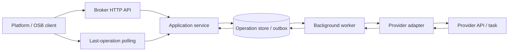

# Đối chiếu yêu cầu OSB với tác vụ nhà cung cấp bằng mã truy vết

## 1. Bài toán truy vết xuyên suốt service broker

Một request tới Spring Cloud Service Broker thường đi qua nhiều thành phần trước khi tài nguyên thực sự sẵn sàng. Nền tảng gửi request theo Open Service Broker API (OSB API); broker xác thực và lưu operation; worker nhận công việc từ queue; provider adapter gọi API của cloud hoặc hệ thống hạ tầng; provider có thể trả kết quả ngay hoặc tạo một tác vụ chạy nền; sau đó broker cập nhật operation để nền tảng polling `last_operation`.

Khi một database không được tạo, một binding bị treo hoặc deprovision chạy quá lâu, chỉ nhìn log của HTTP controller thường không đủ để biết lỗi xảy ra ở đâu. Cần nối được các sự kiện ở các lớp khác nhau thành một hành trình có thể điều tra:



Trong module `SPRING_CLOUD_SERVICE_BROKER`, mã truy vết giúp đối chiếu request OSB với operation nội bộ và tác vụ thực tế ở provider. Bài học tập trung vào cách truyền trace context, lưu correlation qua ranh giới bất đồng bộ và dùng log, trace, metric để tìm đúng bước gây lỗi.

## 2. Phân biệt trace ID, span ID và mã nghiệp vụ

Các hệ thống quan sát thường có nhiều loại ID. Chúng liên quan nhưng không thay thế cho nhau.

| ID | Phạm vi | Mục đích | Vòng đời |
|---|---|---|---|
| `trace_id` | Một distributed trace | Nhóm các span có liên quan trong một hành trình quan sát. | Do tracing SDK tạo hoặc nhận từ trace context hợp lệ; có thể thay đổi khi bắt đầu một trace mới. |
| `span_id` | Một thao tác được instrument | Phân biệt từng bước như nhận HTTP request, truy vấn DB hoặc gọi provider. | Mỗi span có ID riêng. |
| `correlation_id` | Một yêu cầu nghiệp vụ hoặc chuỗi xử lý | Tìm các log/sự kiện liên quan ngay cả khi không có trace được ghi lại. | Broker tạo hoặc tiếp nhận theo quy ước riêng và lưu bền vững. |
| `operation_id` | Một operation OSB bất đồng bộ | Cho phép nền tảng và broker xác định chính xác operation cần polling. | Bền vững qua retry, restart và nhiều replica. |
| `instance_id` | Một service instance | Định danh tài nguyên dịch vụ theo OSB. | Xuyên suốt vòng đời instance. |
| `binding_id` | Một service binding | Định danh quyền truy cập/credential của một consumer. | Xuyên suốt vòng đời binding. |
| `provider_task_id` | Một tác vụ do provider tạo | Tra cứu trạng thái tác vụ ở cloud/provider API. | Theo vòng đời task của provider. |

Không dùng `trace_id` làm khóa chính cho operation hoặc service instance. Trace có thể không được sample, có thể bị thay mới ở ranh giới bất đồng bộ hoặc hết thời gian lưu ở hệ thống tracing. `operation_id` và `instance_id` phải được lưu trong database broker để nghiệp vụ vẫn hoạt động khi tracing backend không khả dụng.

Một request HTTP có thể có một trace ID và nhiều span ID. Provisioning bất đồng bộ có thể bắt đầu từ trace của request, tiếp tục trong worker và phát sinh các trace mới khi polling provider. `operation_id` là khóa nghiệp vụ nối các giai đoạn đó, còn trace context cung cấp quan hệ quan sát giữa chúng.

## 3. W3C Trace Context và header truyền qua HTTP

W3C Trace Context định nghĩa cách truyền ngữ cảnh distributed tracing giữa các thành phần qua HTTP. Header phổ biến nhất là `traceparent`; `tracestate` có thể mang thông tin bổ sung của vendor tracing.

Ví dụ:

```http
traceparent: 00-4bf92f3577b34da6a3ce929d0e0e4736-00f067aa0ba902b7-01
tracestate: vendor=value
```

`traceparent` gồm các phần:

```text
version-trace-id-parent-id-trace-flags
```

- `version`: phiên bản định dạng Trace Context.
- `trace-id`: định danh trace 16 byte, biểu diễn bằng 32 ký tự hex.
- `parent-id`: span ID của thao tác gửi context, biểu diễn bằng 16 ký tự hex.
- `trace-flags`: các cờ, trong đó bit sampled cho biết trace có được đánh dấu lấy mẫu hay không.

Khi broker nhận một HTTP request có trace context hợp lệ, tracing instrumentation có thể tiếp tục trace đó bằng cách tạo server span con. Nếu không có context, broker tạo trace mới. Header không hợp lệ phải được bỏ qua hoặc xử lý theo quy tắc của SDK; không tự phân tích chuỗi tùy ý rồi tin rằng nó hợp lệ.

OSB API chuẩn hóa các endpoint, request/response và header như `X-Broker-API-Version`; nó không bắt buộc mọi platform phải gửi W3C `traceparent`. Vì vậy, trace propagation là khả năng tích hợp quan sát tùy môi trường. Broker cần hoạt động bình thường cả khi platform không gửi trace header.

Không nhầm `traceparent` với `X-Broker-API-Version`, `Authorization` hoặc `X-Correlation-ID`. Chúng có mục đích và quy tắc bảo mật khác nhau.

## 4. Tạo correlation ID nghiệp vụ tại biên OSB

Khi request không có trace context hoặc platform không gửi correlation header riêng, broker vẫn cần một mã nghiệp vụ để tìm request trong log. Có thể tạo `correlation_id` ngẫu nhiên ở HTTP ingress và gắn nó vào request context.

Ví dụ log khi nhận request provision:

```json
{
  "event": "osb.request.received",
  "correlation_id": "corr-7d1f9e5c",
  "trace_id": "4bf92f3577b34da6a3ce929d0e0e4736",
  "span_id": "00f067aa0ba902b7",
  "operation_type": "PROVISION",
  "instance_id": "inst-1001",
  "service_id": "postgresql",
  "plan_id": "isolated"
}
```

Nếu platform gửi một correlation header, chỉ tiếp nhận header đó theo allowlist và giới hạn độ dài/ký tự. Một số hệ thống dùng `X-Request-ID`, `X-Correlation-ID` hoặc header riêng. Broker có thể giữ giá trị nguồn trong trường `upstream_request_id` và tạo `correlation_id` nội bộ riêng để tránh va chạm hoặc giả mạo.

Correlation ID không phải credential và không được dùng để xác thực hoặc phân quyền. Caller có thể tự gửi một giá trị trùng với request khác nhằm làm nhiễu log; do đó cần giới hạn format, ghi nhận nguồn và không dùng nó làm khóa duy nhất cho operation.

## 5. Định danh operation và provider task

Khi broker nhận một thao tác bất đồng bộ, cần tạo một `operation_id` ổn định. Provider có thể trả về một `provider_task_id` riêng. Hai ID này phải được lưu thành quan hệ rõ ràng.

Ví dụ dữ liệu operation:

```json
{
  "operation_id": "op-provision-1001-01",
  "operation_type": "PROVISION",
  "instance_id": "inst-1001",
  "binding_id": null,
  "correlation_id": "corr-7d1f9e5c",
  "trace_context": {
    "traceparent": "00-4bf92f3577b34da6a3ce929d0e0e4736-00f067aa0ba902b7-01",
    "tracestate": "vendor=value"
  },
  "provider": "managed-postgres",
  "provider_task_id": "task-88421",
  "state": "RUNNING",
  "created_at": "2026-11-27T10:00:00Z"
}
```

Đây là schema minh họa. Broker nên lưu thêm version, retry count, lease/worker owner, current step, provider resource ID, thời điểm cập nhật và error code phù hợp với mô hình vận hành.

Quan hệ thường gặp:

```text
OSB request
  └── operation_id
       ├── correlation_id
       ├── originating trace context
       ├── instance_id / binding_id
       └── provider_task_id
            └── provider status / provider resource ID
```

`operation_id` nối nghiệp vụ ở phía broker; `provider_task_id` dùng để gọi API status của provider; trace context nối các span. Không giả định provider hiểu `operation_id` hoặc `trace_id`. Nếu provider hỗ trợ idempotency key hoặc custom metadata, broker có thể truyền operation ID đã được kiểm soát để dễ đối soát.

## 6. Truyền trace context qua worker queue

Ranh giới quan trọng nhất thường là từ HTTP request sang background worker. Thread hoặc process nhận request có thể kết thúc ngay sau khi broker trả `202 Accepted`; worker có thể chạy ở Pod khác hoặc vài phút sau.

Thread-local context không tự tồn tại qua queue hoặc process restart. Broker cần serialize trace context cùng message/outbox event hoặc lưu context trong operation record.

Ví dụ message:

```json
{
  "event_type": "PROVISION_SERVICE_INSTANCE",
  "operation_id": "op-provision-1001-01",
  "instance_id": "inst-1001",
  "correlation_id": "corr-7d1f9e5c",
  "traceparent": "00-4bf92f3577b34da6a3ce929d0e0e4736-00f067aa0ba902b7-01",
  "tracestate": "vendor=value",
  "payload_version": 1
}
```

Trong hệ thống dùng Kafka hoặc RabbitMQ, có thể truyền trace context ở message headers thay vì body. Cách nào cũng cần một contract ổn định và không chứa secret.

Worker lấy message, extract context và tạo consumer span. Nếu operation kéo dài lâu, không nhất thiết giữ một span mở suốt nhiều phút hoặc nhiều giờ. Có thể tạo một trace/span mới cho mỗi lần worker xử lý và gắn `SpanLink` tới context của request khởi tạo. Khi đó trace backend vẫn thể hiện quan hệ giữa request gốc và các lần xử lý, trong khi mỗi span có thời gian tồn tại hợp lý.

Nếu queue redeliver message, worker có thể tạo một span mới cho mỗi lần attempt nhưng vẫn giữ `operation_id` và link về context gốc. `attempt` hoặc `retry_count` giúp phân biệt các lần thử.

## 7. Truyền context từ provider adapter tới API nhà cung cấp

Provider adapter thường gọi API ngoài bằng `WebClient`, `RestClient` hoặc SDK. Nếu provider hỗ trợ W3C Trace Context, broker có thể inject `traceparent` và `tracestate` vào request outbound để trace tiếp tục qua hệ thống provider.

Ví dụ request:

```http
POST /v1/databases HTTP/1.1
Host: api.provider.example
Content-Type: application/json
traceparent: 00-4bf92f3577b34da6a3ce929d0e0e4736-7a085853722dc6d2-01
X-Request-Correlation: op-provision-1001-01

{
  "name": "orders-inst-1001",
  "size": "medium"
}
```

`X-Request-Correlation` trong ví dụ là header tùy chọn do hai hệ thống thống nhất, không phải header OSB hoặc W3C bắt buộc. Không gửi header này nếu provider không hỗ trợ hoặc không có hợp đồng rõ ràng.

Nếu provider không hỗ trợ trace context, broker vẫn ghi span cho outbound HTTP call, đồng thời lưu provider request ID/task ID trả về. Khi cần liên hệ support provider, dùng request ID mà provider cấp cùng operation ID nội bộ và timestamp.

Với Spring Boot có Micrometer Tracing/OpenTelemetry instrumentation, dùng các builder được Spring quản lý như `WebClient.Builder` hoặc `RestClient.Builder` để tận dụng observation và propagation đã cấu hình. Tạo client thủ công ngoài instrumentation có thể khiến outbound span hoặc header propagation không xuất hiện như mong đợi.

## 8. Truy vết provider task bất đồng bộ

Nhiều provider không hoàn tất ngay trong request create. Họ trả task ID hoặc operation URL, sau đó broker phải polling trạng thái provider.

Ví dụ:

```http
POST /v1/databases HTTP/1.1
traceparent: 00-4bf92f3577b34da6a3ce929d0e0e4736-7a085853722dc6d2-01

HTTP/1.1 202 Accepted
Content-Type: application/json

{
  "task_id": "task-88421",
  "status_url": "/v1/tasks/task-88421"
}
```

Broker phải lưu `task-88421` cùng `operation_id`. Worker hoặc scheduled poller dùng provider task ID để truy vấn status. Mỗi lần polling nên tạo span riêng, ghi `operation_id`, `provider_task_id`, `poll_attempt` và kết quả status.

Không tạo một span duy nhất kéo dài suốt thời gian provider xử lý nếu thời gian đó không xác định. Mô hình phù hợp hơn:

- Span request OSB: nhận và xác nhận operation.
- Span enqueue: lưu operation và gửi message.
- Span worker attempt: xử lý một lần công việc.
- Span provider create: gọi API tạo tài nguyên.
- Span provider poll: một lần truy vấn trạng thái task.
- Span finalize: lưu provider resource ID và chuyển operation sang terminal state.
- Span last-operation HTTP: trả kết quả cho platform polling.

Các span được liên kết bằng trace context/links và thuộc cùng operation qua `operation_id`. Mỗi lần platform gọi `last_operation` là một HTTP request riêng; dùng operation ID để tìm cùng operation, không giả định mọi lần polling đều nằm trong một trace ID duy nhất.

## 9. Spring Boot và OpenTelemetry/Micrometer Tracing

Trong Spring Boot hiện đại, Micrometer Observation và Micrometer Tracing có thể tích hợp với tracing bridge/exporter để tạo span, đưa trace ID/span ID vào log context và truyền context qua các HTTP client được instrument.

Một cấu hình khái niệm:

```yaml
management:
  tracing:
    sampling:
      probability: 0.1

logging:
  pattern:
    correlation: "[${spring.application.name:broker},%X{traceId:-},%X{spanId:-}] "
```

Tên property và pattern cụ thể cần khớp phiên bản Spring Boot, Micrometer Tracing và logging backend đang dùng. Sampling probability `0.1` chỉ là ví dụ minh họa tỷ lệ head sampling; không áp dụng máy móc cho mọi môi trường.

Khi dùng Spring MVC/Servlet, instrumentation có thể gắn trace context vào request thread. Với WebFlux/Reactor, context cần đi theo Reactor Context; không tự giữ dữ liệu trong `ThreadLocal` rồi giả định nó tồn tại khi pipeline đổi scheduler.

### 9.1. Tạo span nghiệp vụ cho operation

Ngoài span HTTP tự động, nên tạo span cho các bước nghiệp vụ quan trọng như `osb.provision`, `provider.create_database`, `provider.poll_task` hoặc `osb.finalize_operation`.

Ví dụ pseudocode dùng OpenTelemetry API:

```java
Span span = tracer.spanBuilder("provider.create_database").startSpan();
try (Scope scope = span.makeCurrent()) {
    span.setAttribute("osb.operation_id", operationId);
    span.setAttribute("osb.instance_id", instanceId);
    span.setAttribute("provider.name", providerName);

    ProviderResult result = providerClient.createDatabase(command);
    span.setAttribute("provider.task_id", result.taskId());
    return result;
} catch (RuntimeException ex) {
    span.recordException(ex);
    span.setStatus(StatusCode.ERROR);
    throw ex;
} finally {
    span.end();
}
```

Đây là ví dụ imperative để minh họa span lifecycle. Trong ứng dụng reactive, không giữ `Scope` đồng bộ quanh một publisher chưa được subscribe. Hãy dùng instrumentation/observation hỗ trợ Reactor hoặc tạo span trong operator callback theo context propagation phù hợp. Nếu không, span có thể kết thúc trước khi tác vụ bất đồng bộ thực sự chạy.

### 9.2. Gắn operation ID vào span

Nên dùng span attribute có namespace rõ ràng, ví dụ:

- `osb.operation_id`
- `osb.instance_id`
- `osb.binding_id`
- `osb.operation_type`
- `osb.service_id`
- `osb.plan_id`
- `provider.name`
- `provider.task_id`
- `retry.attempt`

Không đưa password, token, connection URI có credential hoặc toàn bộ request parameters vào span attribute. Trace backend thường cho phép nhiều nhóm người truy cập và retention dài; dữ liệu trace phải được xem là dữ liệu vận hành có kiểm soát.

## 10. Lưu trace context trong operation store và outbox

Khi HTTP request kết thúc, context trong memory biến mất. Để worker tiếp tục tương quan, cần lưu context vào record hoặc outbox event trong cùng transaction với operation.

Ví dụ bảng:

```sql
CREATE TABLE broker_operation (
    operation_id VARCHAR(100) PRIMARY KEY,
    instance_id VARCHAR(100) NOT NULL,
    operation_type VARCHAR(40) NOT NULL,
    state VARCHAR(30) NOT NULL,
    correlation_id VARCHAR(100) NOT NULL,
    traceparent VARCHAR(128),
    tracestate VARCHAR(512),
    provider_task_id VARCHAR(160),
    created_at TIMESTAMP NOT NULL,
    updated_at TIMESTAMP NOT NULL
);
```

Đây là schema ví dụ; cần chọn kiểu dữ liệu, giới hạn độ dài, index và retention theo database thực tế. Không bắt buộc lưu `traceparent` nếu hệ thống chỉ dùng correlation ID, nhưng nếu cần tiếp tục trace qua queue thì phải giữ context cần thiết hoặc tạo span link từ context đã persist.

Transactional outbox giúp lưu operation và event dispatch trong cùng transaction:

1. Tạo operation với `state=PENDING` và `operation_id`.
2. Ghi outbox event chứa operation ID và trace context.
3. Commit transaction.
4. Outbox publisher gửi event vào queue.
5. Worker consume event, extract context và xử lý.

Nếu publish thất bại, outbox publisher có thể retry mà không làm mất operation. Event cần idempotency key để broker không tạo side effect lặp khi queue redeliver.

## 11. Đối chiếu request OSB và tác vụ provider trong log

Structured log giúp tìm kiếm nhanh theo các ID nghiệp vụ. Một event log nên chứa đủ khóa tương quan nhưng không chứa secret.

Ví dụ các log liên quan cùng một operation:

```json
{
  "event": "osb.request.accepted",
  "timestamp": "2026-11-27T10:00:00Z",
  "trace_id": "4bf92f3577b34da6a3ce929d0e0e4736",
  "span_id": "00f067aa0ba902b7",
  "correlation_id": "corr-7d1f9e5c",
  "operation_id": "op-provision-1001-01",
  "instance_id": "inst-1001",
  "operation_type": "PROVISION",
  "http_status": 202
}
```

```json
{
  "event": "provider.task.created",
  "timestamp": "2026-11-27T10:00:02Z",
  "trace_id": "4bf92f3577b34da6a3ce929d0e0e4736",
  "span_id": "7a085853722dc6d2",
  "correlation_id": "corr-7d1f9e5c",
  "operation_id": "op-provision-1001-01",
  "instance_id": "inst-1001",
  "provider": "managed-postgres",
  "provider_task_id": "task-88421"
}
```

```json
{
  "event": "osb.operation.completed",
  "timestamp": "2026-11-27T10:02:45Z",
  "trace_id": "4bf92f3577b34da6a3ce929d0e0e4736",
  "span_id": "b9c7c989f97918e1",
  "correlation_id": "corr-7d1f9e5c",
  "operation_id": "op-provision-1001-01",
  "instance_id": "inst-1001",
  "provider_task_id": "task-88421",
  "state": "SUCCEEDED",
  "duration_ms": 165000
}
```

Trong ví dụ, các span có thể nằm ở cùng trace vì worker đã tiếp tục context ban đầu. Nếu worker tạo trace mới và dùng SpanLink, `trace_id` có thể khác; `operation_id` vẫn nối được ba event. Vì vậy, dashboard vận hành cần tìm kiếm theo `operation_id` và `instance_id`, sau đó mở trace tương ứng nếu có.

## 12. Đo metric mà không tạo cardinality quá cao

Metric trả lời câu hỏi tổng thể: có bao nhiêu operation đang chạy, tỷ lệ lỗi của provider nào, thời gian provision p95 là bao lâu. Metric không phải nơi lưu mọi ID của từng request.

Label phù hợp thường có cardinality thấp:

| Metric | Label phù hợp |
|---|---|
| `osb_operations_total` | `operation_type`, `service_id`, `result` |
| `osb_operation_duration_seconds` | `operation_type`, `service_id`, `plan_tier` |
| `provider_requests_total` | `provider`, `action`, `result` |
| `provider_request_duration_seconds` | `provider`, `action` |
| `osb_operations_in_progress` | `operation_type`, `provider` |
| `osb_operation_retries_total` | `operation_type`, `provider`, `reason` |
| `provider_tasks_pending` | `provider`, `task_state` |

Không dùng `trace_id`, `span_id`, `operation_id`, `instance_id`, `binding_id` hoặc `provider_task_id` làm label metric. Các giá trị này gần như duy nhất theo request và có thể làm time-series tăng không giới hạn. Hãy giữ chúng trong trace/log hoặc kho operation.

Các dashboard hữu ích:

- Số operation `PENDING`/`RUNNING` theo loại và provider.
- Tuổi operation lớn nhất và phân phối thời gian hoàn tất.
- Tỷ lệ provider task timeout, retry và terminal failure.
- Tỷ lệ request OSB trả `202`, `4xx` và `5xx`.
- Queue lag, số lần redelivery và dead-letter count.
- Chênh lệch giữa provider task hoàn tất và operation broker chưa cập nhật.

## 13. Truy vết request polling last_operation

Mỗi lần platform gọi `last_operation` là một HTTP request độc lập. Request có thể đến replica khác và có trace ID mới. Broker cần dùng `operation_id` để đọc cùng record, sau đó ghi span attribute liên quan.

Ví dụ:

```text
HTTP trace A: PUT service_instances/inst-1001
  operation_id = op-provision-1001-01

Worker trace B: provision provider task
  operation_id = op-provision-1001-01
  provider_task_id = task-88421

HTTP trace C: GET last_operation (poll 1)
  operation_id = op-provision-1001-01

HTTP trace D: GET last_operation (poll 2)
  operation_id = op-provision-1001-01
```

Trace A, B, C và D có thể là bốn trace riêng. Nếu B được liên kết với A bằng span link, trace backend có thể hiển thị quan hệ khởi tạo và xử lý. C và D được nối bằng operation ID. Không ép tất cả polling request vào một trace kéo dài chỉ để có cùng trace ID.

Khi xử lý polling, log nên ghi `operation_id`, state, poll count hoặc thời gian operation đã chạy. Không ghi toàn bộ response hoặc mô tả provider có thể chứa dữ liệu nhạy cảm.

## 14. Xử lý lỗi và tìm điểm đứt trong trace

Khi operation thất bại, trace và log cần giúp phân biệt các nhóm lỗi:

| Dấu hiệu | Lớp có thể gây lỗi | Hướng điều tra |
|---|---|---|
| Không có span broker ingress | Request không tới broker hoặc bị gateway chặn. | Kiểm tra DNS, ingress, TLS, firewall và platform log. |
| Ingress span có nhưng không có operation record | Validation, authorization hoặc database transaction lỗi. | Kiểm tra HTTP status, application error và DB span. |
| Có operation nhưng không có worker span | Outbox publisher, queue hoặc consumer lỗi. | Kiểm tra outbox age, queue lag, dead-letter và worker health. |
| Có worker span nhưng không có provider request | Plan resolver hoặc strategy selection lỗi. | Kiểm tra provider mapping và validation. |
| Provider request timeout | Mạng hoặc provider API không phản hồi. | Đối chiếu provider request ID, timeout và retry policy. |
| Provider task thành công nhưng operation còn RUNNING | Callback/poller/finalize step lỗi. | Tra provider task ID và operation state transition. |
| Last operation không tìm thấy record | Sai operation ID, sai tenant scope hoặc retention quá sớm. | Đối chiếu instance ID, operation ID và persistence. |

Một trace bị thiếu span không chứng minh thao tác chưa chạy. Có thể span không được sample, exporter bị lỗi hoặc context không được truyền qua queue. Vì vậy, operation store và structured logs là nguồn đối chiếu bổ sung.

## 15. Sampling và khả năng điều tra

Distributed tracing có thể tạo lượng dữ liệu lớn. Sampling giảm chi phí nhưng đồng nghĩa một số trace không được lưu. Broker nên:

- Dùng sampling phù hợp với lưu lượng và chi phí backend.
- Có thể tăng sampling cho lỗi hoặc request chậm nếu backend hỗ trợ tail sampling.
- Không phụ thuộc trace được sample để xác định trạng thái nghiệp vụ.
- Luôn ghi operation state và correlation ID trong database/audit theo retention policy.
- Ghi structured log cho sự kiện quan trọng như operation accepted, provider task created, retry, terminal state.
- Theo dõi dropped span/exporter errors để biết khi nào dữ liệu quan sát không đầy đủ.

Nếu trace không có trong backend, dùng `operation_id` để tìm record và log. Nếu log cũng thiếu, dùng provider task ID hoặc provider request ID để đối soát với hệ thống bên ngoài.

## 16. Bảo mật trace context và dữ liệu quan sát

Trace context giúp nối các request nhưng không phải dữ liệu xác thực. Một caller có thể gửi `traceparent` tùy ý; broker không được dùng trace ID để cấp quyền, xác định tenant hoặc bỏ qua authentication.

Các nguyên tắc:

- Kiểm tra định dạng và giới hạn độ dài header theo W3C Trace Context/SDK.
- Không tin `tracestate` hoặc baggage từ caller như một nguồn cấu hình bảo mật.
- Không đưa password, token, connection string, SQL parameters nhạy cảm hoặc PII vào span attribute.
- Không log `Authorization`, cookie hoặc binding credentials.
- Chỉ propagate trace context tới provider/host được phép; không forward toàn bộ header inbound một cách mù quáng.
- Nếu dùng correlation header riêng, validate và giới hạn độ dài/ký tự.
- Bảo vệ trace backend và log store bằng RBAC, encryption và retention phù hợp.
- Không cho phép người dùng sửa trace context để truy cập trace của tenant khác; authorization của trace UI phải độc lập.

`tracestate` và baggage có thể chứa thông tin vendor hoặc ứng dụng. Chỉ propagate các field cần thiết, theo allowlist và policy của tổ chức. Tránh dùng baggage cho secret hoặc dữ liệu cá nhân.

## 17. Kiểm thử trace propagation xuyên suốt

Kiểm thử cần chứng minh ID nghiệp vụ được giữ nguyên và trace context được truyền đúng qua các ranh giới.

| Kịch bản | Assertion |
|---|---|
| Request OSB có `traceparent` hợp lệ | Broker tạo server span thuộc trace ID được truyền. |
| Request không có `traceparent` | Broker tạo trace mới và correlation ID nội bộ. |
| `traceparent` không hợp lệ | Không làm request hỏng chỉ vì tracing header; SDK xử lý theo chuẩn và broker tạo context mới nếu cần. |
| Request được tiếp nhận async | Operation record lưu operation ID và context/correlation cần cho worker. |
| Message được consume ở Pod khác | Worker tạo span và liên kết đúng context gốc hoặc SpanLink. |
| Provider hỗ trợ trace context | Outbound request có trace context hợp lệ. |
| Provider trả task ID | `provider_task_id` được lưu cùng `operation_id`. |
| Poll provider | Mỗi lần poll có span riêng, cùng operation ID. |
| Platform polling last operation | Request trace mới vẫn tìm đúng operation record. |
| Worker retry | Mỗi attempt có span riêng nhưng operation ID không đổi. |
| Trace exporter unavailable | Operation vẫn chạy và trạng thái vẫn được persist. |
| Secret redaction | Không có credential trong log, span, baggage hoặc metric. |

Test integration có thể dùng in-memory exporter hoặc test span exporter để kiểm tra trace ID, parent/links và attributes. Với queue, chạy producer và consumer trong test context riêng để chứng minh context không phụ thuộc thread-local.

## 18. Kiểm thử và quan sát với Spring WebFlux

Nhiều ứng dụng Spring Cloud Open Service Broker dùng reactive types như `Mono` và `Flux`. Context propagation cần được xử lý đúng với Reactor.

Các lưu ý:

- Dùng `WebClient.Builder` được Spring Boot cấu hình thay vì tạo client không được instrument.
- Không gọi `.subscribe()` thủ công trong service chỉ để tạo span; giữ publisher trong request/worker pipeline.
- Không dùng `ThreadLocal` làm nơi duy nhất lưu operation ID hoặc trace context qua scheduler boundary.
- Dùng Reactor Context và Micrometer/OpenTelemetry instrumentation tương thích phiên bản.
- Tạo span trong pipeline và kết thúc span khi publisher hoàn tất, lỗi hoặc bị cancel.
- Khi queue là ranh giới process, serialize context vào message/outbox; Reactor Context không tự đi qua broker message.

Ví dụ kiểm thử reactive publisher:

```java
StepVerifier.create(provisioningService.provision(command))
        .expectNextMatches(result -> result.operationId() != null)
        .verifyComplete();
```

Test này xác minh publisher hoàn tất và trả operation ID. Để kiểm tra tracing, kết hợp test exporter và xác minh span được kết thúc, có attribute `osb.operation_id` và không bị mất khi pipeline đổi scheduler.

## 19. Quy trình điều tra một operation bị treo

Giả sử platform báo service instance `inst-1001` vẫn `in progress` sau thời gian dự kiến. Quy trình điều tra:

1. Lấy `instance_id` và `operation_id` từ platform/broker response.
2. Tìm operation record trong broker database, xác minh state, `updated_at`, worker lease và provider task ID.
3. Tìm structured logs theo `operation_id` và `correlation_id`.
4. Mở trace tương ứng nếu có `trace_id`; xem span cuối cùng thành công và span đầu tiên lỗi hoặc bị thiếu.
5. Nếu có `provider_task_id`, gọi provider status API hoặc kiểm tra provider console bằng quyền vận hành phù hợp.
6. Kiểm tra queue lag, dead-letter, retry count và worker heartbeat.
7. Xác định operation có thể resume, cần retry an toàn hay phải chuyển sang manual reconciliation.
8. Cập nhật operation state bằng workflow có audit; không sửa trực tiếp database để ép `SUCCEEDED`.

Không retry provider create chỉ vì trace thiếu span hoặc request timeout. Trước khi thử lại, phải xác minh provider task/resource hiện có để tránh tạo tài nguyên trùng.

## 20. Checklist triển khai

1. Tạo hoặc tiếp nhận trace context hợp lệ ở OSB ingress.
2. Tạo correlation ID nội bộ nếu request chưa có mã tương quan đáng tin cậy.
3. Dùng `operation_id` làm định danh bền vững cho asynchronous operation.
4. Lưu `instance_id`, `binding_id`, provider name và `provider_task_id` khi có.
5. Persist trace context/correlation trong operation hoặc outbox trước khi trả `202`.
6. Truyền context qua message headers/body theo contract đã thống nhất.
7. Tạo worker span hoặc SpanLink khi xử lý asynchronous task.
8. Instrument outbound provider HTTP và lưu provider request/task ID.
9. Tạo span riêng cho từng lần provider polling và platform last-operation request.
10. Ghi structured log có operation ID và trace/span ID, không ghi secret.
11. Dùng metric label có cardinality thấp; không dùng trace/operation/instance ID làm label.
12. Bảo vệ trace context, baggage, log store và trace backend.
13. Kiểm thử propagation qua nhiều replica, queue, retry và exporter outage.
14. Giữ operation history đủ lâu để điều tra ngay cả khi trace bị sample hoặc hết retention.

## 21. Nguyên tắc cần ghi nhớ

- `trace_id` nhóm span quan sát; `span_id` định danh một bước; `operation_id` định danh nghiệp vụ bất đồng bộ; `provider_task_id` định danh tác vụ bên ngoài.
- OSB API không bắt buộc platform gửi `traceparent`; broker phải hoạt động khi trace header không có.
- W3C Trace Context giúp truyền trace qua HTTP; queue boundary cần serialize/extract context hoặc tạo SpanLink.
- Một operation dài không cần giữ một span mở hàng giờ; mỗi worker attempt và provider poll có thể là span riêng.
- Platform `last_operation` request là các HTTP trace riêng, được nối bằng operation ID.
- Trace sampling hoặc exporter outage không được làm mất operation state hay cản trở provisioning.
- Structured logs giữ khóa nghiệp vụ; metrics dùng label cardinality thấp; traces mô tả đường đi từng bước.
- Trace context không phải credential và không được dùng để authorization.
- Không ghi secret hoặc dữ liệu nhạy cảm vào span, baggage, log hay metric.

## Nguồn tham khảo

- [W3C Trace Context](https://www.w3.org/TR/trace-context/): định dạng `traceparent`, `tracestate` và cách truyền context qua hệ thống phân tán.
- [OpenTelemetry – Context propagation](https://opentelemetry.io/docs/concepts/context-propagation/): truyền context qua service và process boundary.
- [OpenTelemetry – Traces](https://opentelemetry.io/docs/concepts/signals/traces/): trace, span, parent-child relationship và span links.
- [OpenTelemetry – Messaging semantic conventions](https://opentelemetry.io/docs/specs/semconv/messaging/): conventions cho producer/consumer và message processing.
- [Spring Boot – Tracing](https://docs.spring.io/spring-boot/reference/actuator/tracing.html): Micrometer Tracing, sampling và log correlation.
- [Open Service Broker API v2.17](https://github.com/openservicebrokerapi/servicebroker/blob/v2.17/spec.md): asynchronous operation và last-operation contract.
